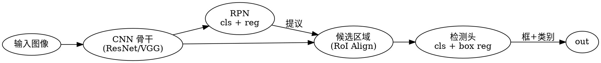

## Introduction

目标检测回答两个问题：**图里有什么、各在哪里**。分类只输出一个类别标签，检测要输出数量不定的「边界框 + 类别 + 置信度」三元组——输出结构从固定长度变成集合，这是它与分类的本质差别，也带来了一整套特有机制：候选区域、先验框、标签分配、非极大值抑制。

检测是 CV 里工程密度最高的任务：安防、工业质检、自动驾驶、机器人抓取都直接消费它的输出。它与 [CNN](/docs/CS/AI/CNN.md) 的分工是：CNN 讲网络怎么搭，本篇讲**检测这个任务怎么解**。指标口径（mAP、AP@0.5:0.95）统一见 [Metrics](/docs/CS/AI/CV/Metrics.md)。

## Two-Stage Detectors

两阶段把问题拆成「先找候选区域、再精修」两步，精度优先。

**R-CNN**（2014）是开山之作：选择性搜索生成约 2000 个候选区域，每个区域分别过 CNN 提特征再过 SVM 分类加框回归。特征不共享，一张图要跑几千次前向，慢到无法实时，且三个模块（提议、分类、回归）分开训练。

**Fast R-CNN**（2015）做了一次关键简化：整张图只过一次 CNN 得到共享特征图，候选区域通过 **RoI Pooling** 从特征图上抠出固定尺寸的特征再进检测头；分类与框回归合成一个多任务损失联合训练。速度提升一个量级，但候选区域仍来自选择性搜索。

**Faster R-CNN**（2015）补上最后一块拼图——**区域建议网络（Region Proposal Network，RPN）**：在共享特征图上滑一个小网络，每个位置同时预测「是/不是物体」的分数和框的偏移，把候选区域生成也变成网络前向。自此检测端到端可训。



RPN 的核心概念是**锚点（anchor）**：每个滑窗位置预设 9 个不同尺度与长宽比的参考框（3 尺度 × 3 比例，如 128/256/512 × 1:1/1:2/2:1），网络学习的是「相对锚点的修正量」而不是绝对坐标。两阶段后来演进到 RoI Align（用双线性插值替代量化的 RoI Pooling，修正特征错位）、FPN 特征金字塔（多尺度检测）。

| 版本 | 候选区域来源 | 特征共享 | VOC 2007 mAP（VGG16） |
| ------ | ------ | ------ | ------ |
| R-CNN | 选择性搜索 | 否，逐区域前向 | 66.0% |
| Fast R-CNN | 选择性搜索 | 是，RoI Pooling | 70.0% |
| Faster R-CNN | RPN 生成 | 是，RoI Pooling | 73.2% |

## One-Stage Detectors

单阶段把检测当**回归问题**：一次前向直接输出所有框，没有显式候选区域，速度优先。

**YOLO**（You Only Look Once，2015）确立了范式：整图划分为 S×S 网格，每格预测固定数量的框及其类别。后续版本各有一条主线：

| 版本 | 年份 | 关键变化 |
| ------ | ------ | ------ |
| YOLOv1 | 2015 | 检测即回归，单次前向出框 |
| YOLOv2 | 2016 | 引入锚点、BatchNorm、多尺度训练 |
| YOLOv3 | 2018 | Darknet-53 骨干，多尺度预测 |
| YOLOv4 | 2020 | CSPDarknet53、Mosaic 增强、 bag-of-freebies 集大成 |
| YOLOv5 | 2020 | Ultralytics 的 PyTorch 重写，工程与导出生态完善 |
| YOLOv8 | 2023 | 无锚化 + 解耦头，统一支持检测/分割/分类/姿态 |
| YOLOv10 | 2024 | 无 NMS 的双重标签分配，端到端推理 |
| YOLO11 | 2024 | Ultralytics 稳定主线，更轻量 |
| YOLO26 | 2026 | 端到端无 NMS 推理、移除 DFL、ProgLoss + STAL + MuSGD 优化器 |

YOLO26（2026-01 发布，论文 arXiv:2606.03748）是当前 Ultralytics 旗舰：检测头去掉 Distribution Focal Loss 与一对多头，可选一对一头的 `nms=False` 端到端路径（默认一对多头仍走 NMS 保精度）；COCO 检测 mAP 40.9–57.5（n→x），T4 TensorRT 延迟 1.7–11.8 ms，Intel Xeon 上 CPU ONNX 推理比 YOLO11n 快最高 43%。注意 Ultralytics 系（v5/v8/v11/v26）是 **AGPL-3.0**，商用有传染性，见 [Deployment](/docs/CS/AI/CV/Deployment.md)。

**SSD**（2016）走多尺度路线：在多个不同分辨率的特征图上分别放置默认框，浅层管小目标、深层管大目标，配 3:1 的难负样本挖掘。SSD300 在 VOC 2007 上约 77% mAP、约 59 FPS。

**RetinaNet**（2017）解决单阶段的精度短板：单阶段每图产生上万候选框，绝大多数是易分负样本，海量简单负样本淹没了损失。**Focal Loss** 给交叉熵加调制因子：

$$
\mathrm{FL}(p_t)=-\left(1-p_t\right)^{\gamma}\log(p_t)
$$

其中 $p_t$ 是模型对真类别的预测概率，$\gamma=2$。易分样本 $(1-p_t)^\gamma$ 趋近 0 自动降权，难样本权重放大——单阶段精度首次追平两阶段（ResNet-101-FPN 在 COCO 上 39.1 AP）。

## Anchor-Free and Label Assignment

锚点框需要手工设计尺度和比例，长尾分布数据上很难调。**Anchor-free** 路线直接预测点或中心：

- **FCOS**：逐像素预测四边距离，加 center-ness 分支抑制低质量预测
- **CenterNet**：把目标表示成中心点热图 + 尺寸偏移的三元组，免去锚点与 NMS 的多数场景

比"有没有锚点"更深的问题的是**标签分配**——正负样本怎么定：

| 策略 | 代表 | 做法 |
| ------ | ------ | ------ |
| 静态阈值 | Faster R-CNN、SSD | 按锚点与真值的 IoU 划正负，简单但次优 |
| 难负样本挖掘 | SSD | 只回传置信度最高的负样本 |
| 动态 k | YOLOX（SimOTA） | 中心先验筛候选，按代价取 top-k 动态分配 |
| 任务对齐 | TOOD（TAL） | 分类分与定位分联合打分 $t=s^{\alpha}u^{\beta}$ |
| 一对一匹配 | DETR 系、RT-DETR、YOLO26 端到端 | 匈牙利匹配，天然免 NMS |

一对一匹配（每真值只配一个预测框）从根本上绕开了 NMS——重复框不再出现；一对多（YOLO26 默认头）仍保留 NMS 换取更高精度。

## Post-Processing and Neck

**非极大值抑制（NMS）**：按置信度排序，取最高分框，抑制与之 IoU 超过阈值（常取 0.5）的框，循环至空。它假设"重复框必然高分重叠"，密集场景与遮挡下会误杀。变体：Soft-NMS 不硬删而是衰减重叠框分数；DIoU-NMS 用中心距离辅助判断。

**特征金字塔（FPN）**：深层特征语义强、分辨率低，浅层反之。FPN 用横向连接 + 自顶向下路径把两者融合，让各尺度都能检测。YOLO 系再加自底向上路径（PANet）补强低层定位信息。

## DETR Family

**DETR**（2020）把检测重构为**集合预测**：一组可学习的 object query 直接经 Transformer 解码器输出全部检测，用匈牙利匹配分配标签，完全去掉锚点与 NMS。代价是收敛慢（需数百 epoch）、小目标差——query 在多尺度特征上一次性展开，细节丢失。

后续改进沿三条线：

- **Deformable DETR**：可变形注意力只在关键采样点附近聚合，多尺度输入，收敛快约 10 倍
- **RT-DETR**（CVPR 2024）：混合编码器解耦单尺度自注意力（AIFI）与跨尺度融合，加 IoU-aware query selection 选高质量初始 query——首个在速度上正面压过 YOLO 的 DETR 系（R50 约 53 AP、T4 上约 108 FPS），且原生无 NMS
- **RT-DETRv2**（2024）：bag-of-freebies——离散采样算子替代 `grid_sample`（消除部署约束）、按特征层定制采样点数、动态增强与尺度自适应超参。RT-DETRv2-S 48.1 mAP（较 R18 +1.6）
- **RT-DETRv4**（2025-11，ECCV 2026，arXiv:2510.25257）：用视觉基础模型蒸馏——以 DINOv3 ViT-B/16-LVD-1689M 为教师增强轻量检测器，不增推理延迟。T4 上 S 49.8 AP/3.66 ms、X 57.0 AP/12.9 ms

解码器层数可调（3–6 层）是 RT-DETR 独有的部署特性：同一份权重按算力改深度即可在 53–74 FPS 间切换，无需重训。

## Practice

```python
from ultralytics import YOLO

model = YOLO("yolo26n.pt")               # 预训练权重（n/s/m/l/x 五档）
results = model("street.jpg")            # 推理：检测/分割/姿态/OBB 统一 API
results = model.predict("img.jpg", nms=False)   # 端到端无 NMS 路径
model.export(format="onnx")              # 导出部署
```

torchvision 侧同样开箱即用：

```python
from torchvision.models.detection import fasterrcnn_resnet50_fpn

detector = fasterrcnn_resnet50_fpn(weights="DEFAULT").eval()
# out: list of dict(boxes, labels, scores)，每图一张
```

## Links

- [CV](/docs/CS/AI/CV.md)
- [CNN](/docs/CS/AI/CNN.md)
- [Segmentation](/docs/CS/AI/CV/Segmentation.md)
- [Metrics](/docs/CS/AI/CV/Metrics.md)
- [Deployment](/docs/CS/AI/CV/Deployment.md)

## References

1. [Rich feature hierarchies for accurate object detection and semantic segmentation (R-CNN)](https://arxiv.org/abs/1311.2524)
2. [Fast R-CNN](https://arxiv.org/abs/1504.08083)
3. [Faster R-CNN: Towards Real-Time Object Detection](https://arxiv.org/abs/1506.01497)
4. [SSD: Single Shot MultiBox Detector](https://arxiv.org/abs/1512.02325)
5. [Focal Loss for Dense Object Detection (RetinaNet)](https://arxiv.org/abs/1708.02002)
6. [You Only Look Once: Unified, Real-Time Object Detection-YOLO](https://pjreddie.com/darknet/yolo/)
7. [End-to-End Object Detection with Transformers (DETR)](https://arxiv.org/abs/2005.12872)
8. [DETRs Beat YOLOs on Real-time Object Detection (RT-DETR)](https://arxiv.org/abs/2304.08069)
9. [RT-DETRv2: Improved Baseline with Bag-of-Freebies](https://arxiv.org/abs/2407.17140)
10. [RT-DETRv4: Painlessly Furthering Real-Time Object Detection with Vision Foundation Models](https://arxiv.org/abs/2510.25257)
11. [Ultralytics YOLO26 文档](https://docs.ultralytics.com/models/yolo26/)
