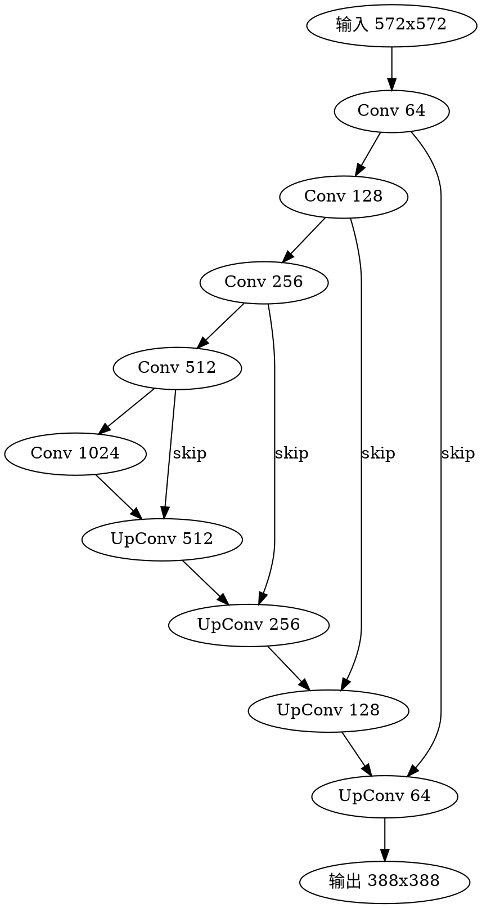

## Introduction

语义分割回答**每个像素属于什么**。分类给一张图一个标签，检测给若干框，分割把预测粒度推到像素级——输出与输入同尺寸的掩码图。它是医学影像（器官/病灶勾画）、自动驾驶（可行驶区域）、图像编辑（抠图/换背景）、遥感（地物分类）的底座。

分割按「是否区分同类个体」分三档：**语义分割**同类不分个体，**实例分割**同类也分开，**全景分割**两者合并（既分 things 也分 stuff）。任务全景见 [CV](/docs/CS/AI/CV.md)，检测机制见 [Detection](/docs/CS/AI/CV/Detection.md)，指标见 [Metrics](/docs/CS/AI/CV/Metrics.md)。

## Semantic Segmentation

**FCN**（2015）把分类网络末尾的全连接层换成卷积，使网络输出空间图而非向量，再上采样回原分辨率，开创全卷积路线。跳跃连接把深层语义与浅层细节融合，直接决定边界质量。

**U-Net**（2015）是 Biomedical 分割的常青结构：对称的编码器-解码器，同层之间用跳跃连接拼接（concat）精细特征。数据量小的医学场景下依然强劲，后续变体（U-Net++、nnU-Net）长居各类分割竞赛榜首。

**DeepLab** 系列用**空洞卷积（atrous convolution）**在不降分辨率的前提下扩大感受野，配合 **ASPP**（Atrous Spatial Pyramid Pooling，多个不同空洞率卷积分支并联）捕获多尺度上下文；后期用深度可分离卷积做轻量化。

## Instance Segmentation

**Mask R-CNN**（2017）在 Faster R-CNN 的每个 RoI 上加一条并行的掩码分支，输出每类一个二值掩码；同时引入 **RoI Align**（双线性插值取特征，修正 RoI Pooling 的量化错位），掩码与框对齐显著改善。它是"检测 + 分割"联合的经典范式，至今是许多系统的精度基线。

实时路线另辟蹊径：**YOLACT** 把掩码生成拆成「原型 + 系数」两步（生成一批原型掩码图，每实例只回归混合系数），一次前向出全部实例掩码，30+ FPS。

## Panoptic and Query-Based

全景分割要求每个像素都有归属：things 区分实例、stuff（天空、道路、草地）只分类别。**Panoptic FPN** 之类做法是语义分支与实例分支共享骨干再合并。

**MaskFormer / Mask2Former**（2022）把分割统一成**掩码分类**问题：用 object query 经 Transformer 解码出 N 个「掩码 + 类别」对，语义、实例、全景三个任务共用同一架构，只是监督方式不同。Mask2Former 加可变形注意力与多尺度策略，是当前通用分割的强基线。

## Foundation Models

**SAM**（Segment Anything，2023）把分割重构成**可提示（promptable）任务**：输入点/框/文本提示，输出对应掩码，无需针对新类别训练。它在 SA-1B（约 1100 万图、11 亿掩码）上预训练，零样本分割能力远超此前的任务专用模型。

| 版本 | 时间 | 关键进展 |
| ------ | ------ | ------ |
| SAM | 2023-04 | 点/框提示，图像域零样本分割 |
| SAM 2 | 2024-07 | 扩展到视频，引入记忆机制跨帧传播掩码 |
| SAM 3 | 2025-11-19 | 提示词概念分割：文本/示例提示，一次找出某概念的全部实例 |
| SAM 3.1 | 2026-03-27 | 对象复用，单次前向跟踪最多 16 个对象，H100 上 16→32 FPS |

SAM 3 内建开放词汇检测器，把「分割」与「检测」合并进同一模型；配套发布 SA-Co 概念分割基准（训练集约 520 万图、400 万名词短语），LVIS 零样本掩码 AP 达 47.0。SAM 3.1 的对象复用（object multiplexing）把视频跟踪吞吐翻倍，见 [Tracking](/docs/CS/AI/CV/Tracking.md)。

工程上 SAM 已成为数据标注流水线的默认工具：先自动预标注，人工只修错误，标注成本降一个量级。

## Metrics

分割不用检测的 mAP：**mIoU**（逐类交并比再平均）是语义分割主指标；**Dice 系数** $\frac{2|A\cap B|}{|A|+|B|}$ 与 IoU 高度相关，医学场景惯用；实例/全景看 mask AP。细节见 [Metrics](/docs/CS/AI/CV/Metrics.md)。

## Links

- [CV](/docs/CS/AI/CV.md)
- [Detection](/docs/CS/AI/CV/Detection.md)
- [Tracking](/docs/CS/AI/CV/Tracking.md)
- [CNN](/docs/CS/AI/CNN.md)
- [Metrics](/docs/CS/AI/CV/Metrics.md)

## References

1. [Fully Convolutional Networks for Semantic Segmentation (FCN)](https://arxiv.org/abs/1411.4038)
2. [U-Net: Convolutional Networks for Biomedical Image Segmentation](https://arxiv.org/abs/1505.04597)
3. [DeepLab: Semantic Image Segmentation with Deep Convolutional Nets, Atrous Convolution, and Fully Connected CRFs](https://arxiv.org/abs/1606.00915)
4. [Mask R-CNN](https://arxiv.org/abs/1703.06870)
5. [YOLACT: Real-time Instance Segmentation](https://arxiv.org/abs/1904.02689)
6. [Masked-attention Mask Transformer for Universal Image Segmentation (Mask2Former)](https://arxiv.org/abs/2112.01527)
7. [Segment Anything](https://arxiv.org/abs/2304.02643)
8. [SAM 2: Segment Anything in Images and Videos](https://arxiv.org/abs/2408.00714)
9. [SAM 3: Segment Anything with Concepts](https://arxiv.org/abs/2511.16719)
10. [SAM 3 文档（Ultralytics）](https://docs.ultralytics.com/models/sam-3/)
