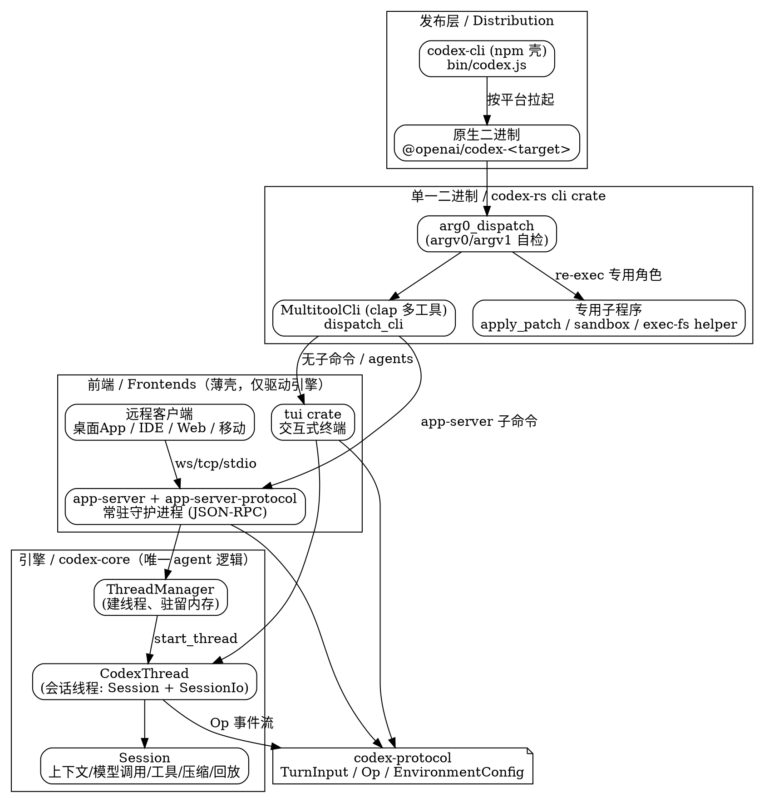

## Introduction

本页从源码层面梳理 Codex v0.167.0 的**总体架构与启动链路**：从一个 `codex` 命令被敲下，到 agent 会话线程被建立并跑起来，中间经过哪几层、各自负责什么。结论先行——Codex 是**三层结构**（壳 → 单一原生二进制 → 单一引擎库 `codex-core`），并配**两个前端**（TUI 与 app-server 守护进程）共用同一份引擎。

> 版本基线：v0.167.0（`E:/Projects/codex-rust-v0.167.0`）

反直觉的三点（详见下文）：

- 你装到的 `codex` 只是下载/拉起原生二进制的**壳**（`codex-cli` 这个 npm 包）。
- 原生二进制是**单一可执行文件多重人格**：靠 `argv0`/`argv1` 自检把自己 re-exec 成 `apply_patch`、沙箱、exec/fs helper。
- TUI 与 app-server 是**同一引擎库 `codex-core` 的两个驾驶舱**，核心逻辑只有一份。

## Layered Architecture



## The Distribution Shell

`codex` 命令的第一跳并不是 Rust 代码本身。`codex-cli` 这个 npm 包（`@openai/codex`）的 `bin/codex.js` 只是一个**下载器与启动器**：它根据 `process.platform`/`process.arch` 算出目标三元组，再映射到对应的平台原生包（如 `@openai/codex-linux-x64`、`@openai/codex-darwin-arm64`、`@openai/codex-win32-x64`），从中找到并 `spawn` 真正的原生可执行文件。

```javascript
const PLATFORM_PACKAGE_BY_TARGET = {
  "x86_64-unknown-linux-musl": "@openai/codex-linux-x64",
  "aarch64-apple-darwin": "@openai/codex-darwin-arm64",
  "x86_64-pc-windows-msvc": "@openai/codex-win32-x64",
  // ...
};
```

含义：用户通过 npm/pnpm 安装的是壳，**真正的逻辑、版本与更新都绑定在那个按平台分发的原生二进制上**。这也是为什么同一份文档对「Codex 是什么语言写的」会给出不同答案——入口是 JS，主体是 Rust。

## The Single Binary, Multiple Personalities

原生二进制由 `codex-rs/cli` crate 编译而成，但它**不只是一个 CLI**：`arg0_dispatch`（来自 `codex-rs/arg0`）在 `main` 最早期读取 `argv0`（可执行文件名）与 `argv1`，按约定把自己切到不同的专用 `main`。这是为了把「沙箱里的子进程」「补丁应用器」等都复用同一个二进制，而不是额外打包小工具。

```rust
pub fn arg0_dispatch() -> Option<Arg0PathEntryGuard> {
    let argv0 = /* 可执行文件名 */;
    if exe_name == CODEX_LINUX_SANDBOX_ARG0 {
        codex_linux_sandbox::run_main();
    } else if exe_name == APPLY_PATCH_ARG0 || exe_name == MISSPELLED_APPLY_PATCH_ARG0 {
        codex_apply_patch::main();
    }
    let argv1 = args.next().unwrap_or_default();
    if argv1 == CODEX_FS_HELPER_ARG1 {
        codex_exec_server::run_fs_helper_main();
    }
    // windows sandbox wrapper / exec helper 同理
}
```

要点：

- `argv0` 决定「我是谁」——`apply_patch`、Linux 沙箱等；`argv1` 决定「我要当哪种辅助进程」——fs helper、exec helper、Windows 沙箱 wrapper 等。
- 这些 re-exec 出来的子程序是**无独立前端、只做一件事**的专用进程，例如把模型产出的 diff 落盘为 `git apply`、在受限环境中跑命令。
- 主流程走不到任何特殊分支时，就落到正常的 `MultitoolCli` 分发（见下）。

## The Multitool CLI Dispatch

`cli` crate 的 `main` 用 clap 定义了一个 **multitool**：顶层 `MultitoolCli` 既接受一组扁平的「交互式选项」（prompt、图片、目录、remote 等），又接受一个可选的子命令。

```rust
struct MultitoolCli {
    #[clap(flatten)]
    pub config_overrides: CliConfigOverrides,
    #[clap(flatten)]
    pub interactive: TuiCli,
    #[clap(subcommand)]
    subcommand: Option<Subcommand>,
}
```

`Subcommand` 枚举里的分支众多，但按「是否进入交互式 agent」可归为两类：

- **进交互式 agent**：无子命令，或 `agents`（会话总览）。两者都走到 `run_interactive_tui`，即拉起 TUI 前端。
- **其它子命令（都是工具/运维/接入）**：`exec`/`review`（非交互式跑模型）、`app-server`（常驻守护）、`mcp`、`plugin`、`sandbox`、`login`/`logout`、`doctor`、`debug`、`responses-api-proxy`、`exec-server`、`stdio-to-uds`、`cloud` 等。

```rust
match subcommand {
    None | Some(Subcommand::Agents(_)) => {
        // 默认 / agents：进入交互式 TUI
        return Ok(Some(launch_tui(interactive, root_remote, root_remote_auth_token_env, arg0_paths)));
    }
    Some(Subcommand::AppServer(app_server_cli)) => {
        // 常驻守护进程
        // transport = Stdio | listen(ws/tcp)
    }
    Some(Subcommand::Exec(mut exec_cli)) => {
        codex_exec::run_main(exec_cli, arg0_paths.clone()).await?;
    }
    // Mcp / Plugin / Sandbox / Login / Debug / ... 各走各的模块
}
```

注意 `interactive` 里有一个 `--remote ws://...|unix://...` 选项：TUI 可以**不本地跑引擎，而是连到一个远程 app-server**，把本地终端当作远程 agent 的「显示器」。这把「前端」与「引擎」的分离彻底坐实了。

## The Engine: codex-core

无论走 TUI 还是 app-server，最终都汇入 `codex-core`（crate 名 `codex-core`）。它是整个 Codex **唯一承载 agent 逻辑的地方**：模型请求、上下文组装、工具执行、沙箱、压缩、回放全在这里。它的对外公开面由两个核心类型领衔：

```rust
pub struct CodexThread {
    pub(crate) session: Arc<Session>,
    pub(crate) io: SessionIo,
    pub(crate) residency_gate: Arc<RwLock<()>>,
    pub(crate) session_source: SessionSource,
    // ...
}

impl CodexThread {
    pub async fn submit(&self, op: Op) -> CodexResult<String> {
        self.io.submit(op).await
    }
    // prewarm / create_child / prepare_child / tool_invocation ...
}
```

注释里这句话点明了它的本质——*「Conduit for the bidirectional stream of messages that compose a thread (formerly called a conversation) in Codex.」* 也就是说：**一条 Thread = 一段双向消息流（用户 `Op` 进、事件 `Op` 出）**，底层包着一个 `Arc<Session>` 和一条 `SessionIo`。

线程怎么来的？由 `ThreadManager` 负责创建并驻留在内存里：

```rust
pub struct NewThread {
    pub thread_id: ThreadId,
    pub thread: Arc<CodexThread>,
    pub session_configured: SessionConfiguredEvent,
}

pub struct ThreadManager {
    state: Arc<ThreadManagerState>,
    // ...
}

impl ThreadManager {
    pub async fn start_thread(&self, options: StartThreadOptions) -> CodexResult<NewThread> {
        // ...
    }
}
```

`ThreadManager` 是「工厂 + 注册表」：`start_thread` 吃一份 `StartThreadOptions`（含 `Config`、动态工具、初始历史、fork 来源等），产出一个 `Arc<CodexThread>` 并把它的 `thread_id` 登记进来，供后续 `submit`、`fork`、`resume` 复用。app-server 里就是这样驱动会话的：

```rust
let codex_core::NewThread { thread, .. } =
    thread_manager.start_thread(codex_core::StartThreadOptions::new(config.clone())).await?;
```

## Two Frontends, One Engine

`codex-core` 之上飘着两个前端，**都只做「把用户/客户端意图翻译成 `Op` 喂给 `CodexThread`，再把流出的 `Op` 渲染/转发」**，自己不含 agent 逻辑。

**TUI（`codex-rs/tui`）**——交互式终端前端。它持有一个 `TurnContext`（每轮上下文）或直接包住 `CodexThread`，把键盘输入、slash 命令、权限确认翻译成 `Op` 提交，再把模型流式输出渲染成聊天界面。源码里随处可见 `AppCommand::OverrideTurnContext { .. }` 与 `AppEvent::CodexOp(Op::...)` 这类「前端命令 ↔ 引擎事件」的对偶。

**App Server（`codex-rs/app-server` + `app-server-protocol`）**——常驻守护进程，把引擎暴露成可供多客户端接入的**远程服务**。它选择传输方式：

```rust
let transport = if stdio {
    codex_app_server::AppServerTransport::Stdio
} else {
    listen   // ws:// 或 tcp 监听
};
```

远程客户端（桌面 App、IDE 插件、Web、移动端）通过 `app-server-protocol` 定义的 JSON-RPC 与之通信；守护进程内部仍然是 `ThreadManager` + `CodexThread`。TUI 也能用 `--remote` 退化成它的纯前端。这就解释了为什么 Codex 既有「一个二进制」的极简发布，又能支撑「桌面 App + CLI + IDE」的多端形态——**引擎一份，驾驶舱按需接**。

## Where the Protocol Lives

`codex-protocol`（crate `codex-protocol`，路径 `codex-rs/protocol`）是横切的**消息与类型层**：它定义了前端与引擎之间、以及 app-server 线格式里流转的语义——`turn_input::TurnInput`、`protocol::EnvironmentConfig`、`mcp_policy`、以及贯穿全文的事件类型 `Op`。`core`、`app-server`、`tui` 都依赖它，所以消息契约只有一份定义、被所有层共享。

## Why This Shape

把上面几点串起来，Codex 之所以长成「壳 + 单二进制 + 单引擎 + 双前端」，是几个约束共同决定的：

- **发布要跨平台且轻**：用 JS 壳按平台拉起原生二进制，避免让用户自己编 Rust；单二进制多重人格又省掉了额外的小工具分发包。
- **能力要被多端复用**：CLI、桌面 App、IDE 都要驱动同一套 agent 逻辑，于是把逻辑压进 `codex-core` 这个库，前端退化为「驾驶舱」。
- **远程接入要成服务**：IDE/桌面需要常驻、可并发、走协议的入口，于是有 app-server 守护进程；TUI 还能反向连它，证明前端与引擎已经解耦。
- **安全边界要独立进程**：沙箱执行、补丁应用被做成 re-exec 出来的专用子程序，让「受限执行」与「主引擎」在进程边界上隔离。

## Links

- [Codex 总览](/docs/CS/AI/Codex/Codex.md)
- [AI 总纲](/docs/CS/AI/AI.md)
- [LLM Agent 理论](/docs/CS/AI/LLM/Agent/Theory/Agent.md)
- [MCP 协议](/docs/CS/AI/LLM/Protocol/MCP.md)

## References

1. [openai/codex 仓库（v0.167.0）](https://github.com/openai/codex/tree/v0.167.0)
2. [codex 二进制入口 cli/src/main.rs](https://github.com/openai/codex/blob/v0.167.0/codex-rs/cli/src/main.rs)
3. [codex-core 线程模型 core/src/codex_thread.rs](https://github.com/openai/codex/blob/v0.167.0/codex-rs/core/src/codex_thread.rs)
4. [arg0 多重人格 arg0/src/lib.rs](https://github.com/openai/codex/blob/v0.167.0/codex-rs/arg0/src/lib.rs)
5. [Codex CLI 官方文档](https://developers.openai.com/codex/cli/)
