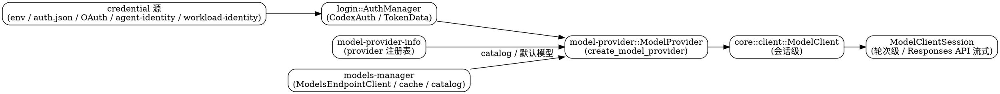

# Codex 认证与模型接入（Auth & Model Access）

## Introduction

Codex 的「模型接入」拆成两条正交的链路：**认证（谁在调）** 与 **模型供给（调哪个、怎么调）**。认证解决 credential 的来源与刷新，模型供给解决 provider 注册、catalog 发现与每次调用的请求装配。两条链路在 `ModelClient` 构造处汇合：认证派生出 HTTP 头，provider 决定 URL / 协议 / 重试。



## 认证层

认证相关 crate 有三个，职责互不重叠：

- **`login`**——面向用户的账户与 credential 管理；
- **`agent-identity`**——Codex 作为「agent」向后端注册身份（ed25519 + JWT/JWKS）；
- **`workload-identity`**——把外部平台颁发的断言（assertion）兑换成 ChatGPT 凭证（OIDC 联邦）。

### login：账户与 credential

`login` crate 暴露 `AuthManager` / `CodexAuth`，是 core 在构造 `ModelProvider` 时传入的认证源。它支持多种登录方式，统一收敛为 `TokenData`：

- **环境变量直读**：`read_codex_access_token_from_env` / `read_openai_api_key_from_env`，对应 `CODEX_ACCESS_TOKEN_ENV_VAR` / `CODEX_API_KEY_ENV_VAR` / `OPENAI_API_KEY_ENV_VAR`；`login_with_api_key` / `login_with_access_token` / `login_with_bedrock_access_keys` / `login_with_bedrock_api_key` 把各类密钥包成认证态。
- **OAuth**：`oauth_session` 提供 `OAuthSessionManager` / `OAuthLoginControl` / `OAuthSessionStatus`（含 `subscribe_oauth_session_status` 订阅状态变更）；`device_code_auth` 实现设备码登录（`request_device_code` / `complete_device_code_login` / `run_device_code_login`）；`pkce` 与 `server`（`LoginServer` / `run_login_server` / `ShutdownHandle`）支撑本地回调，成功后 `success_page`（含 `CODEX_OPEN_APP_URL`）提示回 app。
- **持久化**：`AuthDotJson` / `load_auth_dot_json` / `save_auth` 把凭证落 `auth.json`；`AuthConfig` / `AuthRuntimeConfig` / `AuthManagerConfig` 控制后端（keyring / 文件等，`AuthKeyringBackendKind`）；`AuthCredentialsStoreMode` 决定存储模式。
- **账户路由**：`WorkspaceRouting` / `WorkspaceRoutingResolver` / `WorkspaceRoutingSession` / `WorkspaceRoutingRequest` 把请求按 workspace / 账户路由到不同 provider 与账户（与 model-provider 的 `ACCOUNT_ROUTING_HEADER` 呼应）。
- **恢复**：`UnauthorizedRecovery` / `RefreshTokenError` / `logout_with_revoke` / `REFRESH_TOKEN_URL_OVERRIDE_ENV_VAR` / `REVOKE_TOKEN_URL_OVERRIDE_ENV_VAR` 处理刷新与吊销；`enforce_login_restrictions` 施加登录限制；`is_workload_identity_selected` 在 workload-identity 被选中的分支切换认证策略。

`CLIENT_ID` / `CLIENT_ID_OVERRIDE_ENV_VAR` 允许覆盖 OAuth client id；`AccountOAuthGrant` / `AccountOAuthGrantLease` / `AccountOAuthGrantRevision` 描述 grant 的生命周期。

### agent-identity：机器身份

`agent-identity` crate 让 Codex 进程以非交互方式证明自己是合法 agent，向 `auth.openai.com/api/accounts`（prod）或 `auth.api.openai.org`（staging）注册。`ChatGptEnvironment`（Production / Staging）由 ChatGPT base URL 推导（仅允许 `chatgpt.com` / `chat.openai.com` 及其 backend-api/codex 子路径）。

- 使用 **ed25519 签名密钥**：从 64 字节种子以上下文 `b"codex-agent-identity-ed25519-v1"` 派生 `SigningKey`（`pkcs8` 编解码），公钥用于 JWKS 校验。
- 签发 **JWT**（RS256 经 JWKS：`jsonwebtoken` 的 `decode` / `JwkSet` / `DecodingKey`），固定 `AGENT_IDENTITY_JWT_AUDIENCE = "codex-app-server"`、`AGENT_IDENTITY_JWT_ISSUER = "https://chatgpt.com/codex-backend/agent-identity"`。
- 超时常量：`AGENT_TASK_REGISTRATION_TIMEOUT = 30s`、`AGENT_REGISTRATION_TIMEOUT = 15s`、`AGENT_IDENTITY_JWKS_TIMEOUT = 10s`，断言文件需为绝对路径且 ≤ 16 KiB（与 workload-identity 同约束）。

### workload-identity：断言兑换

`workload-identity` crate 把平台（如 CI / 云）颁发的**文件断言**兑换成 ChatGPT 凭证：

```rust
pub struct WorkloadIdentityConfig {
    pub(crate) assertion_file: PathBuf,   // 必须是绝对路径
    pub(crate) federation_rule_id: String,
    pub(crate) workload_identity_context: Option<String>,
}
```

`WorkloadIdentityExchange` / `WorkloadIdentityToken` 执行兑换；错误 `WorkloadIdentityError` 区分瞬时（`AssertionFile` 的 Interrupted/NotFound/TimedOut/WouldBlock、`ExchangeUnavailable`、408/429/5xx）与终态（空 rule id、非绝对路径、断言 > 16 KiB、`InvalidTokenUrl`）。`AssertionFileMustBeAbsolute` 与 `AssertionTooLarge` 强制本地安全约束。

## 模型供给层

### provider 注册表（model-provider-info）

`model-provider-info` 是编译进二进制的 provider 注册表，用户也可在 `~/.codex/config.toml` 的 `model_providers` 下自定义以覆盖 / 扩展默认值（运行时合并）。内置 provider id 常量：

```rust
pub const OPENAI_PROVIDER_ID: &str = "openai";
pub const CHATGPT_CODEX_BASE_URL: &str = "https://chatgpt.com/backend-api/codex";
pub const AMAZON_BEDROCK_PROVIDER_ID: &str = "amazon-bedrock";
pub const AMAZON_BEDROCK_RUNTIME_PROVIDER_ID: &str = "amazon-bedrock-runtime";
// GCP_PROVIDER_ID 等
```

关键能力元数据：`ModelProviderCapabilities` / `RemoteCompactionSupport`（远端压缩支持）。**驻留（residency）** 是一等约束：进程级 `REQUIREMENTS_RESIDENCY`（`RwLock<Option<ResidencyRequirement>>`）由托管配置 `set_managed_residency_requirement` 设置，请求头 `x-openai-internal-codex-residency`（值 `Us`）。网关 OAuth：`GatewayOAuthConfig` / `GatewayOAuthDelivery` / `OAuthSessionConfig` / `OAuthCredentialsStore`。

### provider 实现（model-provider）

`model-provider` 把注册表项实例化为可执行的 `ModelProvider`：

```rust
pub use provider::ModelProvider;
pub use provider::SharedModelProvider;
pub use provider::create_model_provider;
```

`create_model_provider(provider_info, auth_manager)` 是 core 接入点。它与认证层对接：

- **auth 派生**：`auth::auth_provider_from_auth` / `auth_provider_from_auth_manager` / `auth::ResolvedProviderAuth` / `ProviderAuthScope`，支持 `BearerAuthProvider`（CoreAuthProvider）、`AgentIdentitySessionFallback`（agent-identity 兜底）、`combined_auth::compose_auth`（组合多源）、`runtime_auth::select_runtime_auth` / `validate_runtime_destination` / `validate_runtime_provider` / `validate_runtime_selectors`（运行时 AuthMode 校验）。
- **三大 provider 实现**：`OpenAiModelProvider` / `AmazonBedrockModelProvider`（`amazon_bedrock` 的 region 解析、`is_supported_amazon_bedrock_region` / `is_amazon_bedrock_gov_cloud_region`）/ `GcpModelProvider`（`gcp`）。
- **workspace 路由**：`workspace_routing::ACCOUNT_ROUTING_HEADER` / `ResolvedResponsesProvider` / `ResponsesConnectionKey` / `WorkspaceRoutingContext`，把账户选择注入请求。
- **请求装配**：`request_preparation::prepare_provider_request` 负责最终 URL / 头 / body；`models_endpoint::OpenAiModelsEndpoint` 拉取远端 catalog。
- **默认模型**：memory 抽取默认 `gpt-6-luna`、合并默认 `gpt-6.1-terra`；审批评审默认 `codex-auto-review`（API key 时 `gpt-5.6-luna`）；FEDRAMP 走 `https://gov.api.openai.com/v1`。
- **provider 账户态**：`ProviderAccountState` / `ProviderAccountError`（如 `MissingChatgptAccountDetails` / `UnsupportedBedrockApiKeyAuth`）/ `ProviderUnauthorizedRecovery`（未配置 vs 已恢复）/ `ProviderAuthRecoveryMessages`。

`provider_uses_first_party_auth_path` / `resolve_api_provider` 控制是否走第一方认证路径。

### catalog 与缓存（models-manager）

`models-manager` 负责模型目录的发现、缓存与合并：

- **端点 trait**：`ModelsEndpointClient` 的 `list_models(client_version, http_client_factory) -> ModelsEndpointResponse`，并暴露 `identity()`（区分 provider/principal，用于缓存隔离）、`has_command_auth()`、`uses_codex_backend()`、`supports_api_key_models()`、`has_provider_api_key()`。`for_originator` 按 `ModelCatalogOriginator` 切分端点。
- **缓存**：`ModelsCache` / `FileModelsCache` 落到 `models_cache.json`，`DEFAULT_MODEL_CACHE_TTL = 300s`；`CatalogModel` / `ModelOrigin` / `SelectedCatalog` / `CatalogState` 描述目录合并。
- **预设与协作**：`model_presets` / `collaboration_mode_presets`（`builtin_collaboration_mode_presets`）/ `ModelPreset` / `CollaborationModeMask`；`ModelInfo` / `ModelVisibility` / `ModelsResponse` 是目录项。
- **管理器**：`OpenAiModelsManager` / `StaticModelsManager` / `SharedModelsManager`；`ModelCatalogOriginator` 标记目录来源；`RefreshStrategy` 决定刷新策略。

catalog 缓存按「用户 + 目录相关请求上下文（如国家）」隔离——`ModelProviderInfo` 用 header auth 的 account id 而非完整 auth 头，以缩小缓存键并避免凭证泄漏。

## 接入 core：ModelClient

`core/src/client.rs` 把上述两条链路收口。`ModelClient` 是**会话级**句柄，持有 `SharedModelProvider`，构造时调用 `create_model_provider`：

```rust
let model_provider = create_model_provider(provider_info, auth_manager);
let include_attestation = model_provider.supports_attestation();
// ...
state: Arc::new(ModelClientState { provider: model_provider, /* … */ })
```

- `collect_auth_env_telemetry(model_provider.info(), codex_api_key_env_enabled)` 在构造期采集认证相关环境变量遥测（不落明细）。
- `ModelClientSession` 是**轮次级**流式会话（`new_session()` 每轮新建），负责把历史/工具结果组装成 Responses API 请求并流式消费——即 SessionLoop 笔记中 `try_run_sampling_request` 调用到的采样客户端。
- 多 provider 类型意味着底层 transport（`codex_api` 的 `Provider` / `ApiError` / `TransportError`）对 OpenAI 走 Responses API，对 Bedrock/GCP 走各自协议；auth 头由 `SharedAuthProvider` 注入。

## 与相邻子系统的边界

- **与可观测性**：`ModelClientSession` 构造 WebSocket / SSE 遥测（`build_websocket_telemetry` / `build_streaming_telemetry`），token usage（`TokenUsageRecord`）经 `SessionState` 累积并进入 rollout（见 Observability / Persistence 笔记）。
- **与插件 / 连接器**：provider 选择受 workspace routing 与账户约束，连接器（`connectors.rs`）也复用 `EnvironmentManager` 与同一 `AuthManager`。
- **与 exec-server**：远程执行环境下，`ModelClient` 仍指向后端模型服务，但工具执行经 exec-server 的 JSON-RPC（见 ExecServer 笔记），二者解耦。

## Links

- [Codex 总览](/docs/CS/AI/Codex/Codex.md)
- [Codex 架构](/docs/CS/AI/Codex/Architecture.md)
- [Codex 可观测性](/docs/CS/AI/Codex/Observability.md)
- [Codex 核心会话循环](/docs/CS/AI/Codex/SessionLoop.md)
- [Codex 沙箱](/docs/CS/AI/Codex/Sandbox.md)

## References

- `codex-rust-v0.167.0/codex-rs/login/src/lib.rs`（`AuthManager` / `TokenData` / OAuth / `WorkspaceRouting` / env 变量）
- `codex-rust-v0.167.0/codex-rs/agent-identity/src/lib.rs`（ed25519 / JWT / `ChatGptEnvironment` / JWKS 常量）
- `codex-rust-v0.167.0/codex-rs/workload-identity/src/lib.rs`（`WorkloadIdentityConfig` / 断言兑换 / 错误分类）
- `codex-rust-v0.167.0/codex-rs/model-provider-info/src/lib.rs`（provider 注册表 / residency / 内置 id）
- `codex-rust-v0.167.0/codex-rs/model-provider/src/lib.rs`（`create_model_provider` / auth / workspace routing）
- `codex-rust-v0.167.0/codex-rs/model-provider/src/provider.rs`（`ModelProvider` / `ProviderAccountState` / 默认模型常量）
- `codex-rust-v0.167.0/codex-rs/models-manager/src/manager.rs`（`ModelsEndpointClient` / cache / TTL / catalog）
- `codex-rust-v0.167.0/codex-rs/core/src/client.rs`（`ModelClient` / `ModelClientSession` / `create_model_provider` 接入点）
