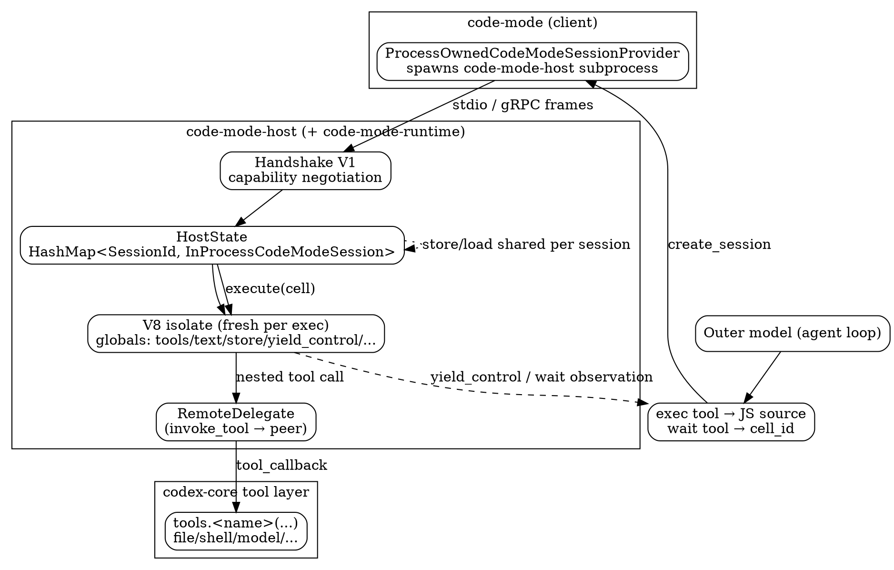

## Introduction

Code Mode 是 Codex 里一个相当特别的机制：它允许 Agent **用 JavaScript 写一段编排逻辑**，这段 JS 在一个 V8 隔离环境里执行，并通过一组全局函数去调用普通的 Codex 工具（文件读写、命令执行、模型调用等）。换句话说，模型不再只是「一次一次地吐工具调用」，而是可以写一小段脚本，**用代码把多个工具调用编排成确定性的工作流**，同时仍能在脚本里随时调用工具。

它解决的痛点很具体：纯靠模型自回归地一步步 tool-calling，遇到「先调 A、拿到结果再决定调 B 还是 C、循环若干次」这类逻辑时既慢又容易跑偏；把这段逻辑写成 JS，模型只需一次性产出正确的脚本，执行与分支判断交给 V8，既快又可控。

整条链路由 5 个 crate 组成：`code-mode-protocol`（线协议）、`code-mode-host`（Rust 宿主）、`code-mode-runtime`（V8 运行时）、`code-mode`（客户端/provider）、`v8-poc`（V8 实验占位）。

## The Two Public Tools

对**外层**模型而言，Code Mode 暴露两个工具：`exec` 与 `wait`（常量定义在 `code-mode-protocol`）：

```rust
pub const PUBLIC_TOOL_NAME: &str = "exec";
pub const WAIT_TOOL_NAME: &str = "wait";
```

`exec` 工具的官方描述把这个机制讲得最清楚：

> Run JavaScript code to orchestrate/compose tool calls
> - Evaluates the provided JavaScript code in a fresh V8 isolate as an async module.
> - All nested tools are available on the global `tools` object, for example `await tools.exec_command(...)`.
> - Nested tool methods take either a string or an object as their input argument.
> - Runs raw JavaScript -- no Node, no file system, no network access, no console.
> - You may optionally start the tool input with a first-line pragma like `// @exec: {"yield_time_ms": 10000, "max_output_tokens": 1000}`.
> - `yield_time_ms` asks `exec` to yield early if the script is still running. Defaults to 10000 ms.
> - `max_output_tokens` sets the token budget for direct `exec` results. Defaults to 10000 tokens.

注意几个硬约束：**每个 `exec` 都是「全新的 V8 隔离环境」里跑一段 async module**；隔离环境里**没有 Node、没有文件系统、没有网络、没有 console**；脚本跑完隔离环境即销毁，未 await 的 promise 被静默丢弃。

`wait` 工具只在 `exec` 返回 `Script running with cell ID ...` 后使用：它按 `cell_id` 观察那个还在跑的 cell，只返回「上次 yield 之后的新输出」，或最终完成/终止结果；`terminate: true` 可以中断该 cell。

## JS Surface in the Isolate

`code-mode-runtime` 在初始化 V8 上下文时，通过 `install_globals` 注入 JS 全局对象，同时**主动删掉一批危险 API**：

```rust
delete_global(scope, global, "console")?;
delete_global(scope, global, "Atomics")?;
delete_global(scope, global, "SharedArrayBuffer")?;
delete_global(scope, global, "WebAssembly")?;
```

注入的全局函数/对象：

| 全局 | 作用 |
| :-- | :-- |
| `tools` | 对象，每个启用的嵌套工具是一个方法，如 `await tools.exec_command(...)` |
| `ALL_TOOLS` | 数组，`{name, description}` 元信息，用于自省 |
| `text(value)` | 追加一个文本输出项（非字符串用 `JSON.stringify`） |
| `image` / `audio` / `generatedImage` | 追加图片 / 音频 / 生成图输出项（base64 `data:` URL） |
| `store(key, value)` / `load(key)` | 在同一 session 的 cell 之间持久化可序列化值 |
| `notify(value)` | 立即把一段 `custom_tool_call_output` 注入当前 `exec` 调用 |
| `setTimeout` / `clearTimeout` | 定时器（pending timeout 不会单独保活 `exec`） |
| `yield_control()` | 把已累积的输出立刻 yield 给模型，脚本本身继续跑 |
| `exit()` | 立即成功结束当前脚本（等价于顶层提前 return） |

「嵌套工具」就是普通的 Codex 工具——脚本里 `await tools.foo(...)` 一次，就等价于外层模型调一次 `foo`。还有 `tools.tool_search({query, limit})` 做 BM25 召回，用于发现那些没进描述、但仍在全局 `tools` 上的「deferred nested tools」。

## Protocol, Host, Runtime

三者的分工是经典的「客户端 / 宿主 / 运行时」：

**`code-mode-protocol`** 定义线协议：

- `host` 模块：`FramedReader`/`FramedWriter` 帧化、`ClientToHost`/`HostToClient` 消息、`HostRequest`（`OpenSession`/`Execute`/`Wait`/`Terminate`/`ShutdownSession`）与 `HostResponse`、握手（`ClientHello`/`HostHello` + 能力协商）、`HandshakeRejectReason`。
- `session` 模块：`CodeModeSession`、`CellId`、`CodeModeSessionDelegate`、`CodeModeSessionProvider`、`CodeModeSessionOptions`。
- `runtime` 模块：`ExecuteRequest`（`tool_call_id` + `source` + `yield_time_ms` + `max_output_tokens`）、`WaitRequest`、`TerminateRequest`、`RuntimeResponse`、`CodeModeNestedToolCall`、`DEFAULT_EXEC_YIELD_TIME_MS` 等。

**`code-mode-host`** 是 Rust 实现的宿主。入口 `run_main`（gRPC 传输）或 `run_stdio`（标准流传输）。`HostState` 维护一张 `HashMap<SessionId, Arc<InProcessCodeModeSession>>`，并施加资源准入：

```rust
const MAX_IN_FLIGHT_REQUESTS: usize = 256;
const MAX_ACTIVE_CELLS: usize = 128;
const MAX_RECENT_REQUEST_IDS: usize = 4096;
const MAX_RECENT_SESSION_IDS: usize = 4096;
```

握手固定协议版本 V1，并对三类能力做协商：`SESSION_RESOURCE_LIMITS_CAPABILITY`、`YIELD_OBSERVATION_CAPABILITY`、`BOUNDED_OUTPUT_CAPABILITY`——客户端要求但宿主不支持的能力会直接 `HandshakeRejected`。处理 `Execute` 时，宿主拿一个 active-cell 许可，构造 `RemoteDelegate`，再 `session.execute(request, delegate, Some(yield_signal))`；工具调用经 `RemoteDelegate` 转回宿主的 peer，最终落回 `codex-core` 的工具层执行。

**`code-mode-runtime`** 提供 `InProcessCodeModeSession`，真正在 V8 隔离环境里跑 JS。`service.rs` 的 `execute` 把请求转给 `SessionRuntime`，用 `ObserveMode::YieldAfter(yield_timeout)` 控制何时把观察结果 yield 出去，并把协议层的 `CodeModeSessionDelegate` 包成 `ProtocolDelegate`（其中的 `invoke_tool` 就是嵌套工具调用出口）。`runtime/` 子目录里还有 `module_loader`（模块加载）、`timers`（定时器）、`value`（值转换）与内联的 `settled.js`（settlement helper）。

## Session, Cell, Delegate

理解 Code Mode 要抓住三个概念：**session / cell / delegate**。

`CodeModeSession` 是「一个 Codex 线程拥有的持久会话」——同一个 session 里先后执行的 cell **共享 `store`/`load` 的值**，不同 session 严格隔离：

```rust
pub trait CodeModeSession: Send + Sync {
    fn execute<'a>(
        &'a self,
        request: ExecuteRequest,
        delegate: Arc<dyn CodeModeSessionDelegate>,
        preempt: Option<CancellationToken>,
    ) -> CodeModeSessionResultFuture<'a, StartedCell>;

    fn wait<'a>(
        &'a self,
        request: WaitRequest,
        preempt: Option<CancellationToken>,
    ) -> CodeModeSessionResultFuture<'a, WaitOutcome>;

    fn terminate<'a>(
        &'a self,
        request: TerminateRequest,
    ) -> CodeModeSessionResultFuture<'a, WaitOutcome>;

    fn shutdown<'a>(&'a self) -> CodeModeSessionResultFuture<'a, ()>;
}
```

一次 `execute` 产出一个 `StartedCell`，cell 有一个 `CellId`。cell 在执行中可以被 `yield_control()` 中途让出控制权（观察累积输出），也可以被 `wait`/`terminate` 观察或终止。

`CodeModeSessionDelegate` 是宿主在每次执行期间持有的回调，把「嵌套工具调用」和「通知」带回 Codex：

```rust
pub trait CodeModeSessionDelegate: Send + Sync {
    fn invoke_tool<'a>(
        &'a self,
        invocation: CodeModeNestedToolCall,
        cancellation_token: CancellationToken,
    ) -> ToolInvocationFuture<'a>;

    fn notify<'a>(
        &'a self,
        call_id: String,
        cell_id: CellId,
        text: String,
        cancellation_token: CancellationToken,
    ) -> NotificationFuture<'a>;

    fn cell_closed(&self, cell_id: &CellId);
}
```

`NoopCodeModeSessionDelegate` 则是给「不需要嵌套工具/通知」的客户端用的占位实现——它的 `invoke_tool` 直接 `cancellation_token.cancelled().await; Err(...)`，即永不真正执行工具。

## Providers (Client Side)

`code-mode` crate 是客户端，提供 `CodeModeSessionProvider` 的几种实现：

- `ProcessOwnedCodeModeSessionProvider`：懒启动一个**宿主子进程**（通过 `InstallContext::current().code_mode_host_program()` 找到 `code-mode-host` 二进制），把 V8 执行放到独立进程里，client 与其标准流帧化通信。这是本地默认路径，把 V8 故障/崩溃隔离在子进程，不拖垮主引擎。
- `GrpcCodeModeSessionProvider`：走 gRPC 连接远端宿主。
- `DisabledCodeModeSessionProvider`：特性未启用时直接拒绝创建会话。

会话还有输出截断模式（`CodeModeOutputTruncation::{Client, Server}`）：`Client` 由调用方自己裁 budget，`Server` 由宿主在传输前按 token 预算截断（默认 10,000 token，文本溢出保留前缀+滚动尾部，图片/音频按字节额度准入、不可分割）。资源限制 `CodeModeSessionCellExecutionLimits` 含 `max_yield_time_ms` 与 `max_heap_size_bytes`。



## Links

- [Codex Architecture](/docs/CS/AI/Codex/Codex.md?id=architecture)
- [Codex 核心会话循环](/docs/CS/AI/Codex/SessionLoop.md)
- [Codex Sandbox](/docs/CS/AI/Codex/Sandbox.md)
- [Codex 多 Agent](/docs/CS/AI/Codex/MultiAgent.md)
- [LLM Agent 理论](/docs/CS/AI/LLM/Agent/Theory/Agent.md)
- [MCP 协议](/docs/CS/AI/LLM/Protocol/MCP.md)

## References

1. [openai/codex（v0.167.0）](https://github.com/openai/codex/tree/v0.167.0)
2. [Codex Code Mode 文档](https://developers.openai.com/codex/)
