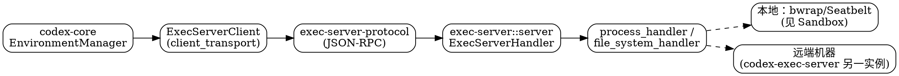

# Codex exec-server 与远程执行（Exec Server & Remote Execution）

## Introduction

`codex-exec-server` 是一个**独立二进制服务**，把「进程执行 / 文件系统 / 环境信息 / 能力发现 / HTTP 代理」封装成一组 **JSON-RPC 方法**，通过 WebSocket / stdio / Noise 中继三种传输暴露给 Codex 引擎。它既是**远程执行**的边界（把工具调用发到远端机器跑），也是**本地跨环境文件访问**的边界（fs-helper 模式）。与 Sandbox 笔记里「本地 bwrap/Seatbelt 隔离」不同，exec-server 关心的是**进程边界之外的执行环境**——无论是另一台机器，还是当前被沙箱隔离、需要受控文件访问的环境。

三个 crate 分工：

- **`exec-server-protocol`**——线协议：JSON-RPC 方法名、`InitializeParams`、各类请求/响应、`ProcessId`、`ByteChunk`（base64 载荷）。
- **`exec-server`**——server 端（处理器 + 传输）与 client 端（`ExecServerClient` + 各传输）同处一 crate。
- **`exec-server-cli`**——命令行入口（`ExecServerCommand`），负责 arg0 分发、配置、认证、启动。



## 线协议（exec-server-protocol）

所有方法定义在 `protocol.rs`，由 `exec-server-protocol` 导出。核心方法分四类：

**进程生命周期**（类 LSP / `process/*`）：

```rust
pub const EXEC_METHOD: &str = "process/start";
pub const EXEC_READ_METHOD: &str = "process/read";
pub const EXEC_WRITE_METHOD: &str = "process/write";
pub const EXEC_SIGNAL_METHOD: &str = "process/signal";
pub const EXEC_TERMINATE_METHOD: &str = "process/terminate";
pub const EXEC_OUTPUT_DELTA_METHOD: &str = "process/output";
pub const EXEC_EXITED_METHOD: &str = "process/exited";
pub const EXEC_CLOSED_METHOD: &str = "process/closed";
```

请求端 `process/start` 启动进程，`process/read` / `write` / `signal` / `terminate` 操作句柄；服务端以通知 `process/output`（增量）、`process/exited`、`process/closed` 回推。

**环境信息**：`environment/info` / `environment/status`——上报 executor 侧的 OS、能力、状态。

**文件系统**（`fs/*`）：`fs/readFile` / `fs/open` / `fs/readBlock` / `fs/writeBlock` / `fs/writeFile` / `fs/createDirectory` / `fs/getMetadata` / `fs/watchMissing` / `fs/missingChanged` / `fs/canonicalize` / `fs/readDirectory` / `fs/walk` / `fs/remove` / `fs/copy`。块读写为 `FILE_READ_CHUNK_SIZE` / `FILE_WRITE_CHUNK_SIZE`，支持大文件流式。`WalkOptions` / `WalkOutcome` 来自 `codex_file_system`。

**能力发现与 HTTP**：`capabilityRoots/discoverV1`（在选中的根下发现能力清单，`DISCOVERABLE_PLUGIN_MANIFEST_PATHS = [".codex-plugin/plugin.json", ".claude-plugin/plugin.json", ".cursor-plugin/plugin.json"]`）；`http/request` + `http/request/bodyDelta`（executor 侧代发 HTTP，单帧 `MAX_HTTP_BODY_DELTA_BYTES = 1 MiB`）。

**载荷**：`ByteChunk(Arc<Vec<u8>>)` 以 base64 透明编码；`InitializeParams { client_name, resume_session_id }` 在握手 `initialize` / `initialized` 时交换。

## 服务端（exec-server）

`exec-server/src/server.rs` 是入口：`run_main(listen_url, runtime_paths, http_client_factory)` → `run_main_with_telemetry` → `transport::run_transport`。请求分发链为 `ConnectionProcessor` → `request_dispatcher`（按 `RequestDispatchMode` 决定串/并）→ `ExecServerHandler` → `handler::file_system_handler` / `process_handler` / `registry` / `session_registry`。

- **传输**：`DEFAULT_LISTEN_URL` 默认 `ws://`<br>支持 `ws://IP:PORT`（默认）、`stdio` / `stdio://`、以及 `--remote` 注册到远端时的 Noise 传输。`WebsocketAuthSettings` 控制 WS 握手鉴权。
- **并发**：`RequestDispatchMode`（Inline 默认 / 并发上限）+ `ConcurrentRequestLimit`；CLI `--concurrent-requests` 设每连接并发请求数（默认 1）。
- **身份**：`build_identity::PROVIDER_ID` 在启动时 `LazyLock::force`，作为 executor 的 provider 标识。

`server` 子模块还包含 OTel 接入（`process_otel_tests` 验证根 span `codex.exec_server`）。

## 客户端与传输（exec-server client）

`ExecServerClient` 是 core 侧代理。连接路径在 `client_transport.rs`：

- `connect_websocket_request` 用 `WebSocketConnector` 建立 WS（可 `use_loopback_direct` 直连 loopback）；超时按 `DEFAULT_REMOTE_EXEC_SERVER_CONNECT_TIMEOUT` / `DEFAULT_REMOTE_EXEC_SERVER_INITIALIZE_TIMEOUT` / `PROVISIONED_ENVIRONMENT_CONNECT_TIMEOUT = 5min`。
- **stdio 传输**：`StdioExecServerConnectArgs` + `StdioExecServerCommand`，把 executor 作为子进程以 stdio 通信（本地隔离场景）。
- **Noise 中继**：`NoiseRendezvousConnectArgs` / `NoiseRendezvousConnectBundle` / `NoiseRendezvousConnectProvider`、`noise_relay::noise_harness_connection_from_websocket_with_readiness`——经 Noise 加密中继建立连接，`NoiseChannelIdentity` 标识信道身份。
- 重连/恢复：`client_recovery` / `client_refresh` / `client_inbound_request_limit`（入站限流）/ `client_telemetry`；`is_environment_offline_error` / `is_retryable_registry_error` / `registry_recovery_retry_delay` 控重试；`INITIAL_REGISTRY_MAX_RETRIES = 4`。
- `JsonRpcConnection` / `JsonRpcConnectionEvent` 是底层的 JSON-RPC 帧；`forward` / `remote_file_system` / `remote_process` 把协议方法映射成文件/进程操作接口。

## 远程注册与认证

`exec-server-cli/src/command.rs` 的 `ExecServerCommand` 定义了「把本机作为远程环境注册」的形态：

- `--remote <URL> --environment-id <ID> --name <NAME>`：以远程环境身份向 registry 注册（需 `environment_id`）。
- **传输**：`--remote-transport`（默认 `Noise`；`direct` 需配 `--aws-sigv4`）。
- **认证三选一**：`--use-agent-identity-auth`（用 `CODEX_ACCESS_TOKEN` 的 agent-identity 签算）、`--aws-sigv4`（AWS SigV4 签 Direct 注册与 WS 握手）、`--executor-credential-stdin`（从 stdin 读轮换 executor 凭证，管道关闭即退出，`CODEX_EXEC_SERVER_EXIT_ON_STDIN_CLOSE`）。
- **沙箱细节**：`--linux-sandbox-pid-namespace`（默认 `isolate`，允许信号隔离；`inherit` 仅限专用环境）、`--proxy-private-ips-via-upstream`（私有 IP 走上游代理）、`--strict-config`（未知配置字段报错）。

`exec_server_auth` / `exec_server_credential` / `exec_server_telemetry` 分别处理认证参数、凭证管道与遥测。`arg0_exec_helper`（`CODEX_ARG0_EXEC_HELPER_ARG1`）与 `fs_helper_main` / `fs_sandbox` 是 arg0 分发下的 fs-helper 模式——即 executor 被本地以 re-exec 方式拉起，专门做受控文件访问。

## 能力发现

executor 本地文件系统可发现能力清单：`capability_discovery::discover_capability_roots` 在选中根递归发现；`ExecutorCapabilityDiscoveryCache` / `ExecutorCapabilityDiscoveryV2Cache` 缓存结果；`ExecutorCapabilityDiscoverySnapshot` 通过协议回传。这支撑了插件/技能在远端环境的可见性（与 PluginSystem 笔记的可发现插件呼应）。

## 与 codex-core 的集成

core 通过 `codex_exec_server::EnvironmentManager` 统一两类执行环境：

- `environment_selection.rs`（`select_thread_environment` 之类）依据配置/能力在**本地沙箱**与**远程 exec-server 环境**之间择一；`EnvironmentManager::from_codex_home` 把 codex_home 下的远程环境配置加载进来。
- `connectors.rs` 也持有 `Arc<EnvironmentManager>`，使连接器复用同一套远程环境解析。
- `codex_exec_server` 导出的 `RemoteFile` / `RemoteProcess` / `remote_file_system` / `ExecutorFileSystem` 是「执行环境无关」的文件系统抽象；本地走 `local_file_system` + `local_process`，远端走 JSON-RPC。
- 网络策略：远端执行的网络同样受 `network_policy_decisions` + `ManagedNetworkSandboxContext` 约束，与本地沙箱的网络代理（见 Sandbox 笔记的 `network-proxy`）同源。

**与本地沙箱的关键区别**：本地沙箱（bwrap/Seatbelt/MXC）是「在同一 OS 内隔离当前进程的执行」，exec-server 是「把执行移到进程边界之外——另一台机器或另一个受控文件空间」。二者可叠加：远端 executor 本身也可再套本地沙箱。

## Links

- [Codex 总览](/docs/CS/AI/Codex/Codex.md)
- [Codex 沙箱](/docs/CS/AI/Codex/Sandbox.md)
- [Codex 架构](/docs/CS/AI/Codex/Codex.md?id=architecture)
- [Codex 插件系统](/docs/CS/AI/Codex/PluginSystem.md)
- [Codex 可观测性](/docs/CS/AI/Codex/Observability.md)

## References

- `codex-rust-v0.167.0/codex-rs/exec-server-protocol/src/protocol.rs`（JSON-RPC 方法常量 / `InitializeParams` / `ByteChunk`）
- `codex-rust-v0.167.0/codex-rs/exec-server/src/lib.rs`（`ExecServerClient` / `EnvironmentManager` 相关导出 / 子模块清单）
- `codex-rust-v0.167.0/codex-rs/exec-server/src/server.rs`（`run_main` / `transport` / `ExecServerHandler`）
- `codex-rust-v0.167.0/codex-rs/exec-server/src/client_transport.rs`（`connect_websocket_request` / 超时常量 / 重试）
- `codex-rust-v0.167.0/codex-rs/exec-server-cli/src/command.rs`（`ExecServerCommand` / `--remote` / 认证三选一 / 沙箱标志）
- `codex-rust-v0.167.0/codex-rs/exec-server-cli/src/lib.rs`（`run_standalone` / arg0 分发）
- `codex-rust-v0.167.0/codex-rs/core/src/environment_selection.rs`（`EnvironmentManager` 择环境）
