# Codex 记忆与上下文管理

Codex 的「记忆」与「上下文」是两条既独立又咬合的链路：记忆是**跨会话持久化的经验库**（磁盘上的 `memories/` 目录 + 状态库里的抽取/合并任务），上下文是**每个 turn 临时组装的模型输入**（由几十个 `ContextualUserFragment` 片段拼成）。两者通过一个 `MemoryContextFragment` 桥接——写入阶段产出的记忆，在读取阶段被切成带上限的 developer 片段注入模型上下文。

## 一、记忆系统（`memories` crate + `ext/memories`）

### 1.1 存储布局

记忆根目录在 `codex_home` 下：

```rust
pub fn memory_root(codex_home: &AbsolutePathBuf) -> AbsolutePathBuf {
    codex_home.join("memories")
}
```

子目录由 `artifacts` 常量定义：

- `raw_memories.md` —— Phase 1 抽取的「原始记忆」聚合文件（V1 使用）。
- `rollout_summaries/` —— 每条已处理 rollout 的摘要，按 `rollout_summary_file_stem` 命名。
- `extensions/` —— 记忆扩展源，每个扩展放一个 `instructions.md`，告诉合并智能体如何解读该来源。

`ensure_layout` 会拒绝符号链接根，并清掉内存目录里的符号链接，防止通过 symlink 逃逸沙箱。

### 1.2 两阶段写入流水线（启动时异步跑）

记忆**不在对话中实时写**，而是在启动时由 `start_memories_startup_task` 拉起一个异步流水线，分两个阶段：

**Phase 1 —— 抽取（extraction）**

`phase1::run` 严格按序执行：

1. `claim_stage1_jobs_for_startup` 从状态库认领符合条件的 rollout 任务（限定 `INTERACTIVE_SESSION_SOURCES`，扫描上限 `THREAD_SCAN_LIMIT = 5000`，按 `max_rollout_age_days` / `min_rollout_idle_hours` 过滤，租约 1 小时）。
2. 对每个认领的 rollout 并行采样（并发 `CONCURRENCY_LIMIT = 8`）：读取最近 rollout 条目，按 `MemoryVersion` 序列化（V1 直接 JSON，V2 走 `serialize_tiered_input` 分层），套用 `stage_one_system.md` 系统提示，用 `REASONING_EFFORT = Low` 抽取。
3. 输出 `StageOneOutput { raw_memory, rollout_summary, rollout_slug }`，写回状态库。

关键约束：phase-1 输入只占模型可用窗口的 70%（`CONTEXT_WINDOW_PERCENT = 70`），兜底 `DEFAULT_ROLLOUT_TOKEN_LIMIT = 150_000`；序列化前会 `redact_secrets` 脱敏，并丢弃 `Compacted`/`TokenUsageRecord`/`SecurityRiskScore` 等内部条目，只保留 `environment_context` 与环境类内容。

**Phase 2 —— 合并（consolidation）**

`phase2::run` 把零散的 raw memory 合并成稳定知识：

1. `try_claim_global_phase2_job` 抢全局 Phase-2 锁（保证单机只跑一个合并智能体）。
2. `prepare_memory_workspace` 在记忆根建一个 **git 基线仓库**；`MemoryWorkspaceLock` 防并发。
3. `sync_rollout_summaries_from_memories` 把当前 Phase-1 输入同步进工作区，再用 git `memory_workspace_diff` 判断「自上次合并以来到底变了没」。
4. 若无变化直接 succeed 退出；否则 `write_workspace_diff` 落盘 diff，`spawn_consolidation_agent` 拉起一个**受沙箱约束的合并智能体**（用 `build_consolidation_prompt` 提示词去改 `raw_memories.md`），完成后 `reset_memory_workspace_baseline` 更新基线并推进 `watermark`。

合并智能体本身也走审批/沙箱（见 [Codex Sandbox](/docs/CS/AI/Codex/Sandbox.md)），且 `parent_permission_profile` 被收紧，避免记忆写入越权。

### 1.3 读取路径注入（`ext/memories` 扩展）

读取与写入彻底解耦：`memories/read` 不依赖写入流水线，真正注入上下文的是 `ext/memories/src/extension.rs` 的 `MemoriesExtension`，它实现 `ContextContributor`：

```rust
impl ContextContributor for MemoriesExtension {
    fn contribute_thread_context<'a>(...) -> ... {
        // config.features.enabled(Feature::MemoryTool) && config.memories.use_memories
        let Some(instructions) =
            build_memory_tool_developer_instructions(&config.codex_home, config.version).await
        else { return Vec::new(); };
        // V2 把完整摘要按 8900 字符切片，每段单独一个片段（各自遵守字节上限）
        let mut remaining = instructions.as_str();
        while !remaining.is_empty() {
            let end = remaining.floor_char_boundary(remaining.len().min(8_900));
            fragments.push(
                MemoryContextFragment::ReadInstructions(remaining[..end].to_string())
                    .render().into_text().unwrap_or_default());
            remaining = &remaining[end..];
        }
        fragments.into_iter()
            .map(|instructions| PromptFragment::developer_policy(
                instructions,
                ContentItemKind(MemoryContextFragment::READ_INSTRUCTIONS_KIND.to_string())))
            .collect()
    }
}
```

也就是说：记忆在 turn 上下文里以 **developer-policy 片段** 形式出现，V2 还会把长摘要切成多个 ≤8900 字符的块以防撑爆上下文。若开启 `dedicated_tools`，扩展还会额外注册一组记忆读写工具（`tools::memory_tools`）。

桥接类型是 `core/src/context/memory.rs` 里的 `MemoryContextFragment`：

```rust
pub enum MemoryContextFragment {
    ReadInstructions(String),   // role = "developer"
    ExtractionEvidence(String), // role = "user"
}
// 两者 body 都经 truncate_text(text, TruncationPolicy::Bytes(8_900)) 截断
```

### 1.4 记忆边界

- 读取与写入是**两个独立 crate**：`memories/read`（读，注入上下文、解析引用、遥测分类）和 `memories/write`（写，启动流水线、文件工件、阶段提示、git 工作区）；`ext/memories` 只做「读时注入」。
- 所有模型可见记忆文本都强制 `TruncationPolicy::Bytes(8_900)` 上限；扩展指令同样切片。
- `MemoryWorkspaceLock` + git 基线保证合并幂等，不会因重复启动而重复写。

## 二、上下文片段模型（`context-fragments` crate）

所有注入模型输入的内容都实现同一个 trait `ContextualUserFragment`：

```rust
pub trait ContextualUserFragment {
    fn role(&self) -> &'static str;
    fn content_kind(&self) -> ContentItemKind;       // "<feature>.<name>" 稳定分类
    fn markers(&self) -> (&'static str, &'static str); // 起止标记，用于回流识别
    fn body(&self) -> ContentItem;

    fn render(&self) -> ContentItem { /* 把 body 包进 markers */ }
    fn render_fragment(&self) -> RenderedFragment {
        RenderedFragment::new(self.role(), AnnotatedContent::from_parts(
            self.render(), self.content_kind(), self.content_metadata()))
    }
}
```

要点：

- **`RenderedFragment { role, content: AnnotatedContent }`** 是片段的归一化形态——`role` + 内容。`AnnotatedContent` 同时携带 `ContentItemKind`（分类，如 `memories.instructions`）和 `ContentItemMetadata`（归属，默认 `harness()`，即「系统注入」而非用户消息）。
- **`markers`** 让片段在模型输出里带显式起止标签（`render` 把 `body` 包进 `start_marker…end_marker`），后续 `matches_marked_text` 能据此**反向识别**哪段文本是当初注入的上下文，实现 round-trip 归因。未标记的片段 markers 留空、永不误匹配。
- **`AttributedFragment<F>`** 在片段外套一层生产者归属，确保「归属在产生时绑定，绝不靠渲染文本推断」。

`context-fragments` 还提供 `AnsweredQuestion`、`ContextualUserFragment`、`RecapPrompt`、`AdditionalContext*`（developer/user/tool-output）等复用类型，以及 `truncate_annotated_text` 等截断工具。

## 三、上下文装配（`core/src/context` + `session`）

### 3.1 片段生成器

`core/src/context/` 下约 90 个模块，每个生成一类片段：基础指令、开发者指令、模型指令、用户指令、`MemoryContextFragment`、`CompactionSummary`、`TokenBudgetContext`、`CurrentTimeReminder`、Guardian 系列（`GuardianPolicy`/`GuardianRetainedInstructions`/`GuardianConversationHistory`…）、多 Agent 指令、插件/应用指令、实时（realtime）指令、世界状态（world_state）等。`world_state` 子模块是**持久化上下文层**，把 AGENTS.md、环境、权限、已装插件、模型目录、协作模式等编译成 `WorldStateUpdate`（带 `Placement` 策略）供装配消费。

### 3.2 装配入口 `build_initial_context_with_world_state`

每个 turn 的模型输入由 `Session::build_initial_context_with_world_state` 组装，产出 `(Vec<WorldStateUpdate>, WorldStateSnapshot)`。它分桶收集：

```rust
let mut developer_sections = Vec::<RenderedFragment>::with_capacity(8);
let mut contextual_user_sections = Vec::<RenderedFragment>::with_capacity(2);
let mut separate_developer_messages = Vec::<ResponseItem>::new();
let mut context_window_hints = Vec::new();
```

流程：

1. 先放 `DeveloperInstructions`（基础开发者指令），但 Guardian 子会话会把它单独成消息以隔离策略提示。
2. 遍历扩展的 `context_contributors`：`contribute_thread_context` 产出的片段按 `PromptSlot` 落桶——`ContextWindow` 进 hint，`DeveloperPolicy`/`DeveloperCapabilities` 进 `developer_sections`；`contribute_turn_context` 产出也进 `developer_sections`。
3. 若启用 `Feature::TokenBudget`，追加 `TokenBudgetContext`（携带 window id、上下文窗口提示）。
4. `world_state.render_full()` 渲染持久化上下文，`split_prefix_updates` 拆出「前缀」与「上下文」两部分。
5. 最后按 **role + markers** 路由每个片段：模型切换指令（`ModelSwitchInstructions`）必须插到 developer 段最前；多 Agent 模式、受管开发者指令、角色指令各自归位；普通 developer 片段进 `developer_sections`，user 片段进 `contextual_user_sections`，带 `Placement::Standalone` 且无标记的 developer 片段单独成消息。

这就是记忆（`MemoryContextFragment::ReadInstructions` 作为 developer 片段）、Guardian、world_state、扩展贡献者被统一拼进同一窗口的地方。

### 3.3 每步快照 `capture_step_context`

`Session::capture_step_context` 在**每个采样步**前跑（对应会话循环里的 `capture_step_context`，见 [Codex 核心会话循环](/docs/CS/AI/Codex/SessionLoop.md)）。它产出 `Arc<StepContext>`，内容包含：

- 解析并刷新当前步的模型与 `environments`（子 Agent 继承根 service tier）。
- `load_agents_md`：加载/刷新 `AGENTS.md` 指令。
- `prepare_tools`：解析能力根、MCP 能力发现、准备插件、拉起扩展的 `prepare_for_step`（MCP/插件/技能工具在此装配），并准备工具推荐。
- 解析 `token_budget`、会话遥测、Web 搜索模式、模型消息/笔记等扩展数据。

`StepContext` 是「这一步喂给采样请求的全部环境快照」，与 `build_initial_context` 互补：后者拼**内容**，前者备**工具与环境**。

## 四、上下文管理器（`core/src/context_manager`）

`context_manager/history.rs` 的 `ContextManager` 持有线程历史与宿主事实：

```rust
pub(crate) struct ContextManager {
    items: Arc<Vec<ResponseItemEnvelope>>,         // 历史，最旧在前
    review_history: Option<TranscriptHistory>,      // 旧版审查兼容
    retained_context: Arc<RetainedContext>,         // 与模型窗口无关的宿主事实
    guardian_review_mode: GuardianContextMode,
    retain_inherited_user_messages: bool,
    history_version: u64,                           // 重写（压缩/回滚）时自增
    reset_version: u64,
    user_message_revision: u64,
    guardian_review_context_revision: u64,
    // ...
}
```

设计要点：

- **快照共享不可变状态**：`items` / `retained_context` 都是 `Arc`，只读消费者（如回放、审查）拿 Arc 浅拷贝，**避免深拷贝**；只有当调用方要改写时才 clone-on-write。
- `history_version` 在压缩、回滚等破坏性重写时自增；`user_message_revision` 与压缩的 history 代际独立计数。
- 配套 `normalize`（归一化）、`updates`（合并 world_state 更新）、`image_availability`（把不可解析的图片引用替换成占位）三个子模块。

## 五、上下文窗口管理（压缩与预算）

当模型窗口逼近上限，Codex 触发 **compaction** 把历史压成摘要，再用「前缀 + 重装的初始上下文」替换旧历史：

- `build_compaction_replacement_history` 调用 `build_initial_context_with_world_state` 重新生成前缀与上下文，和压缩后的历史拼成新窗口——所以压缩后模型仍看到最新记忆/指令，只是对话细节被摘要。
- `run_inline_auto_compact_task`（自动，mid/post-turn）与 `run_compact_task`（手动）走 `run_compact_task_inner`：先跑 `PreCompactHook`，再用 `SUMMARIZATION_PROMPT` 生成摘要，落 `CompactedHistoryMetadata { input_goal_ids, message, window_number, window_ids, ... }`，最后 `PostCompactHook`。`COMPACT_USER_MESSAGE_MAX_TOKENS = 20_000` 限制摘要用户消息体积。
- 自动压缩在会话循环里按 token 预算触发，超限直接 roll-over 到下一轮（见 [Codex 核心会话循环](/docs/CS/AI/Codex/SessionLoop.md)）。插入 `AutoCompactionDisabled` 标记可关闭。
- 远程摘要有独立实现（`compact_remote_v2.rs` 等）。
- **Guardian 上下文层**（`guardian-context` crate）：负责会话历史的截断、预算（budget）、审查（reviews）、分段（sections）、条目（entry）与授权——是更细粒度的上下文裁剪/放行机制，与 `ContextManager` 配合保证长会话下的上下文预算可控。
- `TokenBudgetContext` / `ContextWindowGuidance` / `TokenBudgetRemainingContext` 等片段在装配时把剩余窗口、预算提示直接告诉模型。

## 装配与记忆生命周期

```dot
digraph memory_context {
    rankdir=LR;
    node [shape=box, style=rounded];

    subgraph cluster_write {
        label="记忆写入（启动异步）";
        rollout [label="rollout 文件"];
        p1 [label="Phase1 抽取\n(REASONING=Low, 并发8)"];
        raw [label="raw_memories / rollout_summaries"];
        p2 [label="Phase2 合并智能体\n(git 基线 + 沙箱)"];
        memdir [label="codex_home/memories/"];
        rollout -> p1 -> raw -> p2 -> memdir;
    }

    subgraph cluster_read {
        label="记忆读取（turn 装配）";
        ext [label="MemoriesExtension\ncontribute_thread_context"];
        frag [label="MemoryContextFragment::ReadInstructions\n(≤8900 字符/块, developer)"];
        memdir -> ext -> frag;
    }

    subgraph cluster_assemble {
        label="上下文装配（每次 turn）";
        bld [label="build_initial_context_with_world_state"];
        ws [label="world_state.render_full()"];
        contrib [label="扩展 context_contributors"];
        dev [label="developer_sections /\ncontextual_user_sections"];
        step [label="capture_step_context\n(AGENTS.md / 工具 / 环境)"];
        model [label="模型输入 Prompt"];
        frag -> contrib;
        ws -> bld; contrib -> bld;
        bld -> dev -> model;
        step -> model;
    }

    subgraph cluster_window {
        label="窗口管理";
        budget [label="TokenBudget / Guardian 截断"];
        compact [label="compaction\n(摘要替换历史)"];
        model -> budget -> compact [style=dashed];
        compact -> bld [style=dashed, label="重组初始上下文"];
    }
}
```



## Links

- [Codex 架构总览](/docs/CS/AI/Codex/Codex.md?id=architecture)
- [Codex 核心会话循环](/docs/CS/AI/Codex/SessionLoop.md)
- [Codex Sandbox](/docs/CS/AI/Codex/Sandbox.md)
- [Codex 工具系统](/docs/CS/AI/Codex/Tools.md)
- [Codex 多 Agent](/docs/CS/AI/Codex/MultiAgent.md)
- [Codex Code Mode](/docs/CS/AI/Codex/CodeMode.md)
- [AI 总纲](/docs/CS/AI/AI.md)

## References

- Codex 源码 `codex-rs/memories/write/src/{lib,phase1,phase2}.rs`、`codex-rs/memories/read/src/lib.rs`
- Codex 源码 `codex-rs/ext/memories/src/extension.rs`、`codex-rs/core/src/context/memory.rs`
- Codex 源码 `codex-rs/context-fragments/src/{lib,fragment}.rs`
- Codex 源码 `codex-rs/core/src/session/mod.rs`（`build_initial_context_with_world_state`、`capture_step_context`）
- Codex 源码 `codex-rs/core/src/context_manager/history.rs`、`codex-rs/core/src/compact.rs`
