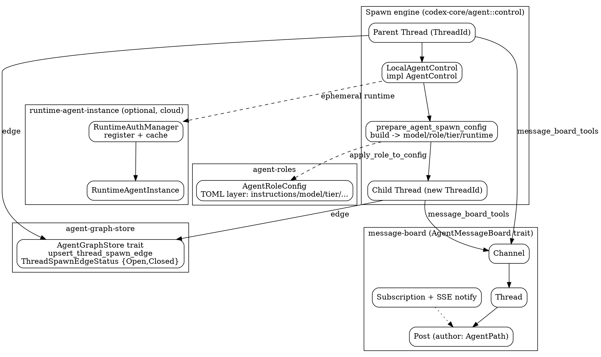

## Introduction

Codex 的多 Agent 能力允许一个 Agent 在会话中**派生出子 Agent（sub-agent）**，形成一棵本地「Agent 树」，并通过一个**消息板（message board）**让树上的 Agent 互相通信。它并不是把模型多跑几次，而是把每个子 Agent 实现成一个独立的 `ThreadId`（会话线程），父线程通过 `AgentControl` 派生子线程、把配置与角色层叠上去，再用消息板跨线程投递消息。

整个机制由四个正交的 crate 拼成：

- **`agent-roles`** — 角色定义（TOML 配置层），决定子 Agent 的 persona / 模型 / 指令。
- **`codex-core` 的 `agent::control`** — spawn 引擎：`LocalAgentControl` 把父线程的配置「快照成子线程配置」，可选地叠加角色层。
- **`agent-graph-store`** — 把「谁 spawn 了谁」的父/子边持久化成一张有向无环图（DAG）。
- **`message-board` + `agent-message-board-client`** — 树内通信主干：channel / thread / post + 订阅 + SSE 通知，本地、内存、远程三种后端共用同一份 `AgentMessageBoard` trait。
- **`runtime-agent-instance`**（可选）— 云端 ephemeral runtime：把子 Agent 派发到 OpenAI 的远端运行时执行。

Codex 有多 Agent 两个版本：`MultiAgentVersion::V1`（遗留，靠 `Op::UserInput` 转向、不透明提交 ID）与 `V2`（当前，基于消息板、命名空间工具、角色层）。下文以 V2 为主。

## Agent Roles

角色是子 Agent 的「预设 persona」。一个角色是一个 TOML 文件，解析后得到 `AgentRoleConfig`：

```rust
#[derive(Debug, Clone, Default, PartialEq, Eq)]
pub struct AgentRoleConfig {
    pub description: Option<String>,
    pub config_file: Option<PathBuf>,
    pub nickname_candidates: Option<Vec<String>>,
}
```

`config_file` 指向一个独立的「配置层」TOML（不是整份 config 拷贝，而是可以被 `flatten` 进父配置的覆盖层）。解析时 `parse_agent_role_file_contents` 会强制校验：角色文件必须定义非空的 `name`，`developer_instructions` 在需要时必须存在，nickname 只能含 ASCII 字母/数字/空格/连字符/下划线且不可重复为空。校验失败直接拒绝加载——这是为了避免一个坏角色静默地把子 Agent 带偏。

加载入口是 `load_agent_roles`，把发现到的角色装进 `Config.agent_roles`。真正把角色层叠到子配置上在 `codex-core` 的 `apply_role_to_config`：

```rust
pub(crate) async fn apply_role_to_config(
    config: &mut Config,
    role_name: Option<&str>,
) -> Result<(), String> {
    let role_name = role_name.unwrap_or(DEFAULT_ROLE_NAME); // "default"
    let role = resolve_role_config(config, role_name)
        .cloned()
        .ok_or_else(|| format!("unknown agent_type '{role_name}'"))?;
    apply_role_to_config_inner(config, role_name, &role).await
        .map_err(|err| { /* -> "agent type is currently not available" */ })
}
```

角色层能覆盖的字段是白名单化的（`AgentRoleOverrides`）：`developer_instructions`、`model`、`model_reasoning_effort`、`model_reasoning_summary`、`model_verbosity`、`personality`、`service_tier`、`features`、`skills`。换言之，角色不只是「系统提示词」，还能改模型与推理档位。

## Spawn

spawn 把「当前线程的配置」变成「子线程的配置」，再交给 `ThreadManager` 开一个新线程。控制器是 `LocalAgentControl`：

```rust
/// Per-session controller handle for a local agent tree.
#[derive(Clone)]
pub(crate) struct LocalAgentControl {
    session_id: SessionId,
    pub(crate) runtime: LocalAgentRuntime,
}
```

`LocalAgentControl` 实现 `AgentControl`（trait 定义在 `core/src/agent/api.rs`）。模型侧的工具调用走到 `spawn_agent` → `spawn_agent_internal` → `ThreadManager::spawn_child_thread`，从而开出一个新的 `ThreadId`。

配置如何「遗传」给子 Agent，是 `agent::child_config` 的核心。入口 `prepare_agent_spawn_config` 按固定优先级叠加各层：

```rust
pub(crate) async fn prepare_agent_spawn_config(
    session: &Session,
    step_context: &StepContext,
    options: SpawnConfigOptions<'_>,
) -> Result<PreparedSpawnConfig, String> {
    let mut config =
        build_agent_spawn_config(&session.get_base_instructions().await, step_context)?;
    // 1. 模型/推理档位覆盖（requested model / reasoning_effort，或 agent_default_subagent_* 配置）
    apply_requested_spawn_agent_model_overrides(...).await?;
    // 2. 角色层（V1 的 full-history fork 不叠角色；V2 可叠）
    if !options.full_history_fork
        || (options.version == SpawnConfigVersion::V2 && options.role_name.is_some())
    {
        apply_spawn_agent_role(session, &mut config, options.role_name).await?;
    }
    // 3. service tier 校验
    apply_spawn_agent_service_tier(session, &mut config).await?;
    // 4. 运行时覆盖：审批策略、cwd、沙箱、权限 profile（来自当前 turn，不能沿用 stale 值）
    apply_spawn_agent_runtime_overrides(&mut config, turn)?;
    Ok(PreparedSpawnConfig { config, role_name })
}
```

`build_agent_spawn_config` 的关键点：**子 Agent 从父 Agent 的「有效配置」起步**，再刷新当前 step 捕获到的模型与推理设置、`base_instructions`、cwd、provider、沙箱与审批策略。注释里特意强调：跳过这个 helper 直接 clone 父配置，会让子 Agent 带着错误的 provider 或运行时策略出门。

两个版本差异：`SpawnConfigVersion::{V1,V2}`，以及 `full_history_fork` 开关——V1 的 full-history fork 禁止改 agent_type（「full-history forked agents inherit the parent agent type」），V2 则允许在 fork 上再叠角色。

## Agent Graph Store

spawn 出来的父/子关系不会只活在内存里。`agent-graph-store` 把「线程 spawn 边」持久化成一张可查询的 DAG：

```rust
pub trait AgentGraphStore: Send + Sync {
    fn upsert_thread_spawn_edge(
        &self,
        parent_thread_id: ThreadId,
        child_thread_id: ThreadId,
        status: ThreadSpawnEdgeStatus,
    ) -> AgentGraphStoreFuture<'_, ()>;

    fn set_thread_spawn_edge_status(
        &self,
        child_thread_id: ThreadId,
        status: ThreadSpawnEdgeStatus,
    ) -> AgentGraphStoreFuture<'_, ()>;

    fn list_thread_spawn_children(
        &self,
        parent_thread_id: ThreadId,
        status_filter: Option<ThreadSpawnEdgeStatus>,
    ) -> AgentGraphStoreFuture<'_, Vec<ThreadId>>;

    fn list_thread_spawn_descendants(
        &self,
        root_thread_id: ThreadId,
        status_filter: Option<ThreadSpawnEdgeStatus>,
    ) -> AgentGraphStoreFuture<'_, Vec<ThreadId>>;
}
```

边的生命周期用 `ThreadSpawnEdgeStatus::{Open, Closed}` 标注——`Open` 表示子线程仍存活或可恢复，`Closed` 表示已从父/子图视角关闭。语义上有两个约束值得注意：

- **一个 child 至多有一个持久化 parent**：重复 upsert 同一个 child 会覆盖其 parent 与 status。
- **`list_thread_spawn_descendants` 是 BFS 且按 depth 再按 thread id 稳定排序**，且 `status_filter` 会作用在「遍历过的每条边」上——也就是说 `Some(Open)` 只会沿 open 边走，被一条 closed 边挡住的下游后代不会返回，即使它自己的入边是 open。

这保证了「live 的子树」可以被稳定地枚举出来，用于状态展示与清理。

## Message Board

消息板是多 Agent 的**通信主干**：它不是点对点的函数调用，而是一个「论坛式」的发布/订阅系统。Agent 在 board 上建 channel、开 thread、发 post，其他 Agent 订阅 channel/thread 后通过 SSE 收到通知。

核心契约是 `AgentMessageBoard` trait，本地/内存/远程三套实现共用：

```rust
pub trait AgentMessageBoard: Send + Sync {
    fn identity(&self) -> SessionId;
    fn create_channel(&self, caller: ThreadId, request: CreateChannelRequest)
        -> BoxFuture<'_, Result<ChannelSummary>>;
    fn post(&self, caller: ThreadId, request: PostRequest)
        -> BoxFuture<'_, Result<PostMetadata>>;
    fn append(&self, caller: ThreadId, request: AppendRequest)
        -> BoxFuture<'_, Result<PostMetadata>>;
    fn list_threads(&self, caller: ThreadId, query: ThreadQuery)
        -> BoxFuture<'_, Result<Page<ThreadSummary>>>;
    fn search_posts(&self, caller: ThreadId, query: PostQuery)
        -> BoxFuture<'_, Result<Page<PostPreview>>>;
    fn read_thread(&self, caller: ThreadId, request: ReadThreadRequest)
        -> BoxFuture<'_, Result<ThreadPage>>;
    fn read_post(&self, caller: ThreadId, request: ReadPostRequest)
        -> BoxFuture<'_, Result<PostContent>>;
    fn set_subscription(&self, caller: ThreadId, request: SubscriptionRequest)
        -> BoxFuture<'_, Result<SubscriptionState>>;
}
```

数据结构是经典的「channel → thread → post」三级：`ChannelSummary` 记录 channel 的权限/创建者/消息数；`ThreadSummary` 持根 post 与回复数；`PostContent` 是带 `message_id`/`author`(`AgentPath`)/`thread_id` 的实际内容。每条 post 都有 `author: AgentPath`，且**发帖者即使被显式指定为接收者也永远收不到自己的通知**——避免自我回声。

Agent 通过一组**工具**使用消息板，而不是直接调 API。`MessageBoardTool` 枚举了可选的工具集：

```rust
pub enum MessageBoardTool {
    CreateChannel,
    UpsertChannel,
    GetChannels,
    ListThreads,
    SearchPosts,
    ReadThread,
    ReadPost,
    Subscribe,
    Unsubscribe,
    Post,
    /// Writes evidence without automatic subscriptions or notifications.
    Append,
}

// 默认暴露给讨论用的 9 个工具，保持注册顺序
pub const DISCUSSION: [Self; 9] = [
    Self::CreateChannel, Self::GetChannels, Self::ListThreads, Self::SearchPosts,
    Self::ReadThread, Self::ReadPost, Self::Subscribe, Self::Unsubscribe, Self::Post,
];
```

`message_board_tools` 把选中的工具按 `namespace`（例如 MAv2 的命名空间）包成 `BoardTool`，注册到子 Agent 的工具表里。读类工具（`get_channels`/`list_threads`/`search_posts`/`read_thread`/`read_post`）标记了 `supports_parallel_tool_calls`，可并发。所有工具输出被截断在 `MAX_RESPONSE_BYTES = 8_000` 字节以内，保证可回填进模型上下文。

**三种后端**：

- `LocalAgentMessageBoard`：基于 SQLite 的本地持久化 board，需要 Python 式的功能开关 `Feature::AgentMessageBoard` + `Feature::MultiAgentV2` 且不是纯 ephemeral。
- `InMemoryMessageBoards`：训练/临时会话用的同树内存 board（跨 ephemeral 会话共享一套）。
- `RemoteAgentMessageBoard`：把请求序列化成 `Call{ caller, timestamp, operation }` 走 HTTP（`POST /v1/boards/{session}/call`），通知走 SSE（`POST /v1/boards/{session}/notifications`）。远程后端**不支持** `upsert_channel` 与 `append`（语义不同，明确拒绝而非退化成 post）。

后端的装配在 `codex-core` 的 `install_agent_message_board`：

```rust
pub fn install_agent_message_board(
    registry: &mut ExtensionRegistryBuilder<Config>,
    manager: Weak<ThreadManager>,
) {
    // ...
    codex_agent_message_board_extension::install(
        registry,
        MULTI_AGENT_V2_NAMESPACE_DESCRIPTION,
        |config: &Config| config.multi_agent_v2.tool_namespace.clone(),
        move |input: &ThreadStartInput<'_, Config>, tree, caller| {
            // 按优先级选后端：
            //   1. 显式 host 连接 (LocalBoardConnection)
            //   2. 配置里的远程 board (message_board_remote)
            //   3. 内存 board（in_memory 开关）
            //   4. 默认本地 SQLite board
            // ...
        },
    );
}
```

host 侧提供 `MessageBoardHost` 能力（成员解析 `agent_path`/`resolve_agent`、时钟 `current_time`、推送 `notify`）。一个关键约束：**通知只在接收方当前 turn 仍可接收时被投递，否则直接丢弃，绝不排队到下个 turn**——避免「过期消息在安静的 Agent 身上被重放」。

## Cloud Runtime Instances

除了在本地派生子线程，Codex 还能把子 Agent 派发到 OpenAI 的**云端 ephemeral runtime** 执行（用于受管的多 Agent 后端）。这一层在 `runtime-agent-instance` crate：

```rust
//! Ephemeral OpenAI runtimes: composite registration and per-request assertions.
pub use actor::AgentHost;
pub use actor::AuthenticatedActor;
pub use manager::RuntimeAuthManager;
pub use registration::RuntimeRegistrationClient;
pub use runtime::RuntimeAgentInstance;
```

`RuntimeAuthManager` 负责向 OpenAI 注册一个 runtime，并复用已注册的实例（`CachedRuntime` 缓存按 credential source 与 org/project selection 去重）：

- 注册前会构造 `RuntimeRegistration` 并带上 `ActorAuthorization`（按 `CodexAuth` 类型分流成 `PlatformApiKey` / `Oauth` / `PersonalAccessToken`，不支持的凭证类型直接报错）。
- 注册失败如果是 `401 UNAUTHORIZED`，会尝试刷新凭证后重试；`403 FORBIDDEN` 则记入 `Denied` 状态并拒绝。
- 成功后得到 `Arc<RuntimeAgentInstance>`，交给调用方作为云端运行时句柄。

`AgentHost` 与 `AuthenticatedActor` 是注册返回的「主机身份」与「已认证 actor 身份」——它们让云端运行时能代表某个 actor 去发起工具调用或模型请求，而不需要把用户原始凭证下放到子 Agent。

## Two Versions

为什么有两套多 Agent？因为它们解决的是同一需求的演进：

- **V1**：最直接——父 Agent 调 `spawn_agent`（当时是 `Op::UserInput` 语义），子 Agent 跑完把结果作为不透明提交回填。简单但通信能力弱，子 Agent 之间无法直接对话。
- **V2**：引入消息板作为一等公民，工具按命名空间隔离，角色层白名单化，spawn 拓扑持久化成 DAG。Agent 之间可以「建频道、发帖、订阅」来协作，而不只是「父派子、子等父」。



## Links

- [Codex Architecture](/docs/CS/AI/Codex/Architecture.md)
- [Codex 核心会话循环](/docs/CS/AI/Codex/SessionLoop.md)
- [Codex Sandbox](/docs/CS/AI/Codex/Sandbox.md)
- [Codex Code Mode](/docs/CS/AI/Codex/CodeMode.md)
- [LLM Agent 理论](/docs/CS/AI/LLM/Agent/Theory/Agent.md)
- [MCP 协议](/docs/CS/AI/LLM/Protocol/MCP.md)

## References

1. [openai/codex（v0.167.0）](https://github.com/openai/codex/tree/v0.167.0)
2. [Codex Multi-Agent 文档](https://developers.openai.com/codex/)
