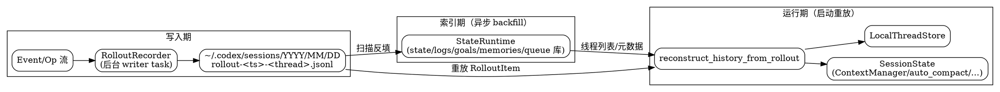

# Codex 持久化与状态（Persistence & State）

## Introduction

Codex 的「持久化」分散在三套互补的机制里，理解它们的边界是把 Codex 当成一个「可恢复、可审计、可重放」的系统而非一次性进程的关键：

1. **Rollout（JSONL）**——会话不可变主记录，落盘在 `~/.codex/sessions/...`，是 crash recovery / resume 的唯一真相源。
2. **SQLite State Runtime**——由 rollout 元数据反填的二级索引库，提供线程列表、目标（goals）、记忆、队列、Guardian 评审等结构化查询。
3. **进程内 SessionState / ThreadStore**——内存态可变状态，跨用户轮次存活，由 rollout 在启动时重放重建，本身不落盘（除非被 rollout 捕获）。

三者关系：`rollout` 写真相 → `state` crate 异步 backfill 出索引 → 启动时 `reconstruct_history_from_rollout` 把 JSONL 重放成内存 `SessionState`。



## Rollout：会话不可变主记录

`rollout` crate 的 `RolloutRecorder` 是唯一的落盘入口。它把规范化的 `RolloutItem` 以 JSONL 形式追加写入，文件名由 `precompute_new_rollout_path` 决定：

```rust
let mut dir = config.codex_home().to_path_buf();
dir.push(SESSIONS_SUBDIR); // "sessions"
dir.push(timestamp.year().to_string());
dir.push(format!("{:02}", u8::from(timestamp.month())));
dir.push(format!("{:02}", timestamp.day()));
let rollout_id = rollout_id_override.unwrap_or(thread_id);
let filename = RolloutFileName::new(timestamp, thread_id, rollout_id).render()?;
```

即 `sessions/YYYY/MM/DD/rollout-<timestamp>-<thread_id>[_<rollout_id>].jsonl`。`thread/revert` 通过 `rollout_id_override` 保留稳定的 thread ID 同时生成一份**全新的不可变 rollout 文件**——这是「线程 ID 不变、历史可分支」的实现基础。归档线程落在独立的 `ARCHIVED_SESSIONS_SUBDIR`。

### 后台 writer 与崩溃恢复

`RolloutRecorder` 通过 `mpsc::Sender<RolloutCmd>` 把写请求交给一个后台 task（`RolloutWriterTask` 拥有 `JoinHandle` 与 `terminal_failure`），自身是 cheap clone。命令枚举包含 `AddItems` / `Persist` / `Flush` / `Shutdown` / `Discard`，每个都带 `oneshot` ack 以便调用方确认刷盘。

核心可变状态 `RolloutWriterState` 的设计重点是**崩溃安全**：

```rust
struct RolloutWriterState {
    writer: Option<JsonlWriter>,
    deferred_creation: bool,        // 新 rollout 尚未物化前不真正建文件
    pending_items: Vec<RolloutItem>, // 已缓冲未落盘
    meta: Option<SessionMeta>,      // 首行会话元数据
    cwd: PathBuf,
    rollout_path: PathBuf,
    ordinal_state: RolloutOrdinalState, // 维持 item 顺序
}
```

- 先写内存 `pending_items`，`write_pending_once` 成功后才 `drain` 已写部分；I/O 失败只 `drop` 文件句柄但**保留未写后缀**，`enter_recovery_mode` 记日志，下一 barrier（`persist`/`flush`/`shutdown`）重新 `open_log_file` 并重试（`write_pending_with_recovery` 最多两次）。
- `open_log_file` 以 append+create 打开，必要时 `materialize_rollout_for_append_blocking`（压缩 rollout 先解压成明文再追加），并 `ensure_rollout_is_newline_terminated` 保证行边界干净；`refresh_rollout_modified_time` 在受 ACL 保护仅允许追加的场景下对 permission denied 容忍。
- `writer_lock`（`WriterLockGuard`）协调同一进程内多个 recorder 的写锁，避免并发截断。

压缩由 `compression` 模块负责，明文路径与压缩路径通过 `plain_rollout_path` 互转。

### 重放与恢复（resume / fork / revert）

`core/src/session/rollout_reconstruction.rs` 的 `reconstruct_history_from_rollout` 把 `RolloutItem` 序列重放为 `RolloutReconstruction`，携带：

- `history: Vec<ResponseItemEnvelope>`——重建的对话历史；
- `retained_context` / `guardian_history`——压缩上下文与 Guardian 检查点；
- `last_started_turn_id` / `previous_turn_settings` / `turn_attribution` / `world_state_baseline`——跨轮次状态；
- `window_number` / `first_window_id` / `previous_window_id` / `window_id`——auto-compaction 窗口链。

重放不是从头扫到底：`select_input_compaction` 选择**最新且能安全界定重放**的 `CompactedItem`，以其 `replacement_history` 为边界截断历史——因为更新（可能不完整）的压缩点会改变旧压缩点无法还原的窗口状态。该边界仅在 `ThreadHistoryMode` 与 resume 元数据契约匹配时生效，否则回退到全量重放。`TurnReferenceContextItem` 区分 `NeverSet` / `Cleared` / `Latest`，确保 fork/revert 注水时只在 baseline 被后续压缩显式失效时才发 clearing 段。

## SQLite State Runtime：结构化索引

`state` crate 的 `StateRuntime`（`codex_state::StateRuntime`）是进程级状态库，由 `rollout/src/state_db.rs::init` 在 core 启动早期创建（`init_state_db`）。它**不是**真相源，而是对 JSONL 的索引镜像，便于无需全量重放即可列线程、查目标、读记忆。

`StateRuntime` 持有多个独立 SQLite 库以分散锁竞争：

```rust
pub struct StateRuntime {
    sqlite: SqliteConfig,
    default_provider: String,
    pool: Arc<sqlx::SqlitePool>,       // state
    logs_pool: Arc<sqlx::SqlitePool>,  // logs（分页历史）
    thread_goals: GoalStore,
    memories: MemoryStore,
    memories_v2: Arc<OnceCell<MemoryStore>>,
    thread_queue: SqliteQueueStore,
    thread_updated_at_millis: Arc<AtomicI64>,
    thread_recency_at_millis: Arc<AtomicI64>,
    reclamation: Arc<SqliteReclamationWorker>,
}
```

- 各库路径由 `SqliteConfig` 决定（`state_db_path` / `logs_db_path` / `goals_db_path` / `memories_db_path` / `queue_db_path`），位置可被 `CODEX_SQLITE_HOME` 覆写。
- **启动时 backfill**：`wait_for_backfill_gate` 在 leases 内等待 rollout 元数据被扫描并已反填到 state 库（默认最多等 30s，测试 2s），完成后才放行；`record_backfill_gate` 记录耗时。`state/src/log_db.rs` 负责把 rollout 中抽取的 `LogEntry` 批量写入 logs 库，`LogWriteFailureReporter` 处理写失败。
- **结构化内容**：线程元数据与排序（`ThreadsPage` / `ThreadSortKey`）、目标（`GoalStore` / `GoalAccountingMode`）、记忆（`MemoryStore`，即 MemoryContext 笔记中 Phase1/Phase2 的落库侧）、用户提交队列（`SqliteQueueStore`，单线程上限 `MAX_QUEUE_ITEMS = 100`）、线程附件（`MAX_THREAD_ATTACHMENT_PAYLOAD_BYTES = 64 KiB`、单线程 `MAX_THREAD_ATTACHMENTS_PER_THREAD = 100`）、Guardian 评审记录（`MAX_GUARDIAN_REVIEW_BYTES` / `_RECORDS` / `_RECORDS_PER_THREAD`）。
- **健康检查与恢复**：`sqlite_integrity_check` 做 quick-check；`backup_runtime_db_for_fresh_start` / `collect_runtime_db_backups` 在疑似损坏时备份旧库并以空库重新开始；`is_sqlite_corruption_error` / `sqlite_error_detail_is_lock` 区分损坏与锁竞争。crate 顶部 `assert!` 要求 bundled SQLite ≥ 3.051.003，以确保 WAL-reset 的损坏修复已包含。
- 指标：`codex.db.error` / `codex.db.backfill` / `codex.sqlite.corruption.count` / `codex.sqlite.init.count` / `codex.sqlite.logs.write.*` 等（见 `state/src/lib.rs` 常量）。

`open_thread_history_db` 打开分页历史库；线程列表走 `RolloutRecorder::list_threads` / `list_threads_from_state_db`，后者在 SQLite 不可用时回退到文件系统分页（`list_threads_with_db_fallback` 的 `StateDbOnly` 模式）。

## 进程内 SessionState 与 ThreadStore

`core/src/state/session.rs` 的 `SessionState` 是**会话级可变状态**，在 `Session` 上曾直接持有、现抽成独立结构，跨轮次与压缩存活但**不单独落盘**——其可重建部分在 rollout 重放时由 `reconstruct_history_from_rollout` 注水：

```rust
pub(crate) struct SessionState {
    pub(crate) session_configuration: SessionConfiguration,
    pub(crate) persisted_dynamic_tools: Arc<[DynamicToolSpec]>,
    pub(crate) active_disabled_plugin_ids: Vec<String>,
    pub(crate) base_instructions_provenance: Option<BaseInstructionsProvenance>,
    pub(crate) history: ContextManager,
    pub(crate) history_reset: CancellationToken,
    pub(crate) latest_rate_limits: Option<RateLimitSnapshot>,
    pub(crate) latest_token_usage_record: Option<TokenUsageRecord>,
    pub(crate) previous_turn_settings: Option<PreviousTurnSettings>,
    pub(crate) last_started_turn_id: Option<String>,
    pub(crate) turn_attribution: Option<TurnAttribution>,
    pub(crate) auto_compact_window: AutoCompactWindow,
    pub(crate) async_compaction: AsyncCompactionState,
    pub(crate) reasoning_effort_pin: ReasoningEffortPin,
    pub(crate) shutting_down: bool,
    pub(crate) startup_prewarm: Option<SessionStartupPrewarmHandle>,
    // …additional_context / active_connector_selection / pending_session_start_sources 等
}
```

`ReasoningEffortPin` 维护了跨压缩/预热继承的推理强度（Compacted 之后允许无 override 的基线）。`ContextManager`（`context_manager/history.rs`）持有 `items: Arc<Vec<ResponseItemEnvelope>>` 与 `retained_context` 快照，是整个会话历史的访问面。

线程存储由 `codex_thread_store` 提供：`LocalThreadStore`（本地）与 `InMemoryThreadStore`（测试/内存），通过 `LoadThreadHistoryParams` 与 `MoveThreadToSectionParams` 操作；`ThreadStoreConfig` 来自 `Config`。`ThreadManager`（`thread_manager.rs`）把 `EnvironmentManager`、`LocalAgentGraphStore`（多 Agent DAG，见 MultiAgent 笔记）、`LocalAgentMessageBoard`（跨 Agent 消息板）组织起来，并在关机路径 `thread_manager/shutdown.rs` 中协调 Agent 树的优雅退出（`AgentTreeShutdown`）。

## 与相邻子系统的边界

- **与会话循环**：`SessionLoop` 每步产生的事件经 `RolloutRecorder` 序列化进 JSONL；`persist`/`flush` 在 turn 边界与关机时被调用以保证落盘（见 SessionLoop 笔记的挂起/恢复）。
- **与记忆**：`state` 库的 `MemoryStore` 是 MemoryContext 笔记中 Phase1 抽取 / Phase2 合并的落库侧；backfill 同样会扫描 rollout 以重建记忆索引。
- **与沙箱**：rollout 默认仅在「全磁盘写 + 全网络」时才绕开 bwrap（见 Sandbox 笔记）；远程执行时的文件读写走 exec-server 的 fs JSON-RPC 而非本地 fs（见 ExecServer 笔记）。

## Links

- [Codex 总览](/docs/CS/AI/Codex/Codex.md)
- [Codex 核心会话循环](/docs/CS/AI/Codex/SessionLoop.md)
- [Codex 记忆与上下文管理](/docs/CS/AI/Codex/MemoryContext.md)
- [Codex 沙箱](/docs/CS/AI/Codex/Sandbox.md)
- [Codex exec-server 与远程执行](/docs/CS/AI/Codex/ExecServer.md)

## References

- `codex-rust-v0.167.0/codex-rs/rollout/src/recorder.rs`（`RolloutRecorder` / `RolloutWriterState` / `precompute_new_rollout_path` / `open_log_file`）
- `codex-rust-v0.167.0/codex-rs/rollout/src/state_db.rs`（`init` / `wait_for_backfill_gate`）
- `codex-rust-v0.167.0/codex-rs/state/src/runtime.rs`（`StateRuntime` / `open_thread_history_db` / `sqlite_integrity_check`）
- `codex-rust-v0.167.0/codex-rs/state/src/lib.rs`（常量 `MAX_QUEUE_ITEMS` 等 / DB 指标名）
- `codex-rust-v0.167.0/codex-rs/core/src/state/session.rs`（`SessionState` / `ReasoningEffortPin`）
- `codex-rust-v0.167.0/codex-rs/core/src/session/rollout_reconstruction.rs`（`RolloutReconstruction` / `select_input_compaction`）
- `codex-rust-v0.167.0/codex-rs/core/src/thread_manager.rs`（`ThreadManager` 组装 `EnvironmentManager` / graph store / message board）
