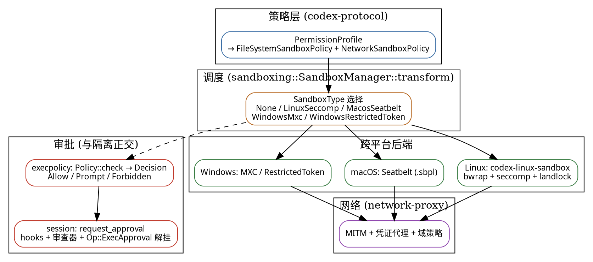

## Introduction

Codex 的「沙箱」不是单一组件，而是**两层正交的关注点**：

1. **文件系统/网络隔离（沙箱本体）**：让工具命令在受限视图里跑。跨平台实现各不相同——Linux 用 `bwrap`+`seccomp`+`landlock`，macOS 用 Seatbelt，Windows 用 MXC / 受限令牌，外加一个常驻的 `network-proxy` 接管所有出网流量。
2. **审批门控（execpolicy + session 审批）**：决定一条命令/一次网络访问到底要不要弹确认、能不能执行。它和隔离是正交的——沙箱只决定「能摸到什么」，审批决定「能不能跑」。

两层都由 `PermissionProfile`（定义在 `codex-protocol`）统一描述，并经 `sandboxing::SandboxManager::transform` 把原始命令**就地包装**成沙箱化命令。



## 1. 策略模型：PermissionProfile

`PermissionProfile` 是统一描述，运行时通过 `to_runtime_permissions()` 拆成两个子策略：

- `FileSystemSandboxPolicy`：可读根、可写根、unreadable glob 等。提供 `has_full_disk_write_access()`、`read_only()`、`restricted(roots)` 等构造器。
- `NetworkSandboxPolicy`：`Enabled` / `Restricted` / `Isolated` 等枚举。

`SandboxManager::select_initial` 据平台与权限档案选 `SandboxType`：

```rust
pub fn select_initial(
    &self,
    permission_profile: &PermissionProfile,
    pref: SandboxablePreference,
    windows_sandbox_type: SandboxType,
    has_managed_network_requirements: bool,
) -> SandboxType
```

`SandboxablePreference::{Forbid, Require, Auto}` 决定强制/禁止/「按策略内容自动」。`Auto` 分支下，若文件系统与网络都被放行、又无受管网络需求，则返回 `SandboxType::None`——**宽松策略等于不隔离**。

## 2. 调度核心：SandboxManager::transform

这是把命令「套壳」的核心流水线，签名是：

```rust
pub fn transform(
    &self,
    request: SandboxTransformRequest<'_>,
) -> Result<SandboxExecRequest, SandboxTransformError>
```

它按 `SandboxType` 分支把 `command` 重写成沙箱化形式：

- `None` → 原样返回。
- `WindowsMxc` → 调 `codex_mxc_sandbox::create_command_args`（需 `is_available()`，否则报 `WindowsMxcPreparation`）。
- `MacosSeatbelt` → 调 `create_seatbelt_command_args_with_profile`，把命令包成 sandboxd 调用。
- `LinuxSeccomp` → 调 `create_linux_sandbox_command_args_for_permission_profile`，把自身包装成 `codex-linux-sandbox` 二进制（通过 `arg0_override` 设 `codex_linux_sandbox_arg0`）；若启动选择了 PID 继承，插入 `--inherit-pid-namespace`。
- `WindowsRestrictedToken` → 受限令牌；非 elevated 时不支持受管网络（强制报错）。

最终产出 `SandboxExecRequest { command, sandbox, permission_profile, network, arg0, .. }`，后续 spawn 时按此执行。

## 3. Linux 沙箱：bwrap + seccomp + landlock 的「三明治」

Linux 走一个**独立二进制** `codex-linux-sandbox`（经由 `arg0` re-exec），其 `run_main` 装配顺序在源码注释里写得很直白：

```rust
/// The sequence is:
/// 1. When needed, wrap the command with bubblewrap to construct the
///    filesystem view.
/// 2. Apply in-process restrictions (no_new_privs + seccomp).
/// 3. `execvp` into the final command.
```

**外阶段（bwrap 建立文件系统视图）**。先判断是否值得套：

```rust
if file_system_sandbox_policy.has_full_disk_write_access() && unreadable_globs.is_empty() {
    // 全磁盘写 + 无不可读 glob → 不包装（跳过沙箱开销）
}
```

否则生成形如 `--new-session --die-with-parent --unshare-user --unshare-pid --unshare-ipc --cap-drop ALL` 的参数，并按固定顺序叠挂载（`bwrap.rs` 注释）：

1. 全读 / 读取 `/` → `--ro-bind / /`；受限读 → `--tmpfs /` 再范围 `--ro-bind`。
2. `--dev /dev` 挂一个最小可写 `/dev`（含 `/dev/urandom`）。
3. 可写根的不可读祖先先 mask，再 bind 可写根（让嵌套 carveout 安全重开）。
4. `--bind <root> <root>` 重开写权限；`--ro-bind` 子路径重载只读保护。
5. WSL 特例：mask `/run/WSL`（防经 Windows 进程桥绕过），WSLg distro 做路径校验。

**内阶段（re-exec 后再叠 seccomp）**。bwrap 后以 `--apply-seccomp-then-exec` 重新进入自身，先验 capability：

```rust
if capability_sets.any(|[effective, permitted, _]| effective != 0 || permitted != 0) {
    panic!("Linux sandbox retained effective or permitted capabilities");
}
```

随后 `apply_permission_profile_to_current_thread`（置 `no_new_privs` + seccomp syscall 过滤）。legacy 模式则改用 landlock LSM 直接强制（`apply_landlock_fs=true`）。网络保留 netns 时还会 `activate_proxy_routes_in_netns` 激活 proxy 路由。最后 `fork` + `execvp` 用户命令，并把转发信号交给子进程。

> 两阶段 re-exec 的原因：bwrap 可能依赖 setuid，所以 seccomp 必须等文件系统视图建立后再叠加——先松后紧。

## 4. 网络代理：network-proxy（MITM + 凭证代理 + 域策略）

bwrap 的网络模式由 `BwrapNetworkMode` 决定：`FullAccess`（不 `--unshare-net`）、`ProxyOnly`（受管网络，保留 netns + proxy 路由并注入 MITM CA）、`Isolated`（`--unshare-net`）。沙箱内进程通过 `PROXY_ENV_KEYS`（http_proxy / https_proxy / all_proxy / no_proxy）把流量导向 `network-proxy`。

`network-proxy` 是一个**完整代理守护**，关键能力：

- **MITM**：自签名 CA（`certs` 模块）+ `mitm` 模块拦截 TLS，对允许域解密后转发。
- **凭证代理**（`credential_broker`）：安全注入凭证（如 AWS 的 SigV4 签名 `aws_sigv4`），经环境变量 `BROKERED_CREDENTIALS_ENV_KEY` 传入、**不落盘**；`secret_substitution` 在运行时替换敏感值。
- **域策略**（`network_policy` / `domain_matcher`）：`NetworkPolicyDecider` 对每个请求给出 `NetworkDecision`（Allow/Deny），并支持 `mitm_hook` 注入/改写请求头。
- **归属标记**（`attribution`）：`PROXY_ATTRIBUTION_TOKEN_ENV_KEY` 标记请求来源，便于审计。

> 反直觉点：沙箱**不是禁用网络**，而是把网络强制收口到 proxy 做 MITM + 凭证代理。在 managed network 模式下你反而能访问私有云资源——因为 proxy 替你签名（SigV4 等）。

## 5. Windows 沙箱：MXC / RestrictedToken

- `WindowsMxc`：`codex_mxc_sandbox`（native，需 `is_available()` 通过），AppContainer 风格的隔离。`transform` 调 `create_command_args` 把命令包进 MXC 运行时。
- `WindowsRestrictedToken`：受限令牌路径。`transform` 中若走此类型且要做受管网络但非 elevated，会直接报错——强制 proxy 路由需要 elevated 后端的 restricting SID（`network_proxy_restricting_sid`）。
- 网络：只有 elevated 后端能做 managed networking。

## 6. macOS 沙箱：Seatbelt

- `MacosSeatbelt`：用 sandboxd 的 Seatbelt 策略，仓库内置 `.sbpl`（`seatbelt_base_policy`、`seatbelt_network_policy`、`seatbelt_preferences_policy`、`seatbelt_read_only_platform_defaults`）。
- `create_seatbelt_command_args_with_profile` 把命令包成 sandbox-exec 调用，绑定 `MACOS_PATH_TO_SEATBELT_EXECUTABLE`。
- 文件系统 helper 走更窄的 `FileSystemHelper` profile；允许跟随 codex_home 的符号链接（`allowed_symlinked_codex_home`）。

## 7. 审批模型：execpolicy + session 审批（与隔离正交）

**execpolicy 引擎**（`codex-execpolicy` crate）是独立的规则决策器：

```rust
pub struct Policy {
    insensitive_rules: MultiMap<String, RuleRef>,
    rules_by_program: MultiMap<String, RuleRef>,
    network_rules: Vec<NetworkRule>,
    host_executables_by_name: HashMap<String, Arc<[AbsolutePathBuf]>>,
}

pub fn check<F>(&self, cmd: &[String], heuristics_fallback: &F) -> Evaluation
// Evaluation { decision: Decision, matched_rules: Vec<RuleMatch> }

pub enum Decision { Allow, Prompt, #[serde(rename = "prompt-user")] PromptUser, Forbidden }
```

- `Policy` 由 `PrefixRule`（命令前缀匹配，按首 token 索引）与 `NetworkRule`（域/协议）组成。
- `Evaluation::from_matches` 取所有匹配规则的 `decision` 的「最大值」（`max`），即越严格的规则胜出。
- `PolicyParser` 解析策略文本；`RequirementsExecPolicy` 带 `fingerprint()` 用于管理端等价比较。
- **规则是活的**：用户每次批准某条命令，会通过 `proposed_execpolicy_amendment` 反向写入 allow 规则（从审批结果到策略的反馈环）。

**session 审批门控**（core 的 `tools/approvals.rs`）：

```rust
async fn check_approval_requirement(&self, ctx: &ApprovalContext) -> Result<(), ToolError> {
    if ctx.requires_human_approval() {
        if let Some(reason) = prompt_is_rejected_by_policy(ctx.review_context.approval_policy, /*prompt_is_rule*/ true) {
            return Err(ToolError::Rejected(reason.to_string()));
        }
        // 再查 requirements().approvals_reviewer 是否允许真人审查 …
    }
    Ok(())
}
```

- `request_approval` 先过 `check_approval_requirement`（`AskForApproval::Never` 直接拒 prompt）。
- **hooks 否决永远赢**（`PermissionRequestDecision::Deny` 直接 Denied）。
- reviewer 可以是真人，也可以是 Guardian 自动审查器（`review_context.turn().strict_auto_review_enabled()`）。
- 与核心会话循环呼应：挂起的工具 future 等 `tx_approve`，用户回 `Op::ExecApproval` → `resolve_exec_approval` 解出 `tx_approve` 解挂。

**两体系关系**：execpolicy 是命令级**静态规则决策**（前缀/域匹配，产出 Allow/Prompt/Forbidden）；session 审批是运行时 **human-in-the-loop 门控**（hooks + 自动审查器 + 用户回流）。沙箱决定「能摸到什么」，审批决定「能不能跑」——正交，缺一不可。

## 反直觉点

- **宽松策略 = 不隔离**：全磁盘写 + 全网络时，Linux 完全不套 bwrap，只为省开销。
- **沙箱不是禁网**：网络被强制收口到 `network-proxy` 做 MITM + 凭证代理；managed network 下反而能访问私有云（proxy 替你签名）。
- **两阶段 re-exec**：bwrap 可能依赖 setuid，seccomp 必须等文件系统视图建好后再叠加。
- **审批与隔离正交**：文件系统视图被沙箱收窄，但命令是否执行仍要过 execpolicy + 审批门控。
- **策略是活的**：每次批准的命令会被加进 execpolicy 的 allow 规则。

## Links

- [Codex Architecture](/docs/CS/AI/Codex/Codex.md?id=architecture)
- [Codex 核心会话循环](/docs/CS/AI/Codex/SessionLoop.md)
- [Codex 枢纽页](/docs/CS/AI/Codex/Codex.md)
- [AI 总纲](/docs/CS/AI/AI.md)

## References

1. [openai/codex（v0.167.0）](https://github.com/openai/codex/tree/v0.167.0)
2. [codex-rs/sandboxing](https://github.com/openai/codex/tree/v0.167.0/codex-rs/sandboxing) — `SandboxManager::transform` 调度
3. [codex-rs/linux-sandbox](https://github.com/openai/codex/tree/v0.167.0/codex-rs/linux-sandbox) — bwrap + seccomp + landlock 装配
4. [codex-rs/network-proxy](https://github.com/openai/codex/tree/v0.167.0/codex-rs/network-proxy) — MITM + 凭证代理
5. [codex-execpolicy](https://github.com/openai/codex/tree/v0.167.0/codex-rs/execpolicy) — `Policy::check → Decision` 审批引擎
