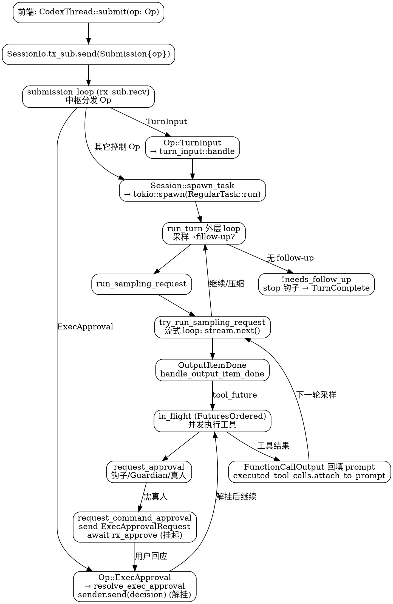

## Introduction

本页从源码层面拆解 Codex v0.167.0 的**核心会话循环（core session loop）**：一条 `CodexThread` 被 `submit(Op)` 喂入用户意图之后，引擎内部如何一步步走到「调用模型 → 解析工具调用 → 执行（并可能要求审批）→ 把结果回填 → 决定是否再来一轮」，直到会话结束。看懂这一条主轴，才能理解后面要深挖的工具系统、沙箱体系与多 Agent 协作。

> 版本基线：v0.167.0（`E:/Projects/codex-rust-v0.167.0`）

结论先行：Codex 的会话循环是**两层嵌套的 loop + 一条审批回调通道**构成的：

- **外层 `submission_loop`**：常驻在一个 `async fn` 里，从 `rx_sub` 通道收 `Op`，按类型分发。它是整条 Thread 的「中枢神经」。
- **中层 `run_turn` 的 `loop`**：一个 turn（一轮对话）内部，反复做「采样请求 → 等结果 → 是否还有后续输入/工具结果要回填」直到不需要 follow-up。
- **内层 `try_run_sampling_request` 的流式 `loop`**：单次采样请求内部，逐事件消费模型流式响应，把完成的工具调用派发成并发 future。
- **审批门控**：工具真正执行前走 `request_approval`，需要人确认时通过 `EventMsg::ExecApprovalRequest` 事件挂起当前工具 future，等用户回 `Op::ExecApproval` 才用 oneshot 解挂。

## The Message Pipeline: From submit to submission_loop

一切的起点是前端（TUI / app-server）调用 `CodexThread::submit(op)`。它只是把 `Op` 转交给 `SessionIo`：

```rust
impl CodexThread {
    pub async fn submit(&self, op: Op) -> CodexResult<String> {
        self.io.submit(op).await
    }
}
```

`SessionIo` 内部持有一条 `tx_sub: Sender<Submission>` 通道；`submit` 把 `op` 包成一个 `Submission` 发进去：

```rust
self.io
    .tx_sub
    .send(Submission {
        id: new_submission_id(),
        op: Op::SuspendTurnAndShutdown { reply },
        turn_extension_init: None,
        trace: current_span_w3c_trace_context(),
        parent_turn_id: None,
        root_turn_id: None,
        residency_guard: None,
        message_delivery: None,
    })
    .await
```

通道的另一端，是 `Session` 启动时拉起的 `submission_loop(sess, config, rx_sub)`。换句话说，**`submit(Op)` 与引擎真正的处理逻辑之间只隔一条 async 通道**——前端完全不碰 agent 逻辑，只是往通道里丢消息。

`Op` 这个枚举（定义在 `codex-protocol`）就是前后端之间的「动词表」。与会话循环最相关的几个变体：

```rust
pub enum Op {
    Interrupt,
    TurnInput { request: Box<TurnInputRequest>, mode: TurnInputMode, reply: oneshot::Sender<...> },
    RecoverTurn { thread_settings: ..., start_options: TurnStartOptions, reply: ... },
    SuspendTurnAndShutdown { reply: ... },
    ThreadSettings { thread_settings: ..., reply: ... },
    ExecApproval { id: String, turn_id: Option<String>, decision: ReviewDecision },
    PatchApproval { id: String, decision: ReviewDecision },
    InterruptIfNoPendingInput { turn_id: String, reply: oneshot::Sender<bool> },
    // RealtimeConversationStart/Attach/Audio/Text/Close、InterAgentCommunication、
    // ReplaceDynamicTools、TurnSettings、ResolveElicitation、Review、Shutdown ……
}
```

## submission_loop: The Central Dispatch

`submission_loop` 是一个死循环，用 `tokio::select!`（biased）在「收到 shutdown 信号」「收到新的 `Submission`」「邮箱（mailbox）有更新」三者间择一：

```rust
pub(super) async fn submission_loop(
    sess: Arc<Session>,
    config: Arc<Config>,
    rx_sub: Receiver<Submission>,
) {
    loop {
        let sub = tokio::select! {
            biased;
            _ = sess.services.local_agent_runtime.shutdown.cancelled() => {
                shutdown_received = shutdown(&sess, super::new_submission_id()).await;
                break;
            }
            sub = rx_sub.recv() => match sub { Ok(sub) => sub, Err(_) => break },
            update = /* mailbox.changed() */ => {
                // 唤醒沉睡的线程去处理待办（WakeOnAgentMessages）
                continue;
            }
        };
        let should_exit = async {
            match sub.op {
                Op::Interrupt => { interrupt(&sess).await; false }
                Op::TurnInput { request, mode, reply } => {
                    let result = turn_input::handle(&sess, request, mode, sub.id.clone()).await;
                    let _ = reply.send(result);
                    false
                }
                Op::ExecApproval { id: approval_id, turn_id, decision } => {
                    sess.resolve_exec_approval(approval_id, turn_id, decision).await;
                    false
                }
                Op::SuspendTurnAndShutdown { reply } => { /* ... */ false }
                Op::ThreadSettings { thread_settings, reply } => { /* ... */ false }
                Op::Shutdown => shutdown(&sess, sub.id.clone()).await,
                // ……
                _ => false,
            }
        }.instrument(dispatch_span).await;
        if should_exit { shutdown_received = true; break; }
    }
    // 通道关闭但没显式 shutdown：跑一遍 teardown
}
```

要点：

- `Op::TurnInput` 才是「开始/转向一轮对话」的入口，它走到 `turn_input::handle`，最终派生出 `run_turn` 任务。
- `Op::ExecApproval` 是**审批回流**——用户在 UI 里点了批准/拒绝后，前端把它当普通 `Op` 发回来，由 `resolve_exec_approval` 解挂正在等待的那个工具 future（详见下文「审批门控」）。
- `Op::Interrupt` 立即中断当前 turn；`Op::SuspendTurnAndShutdown` 在落盘后让 `submission_loop` 退出（用于把线程状态交给另一个 worker 接管）。

## Turn Lifecycle: Op::TurnInput to run_turn

`turn_input::handle` 先解析设置、采集 sender 消息，再决定是「steer 当前 turn」还是「start 一个新 turn」。新 turn 的落点是：

```rust
session
    .spawn_task(Arc::clone(&turn_context), task_input, RegularTask::new())
    .await;
```

`spawn_task` 会先 `abort_all_tasks(TurnAbortReason::Replaced)`（一个 Thread 同一时刻只有一个常规 turn 在跑），再 `start_task`。`start_task` 里登记 `ActiveTurn`、发 `TurnStarted` 生命周期事件、建 `CancellationToken`，最后 `tokio::spawn` 出真正的任务：

```rust
let task_future = async move {
    let task_result = task_for_run
        .run(Arc::clone(&session), ctx, task_input, task_cancellation_token.child_token())
        .instrument(trace_span!("session_task.run"))
        .await;
    // 落盘 rollout、on_task_finished、done.notify_waiters()
};
let handle = tokio::spawn(storage_originator.scope(task_future));
turn.task = Some(running_task);
```

`RegularTask::run` 就是把任务翻译成对 `run_turn` 的调用：

```rust
use crate::session::turn::run_turn;

async fn run(/* ... */) -> CodexResult<Option<String>> {
    // ...emit_turn_started, 准备 step context...
    let last_agent_message = run_turn(
        sess,
        turn_context,
        task_input,
        &mut mcp_startup_requirements,
        None,                       // prewarmed_client_session
        cancellation_token,
    ).instrument(run_turn_span.clone()).await?;
    // 若仍有 pending input，可能会再起一轮（recovery/steering）
}
```

注意 `run_turn` 返回 `CodexResult<Option<String>>` 的 `String` 是「最后一条 agent message」，而 turn 结束时如果没有新输入就退出；如果有 pending input（用户在模型跑的时候又敲了字），外层还会再起一轮。

## Inside run_turn: The Outer Loop

`run_turn` 顶部先处理音频上传拒绝、guardian 检查、pre-sampling 压缩、MCP 启动要求、skills/plugins 注入、session-start 钩子。然后进入核心的 `loop`：

```rust
loop {
    // 1) 取本 turn 内被「中途注入」的 pending input（用户边跑边敲的字）
    let pending_input = if can_drain_pending_input {
        sess.input_queue.get_pending_input(&sess.active_turn).await.0
    } else { Vec::new() };

    // 2) 跑 prompt 钩子、把输入记进 rollout
    if run_hooks_and_record_inputs(&sess, &turn_context, /*...*/, &pending_input,
                                   PersistContext::SteeredUserInput).await? {
        break;
    }

    // 3) 捕获这一「步」的上下文（含 MCP、tools 解析、环境选择）
    let step_context = /* capture_step_context_with_required_mcp_servers(...) */;

    // 4) 采样请求
    let sampling_request_result = run_sampling_request(
        Arc::clone(&sess), Arc::clone(&step_context), /*...*/,
        &mut client_session, sampling_request_input,
        cancellation_token.child_token(),
    ).await;

    match sampling_request_result {
        Ok((sampling_request_output, notify_messages)) => {
            let SamplingRequestResult { needs_follow_up, .. } = sampling_request_output;
            // 5) 收集「是否有 pending input」「token 是否到顶」
            let (has_pending_input, token_status) = /* ... */;
            let needs_follow_up = model_needs_follow_up || has_pending_input;

            // 6) 按需做 auto-compaction（mid-turn / post-turn）
            super::async_compaction::maybe_start(&sess, &step_context, &world_state,
                if needs_follow_up { CompactionPhase::MidTurn } else { CompactionPhase::PostTurn },
                &cancellation_token, &token_status, /*...*/).await;

            // 7) 若需要 roll-over（上下文超限），跑一次自动压缩再 continue
            if should_roll_over {
                let compacted = run_auto_compact(/*...*/).await;
                // ... continue 进下一轮 loop
            }

            // 8) 没有后续输入 → 跑 stop 钩子，结束本轮
            if !needs_follow_up {
                let stop_outcome = run_turn_stop_hooks(&sess, &step_context, /*...*/).await;
                // ... break / 或把 hook 的 continuation 塞回输入
                break;
            }
        }
        Err(err) => { /* 处理 ContextWindowExceeded / UsageLimitReached / 其它 */ }
    }
}
```

三层含义：

- **「follow-up」是循环继续的唯一理由**：要么模型自己说还要继续（`model_needs_follow_up`），要么用户在半路插了新输入（`has_pending_input`）。否则 turn 结束。
- **压缩（compact）嵌在循环里**：mid-turn 压缩发生在工具结果可能把上下文撑爆之前，post-turn 压缩发生在 turn 收尾；超限时直接 roll-over 到下一轮 loop，而不是崩。
- **钩子到处都是**：prompt 钩子、session-start 钩子、stop 钩子，且 stop 钩子返回的 continuation 还能把新指令塞回下一轮输入——这是 Codex「钩子能反过来指挥 agent」的机制。

## Inside the Sampling Request: The Streaming Loop

`run_sampling_request` 先准备 prompt、起一个 `ToolCallRuntime`，再调用 `try_run_sampling_request`；外层还有一层 `loop` 负责在流式错误时按 `max_retries` 重试。真正逐 token 消费模型响应的是 `try_run_sampling_request` 内部这个流式 `loop`：

```rust
let mut in_flight: FuturesOrdered<InFlightFuture<'static>> = FuturesOrdered::new();
let outcome: CodexResult<SamplingRequestResult> = loop {
    let event = stream
        .next()
        .or_cancel(&preempt)
        .or_cancel(&cancellation_token)
        .await;

    match event {
        // ...
        Ok(Ok(event)) => event,
        // 取消 / 邮箱抢占 / 流式错误 → break 或 continue
    }

    match event {
        ResponseEvent::Created { response_id } => { /* 记录 response id，供 guardian 评估 */ }
        ResponseEvent::OutputItemAdded(item) => {
            // 给正在流式接收的工具调用建一个 diff consumer，方便实时展示参数
            if let ResponseItem::CustomToolCall { call_id, name, namespace, .. } = &item {
                active_tool_argument_diff_consumer =
                    tool_runtime.create_diff_consumer(&tool_name).map(|c| (call_id.clone(), c));
            }
            // 非工具类 item（消息/推理）开始流式渲染
        }
        ResponseEvent::OutputItemDone(mut item) => {
            // 工具调用/消息完整产出 → 派发
            let mut ctx = HandleOutputCtx { sess: ..., step_context: ..., tool_runtime, ... };
            let output_result = handle_output_item_done(&mut ctx, item, previously_streamed_item)
                .instrument(handle_responses).await;
            // 把工具执行 future 投入并发队列
            if let Some(tool_future) = output_result.tool_future {
                in_flight.push_back(tool_future);
            }
            needs_follow_up |= output_result.needs_follow_up;
            // 邮箱抢占：模型还在产出，但用户插了信，优先切去处理邮件
        }
        ResponseEvent::GuardianAssessment(assessment) => { pending_assessment = Some(assessment); }
        ResponseEvent::SafetyBuffering(_) => { /* 安全缓冲 UI */ }
        // ServerModel / ModelVerifications / TurnModerationMetadata / ServerReasoningIncluded ……
    }
};
```

关键设计：

- **工具调用异步并发**：每个完成的 `OutputItemDone` 若是一个工具调用，`handle_output_item_done` 产出一个 `tool_future`，被 `push_back` 进 `in_flight`（`FuturesOrdered`）。这些 future 在**流还没结束时就已经在跑**——模型边生成下一个工具调用，前面那个已经在执行。
- **流与执行重叠**：`stream.next()` 和 `in_flight` 的推进是交替进行的；等所有 `in_flight` 完成后，`tool_future` 返回的 `FunctionCallOutput` 会被 `executed_tool_calls.attach_to_prompt` 回填进 prompt，作为下一轮采样的输入——这就是「agent 循环」如何自我喂养。
- **邮箱抢占（mailbox preemption）**：当模型还在产出、但用户通过 inter-agent 消息塞了新信，`OutputItemDone` 分支会触发 `stream.interrupt.send(ResponseInterrupt::Drain)`，把剩余响应 drain 完并标记 `needs_follow_up`，让外层 loop 切去处理邮件。

## Tool Execution and the Approval Gate

工具真正执行前，必须经过**审批门控**——这是 Codex 区别于「无脑执行模型指令」的核心安全机制。`ToolCallRuntime::handle_tool_call` 在执行动作前调用 `request_approval`：

```rust
pub(crate) async fn request_approval(
    self: &Arc<Self>,
    action: ApprovalAction,
    ctx: ApprovalContext,
) -> ApprovalResult {
    self.request_approval_with_user_prompt(
        &action, &ctx,
        self.request_user_approval(&action, &ctx),
    ).await
}
```

`request_approval_with_user_prompt` 的决策链很清晰：**钩子否决永远赢；否则交给审查器（reviewer）**。

```rust
let mut resolution = match run_permission_request_hooks(self, &ctx.review_context,
        &permission_request_run_id, action.permission_request_payload(),
        action.hook_environment_id()).await {
    Some(PermissionRequestDecision::Allow) if !ctx.requires_human_approval() => {
        ApprovalResolution { decision: ReviewDecision::Approved, source: ApprovalResolutionSource::Hook, .. }
    }
    Some(PermissionRequestDecision::Deny { message }) => {
        ApprovalResolution { decision: ReviewDecision::denied(message), source: Hook, .. }
    }
    Some(Allow) | None => {
        self.request_reviewer_approval(action, ctx, user_prompt).await
    }
};
```

`request_reviewer_approval` 在「需要真人」与「可自动审查（Guardian）」之间二选一：

```rust
async fn request_reviewer_approval(self, action, ctx, user_prompt) -> ApprovalResolution {
    if ctx.requires_human_approval() {
        user_prompt.await                       // 走真人审批通道
    } else if let Some(decision) = self.request_guardian_approval(action.clone(), ctx).await {
        ApprovalResolution { decision, source: ApprovalResolutionSource::Guardian, .. }
    } else {
        user_prompt.await
    }
}
```

## The Approval Round-Trip

真人审批的完整回路，是把「执行前」与「用户回应」用一条 oneshot 通道对起来：

1. 工具需要确认（例如执行一条 shell 命令）时，`request_user_approval` 走到 `Session::request_command_approval`，它**先**把 `tx_approve` 存进当前 `ActiveTurn` 的 pending approvals，**再**发 `EventMsg::ExecApprovalRequest` 事件给前端，然后 `await rx_approve`——此时这个工具 future 被挂起：

```rust
pub async fn request_command_approval(
    &self, turn_context: &TurnContext, kind: ExecApprovalKind,
    model_context: ModelInvocationContext, call_id: String, /* ... */
    command: Vec<String>, cwd: PathUri, reason: Option<String>, /* ... */
) -> ReviewDecision {
    let (tx_approve, rx_approve) = oneshot::channel();
    {
        let mut active = self.active_turn.lock().await;
        if let Some(at) = active.as_mut() {
            let mut ts = at.turn_state.lock().await;
            ts.insert_pending_approval(effective_approval_id.clone(), tx_approve, kind,
                                       turn_context.sub_id.clone());
        }
    }
    let event = EventMsg::ExecApprovalRequest(ExecApprovalRequestEvent {
        kind, call_id, turn_id: turn_context.sub_id.clone(), command, cwd, reason,
        available_decisions: Some(available_decisions), /* ... */
    });
    self.send_event(turn_context, event).await;
    rx_approve.await.unwrap_or(ReviewDecision::Abort)   // 挂起，直到用户回应
}
```

2. 用户在 UI 里点了批准/拒绝/中断，前端把决定包成 `Op::ExecApproval` 发回引擎。`submission_loop` 收到后调 `resolve_exec_approval`，它从 pending approvals 里取出那条 `tx_approve` 并 send 决定，从而**解挂**那个工具 future：

```rust
pub(crate) async fn resolve_exec_approval(
    self: &Arc<Self>, approval_id: String, turn_id: Option<String>, decision: ReviewDecision,
) {
    let Some((pending, active_turn_id)) = self
        .take_pending_approval(&approval_id, turn_id.as_deref()).await else { return; };
    let decision = pending.validate(decision);
    if decision == ReviewDecision::Abort {
        // 中断当前 turn
        self.abort_turn_if_active(&pending.turn_id, TurnAbortReason::Interrupted, None).await;
    } else if let ReviewDecision::ApprovedExecpolicyAmendment { proposed_execpolicy_amendment } = &decision {
        // 若用户顺便批准了「以后这类命令免审」的策略修订，持久化它
        let _ = self.persist_execpolicy_amendment(proposed_execpolicy_amendment).await;
    }
    let _ = pending.sender.send(decision);   // 解挂工具 future
}
```

3. 工具 future 拿到 `ReviewDecision` 后，要么执行、要么以 `ToolError::Rejected` / `CodexErr::TurnAborted` 收场；结果作为 `FunctionCallOutput` 回填进下一轮采样（见上文「流与执行重叠」）。

把「策略判定」也顺带说清：`exec_policy` 负责判断一条命令到底要不要审批。它会解析命令、按 `Policy` 里的规则匹配（含前缀规则 `prefix_rule`、沙箱权限、环境策略），产出 `ExecApprovalRequirement`——这就是为什么有些命令（例如简单的 `ls`）在你配置 `AskForApproval::Never` 或命中前缀规则时**完全不弹确认**，而危险命令一定弹。审批策略本身（`AskForApproval::Never/OnRequest/UnlessTrusted/Granular`）就是在这一步生效的。

## Session Lifecycle and Teardown

- **一个 Thread 同一时刻只有一个常规 turn 在跑**：`spawn_task` 开头就 `abort_all_tasks(Replaced)`；`ActiveTurn` 用 `Mutex` 守护，turn 的 `RunningTask` 挂在 `turn.task` 上。
- **中断（Interrupt）**：`Op::Interrupt` 触发 `interrupt(&sess)`，本质是对当前 turn 的 `CancellationToken` 发取消；流式循环里 `or_cancel(&cancellation_token)` 会立即 break 并回 `TurnAborted`。还有更精细的 `InterruptIfNoPendingInput`——只在没排队输入时才取消，避免误伤正在收尾的 turn。
- **恢复（RecoverTurn）**：被打断的常规 turn 可以用 `Op::RecoverTurn` 带着 `start_options` 重新起来（沿用断点设置），这是「断点续跑」的底层入口。
- **挂起交接（SuspendTurnAndShutdown）**：把接受过的请求继续跑完、历史落盘、writer 关闭后，让 `submission_loop` 退出，把线程拥有权交给另一个 worker——用于多进程/故障转移场景。
- **优雅退出**：`task_future` 收尾会 `flush_rollout`（写会话回放）、`on_task_finished`（发 `TurnComplete`）、`done.notify_waiters()`；若通道直接关闭而没收到 `Op::Shutdown`，`submission_loop` 也会跑 `shutdown_session_runtime` 兜底。

## Control Flow at a Glance



## Links

- [Codex 总览](/docs/CS/AI/Codex/Codex.md)
- [Codex 架构与启动链路](/docs/CS/AI/Codex/Architecture.md)
- [AI 总纲](/docs/CS/AI/AI.md)
- [LLM Agent 理论](/docs/CS/AI/LLM/Agent/Theory/Agent.md)
- [MCP 协议](/docs/CS/AI/LLM/Protocol/MCP.md)

## References

1. [openai/codex 仓库（v0.167.0）](https://github.com/openai/codex/tree/v0.167.0)
2. [codex-core 线程模型 core/src/codex_thread.rs](https://github.com/openai/codex/blob/v0.167.0/codex-rs/core/src/codex_thread.rs)
3. [会话循环 core/src/session/turn.rs（run_turn / try_run_sampling_request）](https://github.com/openai/codex/blob/v0.167.0/codex-rs/core/src/session/turn.rs)
4. [提交循环 core/src/session/handlers.rs（submission_loop / resolve_exec_approval）](https://github.com/openai/codex/blob/v0.167.0/codex-rs/core/src/session/handlers.rs)
5. [审批门控 core/src/tools/approvals.rs（request_approval / request_user_approval）](https://github.com/openai/codex/blob/v0.167.0/codex-rs/core/src/tools/approvals.rs)
6. [执行策略 core/src/exec_policy.rs（ExecApprovalRequest）](https://github.com/openai/codex/blob/v0.167.0/codex-rs/core/src/exec_policy.rs)
7. [任务调度 core/src/tasks/mod.rs（spawn_task / start_task）](https://github.com/openai/codex/blob/v0.167.0/codex-rs/core/src/tasks/mod.rs)
