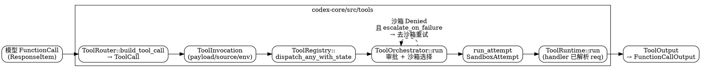

# Codex Tool System

## Introduction

Codex 的「工具系统」不是单一模块，而是一条**从协议契约到执行编排**的完整链路：模型吐出一个 `FunctionCall`，经过「路由 → 注册表 → 编排器 → 运行时」四层，最终落到一个真正读写文件、跑命令的 handler 上，再把结果回填成 `FunctionCallOutput`。整条链路的核心设计是**契约分层 + 策略正交**：

- **契约层**（`codex-tools` crate）：只描述「工具是什么、入参出参长什么样」，不关心怎么跑。
- **运行时契约 + 编排层**（`codex-core/src/tools`）：负责「要不要审批、套不套沙箱、失败要不要升级重试」，与具体工具逻辑正交。
- **handler / runtime 拆分**：每个工具拆成「协议适配器（handler）」和「执行体（runtime）」两块，runtime 只实现 `ToolRuntime<Rq, Out>`，由编排器统一套上审批+沙箱+重试。

> 版本基线：v0.167.0（`E:/Projects/codex-rust-v0.167.0`）

几个反直觉的点：

- **一个工具被注册成两个不同的「面」**：`register_trusted`（内置/原生）和 `register_external`（MCP/动态/插件）走两条不同的注册路径，外部工具重名会被安静跳过而非覆盖——保证内置工具永不被同名第三方工具顶替。
- **审批和沙箱都「不在工具里」**：工具本身只声明 `exec_approval_requirement` 与 `sandbox_permissions`，真正的审批回流（与 [Codex 核心会话循环](/docs/CS/AI/Codex/SessionLoop.md) 的 `Op::ExecApproval` 挂起/解挂是同一套）和沙箱包装（见 [Codex Sandbox](/docs/CS/AI/Codex/Sandbox.md)）由更外层的编排器注入。
- **apply_patch 自研了一套「模糊匹配」补丁算法**：不是 git diff，而是带 Unicode 标点归一化的三级宽松匹配，故意容忍模型生成的近似上下文。

## Tool Contract Layer (`codex-tools`)

协议契约是工具与模型之间的「形状定义」，定义在 `codex-tools` crate，可被 `codex-core` 之外的代码复用：

```rust
pub struct ToolDefinition {
    pub name: String,
    pub description: String,
    pub input_schema: JsonSchema,
    pub output_schema: Option<ToolOutputSchema>,
    pub defer_loading: bool,
}
```

更贴近运行的是 `ToolSpec` 枚举（承载在 `model_visible_specs` 里喂给模型），它有多个变体：`Function`（普通函数工具）、`Namespace`（带命名空间的工具组，如多 Agent 的 `agents.*`）、`Freeform`（自由格式，如 apply_patch 用纯文本而非 JSON schema）、`ToolSearch`（延迟加载的搜索工具）、`WebSearch`。

每个可执行工具实现 `ToolExecutor<Invocation>` trait：

```rust
pub trait ToolExecutor<Invocation>: Send + Sync {
    fn tool_name(&self) -> ToolName;
    fn spec(&self) -> ToolSpec;
    fn exposure(&self) -> ToolExposure { ToolExposure::Direct }
    fn supports_parallel_tool_calls(&self) -> bool { false }
    fn handle<'a>(&'a self, invocation: Invocation) -> ToolExecutorFuture<'a>
    where Invocation: 'a;
}
```

`exposure()` 决定工具对模型是否可见、是否延迟；`supports_parallel_tool_calls()` 决定它能否被并入 [Codex 核心会话循环](/docs/CS/AI/Codex/SessionLoop.md) 里提到的 `in_flight: FuturesOrdered` 并发执行。

## Registry and Routing (`codex-core/src/tools`)

注册表是名字→实现的中心索引，用保序的 `IndexMap`，保证工具顺序稳定（影响模型可见顺序与遥测）：

```rust
pub struct ToolRegistry {
    tools: IndexMap<ToolName, RegisteredTool>,
    functions_namespace_function_prefixes: FunctionsNamespaceFunctionPrefixes,
    first_collision: Option<ToolName>,
    pub(crate) tool_policy: Arc<ToolPolicy>,
}
```

- **两条注册路径**：`register_trusted`（内置 handler，`register_trusted_with_native_review` 还可标记 `NativeReview::Required` 让原生工具也走人类审查）与 `register_external`（MCP/动态/插件）。外部工具在 `register_external_with_exposure` 中会先查 `tool_policy.allows`，重名则记 `first_collision` 并跳过——`exec_command`/`shell_command` 这类保留名更是直接拒绝外部同名工具。
- **`ToolPolicy` 门控**：`tool_policy.allows(&tool_name)` 决定一个工具是否能进注册表，这是「能力开关」的第一道闸。
- **`ToolExposure` 六态**：`Direct` / `DirectModelOnly` / `Deferred` / `DeferredModelOnly` / `CodeModeOnly` / `Hidden`，控制工具何时对模型可见、是否走延迟 `tool_search`。

路由层 `ToolRouter` 持有 registry 和一份 `model_visible_specs`（`Arc<[ToolSpec]>`），负责把模型的 `ResponseItem` 还原成内部 `ToolCall`，并判断一个工具此刻是否暴露：

```rust
pub(crate) fn build_tool_call(&self, mut item: ResponseItem)
    -> Result<Option<ToolCall>, FunctionCallError>
```

`exposes_tool(name)` 会综合 `code_mode_tool_names`（code mode 路由的嵌套身份）与 `model_visible_specs` 判断模型能否直接调用、还是只能经 code mode 或延迟搜索调用。最终的派发入口 `dispatch_tool_call_with_state` 只是把 `ToolCall` 包成 `ToolInvocation` 后转交 `registry.dispatch_any_with_state`：

```rust
pub(crate) async fn dispatch_any_with_state(
    &self,
    mut invocation: ToolInvocation,
    call_state: Option<Arc<ToolCallState>>,
) -> Result<AnyToolResult, FunctionCallError>
```

`ToolInvocation` 是单次调用的完整上下文快照：`session` / `step_context` / `cancellation_token` / `tracker` / `call_id` / `tool_name` / `source`（`Direct` 或 `CodeMode { cell_id, runtime_tool_call_id }`）/ `payload`（`ToolPayload::Function` / `ToolSearch` / `Custom`）/ `environments`。

## Orchestration: Approval, Sandbox, Retry (`orchestrator.rs`)

`ToolOrchestrator::run(tool, req, tool_ctx)` 是真正执行前的「政策层」，它不直接跑工具，而是先决定**审批**和**沙箱**，再交给 `run_attempt` → `tool.run(...)`：

```rust
pub async fn run<Rq, Out, T>(&mut self, tool: &mut T, req: &Rq, tool_ctx: &ToolCtx)
    -> Result<OrchestratorRunResult<Out>, ToolError>
where T: ToolRuntime<Rq, Out>,
```

**① 审批（与会话循环共享一套机制）**

工具先声明 `exec_approval_requirement(req)`，得到 `ExecApprovalRequirement::{Skip, NeedsApproval, NeedsHumanApproval, Forbidden}`：

- `Forbidden` → 直接 `ToolError::Rejected`，不跑。
- `Skip` + `strict_auto_review` → 仍走 `tool_ctx.session.request_approval(...)`，触发 Guardian 自动审查。
- `NeedsApproval`/`NeedsHumanApproval` → `session.request_approval(action, approval_ctx)`，这个 `request_approval` 正是 [Codex 核心会话循环](/docs/CS/AI/Codex/SessionLoop.md) 里 `request_command_approval` 的那条路径——向用户发 `ExecApprovalRequest` 事件、`await rx_approve` 挂起，等 `Op::ExecApproval` 回流解挂。审批来源记入 `initial_approval_source`。

**② 首次尝试 + 沙箱选择**

编排器根据 `tool.sandbox_permissions(req)`、`file_system_sandbox_policy`、`managed_network_active` 选沙箱类型（`SandboxType`），组装 `SandboxAttempt`，调用 `run_attempt` → `tool.run(req, &attempt, &attempt_tool_ctx)`。网络审批（`begin_network_approval` → `ActiveNetworkApproval`）与沙箱代理在此一并注入。

**③ 沙箱拒绝后的升级重试**

若首次尝试返回 `Sandbox::Denied`，编排器检查 `tool.escalate_on_failure()` 与 `tool.wants_no_sandbox_approval(approval_policy)`：满足则**去掉沙箱重跑一次**（把 `SandboxOverride` 切到 Unsandboxed），否则直接把拒绝结果返回给模型。这是「默认拒绝、按需放宽」的安全退化逻辑。

## `ToolRuntime` vs Handler/Runtime Split

`codex-core` 在 `ToolExecutor` 之上又定义 `CoreToolRuntime` trait，额外承载 hooks、遥测、参数 diff、实时环境解析、MCP 服务名、原生审查标记等宿主能力。每个工具的实现被拆成两块：

- **handler**（`core/src/tools/handlers/*`）：协议适配——把 `ToolPayload` 解析成请求、把输出包成 `ToolOutput`、定义 `ToolSpec`。例如 `apply_patch.rs` 把自由文本补丁解析成 `Hunk` 序列，再 `convert_apply_patch_hunks_to_protocol` 转成协议层 `FileChange` 用于历史回放。
- **runtime**（`core/src/tools/runtimes/*`）：真正的执行体，实现 `ToolRuntime<Rq, Out>`。例如 `ApplyPatchRuntime`：

```rust
pub struct ApplyPatchRuntime { /* fs, sandbox, multi_environment */ }
impl ToolRuntime<ApplyPatchRequest, ApplyPatchRuntimeOutput> for ApplyPatchRuntime {
    fn turn_environment<'a>(&self, req: &'a ApplyPatchRequest) -> &'a TurnEnvironment { ... }
    fn exec_approval_requirement(&self, req: &ApplyPatchRequest) -> Option<ExecApprovalRequirement> { ... }
    async fn run(&self, req: &ApplyPatchRequest, attempt: &SandboxAttempt<'_>, ctx: &ToolCtx)
        -> Result<ApplyPatchRuntimeOutput, ToolError> { ... }
}
```

`runtimes/mod.rs` 顶部注释点明设计意图：「每个 runtime 保持小而专注，复用编排器处理审批+沙箱+重试」。也就是说，handler 负责「形状」，runtime 负责「动作」，`ToolOrchestrator` 负责「政策」。

## Toolset Assembly (`spec_plan.rs`)

所有原生工具在 `apply_spec_plan`（经 `add_shell_tools` / `add_core_utility_tools` / `add_collaboration_tools` 等子函数）里按**特性开关（Feature flag）**条件注册进 registry。从源码可见的注册清单（节选）：

- **文件编辑**：`ApplyPatchHandler`（当 `model_info.apply_patch_tool_type` 存在时注册）。
- **命令执行**：`ExecCommandHandler` + `WriteStdinHandler`（`Feature::UnifiedExec` 开启；否则退化为 `one_shot` 一次性执行，保留命令执行但不暴露可恢复进程）。
- **计划/上下文**：`PlanHandler`（`update_plan_enabled`）、`WaitForEnvironmentHandler`（`Feature::DeferredExecutor`）、`NewContextWindowHandler`/`GetContextRemainingHandler`（`Feature::TokenBudget`）。
- **人机交互**：`RequestUserInputHandler`、`RequestUserInputAsyncHandler`、`SendMessageToUserAsyncHandler`、`RequestPermissionsHandler`（`Feature::RequestPermissionsTool`）。
- **定位与工具发现**：`CurrentTimeHandler`/`SleepHandler`、`ListAvailablePluginsToInstallHandler`/`RequestPluginInstallHandler`（tool_suggest 开启时）。
- **媒体**：`ViewImageHandler`（`Feature::ViewImage`）。
- **MCP 资源**：`ListMcpResourcesHandler`/`ListMcpResourceTemplatesHandler`/`ReadMcpResourceHandler`（有 MCP server 时）。
- **协作/多 Agent**：`add_collaboration_tools` 注册 spawn 等子 Agent 工具（详见 [Codex 多 Agent](/docs/CS/AI/Codex/MultiAgent.md)）。
- **Code Mode**：`exec`/`wait` 嵌套工具（详见 [Codex Code Mode](/docs/CS/AI/Codex/CodeMode.md)）。

可见「哪些工具存在」是**配置与模型能力共同决定**的，而不是硬编码全集——注册前都要过 `tool_policy.allows` 与特性开关。

## apply_patch Algorithm (`codex-apply-patch`)

Codex 不靠 git，而是自带一套补丁格式与匹配引擎。补丁语法（Lark 文法在 `parser.rs` 顶部注释里）：

```
*** Begin Patch
*** Update File: path/to/file
@@
 context line
-old line
+new line
*** End of File
*** End Patch
```

支持三类 hunk：`Add File` / `Delete File` / `Update File`（`Update` 还可带 `*** Move to:` 改名）。`parse_patch` 产出 `Vec<Hunk>`，解析器是**故意宽松**的（常量 `PARSE_IN_STRICT_MODE = false`，注释点名 gpt-4.1 需要宽松解析）。

真正有趣的是上下文定位函数 `seek_sequence`：它在一行行文本里找 hunk 的上下文序列，匹配严格度**逐级放宽**：

1. 精确匹配；
2. 忽略行尾空白（rstrip）；
3. 忽略首尾空白（trim）；
4. **Unicode 标点归一化模糊匹配**——把 `– — ‑ −` 等破折号归一成 `-`，把花式引号归一成 `'`/`"`，把不换行空格等归一成普通空格，再比较。注释明确说这是为了「模拟 `git apply` 容忍字节级差异」的行为，让用纯 ASCII 写的补丁也能打到含 typographic dash 的源码上。

`apply_hunks_to_files` 按 hunk 依次落到 `ExecutorFileSystem`（统一抽象，沙箱与 exec-server 走同一套 IO 接口，可选 `FileSystemSandboxContext` 做权限校验），并维护一个 `AppliedPatchDelta`：

- 用 `try_write!` 宏包裹每次写，**一旦写失败就把 `delta.exact` 置为 `false`**——因为失败前的部分写入可能已改变目标文件，delta 不再「精确」，这样上层能如实报告「哪些确实写下去了」用于安全回滚提示。
- 删文件前会先读回内容做 `remove_failure_was_side_effect_free` 校验，移动文件失败时只回滚原始文件删除。
- 最后打印 git 风格的 `A/M/D` 摘要。这套「增量可观测、失败不谎报精确性」的设计，正是它敢于让模型直接改文件的安全底气。

## shell-command (`codex-shell-command`)

`ExecCommandHandler` 背后是 `codex-shell-command` crate，提供跨平台命令解析与安全工具：

- `parse_command`：把任意 shell 命令解析成 `Vec<ParsedCommand>`，用于给用户在 UI 上展示**人类可读**的命令摘要（先去重相邻重复，出现 `Unknown` 则整体降级为单个 `Unknown`）。它内部对 bash / powershell 分别 `extract_bash_command` / `extract_powershell_command`，用 shlex 分词，powershell 还保留 Windows 路径与别名。
- `is_dangerous_command`（`command_safety` 模块）：命令危险性检测，供沙箱/审批策略判断是否要弹确认。
- **shell 快照**（`shell_snapshot*`）：在子进程启动前对凭据、导出变量、字面量做快照，运行后用于凭据代发（与 [Codex Sandbox](/docs/CS/AI/Codex/Sandbox.md) 的 `credential_broker` 配合）与环境恢复——确保代理注入的临时凭据不会落盘、不会泄漏到下一命令。

## Dispatch Pipeline (visual)



## Links

- [Codex Architecture](/docs/CS/AI/Codex/Architecture.md)
- [Codex 核心会话循环](/docs/CS/AI/Codex/SessionLoop.md)
- [Codex Sandbox](/docs/CS/AI/Codex/Sandbox.md)
- [Codex 多 Agent](/docs/CS/AI/Codex/MultiAgent.md)
- [Codex Code Mode](/docs/CS/AI/Codex/CodeMode.md)
- [MCP 协议](/docs/CS/AI/LLM/Protocol/MCP.md)

## References

1. [openai/codex（v0.167.0）— codex-tools/src](https://github.com/openai/codex/tree/v0.167.0/codex-rs/tools/src)
2. [openai/codex（v0.167.0）— codex-core/src/tools](https://github.com/openai/codex/tree/v0.167.0/codex-rs/core/src/tools)
3. [openai/codex（v0.167.0）— codex-apply-patch](https://github.com/openai/codex/tree/v0.167.0/codex-rs/apply-patch)
4. [openai/codex（v0.167.0）— codex-shell-command](https://github.com/openai/codex/tree/v0.167.0/codex-rs/shell-command)
