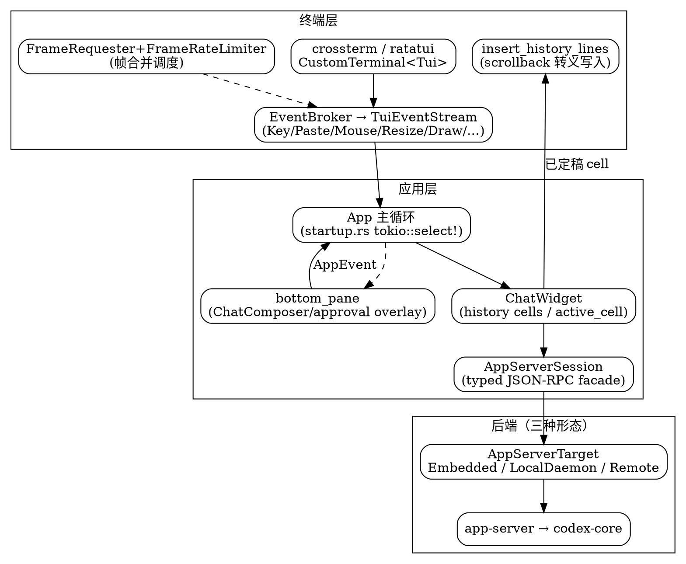

# Codex TUI 与交互（TUI & Interaction）

## Introduction

`codex-tui` 是用户敲 `codex` 进入的那个交互式终端界面。它与 TUI 架构的两个主流直觉都不同：

- **TUI 不是直接驱动 `codex-core` 的前端**。它是一个 **app-server 客户端**：所有会话操作都走 `codex_app_server_protocol` 的 JSON-RPC（`Turn` / `ServerNotification` / `ServerRequest`），与桌面 App、IDE 客户端完全同构。App-server 本身可以**内嵌在同进程**（Embedded）、连接**本地守护进程**（LocalDaemon）或**远程端点**（Remote，UnixSocket/WebSocket）。
- **已定稿的历史不靠 ratatui 渲染，而是直接写进终端 scrollback**（转义序列操作）。ratatui 只负责底部视口（composer、spinner、弹层）与 overlay。



## 终端层：Tui、事件流与帧调度

`tui.rs` 的 `Tui` 是终端封装，持有一个**自定义 Terminal**（`CustomTerminal<CrosstermBackend<Stdout>>`，非 ratatui 原生），以及一整套终端策略状态：

```rust
pub struct Tui {
    pub(crate) link_hover: link_pointer::LinkHover,
    frame_requester: FrameRequester,
    draw_tx: broadcast::Sender<()>,
    pub(super) event_broker: Arc<EventBroker>,
    pub(crate) terminal: Terminal,
    pending_history_lines: Vec<PendingHistoryLines>,
    screen_size: ScreenSizePolicy,
    alt_screen_active: Arc<AtomicBool>,   // overlay/owned transcript 用备用屏
    enhanced_keys_supported: bool,
    scrollback: ScrollbackStrategy,
    pub(crate) mouse_capture: MouseCapture,
    pub(crate) clipboard: crate::clipboard_copy::worker::ClipboardWorker,
    _stderr_guard: terminal_stderr::TerminalStderrGuard,
}
```

- **`TuiEvent`** 归一化终端事件：`Key` / `Paste`（bracketed paste，经 app 层归一化）/ `Mouse` / `Resize` / `Draw`（调度重绘）/ `Resume`（挂起恢复后首帧，需刷新几何）/ `FocusGained` / `FocusLost`。`Resize` 与 `Draw` 分开，使 app 能在 resize 时跑特性门控的预渲染逻辑而不影响常规帧。
- **`EventBroker`** 共享单个 crossterm EventStream，并在暂停/恢复时**销毁并重建**事件流。文档化的动机：crossterm 的 EventStream 若不被 drop，会持续读 stdin，偷走外部编辑器（如 vim）正在等待的输入或 OSC 查询响应——所以交接终端时必须彻底 drop 再重建。
- **`FrameRequester`** 是 actor 风格的帧调度：任意 widget/后台任务可 clone 这个轻量句柄 `schedule_frame()`，内部 `FrameScheduler` 任务把多个请求**合并成一次** broadcast 通知，配合 `FrameRateLimiter`（`TARGET_FRAME_INTERVAL`）保证动画平滑又不超帧率。
- 备用屏（alternate screen）供 overlay 与 owned transcript 使用；`MouseCapture::Inherit` 默认只在 TUI 拥有屏幕时捕获鼠标，把选择/链接点击让给终端；`TerminalStderrGuard` 防止非托管子进程的 stderr 打进视口；tmux 场景由 `SizeMonitor` 采样尺寸并转成 resize 事件。

## Scrollback 即历史：insert_history

这是 Codex TUI 最反直觉的渲染决策——**已定稿的历史行不进 ratatui 的 buffer**，而是用光标/滚动转义序列直接写到视口上方，复用终端原生 scrollback（可随意向上翻）：

```rust
pub fn insert_history_lines<B>(
    terminal: &mut crate::custom_terminal::Terminal<B>,
    lines: Vec<Line>,
) -> io::Result<()> { ... }
```

- 不可信内容先经 ratatui 的控制字符过滤，再叠加**可信的**语义超链接转义（`terminal_hyperlinks`）。
- `HistoryLineWrapPolicy::{PreWrap, Terminal}` 决定换行策略：预换行（自己按宽度折）或交给终端软折行；`InsertHistoryMode::{Standard, FullScreen}` 在部分滚动区域不可靠（如 Zellij）时退化为全屏插入以保住终端原生 scrollback。
- ratatui 视口里只保留**未定稿的尾部**（流式输出、composer、spinner），配合 `pending_history_lines` 延迟到下一帧写入。

## 主循环：五路 select

`run_main`（lib.rs）→ `startup_orchestration::run_main_inner` → `run_ratatui_app`。panic hook 先恢复终端再走 color-eyre；release 版先探更新提示；`StartupDraftPump::run_until` 让启动期间仍能消费终端输入（边等 app-server 引导边渲染草稿输入框）。

真正的主循环在 `app/startup.rs`：一个 `loop` 先消化 pending 工作（resume picker、worktree 切换/附加、reconnect），再进入 `tokio::select!` 五路等待：

```rust
let control = select! {
    result = async { /* daemon_restart task */ }, if app.daemon_restart.is_some() => { ... }
    Some(event) = app_event_rx.recv() => {
        match Box::pin(app.handle_event(tui, backends.session_at_mut(event_session), event)).await { ... }
    }
    active = async { app.active_thread_rx.recv().await }, if ... => { ... }
    event = tui_events.next(), if ... => {
        match app.handle_tui_event(tui, ..., event).await { ... }
    }
    (owner, app_server_event) = backends.next_event(paused_backend) => { ... }
};
```

- **app_event_rx**：内部 `AppEvent`（业务意图，如 `InsertHistoryCell` / `ForkCurrentSession` / `OpenResumePicker`）。
- **active_thread_rx**：当前活跃线程的事件缓冲。
- **tui_events**：终端事件流。
- **backends.next_event**：app-server 事件，**支持多会话**（`BackendSessions` 管理主会话与 worktree/agents overview 等附属会话），事件按 owner 路由。
- 每轮返回 `AppRunControl::{Continue, Exit}`；传输层错误经 `recover_transport_error` 触发重连（`app.reconnect.offline` 状态机）而不退出；离线时事件白名单收窄（多数 AppEvent 被拒），`Exit(ShutdownFirst)` 有 2s 超时（`SHUTDOWN_FIRST_EXIT_TIMEOUT`）。

`AppEvent` 的穷举分发在 `app/event_dispatch.rs` 的 `handle_event`，中央 match 只做路由，大块领域逻辑委托给 `app/` 下 130+ 个子模块（startup、resume、agents_overview、config_panel、history_pagination、user_turn_submission…）。

## ChatWidget：会话主表面

`chatwidget.rs` 的 `ChatWidget` 是核心组件，职责是把 app-server 协议事件变成 UI：

- **双 cell 模型**：已定稿的 transcript cells（不可变）+ 流式期间**原地可变的 `active_cell`**（常为合并后的 exec/工具组）。Ctrl+T 的 transcript overlay 渲染已定稿 cells 加一个**缓存的活动尾部**——`active_cell_transcript_key()` 作为缓存键，只在活动 cell 原地变更或输出随时间变化时重建，避免每帧重算。
- **busy 状态派生**：底部"任务运行中"指示器（spinner + 中断提示）由 `agent_turn_running` 与 `mcp_startup_status` 两个独立生命周期经 `update_task_running_state` 同步派生；preamble 模型在 commentary 流式期间隐藏状态行避免重复进度，流结束后恢复。
- **slash 命令的分界**：解析在 bottom-pane composer，**接受在 ChatWidget**——composer 只负责暂存召回条目并清空输入，ChatWidget 在分发后记录尝试过的 slash 命令，与普通文本提交同路径。
- `chatwidget/` 子模块按生命周期拆分：`streaming` / `turn_runtime` / `tool_lifecycle` / `interrupts` / `compaction` / `permission_popups` / `model_popups` / `usage` / `transcript` 等。

## bottom_pane：输入与审批

`bottom_pane/` 是视口底部的交互层：

- **ChatComposer**（`chat_composer.rs` + `chat_composer_history`）：多行输入、输入历史、slash 命令补全（`command_popup`）、文件提及搜索（`file_search_popup`）、mention 编解码（`mention_codec`，如 `encode_history_mentions_at_elements`）、粘贴风暴处理（`paste_burst`）、prompt 参数填充（`prompt_args`）。
- **审批 overlay**（`approval_overlay.rs`）：`approval_events.rs` 把 app-server 的请求参数归一化成 TUI 视图模型：

```rust
pub(crate) struct ExecApprovalRequestEvent {
    pub(crate) kind: CommandExecutionApprovalKind,
    pub(crate) call_id: String,
    pub(crate) approval_id: Option<String>,
    pub(crate) turn_id: String,
    pub(crate) command: Vec<String>,
    pub(crate) cwd: AbsolutePathBuf,
    pub(crate) reason: Option<String>,
    pub(crate) proposed_execpolicy_amendment: Option<ExecPolicyAmendment>,
    pub(crate) proposed_network_policy_amendments: Option<Vec<NetworkPolicyAmendment>>,
    pub(crate) available_decisions: Option<Vec<CommandExecutionApprovalDecision>>,
    pub(crate) network_approval_context: Option<NetworkApprovalContext>,
    pub(crate) additional_permissions: Option<AdditionalPermissionProfile>,
}
```

  `available_decisions` 缺省时按 execpolicy/network 修正案与附加权限推导默认决策集（对应 Sandbox 笔记里"用户批准反向写 allow 规则"的前端呈现）；patch 审批额外带从相邻 thread item 收集的 `FileChange` 显示模型。
- 其余：`list_selection_view` / `multi_select_picker`（选择器）、`config_panel`（配置面板）、`footer`（快捷键提示）、`questions` / `request_user_input`（异步提问）、`pending_thread_approvals`（审批可被流式输出延迟呈现）。

## 审批闭环：ServerRequest 往返

审批请求从 app-server 以 **`ServerRequest`**（服务端→客户端的反向 JSON-RPC 请求）到达 TUI：`ExecCommandApproval` / `ApplyPatchApproval` / `PermissionsRequestApproval` / `McpServerElicitationRequest` / `DynamicToolCall` 等。`app/app_server_events.rs::handle_server_request_event` 先经 `BufferedServerRequest` 缓冲（持有 `request_handle`），再进 UI 呈现；用户决策后经同一 handle 回写响应。这条链与 SessionLoop 笔记中 core 侧的 `Op::ExecApproval` → `resolve_exec_approval` → `sender.send(decision)` 解挂闭环对应：**审批的挂起点在 core，呈现在 TUI，中间隔着完整 app-server 协议**。

## App-server 接入的三种形态

`lib.rs::AppServerTarget` 决定 TUI 的后端：

- **Embedded**：`InProcessAppServerClient::start` 把 app-server 以库形式跑在同进程（默认交互模式，省一个进程）；
- **LocalDaemon**：连接本机常驻守护（多客户端共享，TUI 重连友好——这也是 reconnect 状态机存在的原因）；
- **Remote**：`RemoteAppServerClient::connect(RemoteAppServerConnectArgs)` 连接 UnixSocket 或 WebSocket 端点（`resolve_remote_addr` 解析，支持 auth token）。

`AppServerSession`（`app_server_session.rs`）是 typed facade，把所有 JSON-RPC 调用（thread 生命周期、config 读写、skills/plugins、账户与限流、review、goal、history 分页……）收拢在一个模块，让 `App` 与 `ChatWidget` 不接触裸协议。

## 与相邻子系统的边界

- **与架构**：Architecture 笔记说"两前端共用引擎"——TUI 深挖后的精确表述是：TUI 经 app-server 协议共用引擎，且 app-server 自身可有 in-process / daemon / remote 三种宿主形态。
- **与会话循环**：TUI 看到的 `Turn` / `ItemStarted` / `ItemCompleted` 通知，是 SessionLoop 中 `run_turn` 产生的 `EventMsg` 经 app-server 协议映射的产物。
- **与沙箱**：execpolicy 修正案（`proposed_execpolicy_amendment`）与网络修正案在审批 UI 呈现，批准后写回策略（见 Sandbox 笔记）。
- **与持久化**：resume picker（`resume_picker.rs`）读线程列表走 app-server 的 state DB 索引，transcript 预览经 rollout 重建（见 Persistence 笔记）。

## Links

- [Codex 总览](/docs/CS/AI/Codex/Codex.md)
- [Codex 架构](/docs/CS/AI/Codex/Codex.md?id=architecture)
- [Codex 核心会话循环](/docs/CS/AI/Codex/SessionLoop.md)
- [Codex 沙箱](/docs/CS/AI/Codex/Sandbox.md)
- [Codex 持久化与状态](/docs/CS/AI/Codex/Persistence.md)

## References

- `codex-rust-v0.167.0/codex-rs/tui/src/tui.rs`（`Tui` / `TuiEvent` / 终端策略）
- `codex-rust-v0.167.0/codex-rs/tui/src/tui/event_stream.rs`（`EventBroker` drop/recreate 动机）
- `codex-rust-v0.167.0/codex-rs/tui/src/tui/frame_requester.rs`（帧合并调度）
- `codex-rust-v0.167.0/codex-rs/tui/src/insert_history.rs`（scrollback 转义写入 / wrap policy）
- `codex-rust-v0.167.0/codex-rs/tui/src/app/startup.rs`（主循环 `select!` 五路源）
- `codex-rust-v0.167.0/codex-rs/tui/src/app/event_dispatch.rs`（AppEvent 穷举分发 / 离线门控）
- `codex-rust-v0.167.0/codex-rs/tui/src/chatwidget.rs`（双 cell 模型 / transcript overlay 缓存）
- `codex-rust-v0.167.0/codex-rs/tui/src/approval_events.rs`（审批视图模型 / 默认决策集）
- `codex-rust-v0.167.0/codex-rs/tui/src/lib.rs`（`run_main` / `AppServerTarget` 三形态）
- `codex-rust-v0.167.0/codex-rs/tui/src/app_server_session.rs`（typed JSON-RPC facade）
