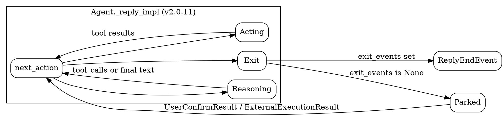

## Introduction

`Agent` 类是 AgentScope 唯一的主循环载体，本分册以 **v2.0.11** 源码为基线，逐行核验它的调用链、三动作状态机、事件流重建、HITL 状态机与外部执行契约。下文的路径均相对 `src/agentscope/`。

> 版本基线：v2.0.11（`__version__ = "2.0.11"`，`_version.py`；tag `v2.0.11`）

版本常量（`_version.py`）：

```python
__version__ = "2.0.11"
```

三个反直觉点：

1. **核心文件比旧笔记写的大得多**：`agent/_agent.py` 实为 **3942 行**（v2.0.8 已是 3908 行），而真正的 ReAct 主循环 `_reply_impl()` 只有 270 行。其余三千多行是事件转换、压缩、权限、HITL 与工具执行的辅助面。
2. **v2.0.8 → v2.0.11 核心层几乎没有结构性改动**：没有新增 hook、没有新增 `EventType` 枚举值、没有新增 `AgentState` 字段、没有新增 action 类型、没有新增权限模式。变化集中在**契约层**：外部执行结果校验、`AskUser`、模型路由中间件与流式重建的 bug 修复。
3. **DataBlock 分片合并从「按当前块」精化为「按 `block_id` 定位」**：decode → 拼接 → encode 在 v2.0.8 已有，v2.0.11 新增按 `event.block_id` 匹配同 id DataBlock（`message/_base.py`），找不到就 append 新块，避免多个 DataBlock 并存于同一条 Msg 时串台；生产端也真的传 `block_id=block.id`（`agent/_agent.py`）。合并分支（`message/_base.py`）：

```python
                    # Merge same-id Base64 chunks like
                    # ToolResponse.append_chunk.
                    merge_target: DataBlock | None = None
                    for output_block in block.output:
                        if (
                            isinstance(output_block, DataBlock)
                            and output_block.id == event.block_id
                            and isinstance(output_block.source, Base64Source)
                        ):
                            merge_target = output_block
                            break
                    if merge_target is not None and isinstance(
                        src,
                        Base64Source,
                    ):
                        existing = base64.b64decode(merge_target.source.data)
                        incoming = base64.b64decode(src.data)
                        merge_target.source.data = base64.b64encode(
                            existing + incoming,
                        ).decode("ascii")
                        merge_target.source.media_type = (
                            src.media_type or merge_target.source.media_type
                        )
                    else:
                        block.output.append(
                            DataBlock(id=event.block_id, source=src),
                        )
```

生产端（`agent/_agent.py`）：

```python
                yield ToolResultDataDeltaEvent(
                    reply_id=self.state.reply_id,
                    tool_call_id=tool_call_id,
                    # Keep the block id so replay groups one payload.
                    block_id=block.id,
                    media_type=block.source.media_type,
                    data=block.source.data,
                )
```

## Call Chain and the Real Size of the Core

公开入口只有两个：`reply()`（`agent/_agent.py`）把整条事件流消费完返回最后一条 `Msg`；`reply_stream()` 产出 `AsyncGenerator[AgentEvent | Msg]`。两者都复用 `_reply()`——它用递归的 `execute_chain()` 组装 `on_reply` 洋葱链，并在 yield `ReplyEndEvent` 前置 `_receive_reply_end` 标志，最后落到 `_reply_impl()`。

两个公开入口的签名（`agent/_agent.py`）：

```python
    async def reply_stream(
        self,
        inputs: Msg
        | list[Msg]
        | UserConfirmResultEvent
        | UserInterruptEvent
        | ExternalExecutionResultEvent
        | None = None,
        structured_schema: Type[BaseModel] | None = None,
        yield_final_msg: bool = False,
    ) -> AsyncGenerator[AgentEvent | Msg, None]:
```

```python
    async def reply(
        self,
        inputs: Msg
        | list[Msg]
        | UserConfirmResultEvent
        | UserInterruptEvent
        | ExternalExecutionResultEvent
        | None = None,
        structured_schema: Type[BaseModel] | None = None,
    ) -> Msg:
```

`_reply()` 的洋葱链与 `_receive_reply_end` 标志（同文件）：

```python
    async def _reply(
        self,
        inputs: Msg
        | list[Msg]
        | UserConfirmResultEvent
        | UserInterruptEvent
        | ExternalExecutionResultEvent
        | None = None,
        structured_schema: Type[BaseModel] | None = None,
    ) -> AsyncGenerator[AgentEvent | Msg, None]:
        """Reply entry point (maybe wrapped by middleware). The reply loop
        exits only after its ``ReplyEndEvent`` escapes the middleware chain,
        so an ``on_reply`` middleware can swallow the event (receive it
        without yielding) to force another reasoning-acting round."""
        if not self._reply_middlewares:
            agen = self._reply_impl(
                inputs=inputs,
                structured_schema=structured_schema,
            )
        else:

            async def execute_chain(
                index: int = 0,
                inputs: Msg
                | list[Msg]
                | UserConfirmResultEvent
                | UserInterruptEvent
                | ExternalExecutionResultEvent
                | None = inputs,
                structured_schema: Type[BaseModel] | None = structured_schema,
            ) -> AsyncGenerator[AgentEvent | Msg, None]:
                if index >= len(self._reply_middlewares):
                    async for item in self._reply_impl(
                        inputs=inputs,
                        structured_schema=structured_schema,
                    ):
                        yield item
                else:
                    mw = self._reply_middlewares[index]
                    ...
            agen = execute_chain()

        self._receive_reply_end = False
        async for item in agen:
            # Set before the yield: the suspended `_reply_impl` checks the
            # flag once resumed by the next pull
            if isinstance(item, ReplyEndEvent):
                self._receive_reply_end = True
            yield item
```

> 上面 `execute_chain` 内部的 `next_handler` / `mw.on_reply` 段用 `...` 标注省略。

`_reply_impl()` 的 `while True` 与三种 action 分支（`agent/_agent.py`），`made_progress` 与 `_receive_reply_end` 两个标志位共同防止中间件连续吞掉 `ReplyEndEvent` 后形成 busy loop：

```python
            # Detects middlewares swallowing the ReplyEndEvent repeatedly
            # without any reasoning/acting in between (a busy loop)
            made_progress = True
            while True:
                # =============================================================
                # Step 3.1: Decide the next action based on the current state
                # =============================================================
                next_action = self._next_action(final_msg)

                match next_action:
                    case Exit(exit_msg=exit_msg, exit_events=exit_events):
                        if not exit_events:
                            # Parked on HITL: the reply is not finished, so
                            # the continuation protocol doesn't apply
                            yield exit_msg
                            return
                        ...
                        if self._receive_reply_end:
                            yield exit_msg
                            return

                        if not made_progress:
                            raise RuntimeError(
                                "A middleware swallowed the ReplyEndEvent "
                                "twice without any reasoning/acting in "
                                "between. Unblock the next round (e.g. "
                                "adjust 'cur_iter', 'max_iters' or the "
                                "structured output state) before swallowing "
                                "the event again.",
                            )
                        made_progress = False
                        final_msg = None
                        continue

                    case Reasoning(hint=hint, tool_choice=tool_choice):
                        made_progress = True
                        final_msg = None
                        ...
                        if interrupted:
                            # Handled by the CancelledError branch below
                            raise asyncio.CancelledError()

                    case Acting(tool_calls=tool_calls):
                        made_progress = True
                        for batch in await self._batch_tool_calls(tool_calls):
                            if batch.type == "sequential":
```

> 上面 Exit 的 `for exit_event in exit_events` 段、Reasoning 的压缩/注入/`_reasoning` 段用 `...` 标注省略。

## Three Actions and the Parked Exit

`Exit` / `Reasoning` / `Acting` 是定义在 `agent/_utils.py` 的 Pydantic BaseModel，不是枚举。三个类（`agent/_utils.py`）：

```python
class Acting(BaseModel):
    """Next action: execute the given tool calls."""

    tool_calls: list[ToolCallBlock]


class Reasoning(BaseModel):
    """Next action: another model call, with optional hint and tool choice."""

    hint: HintBlock | None = None
    tool_choice: ToolChoice | None = None


class Exit(BaseModel):
    """Next action: end the reply."""

    exit_msg: Msg
    exit_events: list[AgentEvent] | None = None
```

`_next_action()`（`agent/_agent.py`）判定分三步。函数签名与 Step 1：

```python
    def _next_action(
        self,
        final_msg: Msg | None = None,
    ) -> Reasoning | Acting | Exit:
        """Decide the next action from the current state. Read-only: all
        side effects are performed by the caller ``_reply_impl``."""

        # ===========================================================
        # Step 1: Check executable and awaiting tool calls
        # ===========================================================
        awaiting_tool_calls = self.state.get_awaiting_tool_calls(self.name)

        last_msg = self._get_last_msg()
        if last_msg is not None:
            # In case wrong tool call state, first filter with the results
            finished_ids = {
                _.id for _ in last_msg.get_content_blocks("tool_result")
            }
            # With awaiting tool calls, PENDING ones are blocked (e.g.
            # deduplicated in a batch) and wait; only ALLOWED ones execute
            executable_tool_calls = [
                _
                for _ in last_msg.get_content_blocks("tool_call")
                if _.id not in finished_ids
                and (
                    _.state == ToolCallState.ALLOWED
                    or (
                        _.state == ToolCallState.PENDING
                        and not awaiting_tool_calls
                    )
                )
            ]
            if executable_tool_calls:
                # Next execute the tool calls
                return Acting(tool_calls=executable_tool_calls)

        if awaiting_tool_calls:
            # Next wait for the permission or external execution to finish
            return Exit(
                # The reply doesn't finish yet
```

1. **Step 1**：存在可执行的 tool call → `Acting`；存在 awaiting 的调用 → `Exit`（parked）。
2. **Step 2**：处理结构化输出，含 `grace_iters` 与强制收尾逻辑。
3. **Step 3**：已有 `final_msg` → `Exit`；`cur_iter == max_iters` → 强制收尾的 `Reasoning`；否则 `Reasoning()`。

最容易被误读的是 `Exit.exit_events = None`——它**不是「没有事件」，而是「reply 尚未结束、parked 在 HITL」**。`_reply_impl` 用 `if not exit_events` 区分 parked 与正常结束（见上面 `while True` 片段）。

`_batch_tool_calls()`（`agent/_agent.py`）仍只按 `is_concurrency_safe` 分 concurrent / sequential 两批，未注册的工具被当作 concurrent：

```python
    async def _batch_tool_calls(
        self,
        tool_calls: list[ToolCallBlock],
    ) -> list[_ToolCallBatch]:
        """Batch the tool calls into a sequence of batches that should be
        executed **sequentially** or **concurrently** according to the tool
        properties `is_concurrency_safe` and `is_read_only`.
        """

        # Batch the tool calls according to whether they can be executed
        # concurrently or not
        batches: list[_ToolCallBatch] = []
        for tool_call in tool_calls:
            tool = await self.toolkit.get_tool(tool_call.name)

            # Treat unregistered or unavailable tools as concurrent tools since
            # it will not generate side effects and be blocked with acting
            if tool is None or tool.is_concurrency_safe:
                if len(batches) == 0 or batches[-1].type != "concurrent":
                    batches.append(
                        _ToolCallBatch(
                            type="concurrent",
                            tool_calls=[tool_call],
                        ),
                    )
                else:
                    batches[-1].tool_calls.append(tool_call)
            else:
                if len(batches) == 0 or batches[-1].type != "sequential":
                    batches.append(
                        _ToolCallBatch(
                            type="sequential",
                            tool_calls=[tool_call],
                        ),
                    )
                else:
                    batches[-1].tool_calls.append(tool_call)

        return batches
```

同批并发用 `asyncio.gather(..., return_exceptions=True)` 加 sentinel 队列，异常聚合成 `ExceptionGroup`。



## AgentState: Eight Fields, One Serializable Bus

`AgentState` 是纯 Pydantic BaseModel，**8 个字段**（`state/_state.py`）：`session_id`、`summary`、`context`、`reply_context`、`permission_context`、`tool_context`、`tasks_context`、`middle_context`。v2.0.8 → v2.0.11 对这个文件的唯一改动是注释里的拼写 `backword` → `backward`。

类定义与字段（`state/_state.py`）：

```python
class AgentState(BaseModel):
    """The agent state that should be saved and loaded from storage."""

    session_id: str = Field(default_factory=_generate_id)
    """The session id of the agent. Normally, each session will maintain one
    independent agent state for each agent."""

    summary: str | list[TextBlock | DataBlock] = ""
    """The compressed summary of the context, which will be prepended to the
    context when fed into the LLM."""

    context: list[Msg] = Field(default_factory=list)
    """The uncompressed conversation context, which will be fed into the LLM"""
    ...
    reply_context: ReplyContext = Field(default_factory=ReplyContext)
    """The reply related context."""

    permission_context: PermissionContext = Field(
        default_factory=PermissionContext,
    )
    """The permission context that will be passed to the toolkit to determine
    the tool permissions."""

    tool_context: ToolContext = Field(default_factory=ToolContext)

    tasks_context: TaskContext = Field(default_factory=TaskContext)
    """The task context that records the agent tasks."""

    middle_context: dict[str, Any] = Field(default_factory=dict)
    """The context that allow the middlewares to store/get data across
    different replies."""
```

> 上面 `AgentState` 中段的向后兼容 validator 与 `reply_id` / `cur_iter` property 用 `...` 标注省略。

`middle_context` 是专为中间件跨 reply 存状态准备的字典，也解释了为什么 `ModelRouterMiddleware` 的路由决策能在 HITL 恢复后保持不变——完整展开见 Classifier 分册。

## Event Stream Replay and Chunk Merging

`EventType` 恰好 **28 个值**（`event/_event.py`），v2.0.8 也是 28，**没有新增枚举值**；ContentBlock 仍是六种（`message/_block.py`）。`Msg.append_event()`（`message/_base.py`）按 `reply_id` 归并，不匹配就 warning 跳过。

`EventType` 枚举（`event/_event.py`）：

```python
class EventType(StrEnum):
    """Event type enumeration."""

    REPLY_START = "REPLY_START"
    REPLY_END = "REPLY_END"

    MODEL_CALL_START = "MODEL_CALL_START"
    MODEL_CALL_END = "MODEL_CALL_END"

    TEXT_BLOCK_START = "TEXT_BLOCK_START"
    TEXT_BLOCK_DELTA = "TEXT_BLOCK_DELTA"
    TEXT_BLOCK_END = "TEXT_BLOCK_END"

    DATA_BLOCK_START = "DATA_BLOCK_START"
    DATA_BLOCK_DELTA = "DATA_BLOCK_DELTA"
    DATA_BLOCK_END = "DATA_BLOCK_END"

    THINKING_BLOCK_START = "THINKING_BLOCK_START"
    THINKING_BLOCK_DELTA = "THINKING_BLOCK_DELTA"
    THINKING_BLOCK_END = "THINKING_BLOCK_END"

    HINT_BLOCK = "HINT_BLOCK"

    TOOL_CALL_START = "TOOL_CALL_START"
    TOOL_CALL_DELTA = "TOOL_CALL_DELTA"
    TOOL_CALL_END = "TOOL_CALL_END"

    TOOL_RESULT_START = "TOOL_RESULT_START"
    TOOL_RESULT_TEXT_DELTA = "TOOL_RESULT_TEXT_DELTA"
    TOOL_RESULT_DATA_DELTA = "TOOL_RESULT_DATA_DELTA"
    TOOL_RESULT_END = "TOOL_RESULT_END"

    EXCEED_MAX_ITERS = "EXCEED_MAX_ITERS"

    REQUIRE_USER_CONFIRM = "REQUIRE_USER_CONFIRM"
    REQUIRE_EXTERNAL_EXECUTION = "REQUIRE_EXTERNAL_EXECUTION"

    USER_CONFIRM_RESULT = "USER_CONFIRM_RESULT"
    USER_INTERRUPT = "USER_INTERRUPT"
    EXTERNAL_EXECUTION_RESULT = "EXTERNAL_EXECUTION_RESULT"

    CUSTOM = "CUSTOM"
```

`append_event()` 的 CUSTOM 短路与 reply_id 校验（`message/_base.py`）：

```python
    def append_event(  # pylint: disable=too-many-branches,too-many-statements
        self,
        event: AgentEvent,
    ) -> Self:
        """Update the message by applying a streaming event.
        ...
        Custom events are skipped because they do not update message content.
        Events whose ``reply_id`` does not match ``self.id`` are skipped with
        a warning. Block-level delta/end events whose target block cannot be
        found are also skipped with a warning.
        ...
        """
        from ..event import EventType  # local import to avoid circular dep

        if event.type == EventType.CUSTOM:
            return self

        if event.reply_id != self.id:
            logger.warning(
                "Event %s with reply_id %r does not match message id %r, "
                "skipping.",
                event.__class__.__name__,
                event.reply_id,
                self.id,
            )
            return self
```

> 上面 `append_event` docstring 的 Args 段用 `...` 标注省略。

v2.0.11 的三处变化值得单列：

| 修复 | 位置 | 语义 |
| :--- | :--- | :--- |
| CUSTOM 事件不参与 Msg 重建 | `message/_base.py` | 直接 `return self`；`mcp_progress`（`agent/_agent.py`）能穿过事件流却不污染重建出的 Msg |
| DataBlock 分片按 `block_id` 定位 | `message/_base.py` | 命中同 id 分片才 decode → 拼接 → encode，否则 append 新块；decode→concat→re-encode 本身 v2.0.8 已有 |
| `append_usage` 用 `model_copy()` | `message/_base.py` | 不采纳调用方传进来的 usage 对象 |

`append_usage()` 的 docstring 与实现（`message/_base.py`）：

```python
    def append_usage(self, usage: Usage) -> Self:
        """Accumulate the token usage of one model call into this message.

        The message keeps a copy of ``usage``, so the object handed over by
        the caller is never adopted and keeps its own value.
        ...
        """
        if self.usage is None:
            self.usage = usage.model_copy()
        else:
            self.usage.input_tokens += usage.input_tokens
            self.usage.output_tokens += usage.output_tokens
```

> 上面 docstring 的 Args 段用 `...` 标注省略。

另有 `CustomEvent(name="mcp_progress")` 从 `ToolChunk.metadata` 转发进度（`agent/_agent.py`、`event/_event.py`），以及全树统一的 `_generate_timestamp`（`event/_event.py`、`state/_task.py`）。

## Two Five-State Machines, Not One

旧笔记把 HITL 写成一条 `PENDING → ASKING → ALLOWED → DENIED / SUBMITTED / INTERRUPTED / ERROR → FINISHED` 的状态机，这是**把两个枚举混成了一条**。v2.0.11（v2.0.8 亦如此）实际是：

- `ToolCallState` **5 态**：`PENDING / ASKING / ALLOWED / SUBMITTED / FINISHED`（`message/_block.py`）
- `ToolResultState` **5 态**：`SUCCESS / ERROR / INTERRUPTED / DENIED / RUNNING`（`message/_block.py`）

两个枚举（`message/_block.py`）：

```python
class ToolCallState(StrEnum):
    """The state of the tool call."""

    PENDING = "pending"
    ASKING = "asking"
    ALLOWED = "allowed"
    SUBMITTED = "submitted"
    FINISHED = "finished"
```

```python
class ToolResultState(StrEnum):
    """The tool result state."""

    SUCCESS = "success"
    ERROR = "error"
    INTERRUPTED = "interrupted"
    DENIED = "denied"
    RUNNING = "running"
```

`DENIED`、`INTERRUPTED`、`ERROR` 是**结果**的状态，不是调用的状态。完整转移图写在 `ToolCallBlock` 的 docstring 里（`message/_block.py`）：

```python
    Transitions
    -----------
    pending
      ├── permission DENY / input validation failed ──► finished
      ├── permission ASK ──────────────────────────── ► asking
      │       ├── user denied ───────────────────────► finished
      │       └── user approved ─────────────────────► allowed
      └── permission ALLOW ────────────────────────── ► allowed

    allowed
      ├── local tool  ── (execute) ─────────────────► finished
      └── external tool ──────────────────────────── ► submitted

    submitted
      └── ExternalExecutionResultEvent received ─────► finished
```

## External Execution Contract

这是 v2.0.11 相对 v2.0.8 最实质的一处能力扩张。`ToolBase` 新增了两个成员（`tool/_base.py`）。

- `is_external_tool: bool = False`——外部工具不需要实现 `__call__`
- `metadata_schema: dict[str, Any] | None = None`——**约束外部执行器必须往 `ToolResultBlock.metadata` 里放什么的 JSON schema**。源码注释把它写得非常清楚：`input_schema` 告诉模型怎么调，`metadata_schema` 告诉执行方怎么答；`output` 保持「模型读起来顺」的自由文本，`metadata` 才是调用方可依赖的那一半。

两个成员及其注释（`tool/_base.py`）：

```python
    is_external_tool: bool = False
    """If this tool is an external tool, which doesn't need to implement the
    __call__ method and the agent will yield the external tool call event."""
    ...
    metadata_schema: dict[str, Any] | None = None
    """What an external executor must put in
    :attr:`~..message.ToolResultBlock.metadata`, as a JSON schema.

    The counterpart of :attr:`input_schema`: that one tells the model how
    to call the tool, this one tells whoever executes it how to answer.
    ``output`` stays whatever reads well to the model — this is the half
    a caller may depend on. ``None`` means nothing is promised."""
```

> 上面 `is_state_injected` 字段用 `...` 标注省略。

`check_external_result(result)`（`tool/_base.py`）仅在 `metadata_schema` 非 None **且** `result.state == SUCCESS` 时用 `jsonschema.validate` 校验 `result.metadata`；抛 `ValidationError` 时 reply 保持 parked，允许执行方重发：

```python
    async def check_external_result(
        self,
        result: "ToolResultBlock",
    ) -> None:
        """Reject a result an external executor sent back.

        Called only for externally executed calls — a tool that produced
        its own result has nothing to check. Shape only, against
        :attr:`metadata_schema`; whether the content is any good is the
        caller's judgement, not this tool's, since a user who answers
        "no idea" has produced a perfectly valid result. Only successful
        results are checked, since the schema describes a successful run.
        ...
        """
        if (
            self.metadata_schema is not None
            and result.state == ToolResultState.SUCCESS
        ):
            jsonschema.validate(result.metadata, self.metadata_schema)
```

> 上面 docstring 的 Raises 段用 `...` 标注省略。

**全仓唯一调用点**是 `Agent` 处理 `ExternalExecutionResultEvent` 的分支（`agent/_agent.py`）：逐条校验通过后才写回 context 并把调用置 `FINISHED`。

执行侧路径（`agent/_agent.py`）：ALLOW 后先把 tool call 置 `SUBMITTED`（注释说明必须早于 yield，因为外层会立刻 break），再 yield `RequireExternalExecutionEvent` 并 `return`——本轮推理到此中断：

```python
            # Send requiring external execution event if it's an external tool
            if tool.is_external_tool:
                # Update the state to "submitted" BEFORE yielding
                # because the outer loop will break immediately after
                # receiving this event, preventing any code after yield
                # from executing
                self._update_tool_call_state(
                    tool_call.id,
                    ToolCallState.SUBMITTED,
                )
                yield RequireExternalExecutionEvent(
                    reply_id=self.state.reply_id,
                    tool_calls=[tool_call],
                )
                return
```

`AskUser`（`tool/_builtin/_ask_user.py`）是首个内置消费方：`is_external_tool=True`、`is_read_only=True`、`is_concurrency_safe=True`、1–4 题每题 2–4 选项、`check_permissions` 恒 ALLOW，且**故意不实现** `__call__` / `call`。属性与恒 ALLOW（`tool/_builtin/_ask_user.py`）：

```python
    metadata_schema: dict[
        str,
        Any,
    ] | None = AskUserMetadata.model_json_schema()

    is_read_only: bool = True
    is_state_injected: bool = False
    is_concurrency_safe: bool = True
    is_external_tool: bool = True

    async def check_permissions(
        self,
        tool_input: dict[str, Any],
        context: PermissionContext,
    ) -> PermissionDecision:
        """Never asks to ask.
        ...
        """
        return PermissionDecision(
            behavior=PermissionBehavior.ALLOW,
            message="The AskUser tool is always permitted.",
        )
```

> 上面 `check_permissions` docstring 中间段用 `...` 标注省略。

配套的安全修复是 `_is_dangerous_path` 改用 `os.path.realpath` 解析符号链接（原为 `abspath`，`tool/_base.py`），jsonschema 输入校验的错误信息也补上了 `e.json_path`（`agent/_agent.py`）。符号链接解析（`tool/_base.py`）：

```python
        # Resolve symlinks so an alias is judged by its target
        abs_path = os.path.realpath(os.path.expanduser(file_path))
```

## Interruption Convergence

中断仍是两条入口：`UserInterruptEvent` 主动（短路，不进循环，交给 `finally`）与 `asyncio.CancelledError` 被动。但 v2.0.11 把**主动信号也统一收敛成抛 `CancelledError`**（见 `Call Chain` 里 `while True` 片段的 `raise asyncio.CancelledError()`），由 except / finally 一处产出 INTERRUPTED 结果；并发取消也不再 `uncancel()` + return，而是 re-raise 让回复循环去关闭未决调用。

一个易踩的细节：`bypass_immune` 的安全 ASK 在 Agent 侧**不参与批次去重**，状态置 `ASKING` 并发 `RequireUserConfirmEvent`（`agent/_agent.py`）。

## What Stayed Stable

理解这一版的最好方式是看「什么没变」。

| 维度 | v2.0.11 事实 | 位置 |
| :--- | :--- | :--- |
| Middleware hook | 恰好 7 个（6 onion + 1 transformer），`is_implemented()` 仍用 `base_method is not sub_method` | `middleware/_base.py` |
| 权限模式 | 5 种，每个 mode 有独立 `_check_<mode>`；旧笔记的「6 步」只是 DEFAULT 的评估顺序，不是全局流水线 | `permission/_types.py` / `permission/_engine.py` |
| ContextConfig | 8 个默认值全部未变，`trigger_ratio` 上限仍是 `le=0.9` | `agent/_config.py` |
| `_validate_configs()` | 除了 `reserve_ratio < trigger_ratio`，注入/压缩工具开启时还检查 `context_buffer_ratio < trigger_ratio` | `agent/_agent.py` |
| SummarySchema / InjectionConfig | 五维摘要、四类按 dimension 触发的注入（1 个总开关 + 4 类，不是「四个开关」）、全部走 `HintBlock` 而非改 system prompt 以保 prompt caching；且注入**持久写入 `state.context`** | `agent/_config.py` / `agent/_agent.py` |
| Offloader | Protocol 三方法 | `workspace/_offload_protocol.py` |

middleware 的 7 个 hook 与 `is_implemented()`（`middleware/_base.py`）：

```python
    Middleware provides interception mechanisms at 7 key execution points
    in the Agent lifecycle:

    **Onion Pattern Hooks** (with before/after logic):
    - `on_reply`: Intercepts the entire reply process
    - `on_reasoning`: Intercepts the reasoning/model call phase
    - `on_check_permission`: Intercepts permission checking for a tool call
    - `on_acting`: Intercepts individual tool call execution
    - `on_model_call`: Intercepts the raw model API call
    - `on_compress_context`: Intercepts context compression

    **Transformer Pattern Hook** (sequential pipeline):
    - `on_system_prompt`: Transforms the system prompt string
```

```python
        base_method = getattr(MiddlewareBase, hook_name, None)
        sub_method = getattr(type(self), hook_name, None)
        return base_method is not sub_method
```

5 种权限模式（`permission/_types.py`）：

```python
    DEFAULT = "default"
    ACCEPT_EDITS = "accept_edits"
    EXPLORE = "explore"
    BYPASS = "bypass"
    DONT_ASK = "dont_ask"
```

`ContextConfig.trigger_ratio` 的 `le=0.9`（`agent/_config.py`）：

```python
    trigger_ratio: float = Field(default=0.8, gt=0, le=0.9)
    """When the token exceeds this ratio of the maximum context length, the
    context will be compressed. To reserve the context for context compression,
    the maximum ratio is 0.9."""
```

`_validate_configs()` 的两条校验（`agent/_agent.py`）：

```python
        if (
            self.context_config.reserve_ratio
            >= self.context_config.trigger_ratio
        ):
            raise ValueError(
                "The 'reserve_ratio' of the context config must be smaller "
                "than its 'trigger_ratio', got "
                f"{self.context_config.reserve_ratio} and "
                f"{self.context_config.trigger_ratio}.",
            )

        # The buffer is only consumed by the runtime state injection and
        # the compression tool, so it's checked only when one of them is on
        if (
            self.injection_config.inject_runtime_state
            or self.context_config.compression_tool_enabled
        ) and (
            self.context_config.context_buffer_ratio
            >= self.context_config.trigger_ratio
        ):
```

`SummarySchema` 的五维（`agent/_config.py`）：

```python
class SummarySchema(BaseModel):
    """The compressed memory model, used to generate summary of old memories"""

    task_overview: str = Field(
        description=(
            "The user's core request and success criteria.\n"
            "Any clarifications or constraints they specified"
        ),
    )
    current_state: str = Field(
        description=(
            "What has been completed so far.\n"
            "File created, modified, or analyzed (with paths if relevant).\n"
            "Key outputs or artifacts produced."
        ),
    )
    important_discoveries: str = Field(
        description=(
            "Technical constraints or requirements uncovered.\n"
            "Decisions made and their rationale.\n"
            "Errors encountered and how they were resolved.\n"
            "What approaches were tried that didn't work (and why)"
        ),
    )
    next_steps: str = Field(
        description=(
            "Specific actions needed to complete the task.\n"
            "Any blockers or open questions to resolve.\n"
            "Priority order if multiple steps remain"
        ),
    )
    context_to_preserve: str = Field(
        description=(
            "User preferences or style requirements.\n"
            "Domain-specific details that aren't obvious.\n"
            "Any promises made to the user"
        ),
    )
```

`Offloader` 的 Protocol 三方法（`workspace/_offload_protocol.py`）：

```python
class Offloader(Protocol):
    """The offloader protocol."""

    async def offload_data_block(self, block: DataBlock) -> DataBlock:
        ...

    async def offload_context(
        self,
        session_id: str,
        msgs: list[Msg],
    ) -> str:
        ...

    async def offload_tool_result(
        self,
        session_id: str,
        tool_result: ToolResultBlock,
    ) -> str:
        ...
```

> 上面三个方法的 docstring 用 `...` 标注省略。

v2.0.11 压缩提示词在运行时替换 `{current_time}`（`agent/_agent.py`；旧笔记把构造 `AssistantMsg` 的那一行当成了模板占位，实际模板占位在 `agent/_config.py`），并新增 `_get_reply_usage()` 让压缩后 / 结构化输出 / 中断的 Msg 都带 usage。

## Links

- [AgentScope](/docs/CS/AI/LLM/Agent/Product/AgentScope/AgentScope.md)
- [Middleware 分册](/docs/CS/AI/LLM/Agent/Product/AgentScope/Middleware.md)
- [Pipeline 分册](/docs/CS/AI/LLM/Agent/Product/AgentScope/Pipeline.md)
- [Tool 分册](/docs/CS/AI/LLM/Agent/Product/AgentScope/Tool.md)
- [SOP 分册](/docs/CS/AI/LLM/Agent/Product/AgentScope/SOP.md)
- [Classifier 分册](/docs/CS/AI/LLM/Agent/Product/AgentScope/Classifier.md)
- [Memory 分册](/docs/CS/AI/LLM/Agent/Product/AgentScope/Memory.md)

## References

- [AgentScope v2.0.11 — agent/_agent.py](https://github.com/agentscope-ai/agentscope/blob/v2.0.11/src/agentscope/agent/_agent.py)
- [AgentScope v2.0.11 — message/_base.py](https://github.com/agentscope-ai/agentscope/blob/v2.0.11/src/agentscope/message/_base.py)
- [AgentScope v2.0.11 — tool/_base.py](https://github.com/agentscope-ai/agentscope/blob/v2.0.11/src/agentscope/tool/_base.py)
- [AgentScope v2.0.11 — state/_state.py](https://github.com/agentscope-ai/agentscope/blob/v2.0.11/src/agentscope/state/_state.py)
- [AgentScope v2.0.11 release notes](https://github.com/agentscope-ai/agentscope/releases/tag/v2.0.11)
