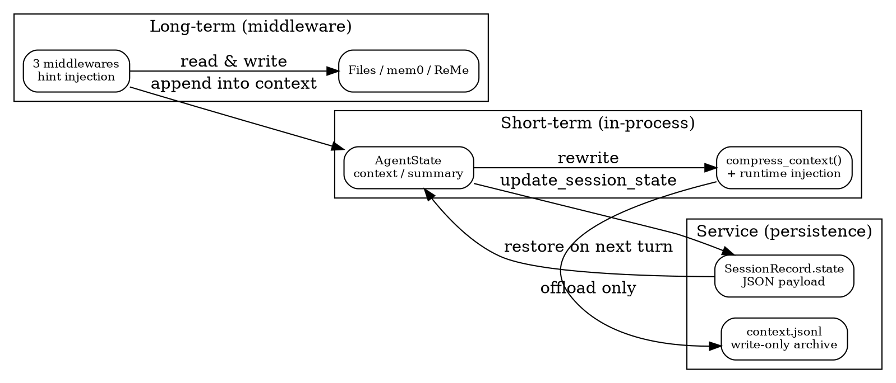

# Memory in AgentScope v2.0.11

## Introduction

> 版本基线：v2.0.11（2026-10-27，tag `v2.0.11`），`src/agentscope/_version.py` 里写着 `__version__ = "2.0.11"`。

> [!NOTE]
>
> 本文讲机制时**直接贴 v2.0.11 的真实源码片段**，不用 `file:line` 行号定位——读者不必打开仓库就能核对。所有路径均相对 `src/agentscope/`；凡属节选，会在代码块外说明省略了什么。

AgentScope **没有一个叫 `Memory` 的类**。所谓「记忆」是三层互不连通的机制：`AgentState.context` / `summary` 管一次会话内的短期上下文，三套长期记忆中间件管跨会话的外部知识，`SessionRecord.state` 管跨进程的会话恢复。

三个先说清的反直觉点：

1. **workspace 里的 `sessions/<sid>/context.jsonl` 只写不读**——它是压缩归档/审计日志，不是恢复路径；真正的跨进程恢复走 SQL/Redis 的 JSON `payload` 列。
2. **三套长期记忆中间件并不共享同一套注入时序**：只有 Agentic 与 ReMe 用「后台 task + `on_reasoning` 注入」，Mem0 完全没有 `on_reasoning`，它在 `on_reply` 里同步 `await` 检索。
3. **长期记忆既读不到也不写 `state.summary`**：压缩摘要是短期层私有；长期层只往 `state.context` 塞 `HintBlock`，而且这些注入会被下一次压缩切走、回合内不补。

分层的一般定义见 [Paradigm](/docs/CS/AI/LLM/Agent/Theory/Paradigm.md)，压缩的理论取舍属 Compaction 理论的范围（见文末 Links）。

## Three Layers, Not One Memory



| 层 | 载体 | 生命周期 | 谁写 | 谁读 |
| :--- | :--- | :--- | :--- | :--- |
| 短期 | `AgentState.context` / `summary` | 单个 Agent 实例 / 一次会话 | Agent 主循环、压缩、注入、中间件 | `model` / `formatter` |
| 长期 | 三中间件各自的后端（文件 / mem0 / ReMe） | 跨会话、跨进程 | Agent（`Write`）、中间件自动写回 | 中间件检索 |
| 服务化 | `SessionRecord.state` 落 DB `payload` | 跨进程重启 / 多租户 | `ChatService` | `ChatService` |

`workspace` 的 `context.jsonl` 是**第四条独立支路**，位于短期层与文件系统之间，但不参与任何读出。这与 App 分册里的 `SessionRecord` 抽象、`open_reply_stream` 的 checkpoint replay 是三件不同的事，最容易混。

## Short-Term Memory: AgentState and Its Eight Fields

`state/_state.py` 里的 `AgentState` 是纯 Pydantic `BaseModel`，类 docstring 第一句就写明用途："The agent state that should be saved and loaded from storage."。下面是字段定义（节选，中间略去了旧格式迁移的 validator 实现，后文单独说）：

```python
class AgentState(BaseModel):
    """The agent state that should be saved and loaded from storage."""

    session_id: str = Field(default_factory=_generate_id)
    """The session id of the agent. Normally, each session will maintain one
    independent agent state for each agent."""

    summary: str | list[TextBlock | DataBlock] = ""
    """The compressed summary of the context, which will be prepended to the
    context when fed into the LLM."""

    context: list[Msg] = Field(default_factory=list)
    """The uncompressed conversation context, which will be fed into the LLM"""

    # ... (validator implementation omitted; shown in the next block) ...

    reply_context: ReplyContext = Field(default_factory=ReplyContext)
    permission_context: PermissionContext = Field(
        default_factory=PermissionContext,
    )
    tool_context: ToolContext = Field(default_factory=ToolContext)
    tasks_context: TaskContext = Field(default_factory=TaskContext)
    middle_context: dict[str, Any] = Field(default_factory=dict)
```

| 字段 | 类型 | 作用 |
| :--- | :--- | :--- |
| `session_id` | `str` | 会话标识，默认 `_generate_id()` |
| `summary` | `str \| list[TextBlock \| DataBlock]` | **不是纯 str**，压缩产物可含媒体块 |
| `context` | `list[Msg]` | 未压缩的对话上下文 |
| `reply_context` | `ReplyContext` | `reply_id` / `cur_iter` / `structured_schema` |
| `permission_context` | `PermissionContext` | 权限规则与 mode |
| `tool_context` | `ToolContext` | 文件读缓存、activated tool groups |
| `tasks_context` | `TaskContext` | Plan 任务列表 |
| `middle_context` | `dict[str, Any]` | 中间件跨回复状态 |

旧笔记在这一页同时写了「七块数据」「六个字段全部是子 context」「六个子 context」，三处互相矛盾——真实情况是 **8 个字段，其中只有 5 个是子 context 模型**（`reply` / `permission` / `tool` / `tasks` / `middle`，`middle_context` 还是裸 dict）。`session_id`、`summary`、`context` 都不是。

两个面向外部存储的 Pydantic 钩子值得单独记。一个是 `@field_serializer("structured_schema")`，把 schema 类转成 JSON schema dict；另一个是被上段代码略去的迁移 validator，它直接证明这份 state 会被反序列化旧数据：

```python
    @model_validator(mode="before")
    @classmethod
    def _migrate_legacy_reply_fields(cls, data: Any) -> Any:
        """Migrate the top-level ``reply_id``/``cur_iter`` fields (the
        pre-``reply_context`` storage format) into ``reply_context``, so
        that the states saved by previous versions load correctly."""
```

但类内**没有** `save()` / `load()` / `from_dict()`，全文件也不 import 任何 Store/Repository；持久化完全交给服务层。

`append_context()` 是状态写入的统一入口，也是理解「记忆注入为什么不产生碎消息」的关键：

```python
    def append_context(
        self,
        name: str,
        blocks: list[
            TextBlock | DataBlock | HintBlock | ToolCallBlock | ToolResultBlock
        ],
    ) -> None:
        """Append the given blocks to the agent's own message with the current
        `reply_id`. If such message doesn't exist, a new assistant message
        with agent's name and current reply ID will be created.
        """
        # If append to the latest message
        if (
            self.context
            and self.context[-1].role == "assistant"
            and self.context[-1].name == name
            and self.context[-1].id == self.reply_id
        ):
            self.context[-1].content.extend(blocks)
        else:
            # Create a new assistant message with the current reply ID
            self.context.append(
                Msg(
                    id=self.reply_id,
                    role="assistant",
                    name=name,
                    content=blocks,
                ),
            )
```

尾消息是同一 `reply_id`、同一 `name` 的 assistant 消息时，新块直接 `extend` 进去；否则新建一条 `Msg`。所有中间件注入 `HintBlock` 时都靠这个规则按 `reply_id` 归并。

`ToolContext.read_file_cache` 是真正的 LRU，双上限、按 mtime 判失效、命中移到末尾、超出则 `pop(0)` 驱逐：

```python
class ToolContext(BaseModel):
    """The tool context, e.g. tool cache"""

    max_cache_files: int = Field(default=100, gt=1)
    """The maximum number of cached files."""
    max_cache_bytes: float = Field(default=25000, gt=10000)
    """The maximum size of the accumulated read file cache."""
    read_file_cache: list[ReadCacheEntry] = Field(default_factory=list)
    """The cache for Read/Write/Edit file tools."""
```

清理入口的名字和语义也写在源码里：

```python
    async def clean_file_cache(
        self,
        reserved_file_paths: set[str] | None = None,
    ) -> None:
        """Drop read caches whose paths are not in ``reserved_file_paths``.
```

即**按保留消息里仍引用的路径反向保留、清掉其余**，不是旧笔记写的「只清压缩掉的路径」。

## Context Compression Pipeline

`agent/_agent.py` 的 `compress_context()` 先走 `on_compress_context` 中间件链，终点是 `_compress_context_impl()`。完整步骤：

1. `_limit_context_images()` 把超限旧图片 offload；`_prepare_model_input()` 后用 `model.count_tokens(**kwargs)` 精确计数。
2. `threshold = trigger_ratio * model.context_size`，低于阈值直接 return。
3. `_split_context_for_compression()` 从**尾部向前**逐条 `count_tokens`，直到达到 `reserve_ratio * context_size`（默认 0.1）；切分时保护未完成的 tool_call 与 tool_result 配对。
4. 系统消息 + 旧 summary（包成 `UserMsg`）喂给 `generate_structured_output()`，schema 是 `SummarySchema`。
5. 五维字段经 `summary_template` 格式化成 `<system-info>...</system-info>`。
6. 溢出时逐条丢最旧消息重试；`compression_fallback_to_truncation` 为 True 时保留旧摘要或占位文本，为 False 则抛错。
7. 有 `Offloader` 就 `offload_context()` 并在摘要里留指针，最后 **`self.state.summary = new_summary`、`self.state.context = msgs_to_reserve`**。

阈值判定与 token 计数的原文：

```python
        cfg: ContextConfig = context_config or self.context_config

        # Limit the number of images in the context first, so that the token
        # counting below reflects the images that actually remain
        await self._limit_context_images(cfg)

        # Count the current tokens
        kwargs = await self._prepare_model_input()
        estimated_tokens = await self.model.count_tokens(**kwargs)

        # Skip if no compression is needed
        threshold = cfg.trigger_ratio * self.model.context_size
        if estimated_tokens < threshold:
            return
```

所谓「五维结构化摘要」不是抽象说法，`agent/_config.py` 的 `SummarySchema` 把每个维度该写什么直接写进了 Pydantic 的 `description`，模型是被这些引导语约束着生成的：

```python
class SummarySchema(BaseModel):
    """The compressed memory model, used to generate summary of old memories"""

    task_overview: str = Field(
        description=(
            "The user's core request and success criteria.\n"
            "Any clarifications or constraints they specified"
        ),
    )
    current_state: str = Field(
        description=(
            "What has been completed so far.\n"
            "File created, modified, or analyzed (with paths if relevant).\n"
            "Key outputs or artifacts produced."
        ),
    )
    important_discoveries: str = Field(
        description=(
            "Technical constraints or requirements uncovered.\n"
            "Decisions made and their rationale.\n"
            "Errors encountered and how they were resolved.\n"
            "What approaches were tried that didn't work (and why)"
        ),
    )
    next_steps: str = Field(
        description=(
            "Specific actions needed to complete the task.\n"
            "Any blockers or open questions to resolve.\n"
            "Priority order if multiple steps remain"
        ),
    )
    context_to_preserve: str = Field(
        description=(
            "User preferences or style requirements.\n"
            "Domain-specific details that aren't obvious.\n"
            "Any promises made to the user"
        ),
    )
```

生成的摘要最终被套进这个模板，作为 `<system-info>` 块前置到下一轮输入：

```python
    summary_template: str = Field(
        default=(
            "<system-info>Here is a summary of your previous work\n"
            "# Task Overview\n"
            "{task_overview}\n\n"
            "# Current State\n"
            "{current_state}\n\n"
            "# Important Discoveries\n"
            "{important_discoveries}\n\n"
            "# Next Steps\n"
            "{next_steps}\n\n"
            "# Context to Preserve\n"
            "{context_to_preserve}"
            "</system-info>"
        ),
        json_schema_extra={"format": "textarea"},
    )
```

`compression_prompt` 要求把 `today` 转成绝对日期、把 "this file" 写成完整路径、记录 in-flight 后台任务的 id/owner/status——因为摘要可能被**再次压缩**，所有引用必须自包含；`{current_time}` 在运行时替换，旧笔记把替换位置指到了构造 `AssistantMsg` 的那一行，其实真正的替换发生在 `compression_prompt.replace("{current_time}", ...)`。

压缩真正改写 state 的地方在 `_apply_change()` 尾部（节选，中间略去 offload 与读缓存清理）：

```python
            # Clear the read tool cache
            await self._clear_unreserved_read_cache(msgs_to_reserve)

            # The current reply msg may be fully compressed, so keep its usage
            current_reply_usage = self._get_reply_usage()

            # Update the context and summary
            self.state.summary = new_summary
            self.state.context = msgs_to_reserve
```

调用点在 `_reply_impl()` 的 `while True` 里、`case Reasoning` 分支内、`_reasoning()` 之前——即**每次进入推理迭代前都检查一次**，不是每轮 reply 一次：

```python
                    case Reasoning(hint=hint, tool_choice=tool_choice):
                        made_progress = True
                        final_msg = None
                        if hint:
                            self.state.append_context(self.name, [hint])

                        # Compressed the memory if needed before reasoning
                        await self.compress_context()

                        # Inject runtime state if needed before reasoning
                        async for evt in self._inject_runtime_state():
                            yield evt

                        # Perform reasoning
```

`CompressContext` 工具并非自动注册：`ContextConfig.compression_tool_enabled` 默认 `False`，且只在 `_prepare_model_input()` 里惰性装备。它的权限声明也值得看一眼，因为旧笔记写它带 `bypass_immune=True`——源码里根本没有这个参数：

```python
        self._compression_tool = FunctionTool(
            self._compress_context_tool,
            name=_COMPRESSION_TOOL_NAME,
            is_concurrency_safe=False,
            permission=PermissionDecision(
                behavior=PermissionBehavior.ALLOW,
                message=f"{_COMPRESSION_TOOL_NAME} is always allowed.",
            ),
        )
```

## Runtime-State Injection

`InjectionConfig` 不是「四个开关」，而是 1 个总开关 `inject_runtime_state=True` + 按 dimension 触发的四类注入：`current-time`、`tasks`、`context-length`（仅 `cur_iter==0`）、`tool-error`。另有 `timezone` / `time_interval` / `tool_retries_limit` / `injection_source` / `extra_fields` / `emit_hint_event` 等细粒度参数。

`_inject_runtime_state()` 的 docstring 把两个设计取舍写得很直白，比任何转述都清楚（以下摘自该 docstring）：

```text
        .. note:: The injection is **not** ephemeral. It is appended to the
            persistent context on purpose, so the agent can perceive how time
            elapses and what it did at each step, building a sense of time.

        .. note:: We attach a ``HintBlock`` instead of mutating the system
            prompt, so that prompt caching still works while the agent remains
            aware of the changing time / tasks / context.
```

产物经 `self.state.append_context(...)` **持久写进 `state.context`**：

```python
            hint_block = HintBlock(
                source=injection_source,
                # Use replace instead of format, so that the other curly
                # braces in the template are kept as-is
                hint=self.injection_config.template.replace(
                    "{runtime_state}",
                    "\n".join(
                        f"<{k}>{v}</{k}>" for k, v in injections.items()
                    ),
                ),
            )
            self.state.append_context(
                self.name,
                [hint_block],
            )
```

这构成一个自愈回路：注入的 HintBlock 会随旧消息被压缩进 summary，而 Time 维度恰好把「压缩后上下文里没有时间记录」当作重新注入的条件。所以压缩不是把运行时状态丢掉，而是逼它重新生成。

## Workspace Offloading: A Write-Only Archive

`workspace/_offload_protocol.py` 的 `Offloader` Protocol 只有三个方法：`offload_data_block` / `offload_context` / `offload_tool_result`。返回值不是本地路径，第一个方法的 docstring 写得很明确：

```python
class Offloader(Protocol):
    """The offloader protocol."""

    async def offload_data_block(self, block: DataBlock) -> DataBlock:
        """Persist a base64 data block to workspace storage.

        Args:
            block (`DataBlock`):
                A data block. Blocks already backed by a URL source are
                returned unchanged.

        Returns:
            `DataBlock`:
                A data block whose source is a portable ``workspace://``
                URL pointing at the persisted file inside the workspace.
        """
```

另两个方法的签名是 `offload_context(session_id, msgs) -> str` 与 `offload_tool_result(session_id, tool_result) -> str`。

统一实现在 `WorkspaceBase.offload_context()`：路径 `sessions/<session_id>/context.jsonl`，内部 `offload_block()` 递归把 `Base64Source` 换成 URL，并处理嵌套的 `ToolResultBlock.output` 与 `HintBlock.hint`；`deepcopy(msgs)` 保证不改原消息；每行 `msg.model_dump_json()`。

所谓「追加」其实是 **read-modify-write**：

```python
        if not lines:
            # Nothing to append: writing the empty join would still add a
            # standalone blank line that is not a JSONL record.
            return path

        payload = "\n".join(lines) + "\n"

        existing = b""
        try:
            existing = await backend.read_file(path)
        except (FileNotFoundError, OSError):
            pass
        await backend.write_file(path, existing + payload.encode("utf-8"))
        return path
```

大文件会被反复全量 IO。`offload_data_block()` 把数据写成 `data/<sha256-of-base64>.<ext>`、同块去重，返回的 URL 是 `workspace:///` 而非 `file://`：

```python
        # A ``workspace://`` reference (workspace-relative path). Unlike a
        # node-local ``file://`` path it is portable: a serving endpoint
        # resolves the actual workspace from the request's session
        # context and reads the relative path. See docs TODO (frontend
        # ``workspace://`` rendering).
        return DataBlock(
            id=block.id,
            name=block.name,
            source=URLSource(
                url=AnyUrl(f"workspace:///{rel}"),
                media_type=block.source.media_type,
            ),
        )
```

旧笔记写的 `file://` 已失效。

**只写不读**：全仓 `src/` 内对 `context.jsonl` 的引用只有 docstring、路径构造，加上上面那次为拼接而做的自读；没有任何 restore / load 把它读回 `AgentState`。它是归档与审计，不是恢复路径。

## Service-Layer Session Persistence

真正的恢复链路在 app 层。`app/storage/_model/_session.py` 里 `SessionRecord` 直接把整个 `AgentState` 当字段：

```python
    state: AgentState = Field(default_factory=AgentState)
    """Mutable runtime state, updated after each chat turn."""
```

SQL 后端 `update_session_state()` 把整个 state 写进 `SessionRow` 的 JSON `payload` 列（read-modify-write），mapper 用 `record.model_dump(mode="json")` / `model_validate()` 序列化与还原——后者会触发前面说的 `_migrate_legacy_reply_fields`。

`app/_service/_chat.py` 里，**恢复**是把库里的 state 原样交给新构造的 Agent；**落库**是逐条 `upsert_message` 之后再整个 state 写回：

```python
                agent_state = session_record.state
                agent_state.session_id = session_id
                chat_config = agent_record.data.chat_config
                agent = self._agent_cls(
                    name=agent_record.data.name,
                    system_prompt=system_prompt,
                    model=model,
                    toolkit=toolkit,
                    model_config=ModelConfig(fallback_model=fallback_model),
                    context_config=chat_config.context_config,
                    react_config=chat_config.react_config,
                    state=agent_state,
                    middlewares=middlewares,
                    offloader=workspace,
                )
```

```python
                            await self._storage.update_session_state(
                                user_id=user_id,
                                agent_id=agent_id,
                                session_id=session_id,
                                state=agent.state,
                            )
```

**checkpoint 不是状态恢复**：`app/channel/_stream.py` 的 `open_reply_stream()` 先订阅、再读持久化 checkpoint，随后 `log_read(..., since=after)` 做的是**事件流 replay 去重**；cursor 由 `_chat.py` 推进。注意这个函数体没有 `yield`，是 `return _read(...)` 的 async 函数：

```python
    feeder_task = asyncio.create_task(feeder())
    try:
        await asyncio.wait_for(ready.wait(), timeout=_SUBSCRIBE_TIMEOUT_SECS)
        cursor = await bus.registry_get(
            MessageBusKeys.session_event_checkpoint(session_id),
            MessageBusKeys.SESSION_EVENT_CURSOR_FIELD,
        )
    except BaseException:
        feeder_task.cancel()
        raise
    return _read(bus, event_key, queue, feeder_task, cursor)
```

`app/_service/_session.py` 的 `derive_parked_status(session.state.context)` 说明持久化的 context 还用于跨进程 HITL 状态判定；列表接口则会把 `state.context` / `summary` / `tool_context` trim 掉，消息另走 `GET /sessions/{id}/messages`，路由的 docstring 还说清了理由：

```text
    The record arrives trimmed: ``state.context``, ``state.summary``
    and ``state.tool_context`` are cleared, since they hold the model's
    conversation and every file it has read. Fetch a session's messages
    from ``GET /sessions/{id}/messages`` instead.
```

一句话：**offload 落盘 ≠ 会话恢复**，两套持久化互不相通。

## Long-Term Memory: Three Architectures

三套实现位于 `middleware/_longterm_memory/`，由 `middleware/__init__.py` 导出；逐文件细节归 Middleware 分册，这里只给定位矩阵与最容易被误读的机制。

| | `AgenticMemoryMiddleware` | `Mem0Middleware` | `ReMeMiddleware` |
| :--- | :--- | :--- | :--- |
| 后端 | 文件系统 Markdown + `MEMORY.md` 索引 | mem0 OSS / Platform | 进程内嵌入 ReMe app |
| `on_system_prompt` | 有 | 有 | 有 |
| `on_reply` | 有 | 有 | 有 |
| `on_reasoning` | 有 | **无** | 有 |
| `list_tools` | **无** | 有 | 有 |
| 暴露工具 | 无（Agent 用 `Write` 自我管理） | `search_memory` / `add_memory` | `memory_search`（仅 1 个） |
| 写回 | 不自动写，Agent 自己写文件 | 每轮自动 + 工具手动 | `auto_memory` job 所有 mode 自动 |
| 隔离 | 目录 | `user_id` + 可选 `agent_id` | `session_id`（写回）/ workspace 全局（检索） |

**Hook 覆盖矩阵纠正了一个旧结论**：旧笔记说「三者都实现 `on_reply`/`on_reasoning`（异步检索、注入结果）」，实际 Mem0 完全没有 `on_reasoning`，检索和注入都塞在 `on_reply` 里。下面三段分别摘自同一个方法的不同位置。

纯 `agent_control` 模式直接透传，判定语句就是 `if self._mode == "agent_control"`（旧笔记把位置指到了它上面的注释行）：

```python
        # In pure agent_control mode the middleware is a no-op on the
        # reply path — the agent decides when to invoke the memory
        # tools — so just pass through.
        if self._mode == "agent_control":
            async for item in next_handler(**input_kwargs):
                yield item
            return
```

其余模式是**同步 `await` 检索**，不是后台 task：

```python
            try:
                memories = await self._async_search(
                    query_text,
                    user_id=user_id,
                    agent_id=search_agent_id,
                )
```

等 `ReplyStartEvent` 出现时把 `AssistantMsg(name="memory")` 追加到 `state.context`，靠布尔 `injected` 防重复：

```python
        final_msg: Msg | None = None
        injected = False
        try:
            async for item in next_handler(**input_kwargs):
                is_reply_start = isinstance(item, ReplyStartEvent)
                if not injected and memories and is_reply_start:
                    agent.state.context.append(
                        self._build_memory_message(memories),
                    )
                    injected = True
                if isinstance(item, Msg) and item.role == "assistant":
                    final_msg = item
                yield item
```

隔离键也一并看源码，只有 `user_id` 与可选 `agent_id`，**没有 `run_id`**：

```python
        filters: dict[str, Any] = {"user_id": user_id}
        if agent_id:
            filters["agent_id"] = agent_id
```

**Agentic 的「检索」是 LLM 选文件，不是向量检索**：拿 `retrieval_model or agent.model` 调 `generate_structured_output`，把 `MEMORY.md` 的 manifest 交模型挑最多 5 个文件，再丢弃幻觉文件名并去重；没有 embedding、没有 BM25。

```python
        # 2. Ask the model to select relevant files.
        model = self._parameters.retrieval_model or agent.model
        res = await model.generate_structured_output(
            [
                SystemMsg(
                    name="system",
                    content=self._parameters.retrieval_instructions,
                ),
                UserMsg(
                    name="user",
                    content=(
                        f"Query: {query}\n\n"
                        f"Available memories:\n{manifest}"
                    ),
                ),
            ],
            structured_model=_MemorySelection,
        )

        # 3. Discard hallucinated filenames and count each memory only once.
        raw_selected: list[str] = res.content.get("selected_files", [])
        selected = list(
            dict.fromkeys(f for f in raw_selected if f in valid_filenames),
        )[:5]
        if not selected:
            return None
```

四类 frontmatter `type`（`user` / `feedback` / `project` / `reference`）**只存在于 `DEFAULT_MEMORY_INSTRUCTIONS` 的提示词规范里**，运行时唯一作用是 manifest 的 `[type]` 前缀，代码无按 type 分支。那段提示词也直白说明了「Agent 用 `Write` 自我管理记忆」到底是什么意思：

下面摘自 `DEFAULT_MEMORY_INSTRUCTIONS` 的开头：

```text
# Auto Memory

 You have a persistent, file-based memory system at `{memory_dir}`. \
 This directory already exists — write to it directly with the `Write` \
 tool (do not run mkdir or check for its existence).
```

`MEMORY.md` 默认上限 `memory_max_tokens=4000`，超限由 `_truncate_if_needed()` 按前缀切并追加 `<<<TRUNCATED>>>` + `Read offset` 提示，反向教 Agent 用 `Read` + `offset` 补全——但提示词里另写「200 行后截断」，两者口径并不一致。

**Mem0 的两级 fallback 归属被旧笔记写错**：`_async_add_with_fallback()` 先让 mem0 的抽取 LLM 跑一遍，抽取为空再 `infer=False` 存原文：

```python
        # 1. Normal path: let mem0's extraction LLM do its job.
        result = await self._async_add(
            [{"role": "user", "content": text, "name": "user"}],
            user_id=user_id,
            agent_id=agent_id,
        )
        if _mem0_extracted_anything(result):
            return result

        # 2. Raw save: extraction returned empty, persist the raw text
        # so the caller's ``add_memory`` invocation isn't silently
        # discarded.
        return await self._async_add(
            [{"role": "user", "content": text, "name": "user"}],
            user_id=user_id,
            agent_id=agent_id,
            infer=False,
        )
```

但它**只被 `add_memory` 工具调用**（`_mem0/_tools.py` 里 `result = await self._mw._async_add_with_fallback(...)`）。每轮自动写回走 `on_reply` 的 `finally` → `_dispatch_write()` → `_async_add()`，**没有** `infer=False` 兜底，抽取为空就什么都不存；`await_write=False` 时更是 fire-and-forget `create_task`，不保存引用、不 cancel/await。

**ReMe 把「记忆」建模成具名 job**：`_reme/_config.py` 的 `_memory_jobs()` 注册 15 个 job，含唯一的后台文件监视器 `index_update_loop`、`search`、`auto_memory`、`dream_cron`（`0 23 * * *`）；`keyword_index` 默认 `bm25`，只有传了 `embedding_model` 才追加向量 store：

```python
        "auto_memory": _job(
            "auto_memory_step",
            "Record conversation facts into a daily memory card.",
            {
                "messages": {
                    "type": "array",
                    "items": {"type": "object"},
                },
                "session_id": {"type": "string", "default": ""},
                "memory_hint": string,
            },
            ("messages",),
        ),
        # ``auto_memory`` writes daily cards; dream is the downstream memory
        # consolidation phase that turns those cards into durable digest
        # nodes. Keep both the nightly schedule and an explicit job for
        # deterministic/manual execution.
        "dream_cron": {
            "backend": "cron",
            "cron": "0 23 * * *",
            "steps": _dream_steps(),
        },
```

`ReMeMiddleware` 构造时固定 chat/embedding 模型（注释明写 "never taken from an agent"），却按 `session_id` 动态分桶管理检索任务。它在回合开始前先给 context 拍一个 id 快照：

```python
        # Snapshot the context BEFORE the turn so the write-back persists
        # only this turn's *increment*. ReMe's ``auto_memory`` consumes the
        # incremental exchange, whereas ``agent.state.context`` is the full
        # accumulated history — so we diff by message id (below) rather than
        # sending the whole context, which would re-feed every prior turn.
        # Taking the increment (not just the final message) still captures
        # every step of the turn — user input, each assistant step, and
        # every tool call / tool result — which the agent records on
        # ``state.context`` via ``_save_to_context`` but does not all yield
        # on the stream (only the final answer is yielded).
        pre_ids = {m.id for m in agent.state.context if isinstance(m, Msg)}
```

`on_reply` 的 `finally` 在**所有 mode** 无条件写回（中间先 cancel/await 掉本轮检索 task，避免泄漏），内容是快照之后的增量消息，并显式剔除自己注入的 `name=="memory"` 消息：

```python
            # This turn's new messages only: everything now present that
            # was not before, minus any memory hint we injected (matched by
            # its reserved name, since injection happens in ``on_reasoning``).
            increment = [
                m
                for m in agent.state.context
                if isinstance(m, Msg)
                and m.id not in pre_ids
                and getattr(m, "name", None) != _MEMORY_MSG_NAME
            ]
            # Only persist a real exchange: a genuine user turn plus at
            # least one non-empty assistant message produced this turn.
            if query_text and any(
                m.role == "assistant" and m.get_text_content()
                for m in increment
            ):
                await self._write_back(increment, session_id)
```

三者的共同点只有两个：都实现 `on_system_prompt`（真正决定工具暴露的是 `list_tools()`，不是提示词），都往 `state.context` 注入 `HintBlock`；去重靠「消耗 task 引用」/布尔标志，**与 `state.middle_context` / `reply_id` 无关**（`middle_context` 只被 budget 与 model_router 用）。记忆工具的 `check_permissions()` 无条件返回 `ALLOW`，绕过权限引擎：

```python
    async def check_permissions(
        self,
        *_args: Any,
        **_kwargs: Any,
    ) -> PermissionDecision:
        return PermissionDecision(
            behavior=PermissionBehavior.ALLOW,
            message="auto-allowed: mem0 long-term memory tool",
        )
```

## Boundaries and Misleading Names

- **长期注入会被压缩切走**：三中间件都**不实现 `on_compress_context`**（hook 定义在 `middleware/_base.py`），旧的 `memory` 消息被划进 `msgs_to_compress` 后从 context 移除，须等下一轮 `ReplyStartEvent` 才重注。
- **summary 不被长期记忆复用**：全仓读写 `state.summary` 的只有 `agent/_agent.py`、`agent/_realtime/_agent.py`、`pipeline/*` 与 session router，无任何中间件。[Pipeline 分册](/docs/CS/AI/LLM/Agent/Product/AgentScope/Pipeline.md) 记的 `verifier_reset_context=True` 会清空会话但保留工具/任务状态：

```python
                    if self.verifier_reset_context:
                        # Only the conversation, tool/task state stays
                        self.verifier.state.context.clear()
                        self.verifier.state.summary = ""
```

- **Realtime 有独立历史机制**（`agent/_realtime/_agent.py` 的 `_HISTORY_MAX_MESSAGES=100` / `_HISTORY_MAX_TEXT_CHARS=32_000`，`replay_history()`），那是会话历史回放，不是长期记忆。
- **一堆命名巧合**：`app/message_bus/_in_memory_message_bus.py` 是进程内存总线；`workspace/_applecontainer/_constants.py` 的 `DEFAULT_MEMORY="2G"` 是容器内存配额；`rag/_vdb/_qdrant.py` 的 `location=":memory:"` 是内存向量库；`agent/_a2a_agent.py` 的 `observe()` 只是下轮输入的短期消息缓存。`app/_service/` **没有 memory service**、`app/_router/` **没有 memory 路由**、`app/storage/_model/` **没有 memory 表**——app 层唯一触点只是 `app/_app.py` 把 `AgenticMemoryMiddleware` 当作 workspace 型中间件的文档示例。
- 记忆 ≠ 向量库：[RAG 分册](/docs/CS/AI/LLM/Agent/Product/AgentScope/RAG.md) 的 `RAGMiddleware` 走文档检索与 `persist_hint` 开关，与三套长期记忆是并列的另一条路；跨框架的定位差异见 [LangTools](/docs/CS/AI/LangTools.md)。

## Packaging and Version History

`pyproject.toml` 把长期记忆拆成可选依赖，注释甚至解释了为什么锁 mem0 v2.x：

```toml
# ------------ Long-term memory ------------
# Required by `agentscope.middleware._longterm_memory.Mem0Middleware`.
# Pinned to mem0 v2.x because the middleware targets that
# architecture: ADDITIVE_EXTRACTION_PROMPT + AGENT_CONTEXT_SUFFIX
# (replaced v1's USER/AGENT_MEMORY_EXTRACTION_PROMPT split) and the
# v3 phased pipeline in `_add_to_vector_store`. Running on mem0 1.x
# wouldn't crash but the 2-tier add fallback degenerates into a
# wasted LLM call.
memory-mem0 = ["mem0ai>=2.0.0"]
# Required by `agentscope.middleware._longterm_memory.ReMeMiddleware`.
memory-reme = ["reme-ai>=0.4.0.6"]
memory = [
    "agentscope[memory-mem0]",
    "agentscope[memory-reme]",
]
```

`mem0` / `reme` 是已弃用别名。**Agentic 实现零第三方依赖**，只需 workspace backend。服务层持久化另走 `storage-redis` / `storage-sql`。

逐 tag `git cat-file -e` 与首次引入 commit 核对：

| 实现 | 首个 commit | 落到的 tag | NEWS.md 标注 |
| :--- | :--- | :--- | :--- |
| mem0 | `5be0b16d` 2026-06-17 (#1775) | v2.0.3（2026-06-26） | 2026-06 |
| Agentic | `615524c6` 2026-06-30 (#1927) | v2.0.4（2026-07-07） | 2026-06 |
| ReMe | `922e673b` 2026-07-03 (#1972) | v2.0.4 | 2026-07 |

也就是说 **v2.0.8 时三套已全部存在**，本次 v2.0.8 → v2.0.11 在 `middleware/_longterm_memory/` 下只有 1 个文件、+10/−4 行：两个 fix（`f2bedf3e` 修 frontmatter 闭合 fence 结尾、`a3882128` 检索去重）加一个回归测试。app 层同期未新增任何 memory 端点/路由/表，`SessionRecord.state: AgentState` 更是 v2.0.0 起就有。短期层同期改动集中在 `workspace://` 引用、嵌套媒体抽离、空批次不追加等修护。

示例与测试：`examples/long_term_memory/` 三组（agentic_memory / mem0 / reme），另 `examples/agent_service/main.py` 与 `examples/console/main.py` 演示注入；测试有 `tests/middleware_filesystem_memory_test.py`、`mem0_middleware_test.py`、`mem0_agentscope_adapter_test.py`、`reme_middleware_test.py`。仓库自带 `docs/roadmap.md` 仍写着 "Support long-term memory"，对照三个 2026-06/07 的 FEAT 条目，说明 roadmap 未及时更新。

## Corrections to the Previous Baseline

| 位置 | 旧写法 | v2.0.11 事实 |
| :--- | :--- | :--- |
| `AgentScope.md` Architecture | AgentState「七块数据」「六个字段」「六个子 context」 | **8 字段**，其中 5 个子 context 模型（见上文字段定义源码） |
| `AgentScope.md` offload | DataBlock 改写成 `file://` URL | **`workspace:///`**（见上文 `offload_data_block()` 源码） |
| `Tool.md` | `CompressContext` 恒 `ALLOW, bypass_immune=True` | 只有 `behavior=ALLOW` + `message`（见上文 `FunctionTool` 源码） |
| `AgentLoop.md` | 把 `{current_time}` 替换指到构造 `AssistantMsg` 的那一行 | 实际替换是 `compression_prompt.replace(...)` |
| `Middleware.md` | 三者都有 `on_reasoning`；`_async_add_with_fallback` 是自动写回 | Mem0 无该 hook；fallback 只服务 `add_memory` 工具 |
| `Middleware.md` | `on_reply` no-op 判定写在注释行；mode 默认值误认作类定义行 | 判定是 `if self._mode == "agent_control"`；mode 默认值在构造函数里 |
| `Middleware.md` | mem0 按 `run_id` 隔离 | `filters` 只有 `user_id` + 可选 `agent_id`，无 `run_id` |
| 枢纽 Formatter 章 | 「没有独立的 memory 抽象方法」 | 仅就 `FormatterBase` 成立；`MiddlewareBase.on_system_prompt` 是另一层机制 |

> [!NOTE]
>
> 判断一个框架「有没有 Memory」，别去搜 `class Memory` 或 `memory/` 目录。v2.0.11 里 `src/agentscope/` 顶层根本没有 `memory` 包，全树文件名带 memory 的只有一个消息总线实现；真正的记忆能力分散在 `state/`、`agent/_config.py`、`workspace/`、`middleware/_longterm_memory/` 与 `app/storage/` 五处，靠 `HintBlock` 与 `AgentState` 串起来。

## Links

- [AgentScope](/docs/CS/AI/LLM/Agent/Product/AgentScope/AgentScope.md)
- [Middleware 分册](/docs/CS/AI/LLM/Agent/Product/AgentScope/Middleware.md)
- [AgentLoop 分册](/docs/CS/AI/LLM/Agent/Product/AgentScope/AgentLoop.md)
- [App 分册](/docs/CS/AI/LLM/Agent/Product/AgentScope/App.md)
- [Compaction 理论](/docs/CS/AI/LLM/Agent/Theory/Compaction.md)
- [AgentScopeJava Memory](/docs/CS/AI/LLM/Agent/Product/AgentScopeJava/Memory.md)

## References

- [AgentScope v2.0.11 — state/_state.py](https://github.com/agentscope-ai/agentscope/blob/v2.0.11/src/agentscope/state/_state.py)
- [AgentScope v2.0.11 — agent/_config.py](https://github.com/agentscope-ai/agentscope/blob/v2.0.11/src/agentscope/agent/_config.py)
- [AgentScope v2.0.11 — workspace/_base.py](https://github.com/agentscope-ai/agentscope/blob/v2.0.11/src/agentscope/workspace/_base.py)
- [AgentScope v2.0.11 — middleware/_longterm_memory/](https://github.com/agentscope-ai/agentscope/tree/v2.0.11/src/agentscope/middleware/_longterm_memory)
- [AgentScope v2.0.11 — app/storage/_model/_session.py](https://github.com/agentscope-ai/agentscope/blob/v2.0.11/src/agentscope/app/storage/_model/_session.py)
- [AgentScope v2.0.11 — docs/NEWS.md](https://github.com/agentscope-ai/agentscope/blob/v2.0.11/docs/NEWS.md)
- [AgentScope Docs — Long-term Memory](https://docs.agentscope.io/latest/en/building-blocks/long-term-memory)
