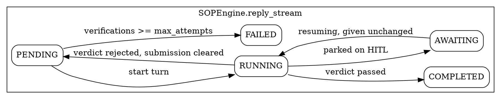

## Introduction

`agentscope.sop` 把「一个多步骤任务」建模成**数据库的存储过程**：定义是代码、可以跑无数次，运行实例是纯数据、属于某一次具体执行。`app/_service/_sop.py` 的原文是 "Running a stored procedure, one `ChatService` turn per step half."——注意类比的是**运行**，不是流程定义。本分册以 v2.0.11 源码核验它的状态机、两套提交路径、nudge 预算与服务层持久化。

模块 docstring（`app/_service/_sop.py`）：

```python
"""Running a stored procedure, one ``ChatService`` turn per step half.

A step's result is read back from the run state, where its agent's
submit tool wrote it.
"""
```

> 版本基线：v2.0.11（核心包 `src/agentscope/sop/`，服务层 `src/agentscope/app/_service/_sop.py`）

三个反直觉点：

1. **同一个 `SOPStepBase` 契约下有两套完全相反的提交机制**：核心 `SOPStep` 用 `structured_schema` 直接收结构化输出；服务层 `SessionSOPStep` 却完全不走结构化输出，改用 `SubmitHandover` / `SubmitVerdict` 工具**写 storage 再读回**。
2. **引擎不产生事件**：`SessionSOPStep.reply_stream` 用 `for event in (): yield event` 造了个空生成器（`app/_service/_sop.py`），事件全部由 chat session 经消息总线旁路发布。空生成器（`app/_service/_sop.py`）：

```python
        """Hand one turn to one session and read back what it filed.

        Yields nothing: the agent publishes into its own session.
        """
        for event in ():
            yield event
```

3. **三个「3」互不相干**：`max_attempts=3`、`max_nudges=3`、SDK `max_retries` 是三笔独立预算；nudge 超限只是发一个 `ReplyEndEvent(ERROR)`，真正「消耗一次 attempt」要靠 step 的兜底裁决加引擎判定。

## Stored Procedure, Not a Prompt

`SOP` 定义（`sop/_schema.py`）只有 `name` / `steps` / `description`，**不含任何 run 状态**——一份定义可以驱动多次 run。运行态在 `SOPRunState`（`sop/_state.py`）。这个切分正是「存储过程」类比的落点：定义与实例分离，实例可以持久化、恢复、并发多份。

定义（`sop/_schema.py`）：

```python
class SOP:
    """A fixed sequence of milestones, each verified before the next."""

    def __init__(
        self,
        name: str,
        steps: list[SOPStepBase],
        description: str = "",
    ) -> None:
        ...
        self.name = name
        self.steps = steps
        self.description = description
```

> 上面 `__init__` 的 docstring Args 段用 `...` 标注省略。

「定义是代码、run 是纯数据」写在 `sop/_state.py` 的模块 docstring 里：

```python
"""The runtime state of a SOP run — the half worth persisting.

A definition is code and can be run any number of times; a run is plain
data and belongs to exactly one of those times. The engine owns the run
and hands each step the slice that is its own, so nothing about a run
ever lives on a step object.
"""
```

## State Model

| 模型 | 位置 | 事实 |
| :--- | :--- | :--- |
| `SOPPhase` | `sop/_state.py` | 五态 `PENDING / RUNNING / AWAITING / COMPLETED / FAILED`，**step 与整个 run 共用同一套枚举**；`AWAITING` 就是 parked |
| `SOPRunState.phase` | `sop/_state.py` | **不是存储字段，是 `@computed_field` 从 steps 派生**：`FAILED` 优先于 `COMPLETED`，`AWAITING` 优先于 `RUNNING` |
| `VerificationResult` | `sop/_state.py` | `passed` + `message` + `verifier` + **`created_at`**（旧笔记漏了时间戳）；注释强调只记已定论的裁决 |
| `SOPStepRunState` | `sop/_state.py` | `ConfigDict(extra="allow")`，字段 `phase / given / submission / verifications`；`submission` 为 `None` 表示还在干活 |
| `SOPStepDataV1` | `app/storage/_model/_sop.py` | `max_attempts` 默认 3 且带 `gt=0` 校验；verifier 是 `AgentVerifier \| HumanVerifier` 判别联合 |

五态枚举与派生 phase（`sop/_state.py`）：

```python
class SOPPhase(StrEnum):
    """Where a step, or a whole run, stands.

    One enum for both: a run is only ever as far along as its steps let
    it be.
    """

    PENDING = "pending"
    """Not started, or sent back to try again."""

    RUNNING = "running"
    """In flight."""

    AWAITING = "awaiting"
    """Parked — someone outside has to answer before it can go on."""

    COMPLETED = "completed"
    """Accepted."""

    FAILED = "failed"
    """Refused until :attr:`~._schema.SOPStepBase.max_attempts` ran out."""
```

```python
    @computed_field  # type: ignore[misc]
    @property
    def phase(self) -> SOPPhase:
        """Where the run stands, worked out from its steps.
        ...
        """
        phases = [_.phase for _ in self.steps]
        if not phases or all(_ is SOPPhase.PENDING for _ in phases):
            return SOPPhase.PENDING
        if any(_ is SOPPhase.FAILED for _ in phases):
            return SOPPhase.FAILED
        if all(_ is SOPPhase.COMPLETED for _ in phases):
            return SOPPhase.COMPLETED
        if any(_ is SOPPhase.AWAITING for _ in phases):
            return SOPPhase.AWAITING
        return SOPPhase.RUNNING
```

> 上面 `phase` docstring 的 Returns 段用 `...` 标注省略。

`VerificationResult` 与 `SOPStepRunState` 的字段（同文件）：

```python
class VerificationResult(BaseModel):
    """One settled verdict on one attempt.

    Only settled verdicts exist — a step with nothing to say yet records
    nothing, because a verdict that has not happened is not a verdict.
    """

    passed: bool
    """Whether the attempt was accepted."""

    message: str = ""
    """Why it was refused. This goes back to the executor verbatim on the
    next attempt, so it has to say what is missing rather than that
    something is."""

    verifier: str = ""
    """Who decided — a model, a person, an external system."""

    created_at: str = Field(default_factory=_generate_timestamp)
    """When the verdict was reached."""
```

```python
class SOPStepRunState(BaseModel):
    """What one step did in one run.
    ...
    """

    model_config = ConfigDict(extra="allow")

    phase: SOPPhase = SOPPhase.PENDING
    """Where the step stands."""

    given: list[Msg] = Field(default_factory=list)
    ...
    submission: list[TextBlock | DataBlock] | None = None
    ...
    verifications: list[VerificationResult] = Field(default_factory=list)
    """Every settled verdict, oldest first. Its length is the attempt
    count, and its last entry is why the executor is being asked again."""
```

> 上面 `SOPStepRunState` 的 `given` / `submission` docstring 段用 `...` 标注省略。

`verifications` 的**长度就是 attempt 计数**：每落一条裁决算一次尝试。`given` 由引擎写、step 只读。

`SOPStepDataV1` 的 `max_attempts` 带 `gt=0`（`app/storage/_model/_sop.py`）：

```python
    max_attempts: int = Field(
        default=3,
        gt=0,
        description="How many refusals before the run gives up on it.",
    )
```

## SOPEngine: The Only Driver

`SOPEngine`（`sop/_engine.py`）是唯一的状态机驱动者。文件头注释写明「引擎只从 `SOPRunState` 决策，绝不看 step 内部」；构造时用 `step.state_type.model_validate` 还原子类状态。

模块 docstring 与状态还原（`sop/_engine.py`）：

```python
"""Running a SOP.

The engine walks the steps in order, hands resumption events to
whichever one parked, and spends the attempt budget. It decides from
each step's :class:`~._state.SOPStepRunState` alone, never from how the
step reached it.
"""
```

```python
        self.state.steps = [
            step.state_type.model_validate(stored.model_dump())
            if stored is not None
            else step.state_type()
            for step, stored in zip_longest(sop.steps, self.state.steps)
        ]
```

主循环：跳过 `COMPLETED`、遇 `FAILED` / `AWAITING` 直接 return，`while True` 内重跑 `PENDING`。**`max_attempts` 的判定点就是一行**（`sop/_engine.py`）：

```python
                if len(record.verifications) >= step.max_attempts:
                    record.phase = SOPPhase.FAILED
                    return
```

主循环里的跳过、resuming 与两个 `CustomEvent`（同文件）：

```python
        for index, step in enumerate(self.sop.steps):
            record = self.state.steps[index]
            if record.phase is SOPPhase.COMPLETED:
                continue
            if record.phase is SOPPhase.FAILED:
                return

            while True:
                # The answer goes to the step that parked; a fresh
                # attempt gets what the run knows so far.
                if not resuming:
                    record.given = self._handover(index)
                yield CustomEvent(
                    name="SOP_STEP_STARTED",
                    value={
                        "step": step.subject,
                        "attempt": len(record.verifications) + 1,
                    },
                )
                async for event in step.reply_stream(
                    inputs if resuming else record.given,
                    record,
                ):
                    yield event
                yield CustomEvent(
                    name="SOP_STEP_ENDED",
                    value={
                        "step": step.subject,
                        "phase": record.phase.value,
                    },
                )
                inputs, resuming = None, False
```

resuming 的判定（同文件）：

```python
        interrupting = isinstance(inputs, UserInterruptEvent)
        resuming = interrupting or isinstance(
            inputs,
            (UserConfirmResultEvent, ExternalExecutionResultEvent),
        )
```

其余要点：

- 每轮发出 `SOP_STEP_STARTED` / `SOP_STEP_ENDED` `CustomEvent`（见上面主循环）
- `_handover(index)`：首步给 `state.inputs`，后续步把前一步 `submission` 包进 `<handover from="…">`。docstring（`sop/_engine.py`）：

```python
    def _handover(self, index: int) -> list[Msg]:
        """What a step is given to work from.

        The run's own inputs for the first step, and what the one before
        handed over for the rest. Nothing else crosses: a step reads its
        predecessor's account, not its files or its conversation.
```

- AWAITING park：`SOPStep.reply_stream` 见到 `RequireUserConfirmEvent` / `RequireExternalExecutionEvent` 就置 `phase=AWAITING` 并 return（`sop/_schema.py`）：

```python
                if isinstance(
                    event,
                    (RequireUserConfirmEvent, RequireExternalExecutionEvent),
                ):
                    state.phase = SOPPhase.AWAITING
                    return
```

- AWAITING 恢复：`resuming` 由输入类型判定，resuming 时不重设 `record.given`，把事件**直接**交给 `step.reply_stream`（见上面主循环 `inputs if resuming else record.given`）



## Two Submission Paths

| 维度 | 核心 `SOPStep` | 服务层 `SessionSOPStep` |
| :--- | :--- | :--- |
| 产出方式 | `structured_schema=_Handover` / `_Verdict` 直接收结构化输出（`sop/_schema.py`） | `SubmitHandover` / `SubmitVerdict` 工具写 storage 再读回（`app/_service/_sop.py`） |
| 私有模型 | `_Handover` / `_Verdict`（`sop/_schema.py`） | `_SubmitHandoverParams` / `_SubmitVerdictParams`（`app/_tool/_sop_submit.py`） |
| 事件 | 由 `reply_stream` yield | `for event in (): yield event`，事件由 session 自己发布 |
| schema 来源 | Pydantic `model_json_schema()` | `_XxxParams.model_json_schema()`，`ParamsBase` 仅去掉 title（`app/_tool/_sop_submit.py`、`tool/_base.py`） |

核心路径的 `structured_schema=_Handover` / `_Verdict`（`sop/_schema.py`）：

```python
            async for event in self.executor.reply_stream(
                inputs=self._brief(inputs, state),
                structured_schema=_Handover,
                yield_final_msg=True,
            ):
```

```python
        async for event in self.verifier.reply_stream(
            inputs=self._question(inputs, state),
            structured_schema=_Verdict,
            yield_final_msg=True,
        ):
```

两个私有模型（`sop/_schema.py`）：

```python
class _Handover(BaseModel):
    """What an executor hands on when it is done."""

    handover: str = Field(
        description=(
            "What you are handing to the following steps. They cannot see "
            "your files, your tools' output or this conversation — only "
            "this. Write it for someone who has seen none of your work."
        ),
    )


class _Verdict(BaseModel):
    """What a verifier answers."""

    passed: bool = Field(
        description="Whether the work meets what the step had to prove.",
    )
    message: str = Field(
        default="",
        description=(
            "If it does not pass, exactly what is wrong and what to do "
            "about it. This is handed to the executor verbatim, so name "
            "the specific claims, files or values at fault."
        ),
    )
```

服务层的两个 Params（`app/_tool/_sop_submit.py`）：

```python
class _SubmitHandoverParams(ParamsBase):
    """Parameters for :class:`SubmitHandover`."""

    handover: str = Field(
        description=(
            "What you are handing to the following steps. They cannot "
            "see this conversation or your tools' output, so anything "
            "they need from it has to be in here. Files are the "
            "exception when the procedure shares one workspace: name "
            "those by path rather than describing them."
        ),
    )


class _SubmitVerdictParams(ParamsBase):
    """Parameters for :class:`SubmitVerdict`."""

    passed: bool = Field(
        description="Whether the work meets what the step had to prove.",
    )
    message: str = Field(
        default="",
        description=(
            "If it does not pass, exactly what is wrong and what to do "
            "about it. This is handed to the author verbatim on their "
            "next attempt, so name the specific claims, files or values "
            "at fault."
        ),
    )
```

`SOPStepBase` 的契约只有一条（`sop/_schema.py`）：**一次 `reply_stream()` 调用算一次尝试**，要么 parked，要么在 state 上留下裁决。`max_attempts` 默认 3，docstring 明写 "Enforced by the engine, not here"——但构造参数**没有任何校验**，传 0 会立刻 FAILED；只有服务层的 `SOPStepDataV1` 才加了 `gt=0`。

契约与默认值（`sop/_schema.py`）：

```python
class SOPStepBase(ABC):
    """One milestone: a name, what it must prove, and how many tries.

    Subclasses put whatever they like in :meth:`reply_stream` — the
    contract is only that **one call is one attempt**, and that it either
    parks or files a verdict on the state it was handed.
    """
    ...
    def __init__(
        self,
        subject: str,
        description: str,
        max_attempts: int = 3,
    ) -> None:
        """Initialize the step.
        ...
            max_attempts (`int`, defaults to `3`):
                How many refusals before the run gives up on it. Enforced
                by the engine, not here.
        """
        self.subject = subject
        self.description = description
        self.max_attempts = max_attempts
```

> 上面 `state_type` 字段与 `__init__` docstring 的其它 Args 段用 `...` 标注省略。

`record()` 落一条 `VerificationResult`：通过则 `COMPLETED`，拒绝则清空 `submission` 并回 `PENDING`（`sop/_schema.py`）：

```python
        state.verifications.append(
            VerificationResult(
                passed=passed,
                message=message,
                verifier=verifier,
            ),
        )
        if passed:
            state.phase = SOPPhase.COMPLETED
        else:
            state.submission = None
            state.phase = SOPPhase.PENDING
```

`_brief` 把上一条裁决的 `message` 原样回灌并报 "attempt N of max_attempts"（`sop/_schema.py`）：

```python
        if state.verifications:
            last = state.verifications[-1]
            text += (
                f"\nYour last attempt was not accepted:\n{last.message}\n"
                f"This is attempt {len(state.verifications) + 1} of "
                f"{self.max_attempts}."
            )
```

**后面的 step 究竟能看到什么**——只有 handover 文本。`_Handover` 的描述写得很直白："They cannot see your files, your tools' output or this conversation — only this"（`sop/_schema.py`），唯一例外是共享 workspace 时给文件路径而非内容。reviewer 看到的是 `state.given` 加 `<submission>` 包裹（`app/_service/_sop.py`）：

```python
        return [
            UserMsg(name="sop", content=text + "</system-reminder>"),
            *state.given,
            UserMsg(
                name="sop",
                content=[
                    TextBlock(type="text", text="<submission>"),
                    *(state.submission or []),
                    TextBlock(type="text", text="</submission>"),
                ],
            ),
        ]
```

工具装配点按 `sop_dispatch` 解析 run/step，`submission is None` 时给 `SubmitHandover`，否则给 `SubmitVerdict`（`app/_service/_toolkit.py`）：

```python
    # A step's turn gets one submit tool: handover until something has
    # been handed over, verdict after.
    if sop_dispatch is not None:
        sop_run_id, _, step_index = sop_dispatch.rpartition(":")
        run = await storage.get_sop_run(user_id, sop_run_id)
        index = int(step_index)
        if run is not None and index < len(run.state.steps):
            submit_kwargs: dict[str, Any] = {
                "storage": storage,
                "user_id": user_id,
                "sop_run_id": sop_run_id,
                "step_index": index,
            }
            tools.append(
                SubmitHandover(**submit_kwargs)
                if run.state.steps[index].submission is None
                else SubmitVerdict(
                    **submit_kwargs,
                    verifier=agent_record.data.name,
                ),
            )
```

`_SOPSubmitBase.check_permissions` 恒 `ALLOW`（`app/_tool/_sop_submit.py`）：

```python
        return PermissionDecision(
            behavior=PermissionBehavior.ALLOW,
            message=f"{self.name} is how a step reports, so it never asks.",
        )
```

## Nudge Budget vs Attempt Budget

`SOPStepSubmitMiddleware`（`app/middleware/_sop_step_middleware.py`，注意旧笔记写的类名不准确）解决的是「Agent 忘了交卷」。类定义与两个常量（同文件）：

```python
class SOPStepSubmitMiddleware(MiddlewareBase):
    """Require a step's agent to end its turn through its submit tool.

    A reply-end with nothing submitted is swallowed with a nudge, and
    failed after ``max_nudges`` so it costs an attempt instead of hanging.
    """

    #: Either ends a step's turn; :func:`get_toolkit` gives an agent one.
    TOOLS = ("SubmitHandover", "SubmitVerdict")

    def __init__(self, max_nudges: int = 3) -> None:
```

- `TOOLS = ("SubmitHandover", "SubmitVerdict")`，`max_nudges=3`
- `_submitted()` 扫 `agent.state.context`，要求末尾 tool call 是提交工具且对应 `ToolResultBlock` 为 `SUCCESS`（同文件）：

```python
            if last_call.name not in self.TOOLS:
                return False

            result = next(
                (
                    block
                    for block in blocks
                    if isinstance(block, ToolResultBlock)
                    and block.id == last_call.id
                ),
                None,
            )
            return (
                result is not None and result.state == ToolResultState.SUCCESS
            )
```

- 未提交的 `COMPLETED` / `EXCEED_MAX_ITERS` 结尾被**吞掉**，`nudges += 1` 并追加 `HintBlock` 提醒，同时把 `cur_iter = min(cur_iter, max_iters-1)` 让出一次迭代
- `nudges >= max_nudges` 时发 `ReplyEndEvent(finished_reason=ERROR)`，不挂死（同文件）：

```python
            if event.finished_reason not in (
                ReplyFinishedReason.COMPLETED,
                ReplyFinishedReason.EXCEED_MAX_ITERS,
            ):
                # Interrupted or failed endings cannot be continued.
                yield event
                continue

            if nudges >= self._max_nudges:
                yield ReplyEndEvent(
                    session_id=event.session_id,
                    reply_id=event.reply_id,
                    finished_reason=ReplyFinishedReason.ERROR,
                    error=ErrorInfo(
                        type=ErrorType.INTERNAL,
                        message=(
                            f"{agent.name} ended {nudges} replies in a "
                            f"row without submitting anything to the "
                            f"procedure; giving up on this attempt."
                        ),
                    ),
                )
                continue

            nudges += 1
```

但 middleware **并不直接置 FAILED**。真正消耗 attempt 的是 step 的兜底 `self.record(state, False, ...)`（`app/_service/_sop.py`）记一条裁决，再由引擎 `len(verifications) >= max_attempts` 推到 `FAILED`（`sop/_engine.py`）。兜底裁决（`app/_service/_sop.py`）：

```python
            self.record(
                state,
                False,
                "The reviewer ended its turn without a verdict."
                if reviewing
                else "Your turn ended without submitting anything, so the "
                "step has nothing to show for it.",
                "sop",
            )
```

这是「用中间件约束替代 prompt 恳求」的硬约束路线——对比 Skill 里的 soft instruction，SOP 不靠请求，靠不交卷就不放你结束。middleware 只在 `sop_dispatch is not None` 的 turn 加装（`app/_service/_chat.py`），人在同一 session 闲聊不受约束：

```python
                # Only a turn the run asked for must end in a submission;
                # a person chatting in the same session must not.
                if sop_dispatch is not None:
                    middlewares.append(SOPStepSubmitMiddleware())
```

## Parked Turns, Persistence and HTTP Surface

服务层把 parked turn 接进已有的 HITL 机制：`derive_parked_status` 读 session context 尾部 tool_call 状态，`ASKING` → `AWAITING_PERMISSION`、`SUBMITTED` → `AWAITING_EXTERNAL_RESULT`（`app/_service/_session.py`）：

```python
        if any(tc.state == ToolCallState.ASKING for tc in tool_calls):
            return SessionStatus.AWAITING_PERMISSION
        if any(tc.state == ToolCallState.SUBMITTED for tc in tool_calls):
            return SessionStatus.AWAITING_EXTERNAL_RESULT
        return SessionStatus.IDLE
```

`finally` 里用 message_bus 的 `sop_dispatch` claim 保住 parked turn，非 AWAITING 则 drop（`app/_service/_sop.py`）：

```python
        finally:
            # A parked turn keeps its claim for the chat turn that
            # resumes it; any other ending releases the session.
            if state.phase is SOPPhase.AWAITING:
                await self._message_bus.registry_set(
                    MessageBusKeys.sop_dispatch(session_id),
                    MessageBusKeys.SOP_DISPATCH_FIELD,
                    dispatch,
                )
            else:
                await self._message_bus.registry_drop(
                    MessageBusKeys.sop_dispatch(session_id),
                )
```

`SessionSOPStep.reply_stream` 一次调用把**一个 turn** 交给 executor 或 reviewer session，靠 `state.submission is not None` 判断在哪一半（`app/_service/_sop.py`）：`HumanVerifier` 直接 `phase=AWAITING` 等人，`AgentVerifier` 才开 reviewer turn。分支源码（同文件）：

```python
        verifier = self._data.verifier
        reviewing = state.submission is not None
        if not reviewing:
            ref, opening = self._data.executor, self._brief(state)
        elif verifier is None:
            # A step that only had to happen.
            self.record(state, True)
            return
        elif isinstance(verifier, HumanVerifier):
            # The person's verdict is filed via ``record_verdict``.
            state.phase = SOPPhase.AWAITING
            return
        else:
            ref, opening = verifier.agent, self._question(state, verifier)
```

`SOPService.run` → `_advance` 拿 run 锁后构造 `SOPEngine` 并 `async for _ in engine.reply_stream(): pass` 把引擎跑空。`record_verdict()` 人工 review 要求必须是 `HumanVerifier` 且 phase 为 `AWAITING`，复用 `SubmitVerdict` 工具。

持久化：`SOPRunRecord.state: SOPRunState` + 启动时定义副本 `definition`（`app/storage/_model/_sop.py`）：

```python
class SOPRunRecord(_RecordBase):
    """One run of a procedure."""

    user_id: str
    """The user id."""

    sop_id: str = Field(frozen=True)
    """The :class:`SOPRecord` this run came from. Frozen, since backends
    index runs under it."""

    definition: SOPData
    """A copy of the procedure at start, so editing it cannot strand
    the run."""

    sessions: dict[str, str] = Field(default_factory=dict)
    """The session id for each :attr:`SOPAgentRef.session_key`."""

    state: SOPRunState = Field(default_factory=SOPRunState)
    """How the run is going."""
```

表 `sops` / `sop_runs`，`phase` 是派生冗余列、`payload` 存整条 JSON（`app/storage/_sql/_alembic/versions/0004_sops.py`）：

```python
    op.create_table(
        "sop_runs",
        sa.Column("user_id", sa.String(length=255), nullable=False),
        sa.Column("sop_id", sa.String(length=255), nullable=False),
        sa.Column("phase", sa.String(length=16), nullable=False),
        sa.Column("id", sa.String(length=255), nullable=False),
        sa.Column("created_at", sa.DateTime(), nullable=False),
        sa.Column("updated_at", sa.DateTime(), nullable=False),
        sa.Column("payload", sa.JSON(), nullable=False),
        sa.PrimaryKeyConstraint("id"),
    )
```

`StorageBase` 暴露 `upsert/get/list/update/delete_sop_run`（`app/storage/_base.py`），SQL 与 Redis 各有一份实现（`app/storage/_sql/_storage.py`、`app/storage/_redis_storage.py`）。

HTTP 面是 `sop_router = APIRouter(prefix="/sop")`（`app/_router/_sop.py`）：

```python
sop_router = APIRouter(
    prefix="/sop",
    tags=["sop"],
    responses={404: {"description": "Not found"}},
)
```

`GET /schema`、`GET/POST /`、`GET /runs`、`GET/DELETE /runs/{id}`、`POST /runs/{id}/verdict`、`GET/PATCH/DELETE /{sop_id}`、`POST /{sop_id}/runs`。启动 run 与提交 verdict 都调 `service.advance_later()` 后台推进。`SubmitVerdictRequest` 只有 `step_index(ge=0)` + `passed` + `message`（`app/_router/_schema/_sop.py`）：

```python
class SubmitVerdictRequest(BaseModel):
    """Request body for a person's verdict on a step."""

    step_index: int = Field(
        ge=0,
        description="Which step is being judged, by its position.",
    )
    passed: bool = Field(description="Whether the attempt is accepted.")
    message: str = Field(
        default="",
        description="Why it was refused, handed to the author verbatim.",
    )
```

## v2.0.11 Delta

`git diff v2.0.10..v2.0.11` 在 `sop/` 与 `app/_service/_sop.py` 上是**零变化**；SOP 相关的唯一改动是 `app/_router/_sop.py` 把 Starlette 常量 `HTTP_422_UNPROCESSABLE_ENTITY` 换成 `HTTP_422_UNPROCESSABLE_CONTENT`：

```python
    except ValueError as exc:
        raise HTTPException(
            status_code=status.HTTP_422_UNPROCESSABLE_CONTENT,
            detail=str(exc),
        ) from exc
```

也就是说 SOP 是 **v2.0.9 引入、v2.0.10 定型**，v2.0.11 只做了依赖库适配。

## Links

- [AgentScope](/docs/CS/AI/LLM/Agent/Product/AgentScope/AgentScope.md)
- [App 分册](/docs/CS/AI/LLM/Agent/Product/AgentScope/App.md)
- [AgentLoop 分册](/docs/CS/AI/LLM/Agent/Product/AgentScope/AgentLoop.md)
- [Pipeline 分册](/docs/CS/AI/LLM/Agent/Product/AgentScope/Pipeline.md)
- [Classifier 分册](/docs/CS/AI/LLM/Agent/Product/AgentScope/Classifier.md)
- [Middleware 分册](/docs/CS/AI/LLM/Agent/Product/AgentScope/Middleware.md)
- [Memory 分册](/docs/CS/AI/LLM/Agent/Product/AgentScope/Memory.md)

## References

- [AgentScope v2.0.11 — sop/_engine.py](https://github.com/agentscope-ai/agentscope/blob/v2.0.11/src/agentscope/sop/_engine.py)
- [AgentScope v2.0.11 — sop/_schema.py](https://github.com/agentscope-ai/agentscope/blob/v2.0.11/src/agentscope/sop/_schema.py)
- [AgentScope v2.0.11 — app/_service/_sop.py](https://github.com/agentscope-ai/agentscope/blob/v2.0.11/src/agentscope/app/_service/_sop.py)
- [AgentScope v2.0.11 — app/middleware/_sop_step_middleware.py](https://github.com/agentscope-ai/agentscope/blob/v2.0.11/src/agentscope/app/middleware/_sop_step_middleware.py)
- [AgentScope v2.0.11 — app/_router/_sop.py](https://github.com/agentscope-ai/agentscope/blob/v2.0.11/src/agentscope/app/_router/_sop.py)
