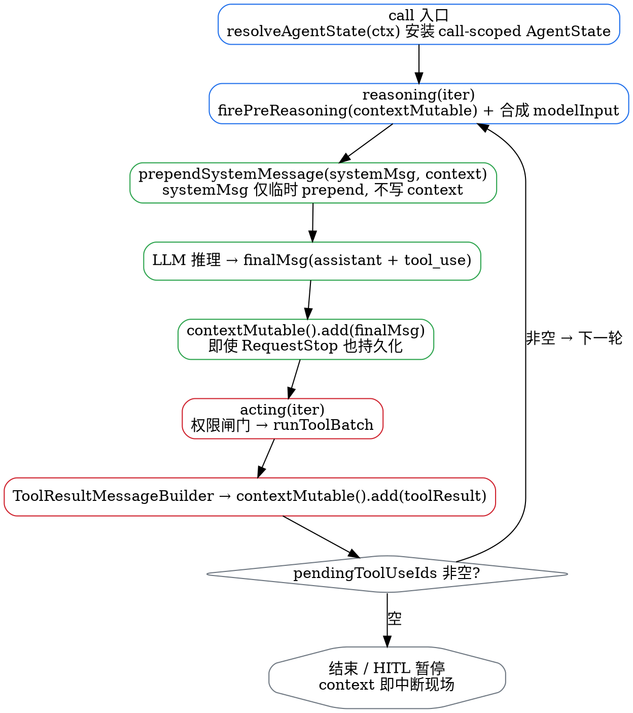

# Context

## Introduction

本分册覆盖 AgentScope Java 的**状态与上下文管理**：`AgentState` 与它的存储实现、`RuntimeContext` 的 per-call 语义、Harness 如何把 System / 对话 / 状态 / 参考材料组织成一次模型请求、上下文压缩与工具结果卸载的取舍，以及两层长期记忆。

本分册所有类名、字段、默认值均核对自本地 `v2.0.4` 源码树（`agentscope-core/.../state/`、`.../memory/`，`agentscope-harness/.../memory/`、`.../middleware/`）。**最重要的一条订正：core 的 `memory` 包在 2.0.0 已整体废弃**——「Long-term memory is removed; conversation context now lives on `AgentState`」，v2 的记忆能力全部迁到 harness 层。

核心认知：**压缩后的工作历史用于「接着做」，长期记忆用于「以后还记得」，完整 Session Log 用于「回看当时发生了什么」——三者互不替代**。

## AgentState

`AgentState`（`state/AgentState.java`）是当前工作状态的完整快照，字段（源码顺序）：

```java
private final String sessionId;
private final String userId;
private String summary;                        // 压缩摘要
private final List<Msg> context;               // 工作上下文（可变）
private String replyId;
private int curIter;
private boolean shutdownInterrupted;
private PermissionContextState permissionContext;
private final ToolContextState toolContext;
private final TaskContextState tasksContext;
private final PlanModeContextState planModeContext;
```

访问器要点（源码验证）：`getContext()` 返回**防御拷贝**——`Collections.unmodifiableList(new ArrayList<>(context))`，调用方既不能 add/remove，也无法穿透改写内层 `Msg` 引用；**`contextMutable()` 才是可变入口**，它直接 `return context`（live 引用），压缩中间件、工具结果回写、HITL 状态修补都走它就地增删。`summary` 是 free-form `String`（`@JsonProperty("summary")`），javadoc 明确「richer structured forms are left for future iterations」。序列化走 `toJson()`（pretty JSON）/ `fromJsonString(String)`，`context` 字段 `@JsonProperty("context")` 反序列化直接落到这个可变 `List<Msg>`。`Builder` 支持 `sessionId/userId/summary/context/addMessage/replyId/curIter/shutdownInterrupted/permissionContext/toolContext/tasksContext/planModeContext`。

三个子状态类把不同关注点拆开：`PermissionContextState`（权限模式 + 工作目录 + 三张规则表）、`ToolContextState`、`TaskContextState`（任务/todo）、`PlanModeContextState`（`planActive` + `currentPlanFile`）。

## AgentStateStore

`AgentStateStore`（`state/AgentStateStore.java`）是按 **`(userId, sessionId)` 寻址 + 一个状态键**的持久化接口：

```java
long UNVERSIONED = -1L;   // 不支持乐观并发的后端哨兵；CAS 冲突时也返回它
void save(String userId, String sessionId, String key, State value);                 // 全量替换
void save(String userId, String sessionId, String key, List<? extends State> values);
<T extends State> Optional<T> get(String userId, String sessionId, String key, Class<T> type);
boolean exists(String userId, String sessionId);
void delete(String userId, String sessionId);
Set<String> listSessionIds(String userId);
```

javadoc 明确的槽位约定：`sessionId` 非空非空白；**`userId` 可空，`null` 表示匿名/单租户调用方**（CLI、测试），实现把所有匿名会话归到单一命名空间；调用方**不得**手工拼接两者，由实现决定怎么合成存储键。

并发控制：`supportsOptimisticConcurrency()` 默认 false，此时 `saveIfVersion(...)` 退化为无条件 `save`；支持时走 `getVersioned(...)` / `saveIfVersion(...)` 的 CAS。

**实现只有两个**：`InMemoryAgentStateStore`（测试用）与 `JsonFileAgentStateStore`（本地 JSON 文件）。默认本地根是 `~/.agentscope/state/<agentId>/`，可用 builder 的 `stateStore` 替换。

⚠️ **定位变化**：v2 默认是 **EVENT_LOG 模式**——`AgentState` 的 checkpoint 与完整执行事实都进原生 Session Log，`AgentStateStore` 退化为「LEGACY 恢复来源 + 显式迁移来源」。另有两个辅助类：`LegacyStateLoader`（读旧格式）、`VersionedState` / `ConflictPolicy`（版本与冲突策略）、`ConcurrentSessionModificationException`（CAS 冲突）、`SessionInfo`、`ReadCacheEntry`、`ListHashUtil`。

### CAS 持久化（源码级）

每次 `call()` 结束（或关键节点）都会把 `AgentState` 落盘。`ReActAgent.persistAgentStateCas(...)`（@4699）走**乐观并发**：

```java
persistAgentStateCas(userId, sessionId, slot, state, expected, state.getContext().size());
// expected = 上一个成功持久化的版本号；CAS 失败抛 ConcurrentSessionModificationException
```

- `getVersioned(...)` / `saveIfVersion(...)` 只在 `supportsOptimisticConcurrency()==true` 时启用；默认 `InMemoryAgentStateStore` / `JsonFileAgentStateStore` 都**不支持**（退化为无条件 `save`，`UNVERSIONED=-1L` 哨兵）。
- 持久化尺寸以 `getContext().size()` 计（注意是防御拷贝视图的 size，等价于 live 列表长度），作为版本外的辅助校验。
- 落盘粒度：reasoning 产生 `finalMsg`、PostReasoning 的 `eventMsg`、acting 的工具结果、`RequestStopEvent` 暂停态——凡改变 `contextMutable()` 的节点，最终都经 `saveStateToSession(scope)`（如 `doCallInner` 后、`runPostReasoningPipeline` 末尾）统一刷写，保证中断后可从 `AgentState.context` 重放 pending tool calls。

## RuntimeContext

`RuntimeContext`（`agent/RuntimeContext.java`）是 **per-call 瞬态上下文**，决定这次调用读写哪个状态槽位：

| 成员 | 说明 |
| :--- | :--- |
| `getSessionId()` / `getUserId()` | 身份 |
| `getAgentState()` / `setAgentState(...)` | 本次执行挂的状态 |
| `getToolExecutionContext()` / `asToolExecutionContext()` | 工具执行上下文 |
| `getToolRequestConfig()` / `setToolRequestConfig(...)` | 本次调用的工具面（激活组、过滤） |
| `getExtra()` | 字符串键属性表 |
| `put(String, Object)` / `put(Class<T>, T)` | **两套属性槽**：字符串键 + 类型化键 |
| `resolveAgentState(ctx, fallbackAgent)` | 静态解析：ctx 没有就退回 agent 自带的 |

Builder 支持 `sessionId/userId/agentState/put/putAll/toolExecutionContext/toolRequestConfig/from(source)`。类型化槽（`put(Class<T>, T)`）是框架内部传递单例对象的通道——例如子 Agent 的 `AgentSpawnTool.CTX_FORCE_SYNC`、`CTX_EXPOSE_TO_USER` 都走这类 key。

### Typed Slots & Tool DI（源码级深化）

`RuntimeContext` 的属性分**两套槽**：`stringAttributes`（`ConcurrentHashMap<String,Object>`，字符串键）与 `typedAttributes`（`ConcurrentMap<Class<?>, ConcurrentMap<String,Object>>`，类型键）。类型化槽是框架内部传单例对象的通道：

- `put(Class<T>, T)` / `get(Class<T>)` 以常量 `TYPED_DEFAULT_KEY`（空串）作为「单例类型」访问的 key；`get(Class)` 先查 exact type，再查 `getAssignableValue`——沿类型层级找**最具体**的匹配（子类/接口实现优先），这正是 `AgentSpawnTool.CTX_FORCE_SYNC`、`CTX_EXPOSE_TO_USER` 这类「按类型取回调用方注入的对象」的落地方式。
- 特殊 case：`get(Class)` 当 `type == RuntimeContext.class` 时**直接返回 `this`**，即 `ctx.get(RuntimeContext.class)` 拿到上下文自身。
- `asToolExecutionContext()`：把本 `RuntimeContext` 包成 `DefaultMutableContextStore` 作为**最高优先级**嵌进 `ToolExecutionContext`，再合并 build-time 注入的 `toolExecutionContext`（嵌套 store，低优先级）。所以工具读上下文时**运行时属性覆盖 build-time DI**。

**并发安全关键点**：`agentState` 字段是 `volatile`，在 `call()` 入口由 agent 调 `setAgentState(...)` 安装，非 call 期 `null`。因此中间件/工具应调静态 `resolveAgentState(ctx, fallbackAgent)`（优先 ctx 的 call-scoped state，回退 `fallbackAgent.getAgentState()`），而非直接 `agent.getAgentState()`——后者在并发多 session 下会取到错误 session 的状态。

## Context Construction

工作区材料**每次 call 读取一次**，由最终 Context 构建器分层组织，**不把全部文件直接追加进 System**——`AGENTS.md` 进 `project_rules`、`MEMORY.md` / `knowledge` / `additionalContextFile` 以参考消息（`HARNESS_CONTEXT`）形式注入，预算不足时后三者可被省略（只有 `additionalContextFile` 是必需材料）。

各材料的落点、预算行为与 `maxContextTokens`（默认 **8000**，只用于工作区材料准备，不代表最终模型输入上限）的完整对照表，见 [工作区分册](/docs/CS/AI/LLM/Agent/Product/AgentScopeJava/Workspace.md) 的 Material Loading And Budget。几条 Context 层独有、值得记住的细节：

- `MEMORY.md` 在记忆工具与 hooks 都关闭时不加载；
- 知识目录只加载入口和索引，其余文件由模型按需读取；
- 同一次 call 内文件变化不自动刷新，下一次 call 重新加载。

## ReAct Loop: Context Assembly Per Turn

> **核心认知**：`AgentState.context` 是**持久化的对话历史**；`systemMsg` 是 **call-scoped 临时合成的指令/参考材料**。两者在发给模型前才经 `MessageUtils.prependSystemMessage(...)` 合并，**system message 从不写入 `AgentState.context`**。

**循环入口**：

- 全新调用：`coreAgent()` → `executeIteration(0)` → `reasoning(0, false)`。
- 带 pending tool calls 的恢复：`resumeAgent()` → `acting(0)`（**直入 acting，跳过 reasoning**——上次已产生 tool_use，只需补结果）。

**reasoning 阶段（@2410 起，逐轮构建 context）**：

1. `firePreReasoning(state.contextMutable(), systemMsg, modelName)` —— 把**当前 live context** 交给 PreReasoning hook（hook 可读可改）。
2. `modelInput = MessageUtils.prependSystemMessage(event.getInputMessages(), event.getSystemMessage())` —— system message **临时 prepend** 到 `modelInput`，**不触碰** `AgentState.context`。
3. 模型流产生 `finalMsg`（assistant，含 `ToolUseBlock`）。
4. 即使 `RequestStopEvent`（HITL/中间件停止）也 `state.contextMutable().add(finalMsg)`（@2498）——**暂停态也持久化，保证下次 call 能从 pending tool calls 恢复**。
5. `InterruptedException` 时 `context.buildFinalMessage()` 除非 `DISCARD` 策略否则 `contextMutable().add(msg)`（@2520）。
6. `runPostReasoningPipeline`（@2542）：PostReasoning hook 的 `eventMsg` 也 `add`（@2549）；然后判定 HITL stop / `gotoReasoning`（→ `reasoning(iter+1,true)`）/ finish / `buildEmptyResponseReminder`（空响应则加提醒并回 reasoning）/ **continue → `acting(iter)`（@2590）**。

**acting 阶段（@3001 起）**：`actingStream` → `evaluatePermissions(toolCalls)`（权限闸门，见权限分册）→ `runToolBatch` → 工具结果经 `ToolResultMessageBuilder.buildToolResultMsg(...)` 写成 `Msg` 再 `state.contextMutable().add(...)`（@3091/@3706/@3764）。

**循环判定（@1905）**：acting 之后若 `!pendingToolUseIds(state.contextMutable()).isEmpty()` 则回到下一轮 `reasoning → acting`；为空则结束。

**错误与中断的 context 一致性保护**：

- `doNativeStructuredCall.doOnError`（@1342-1349）：把 context 回滚到 `contextSizeBefore`（移除错误后多 append 的临时消息），**失败不污染持久化 context**。
- `synthesizeErrorResultsForPendingToolCalls`（@2203）：若中断发生在「reasoning 已写 tool_use、acting 未产 result」之间，为每个 pending tool call 合成 error `ToolResultBlock` 补上，**必须早于 recovery message 添加**（否则 last assistant 变成 recovery msg，pending 检测失效）——避免恢复后 context 不一致、provider 返回空响应。
- `compressStructuredOutputContext`（@1444）：`clear()` + 重建过滤临时消息——「压实 `contextMutable()`」手法的另一处（compaction 也用同款 clear+addAll 重建）。



## HITL & Permission State in Context

权限/HITL 的**暂停态不是存在另一个字段里，而是编码进 `AgentState.context` 本身**——这正是「context 即可恢复中断现场」的落地：

- **replyId 持久化进 context**：`persistPendingRequestReplyId`（@2044）把 replyId 写入 **last assistant message 的 metadata**（`Msg.METADATA_CONFIRM_REQUEST_REPLY_ID`）。因为 assistant message 拥有那些被暂停的 `ToolUseBlock`，把关联键存那，下次 `call()` 才能从 session state 找回是哪个 pending 请求；恢复接受后 `clearPendingRequestReplyId`（@2058）清除。
- **用户确认结果回写**：`applyConfirmResults`（@2088）——确认则 `MessageUtils.replaceToolUseBlocks(contextMutable(), replacements)` 把 ASKING 的 `ToolUseBlock` 替换为 ALLOWED（可带用户修改的参数）并注册其 `PermissionRule`；拒绝则合成 DENIED `ToolResultBlock` 经 `contextMutable().add(...)`（@2128）写入——这样 resume 时该 tool 不再是 pending。
- **pending 兜底修补**：`maybePatchPendingToolCalls`（@2144）——恢复时若 pending tool calls 无结果、且用户也没提供结果，自动合成 error `ToolResultBlock`，防止 context 不一致导致 provider 空响应。

> 结论：`AgentState.context` 远不止「对话历史」——它是**带暂停态、带权限态、可逐 call 重放的中断现场**；权限引擎的 ALLOW/ASK/DENY 决策最终都物化为 context 里的 `ToolUseBlock.state` 与 `ToolResultBlock.state`，靠 `saveStateToSession` 跨 call 持久化。

## Compaction

`CompactionConfig`（harness `memory/compaction/CompactionConfig.java`）的默认值全部是**动态**的：

| 项 | 默认行为 |
| :--- | :--- |
| 触发 | 估算 token 数达到 `model.contextWindow - reserved(20k)` 时动态触发；模型不上报上下文窗口时退化为固定 token 数或 **50 条消息**（先到者） |
| 保留尾部 | 动态算 `min(8k, max(2k, usable * 0.25))` token；模型不上报窗口时退化为 **20 条消息** |
| Prune | **默认开启**：聚合旧工具结果输出，可裁剪总量超 **20k** token 时修剪（保护最近 **40k** token） |
| 摘要 | 开启 |

`ConversationCompactor` 的六步算法（javadoc 原文）：

```text
1. Check trigger    — token 数或消息条数超阈值
2. Determine cutoff — 找保住尾部预算的最早下标；绝不把 ASSISTANT tool-call 和它的 TOOL result 拆开
3. Memory flush     — （可选）经 MemoryFlushManager 从前缀抽取长期记忆
4. Message offload  — （可选）把完整对话持久化进 session JSONL
5. Summarize        — 一次 LLM 调用把前缀蒸馏成结构化摘要
6. Rebuild          — 返回 [summaryUserMsg] + preservedTail
```

调用方（`CompactionMiddleware`）负责同时更新 agent 工作记忆与面向 LLM 的消息列表；该中间件在 `onReasoning` 触发，并把 `ReasoningInput` 重建成 `[systemMsg] + ...`。

压缩事件进 Session Log：`compaction/start` / `compaction/end`，其中 **`compaction/end` 的载荷含 `compactionId`、`status`、`beforeMsgCount`、`beforeTokenCount`**；仅当 `status` 为 completed 时才带 `afterMsgCount` / `afterTokenCount`——失败或取消时**不伪造压缩后指标**。

## Tool Result Eviction

`ToolResultEvictionConfig` 与压缩**正交**，这一点 javadoc 说得最清楚：

> **Eviction addresses context *width*** — individual messages that are too large.
> **Compaction addresses context *depth*** — too many accumulated messages.

两者触发条件与生命周期事件都不同。机制：单个工具结果的文本内容超 `maxResultChars()`（默认 **80K 字符**）时，`ToolResultEvictionMiddleware` 把完整输出写到 `{evictionPath}/{agentName}/{sanitized-toolCallId}-{contentHash}`，上下文里的 `ToolResultBlock` 换成带 head+tail 预览 + 「用 `read_file` 读全文」指引的紧凑占位符。写盘前先压实 `AgentState.contextMutable()`，防止 legacy pre-reasoning hook 把原始结果藏过持久化清理。

## Memory In V2

设计实现与源码机制（四件套算法、中间件调度节流、`MemoryConsolidator` 水位 CAS、三工具落点）见 [记忆分册](/docs/CS/AI/LLM/Agent/Product/AgentScopeJava/Memory.md)。本节约写概念层。

⚠️ **core 的 `memory` 包整体废弃**：`LongTermMemory`、`Memory`、`StateBackedMemory`、`InMemoryMemory`、`AgentStateMemoryView`、`LongTermMemoryTools`、`StaticLongTermMemoryHook`、`LongTermMemoryMode` 全部 `@Deprecated(forRemoval = true, since = "2.0.0")`。`LongTermMemory` 的 javadoc 原文：「Long-term memory is removed; conversation context now lives on `AgentState#getContext()`」；`Memory`：「Conversation context is now held on ...」。`ReActAgent.Builder` 里的 `longTermMemory(...)` / `longTermMemoryMode(...)` / `longTermMemoryAsyncRecord(...)` 只是 1.x 兼容 setters。

**v2 的两层记忆在 harness**，落点是工作区两个文件：

```text
workspace/
├── MEMORY.md                  ← 策划后的长期记忆，每次 call 加载为参考上下文
└── memory/
    └── YYYY-MM-DD.md          ← 每天追加的事实流水账（未去重）
```

职责边界由两个类严格分开（javadoc 原文）：

| 层 | 文件 | 唯一写者 | 性质 |
| :--- | :--- | :--- | :--- |
| Layer 1 | `memory/YYYY-MM-DD.md` | `MemoryFlushManager` | append-only 日流水账，每次压缩 flush 追加一个带时间戳的小节 |
| Layer 2 | `MEMORY.md` | `MemoryConsolidator` | 全局策划、去重、有界；按周期读取自上次 consolidation 水位以来的日账 + 当前 `MEMORY.md`，让 LLM 合并/去重/裁剪后覆写 |

写入路径：压缩前 `MemoryFlushMiddleware` 从对话前缀抽新事实追加进日账（`onAgent` 的 `doOnComplete`，fire-and-forget 不阻塞 agent 流）；后台节流任务定期合并去重写回 `MEMORY.md`。读取路径：框架自动读 `MEMORY.md`（两层读，filesystem 优先），agent 也可主动调 `memory_search` / `memory_get`。

`MemoryConfig`（harness `memory/MemoryConfig.java`）的可调项与默认值：

| 字段 | 默认 |
| :--- | :--- |
| `mode`（`FlushMode`：`ALWAYS` / `NEVER` / `THROTTLED`） | — |
| `minGap` | — |
| `consolidationMaxTokens` | **4000** |
| `consolidationMinGap` | **30 分钟** |
| `dailyFileRetentionDays` | **90** |
| `sessionRetentionDays` | **180** |
| `flushTrigger` | `FlushTrigger.always()`（`never()` 只关 per-call flush，不动后台维护） |
| `model` / `flushPrompt` / `consolidationPrompt` | null（用默认提示词） |

配套：`MemoryBackgroundTasks`（后台任务）、`memory/.consolidation_state`（记录上次成功合并的时间戳水位）。关掉的开关：`disableMemoryHooks()`（flush + 后台维护）、`disableMemoryTools()`（`memory_search` / `memory_get` / `memory_save` / `session_search`）。

## Links

- [主笔记](/docs/CS/AI/LLM/Agent/Product/AgentScopeJava/AgentScopeJava.md)
- [智能体分册](/docs/CS/AI/LLM/Agent/Product/AgentScopeJava/Agent.md)
- [会话分册](/docs/CS/AI/LLM/Agent/Product/AgentScopeJava/Session.md)
- [工作区分册](/docs/CS/AI/LLM/Agent/Product/AgentScopeJava/Workspace.md)
- [记忆分册](/docs/CS/AI/LLM/Agent/Product/AgentScopeJava/Memory.md)
- [Compaction](/docs/CS/AI/LLM/Agent/Theory/Compaction.md)
- [AgentScope（Python 版）](/docs/CS/AI/LLM/Agent/Product/AgentScope/AgentScope.md)

## References

- [AgentScope Java 上下文管理](https://java.agentscope.io/v2/zh/docs/harness/context)
- [AgentScope Java 工作区](https://java.agentscope.io/v2/zh/docs/harness/workspace)
- [AgentScope Java 会话日志](https://java.agentscope.io/v2/zh/docs/harness/session-log)
