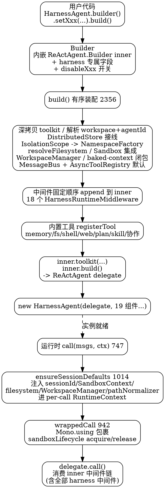

## Introduction

本分册专门拆解 `HarnessAgent` 的内部架构——它如何把工作区、文件系统、沙箱、记忆、技能、子 Agent、会话日志等工程能力**装配**进一个 `ReActAgent`。所有事实核对自本地 `v2.0.4` 源码树（`agentscope-harness/src/main/java/io/agentscope/harness/agent/HarnessAgent.java`，2971 行；`HarnessAgentBuilderSupport.java`，920 行；`middleware/HarnessRuntimeMiddleware.java`）。

本分册与 [智能体分册](/docs/CS/AI/LLM/Agent/Product/AgentScopeJava/Agent.md) 互补：后者讲 `Agent` 接口与 `ReActAgent` 的**调用方式**（Builder 参数、生命周期、结构化输出、`AgentRun`、中断、HITL、模型容错），本册只讲 harness 层的**装配层**——`HarnessAgent` 不是 `ReActAgent` 的子类，而是它的装饰器包装，本册不重复接口与生命周期。

## Delegation Architecture

`HarnessAgent implements Agent, AutoCloseable`（`HarnessAgent.java:169`），**不继承 `ReActAgent`**，而是**装饰器 / 委托包装**：内部持有 `private final ReActAgent delegate`（`HarnessAgent.java:173`），所有 `call / stream / observe / interrupt` 都转发给 `delegate`，在转发前注入 harness 运行时上下文。

私有构造函数（`HarnessAgent.java:205`）接收 19 个 harness 能力组件，按职责可归为：

- **执行体**：`ReActAgent delegate`
- **工作区 / 文件系统**：`WorkspaceManager`、`WorkspaceIndex`、`WorkspacePathNormalizer`、沙箱 `SandboxContext`、`BiFunction<String,String,WorkspaceManager> workspaceFactory`（baked-context 闭包）
- **技能 / 自学习**：`List<AgentSkillRepository>`、`PlanModeManager`、`SkillPromoter`、`SkillUsageStore`、`SkillCurator`、`SkillAuditLog`
- **记忆 / 协作**：`MemoryConfig`、子代理中间件 `Object subagentMiddleware`（实为 `SubagentsMiddleware` / `DynamicSubagentsMiddleware` 之一）
- **分布式 / 路由**：`DistributedStore`、`Toolkit ownedMcpToolkit`

**与 `ReActAgent` 的迁移关系**：`HarnessAgent.Builder.fromAgent(ReActAgent)`（`HarnessAgent.java:1427`）从 vanilla `ReActAgent` 继承可观察配置（`name` / `sysPrompt` / `model` / `maxIters` / `toolkit` 深拷贝 / `stateStore` / `middlewares` / `hooks` / `permissionContext` 复用）。关键约束：迁移时**自动排除所有 `HarnessRuntimeMiddleware`**（`HarnessAgent.java:1623` 的 `!(middleware instanceof HarnessRuntimeMiddleware)`），因为它们由 harness 按场景重新装配，不能从 vanilla agent 继承。

## Builder Assembly Chain

`HarnessAgent.Builder`（`:1194`）内嵌 `private final ReActAgent.Builder inner = ReActAgent.builder()`（`:1196`）——**委托构造**：所有 forwarder setter 同时写给 `inner` 与本地 mirror 字段（`name`、`toolkit`、`model`、`maxIters`、`middlewares` 等），harness 专属字段（`workspace`、`memoryConfig`、`skillRepositories`、`planModeEnabled`、`subagentDeclarations` …）只存在于 Builder 自身，供 `HarnessAgentBuilderSupport` 的静态 helper 读取（避免跨包访问 `ReActAgent.Builder` 内部）。

Builder 暴露**大量 `disableXxx()` 开关**，把能力做成可插拔裁剪：`disableFilesystemTools`、`disableShellTool`、`disableWebTools`、`disableMemoryTools`、`disableMemoryHooks`、`disableTranscript`、`disableSessionPersistence`、`disableWorkspaceContext`、`disableAtPathExpansion`、`disableSubagents`、`disableDynamicSkills`、`disableDefaultWorkspaceSkills`、`disableDynamicSubagents`、`disableToolsConfig`、`disableCompaction`、`disableToolResultEviction` ……——同一套 builder 可裁出从「轻量推理 agent」到「全能力 agent」的多种形态。

`build()`（`:2356`）的有序装配步骤（核对自源码）：

1. **Toolkit 深拷贝**：`agentToolkit = this.toolkit.copy()`（`:2359`）——每个 agent 实例独立 toolkit，harness 注册工具与用户工具**不跨 build 泄漏**。
2. **校验**：filesystem spec 互斥（`sandboxFilesystemSpec` / `remoteFilesystemSpec` / `localFilesystemSpec` 至多一个，且与 `abstractFilesystem` 互斥，`:2362-2375`）。
3. **解析 workspace / agentId**：workspace 解析序 `agentscope.workspace` 系统属性 > `AGENTSCOPE_WORKSPACE` 环境变量 > `${user.dir}/.agentscope/workspace`（`:376`, `:1166`）；agentId 缺省回退 `name` → `"ReActAgent"`（`:377`）。
4. **DistributedStore 自动接线**（`:384-407`）：优先级 `explicit builder > distributedStore > workspace defaults`，注入 `stateStore`、remote/sandbox filesystem 的 store、`messageBus`、`asyncToolRegistry`、sandbox snapshot / execution guard。
5. **PeriodicGate**（`:409-412`）：分布式用 `StoreBackedPeriodicGate`，本地用 `LocalPeriodicGate`（记忆冲刷 / 策展的节拍器）。
6. **默认 stateStore**（`:426`）：`new JsonFileAgentStateStore(defaultStateDir(agentId))`，根在 `~/.agentscope/state/<agentId>/`（**独立于 workspace**）；remote filesystem 校验要求分布式 stateStore，否则抛异常（`:431`）。
7. **IsolationScope → NamespaceFactory**（`:415-425`）：filesystem 隔离范围（USER / SESSION / AGENT）转成命名空间工厂，决定 per-(user,session) 的存储与文件前缀。
8. **解析 filesystem**：`HarnessAgentBuilderSupport.resolveFilesystem(...)`（`:2443`）。
9. **Sandbox 集成**（`:447-484`）：sandbox 模式下 `SandboxBackedFilesystem` / `RoutedSandboxFilesystem` + `SandboxManager` + `SandboxLifecycleMiddleware`（按调用生命周期 acquire / release）。
10. **WorkspaceManager**（`:485`）：`new WorkspaceManager(resolvedWorkspace, filesystem, workspaceIndex, nsFactory)`。
11. **baked-context 闭包** `workspaceFactoryFn`（`:492-502`）：为给定 `(uid, sid)` 创建绑定 `BakedContextFilesystem`（基于 `buildBakedRuntimeContext`）的 `WorkspaceManager`——子代理 / per-call 视图隔离的落点。
12. **MessageBus / AsyncToolRegistry 默认**（`:507-516`）：基于同一 filesystem 的 `WorkspaceMessageBus` / `WorkspaceAsyncToolRegistry`。
13. **中间件固定顺序 append**（见下节）。
14. **内置工具注册**（见工具节，受 `disableXxx` 条件控制）。
15. **Plan mode**（`:2736-2755`）：`PlanModeManager` + 3 个 plan 工具 + `PlanModeMiddleware`（只读判定 + `planExtraAllowed` 允许 shell）。
16. **tools.json**（`:2757-2771`）：`McpServerRegistrar.register` 注册 MCP server；`ToolFilter.apply`（`:2935`）做 allow / deny 过滤（平台工具豁免）。
17. **Skills**（`:2773-2931`）：`composeSkillRepositories` 合并仓库 → `HarnessSkillMiddleware`（frozen vs dynamic 取决于 `disableDynamicSkills`）；skill_manage 启用时换 writable repo + `SkillManageTool` / `ProposeSkillTool` + `SkillPromoter` / `Curator` / `Usage` + 对应 middleware。
18. **Build inner + 装饰器组装**（`:2946-2968`）：`inner.toolkit(agentToolkit)` → `ReActAgent delegate = inner.build()` → `new HarnessAgent(delegate, ...)`。

## Harness Middleware Stack

harness 自带中间件统一实现标记接口 **`HarnessRuntimeMiddleware extends MiddlewareBase`**（`HarnessRuntimeMiddleware.java:25`，javadoc 明确「framework-owned，不应被 `fromAgent()` 复制」）。**18 个实现**按 build() 的固定顺序 append 到 `inner`（洋葱层序，外 → 内）：

| 顺序 | 中间件 | 触发条件 | 职责 |
| :--- | :--- | :--- | :--- |
| 1 | `SandboxLifecycleMiddleware` | 沙箱模式 | 每次 call / stream 用 `Mono.using` / `Flux.using` acquire / release 沙箱（`:947`, `:954`） |
| 2 | `AgentTraceMiddleware` | `agentTracingLogEnabled`（默认 true） | agent 追踪日志 |
| 3 | `WorkspaceContextMiddleware` | `!disableWorkspaceContext` | `onSystemPrompt` 注入工作区上下文（session / AGENTS.md / MEMORY.md / 知识，`WorkspaceContextMiddleware.java:50`） |
| 4 | `AtPathExpansionMiddleware` | `!disableAtPathExpansion` | 把 `@path` 引用展开为实际文件内容 |
| 5 | `TranscriptMiddleware` | `!disableTranscript` | 持久化会话历史（transcriptStore, tenant） |
| 6 | `MemoryFlushMiddleware` | memoryModel && `!disableMemoryHooks` | 记忆冲刷（flushTrigger, isolationScope, periodicGate） |
| 6 | `MemoryMaintenanceMiddleware` | 同上 | 记忆合并 / 保留（consolidator, retention days） |
| 7 | `CompactionMiddleware` | `!disableCompaction` | 上下文压缩（挂 `wrappedCall` 的溢出恢复） |
| 8 | `ToolResultEvictionMiddleware` | `!disableToolResultEviction` | 工具结果淘汰（控制上下文体积） |
| 9 | `InboxMiddleware` | `messageBus != null` | 基于消息总线的收件箱（capacity 100, asyncToolRegistry） |
| 10 | `TeamsMiddleware` | teamsMode | 团队角色裁剪 `team` 工具 + 控制面 TeamEvent 绑定 |
| 11 | `SubagentsMiddleware` / `DynamicSubagentsMiddleware` | `!disableSubagents` | 静态 / 动态子代理（扫描 `subagents/`、声明、custom factories；注入 `AgentSpawnTool` + `TaskTool`） |
| 12 | `AsyncToolMiddleware` | `messageBus && asyncToolTimeout` | 异步工具执行 |
| 13 | `PlanModeMiddleware` | `planModeEnabled` | 只读设计阶段闸门 |
| 14 | `SkillUsageMiddleware` | `skillManageToolEnabled` | 技能使用统计 |
| 14 | `SkillCuratorMiddleware` | `skillCuratorEnabled` | 技能策展（状态机 / 伞合并） |
| 15 | `HarnessSkillMiddleware` | 有技能仓库 | 技能合并 / 过滤 / 物化 / 沙箱投影（详见 [技能分册](/docs/CS/AI/LLM/Agent/Product/AgentScopeJava/Skill.md)） |

> 注意：core 的 `ReActAgent` 自带 5 个 hook 中间件（onReasoning / onActing / …）；harness 这 18 个 `HarnessRuntimeMiddleware` 是**叠加在其上**的工程能力层，全部由 build() 框架装配，用户无需手动挂。

## Built-in Tool Set

build() 直接 `agentToolkit.registerTool(...)`（或通过中间件 `getTools()` 注入）的内置工具，按领域分组：

| 领域 | 工具 | 注册条件 |
| :--- | :--- | :--- |
| 记忆 | `MemorySearchTool` / `MemoryGetTool` / `MemorySaveTool` / `SessionSearchTool` | `!disableMemoryTools` |
| 文件系统 | `FilesystemTool`（带 `WorkspacePathNormalizer` 围栏） | `!disableFilesystemTools` |
| 交付 | `ArtifactDeliveryTool` | `artifactDeliveryEnabled`（有 artifactDeliveryTarget 且未禁 fs） |
| 执行 | `ShellExecuteTool`（仅沙箱 filesystem 下注册） | `!disableShellTool && sandbox` |
| Web | `WebFetchTool` / `WebSearchTool` | `!disableWebTools` |
| 计划 | `PlanEnterTool` / `PlanWriteTool` / `PlanExitTool` | `planModeEnabled` |
| 技能自学习 | `SkillManageTool` / `ProposeSkillTool`（`registerAgentTool`） | `skillManageToolEnabled` |
| 协作-子代理 | `AgentSpawnTool` + `TaskTool`（来自 `SubagentsMiddleware.getTools()`） | `!disableSubagents` |
| 协作-团队 | 角色裁剪的 `team` 工具（来自 `TeamsMiddleware.getTools()`） | teamsMode |
| 协作-异步 | `WaitAsyncResultsTool` | `messageBus != null` |

`HarnessPlatformTools`（`tools/HarnessPlatformTools.java:29`）是**平台工具名白名单集合**而非注册点：被 `ToolFilter` 用于在 tools.json 的 allow / deny 过滤时**豁免**平台工具（subagents / teams / tasks / plan / skills / memory helpers 等总是存活，`ToolFilter.java:77`, `:116`）。

## Runtime Forwarding & Context Injection

所有 `call(List<Msg>, RuntimeContext)`（`:747`）与 `streamEvents(...)`（`:920`）都先经 `ensureSessionDefaults(ctx)`（`:1014`）再进 `wrappedCall` / `wrappedStreamEvents`：

- **`ensureSessionDefaults`** 把 harness 能力组件**注入 per-call `RuntimeContext`**：默认 `sessionId`（缺省回退 `getName()`）、`SandboxContext`（缺省 `defaultSandboxContext`）、`AbstractFilesystem`（来自 WorkspaceManager）、`WorkspaceManager`、`WorkspacePathNormalizer`。这些组件随后被各 harness 中间件与工具从 `RuntimeContext` 取出使用——**这正是 harness 能力的运行时注入点**。
- **`wrappedCall` / `wrappedStreamEvents`**（`:942`, `:991`）用 `Mono.using` / `Flux.using` 包裹：进入时 `sandboxLifecycleMw.acquireForCall(effective)`、退出时 `releaseForCall`——**沙箱按调用生命周期自动获取 / 释放**。
- **上下文溢出恢复**：`wrappedCall` 挂 `compactionHook.onErrorResume`（`:958`）——当模型返回 `context_length_exceeded` 等溢出错误（`isContextOverflowError`, `:1103`），触发 `forceCompactAndRetry`（`:1058`）紧急压缩后重试；未配 compaction 则直接报错。

## Isolation & Concurrency

- **`IsolationScope`**（`USER` / `SESSION` / `AGENT`，`IsolationScope.java`）→ `NamespaceFactory`（`fsIsolationScope.toNamespaceFactory()`，`:1425`）决定 per-(user,session) 的存储与文件命名空间前缀。
- **baked-context 闭包**（`workspaceFactoryFn`, `:492`）：为 `(uid, sid)` 构造绑定 `BakedContextFilesystem`（基于 `buildBakedRuntimeContext`）的 `WorkspaceManager`，是子代理 / per-call 视图隔离的落点；同名 uid 的命名空间收敛为空列表（`:1497`）。
- **DistributedStore 自动接线**（`:384`）：分布式部署下自动把 stateStore / messageBus / asyncToolRegistry / sandbox snapshot / execution guard 接好；remote filesystem 强制要求分布式 stateStore（本地实现会抛异常，`:431`）——保证多副本可恢复。
- **默认 stateStore 独立于 workspace**：`~/.agentscope/state/<agentId>/`（`:1134-1141`）位于 workspace 之外，agent 状态（沙箱状态恢复的前提）不与工作区数据纠缠。

## Diagram: Delegation + Assembly + Forwarding

## Links

- [智能体分册](/docs/CS/AI/LLM/Agent/Product/AgentScopeJava/Agent.md)
- [工具分册](/docs/CS/AI/LLM/Agent/Product/AgentScopeJava/Tool.md)
- [技能分册](/docs/CS/AI/LLM/Agent/Product/AgentScopeJava/Skill.md)
- [工作区分册](/docs/CS/AI/LLM/Agent/Product/AgentScopeJava/Workspace.md)
- [会话分册](/docs/CS/AI/LLM/Agent/Product/AgentScopeJava/Session.md)
- [主笔记](/docs/CS/AI/LLM/Agent/Product/AgentScopeJava/AgentScopeJava.md)

## References

- [AgentScope Java Harness 架构](https://java.agentscope.io/v2/zh/docs/harness/architecture)
