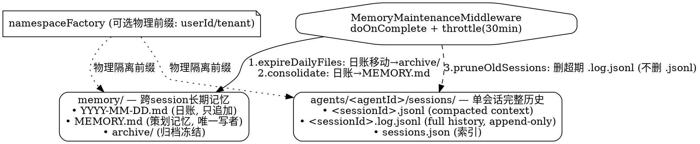
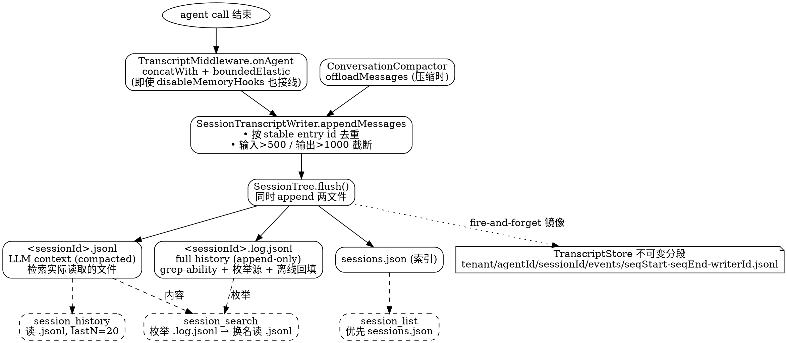
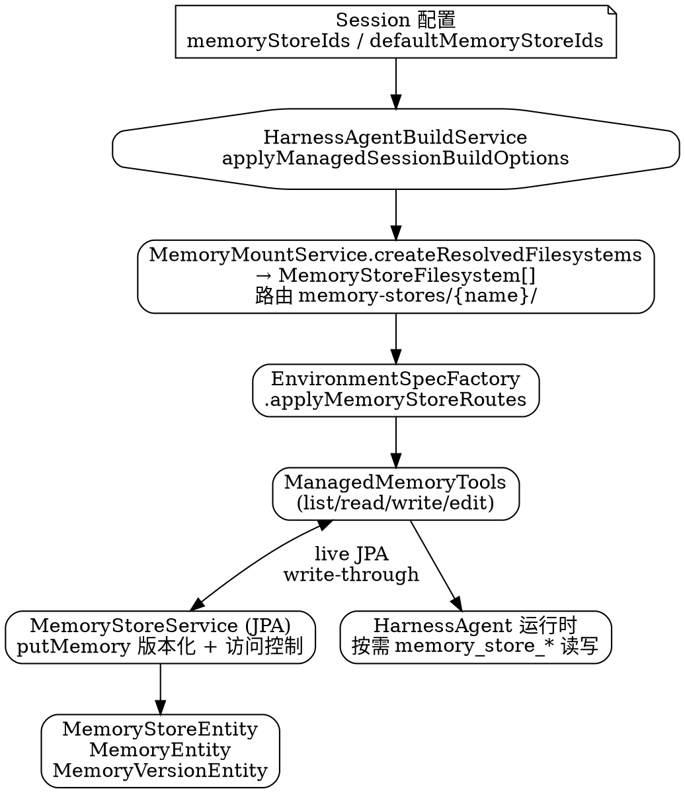
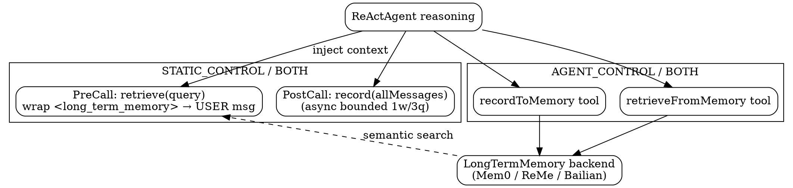
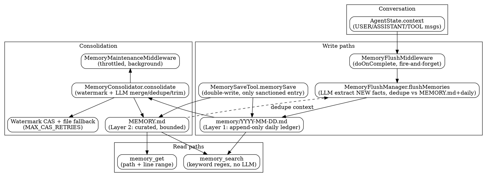

# Memory

## Introduction

本分册覆盖 AgentScope Java 的**记忆子系统设计实现**——agent 如何"记住"东西：两层长期记忆（`memory/YYYY-MM-DD.md` 日账与 `MEMORY.md` 策划记忆）是怎么被写入、合并、检索、清理的；对话上下文（`AgentState.context`）涨满时如何压缩收敛；会话历史如何在本地与跨机持久化；以及 builder 平台的托管记忆（Managed Memory Store）如何作为第三套体系接入。

**分工约定**：[上下文分册](/docs/CS/AI/LLM/Agent/Product/AgentScopeJava/Context.md) 的 `Memory In V2` 节已写清**概念层**（两层职责、文件布局、`MemoryConfig` 字段默认值、开关）；本分册聚焦**源码机制**——四个核心类的算法、中间件的调度与节流、水位与并发安全、三个工具的落点。

**源码基线**：本分册所有类名、方法签名与算法均核对自本地 `v2.0.4` 源码树（`agentscope-harness/.../agent/memory/`、`.../agent/middleware/`、`.../agent/tool/`、`agentscope-core/.../core/memory/`、`agentscope-service/.../builder/web/managed/`）。

**阅读路线**：本章不假设你已熟悉该系统。我们从"为什么需要记忆"讲起，先建立一张全景心智模型，再按"短期记忆 → 压缩 → 长期记忆 → 会话持久化 → 平台托管 → 历史遗产"由浅入深展开；每个关键技术点都会追问一句"为什么这么设计"。

## Why Memory Exists: 从大模型的三个缺憾讲起

要理解整套记忆子系统，先要明白它**要解决什么**——否则下面的三层文件、水位、CAS、双文件都会显得零散。大模型 + agent 循环本身有三个根深蒂固的缺憾，记忆子系统正是为它们逐一补洞：

1. **无状态**：每次推理只看得见传入的 `context`，调用结束即忘。同一用户下一条消息必须靠"把历史重新塞进 context"才能延续对话——于是需要一套**短期记忆**（`AgentState.context`）作为对话的现态。
2. **上下文有限且昂贵**：context 窗口有上限、token 要花钱。长对话必须裁剪，但**裁剪 ≠ 丢弃**——被裁掉的用户偏好、关键决策若真丢了，agent 就"失忆"。于是需要一条**压缩主线**：把旧上下文蒸馏成摘要、把原文救回归档，再让上下文窗口重新可用。
3. **跨会话/跨 agent 的知识要沉淀复用**：用户偏好、项目决策、操作说明不应每轮重新从对话里抠，而应沉淀成可被任意会话检索的**长期记忆**；团队共享知识还应跨 agent、跨租户复用。于是需要**两层文件长期记忆**与**平台托管记忆**。

这三个缺憾对应三类不同的"记忆需求"——**短期现态、长期沉淀、共享知识**——它们的生命周期、读写频率、隔离维度都不同。这正是整套系统"分成三套、而非一套"的根本原因（详见下一节）。

## Mental Model: 三层记忆 + 一条压缩主线

把上面三个缺憾映射到系统的真实组件，得到一张全景心智模型。请先记住这张图，后面每一章都是在放大其中一个方块：

```
                对话进行中
                    │
                    ▼
        ┌───────────────────────────┐
        │  AgentState.context       │  ← 短期记忆（唯一真源）
        │  (USER/ASSISTANT/TOOL)    │
        └─────────────┬─────────────┘
                      │ 涨满时（压缩主线）
          ┌───────────┼───────────────────────────────┐
          ▼           ▼                                ▼
   ① 抽记忆    ② 存全量                      ③ 收敛 context
   flush 日账   offload .jsonl/.log.jsonl      summarizePrefix → [summary]+tail
          │                                     │
          ▼                                     ▼
   长期记忆（两层文件）                    AgentState.context 被整体替换
   memory/YYYY-MM-DD.md                       （旧前缀从现态移除）
   MEMORY.md
          │ 后台合并（Consolidation）
          ▼
   MEMORY.md（curated, bounded）
```

| 层级 | 组件 | 解决哪个缺憾 | 生命周期 |
| :--- | :--- | :--- | :--- |
| **短期记忆** | `AgentState.context` | 无状态（现态延续） | 单次会话，随会话恢复/重置 |
| **压缩主线** | Compaction（summarize + offload + reload） | 上下文有限（裁剪不丢） | 每次推理前按需触发 |
| **长期记忆（两层文件）** | `memory/YYYY-MM-DD.md` + `MEMORY.md` | 跨会话沉淀 | 跨会话累积、按月归档 |
| **会话持久化** | `agents/<id>/sessions/*.jsonl` + `.log.jsonl` | 可恢复/可审计/可搜索 | 单会话完整历史 |
| **平台托管记忆** | Managed Memory Store（service 层） | 跨 agent/租户共享知识 | 多租户共享、带版本 |

**设计动机——为什么分三层而不是一套？** 把短期、长期、共享混在一个存储里会互相干扰：长期记忆不能被压缩裁剪（否则沉淀会丢），共享库必须强制多租户隔离（否则用户 A 读到用户 B 的知识），短期 context 必须随推理链即时重建（不能慢一拍）。分层的代价是多了几套写入路径与命名空间规则，但换来**各层的生命周期、隔离维度、写者身份互不污染**——这正是后面所有"协调清理""节流对齐""会话与记忆解耦"设计的出发点。

> 另有一条 **core v1 `Memory` API** 与 **`LongTermMemory` 扩展后端（Mem0/ReMe/Bailian）** 是历史遗产 / 可选替代，整包 `@Deprecated(forRemoval = true)`，v2 推荐的事实机制是上面的 harness 文件体系。它们放在本文末尾的「历史遗产」与「可选后端」两章，不影响主线理解。

## Short-Term Memory: AgentState.context is the Single Source of Truth

先从最基础的一层讲起。理解了"短期记忆是唯一的真源"，后面所有记忆/压缩/持久化都以它为圆心就顺理成章了。

`AgentState.context` 是 agent 每一轮推理**实际看到的对话消息列表**（含 `USER`/`ASSISTANT`/`TOOL` 消息）。它的几个关键事实：

- **它是现态，不是副本**：agent loop 把 `context` 拼上系统提示、本轮输入，交给模型；模型产出后再把新消息追加回 `context`。推理输入如何重建，取决于上层是否每轮把 `SYSTEM` 放回 `input[0]`（压缩章节会回看这一隐含约束）。
- **它是唯一真源**：所有"记忆"都是把 `context` 里的内容**派生**出去（抽成日账、救回归档、蒸馏成摘要），而不是反过来用记忆覆盖 `context`。持久化也以它为准——`AgentStateStore`（JsonFile/Redis/JDBC/…）负责把 `context` 落盘。

> **设计动机——为什么必须只有一个真源？** 若短期 context 与某份"记忆缓存"同时存在，二者必然在某个时刻不一致（谁覆盖谁？），agent 就会时而"记得"时而"失忆"。AgentScope 选择让 `AgentState.context` 充当唯一的现态真源，所有记忆操作都是**单向派生**：context → 记忆文件 →（后台合并）→ 更精炼的记忆文件 →（下一轮读取）→ 重新注入 context。派生方向单一，就不会出现回环覆盖。

**core 包的校准**：`io.agentscope.core.memory` 整包 `@Deprecated(forRemoval = true, since = "2.0.0")`，但 v2.0.4 里它**仍被保留作 1.x 源码兼容层**——`ReActAgent.Builder` 仍保留 `longTermMemory(...)`/`longTermMemoryMode(...)`/`longTermMemoryAsyncRecord(...)`，且 `build()` 在 `longTermMemory != null` 时调用 `configureLongTermMemory`。关键桥梁：`configureLongTermMemory` 把 `new AgentStateMemoryView(reactAgent::getAgentState)` 作为**只读视图**传给 `StaticLongTermMemoryHook`——即即使启用 deprecated LTM，它读取的也是真实的 `AgentState.context`。详见文末「历史遗产」章。

## Compaction: 当 context 涨满时如何收敛

短期记忆会无限增长，而 context 窗口有限——这是第一节说的第二个缺憾。这一章专讲"压缩主线"：如何把旧上下文收敛、同时保证不丢历史。

### Why Compaction（动机先行）

context 一旦接近窗口上限，继续追加就会截断或超预算。但被裁掉的往往是**用户偏好、关键决策、文件改动**这些高价值信息。压缩要解决的是一个看似矛盾的需求：**既要让窗口重新可用（裁剪），又不能真把信息弄丢（保留）**。AgentScope 的解法是一个三段式时序——

> **先抽记忆（flush）→ 先存全量（offload）→ 再蒸馏摘要（summarize）→ 最后替换 context（applyToContext）**

这套时序是整个压缩设计的灵魂，后面所有算法都是它的注脚。

### Dynamic Compaction Window: Trigger & Keep Resolution

压缩窗口如何"自适应模型"而非写死阈值？`CompactionMiddleware` 在每次 `onReasoning` 之前调用 `resolveEffectiveConfig()`，把 `CompactionConfig` 的"动态占位符"（`triggerTokens = 0`、`keepTokens = -1`）替换成基于模型上下文窗口的实值。

**默认配置（`CompactionConfig.Builder` 初始值）**

| 字段 | 默认值 | 语义 |
|------|--------|------|
| `triggerMessages` | 50 | 对话（非 SYSTEM）消息数达此即触发（0 = 关闭） |
| `triggerTokens` | 0 | 0 = 动态模式：用 `窗口 - reserved` |
| `reserved` | 20_000 | 留给 summary 提示词 + 输出的 token 预算（仅动态模式用） |
| `keepTokens` | -1 | -1 = 动态；0 = 用 `keepMessages`；>0 = 静态预算 |
| `keepTokensMin` | 2_000 | 动态 keep 下限 |
| `keepTokensMax` | 8_000 | 动态 keep 上限 |
| `keepTokensRatio` | 0.25 | 动态 keep 比例 |
| `keepMessages` | 20 | `keepTokens == 0` 时保留末 N 条 |

**解析公式（`resolveEffectiveConfig`）**

- 触发标记 `needsDynamic = (triggerTokens == 0) || (keepTokens == -1)`；默认两者都命中 → 必走动态。
- `effectiveTrigger`：
  - `triggerTokens == 0` 且模型报窗口（`contextWindow > 0`）：`effectiveTrigger = contextWindow - reserved`；若结果 `≤ 0`（reserved 超过窗口），clamp 到 `max(1, contextWindow / 2)` 并告警（否则会每次调用都触发、抖动）；
  - 模型不报窗口：`effectiveTrigger = FALLBACK_TRIGGER_TOKENS = 160_000`；
  - 否则（显式静态）`effectiveTrigger = triggerTokens`。
- `effectiveKeep`（仅当 `keepTokens == -1`）：
  - 模型报窗口：`usable = contextWindow - reserved`；`effectiveKeep = min(keepTokensMax, max(keepTokensMin, (int)(usable * keepTokensRatio)))`；
  - 模型不报窗口：`effectiveKeep = 0`（**退化为 `keepMessages` 模式**）。
- 最后 `config.withEffective(effectiveTrigger, effectiveKeep)`：返回一份**防御性副本**，仅替换 `triggerTokens`/`keepTokens` 两个字段，其余（summaryPrompt、prune、truncateArgs 等）完全沿用——动态解析不影响任何非窗口相关配置。

**消费侧（`ConversationCompactor.compactIfNeeded`）的两条触发路与两种保留模式**

- `shouldCompact` 是**两路 OR**，不是只有 token：
  - `triggerMessages > 0 && messages.size() >= 50` → 默认 50 条消息**必然**触发，与 token 估算无关；
  - `triggerTokens > 0 && totalTokens >= effectiveTrigger` → 动态 token 阈值。
- `determineCutoffIndex` 按 `keepTokens` 分派：
  - 动态解析后 `effectiveKeep ≥ keepTokensMin(2000) > 0` → **永远走 `findTokenBasedCutoff`**（token 预算二分）；
  - 静态 `keepTokens == 0`（含模型不报窗口的 fallback）→ `findMessageBasedCutoff`（保留末 `keepMessages = 20` 条）。

**关键校准与数值**

- **默认实为"token 保留模式"**：尽管 `keepTokens` 默认 `-1`，解析后恒 ≥2000，所以默认路径走 token 预算二分，而非 message 计数保留——`keepTokens == 0 退化 message` 仅对应显式静态或 fallback 场景。
- **动态 keep 在大模型上其实是"恒定 8k"**：`keepTokensMax = 8000` 锁顶，而 `usable * 0.25` 在窗口 ≥ ~52k 时就已超过 8000；因此常见大模型（窗口 ≥128k）的 keep 全部被夹到 8000，比例 `0.25` 只在小窗口（如 32k：`usable = 12k → 3k`）才生效。
- **fallback 不对称**：模型不报窗口时，trigger 仍用 160k fallback，但 keep 退化为 0（→ 末 20 条 message）——即"无法动态算 keep 预算"。
- **reserved 是 summary 自留地**：触发阈值与 keep 预算都从 `contextWindow - reserved` 切出，保证 `keep 尾 + 新摘要 + 即将生成的回复` 不挤占 summary 提示词 / 输出空间。

> 下面是可交互的动态窗口计算器（基于 v2.0.4 真实公式，已核对 `CompactionMiddleware.resolveEffectiveConfig` 与 `CompactionConfig`）。拖动窗口滑块或点预设，观察触发阈值、保留预算、保留占比与是否触发如何随模型上下文窗口变化。若你的阅读器未启用脚本，下方静态表提供相同数值。

<div class="cw-root">
<style>
.cw-root{--bg:#ffffff;--bg2:#f6f7f9;--fg:#1a1a1a;--fg2:#52525b;--bd:#e4e4e7;--red50:#fcebeb;--green50:#eaf3de;--green:#3b6d11;--blue:#185fa5;font-family:system-ui,-apple-system,sans-serif;color:var(--fg);}
@media (prefers-color-scheme: dark){.cw-root{--bg:#1e1e1e;--bg2:#27272a;--fg:#e4e4e7;--fg2:#a1a1aa;--bd:#3f3f46;--red50:#3a1f1f;--green50:#1f2f12;--green:#97c459;--blue:#85b7eb;}}
.cw-card{background:var(--bg2);border-radius:8px;padding:12px 14px;display:flex;flex-direction:column;gap:4px;}
.cw-card span{font-size:12px;color:var(--fg2);}
.cw-card b{font-size:22px;font-weight:500;color:var(--fg);}
.cw-preset{cursor:pointer;font-size:12px;padding:5px 10px;border-radius:8px;border:.5px solid var(--bd);background:var(--bg);color:var(--fg);}
.cw-preset:hover{border-color:var(--blue);}
.cw-lookup{width:100%;border-collapse:collapse;font-size:12px;margin-top:6px;}
.cw-lookup th,.cw-lookup td{border-bottom:.5px solid var(--bd);padding:6px 8px;text-align:left;color:var(--fg);}
.cw-lookup tbody tr{cursor:pointer;}
.cw-lookup tbody tr:hover{background:var(--bg2);}
.cw-lookup td:first-child{color:var(--fg2);}
</style>
<div style="display:flex;flex-wrap:wrap;gap:16px;align-items:flex-end;margin-bottom:14px;">
  <label style="display:flex;flex-direction:column;gap:6px;font-size:13px;color:var(--fg);min-width:240px;flex:1;">
    模型上下文窗口 W
    <input id="cw-win" type="range" min="4096" max="524288" step="1024" value="128000" style="width:100%">
    <span style="font-size:12px;color:var(--fg2);">当前：<b id="cw-winOut">128k</b> tokens</span>
  </label>
  <label style="display:flex;flex-direction:column;gap:6px;font-size:13px;color:var(--fg);min-width:150px;flex:1;">
    当前消息数
    <input id="cw-msg" type="range" min="1" max="120" step="1" value="60" style="width:100%">
    <span style="font-size:12px;color:var(--fg2);">当前：<b id="cw-msgOut">60</b> 条</span>
  </label>
  <label style="display:flex;flex-direction:column;gap:6px;font-size:13px;color:var(--fg);min-width:200px;flex:1;">
    当前累计 token
    <input id="cw-tok" type="range" min="0" max="128000" step="1024" value="128000" style="width:100%">
    <span style="font-size:12px;color:var(--fg2);">当前：<b id="cw-tokOut">128,000</b></span>
  </label>
</div>
<div style="display:flex;flex-wrap:wrap;gap:10px;margin-bottom:14px;">
  <button data-w="8192" class="cw-preset">8k</button>
  <button data-w="32000" class="cw-preset">32k</button>
  <button data-w="64000" class="cw-preset">64k</button>
  <button data-w="128000" class="cw-preset">128k</button>
  <button data-w="200000" class="cw-preset">200k</button>
  <button data-w="0" class="cw-preset">不报窗口</button>
</div>
<div style="display:grid;grid-template-columns:repeat(auto-fit,minmax(150px,1fr));gap:12px;margin-bottom:16px;">
  <div class="cw-card"><span>有效触发阈值 T</span><b id="cw-trigger">108,000</b></div>
  <div class="cw-card"><span>有效保留预算</span><b id="cw-keep">8,000</b></div>
  <div class="cw-card"><span>保留占窗口比</span><b id="cw-ratio">6%</b></div>
  <div class="cw-card"><span>是否触发压缩</span><b id="cw-fire">—</b></div>
</div>
<div id="cw-bar" style="margin-bottom:12px;"></div>
<div style="display:flex;flex-wrap:wrap;gap:16px;font-size:12px;color:var(--fg2);margin-bottom:8px;">
  <span style="display:flex;align-items:center;gap:5px;"><span style="width:11px;height:11px;border-radius:2px;background:var(--red50);border:.5px solid var(--bd);"></span>压缩丢弃区（前缀被摘要后丢弃，原始由 offload 救回 JSONL）</span>
  <span style="display:flex;align-items:center;gap:5px;"><span style="width:11px;height:11px;border-radius:2px;background:var(--green50);border:.5px solid var(--bd);"></span>原样保留尾部（keep 预算 token / 末 20 条）</span>
  <span style="display:flex;align-items:center;gap:5px;"><span style="width:11px;height:11px;border-radius:2px;background:var(--blue);"></span>压缩触发门槛 T（累计 token 跨过即触发）</span>
</div>
<table class="cw-lookup">
  <thead><tr><th>窗口 W</th><th>effectiveTrigger</th><th>effectiveKeep</th><th>模式</th></tr></thead>
  <tbody id="cw-rows"></tbody>
</table>
<script>
(function(){
  var R={reserved:20000,min:2000,max:8000,ratio:0.25,fb:160000,tm:50,km:20};
  var fmt=function(n){return n.toLocaleString('en-US');};
  var pretty=function(w){ if(w===0) return '不报窗口'; if(w%1000===0) return (w/1000)+'k'; return w.toLocaleString(); };
  var $=function(id){return document.getElementById(id);};
  var win=$('cw-win'),msg=$('cw-msg'),tok=$('cw-tok');
  function compute(w){
    if(w===0) return {mode:'message',trigger:R.fb,keep:0,clamp:false};
    var rawT=w-R.reserved;
    var trigger= rawT<=0? Math.max(1,Math.floor(w/2)):rawT;
    var clamp= rawT<=0;
    var usable=w-R.reserved;
    var keep=Math.min(R.max,Math.max(R.min,Math.floor(usable*R.ratio)));
    return {mode:'token',trigger:trigger,keep:keep,clamp:clamp};
  }
  function draw(){
    var w=+win.value, m=+msg.value, t=+tok.value;
    var c=compute(w);
    $('cw-winOut').textContent=pretty(w);
    $('cw-msgOut').textContent=m;
    $('cw-tokOut').textContent=fmt(t);
    $('cw-trigger').textContent=fmt(c.trigger)+(c.clamp?' (clamp)':'');
    $('cw-keep').textContent= c.mode==='message'? '0 (末'+R.km+'条)': fmt(c.keep)+(c.keep>=R.max?' (锁顶)':'');
    var ratio= w>0? Math.round(c.keep/w*100):null;
    $('cw-ratio').textContent= c.mode==='message'?'— (按条数)': ratio+'%';
    var byMsg=m>=R.tm, byTok=t>=c.trigger, yes=byMsg||byTok;
    $('cw-fire').textContent= yes? (byMsg?'是 · 消息路(≥50)':(byTok?'是 · token 路(≥T)':'是')) : '否';
    var x0=36,x1=652,y=44,h=36;
    var s='';
    if(w>0){
      var xt=x0+(c.trigger/w)*(x1-x0);
      var xk=x0+((w-c.keep)/w)*(x1-x0);
      s+='<rect x="'+x0+'" y="'+y+'" width="'+(xk-x0)+'" height="'+h+'" fill="var(--red50)" stroke="var(--bd)"/>';
      s+='<rect x="'+xk+'" y="'+y+'" width="'+(x1-xk)+'" height="'+h+'" fill="var(--green50)" stroke="var(--bd)"/>';
      s+='<line x1="'+xt+'" y1="'+(y-8)+'" x2="'+xt+'" y2="'+(y+h+8)+'" stroke="var(--blue)" stroke-width="1.5" stroke-dasharray="4 3"/>';
      s+='<text x="'+(x0+(Math.min(xk,x1))/2)+'" y="'+(y+h/2+4)+'" font-size="11" fill="var(--fg2)" text-anchor="middle">前缀·压缩</text>';
      s+='<text x="'+((xk+x1)/2)+'" y="'+(y+h/2+4)+'" font-size="11" fill="var(--green)" text-anchor="middle">保留</text>';
      s+='<text x="'+xt+'" y="'+(y-12)+'" font-size="10.5" fill="var(--blue)" text-anchor="middle">T='+fmt(c.trigger)+(c.clamp?' (clamp)':'')+'</text>';
    } else {
      var xk2=x0+(x1-x0)*0.8;
      s+='<rect x="'+x0+'" y="'+y+'" width="'+(xk2-x0)+'" height="'+h+'" fill="var(--red50)" stroke="var(--bd)"/>';
      s+='<rect x="'+xk2+'" y="'+y+'" width="'+(x1-xk2)+'" height="'+h+'" fill="var(--green50)" stroke="var(--bd)"/>';
      s+='<text x="'+((x0+xk2)/2)+'" y="'+(y+h/2+4)+'" font-size="11" fill="var(--fg2)" text-anchor="middle">压缩丢弃 (无 token 标尺)</text>';
      s+='<text x="'+((xk2+x1)/2)+'" y="'+(y+h/2+4)+'" font-size="11" fill="var(--green)" text-anchor="middle">末 '+R.km+' 条</text>';
    }
    $('cw-bar').innerHTML='<svg viewBox="0 0 680 108" width="100%" role="img" aria-label="Dynamic compaction window bar"><title>动态压缩窗口条带</title><desc>横向表示上下文窗口，左红为被压缩前缀，右绿为原样保留尾部，蓝色虚线为触发门槛 T。</desc>'+s+'</svg>';
  }
  function syncTokMax(){
    tok.max = win.value==='0'? 200000 : win.value;
    if(+tok.value>+tok.max) tok.value=tok.max;
  }
  win.addEventListener('input',function(){ syncTokMax(); draw(); });
  msg.addEventListener('input',draw);
  tok.addEventListener('input',draw);
  var presets=document.querySelectorAll('.cw-preset');
  for(var i=0;i<presets.length;i++){ presets[i].addEventListener('click',function(){ win.value=this.dataset.w; syncTokMax(); tok.value=tok.max; draw(); }); }
  var rows=$('cw-rows');
  var data=[[8192,'8k'],[32000,'32k'],[64000,'64k'],[128000,'128k'],[200000,'200k'],[0,'不报窗口']];
  for(var j=0;j<data.length;j++){
    (function(w,lbl){
      var c=compute(w);
      var tr=document.createElement('tr');
      tr.innerHTML='<td>'+lbl+'</td><td>'+fmt(c.trigger)+(c.clamp?' (clamp)':'')+'</td><td>'+(c.mode==='message'?'0 (末'+R.km+'条)':fmt(c.keep)+(c.keep>=R.max?' (锁顶)':''))+'</td><td>'+c.mode+'</td>';
      tr.addEventListener('click',function(){ win.value=w; syncTokMax(); tok.value=tok.max; draw(); });
      rows.appendChild(tr);
    })(data[j][0],data[j][1]);
  }
  syncTokMax(); draw();
})();
</script>
</div>

| 模型上下文窗口 | effectiveTrigger（窗口 − 20k） | effectiveKeep（夹到 [2k, 8k]） |
|----------------|-------------------------------|--------------------------------|
| 200k | 180_000 | 8_000（锁顶） |
| 128k | 108_000 | 8_000（锁顶） |
| 32k | 12_000 | 3_000（比例生效） |
| 未报窗口 | 160_000（fallback） | 0 → 末 20 条 message |

### ConversationCompactor: Cutoff & Pruning Mechanics

`compactIfNeeded` 的算法骨架在概念六步之外，还有两段非 LLM 预处理和一套精确的 cutoff/pruning 机制——这是压缩"不破坏工具调用对、不爆上下文"的实现原理。

**Token 估算（`TokenCounterUtil`）**：所有 trigger / keep 预算都基于**字符近似**而非真实分词——常数 `CHARS_PER_TOKEN = 2.5`（≈1 token/2.5 字符，对中英文混合保守）、每条消息 `MESSAGE_OVERHEAD = 5`、每个 `ToolUseBlock` +10、每个 `ToolResultBlock` +8；文本按 `ceil(len/2.5)` 估算。因此触发/保留阈值都是**估算值**，并非模型的精确 token 数。

**Cutoff 二分（token 模式，`findTokenBasedCutoff`）**：在 `[0, n)` 上二分找"最早使后缀 token 数 ≤ `keepTokens` 的下标"——`left/right` 夹逼，循环上限 `32 - clz(n) + 1` 次；`keepTokens > 0` 走 token 预算，`keepTokens == 0` 退化 `findMessageBasedCutoff`（保留末 `keepMessages` 条）；末尾 `Math.min(candidate, n - 1)` 保证**至少留 1 条**。

**安全截断（`findSafeCutoffPoint`）**：若 `cutoff` 落在 `TOOL` 消息上，向前收集连续 TOOL 的 `tool_call_id`，再**向后回溯**找发出这些调用的 `ASSISTANT` 消息，把 cutoff 移到该 ASSISTANT 之前——**绝不拆散 ASSISTANT↔TOOL 对**。找不到对应 ASSISTANT 时，直接跳过所有 TOOL 消息。

**工具结果裁剪（`pruneToolResults`，默认启用）**：从后向前遍历 TOOL 消息，先累计保护最近 `protectTokens(40k)` 的工具输出；更老的、且单条输出 > `maxOutputChars(2000)` 的工具结果，换成 **head+tail 预览**（`buildPrunePreview`：前 `maxChars/2` + 后 `maxChars/2`，中间标 `(N chars pruned)`）；仅当"可剪总量 > `minimumTokens(20k)`"才执行（否则原样返回）。`read_file`/`memory_search`/`memory_get`/`session_search` 在 `excludedTools` 里，永不被剪。

**参数截断（`truncateArgs`，默认 `null` = 禁用）**：启用时触发 25 消息 / 40k token，保留最近 20 条，把 keep 窗口之前 `ASSISTANT` 消息里 > `maxArgLength(2000)` 字符的 `ToolUseBlock` 字符串参数**截成前 20 字符 + `...(argument truncated)`**（非 LLM、纯字符串 clip）。

> 这三道机制（token 估算 → 二分 cutoff → 安全截断 → 工具结果/参数裁剪）让压缩在"不丢工具调用语义"的前提下，把旧上下文压到 keep 预算内；再叠加 LLM summary 与 offload，形成"压缩前先抽记忆、先存全量"的时序。注意 `pruneToolResults` / `truncateArgs` 都返回**新消息对象**（不可变改造），而非原地修改 `AgentState.context`。

### Summarization: summarizePrefix Real LLM Call

`ConversationCompactor.summarizePrefix` 是压缩里唯一的 LLM 摘要调用。它与 flush / consolidation 两处不同——**没有 SYSTEM 消息，整段提示词塞进一条 USER 消息**，且走 `model.stream(...)` 流式聚合。

**调用骨架**

1. **空前缀短路**：`prefix.isEmpty()` → 直接 `Mono.just("No previous conversation history.")`，跳过 LLM。
2. **消息渲染**：`formatMessagesForSummary(prefix)` 先过滤 `SYSTEM`（SYSTEM 不进摘要），逐条 `renderMessageForSummary` 后用 `\n\n` 拼接：
   - 角色标签映射 `USER→Human` / `ASSISTANT→AI` / `TOOL→Tool`；
   - `TextBlock`：`strip()` 后原样；
   - `ToolUseBlock`：渲染为 `[tool_call: <name>]`——**只留工具名、丢弃参数**；
   - `ToolResultBlock`：渲染为 `[tool_result: <name>] ` + 文本；文本取自 `getOutput()` 里的 `TextBlock`，**超 500 字符截断为前 500 + "..."**。
3. **prompt 拼装**：`config.getSummaryPrompt().replace("{messages}", formatted)`——填入上轮收录的四级骨架（`SESSION INTENT / SUMMARY / ARTIFACTS / NEXT STEPS`）的 `{messages}` 占位符。
4. **真实 LLM 调用**：
   ```java
   model.stream(summarizationInput, null, null)   // 单条 USER 消息，无 system、无 options/rc
       .reduce(new StringBuilder(), (sb, resp) -> {
           for (ContentBlock b : resp.getContent())
               if (b instanceof TextBlock tb && tb.getText() != null) sb.append(tb.getText());
           return sb;
       })
       .map(StringBuilder::toString).map(String::strip)
       .filter(s -> !s.isBlank())
       .defaultIfEmpty("(Summary unavailable)")
       .onErrorResume(e -> {
           if (containsInterruptedException(e)) return Mono.error(e);   // 取消须传播
           return Mono.just("(Summarization failed: " + e.getMessage() + ")");
       });
   ```
   - 用 **`.stream()` 流式接口**（非 `chat`），第二/三参 `StreamOptions` / `RuntimeContext` 均传 `null`；
   - **`reduce` 流式聚合**：逐 chunk 把 `TextBlock` 文本追加进 `StringBuilder`，末尾 `strip`；
   - 聚合为空 → `defaultIfEmpty("(Summary unavailable)")`；非中断异常 → 返回带错误信息的降级串（摘要失败不阻断推理）。

**历史摘要滚动累积（关键实现原理）**

`compactIfNeeded` 里 `summaryInput = messages.subList(0, cutoff)`，而 `messages` 是运行时 `context`（去掉 SYSTEM）。因为上一轮 `applyToContext` 把 `summaryMsg`（`name = SUMMARY_MSG_NAME`）加回了 `context`，**本轮被压缩的前缀里天然包含上一轮的 summary 消息** → `summarizePrefix` 把这些旧摘要和本轮新增原始消息一起再喂给 LLM → **摘要增量累积、不丢历史，无需单独的"历史摘要存储"**。

但同一次调用内要区分两条消费路径：
- `summaryInput`（含旧 summary）喂给 `summarizePrefix` 做滚动汇总；
- `flushInput = filterSummaryMessages(summaryInput)` 喂给 `MemoryFlushManager`——`filterSummaryMessages` 用 `name == SUMMARY_MSG_NAME` 把旧摘要剔除，**避免把"摘要"当成"原始对话"重复抽取进长期记忆**。

**summary 消息构造与文件引用注入（`buildSummaryMessage`）**

- offload 成功（`filePath != null`）：正文把 offload 的 JSONL 路径**直接写进 summary 消息正文**，让模型"如需细节可回溯全量"；这是 offload 与 summary 的衔接点。
- offload 失败 / 关闭（`filePath == null`）：降级为简单串。
- 角色 `USER`、`name = SUMMARY_MSG_NAME`（供 hooks 识别），`id = buildSummaryMessageId(content)`。

**内容寻址 ID（`buildSummaryMessageId`）**：`UUID.nameUUIDFromBytes(content.getBytes(UTF_8))` → `"SUMMARY_MSG_NAME:" + uuid`。**相同摘要内容 → 相同 ID**，使"重复会话 offload / 重放"幂等——上下文里若已存在同内容 summary，ID 碰撞避免重复累加。

### Compaction Persistence: Offload Before Compact & In-Memory applyToContext

上一节讲清了 `summarizePrefix` 的 LLM 调用。但"压缩结果如何落盘、内存 context 如何回写"由 `ConversationCompactor.compactIfNeeded` 编排、`CompactionMiddleware.applyToContext` 收尾。两个关键事实：**offload 落的是被压缩掉的原始前缀、不是压缩结果；`applyToContext` 对 context 是整体替换、不是合并**。

**`compactIfNeeded` 四步编排**

```
Step 1 flushStep  : MemoryFlushManager.flushMemories(rc, flushInput)
                    flushInput = filterSummaryMessages(summaryInput)   ← 剔旧摘要，只抽新增原始消息进日账
Step 2 (guard)    : onErrorResume → 抽记忆失败不阻断压缩
Step 3 offloadStep: if config.isOffloadBeforeCompact()  (默认 true)
                      flushManager.offloadMessages(rc, messages, agentId, sessionId)  ← messages = 完整 prefix（将被丢弃者）
                      path = resolveOffloadPath(...)                                  ← 工作区相对路径
                    else ""
                    offload 失败 → 降级 ""（summary 不带文件引用），压缩继续
Step 4 summarize  : summarizePrefix(summaryInput) → buildSummaryMessage(summary, filePath)
                    compacted = [summaryMsg(USER, name=__compaction_summary__)] + tail
                    return Optional.of(compacted)
```

- `messages`（offload 入参）= `conversation.subList(0, cutoff)`——**即将被压缩掉的前缀原始消息**，不是 summary、也不是 tail。
- `tail` = `conversation.subList(cutoff, size)`——保留窗口内的未压缩消息。
- `summaryMsg` 角色为 `USER`（非 ASSISTANT），正文含 offload 路径。

**offload 落盘：救回被丢弃的前缀（校正）**

`MemoryFlushManager.offloadMessages`（已 `@Deprecated`）是薄包装，委托 `new SessionTranscriptWriter(workspaceManager).appendMessages(...)`（差量幂等 append）。它写入的正是 **prefix 原始消息**——这是压缩的"保险"：**在 `applyToContext` 把 prefix 移出 `AgentState.context` 之前**，先把这部分即将丢失的对话原文追加进 `<sessionId>.jsonl` / `.log.jsonl`，保证即使 context 后续只剩 summary，全量历史仍可在 session 文件中回溯。

> ⚠️ 订正：既有 `CompactionEntry` 节称"被压缩掉的消息从不以 `MessageEntry` 形式再次落盘、offload 写的是 delta"——**需修正**。准确说法：prefix 只在 offload 这次以普通 `MessageEntry` 落盘**一次**；之后 `TranscriptMiddleware`（回合结束）写的是压缩后的 `context`（= summary + tail，已不含 prefix），自然不再重复写 prefix。两次 `appendMessages` 合起来才构成全量历史。

**`applyToContext`：内存态整体替换（非 merge）**

`CompactionMiddleware.applyToContext`：

```java
List<Msg> ctx = state.contextMutable();
ctx.clear();                 // ← 清空整个旧 context
ctx.addAll(compacted);       // ← 整体替换为 [summaryMsg] + tail
```

- **整体覆盖，不是合并、也不是"在头部插入摘要"**。压缩后持久态 `AgentState.context` = `[summaryMsg] + tail`（无 SYSTEM——见下）。
- 异常仅 `log.warn` 不抛，压缩失败则 context 维持原样。

**SYSTEM 消息的微妙点（观察）**：`compacted` 由 `conversation`（已剔除 SYSTEM）构造，故 `applyToContext` 之后持久态 `context` **不含 SYSTEM 消息**。SYSTEM 由 `CompactionMiddleware` 每轮从 `input.messages()[0]` 单独取出（`systemMsg = messages.get(0)`），并在 `next.apply(new ReasoningInput([sys] + compacted, ...))` 里手工拼回本轮推理输入——即它**不依赖 context 持久化 SYSTEM**，而是假设上游每轮把 SYSTEM 放在 input 第 0 位。若框架下轮从 `state.context()` 重建 input 且 SYSTEM 不在 context，则 SYSTEM 会丢失。这是压缩路径下 context 整体替换带来的隐含约束，分析会话恢复时需留意。

**持久化责任分离（三条互不重叠的线）**

| 写者 | 触发时机 | 写入内容 | 落点 |
| :--- | :--- | :--- | :--- |
| `offloadMessages`（压缩时） | `compactIfNeeded` Step 3，`applyToContext` **之前** | 被压缩掉的 **prefix 原始消息** | `<sessionId>.jsonl` + `.log.jsonl`（append） |
| `TranscriptMiddleware` | 回合结束（`onAgent` 串接尾部） | **压缩后** `AgentState.context`（= summary + tail） | 同上两文件（append） |
| `AgentStateStore`（JsonFile/Redis/JDBC/…） | 框架的 state flush 点 | `AgentState.context` 持久态（含 summary + tail） | 各自的 state 存储后端 |

- 前两者都走 `SessionTranscriptWriter.appendMessages`（同一差量幂等路径），但**写的不是同一份内容**：offload 救 prefix，transcript 写压缩结果。合起来 = 全量历史。
- **`AgentState.context` 的持久化独立于 session JSONL**：由 `AgentStateStore` 负责。session JSONL 是"会话级可检索归档"，二者物理隔离、职责正交。

**设计动机深析——为什么是"先抽、先存、再压缩"这个时序？** 注意三个动作的顺序是刻意的：`flush`（Step 1）和 `offload`（Step 3）都发生在 `applyToContext`（context 整体替换）**之前**。原因很直接：**一旦 prefix 被移出 `AgentState.context`，它就从"现态真源"里消失了**；如果先替换、后救回，那段对话就再也找不回来。所以"存全量"（offload）必须是保险丝，垫在"删现态"（applyToContext）之前；而"抽记忆"（flush）也必须在前缀还在 context 里时完成，否则抽取 LLM 看不到原始消息。这两道"前置"动作，正是"裁剪不丢历史"承诺的工程兑现点。

**与 `MemoryFlushMiddleware` 的分工（时序耦合）**：维护类注释原话——「When CompactionMiddleware is active, it handles flush/offload for the messages it summarizes; this middleware covers the remaining tail of messages that were kept verbatim.」即被 summarize 的 **prefix** 由 Compaction 负责 flush + offload；保留的 **tail** 由 `MemoryFlushMiddleware.doOnComplete` 负责 flush。因为 Compaction 触发时用 `applyToContext` 把 prefix 从 `AgentState` 上下文**移除**（替换为 `[summaryMsg]+tail`），所以同一次 call 结束时 `MemoryFlushMiddleware` flush 的是 `[summaryMsg]+tail`——**两段不重叠**，同一消息不会被 flush 两次。

## Long-Term Memory: 两层文件模型

讲完短期记忆与压缩，现在进入"长期沉淀"——把对话里值得留下的东西跨会话保存、可被任意未来会话检索。这是第一节说的第三个缺憾的解法。

### Why Two Layers（动机先行）

为什么长期记忆要分**两层**而不是一个文件？因为"写入"和"沉淀"的频率、保真度、膨胀风险完全不同：

- **日账（Layer 1）**是压缩/主动保存时**高频、append-only、低保真**地记流水——它可能冗余、可能含噪声，但它完整、可被重新吸收。
- **`MEMORY.md`（Layer 2）**是后台**低频、有界、高保真**地把日账合并成策划记忆——它去重、裁剪、权威，但必须限制大小否则无限膨胀。

两层之间靠"水位"衔接：后台合并只处理"上次合并以来新增"的日账，不每次全量重读。

### Configuration Reference（配置中枢）

`MemoryConfig` 是所有 LLM 驱动记忆操作（flush / consolidation）的统一配置中枢，构建 `defaults()` 等价于历史行为（无破坏）。所有旋钮与默认值均来自 `MemoryConfig.java` 源码：

| 旋钮 | 类型 | 默认值 | 含义 |
| :--- | :--- | :--- | :--- |
| `model` | `Model` | `null` | 记忆专用模型；`null` 表示复用 agent 主模型（可用更廉价的小模型） |
| `flushPrompt` | `String` | `DEFAULT_FLUSH_PROMPT` | flush 抽取 SYSTEM 提示，纯文本无占位符，`null` 复原默认 |
| `consolidationPrompt` | `String` | `DEFAULT_CONSOLIDATION_PROMPT` | 合并提示，经 `String.format` 注入两个 `%d`（max-tokens、max-chars），自定义必须恰好两个 `%d`，否则构建期抛 `IllegalArgumentException` |
| `consolidationMaxTokens` | `int` | `4000`（≥1，否则抛异常） | 合并后 `MEMORY.md` 的 token 预算；`maxChars = maxTokens × 4` |
| `consolidationMinGap` | `Duration` | `30 min` | 两次合并/维护的最小间隔；首次调用立即跑，非初始延迟，且与 flush 节流独立 |
| `dailyFileRetentionDays` | `int` | `90`（≥1） | 日账超过该天数移入 `memory/archive/`（按文件名日期解析） |
| `sessionRetentionDays` | `int` | `180`（≥1） | 会话 JSONL 日志超过该天数删除（按 `modifiedAt`） |
| `flushTrigger` | `FlushTrigger` | `always()` | 每调用 flush 的触发策略（见下方三态） |

**`FlushTrigger` 三态**（不可变值对象，工厂归一化）：`always()`（`ALWAYS`）每次都刷；`never()`（`NEVER`）只关 per-call flush（后台维护仍按计划跑）；`throttled(Duration)`（`THROTTLED`）在 `minGap` 内 CAS 抢槽至多一个胜出，且 `throttled(ZERO)` 归一为 `always()` 无需特判。三者 `equals/hashCode` 基于 `(mode, minGap)`，支持配置比较。

> 设计要点：flush 与 consolidation 使用**独立**的节流窗口；`throttled` 的「首个合格调用立即执行」语义意味着 `minGap` 只约束后续运行、不是首跑前的等待，避免冷启动延迟。

### Passive Extraction: Flush Pipeline

压缩前（见 [上下文分册](/docs/CS/AI/LLM/Agent/Product/AgentScopeJava/Context.md) 的 Compaction 六步）`MemoryFlushMiddleware` 触发抽取，不阻塞 agent 流：

1. `onAgent(...).doOnComplete(() -> scheduleFlush(...))` —— agent 流完成后 fire-and-forget。
2. `scheduleFlush` 先 `MemoryBackgroundTasks.begin()` 占 in-flight 槽（防止 quiescence 检查误判后台空闲），再把任务放进 `FLUSH_QUEUES`。
3. `runFlush` 在 `Schedulers.boundedElastic()` 后台跑 `doFlush`。
4. `doFlush` 读**执行时**的 `AgentState.context`（不是调度时——排队任务能看到其间追加的全部消息），空则跳过；`shouldFlushNow(rc)` 按 trigger 决定。
5. `MemoryFlushManager.flushMemories(rc, messages)` 算法：
   - `serializeMessages` 只取非 `SYSTEM`、非内部上下文消息（`isInternalContextMessage`），`USER`/`ASSISTANT`/`TOOL` 渲染成简洁文本——工具调用/工具结果也渲染，让模型能从工具交互抽事实。
   - 把已有 `MEMORY.md` 与今日日账作为**去重上下文**喂给抽取 LLM（提示「skip anything already covered above」）。
   - `model.stream(...)` 聚合抽 **NEW** 事实；结果空白或 `"NO_REPLY"` 则不写。
   - `writeMemoryFiles` 只 `appendUtf8WorkspaceRelative` 进今日日账（带 `## Memory Flush — <timestamp>` 小节）。

### Active Save: MemorySaveTool

`MemorySaveTool.memorySave` 是 agent 写长期记忆的**唯一授权入口**（javadoc 强调：系统提示词引导 LLM 用本工具而非 `write_file`/`edit_file`，消除 LLM 乱起文件名或跳过日账的非确定性）：

- **双写**：先 `appendUtf8WorkspaceRelative(rc, MEMORY_MD, section)`，再追加带 `## Memory Save — <timestamp>` 小节的今日日账。
- 落点语义：直接 append 到 `MEMORY.md`（**不去重、不裁剪**），去重与有界裁剪交给后台 `MemoryConsolidator` 周期处理。
- 返回「Saved N memories to MEMORY.md」。

### Consolidation: Watermark + CAS

`MemoryConsolidator.consolidate(rc)` 是 Layer 1 → Layer 2 的合并算法，水位机制保证只处理「上次合并以来新增」的日账：

1. `readWatermark(rc)` —— 返回上次成功合并的 `Instant`，首次为 `Instant.EPOCH`（全量）。优先读 `baseStore`（CAS 安全命名空间 `WATERMARK_NAMESPACE`/`WATERMARK_KEY`），失败回退文件 `memory/.consolidation_state`。
2. `readDailyEntries(rc, watermark)` —— `fs.glob(rc, "*.md", "memory")`；跳过 `STATE_FILE`/`archive`/非 `.md`；用 `isModifiedAfter`（文件 `modifiedAt` 严格晚于水位，mtime 未知时保守包含）过滤；按文件名排序。
3. LLM 合并：`systemPrompt` 注入 `maxMemoryTokens` 与 `maxChars = maxMemoryTokens * 4`；`userContent` = 当前 `MEMORY.md` + 新日账（带 `since <watermark>` 标注）。
4. `writeConsolidatedMemory` 覆写 `MEMORY.md`。
5. `writeWatermark(rc, runStart)` —— `baseStore != null` 时先走 `writeWatermarkToStore`（见下 CAS 循环），之后**无条件**把 `ts` 字符串写文件 `memory/.consolidation_state`。

**CAS 循环（`writeWatermarkToStore`，`MAX_CAS_RETRIES = 5`）**

```java
for (int attempt = 0; attempt < MAX_CAS_RETRIES; attempt++) {
    StoreItem item = baseStore.get(WATERMARK_NAMESPACE, WATERMARK_KEY); // 读当前版本
    long expectedVersion = item != null ? item.version() : 0L;
    if (baseStore.putIfVersion(WATERMARK_NAMESPACE, WATERMARK_KEY, value, expectedVersion))
        return; // 版本匹配才写成功
}
log.warn("Failed to advance consolidation watermark in store after {} CAS retries", MAX_CAS_RETRIES);
```
- `get` 抛异常 → `return`（放弃，不重试）；`putIfVersion` 抛异常 → `return`。两处都是"失败后只 warn"，**绝不阻塞合并主流程**。

**CAS 边界校准（关键）**
- CAS 保护的是 **watermark 元数据单调前进**，**不保护 `MEMORY.md` 内容本身**：`MEMORY.md` 由 `writeConsolidatedMemory` 用 `writeUtf8WorkspaceRelative("MEMORY.md", content)` **整体覆盖（非 CAS、last-writer-wins）**。
- 因此两个并发 `consolidate` 若基于同一 `watermark` 读 daily、各自覆盖 `MEMORY.md`，**慢者赢、互相不感知**；CAS 只保证"慢者不会把 watermark 退回更早的值"，并不能杜绝合并内容交叉覆盖。
- "合并无丢失"真正依赖的是：① flush 队列按 key 串行化（每 key 至多一个在飞写入 daily）；② `MemoryMaintenanceMiddleware` 节流，同一 agent/session 的合并不会高频并发。CAS 是 watermark 的乐观锁，不是合并的互斥锁。

**store × file 双写不对称**
- `writeWatermark` 的 store 分支与文件分支**解耦**：store CAS 失败/异常时，`writeWatermarkToStore` 直接 `return`，但紧随其后的文件写入仍执行 → **store 与文件 watermark 可能瞬时 diverge**。
- 读侧 `readWatermark` 优先 store（`baseStore` 非 null 时），store 读失败才回退文件——所以正常以 store 为准；diverge 只在 store 写入异常的那一瞬间存在，下一轮合并会从 store 读到较新值后重新对齐。

> **设计动机——为什么 CAS 只锁 watermark、不锁 MEMORY.md？** 若对 `MEMORY.md` 也做 CAS 全文件乐观锁，合并本就是"读全量日账 + 大模型重写"，耗时且昂贵，频繁重试会拖垮后台维护；更糟的是它会把"记忆合并"变成互斥临界区，违背"后台 fire-and-forget 不阻塞 agent"的设计初衷。AgentScope 的取舍是：**承认 MEMORY.md 是 last-writer-wins（慢者赢），用水位乐观锁只保证"进度标记单调前进"**，而把"合并不交叉覆盖"的硬保证下放给 flush 串行化 + 维护节流——即宁可承受极罕见的合并抖动，也不让记忆维护成为系统的同步瓶颈。这是一种典型的"用最终一致换吞吐"的工程权衡。

### Scheduling & Throttling

两个中间件都在 `onAgent` 的 `doOnComplete` 触发，把重活（LLM 抽取/合并、远程 store I/O）丢到后台弹性线程，绝不在 agent 主链路上阻塞。

**MemoryFlushMiddleware — 按 key 合并**

- `FLUSH_QUEUES` 是 `ConcurrentHashMap<String, FlushQueue>`；`FlushQueue` 持一个 `LinkedHashMap<ConversationKey, Runnable> pending` 与 `running` 标志，字段只在 `compute`（持有桶锁）内改，无需额外同步。
- `scheduleFlush`：`compositeTimerKey` 为桶键；若 `q.running` 为真，新任务**合并**进 `pending`（只保留最新 `ConversationKey`）——因为任务执行时才读 context，串行化在 `(userId, sessionId)` 上，最新任务的状态已含被替换任务要读的全部消息，**合并不丢消息**。
- `runFlush` 的 `doFinally` 调 `drainFlushQueue`：取 `pending` 下一个继续跑；桶空闲则 `compute` 返回 `null` 把键摘掉，避免 map 无限增长。

**shouldFlushNow — 三态 trigger**

`MemoryConfig.FlushTrigger` 是不可变值对象，三态工厂：

| 工厂 | 模式 | 语义 |
| :--- | :--- | :--- |
| `always()` | `ALWAYS` | 每次都刷 |
| `never()` | `NEVER` | 只关 per-call flush（后台维护仍按计划跑） |
| `throttled(Duration minGap)` | `THROTTLED` | `minGap` 内 CAS 抢 slot，至多一个胜出；**`throttled(ZERO)` 归一为 `always()`**（退化情况无需特判） |

`shouldFlushNow` 的 `THROTTLED` 分支走 `periodicGate.tryClaim(compositeTimerKey, minGap)`（`AtomicReference#compareAndSet` 抢槽）。

**compositeTimerKey / timerKeyFor — 隔离维度对齐**

- `compositeTimerKey = "memory-flush:" + isolationScope.name() + ":" + timerKeyFor(rc)`：`memory-flush` 操作前缀让 flush 与 maintenance 互不抢同一 `PeriodicGate` 的槽；`isolationScope` 前缀让不同隔离维度不共享槽。
- `timerKeyFor` 与**记忆数据命名空间对齐**：`USER`→`userId`、`SESSION`→`sessionId`、`AGENT`/`GLOBAL`→`""`（所有调用方共享一个 throttle slot，从而串行化在共享内存文件上的 flush）。

**MemoryBackgroundTasks — 进程级 in-flight 计数**

`MemoryBackgroundTasks` 是 fire-and-forget 后台任务（flush / maintenance）的**进程级**静默闸门，解决一个关键时序问题：调度中间件每次 agent 调用都会新建，因此 `HarnessAgent.close()` 无法从中间件实例本身感知还有多少异步任务在飞——它靠这个静态计数器来等待。

- `begin()` / `end()` 成对：`begin` 同步 `synchronized(MONITOR)` 自增 `inFlight`；只有 in-flight 计数在派发时**同步**加一，下游任务即便在 `boundedElastic` 异步跑，quiescence 检查也绝不会在任务被计数前看到空集合。
- `end()` 在 `doFinally` 里调用，递减到 `0` 时 `notifyAll()` 唤醒等待者。
- `awaitQuiescence(timeout, unit)`：`close()` 阻塞直到「本次调用前启动的所有后台任务」完成或超时返回 `false`。与 `SessionTree.awaitMirrorQuiescence` 同理——保证异步工作区写（日账/合并/归档）不与资源清理（如测试删临时工作区）竞速。

> 这一计数与 `FLUSH_QUEUES`/`PeriodicGate` 的节流是两套正交机制：节流管「要不要跑」，闸门管「跑着的有没有跑完」。前者防过载，后者防竞态。

### Maintenance: Cleanup

`MemoryMaintenanceMiddleware.doMaintenance` 在 `onAgent` 的 `doOnComplete` 触发（`MemoryFlushMiddleware` 之后），同样 fire-and-forget 丢到 `boundedElastic` 后台；`minGap` 默认 `DEFAULT_MIN_GAP = 30 min`，且 `tryClaim` 抢槽失败时立即 `Mono.empty()` 释放 in-flight 槽。`compositeTimerKey` 前缀为 `memory-maintenance:`（与 flush 的 `memory-flush:` 区分），`isolationScope` 前缀逻辑与 flush 完全相同，使不同隔离维度不共享同一 `PeriodicGate` 槽。维护三步顺序执行：

1. **`expireDailyFiles`** —— `fs.glob("*.md", MEMORY_DIR)`，跳过目录、以 `.` 开头的隐藏文件（含 `STATE_FILE`）与 `archive/`；对文件名能解析为 `LocalDate` 且早于 `now - dailyFileRetentionDays` 的日账，执行 `fs.move` 移入 `MEMORY_DIR/archive/`（**移动而非删除**，可回溯）；解析失败（非日期文件名）静默跳过。
2. **`consolidateMemory`** —— 若 `consolidator != null` 调 `MemoryConsolidator.consolidate(rc).block()`（阻塞直到本次合并完成），异常仅 `log.warn` 不向上抛。
3. **`pruneOldSessions`** —— `fs.glob("*.log.jsonl", AGENTS_DIR)`，按 `modifiedAt` 早于 `now - sessionRetentionDays` 的会话日志 `fs.delete` 删除（`modifiedAt` 缺失则跳过）。

> 注意 `expireDailyFiles` 与 `MemoryConsolidator.readDailyEntries` 的耦合：前者归档时把文件移进 `archive/`，后者在合并时显式跳过名为 `archive` 的条目，因此被归档的日账不会再被合并进 `MEMORY.md`——归档即「已消费且冻结」。

### Reading Path: Three Tools

框架自动读 `MEMORY.md`（filesystem 优先，两层读——见 [上下文分册](/docs/CS/AI/LLM/Agent/Product/AgentScopeJava/Context.md) `Context Construction`）；agent 也可主动调工具：

| 工具 | 落点 | 实现要点 |
| :--- | :--- | :--- |
| `memory_save` (`MemorySaveTool`) | 双写 `MEMORY.md` + 今日日账 | **唯一授权写入口**，系统提示词引导替代 `write_file`/`edit_file` |
| `memory_get` (`MemoryGetTool`) | 读指定 `path` + `startLine`/`endLine` 行范围 | 纯文件读取，按相对路径访问记忆文件 |
| `memory_search` (`MemorySearchTool`) | 遍历 `listMemoryFilePaths`（MEMORY.md + `memory/*.md`） | **纯关键词正则**（`Pattern.quote(query)` 大小写不敏感，逐行匹配），**不接 LLM、不 embedding**，返回 `Source: <path>#<line>: <content>` 带行号；可跨 Local/Sandbox/Store |

> 设计取舍：`memory_search` 用最朴素的子串/正则匹配而非语义检索——记忆文件本就是 LLM 可读的 Markdown，关键词命中 + 行号引用已足够 agent 定位，且零额外向量索引依赖，跨三种存储后端一致工作。

### Switches & Isolation（长期记忆开关）

- `disableMemoryHooks()` —— 关 flush + 后台维护（两套都关）。
- `disableMemoryTools()` —— 关 `memory_save`/`memory_get`/`memory_search`（以及 `session_search`）。
- `IsolationScope` 贯穿计时 key 与记忆数据命名空间：多租户/并发 session 的 flush 与合并各自串行化，互不被对方的节流槽或内存文件覆盖。

### 设计动机深析——为什么分两层而不是一层？

把"写入"和"沉淀"合到一个文件会遇到两难：要么每次保存都做去重合并（昂贵、且无法保留原始流水供重新吸收），要么不做合并（文件无限膨胀、检索噪声大）。AgentScope 用**日账 + 水位合并**解出这个两难：

- Layer 1 日账是"廉价保险"——append-only、无需 LLM 去重，保证**任何值得记的对话瞬间都被无损耗地捕获**；它还能被压缩前抽取、被归档冻结（移到 `archive/` 即不再参与合并，但保留可回溯）。
- Layer 2 `MEMORY.md` 是"精炼真相"——后台低频合并，受 `consolidationMaxTokens` 硬约束大小（默认 4000 token），保证**检索时噪点低、体积小**。

两层之间靠 `watermark`（`.consolidation_state`）衔接，合并只增量处理新日账。这种"高频低保真写 + 低频高保真沉淀"的分层，在日志系统（WAL + checkpoint）、数据库（redo log + 脏页刷盘）里是同样的经典范式——记忆子系统只是把它搬到了 LLM 语境。

## Session Persistence: Session JSONL

长期记忆解决"跨会话沉淀"，但还有一类数据——**单会话的完整历史**——既不该进长期记忆（太噪、太私密、随会话失效），又必须可靠保存：用于 Operate 审计、会话恢复（resumption）、以及 `session_search`/`session_history` 检索。这就是会话持久化层的职责，且它**独立于记忆开关**。

### Why Session Persistence（动机先行）

注意一个设计选择：**会话历史落盘与记忆抽取解耦**。`TranscriptMiddleware` 类注释明确：它**即使 `disableMemoryHooks` 置位也照常接线**。原因是——记忆可关，但"会话历史完整、可恢复、可审计"是不可关的底线。一个关了记忆的 agent，重启后仍应能从 session 文件恢复对话，而非一片空白。因此会话持久化走自己独立的触发路径（agent stream 尾部），与记忆的 `MemoryFlushMiddleware` 互不依赖。

### Session JSONL & Memory Daily Ledger: Coordinated Cleanup & Namespace Isolation

harness 的「跨调用/长期状态」实际分布在**两棵独立文件树**：`memory/`（长期记忆，跨 session 累积）与 `agents/<agentId>/sessions/`（单会话完整历史）。二者清理策略与物理布局都不同，但都由 `MemoryMaintenanceMiddleware` 的同一轮维护按序处理。

**双文件会话模式（`SessionTree`，借鉴 pi-mono mom）**：

```
agents/<agentId>/sessions/<sessionId>.jsonl      — LLM context（compacted，模型实际看到的版本）
agents/<agentId>/sessions/<sessionId>.log.jsonl   — full history（append-only，never compacted）
agents/<agentId>/sessions/sessions.json           — 会话索引（sessionId → summary + updatedAt）
```

`SessionTree` 同时维护两者：`logFile = contextFile.resolveSibling(baseName + ".log.jsonl")`，`flush()` 落 `contextFile` 并同步落 `logFile`（dual-file pattern for grep-ability）。写入由 `SessionTranscriptWriter.appendMessages` 触发（幂等：按 stable entry id 去重，更新 `sessions.json`），调用方是 **Compaction offload** 与 **`TranscriptMiddleware`（turn boundary）**——后者独立于更早的 `MemoryFlushManager`，类注释明确「transcript completeness must not depend on memory-flush triggers」。

**协同清理（`MemoryMaintenanceMiddleware.doMaintenance`，`onAgent.doOnComplete` 之后，throttle `minGap=30min`）三步按序**：

1. `expireDailyFiles` —— `fs.glob("*.md", MEMORY_DIR)`，按 `LocalDate.now() - dailyFileRetentionDays(90)` 把超期日账 **移动** 到 `MEMORY_DIR/archive/`（移动非删除；`archive/` 被 consolidate 的 `readDailyEntries` 显式跳过 → 归档即冻结）。
2. `consolidateMemory` —— `MemoryConsolidator.consolidate(rc).block()`（LLM 合并日账 → `MEMORY.md`）。
3. `pruneOldSessions` —— `fs.glob("*.log.jsonl", AGENTS_DIR)`，按 `Instant.now() - sessionRetentionDays(180)` 删超期 `.log.jsonl`（按 `fi.modifiedAt()`）。

> **关键区别**：`pruneOldSessions` 的 glob 只匹配 `*.log.jsonl`（完整历史），**不删** `.jsonl`（compacted context）。也就是说维护清理只针对「永不压缩的全量日志」，session 的 compacted context 不在 prune 范围——它随 session 整体或他路清理，且需保留给后续 compaction 引用。记忆日账是「移动归档（保留）」，会话全量日志是「删除（丢弃）」，二者策略相反，但因位于 `memory/` 与 `agents/` 两棵独立树、glob 范围不重叠而互不干扰。

**命名空间隔离（两层正交）**：

- **物理前缀（可选）**：`WorkspaceManager.resolveRuntimeDataPath(rc, rel)` 经 `namespaceFactory.getNamespace(rc)` 在相对路径前加命名空间前缀（如 `userId`/`tenant`）。默认 `namespaceFactory == null` → 不加前缀（单机）。所以隔离是**可选的物理隔离**，一旦配置，`memory/` 与 `agents/` 都落在该前缀下。
- **逻辑隔离（memory 专用）**：`memory/` 下由 `IsolationScope`（USER / SESSION / AGENT / GLOBAL）决定文件命名，配合上面的物理前缀；`agents/<agentId>/sessions/` 则由 `agentId + sessionId` 隔离（配合物理前缀）。
- **节流维度对齐**：`MemoryMaintenanceMiddleware` 与 `MemoryFlushMiddleware` 的 `timerKeyFor` / `compositeTimerKey` 用**完全相同**的映射（USER→`userId` / SESSION→`sessionId` / AGENT,GLOBAL→`""`），使节流窗口与「记忆数据命名空间」对齐——隔离维度相同的调用共享一个 throttle slot，从而串行化在共享记忆文件上的写；同时维护前缀 `memory-maintenance:` 与 flush 前缀 `memory-flush:` 区分，即使共用 `PeriodicGate` 也互不抢占。

> **关系澄清**：`memory/`（日账 + `MEMORY.md`）是**跨 session 累积的长期记忆**；`agents/<agentId>/sessions/` 是**单会话完整历史**。两者都受 `namespaceFactory` 物理隔离影响（若配置），但清理语义相反（归档 vs 删除），且 `session_search` / `session_history` 工具读的是 `.log.jsonl` 全量日志——即使上下文已被压缩成摘要，agent 仍能查到原始消息。



### TranscriptMiddleware: Tail-Of-Stream Wiring & boundedElastic

上一节讲了 `SessionTree.flush()` 底层双文件 append；本节点透**谁、在何时**触发 `appendMessages`——即 `TranscriptMiddleware.onAgent` 如何把 transcript 写入挂到 agent 事件流的尾部。

**接线骨架（`onAgent`）**

```java
return next.apply(input)                       // agent 正常执行，产出全部 AgentEvent
    .concatWith(                               // ← 追加到事件流【末尾】，不阻塞响应
        Mono.defer(() -> appendTranscript(agent, rc))
            .subscribeOn(Schedulers.boundedElastic())  // 阻塞 I/O 在弹性池，不占事件循环
            .onErrorResume(e -> { log.warn("Transcript append failed: {}", e.getMessage());
                                 return Mono.empty(); })
            .then(Mono.<AgentEvent>empty()));  // 把 Mono<Void> 转空事件流，不向流注入事件
```

- **`concatWith` 是关键时序**：transcript 追加发生在 agent 已吐出最终响应**之后**，所以落盘**不阻塞流式响应返回**——用户先拿到答案，会话历史随后异步落盘。
- **`Mono.defer`** 把实际 `appendTranscript` 延迟到 `concatWith` 订阅时才执行（即 agent 流结束后），避免在前置阶段提前触发。
- **`Schedulers.boundedElastic()`**：`appendTranscript` 内部 `SessionTranscriptWriter.appendMessages` 是**同步阻塞文件 I/O**，用弹性线程池承载，避免阻塞 reactor 事件循环线程。
- **`.then(Mono.<AgentEvent>empty())`**：把 `Mono<Void>` 收口为"无额外事件"，确保 transcript 写入不会向 `Flux<AgentEvent>` 注入多余事件（否则下游可能误判多了一个事件）。

**`appendTranscript` 取数**

```java
AgentState state = RuntimeContext.resolveAgentState(rc, agent);
List<Msg> messages = state.getContext();        // 整个 context（= 压缩后的 context：summary + tail）
String agentId = (agent instanceof HarnessAgent h && h.getAgentId() != null) ? h.getAgentId() : agent.getName();
String sessionId = rc.getSessionId() != null ? rc.getSessionId() : "default";
new SessionTranscriptWriter(...).appendMessages(rc, messages, agentId, sessionId);
```

- 落盘的是 `state.getContext()`——即**压缩后的 context**（summary + tail）。这解释了为什么 `session_search` 能枚举到原始消息（被裁掉的前缀已由 `offloadMessages` 救回 `.jsonl`，而 transcript 这里只写压缩态）。
- `agentId` 优先 `HarnessAgent.getAgentId()`（stable id），否则回退 `agent.getName()`；`sessionId` 缺失降级 `"default"`。

**与 memory flush 解耦（独立性）**

类注释明确：TranscriptMiddleware **即使 `disableMemoryHooks` 置位也照常接线**。会话历史落盘独立于记忆抽取/合并，保证 Operate / `SessionSearchTool` / 会话恢复始终有完整历史——记忆的开关不影响会话审计与可恢复性。

### Transcript Write & Search Path

**写入链（独立于 memory flush）**：`TranscriptMiddleware.onAgent` 用 `concatWith`（而非 `doOnComplete`）把 `appendTranscript` 串接在 agent stream 尾部、`subscribeOn(boundedElastic)`；`agentId` 优先取 `HarnessAgent.getAgentId()`（stable id），否则 `agent.getName()`；`sessionId` 取 `rc.getSessionId()` 否则 `"default"` → `SessionTranscriptWriter.appendMessages(rc, state.getContext(), agentId, sessionId)`。

`appendMessages` 内部：`resolveSessionContextFile(.jsonl)` → `SessionTree(contextFile, ws, fs, index, contextRelPath).setRuntimeContext(rc).setTranscriptStore(store, TranscriptRef(tenant, agentId, sessionId))` → `load()`（本地读 context；本地缺失则先从远程镜像 restore）→ `syncFromRemote()` → 按 stable entry id 去重（`deriveEntries` 生成 `MessageEntry`/`ToolUseEntry`/`ToolResultEntry`，输入 > 500 字符、输出 > 1000 字符截断并带 `truncated` + `originalSize`）→ `tree.append()` → `flush()` → `updateSessionIndex`。Compaction 的 offload 走的正是**同一条** `appendMessages` 路径。

**检索三工具（`SessionSearchTool`，纯本地、零网络）**：

| 工具 | 读哪个文件 | 关键行为 |
| :--- | :--- | :--- |
| `session_search(query, agentId?, maxResults=10)` | 枚举 `*.log.jsonl`，但**内容读 `.jsonl`** | `listLogFiles` 按 `SESSION_LOG_EXT` 枚举（指定 agentId 只扫该 agent 的 `sessions/`，否则扫所有 agent 目录）；每个 logFile 用 `resolveSibling` 把 `.log.jsonl` 换成 `.jsonl` 构造 `SessionTree(contextFile, ws, null)` + `load()`，遍历 `getAllEntries()` 做 `toLowerCase().contains(query)` 匹配；结果前缀用 **logFile** 的 workspace-相对路径 + entry id + 角色标签，预览 200 字符 |
| `session_list(agentId)` | 优先 `sessions.json`，fallback 本地 `.jsonl` | 先 `readManagedWorkspaceFileUtf8`（两层：remote → local）读会话索引；为空则列举本地 `.jsonl`（`SESSION_CONTEXT_EXT`） |
| `session_history(agentId, sessionId, lastN=20)` | `.jsonl`（legacy fallback `.json`） | `resolveSessionContextFile` → `load()` → `getMessageEntries()` 取最后 `lastN` 条，每条截断 500 字符；`.jsonl` 不存在时 fallback 到已废弃的 `.json` |

**`.log.jsonl` vs `.jsonl` 的真实分工（关键订正）**：`SessionTree.flush()` 对两者 **append 同一批 entries**，所以正常情况下内容相同；真正的差异只出现在三处——① session compaction：写入 `CompactionEntry`（`firstKeptEntryId` / `summaryEntryId`），`buildContext()` 据此返回 `[summary] + firstKept 起的 MessageEntry` 压缩视图；② 远程合并 `mergeRemoteEntries`：`overwriteFile(contextFile, merged)` **重写 context**，而 `appendToFile(logFile, remoteNewEntries)` 只追加增量；③ `syncFromLog()` 把 log 里有、context 里没有的（离线期间追加的）entries 回填进内存。

因此 `.log.jsonl` 的价值是**「grep-ability」**（类注释原话，dual-file pattern from pi-mono mom）+ 离线回填 + 作为 `session_search` 的**枚举源**；而 `.jsonl` 是 LLM-facing 的 canonical context，检索时**实际被读取的是它**。这也解释了清理与检索的张力：`pruneOldSessions` 删 `.log.jsonl` 会让该 session **不再被 `session_search` 枚举到**（但 `session_history` 仍可读 `.jsonl`），而 `.jsonl` 不在 prune 范围内。

**远程分段持久化（`TranscriptStore`）**：与 `BaseStore`（文档 KV）正交，写**不可变分段**以避免并发覆盖：`appendSegment(ref, seqStart, seqEnd, writerId, jsonl)`，key layout `{tenant}/{agentId}/{sessionId}/events/{seqStart}-{seqEnd}-{writerId}.jsonl`；`listSegments` 按 `seqStart` 升序，`syncFromTranscriptStore` 按段合并并按 entry id 去重。`withRuntimeContext(rc)` 让 namespace-scoped 后端把段路由到 caller 的 namespace。实现为 `FilesystemTranscriptStore` / `ObjectStoreTranscriptStore`；镜像是 fire-and-forget，跑在 daemon 单线程 `MIRROR_EXECUTOR`（`awaitMirrorQuiescence` 配合 `close()` 静默等，避免与资源清理竞速）。



### Session JSONL Physical Write & Cross-Machine Sync

上一节讲了 `SessionTranscriptWriter.appendMessages`（entry-id 幂等去重）。本节点透 `SessionTree.flush()` 内部如何**双文件 append** 与**两套远程镜像并存**，以及重启/跨机时的读侧恢复。

**`flush()`：双文件 append（本地主保证）**

```java
public void flush() {
    if (pendingWrites.isEmpty()) return;          // 无数据不写
    flushed = true;
    List<SessionEntry> toWrite = new ArrayList<>(pendingWrites);
    pendingWrites.clear();
    long seqEnd   = appendOrder.size() - 1L;
    long seqStart = seqEnd - toWrite.size() + 1L; // 增量段范围
    appendToFile(contextFile, toWrite);           // .jsonl      (LLM context)
    appendToFile(logFile,      toWrite);           // .log.jsonl  (full history)
    if (transcriptStore != null) scheduleSegmentMirror(toWrite, seqStart, seqEnd);
    scheduleMirror();                              // 全文件镜像
}
```

- `appendToFile` 用 `StandardOpenOption.APPEND`（**纯追加、绝不 truncate**），context 与 log 两份文件写**完全相同**的 `toWrite` 增量——这就是既有 `.jsonl`/`.log.jsonl` "正常情况下内容相同" 的实现根因。
- `seqStart/seqEnd` 来自 `appendOrder` 全局序号，是后续不可变分段的段偏移。

**两套远程镜像并存（关键校准）**

同一个 `flush()` 同时驱动两条互不重叠的远程通道：

| 通道 | 触发 | 写的内容 | 实现 | 并发安全 |
| :--- | :--- | :--- | :--- |
| Legacy 全文件镜像 | `scheduleMirror()` | **整个** `.jsonl`/`.log.jsonl`（重传全量） | `mirrorToFilesystem` → `Files.readAllBytes` + `fs.uploadFiles` | 单线程串行（见下） |
| 不可变分段 | `scheduleSegmentMirror()` | **增量** entries 序列化为一个段 | `TranscriptStore.appendSegment(ref, seqStart, seqEnd, writerId, payload)` | `CREATE_NEW` + `writerId` 防覆盖/碰撞 |

- 不可变分段的 key layout：`{tenant}/{agentId}/{sessionId}/events/{seqStart}-{seqEnd}-{writerId}.jsonl`。`FilesystemTranscriptStore.appendSegment` 用 `Files.write(file, jsonl, CREATE_NEW, WRITE)`——**`CREATE_NEW` 保证绝不覆盖其他 writer 的段**；`ObjectStoreTranscriptStore` 则每个段是独立对象。`writerId` 是该 `SessionTree` 构造时的 8 位随机串，**区分多副本/多 writer 避免 key 碰撞**。`listSegments` 按 `seqStart` 升序（再 key）重建顺序；`compact` 可选地合并小段为一个 `compacted` 段。
- 两条通道物理隔离：legacy 镜像与 `load()`/`restoreFromMirror` 配对（整文件冷启动兜底），分段与 `syncFromTranscriptStore` 配对（增量 union-merge）。**同一份数据既以整文件形式镜像、又以分段形式持久化**。

**`MIRROR_EXECUTOR`：单线程 daemon，串行上传**

```java
private static final ExecutorService MIRROR_EXECUTOR =
    Executors.newSingleThreadExecutor(r -> {
        Thread t = new Thread(r, "session-tree-mirror");
        t.setDaemon(true);                          // daemon：JVM 退出不阻塞
        return t;
    });
```

单线程串行化同一 session 的上传，**避免并发覆盖**；远程 I/O 失败仅 `log.warn`，**永不阻塞 `flush()` 返回**（本地写才是主保证）。

**sandbox pin：异步上传跨越 agent call 生命周期**

`pinIfSandbox(filesystem)` 检测 fs 是否为 `SandboxAware` 且有活动 sandbox，是则包装为 `PinnedSandboxFilesystem` 供异步上传——否则 agent call 结束后 sandbox 解绑，镜像线程会报 "No active sandbox"。`scheduleSegmentMirror` 与 `scheduleMirror` 都先 `pinIfSandbox` 再提交任务。

**`awaitMirrorQuiescence`：关闭时静默等待排空**

```java
public static boolean awaitMirrorQuiescence(long timeout, TimeUnit unit) {
    MIRROR_EXECUTOR.submit(() -> {}).get(timeout, unit);  // sentinel
    return true;
}
```

单线程 + sentinel task 等待，保证此前所有镜像上传完成。`HarnessAgent.close()` 用它配合关闭，**避免异步镜像与"删除临时 workspace"等资源清理竞速**。

**读侧：冷启动恢复 + union-merge**

- `load()`：local-only 零网络；**本地 `contextFile` 缺失则 `restoreFromMirror`**（从 legacy 全文件镜像拉回 TRUNCATE+WRITE 本地）。
- `syncFromRemote()`：若 `transcriptStore` 绑定 → `syncFromTranscriptStore()`（读段、按 entry id 去重合并）；否则 legacy 全文件 `pullRemoteEntries` + `mergeRemoteEntries`。
- `mergeRemoteEntries` 的关键不对称：`overwriteFile(contextFile, merged)`（**全文件 TRUNCATE+WRITE**）重排 context，但 `appendToFile(logFile, remoteNewEntries)`（**仅追加增量**）——所以远程合并只重写 context、log 仍 append-only，与既有 `.jsonl` vs `.log.jsonl` 分工一致。

> **跨机一致性直觉**：本地 append 是强保证；远程镜像/分段是 best-effort。重启后先本地、缺失再冷启动拉镜像、再 union-merge 远程增量。镜像失败不会丢本地数据，只可能短暂落后于远程——这是"at-least-once、最终一致"的设计，而非强一致事务。

> **设计动机——为什么是双文件 + 两套镜像？** `.jsonl`（compacted context）与 `.log.jsonl`（full history）并存，是为了同时满足"LLM 只看压缩后上下文"与"审计/检索要完整历史"两个不同消费者——类注释称之为 grep-ability。两套远程镜像（全文件 + 不可变分段）则是为了兼顾"冷启动整文件兜底"与"增量高效同步、避免并发覆盖"。代价是写放大（一次 flush 写两份本地 + 两份远程），但本地 append 是 O(增量)、远程是 fire-and-forget 不阻塞——把"可靠恢复"的成本压在了后台。

### CompactionEntry: Reserved But Unwritten — Where Session Compaction Actually Lives（校准）

> **核心订正（反直觉）**：`SessionEntry.CompactionEntry`（及 `SummaryEntry`）是 `SessionEntry` 多态体系里**预留的持久化压缩标记**类型，但在 v2.0.4 **主代码路径中是"写入孤儿"**——类定义了、反序列化消费逻辑（`buildContext` 据此裁剪、`load`/`syncFromLog`/`mergeRemoteEntries`/`append` 的状态恢复）都写好了，**全仓（含 examples）却没有任何一处 `new` 它**。真实的 session 级压缩是**隐式**实现的，根本不走这个类型。

**证据链（全部经 grep + 读方法体交叉验证）**：

1. 全仓构造调用搜索 `new SessionEntry.CompactionEntry` / `new SessionEntry.SummaryEntry` / `CompactionEntry(` / `SummaryEntry(` → 仅命中 `SessionEntry.java` **自身**的构造函数定义，**零调用方**。
2. `compaction` 包（`ConversationCompactor` / `CompactionMiddleware`）完全不调用 `SessionTree.append` / `buildContext` / `applyToContext`——它们改的是**运行时内存态** `AgentState.contextMutable`。
3. `SessionTree` 4 处 `instanceof SessionEntry.CompactionEntry` 全部是**反序列化恢复**分支，四者都只读取 `getFirstKeptEntryId()` / `getSummaryEntryId()` 写入 `lastCompactionFirstKeptId` / `lastSummaryEntryId`，**从不构造**。

**`buildContext()`（366-395）的真实行为**：

```java
public List<SessionEntry> buildContext() {
    if (appendOrder.isEmpty()) return Collections.emptyList();
    if (lastCompactionFirstKeptId == null)   // ← 实战恒真：无人写 CompactionEntry
        return new ArrayList<>(appendOrder);  // 371：短路返回【全部】条目 = 未压缩视图
    // 裁剪分支：先加 summary entry，再从 firstKeptEntryId 起加 MessageEntry
    ...
}
```

因为 `lastCompactionFirstKeptId` 只能在反序列化遇到 `CompactionEntry` 时被赋值，而该类型**实战无人写入** → 字段**恒为 `null`** → 371 行短路，裁剪分支（377-394）**是空操作**。同理 `SummaryEntry` 的恢复（`lastSummaryEntryId`）也依赖同一个孤儿类型。

**真实的 session 级压缩怎么做（闭环）**：

- `ConversationCompactor.applyToContext` 把压缩做在**内存态**：注入 `__compaction_summary__`（`SUMMARY_MSG_NAME`，普通 message 带特殊 `name`）+ 删除被压缩前缀的 entries，改写 `AgentState.contextMutable`。
- `TranscriptMiddleware` / `SessionTranscriptWriter.appendMessages` 只把**压缩后剩余**的 context **delta** 作为普通 `MessageEntry` 落盘（`.jsonl` + `.log.jsonl`）。
- 被压缩掉的消息**只在 offload 那次以普通 `MessageEntry` 落盘一次**（`compactIfNeeded` 在 `applyToContext` **之前**把 prefix 整体追加进 `.jsonl`/`.log.jsonl`），之后 `TranscriptMiddleware` 写的是压缩后的 `context`（已不含 prefix）所以**不再重复落盘** → 因此 session 文件里**物理上永远没有 `CompactionEntry`**，压缩是"差量落盘"隐式实现的（详见 `Compaction Persistence` 节）。
- summary 同样以"带特殊 `name` 的普通 message"存在 `contextMutable`，**不走 `SummaryEntry` 类型**。

**为什么保留孤儿类型（设计意图推断，标注为软告警/残留不确定性）**：`SessionTree.load()` 注释提到 *"before a write that may follow a cross-machine handoff"*——跨机交接时，若压缩态只存内存会丢失（`AgentState` 不跨进程），导致恢复后重复压缩或摘要错乱。`CompactionEntry` + `SummaryEntry` 是为此预留的**持久化压缩契约**，让压缩边界与摘要可随 session 文件跨机传递；当前版本尚未接线（或被更轻量的"offload delta + 内存态"方案取代）。

> ⚠️ 张力点：一旦将来 `CompactionEntry` 被接线，`pruneOldSessions` 删 `.log.jsonl` 会让跨机恢复丢失压缩标记——但当前版本该路径无写入方，不影响。

### SessionFreshnessEvaluator: 库内预留、未接线（校准）

`io.agentscope.harness.agent.memory.session.SessionFreshnessEvaluator` 实现了两套会话过期策略——**每日重置**（默认 `dailyResetHour = 4` 点，跨过当天 4:00 即视为 stale）与**空闲超时**（默认 `idleTimeout = 2h`，距上次活动超过即 stale），javadoc 注明"inspired by agentscope-claw"。

**但全仓核实：这个类在 harness 库内没有任何调用方**——既未被 `HarnessAgent` 构建链引用，也无任何实例化点。真正使用同款过期逻辑的，是 `agentscope-examples` 下 dataagent / codingagent / paw 各自**独立复制**的 `SessionFreshnessEvaluator`（final 类、静态 `evaluate(entry.lastActivityMs(), now, policy)`），由各自的 `HarnessGateway` 在加载会话列表时调用，stale 则重置该会话的 `AgentStateStore`（即清空对话上下文与运行时状态）。

> 结论：harness 库里的这一份是**写入孤儿**（与 `SessionEntry.CompactionEntry` 同理），当前版本"会话何时过期、记忆何时随状态重置"由上层 example gateway 实现，不在 `io.agentscope.harness` 默认链路内。分析会话重置/记忆清空时机时，应以具体 example 的 gateway 接线为准，而非该类。

## Namespace & Multi-Tenant Isolation

`NamespaceFactory` 是 `@FunctionalInterface`：`List<String> getNamespace(RuntimeContext)`，在**每次** store 操作时调用（而非 agent 实例上的可变共享状态），因此命名空间可随 per-call 身份（userId / sessionId）变化。它是前面所有存储（memory/、agents/、托管记忆）**共用的隔离机制**——前面各章提到的"物理前缀""节流维度对齐"最终都由它落地。

**两套生成器（易混淆，务必区分）**：

| 层面 | 生成器 | 产出 |
| :--- | :--- | :--- |
| 本地磁盘（`WorkspaceManager.resolveRuntimeDataPath`） | `IsolationScope.toNamespaceFactory()` | USER → `[uid]`（缺失回退 `sid`）；SESSION → `[sid]`；AGENT/GLOBAL → `[]`（workspace 本身已 per-agent） |
| 远程 store（`RemoteFilesystemSpec.storeNamespace(agentId)`） | spec 内部（结构更丰富） | SESSION → `agents/{agentId}/sessions/{sid}`；USER（默认）→ `agents/{agentId}/users/{uid}`，uid 缺失用 `anonymousUserId`（默认 `_default`）；AGENT → `agents/{agentId}/shared`；GLOBAL → `global` |

本地落盘即 `workspace.resolve(String.join("/", ns)).resolve(relativePath)`；远程则再由 `remoteForRoute` **追加 routeSegment**，最终 key 形如 `agents/{agentId}/users/{uid}/memory/2026-11-03.md`。

**共享路由表（`RemoteFilesystemSpec.toFilesystem`）** —— 每条路由是 `OverlayFilesystem`：**upper** = per-namespace `RemoteFilesystem`（BaseStore，写入即 copy-on-write），**lower** = 只读 `LocalFilesystem`（scaffold 模板基线，保证脚手架内容可见）：

| 工作区路径 | routeSegment |
| :--- | :--- |
| `AGENTS.md` / `MEMORY.md` / `tools.json`（精确文件） | `root` |
| `memory/` | `memory` |
| `skills/` | `skills` |
| `subagents/` | `subagents` |
| `knowledge/` | `knowledge` |
| `plans/` | `plans` |
| `agents/<agentId>/sessions/` | `sessions` |
| `agents/<agentId>/tasks/` | `tasks` |
| `addSharedPrefix(...)` 追加 | 由前缀推导 |

**默认与开关**：`isolationScope` 默认 `USER`；纯本地单机（未配置 filesystem spec）通常 `namespaceFactory == null` → `memory/`、`agents/` 直接落在 workspace 根下（**无 user 前缀**）。`sharedLocalWorkspace(true)` 会把**默认后端**换成无前缀、阻断遍历的 `LocalFilesystem`（`#3245`），但**共享路由仍保留 per-user store namespace**——注释明确警告该模式「Not safe for multi-tenant workspaces」（同一工作区目录下的用户会互相读写覆盖），只适用于宿主应用直接往 workspace 根写文件的单租户集成。

**tenant 是正交的第三维度**：transcript 段的寻址用 `TranscriptRef(tenant, agentId, sessionId)`，key layout `{tenant}/{agentId}/{sessionId}/events/...`，tenant 由 `TranscriptMiddleware` / `SessionTranscriptWriter` 构造参数传入（默认 `"default"`），与 workspace 层的 IsolationScope namespace 互不干扰。

> **一致性要点**：`MemoryFlushMiddleware` / `MemoryMaintenanceMiddleware` 的 `timerKeyFor`（USER→`userId`、SESSION→`sessionId`、AGENT/GLOBAL→`""`）与 `IsolationScope.toNamespaceFactory()` 是**同一套映射**，保证「节流串行化的粒度」＝「数据隔离的粒度」＝「文件命名空间前缀」三者对齐。

## Managed Memory Store: 第三套体系（Service Layer）

除 harness 文件记忆与 deprecated core LTM 外，仓库还有第三套记忆架构——**builder 平台的托管记忆（Managed Memory Store）**。它是多租户、带版本、路径寻址的**共享知识文档库**，可挂载进 agent 工作区作为文件系统路由，由 agent 在运行时按需读取/（受限）写入。官方定位：维护产品术语、操作说明、稳定事实等「共享知识」，与 Chat 历史、Session 工作记忆、Issue 评论区分。其代码全部在 `agentscope-service`（builder 平台），与 harness 的本地 `MEMORY.md` 文件体系正交。

### Why Managed Memory Store（动机先行）

前面两套——`AgentState.context`（短期）与 harness 两层文件（长期、per-agent 工作区）——都**绑定单个 agent 的工作区**。但团队知识（产品术语表、操作手册）应当**跨 agent、跨租户复用**，且需要**版本管理与共享授权**。这正是托管记忆的定位：它不在 agent 工作区里长出来，而是作为独立多租户知识库存在，按需挂载。注意它与 harness `MEMORY.md` 的关键区别——后者是 agent 从对话里**自己沉淀**的，前者是**运营方预先维护、供多个 agent 共享读取**的。

### 数据模型（三个 JPA 实体）

| 实体 | 主键/标识 | 字段 | 含义 |
| :--- | :--- | :--- | :--- |
| `MemoryStoreEntity` | `storeId`（`mst_` + 随机） | `ownerId` / `name` / `description` / `createdAt` / `updatedAt` | 一个记忆库（知识库） |
| `MemoryEntity` | `memoryId`（`mem_` + 随机） | `storeId` / `path`(≤512) / `content` / `headVersion` / `createdAt` / `updatedAt` | 库内一篇文档，按 `path` 寻址 |
| `MemoryVersionEntity` | `memoryId` + `version` | `content` / `createdAt` | 每篇文档的**不可变版本快照** |

### CRUD 与版本化

`MemoryStoreService`（`service-common`）是 JPA 之上的 CRUD 中枢：

- `putMemory(ownerId, storeId, path, content)` —— 新建或覆盖一篇文档；`headVersion += 1`，并写一条 `MemoryVersionEntity`（版本快照）；同时刷新所属 `MemoryStoreEntity.updatedAt`。
- `getMemory` / `listMemories` / `deleteMemory`（连带删全部版本）/ `listVersions` / `deleteStore`（连带删库内全部文档与版本）。
- 命名约束：`storeId` 在 owner 内按 `name` 唯一（`existsByOwnerIdAndName` 冲突抛 409）；`path` 缺失抛 400。

### 访问控制与共享

- 资源类型键 `RESOURCE_TYPE = "memory_store"`；读/列/取需 `Tier.RUN`，写/删需 `Tier.EDIT`（`requireAccess(ownerId, storeId, tier)`）。
- 通过 `ResourceAccessService` 的 share grant 实现跨用户共享（owner/EDIT 可用 `listShares`）。

### 挂载：从库到工作区文件系统

`MemoryMountService`（`service-dataplane`）把 session 绑定的若干 `memoryStoreId` 解析成可挂载的 `MemoryStoreFilesystem`：

- 路由前缀 `memory-stores/{sanitizedStoreName}/`（`routePrefix`，`sanitize` 把非 `[a-zA-Z0-9._-]` 替换为 `_`）；系统提示里同时以概念别名 `/mnt/memory/{storeName}/` 展示。
- 挂载模式 `read_only` | `read_write`，默认 `read_write`；共享库通常按 `config.memoryAccess = {storeId: "read_write"}` 显式放开写权限。同名 Store 会抛 `IllegalArgumentException`（名称冲突）。
- `EnvironmentSpecFactory.applyMemoryStoreRoutes(builder, ownerId, filesystems)` 经 `HarnessAgent.Builder#filesystemRoute(prefix, fs)` 挂载；对 sandbox（`RoutedSandboxFilesystem`）与非 sandbox（`CompositeFilesystem`）两种模式都生效。

### 文件系统语义

`MemoryStoreFilesystem` 实现 harness 的 `AbstractFilesystem`，但有几点刻意简化：

- **扁平命名空间**：库没有真实子目录，`ls`/`grep`/`glob` 直接遍历全部 `memory` 路径，不解释层级目录语义。
- **纯文本**：不支持二进制上传/下载，记忆文档只能是文本。
- **写即直写**：每次工具调用都直接落到 `MemoryStoreService` 的 JPA，**没有本机磁盘物化**——`materialize` / `writeback` 已标 `@Deprecated` 且是 no-op（`MemoryStoreFilesystem` 每次写都 write-through），因此多并发 turn、缓存的 `HarnessAgent` 实例之间天然一致，无需显式写回。
- **写=新建、改=更新、只读拒绝**：`write(...)` 拒绝已存在路径（"Cannot write to ... because it already exists. Read and then make an edit, or write to a new path."）且 `isReadOnly()` 时返回 fail；`edit(...)` 同理拒绝只读挂载。

> **设计动机——为什么 write-through 无磁盘物化？** 托管记忆是多 agent、多 turn 共享的同一份知识库。若每个 agent 实例本地缓存一份再"写回"，就会陷入"谁先写回、缓存失效"的分布式一致性泥潭。AgentScope 选择**每次工具调用直写 JPA 真源**——代价是每次写多一次 DB 往返，收益是：**所有实例永远读同一份、无需缓存失效协议、天然一致**。对于"共享知识库"这种读多写少、且正确性优先于延迟的场景，这是划算的取舍。

### 工具：四个 `memory_store_*`

`ManagedMemoryTools`（`service-dataplane`）持一个 `Map<storeId, MemoryStoreFilesystem>`，注册为独立的 toolkit 挂进 `HarnessAgent`：

| 工具 | 作用 |
| :--- | :--- |
| `memory_store_list(storeId)` | 列出某挂载库内的文档（live JPA） |
| `memory_store_read(storeId, path[, offset, limit])` | 读单篇文档，支持分页 |
| `memory_store_write(storeId, path, content)` | 新建文档（已存在则失败；只读库失败） |
| `memory_store_edit(storeId, path, oldText, newText)` | 在文档内做字符串替换（只读库失败） |

> 与 harness 的 `memory_get`/`memory_search`（读本地 `MEMORY.md` + 日账、关键词正则、无 LLM）不同，托管记忆工具是**跨 session、跨 agent、带版本、多租户**的共享知识访问，且按 store 隔离、按 `storeId` 寻址。官方文档强调挂载的共享知识在「执行期间是只读的」——实现上对应默认 `read_only` 挂载模式，owner 可通过 `config.memoryAccess` 显式放开为 `read_write`。

### 接线位置

`HarnessAgentBuildService.applyManagedSessionBuildOptions` 是组装入口：

1. `memoryMountService.createResolvedFilesystems(client, sessionId, ownerId, resolved.memoryMounts(), access)` —— 生产路径用 `client.memoryDocuments(sessionId, storeId)` 作为 session 绑定的 `MemoryDocumentStore`（经 control-plane 路由到 data-plane）；本地/JPA 直连的 `createFilesystems(ownerId, ids)` 变体作为 fallback。
2. `environmentSpecFactory.applyMemoryStoreRoutes(b, buildOwnerId, filesystems)` —— 挂路由。
3. 非空时 `b.toolkit(new ManagedMemoryTools(filesystems))` —— 注册工具。
4. `memoryMountService.promptAppendix(mounts)` —— 在系统提示追加「Mounted Memory Stores」段，列出每个挂载的路径、`storeId` 与 `access` 模式；共享库默认只读。



## Historical: Core v1 Memory API (Deprecated)

`io.agentscope.core.memory` 整包 `@Deprecated(forRemoval = true, since = "2.0.0")`，但在 v2.0.4 里它仍被保留作 **1.x 源码兼容层**，并非彻底删除。包里其实是两套不同抽象：`Memory`（v1 会话消息缓冲）与 `LongTermMemory`（跨会话长期记忆，见下一章）。本节点清 core 包遗留的 `Memory` 接口、它的三个实现，以及它们与 `AgentState` 的真实关系——这是理解「v2 状态真源」的对照。

### Memory：v1 对话消息缓冲

`Memory` 接口（`Memory.java:34`）是 v1 的会话消息缓冲抽象，方法：

- `addMessage(Msg)` / `getMessages()` / `deleteMessage(int)` / `clear()` —— 消息级增删查改（越界 `deleteMessage` 是 no-op 不抛异常）；
- `saveTo(AgentStateStore, userId, sessionId)` / `loadFrom(...)` —— 把整份消息列表以 key `memory_messages` 持久化到 `AgentStateStore`（legacy v1 session）。

javadoc 明确：新代码应直接用 `AgentState#getContext()`；本接口只是「write-only mirror for source compatibility with 1.0.x」。

三个实现分工严格：

| 实现 | 角色 | 关键事实（均核对自 v2.0.4 源码） |
| :--- | :--- | :--- |
| `InMemoryMemory` | 早期独立消息缓冲 | `CopyOnWriteArrayList<Msg>`；`saveTo/loadFrom` 经 `AgentStateStore` 持久化（key `memory_messages`）；**v2 agent loop 不再使用**，仅遗留 |
| `StateBackedMemory(AgentState)` | 把 `Memory` CRUD 桥接到 `AgentState.contextMutable()` | 所有增删查改委托给 `state.contextMutable()`；`saveTo/loadFrom` 仍额外把整份 context 镜像到 `AgentStateStore` 的 `memory_messages`——是「写」方向的 bridge |
| `AgentStateMemoryView(Supplier<AgentState>)` | 只读实时视图 | `getMessages()` 在调用时才解析 `state.getContext()` 并返回不可变拷贝；所有写方法抛 `UnsupportedOperationException`；`saveTo` 是 no-op；`stateSupplier` 返回 `null` 时退化为空列表 |

### 接线现实（校准）

`ReActAgent.Builder` 仍保留 `longTermMemory(...)` / `longTermMemoryMode(...)` / `longTermMemoryAsyncRecord(...)`（`ReActAgent.java:5266` / `:5275` / `:5284`），且 `build()` 在 `longTermMemory != null` 时会调用 `configureLongTermMemory(...)`（`:5600` 调、`configureLongTermMemory` 定义于 `:5470`）。因此 deprecated 的 `LongTermMemory` 在 v2.0.4 仍**可被源码兼容启用**，并不是「整包已移除」。

关键桥梁：`configureLongTermMemory` 把 `new AgentStateMemoryView(reactAgent::getAgentState)` 作为只读视图传给 `StaticLongTermMemoryHook`——也就是说，即使启用「deprecated LTM」，它读取的对话上下文也是 v2 真实的 `AgentState.context`。`HookEvent.getMemory()`（`HookEvent.java:139`）同样返回这个只读视图，便于遗留 hook/tool 在 2.0 下继续工作。

> **结论**：对话状态的唯一真源是 `AgentState.context`；`Memory` 只是兼容镜像。`io.agentscope.core.memory` 整包被 `@Deprecated(forRemoval = true)` 标记、javadoc 不建议新代码使用，但 `Memory` 接口本身与 `ReActAgent.Builder.longTermMemory(...)` 接线都还在。**v2 推荐的事实长期记忆机制是 harness 文件体系**（上文），而非这套遗留 API。

## Optional: Extension Memory Providers (LongTermMemory, Deprecated)

除上文 harness 文件式记忆外，仓库里还有一条**并行/前身的记忆架构线**：`io.agentscope.core.memory.LongTermMemory` 抽象及其三个远程后端实现（Mem0 / ReMe / Bailian）。整包 `@Deprecated(forRemoval = true, since = "2.0.0")`，javadoc 明确「long-term memory is removed；跨会话持久化请在应用层集成」——也就是说，harness 的 `MEMORY.md` + 日账文件体系正是它的 **v2 继任者**。但这套抽象与 `agentscope-extensions-mem/{mem0,reme,memory-bailian}` 三个模块仍存在于源码，可由 `ReActAgent.builder().longTermMemory(...).longTermMemoryMode(...)` 直接使用，故单独成章。

### 抽象与两种集成模式

`LongTermMemory` 接口只有两个 reactive 方法，全部返回 Reactor `Mono`：

- `Mono<Void> record(List<Msg> msgs)` —— 框架/agent 把消息写进长期记忆（实现自行抽取「值得记的」信息）。
- `Mono<String> retrieve(Msg msg)` —— 用消息内容作查询，返回相关记忆文本（通常注入系统提示作上下文）。

`LongTermMemoryMode` 决定集成方式：`AGENT_CONTROL`（agent 通过工具主动管）、`STATIC_CONTROL`（框架自动管）、`BOTH`（默认，二者结合）。两条路径的实现：

- **`StaticLongTermMemoryHook`**（STATIC_CONTROL / BOTH，`priority=50` 早插）：`PreCallEvent` 取**最后一条 USER 消息**作 query → `retrieve` → 命中后用 `LongTermMemoryTools.wrap()` 包成 `<long_term_memory>...</long_term_memory>` 注入一条 `name="long_term_memory"` 的 USER 消息到输入末尾；`PostCallEvent` 把 `memory.getMessages()` 全部 `record`。异步模式用专用 `Schedulers.newBoundedElastic(1, 3, "long-term-memory-record")`（1 worker、队列 3、饱和丢弃并 log），fire-and-forget 不阻塞回复。
- **`LongTermMemoryTools`**（AGENT_CONTROL / BOTH）：把核心 API 包成两个 `@Tool`——`recordToMemory(thinking, content[])` 与 `retrieveFromMemory(keywords[])`，后者把关键词拼成查询并 `wrap()` 结果；异常 `onErrorResume` 转为状态文本而非中断流。

### 三个后端实现对照

三者都实现同接口，但后端形态（语义向量 vs 工作区轨迹 vs 托管服务）与隔离维度各不相同：

| 维度 | `Mem0LongTermMemory` | `ReMeLongTermMemory` | `BailianLongTermMemory` |
| :--- | :--- | :--- | :--- |
| 后端类型 | Mem0（向量嵌入 + LLM 抽取） | ReMe（工作区轨迹 + LLM 抽取） | 阿里云百炼 DashScope（语义相似 + LLM 抽取） |
| 默认 base | 自建 `apiBaseUrl`（必填） | 自建 `apiBaseUrl`（必填） | `https://dashscope.aliyuncs.com` |
| 隔离维度 | `agentId` / `userId` / `runId` + 自定义 `metadata` 过滤 | `userId` → `workspaceId`（工作区隔离） | `userId` + `memoryLibraryId` / `projectId` / `profileSchema` |
| 写入过滤 | 仅非空文本、排除 `<compressed_history>`；角色 `USER/SYSTEM→user`、`ASSISTANT/TOOL→assistant` | 仅 `USER` 与纯 `ASSISTANT`（排除含 `ToolUseBlock`）、排除 `<compressed_history>` | 同 ReMe（仅 `USER`/纯 `ASSISTANT`，排除 `ToolUseBlock` 与 `<compressed_history>`） |
| 检索 | 语义搜索 `topK=5`，`onErrorReturn("")` | 取 `answer` 或 `memory_list`，`topK=5`，`onErrorReturn("")` | 语义 + `minScore=0.3`(默认)、`topK=10`，可选 rerank/judge/rewrite；record `onErrorComplete`、retrieve `onErrorReturn("")` |
| 资源 | — | — | `AutoCloseable`，`close()` 释放 client |
| 必填校验 | 至少 `agentName`/`userId`/`runName` 之一 | `userId` + `apiBaseUrl` | `apiKey` + `userId` |

> 关键差异：harness 文件记忆是**本地 Markdown + LLM 抽取 + 关键词检索（无 embedding）**，零外部依赖、跨 Local/Sandbox/Store 一致；而本节的三个 provider 是**远程服务 + 语义/向量检索**，record/retrieve 都是网络调用、`onErrorReturn("")` 容错。二者定位不同：前者是 v2 内建默认，后者适合需要语义检索或已接入 Mem0/百炼的团队。

### Diagram: Extension Provider Flow



## Appendix: LLM Prompts — What the Model Is Actually Told

记忆的三套 LLM 操作各有独立 prompt（flush / consolidation / summary），由 `MemoryConfig` 与 `CompactionConfig` 各自持有并暴露为 `public static final`，允许调用方在构建时覆盖（如追加项目特定指南）。三者的"工作语言"决定了记忆实际怎么被抽取、合并、压缩——这是理解 memory 子系统行为的实现原理关键。

### Flush Prompt（`MemoryFlushManager.DEFAULT_FLUSH_PROMPT`）

SYSTEM 提示，纯文本无占位符。核心指令：

- 角色：memory extraction assistant，把对话里"值得记住"的事实抽成 **markdown 无序列表**，每条独立自包含（带日期/人名/具体值）。
- 空内容则回复精确字符串 **`NO_REPLY`**（`flushMemories` 据此判定不落盘）。
- 引导抽取的类别：用户偏好/个人信息、项目决策、关键技术决策 + 理由、承诺/截止日/待办、关系上下文（谁负责什么）。
- 忽略：日常寒暄、工具调用、瞬时状态更新。
- **写入目标纪律**（最易踩坑）：明确告知模型"你在写**今天的日账** `memory/YYYY-MM-DD.md`，不是 `MEMORY.md`"；`MEMORY.md` 仅作只读上下文，"don't restate facts already covered by MEMORY.md or today's earlier entries"；每条 bullet 独立以便单独检索。

### Consolidation Prompt（`MemoryConsolidator.DEFAULT_CONSOLIDATION_PROMPT`）

SYSTEM 提示，含**恰好两个 `%d`**（`maxTokens`、`maxChars = maxTokens × 4`，由 `String.format` 注入，`MemoryConfig` 构建期校验，否则 `IllegalArgumentException`）。核心指令：

- 角色：memory consolidation assistant，拥有 `MEMORY.md` 这一"跨天、跨会话的唯一事实真源"，保持稳定、权威。
- 输入二选：① 当前 `MEMORY.md`；② 上次合并以来新增的日账。
- 规则：**提升** durable & reusable 的事实，**去重**（新条目复述已有内容就跳过）、**合并**同主题成带小标题的段落、**更新/删除**被新条目取代的过期信息。
- 输出**完整的新 `MEMORY.md`**（非 diff），总长在 `%d` tokens（约 `%d` chars）内，裁剪时优先近期 + 高频引用。

### Summary Prompt（`CompactionConfig.DEFAULT_SUMMARY_PROMPT`）

SYSTEM 提示，含一个 `{messages}` 占位符（`summarizePrefix` 用 `replace("{messages}", ...)` 注入）。结构化 XML 风格指令，输出**四级固定骨架**（每项或写 "None"）：

- `## SESSION INTENT` — 用户首要目标/请求。
- `## SUMMARY` — 最重要的上下文、决策、推理、被否决选项。
- `## ARTIFACTS` — 创建/修改/访问的文件或资源（具体路径与改动）。
- `## NEXT STEPS` — 剩余任务。

> 三者关系：`summaryPrompt` 在**压缩前缀**时把对话蒸馏成一段结构化摘要（注入 `__compaction_summary__` 消息）；`flushPrompt` 把同一前缀里**剔除旧摘要的新原始消息**抽成日账条目；`consolidationPrompt` 周期把日账**合并裁剪**进 `MEMORY.md`。压缩 + flush 发生在推理前关键路径（同步等待），consolidation 在后台节流跑。所有 LLM 调用都用 `model.stream(...)` + `reduce(StringBuilder)` **流式聚合文本**，空白/失败即跳过——不阻塞主链路的语义在此体现。

## Appendix: Memory Data Flow & Scheduling



上面这张静态图给出全貌；下面是可交互版本（基于 v2.0.4 harness 源码的写入/合并路径）。切换五个场景，可高亮该场景实际流经的节点与路径，并在下方即时给出源码级关键事实。**注意两条最易踩的边界**：① `flushMemories` 把 `MEMORY.md` 与当日日账都作为**只读去重上下文**喂给抽取 LLM，但写入**只碰 daily、不碰 MEMORY.md**（`MemoryFlushManager.java:221`）；② `memorySave` 是唯一被认可的**显式双写入口**（同时追加 daily + 写 MEMORY.md，`:28-29,76-86`），模型不应直接 `write_file` 改这两个文件（`:54`）。压缩主线（summarize + offload）在短期 context 内独立收敛，不写这两个文件。

<div class="mf-root">
<h2 class="mf-sr">三层记忆数据流交互图：切换场景可高亮从短期 context 到日账、长期记忆与读取工具的流经路径</h2>
<style>
.mf-root{--bg:#ffffff;--bg2:#f6f7f9;--fg:#1a1a1a;--fg2:#52525b;--bd:#e4e4e7;--bl:#185fa5;--bl50:#e6f1fb;--tl:#0f6e56;--tl50:#e1f5ee;font-family:system-ui,-apple-system,sans-serif;color:var(--fg);}
@media (prefers-color-scheme:dark){.mf-root{--bg:#1e1e1e;--bg2:#27272a;--fg:#e4e4e7;--fg2:#a1a1aa;--bd:#3f3f46;--bl:#85b7eb;--bl50:#12283f;--tl:#5dcaa5;--tl50:#0d2a22;}}
.mf-sr{position:absolute;width:1px;height:1px;overflow:hidden;clip:rect(0 0 0 0);white-space:nowrap;}
.mf-scenes{display:flex;flex-wrap:wrap;gap:8px;margin-bottom:12px;}
.mf-btn{cursor:pointer;font-size:12px;padding:7px 11px;border-radius:8px;border:.5px solid var(--bd);background:var(--bg);color:var(--fg2);transition:border-color .12s,background .12s;}
.mf-btn:hover{border-color:var(--bl);}
.mf-btn.act{border-color:var(--bl);background:var(--bl50);color:var(--bl);}
.mf-path{background:var(--bg2);border:.5px solid var(--bd);border-radius:10px;padding:11px 13px;font-size:12.5px;line-height:1.65;margin-bottom:12px;}
.mf-path .k{color:var(--fg2);}
.mf-path .v{color:var(--fg);}
.mf-bands{display:flex;flex-direction:column;gap:8px;margin-bottom:12px;}
.mf-band{background:var(--bg2);border-radius:10px;padding:10px 12px;}
.mf-bh{font-size:11.5px;color:var(--fg2);margin-bottom:8px;display:flex;justify-content:space-between;}
.mf-row{display:flex;flex-wrap:wrap;gap:8px;}
.mf-node{border-radius:8px;padding:8px 11px;min-width:150px;border:.5px solid var(--bd);background:var(--bg);opacity:.35;transition:opacity .15s,border-color .15s,background .15s;}
.mf-node.on{opacity:1;}
.mf-node.on.proc{border-color:var(--bl);background:var(--bl50);}
.mf-node.on.store{border-color:var(--tl);background:var(--tl50);}
.mf-nt{font-size:12px;font-weight:500;}
.mf-node.on.proc .mf-nt{color:var(--bl);}
.mf-node.on.store .mf-nt{color:var(--tl);}
.mf-ns{font-size:11px;color:var(--fg2);margin-top:3px;line-height:1.4;}
.mf-note{font-size:12px;color:var(--fg2);line-height:1.65;border-left:2px solid var(--bl);padding:2px 0 2px 11px;}
.mf-note b{color:var(--fg);font-weight:500;}
</style>
<div class="mf-scenes" id="mf-scenes"></div>
<div class="mf-path"><span class="k">当前数据流 › </span><span class="v" id="mf-path"></span></div>
<div class="mf-bands" id="mf-bands"></div>
<div class="mf-note" id="mf-note"></div>
</div>
<script>
(function(){
var sc=document.currentScript,root=sc&&sc.closest?sc.closest('.mf-root'):null;
if(!root){var rs=document.querySelectorAll('.mf-root');root=rs[rs.length-1];}
if(!root)return;
var NODES={
 conv:{t:'AgentState.context',s:'USER / ASSISTANT / TOOL',store:0},
 flushMW:{t:'MemoryFlushMiddleware',s:'doOnComplete · fire-and-forget',store:0},
 flushMgr:{t:'flushMemories',s:'LLM 抽新事实 + 对两层去重',store:0},
 saveTool:{t:'memorySave',s:'double-write · 唯一认可入口',store:0},
 daily:{t:'memory/YYYY-MM-DD.md',s:'Layer 1 · append-only 日账',store:1},
 memory:{t:'MEMORY.md',s:'Layer 2 · curated, bounded',store:1},
 maintMW:{t:'MemoryMaintenanceMiddleware',s:'throttled · background',store:0},
 consolidator:{t:'consolidate',s:'watermark + LLM merge/dedupe/trim',store:0},
 cas:{t:'Watermark CAS',s:'MAX_CAS_RETRIES=5 · file fallback',store:0},
 getTool:{t:'memory_get',s:'path + line range',store:0},
 searchTool:{t:'memory_search',s:'keyword regex · 无 LLM',store:0}
};
var BANDS=[
 {n:'Conversation',sub:'短期 · 唯一真源',ids:['conv']},
 {n:'Write paths',sub:'两条写入路径',ids:['flushMW','flushMgr','saveTool']},
 {n:'Storage',sub:'两层文件',ids:['daily','memory']},
 {n:'Consolidation',sub:'后台合并',ids:['maintMW','consolidator','cas']},
 {n:'Read paths',sub:'取回',ids:['getTool','searchTool']}
];
var SCENES=[
 {k:'all',label:'全部',nodes:Object.keys(NODES),path:'context ⇢ 写入 ⇢ 两层文件 ⇢ 合并 ⇢ 读取（压缩主线在 context 内独立收敛）',note:'四套写入路径最终都落到 <b>daily</b> 与 <b>MEMORY.md</b> 两个文件点；压缩主线（summarize + offload）在短期 context 内独立收敛，不写这两个文件。'},
 {k:'flush',label:'对话写入 · flush',nodes:['conv','flushMW','flushMgr','daily','memory'],path:'conv → MemoryFlushMiddleware → flushMemories → daily　┄ memory ⇢ flushMgr（只读去重上下文）',note:'flushMemories 把 MEMORY.md + 当日 daily 喂给抽取 LLM 做去重（<b>:121-136</b>），但写入<b>只碰 daily，不碰 MEMORY.md</b>（<b>:221</b>）。'},
 {k:'save',label:'主动保存 · saveTool',nodes:['saveTool','daily','memory'],path:'memorySave → daily　+　memorySave → MEMORY.md（double-write）',note:'memorySave 是<b>唯一被认可的显式写入口</b>（<b>:54</b>），一次调用同时追加 daily ledger 并写 MEMORY.md（<b>:28-29,76-86</b>）。'},
 {k:'consolidate',label:'后台合并 · consolidation',nodes:['maintMW','consolidator','cas','daily','memory'],path:'MemoryMaintenanceMiddleware → consolidate ← daily（watermark 后）→ MEMORY.md（覆盖写）→ CAS 推进水位',note:'读 watermark 之后修改过的 daily（<b>:229</b>），LLM merge/dedupe/trim 后覆盖 MEMORY.md（<b>:150-152</b>）；CAS 最多 <b>5 次重试</b> + 文件回退（<b>:102,:362</b>）。'},
 {k:'read',label:'读取 · read',nodes:['daily','memory','getTool','searchTool'],path:'daily → memory_search　│　MEMORY.md → memory_get / memory_search',note:'memory_get 按路径 + 行范围读；memory_search 走关键词正则、<b>不经过 LLM</b>。模型只能经这两个工具取回长期记忆。'}
];
var cur='all';
var sBox=root.querySelector('#mf-scenes'),bBox=root.querySelector('#mf-bands'),pEl=root.querySelector('#mf-path'),nEl=root.querySelector('#mf-note');
SCENES.forEach(function(s){var b=document.createElement('button');b.className='mf-btn';b.textContent=s.label;b.onclick=function(){cur=s.k;render();};sBox.appendChild(b);});
BANDS.forEach(function(band){var bd=document.createElement('div');bd.className='mf-band';var h=document.createElement('div');h.className='mf-bh';h.innerHTML='<span>'+band.n+'</span><span>'+band.sub+'</span>';bd.appendChild(h);var row=document.createElement('div');row.className='mf-row';band.ids.forEach(function(id){var n=NODES[id];var c=document.createElement('div');c.className='mf-node '+(n.store?'store':'proc');c.setAttribute('data-id',id);c.innerHTML='<div class="mf-nt">'+n.t+'</div><div class="mf-ns">'+n.s+'</div>';row.appendChild(c);});bd.appendChild(row);bBox.appendChild(bd);});
function render(){
 var s=SCENES.filter(function(x){return x.k===cur;})[0];
 Array.prototype.forEach.call(sBox.children,function(b,i){b.className='mf-btn'+(SCENES[i].k===cur?' act':'');});
 Array.prototype.forEach.call(bBox.querySelectorAll('.mf-node'),function(c){var on=s.nodes.indexOf(c.getAttribute('data-id'))>=0;c.className='mf-node '+(c.classList.contains('store')?'store':'proc')+(on?' on':'');});
 pEl.textContent=s.path;
 nEl.innerHTML=s.note;
}
render();
})();
</script>

## Links

- [主笔记](/docs/CS/AI/LLM/Agent/Product/AgentScopeJava/AgentScopeJava.md)
- [上下文分册](/docs/CS/AI/LLM/Agent/Product/AgentScopeJava/Context.md)（概念层：两层职责、`MemoryConfig` 字段默认值、开关）
- [智能体分册](/docs/CS/AI/LLM/Agent/Product/AgentScopeJava/Agent.md)
- [会话分册](/docs/CS/AI/LLM/Agent/Product/AgentScopeJava/Session.md)
- [工作区分册](/docs/CS/AI/LLM/Agent/Product/AgentScopeJava/Workspace.md)
- [执行内核分册](/docs/CS/AI/LLM/Agent/Product/AgentScopeJava/Execution.md)（State Persistence：`AgentState.context` 与 `AgentStateStore`）
- [Compaction](/docs/CS/AI/LLM/Agent/Theory/Compaction.md)

## References

- [AgentScope Java 上下文管理](https://java.agentscope.io/v2/zh/docs/harness/context)
- [AgentScope Java 工作区](https://java.agentscope.io/v2/zh/docs/harness/workspace)
- [AgentScope Java 会话日志](https://java.agentscope.io/v2/zh/docs/harness/session-log)
- [AgentScope Java 托管记忆（Service Memory）](https://java.agentscope.io/v2/zh/service/memory)
