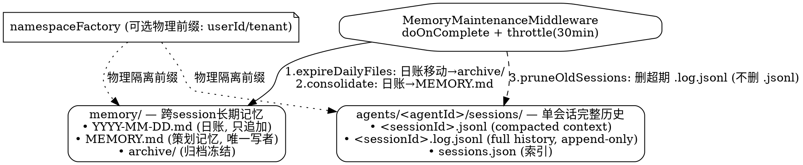
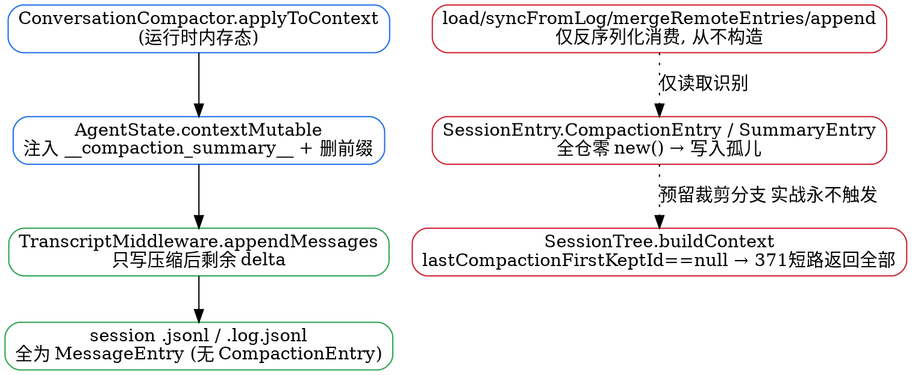
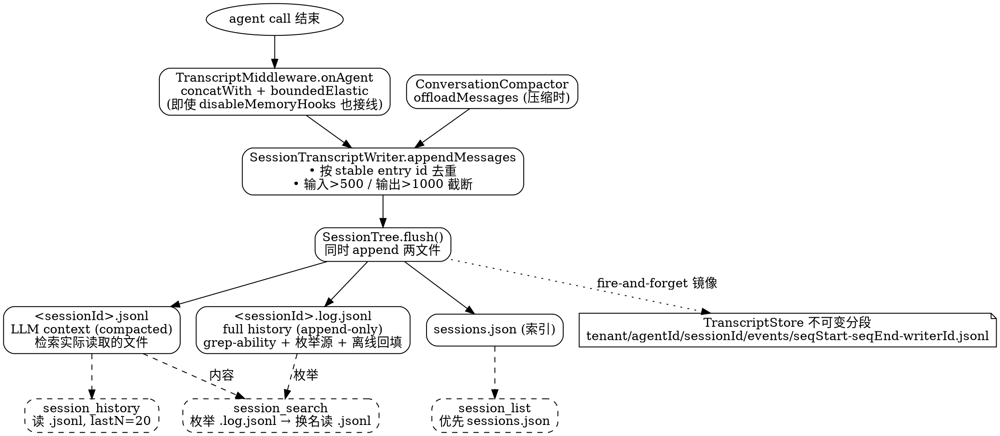

# Memory

## Introduction

本分册覆盖 AgentScope Java 的**记忆子系统设计实现**——两层长期记忆（日流水账 `memory/YYYY-MM-DD.md` 与策划记忆 `MEMORY.md`）是怎么被写入、合并、检索、清理、并与压缩协作的。

**分工约定**：[上下文分册](/docs/CS/AI/LLM/Agent/Product/AgentScopeJava/Context.md) 的 `Memory In V2` 节已写清**概念层**（两层职责、文件布局、`MemoryConfig` 字段默认值、开关）；本分册聚焦**源码机制**——四个核心类的算法、中间件的调度与节流、水位与并发安全、三个工具的落点。

本分册所有类名、方法签名与算法均核对自本地 `v2.0.4` 源码树（`agentscope-harness/.../agent/memory/`、`.../agent/middleware/`、`.../agent/tool/`）。**定位前提**：core 的 `io.agentscope.core.memory` 整包 `@Deprecated(forRemoval = true, since = "2.0.0")`，v2 记忆能力全部在 harness 层。

## Architecture Overview

harness 记忆由四件套 + 三工具组成，职责严格分离：

| 组件 | 角色 | 唯一写目标 |
| :--- | :--- | :--- |
| `MemoryConfig` | 配置中枢（flush 模式、合并窗口、保留天数、水位语义） | — |
| `MemoryFlushManager` | **被动抽取**：压缩前从对话前缀抽事实，写**日账** | `memory/YYYY-MM-DD.md` |
| `MemoryConsolidator` | **后台合并**：按水位读日账 + 当前 `MEMORY.md`，LLM 合并去重后覆写 | `MEMORY.md` |
| `MemoryFlushMiddleware` | 调度 flush：`onAgent` 完成后 fire-and-forget，节流 + 按 key 合并 | — |
| `MemoryMaintenanceMiddleware` | 调度维护：节流触发 `consolidate` + 过期清理 | — |
| `MemoryBackgroundTasks` | in-flight 计数器，配合测试的 `awaitQuiescence` | — |
| `MemorySaveTool` / `MemoryGetTool` / `MemorySearchTool` | agent 主动读写记忆的三个工具 | 见读取路径 |

**两层文件契约**（javadoc 原文明确「唯一写者」）：

- **Layer 1 — 日流水账** `workspace/memory/YYYY-MM-DD.md`：append-only，每次压缩 flush 追加一个带时间戳的小节。写者：`MemoryFlushManager`（被动）与 `MemorySaveTool`（主动）。
- **Layer 2 — 策划记忆** `workspace/MEMORY.md`：全局策划、去重、有界。唯一写者：`MemoryConsolidator`。

> `MemoryFlushManager.writeMemoryFiles` 的注释写道：MEMORY.md 在此**刻意不触碰**，它归 `MemoryConsolidator` 所有，后者周期性把日账合并成有界的策划记忆。这是两条写入路径解耦的关键。

## Configuration Reference

`MemoryConfig` 是所有 LLM 驱动记忆操作（flush / consolidation）的统一配置中枢，构建 `defaults()` 等价于历史行为（无破坏）。所有旋钮与默认值均来自 `MemoryConfig.java` 源码：

| 旋钮 | 类型 | 默认值 | 含义 |
| :--- | :--- | :--- | :--- |
| `model` | `Model` | `null` | 记忆专用模型；`null` 表示复用 agent 主模型（可用更廉价的小模型） |
| `flushPrompt` | `String` | `DEFAULT_FLUSH_PROMPT` | flush 抽取 SYSTEM 提示，纯文本无占位符，`null` 复原默认 |
| `consolidationPrompt` | `String` | `DEFAULT_CONSOLIDATION_PROMPT` | 合并提示，经 `String.format` 注入两个 `%d`（max-tokens、max-chars），自定义必须恰好两个 `%d`，否则构建期抛 `IllegalArgumentException` |
| `consolidationMaxTokens` | `int` | `4000`（≥1，否则抛异常） | 合并后 `MEMORY.md` 的 token 预算；`maxChars = maxTokens × 4` |
| `consolidationMinGap` | `Duration` | `30 min`（`DEFAULT_CONSOLIDATION_MIN_GAP`） | 两次合并/维护的最小间隔；首次调用立即跑，非初始延迟，且与 flush 节流独立 |
| `dailyFileRetentionDays` | `int` | `90`（≥1） | 日账超过该天数移入 `memory/archive/`（按文件名日期解析） |
| `sessionRetentionDays` | `int` | `180`（≥1） | 会话 JSONL 日志超过该天数删除（按 `modifiedAt`） |
| `flushTrigger` | `FlushTrigger` | `always()` | 每调用 flush 的触发策略（见下方三态） |

**`FlushTrigger` 三态**（不可变值对象，工厂归一化）：`always()`（`ALWAYS`）每次都刷；`never()`（`NEVER`）只关 per-call flush（后台维护仍按计划跑）；`throttled(Duration)`（`THROTTLED`）在 `minGap` 内 CAS 抢槽至多一个胜出，且 `throttled(ZERO)` 归一为 `always()` 无需特判。三者 `equals/hashCode` 基于 `(mode, minGap)`，支持配置比较。

> 设计要点：flush 与 consolidation 使用**独立**的节流窗口；`throttled` 的「首个合格调用立即执行」语义意味着 `minGap` 只约束后续运行、不是首跑前的等待，避免冷启动延迟。

## Passive Extraction: Flush Pipeline

压缩前（见 [上下文分册](/docs/CS/AI/LLM/Agent/Product/AgentScopeJava/Context.md) 的 Compaction 六步）`MemoryFlushMiddleware` 触发抽取，不阻塞 agent 流：

1. `onAgent(...).doOnComplete(() -> scheduleFlush(...))` —— agent 流完成后 fire-and-forget。
2. `scheduleFlush` 先 `MemoryBackgroundTasks.begin()` 占 in-flight 槽（防止 quiescence 检查误判后台空闲），再把任务放进 `FLUSH_QUEUES`（见调度节）。
3. `runFlush` 在 `Schedulers.boundedElastic()` 后台跑 `doFlush`。
4. `doFlush` 读**执行时**的 `AgentState.context`（不是调度时——排队任务能看到其间追加的全部消息），空则跳过；`shouldFlushNow(rc)` 按 trigger 决定。
5. `MemoryFlushManager.flushMemories(rc, messages)` 算法：
   - `serializeMessages` 只取非 `SYSTEM`、非内部上下文消息（`isInternalContextMessage`），`USER`/`ASSISTANT`/`TOOL` 渲染成简洁文本——工具调用/工具结果也渲染，让模型能从工具交互抽事实。
   - 把已有 `MEMORY.md` 与今日日账作为**去重上下文**喂给抽取 LLM（提示「skip anything already covered above」）。
   - `model.stream(...)` 聚合抽 **NEW** 事实；结果空白或 `"NO_REPLY"` 则不写。
   - `writeMemoryFiles` 只 `appendUtf8WorkspaceRelative` 进今日日账（带 `## Memory Flush — <timestamp>` 小节）。

## Active Save: MemorySaveTool

`MemorySaveTool.memorySave` 是 agent 写长期记忆的**唯一授权入口**（javadoc 强调：系统提示词引导 LLM 用本工具而非 `write_file`/`edit_file`，消除 LLM 乱起文件名或跳过日账的非确定性）：

- **双写**：先 `appendUtf8WorkspaceRelative(rc, MEMORY_MD, section)`，再追加带 `## Memory Save — <timestamp>` 小节的今日日账。
- 落点语义：直接 append 到 `MEMORY.md`（**不去重、不裁剪**），去重与有界裁剪交给后台 `MemoryConsolidator` 周期处理。
- 返回「Saved N memories to MEMORY.md」。

## Consolidation: Watermark + CAS

`MemoryConsolidator.consolidate(rc)` 是 Layer 1 → Layer 2 的合并算法，水位机制保证只处理「上次合并以来新增」的日账：

1. `readWatermark(rc)` —— 返回上次成功合并的 `Instant`，首次为 `Instant.EPOCH`（全量）。优先读 `baseStore`（CAS 安全命名空间 `WATERMARK_NAMESPACE`/`WATERMARK_KEY`），失败回退文件 `memory/.consolidation_state`。
2. `readDailyEntries(rc, watermark)` —— `fs.glob(rc, "*.md", "memory")`；跳过 `STATE_FILE`/`archive`/非 `.md`；用 `isModifiedAfter`（文件 `modifiedAt` 严格晚于水位，mtime 未知时保守包含）过滤；按文件名排序。
3. LLM 合并：`systemPrompt` 注入 `maxMemoryTokens` 与 `maxChars = maxMemoryTokens * 4`；`userContent` = 当前 `MEMORY.md` + 新日账（带 `since <watermark>` 标注）。
4. `writeConsolidatedMemory` 覆写 `MEMORY.md`。
5. `writeWatermark(rc, runStart)` —— 先写 `baseStore`（`writeWatermarkToStore` 走 **CAS 重试** `MAX_CAS_RETRIES`，`expectedVersion` 防并发覆盖），再尽力写文件。

**并发安全双轨**：水位既有后端 CAS（多实例安全），又有文件回退（本地/无后端时）。flush 队列按 key 串行化（每 key 至多一个在飞），进一步避免读-改-写竞争。

## Scheduling & Throttling

两个中间件都在 `onAgent` 的 `doOnComplete` 触发，把重活（LLM 抽取/合并、远程 store I/O）丢到后台弹性线程，绝不在 agent 主链路上阻塞。

### MemoryFlushMiddleware — 按 key 合并

- `FLUSH_QUEUES` 是 `ConcurrentHashMap<String, FlushQueue>`；`FlushQueue` 持一个 `LinkedHashMap<ConversationKey, Runnable> pending` 与 `running` 标志，字段只在 `compute`（持有桶锁）内改，无需额外同步。
- `scheduleFlush`：`compositeTimerKey` 为桶键；若 `q.running` 为真，新任务**合并**进 `pending`（只保留最新 `ConversationKey`）——因为任务执行时才读 context，串行化在 `(userId, sessionId)` 上，最新任务的状态已含被替换任务要读的全部消息，**合并不丢消息**。
- `runFlush` 的 `doFinally` 调 `drainFlushQueue`：取 `pending` 下一个继续跑；桶空闲则 `compute` 返回 `null` 把键摘掉，避免 map 无限增长。

### shouldFlushNow — 三态 trigger

`MemoryConfig.FlushTrigger` 是不可变值对象，三态工厂：

| 工厂 | 模式 | 语义 |
| :--- | :--- | :--- |
| `always()` | `ALWAYS` | 每次都刷 |
| `never()` | `NEVER` | 只关 per-call flush（后台维护仍按计划跑） |
| `throttled(Duration minGap)` | `THROTTLED` | `minGap` 内 CAS 抢 slot，至多一个胜出；**`throttled(ZERO)` 归一为 `always()`**（退化情况无需特判） |

`shouldFlushNow` 的 `THROTTLED` 分支走 `periodicGate.tryClaim(compositeTimerKey, minGap)`（`AtomicReference#compareAndSet` 抢槽）。

### compositeTimerKey / timerKeyFor — 隔离维度对齐

- `compositeTimerKey = "memory-flush:" + isolationScope.name() + ":" + timerKeyFor(rc)`：`memory-flush` 操作前缀让 flush 与 maintenance 互不抢同一 `PeriodicGate` 的槽；`isolationScope` 前缀让不同隔离维度不共享槽。
- `timerKeyFor` 与**记忆数据命名空间对齐**：`USER`→`userId`、`SESSION`→`sessionId`、`AGENT`/`GLOBAL`→`""`（所有调用方共享一个 throttle slot，从而串行化在共享内存文件上的 flush）。

### MemoryBackgroundTasks — 进程级 in-flight 计数

`MemoryBackgroundTasks` 是 fire-and-forget 后台任务（flush / maintenance）的**进程级**静默闸门，解决一个关键时序问题：调度中间件每次 agent 调用都会新建，因此 `HarnessAgent.close()` 无法从中间件实例本身感知还有多少异步任务在飞——它靠这个静态计数器来等待。

- `begin()` / `end()` 成对：`begin` 同步 `synchronized(MONITOR)` 自增 `inFlight`；只有 in-flight 计数在派发时**同步**加一，下游任务即便在 `boundedElastic` 异步跑，quiescence 检查也绝不会在任务被计数前看到空集合。
- `end()` 在 `doFinally` 里调用，递减到 `0` 时 `notifyAll()` 唤醒等待者。
- `awaitQuiescence(timeout, unit)`：`close()` 阻塞直到「本次调用前启动的所有后台任务」完成或超时返回 `false`。与 `SessionTree.awaitMirrorQuiescence` 同理——保证异步工作区写（日账/合并/归档）不与资源清理（如测试删临时工作区）竞速。

> 这一计数与 `FLUSH_QUEUES`/`PeriodicGate` 的节流是两套正交机制：节流管「要不要跑」，闸门管「跑着的有没有跑完」。前者防过载，后者防竞态。

## Maintenance: Cleanup

`MemoryMaintenanceMiddleware.doMaintenance` 在 `onAgent` 的 `doOnComplete` 触发（`MemoryFlushMiddleware` 之后），同样 fire-and-forget 丢到 `boundedElastic` 后台；`minGap` 默认 `DEFAULT_MIN_GAP = 30 min`，且 `tryClaim` 抢槽失败时立即 `Mono.empty()` 释放 in-flight 槽。`compositeTimerKey` 前缀为 `memory-maintenance:`（与 flush 的 `memory-flush:` 区分），`isolationScope` 前缀逻辑与 flush 完全相同，使不同隔离维度不共享同一 `PeriodicGate` 槽。维护三步顺序执行：

1. **`expireDailyFiles`** —— `fs.glob("*.md", MEMORY_DIR)`，跳过目录、以 `.` 开头的隐藏文件（含 `STATE_FILE`）与 `archive/`；对文件名能解析为 `LocalDate` 且早于 `now - dailyFileRetentionDays` 的日账，执行 `fs.move` 移入 `MEMORY_DIR/archive/`（**移动而非删除**，可回溯）；解析失败（非日期文件名）静默跳过。
2. **`consolidateMemory`** —— 若 `consolidator != null` 调 `MemoryConsolidator.consolidate(rc).block()`（阻塞直到本次合并完成），异常仅 `log.warn` 不向上抛。
3. **`pruneOldSessions`** —— `fs.glob("*.log.jsonl", AGENTS_DIR)`，按 `modifiedAt` 早于 `now - sessionRetentionDays` 的会话日志 `fs.delete` 删除（`modifiedAt` 缺失则跳过）。

> 注意 `expireDailyFiles` 与 `MemoryConsolidator.readDailyEntries` 的耦合：前者归档时把文件移进 `archive/`，后者在合并时显式跳过名为 `archive` 的条目，因此被归档的日账不会再被合并进 `MEMORY.md`——归档即「已消费且冻结」。

## Coupling with Compaction & Session Logs

内存子系统并非孤立运行：它一边被 `CompactionMiddleware`（每次推理前）在压缩掉对话前缀前「先抽一波记忆」，一边与 `agents/<agentId>/sessions/` 下的会话 JSONL 共用同一套维护/命名空间机制。两条耦合线都值得单独看清。

### Compaction × Memory Flush: Temporal Coupling

`CompactionMiddleware.onReasoning` 在 **每次 LLM 推理前**触发（`ReActAgent` 才处理，否则直接 `next`），与 `MemoryFlushMiddleware`（call 结束后 `doOnComplete`）分处 agent 调用生命周期的两端。它把 `ConversationCompactor.compactIfNeeded` 跑在 `Flux.defer` 内、用 `flatMap` **同步等待** flush + summarize 完成，才把 `[systemMsg]+[summaryMsg]+tail` 交给下游 `next.apply(...)`——压缩是阻塞在推理前的**关键路径**，而非 fire-and-forget。

**实际算法 = 2 个非 LLM 预处理 + 概念六步**（类 javadoc 把触发/截断/合并/重建列为六步，但 `compactIfNeeded` 体里还有两步轻量预处理）：

| 阶段 | 方法 | 默认开关 | 要点 |
| :--- | :--- | :--- | :--- |
| 0a | `truncateArgs` | `truncateArgsConfig = null` → **默认禁用** | 启用时触发 25 消息 / 40k token，保留最近 20 消息，超 `maxArgLength(2000)` 字符的 `ToolUseBlock` 参数字符串截为前 20 字符 + `...(argument truncated)` |
| 0b | `pruneToolResults` | `PruneConfig.defaults()` → **默认启用** | 从后往前遍历 TOOL 消息，保护最近 `protectTokens(40k)` 的 tool 输出；超 `maxOutputChars(2000)` 的换 head+tail 预览，总可剪 > `minimumTokens(20k)` 才执行；排除 `read_file`/`memory_search`/`memory_get`/`session_search` |
| 1 | `shouldCompact` | — | token 或 message 任一超阈值（`triggerTokens=0` 动态 → `contextWindow - reserved(20k)`；模型不报则 `FALLBACK_TRIGGER_TOKENS=160k`；或 `triggerMessages=50`） |
| 2 | `determineCutoffIndex` | — | token-based 二分（`findTokenBasedCutoff`）或 message-based；`findSafeCutoffPoint` 确保不拆散 ASSISTANT/TOOL 对（cutoff 落在 TOOL 前回退到对应 ASSISTANT） |
| 3 | **flush**（memory） | `flushBeforeCompact=true` | `flushManager.flushMemories(rc, flushInput)`，`flushInput = filterSummaryMessages(summaryInput)`（剔除 `__compaction_summary__` 旧摘要，**避免重复抽取**）；best-effort（`onErrorResume`，失败不阻断 summarize） |
| 4 | **offload**（session） | `offloadBeforeCompact=true` | `offloadMessages(rc, messages, agentId, sessionId)` + `resolveOffloadPath` → 路径注入 summaryMsg：「full conversation history saved to `<path>` should you need to refer back」 |
| 5 | summarize | — | `summarizePrefix` 用 `summaryInput`（**含之前 summary，链式累计**）经一次 LLM 调用，结构化 prompt（SESSION INTENT / SUMMARY / ARTIFACTS / NEXT STEPS） |
| 6 | rebuild | — | `[summaryMsg] + tail`；`applyToContext` 把结果 `ctx.clear()` 后 `addAll` 进 `AgentState.contextMutable()`，并重建 `ReasoningInput`（`[systemMsg]+[compacted]`） |

**与 `MemoryFlushMiddleware` 的分工（核心时序耦合）**：维护类注释原话——「When CompactionMiddleware is active, it handles flush/offload for the messages it summarizes; this middleware covers the remaining tail of messages that were kept verbatim.」即：被 summarize 的 **prefix** 由 Compaction 负责 flush + offload；保留的 **tail** 由 `MemoryFlushMiddleware.doOnComplete` 负责 flush。因为 Compaction 触发时用 `applyToContext` 把 prefix 从 `AgentState` 上下文**移除**（替换为 `[summaryMsg]+tail`），所以同一次 call 结束时 `MemoryFlushMiddleware` flush 的是 `[summaryMsg]+tail`——**两段不重叠**，同一消息不会被 flush 两次。

**两个微妙点**：① Compaction 内部的 flush 是**直接调** `flushManager.flushMemories`，**不走** `MemoryFlushMiddleware` 的 `FLUSH_QUEUES` 节流队列、也不走 `MemoryBackgroundTasks.begin/end`；它在 reactor 推理链上同步等待（`flatMap.then`），而 `MemoryFlushMiddleware` 的 flush 跑在 `boundedElastic` 后台——但二者在同一 call 内串行（reasoning 前 vs call 后），不发生并发写同一 memory 文件。② summaryMsg 的 id 是 content-based 稳定 UUID（`SUMMARY_MSG_NAME + ":" + nameUUIDFromBytes(content)`），保证「重复 session offload 幂等」。

> **订正**：官方 `docs/v2/harness/compaction.md` 简化说「Compactor → offload 原文 → `sessions/<id>.log.jsonl`，压缩前再 flush 一次」。源码更精确：offload 实际**同时**写 `.jsonl`（compacted context）与 `.log.jsonl`（full history）——因为 `SessionTranscriptWriter.appendMessages` → `SessionTree.flush()` 维护 dual-file 模式；而 flush 的是 prefix 中剔除旧摘要的**新原始消息**（`flushInput`），不是整段 conversation。三个 LLM 记忆操作各有独立 prompt（`CompactionConfig.summaryPrompt` / `MemoryConfig.flushPrompt` / `MemoryConfig.consolidationPrompt`），由 `CompactionConfig` 类注释统一归口。

### Session JSONL & Memory Daily Ledger: Coordinated Cleanup & Namespace Isolation

harness 的「跨调用/长期状态」实际分布在**两棵独立文件树**：`memory/`（长期记忆，跨 session 累积）与 `agents/<agentId>/sessions/`（单会话完整历史）。二者清理策略与物理布局都不同，但都由 `MemoryMaintenanceMiddleware` 的同一轮维护按序处理。

**双文件会话模式（`SessionTree`，借鉴 pi-mono mom）**：

```
agents/<agentId>/sessions/<sessionId>.jsonl      — LLM context（compacted，模型实际看到的版本）
agents/<agentId>/sessions/<sessionId>.log.jsonl   — full history（append-only，never compacted）
agents/<agentId>/sessions/sessions.json           — 会话索引（sessionId → summary + updatedAt）
```

`SessionTree` 同时维护两者：`logFile = contextFile.resolveSibling(baseName + ".log.jsonl")`，`flush()` 落 `contextFile` 并同步落 `logFile`（dual-file pattern for grep-ability）。写入由 `SessionTranscriptWriter.appendMessages` 触发（幂等：按 stable entry id 去重，更新 `sessions.json`），调用方是 **Compaction offload** 与 **`TranscriptMiddleware`（turn boundary）**——后者独立于更早的 `MemoryFlushManager`，类注释明确「transcript completeness must not depend on memory-flush triggers」。

**协同清理（`MemoryMaintenanceMiddleware.doMaintenance`，`onAgent.doOnComplete` 之后，throttle `minGap=30min`）三步按序**：

1. `expireDailyFiles` —— `fs.glob("*.md", MEMORY_DIR)`，按 `LocalDate.now() - dailyFileRetentionDays(90)` 把超期日账 **移动** 到 `MEMORY_DIR/archive/`（移动非删除；`archive/` 被 consolidate 的 `readDailyEntries` 显式跳过 → 归档即冻结）。
2. `consolidateMemory` —— `MemoryConsolidator.consolidate(rc).block()`（LLM 合并日账 → `MEMORY.md`）。
3. `pruneOldSessions` —— `fs.glob("*.log.jsonl", AGENTS_DIR)`，按 `Instant.now() - sessionRetentionDays(180)` 删超期 `.log.jsonl`（按 `fi.modifiedAt()`）。

> **关键区别**：`pruneOldSessions` 的 glob 只匹配 `*.log.jsonl`（完整历史），**不删** `.jsonl`（compacted context）。也就是说维护清理只针对「永不压缩的全量日志」，session 的 compacted context 不在 prune 范围——它随 session 整体或他路清理，且需保留给后续 compaction 引用。记忆日账是「移动归档（保留）」，会话全量日志是「删除（丢弃）」，二者策略相反，但因位于 `memory/` 与 `agents/` 两棵独立树、glob 范围不重叠而互不干扰。

**命名空间隔离（两层正交）**：

- **物理前缀（可选）**：`WorkspaceManager.resolveRuntimeDataPath(rc, rel)` 经 `namespaceFactory.getNamespace(rc)` 在相对路径前加命名空间前缀（如 `userId`/`tenant`）。默认 `namespaceFactory == null` → 不加前缀（单机）。所以隔离是**可选的物理隔离**，一旦配置，`memory/` 与 `agents/` 都落在该前缀下。
- **逻辑隔离（memory 专用）**：`memory/` 下由 `IsolationScope`（USER / SESSION / AGENT / GLOBAL）决定文件命名，配合上面的物理前缀；`agents/<agentId>/sessions/` 则由 `agentId + sessionId` 隔离（配合物理前缀）。
- **节流维度对齐**：`MemoryMaintenanceMiddleware` 与 `MemoryFlushMiddleware` 的 `timerKeyFor` / `compositeTimerKey` 用**完全相同**的映射（USER→`userId` / SESSION→`sessionId` / AGENT,GLOBAL→`""`），使节流窗口与「记忆数据命名空间」对齐——隔离维度相同的调用共享一个 throttle slot，从而串行化在共享记忆文件上的写；同时维护前缀 `memory-maintenance:` 与 flush 前缀 `memory-flush:` 区分，即使共用 `PeriodicGate` 也互不抢占。

> **关系澄清**：`memory/`（日账 + `MEMORY.md`）是**跨 session 累积的长期记忆**；`agents/<agentId>/sessions/` 是**单会话完整历史**。两者都受 `namespaceFactory` 物理隔离影响（若配置），但清理语义相反（归档 vs 删除），且 `session_search` / `session_history` 工具读的是 `.log.jsonl` 全量日志——即使上下文已被压缩成摘要，agent 仍能查到原始消息。



### CompactionEntry: Reserved But Unwritten — Where Session Compaction Actually Lives

> **核心订正（反直觉）**：`SessionEntry.CompactionEntry`（及 `SummaryEntry`）是 `SessionEntry` 多态体系里**预留的持久化压缩标记**类型，但在 v2.0.4 **主代码路径中是"写入孤儿"**——类定义了、反序列化消费逻辑（`buildContext` 据此裁剪、`load`/`syncFromLog`/`mergeRemoteEntries`/`append` 的状态恢复）都写好了，**全仓（含 examples）却没有任何一处 `new` 它**。真实的 session 级压缩是**隐式**实现的，根本不走这个类型。

**证据链（全部经 grep + 读方法体交叉验证）**：

1. 全仓构造调用搜索 `new SessionEntry.CompactionEntry` / `new SessionEntry.SummaryEntry` / `CompactionEntry(` / `SummaryEntry(` → 仅命中 `SessionEntry.java` **自身**的构造函数定义（`CompactionEntry(...)` @261、`SummaryEntry(...)` @290、`SummaryEntry(String,String)` @301），**零调用方**。
2. `compaction` 包（`ConversationCompactor` / `CompactionMiddleware`）完全不调用 `SessionTree.append` / `buildContext` / `applyToContext`——它们改的是**运行时内存态** `AgentState.contextMutable`。
3. `SessionTree` 4 处 `instanceof SessionEntry.CompactionEntry` 全部是**反序列化恢复**分支：
   - `load()` @261 — 冷启动读 `contextFile`
   - `append()` @311 — 内存追加（entry 来自外部调用，外部也没构造）
   - `syncFromLog()` @456 — 离线回填读 `logFile`
   - `mergeRemoteEntries()` @542 — 远程合并
   
   四者都只读取 `getFirstKeptEntryId()` / `getSummaryEntryId()` 写入 `lastCompactionFirstKeptId` / `lastSummaryEntryId`，**从不构造**。

**`buildContext()`（366-395）的真实行为**：

```java
public List<SessionEntry> buildContext() {
    if (appendOrder.isEmpty()) return Collections.emptyList();
    if (lastCompactionFirstKeptId == null)   // ← 实战恒真：无人写 CompactionEntry
        return new ArrayList<>(appendOrder);  // 371：短路返回【全部】条目 = 未压缩视图
    // 裁剪分支：先加 summary entry，再从 firstKeptEntryId 起加 MessageEntry
    ...
}
```

因为 `lastCompactionFirstKeptId` 只能在反序列化遇到 `CompactionEntry` 时被赋值，而该类型**实战无人写入** → 字段**恒为 `null`** → 371 行短路，裁剪分支（377-394）**是空操作**。同理 `SummaryEntry` 的恢复（`lastSummaryEntryId`）也依赖同一个孤儿类型。

**真实的 session 级压缩怎么做（闭环）**：

- `ConversationCompactor.applyToContext` 把压缩做在**内存态**：注入 `__compaction_summary__`（`SUMMARY_MSG_NAME`，普通 message 带特殊 `name`）+ 删除被压缩前缀的 entries，改写 `AgentState.contextMutable`。
- `TranscriptMiddleware` / `SessionTranscriptWriter.appendMessages` 只把**压缩后剩余**的 context **delta** 作为普通 `MessageEntry` 落盘（`.jsonl` + `.log.jsonl`）。
- 被压缩掉的消息**从不以 `MessageEntry` 形式再次落盘**（因已移出 `contextMutable`，offload 写的是 delta）→ 所以 session 文件里**物理上永远没有 `CompactionEntry`**，压缩是"差量落盘"隐式实现的。
- summary 同样以"带特殊 `name` 的普通 message"存在 `contextMutable`，**不走 `SummaryEntry` 类型**。

**为什么保留孤儿类型（设计意图推断，标注为软告警/残留不确定性）**：`SessionTree.load()` 注释（242 行附近）提到 *"before a write that may follow a cross-machine handoff"*——跨机交接时，若压缩态只存内存会丢失（`AgentState` 不跨进程），导致恢复后重复压缩或摘要错乱。`CompactionEntry` + `SummaryEntry` 是为此预留的**持久化压缩契约**，让压缩边界与摘要可随 session 文件跨机传递；当前版本尚未接线（或被更轻量的"offload delta + 内存态"方案取代）。

> ⚠️ 张力点：一旦将来 `CompactionEntry` 被接线，`pruneOldSessions` 删 `.log.jsonl` 会让跨机恢复丢失压缩标记——但当前版本该路径无写入方，不影响。



### Transcript Write & Search Path

**写入链（独立于 memory flush）**：`TranscriptMiddleware.onAgent` 用 `concatWith`（而非 `doOnComplete`）把 `appendTranscript` 串接在 agent stream 尾部、`subscribeOn(boundedElastic)`；类注释明确：**即使 `disableMemoryHooks` 也会接线**，以保证 Operate / `SessionSearchTool` / 恢复（resumption）看到的会话历史完整。`agentId` 优先取 `HarnessAgent.getAgentId()`（stable id），否则 `agent.getName()`；`sessionId` 取 `rc.getSessionId()` 否则 `"default"` → `SessionTranscriptWriter.appendMessages(rc, state.getContext(), agentId, sessionId)`。

`appendMessages` 内部：`resolveSessionContextFile(.jsonl)` → `SessionTree(contextFile, ws, fs, index, contextRelPath).setRuntimeContext(rc).setTranscriptStore(store, TranscriptRef(tenant, agentId, sessionId))` → `load()`（本地读 context；本地缺失则先从远程镜像 restore）→ `syncFromRemote()` → 按 stable entry id 去重（`deriveEntries` 生成 `MessageEntry`/`ToolUseEntry`/`ToolResultEntry`，输入 > 500 字符、输出 > 1000 字符截断并带 `truncated` + `originalSize`）→ `tree.append()` → `flush()` → `updateSessionIndex`。Compaction 的 offload 走的正是**同一条** `appendMessages` 路径。

**检索三工具（`SessionSearchTool`，纯本地、零网络）**：

| 工具 | 读哪个文件 | 关键行为 |
| :--- | :--- | :--- |
| `session_search(query, agentId?, maxResults=10)` | 枚举 `*.log.jsonl`，但**内容读 `.jsonl`** | `listLogFiles` 按 `SESSION_LOG_EXT` 枚举（指定 agentId 只扫该 agent 的 `sessions/`，否则扫所有 agent 目录）；每个 logFile 用 `resolveSibling` 把 `.log.jsonl` 换成 `.jsonl` 构造 `SessionTree(contextFile, ws, null)` + `load()`，遍历 `getAllEntries()` 做 `toLowerCase().contains(query)` 匹配；结果前缀用 **logFile** 的 workspace-相对路径 + entry id + 角色标签，预览 200 字符 |
| `session_list(agentId)` | 优先 `sessions.json`，fallback 本地 `.jsonl` | 先 `readManagedWorkspaceFileUtf8`（两层：remote → local）读会话索引；为空则列举本地 `.jsonl`（`SESSION_CONTEXT_EXT`） |
| `session_history(agentId, sessionId, lastN=20)` | `.jsonl`（legacy fallback `.json`） | `resolveSessionContextFile` → `load()` → `getMessageEntries()` 取最后 `lastN` 条，每条截断 500 字符；`.jsonl` 不存在时 fallback 到已废弃的 `.json` |

**`.log.jsonl` vs `.jsonl` 的真实分工（关键订正）**：`SessionTree.flush()` 对两者 **append 同一批 entries**，所以正常情况下内容相同；真正的差异只出现在三处——① session compaction：写入 `CompactionEntry`（`firstKeptEntryId` / `summaryEntryId`），`buildContext()` 据此返回 `[summary] + firstKept 起的 MessageEntry` 压缩视图；② 远程合并 `mergeRemoteEntries`：`overwriteFile(contextFile, merged)` **重写 context**，而 `appendToFile(logFile, remoteNewEntries)` 只追加增量；③ `syncFromLog()` 把 log 里有、context 里没有的（离线期间追加的）entries 回填进内存。

因此 `.log.jsonl` 的价值是**「grep-ability」**（类注释原话，dual-file pattern from pi-mono mom）+ 离线回填 + 作为 `session_search` 的**枚举源**；而 `.jsonl` 是 LLM-facing 的 canonical context，检索时**实际被读取的是它**。这也解释了清理与检索的张力：`pruneOldSessions` 删 `.log.jsonl` 会让该 session **不再被 `session_search` 枚举到**（但 `session_history` 仍可读 `.jsonl`），而 `.jsonl` 不在 prune 范围内。

**远程分段持久化（`TranscriptStore`）**：与 `BaseStore`（文档 KV）正交，写**不可变分段**以避免并发覆盖：`appendSegment(ref, seqStart, seqEnd, writerId, jsonl)`，key layout `{tenant}/{agentId}/{sessionId}/events/{seqStart}-{seqEnd}-{writerId}.jsonl`；`listSegments` 按 `seqStart` 升序，`syncFromTranscriptStore` 按段合并并按 entry id 去重。`withRuntimeContext(rc)` 让 namespace-scoped 后端把段路由到 caller 的 namespace。实现为 `FilesystemTranscriptStore` / `ObjectStoreTranscriptStore`；镜像是 fire-and-forget，跑在 daemon 单线程 `MIRROR_EXECUTOR`（`awaitMirrorQuiescence` 配合 `close()` 静默等，避免与资源清理竞速）。



### NamespaceFactory & Multi-Tenant Addressing

`NamespaceFactory` 是 `@FunctionalInterface`：`List<String> getNamespace(RuntimeContext)`，在**每次** store 操作时调用（而非 agent 实例上的可变共享状态），因此命名空间可随 per-call 身份（userId / sessionId）变化。

**两套生成器（易混淆，务必区分）**：

| 层面 | 生成器 | 产出 |
| :--- | :--- | :--- |
| 本地磁盘（`WorkspaceManager.resolveRuntimeDataPath`） | `IsolationScope.toNamespaceFactory()` | USER → `[uid]`（缺失回退 `sid`）；SESSION → `[sid]`；AGENT/GLOBAL → `[]`（workspace 本身已 per-agent） |
| 远程 store（`RemoteFilesystemSpec.storeNamespace(agentId)`） | spec 内部（结构更丰富） | SESSION → `agents/{agentId}/sessions/{sid}`；USER（默认）→ `agents/{agentId}/users/{uid}`，uid 缺失用 `anonymousUserId`（默认 `_default`）；AGENT → `agents/{agentId}/shared`；GLOBAL → `global` |

本地落盘即 `workspace.resolve(String.join("/", ns)).resolve(relativePath)`；远程则再由 `remoteForRoute` **追加 routeSegment**，最终 key 形如 `agents/{agentId}/users/{uid}/memory/2026-11-03.md`。

**共享路由表（`RemoteFilesystemSpec.toFilesystem`）** —— 每条路由是 `OverlayFilesystem`：**upper** = per-namespace `RemoteFilesystem`（BaseStore，写入即 copy-on-write），**lower** = 只读 `LocalFilesystem`（scaffold 模板基线，保证脚手架内容可见）：

| 工作区路径 | routeSegment |
| :--- | :--- |
| `AGENTS.md` / `MEMORY.md` / `tools.json`（精确文件） | `root` |
| `memory/` | `memory` |
| `skills/` | `skills` |
| `subagents/` | `subagents` |
| `knowledge/` | `knowledge` |
| `plans/` | `plans` |
| `agents/<agentId>/sessions/` | `sessions` |
| `agents/<agentId>/tasks/` | `tasks` |
| `addSharedPrefix(...)` 追加 | 由前缀推导 |

**默认与开关**：`isolationScope` 默认 `USER`；纯本地单机（未配置 filesystem spec）通常 `namespaceFactory == null` → `memory/`、`agents/` 直接落在 workspace 根下（**无 user 前缀**）。`sharedLocalWorkspace(true)` 会把**默认后端**换成无前缀、阻断遍历的 `LocalFilesystem`（`#3245`），但**共享路由仍保留 per-user store namespace**——注释明确警告该模式「Not safe for multi-tenant workspaces」（同一工作区目录下的用户会互相读写覆盖），只适用于宿主应用直接往 workspace 根写文件的单租户集成。

**tenant 是正交的第三维度**：transcript 段的寻址用 `TranscriptRef(tenant, agentId, sessionId)`，key layout `{tenant}/{agentId}/{sessionId}/events/...`，tenant 由 `TranscriptMiddleware` / `SessionTranscriptWriter` 构造参数传入（默认 `"default"`），与 workspace 层的 IsolationScope namespace 互不干扰。

> **一致性要点**：`MemoryFlushMiddleware` / `MemoryMaintenanceMiddleware` 的 `timerKeyFor`（USER→`userId`、SESSION→`sessionId`、AGENT/GLOBAL→`""`）与 `IsolationScope.toNamespaceFactory()` 是**同一套映射**，保证「节流串行化的粒度」＝「数据隔离的粒度」＝「文件命名空间前缀」三者对齐。

## Reading Path: Three Tools

框架自动读 `MEMORY.md`（filesystem 优先，两层读——见 [上下文分册](/docs/CS/AI/LLM/Agent/Product/AgentScopeJava/Context.md) `Context Construction`）；agent 也可主动调工具：

| 工具 | 落点 | 实现要点 |
| :--- | :--- | :--- |
| `memory_save` (`MemorySaveTool`) | 双写 `MEMORY.md` + 今日日账 | **唯一授权写入口**，系统提示词引导替代 `write_file`/`edit_file` |
| `memory_get` (`MemoryGetTool`) | 读指定 `path` + `startLine`/`endLine` 行范围 | 纯文件读取，按相对路径访问记忆文件 |
| `memory_search` (`MemorySearchTool`) | 遍历 `listMemoryFilePaths`（MEMORY.md + `memory/*.md`） | **纯关键词正则**（`Pattern.quote(query)` 大小写不敏感，逐行匹配），**不接 LLM、不 embedding**，返回 `Source: <path>#<line>: <content>` 带行号；可跨 Local/Sandbox/Store |

> 设计取舍：`memory_search` 用最朴素的子串/正则匹配而非语义检索——记忆文件本就是 LLM 可读的 Markdown，关键词命中 + 行号引用已足够 agent 定位，且零额外向量索引依赖，跨三种存储后端一致工作。

## Switches & Isolation

- `disableMemoryHooks()` —— 关 flush + 后台维护（两套都关）。
- `disableMemoryTools()` —— 关 `memory_save`/`memory_get`/`memory_search`（以及 `session_search`）。
- `IsolationScope` 贯穿计时 key 与记忆数据命名空间：多租户/并发 session 的 flush 与合并各自串行化，互不被对方的节流槽或内存文件覆盖。

## Extension Memory Providers (LongTermMemory)

除上文 harness 文件式记忆外，仓库里还有一条**并行/前身的记忆架构线**：`io.agentscope.core.memory.LongTermMemory` 抽象及其三个远程后端实现（Mem0 / ReMe / Bailian）。整包 `@Deprecated(forRemoval = true, since = "2.0.0")`，javadoc 明确「long-term memory is removed；跨会话持久化请在应用层集成」——也就是说，harness 的 `MEMORY.md` + 日账文件体系正是它的 **v2 继任者**。但这套抽象与 `agentscope-extensions-mem/{mem0,reme,memory-bailian}` 三个模块仍存在于源码，可由 `ReActAgent.builder().longTermMemory(...).longTermMemoryMode(...)` 直接使用，故单独成节。

### 抽象与两种集成模式

`LongTermMemory` 接口只有两个 reactive 方法，全部返回 Reactor `Mono`：

- `Mono<Void> record(List<Msg> msgs)` —— 框架/agent 把消息写进长期记忆（实现自行抽取「值得记的」信息）。
- `Mono<String> retrieve(Msg msg)` —— 用消息内容作查询，返回相关记忆文本（通常注入系统提示作上下文）。

`LongTermMemoryMode` 决定集成方式：`AGENT_CONTROL`（agent 通过工具主动管）、`STATIC_CONTROL`（框架自动管）、`BOTH`（默认，二者结合）。两条路径的实现：

- **`StaticLongTermMemoryHook`**（STATIC_CONTROL / BOTH，`priority=50` 早插）：`PreCallEvent` 取**最后一条 USER 消息**作 query → `retrieve` → 命中后用 `LongTermMemoryTools.wrap()` 包成 `<long_term_memory>...</long_term_memory>` 注入一条 `name="long_term_memory"` 的 USER 消息到输入末尾；`PostCallEvent` 把 `memory.getMessages()` 全部 `record`。异步模式用专用 `Schedulers.newBoundedElastic(1, 3, "long-term-memory-record")`（1 worker、队列 3、饱和丢弃并 log），fire-and-forget 不阻塞回复。
- **`LongTermMemoryTools`**（AGENT_CONTROL / BOTH）：把核心 API 包成两个 `@Tool`——`recordToMemory(thinking, content[])` 与 `retrieveFromMemory(keywords[])`，后者把关键词拼成查询并 `wrap()` 结果；异常 `onErrorResume` 转为状态文本而非中断流。

### 三个后端实现对照

三者都实现同接口，但后端形态（语义向量 vs 工作区轨迹 vs 托管服务）与隔离维度各不相同：

| 维度 | `Mem0LongTermMemory` | `ReMeLongTermMemory` | `BailianLongTermMemory` |
| :--- | :--- | :--- | :--- |
| 后端类型 | Mem0（向量嵌入 + LLM 抽取） | ReMe（工作区轨迹 + LLM 抽取） | 阿里云百炼 DashScope（语义相似 + LLM 抽取） |
| 默认 base | 自建 `apiBaseUrl`（必填） | 自建 `apiBaseUrl`（必填） | `https://dashscope.aliyuncs.com` |
| 隔离维度 | `agentId` / `userId` / `runId` + 自定义 `metadata` 过滤 | `userId` → `workspaceId`（工作区隔离） | `userId` + `memoryLibraryId` / `projectId` / `profileSchema` |
| 写入过滤 | 仅非空文本、排除 `<compressed_history>`；角色 `USER/SYSTEM→user`、`ASSISTANT/TOOL→assistant` | 仅 `USER` 与纯 `ASSISTANT`（排除含 `ToolUseBlock`）、排除 `<compressed_history>` | 同 ReMe（仅 `USER`/纯 `ASSISTANT`，排除 `ToolUseBlock` 与 `<compressed_history>`） |
| 检索 | 语义搜索 `topK=5`，`onErrorReturn("")` | 取 `answer` 或 `memory_list`，`topK=5`，`onErrorReturn("")` | 语义 + `minScore=0.3`(默认)、`topK=10`，可选 rerank/judge/rewrite；record `onErrorComplete`、retrieve `onErrorReturn("")` |
| 资源 | — | — | `AutoCloseable`，`close()` 释放 client |
| 必填校验 | 至少 `agentName`/`userId`/`runName` 之一 | `userId` + `apiBaseUrl` | `apiKey` + `userId` |

> 关键差异：harness 文件记忆是**本地 Markdown + LLM 抽取 + 关键词检索（无 embedding）**，零外部依赖、跨 Local/Sandbox/Store 一致；而本节的三个 provider 是**远程服务 + 语义/向量检索**，record/retrieve 都是网络调用、`onErrorReturn("")` 容错。二者定位不同：前者是 v2 内建默认，后者适合需要语义检索或已接入 Mem0/百炼的团队。

### Diagram: Extension Provider Flow

```dot
digraph ExtensionMemory {
    rankdir=TB;
    node [shape=box, style=rounded];

    subgraph HOOK [STATIC_CONTROL / BOTH] {
        pre [label="PreCall: retrieve(query)\nwrap <long_term_memory> → USER msg"];
        post [label="PostCall: record(allMessages)\n(async bounded 1w/3q)"];
    }
    subgraph AGENT [AGENT_CONTROL / BOTH] {
        toolRec [label="recordToMemory tool"];
        toolRet [label="retrieveFromMemory tool"];
    }
    backend [label="LongTermMemory backend\n(Mem0 / ReMe / Bailian)", shape=box];
    agent [label="ReActAgent reasoning"];

    pre -> agent [dir=back, label="inject context"];
    agent -> post;
    agent -> toolRec;
    agent -> toolRet;
    toolRec -> backend;
    toolRet -> backend;
    backend -> pre [style=dashed, label="semantic search"];
}
```

## Diagram: Memory Data Flow & Scheduling

```dot
digraph MemoryFlow {
    rankdir=TB;
    node [shape=box, style=rounded];

    subgraph L1 [Conversation] {
        conv [label="AgentState.context\n(USER/ASSISTANT/TOOL msgs)"];
    }

    subgraph WRITE [Write paths] {
        flushMW [label="MemoryFlushMiddleware\n(doOnComplete, fire-and-forget)"];
        flushMgr [label="MemoryFlushManager.flushMemories\n(LLM extract NEW facts, dedupe vs MEMORY.md+daily)"];
        saveTool [label="MemorySaveTool.memorySave\n(double-write, only sanctioned entry)"];
        daily [label="memory/YYYY-MM-DD.md\n(Layer 1: append-only daily ledger)", shape=box];
    }

    subgraph MERGE [Consolidation] {
        maintMW [label="MemoryMaintenanceMiddleware\n(throttled, background)"];
        consolidator [label="MemoryConsolidator.consolidate\n(watermark + LLM merge/dedupe/trim)"];
        cas [label="Watermark CAS + file fallback\n(MAX_CAS_RETRIES)"];
        memory [label="MEMORY.md\n(Layer 2: curated, bounded)", shape=box];
    }

    subgraph READ [Read paths] {
        getTool [label="memory_get\n(path + line range)"];
        searchTool [label="memory_search\n(keyword regex, no LLM)"];
    }

    conv -> flushMW -> flushMgr -> daily;
    saveTool -> daily;
    saveTool -> memory;
    maintMW -> consolidator -> daily [dir=back];
    consolidator -> memory;
    consolidator -> cas;
    memory -> flushMgr [style=dashed, label="dedupe context"];
    daily -> searchTool;
    memory -> getTool;
    memory -> searchTool;
}
```

## Links

- [主笔记](/docs/CS/AI/LLM/Agent/Product/AgentScopeJava/AgentScopeJava.md)
- [上下文分册](/docs/CS/AI/LLM/Agent/Product/AgentScopeJava/Context.md)（概念层：两层职责、`MemoryConfig` 字段默认值、开关）
- [智能体分册](/docs/CS/AI/LLM/Agent/Product/AgentScopeJava/Agent.md)
- [会话分册](/docs/CS/AI/LLM/Agent/Product/AgentScopeJava/Session.md)
- [工作区分册](/docs/CS/AI/LLM/Agent/Product/AgentScopeJava/Workspace.md)
- [Compaction](/docs/CS/AI/LLM/Agent/Theory/Compaction.md)

## References

- [AgentScope Java 上下文管理](https://java.agentscope.io/v2/zh/docs/harness/context)
- [AgentScope Java 工作区](https://java.agentscope.io/v2/zh/docs/harness/workspace)
- [AgentScope Java 会话日志](https://java.agentscope.io/v2/zh/docs/harness/session-log)
