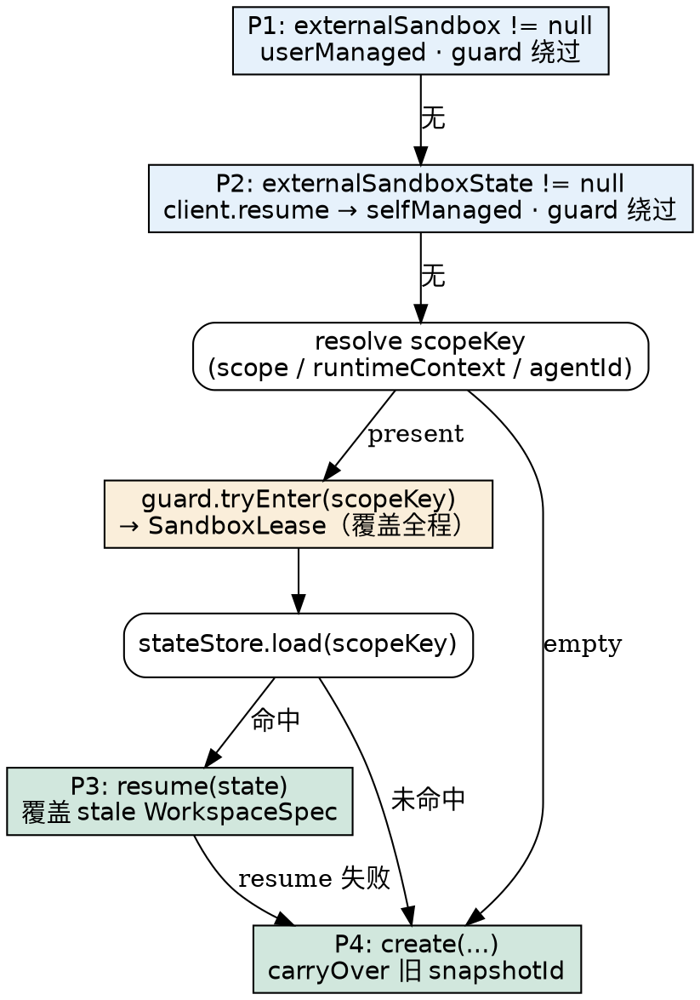

## Introduction

沙箱是 AgentScope Java 把 Agent 的 shell 命令与文件读写放进**隔离执行环境**的机制——agent 不再直接碰宿主 shell，而是由一套 `Sandbox` 抽象把命令发往容器 / 远端环境执行。它和 [工作区分册](/docs/CS/AI/LLM/Agent/Product/AgentScopeJava/Workspace.md) 是同一件事的两个视角：Workspace 讲「文件世界的关系」（目录布局 / 身份 / 三种 filesystem 模式），本分册讲「隔离执行环境本身」——生命周期、隔离范围、工作区投影、快照、文件系统桥、后端实现与并发护栏。事实来自本地 `v2.0.4` 源码逐包核对（`agentscope-harness/.../sandbox/`、`.../filesystem/`、`agentscope-extensions-sandbox/*`、`agentscope-extensions-{redis,jdbc,mysql,postgresql,mongodb,aistio}`），冲突处以源码为准。

> 几个先说清的易错点（源码与直觉冲突，已逐条核实）：
> 1. **docker 后端默认不保存快照**——`DockerFilesystemSpec` 的 `snapshotSpec` 默认是 `NoopSnapshotSpec`，需显式配 `LocalSnapshotSpec` / `RemoteSnapshotSpec` 才持久化。
> 2. **`WorkspaceArchiveExtractor` 全仓只在单测被调用**——docker 后端的 persist / hydrate 走 `docker exec tar`，并未接 `WorkspaceArchiveExtractor`。
> 3. **`SANDBOXED` 不是「拒绝绝对路径」**——`LocalFsMode.SANDBOXED` 是把绝对路径去前导 `/` 后 re-root 到 workspace 根，真正拒绝的是 `..` 段与最终越界。
> 4. **四个扩展后端（k8s / e2b / daytona / agentrun）都没有自带 `SandboxExecutionGuard`**——并发串行化护栏由 store 级扩展（redis / jdbc / mysql / postgresql / mongodb / aistio）提供。

## Core Abstraction

沙箱核心是一组 harness 顶层抽象，所有后端共享同一套生命周期契约。

### Sandbox Interface

`Sandbox`（`agentscope-harness/.../sandbox/Sandbox.java:42`）是活跃沙箱的接口，生命周期由 javadoc 固定五步：`create/resume → start → use(exec/persist/hydrate) → stop → shutdown`，`close() = stop + shutdown`。它特别区分两种"停止"：

```java
// Sandbox.java:35-40, 44-53
void start() throws Exception;          // 初始化或恢复工作区
void stop() throws Exception;           // 仅持久化快照，安全用于自托管与用户托管
default void shutdown() throws Exception { }   // 销毁后端资源，仅自托管调用
void close() throws Exception;          // stop + shutdown
ExecResult exec(RuntimeContext rc, String command, Integer timeoutSeconds) throws Exception;
InputStream persistWorkspace() throws Exception;   // 打包 /workspace 成 tar
void hydrateWorkspace(InputStream archive) throws Exception;  // 解包进 /workspace
```

`stop()` 与 `shutdown()` 的分野是并发语义的关键：用户托管的沙箱（Priority 1）在多次 acquire/release 之间要保持存活，`release` 只调 `stop()` 而不 `shutdown()`（`SandboxManager.java:197-199`）。

### SandboxClient SPI

`SandboxClient<O extends SandboxClientOptions>`（`.../sandbox/SandboxClient.java:25-48`）是后端工厂接口，也是 SPI 扩展点：

```java
Sandbox create(WorkspaceSpec workspaceSpec, SandboxSnapshotSpec snapshotSpec, O options);  // 新建，pre-start 态
Sandbox resume(SandboxState state);              // 从序列化状态恢复
void delete(Sandbox sandbox);
String serializeState(SandboxState state);
SandboxState deserializeState(String json);      // 另有重载接受 snapshotSpec
```

### SandboxState And WorkspaceSpec

`SandboxState` 是可序列化状态（`getState()` 返回），携带 `containerId` / `workspaceRoot` / `snapshot` / `workspaceProjectionHash` 等；`WorkspaceSpec`（`.../sandbox/WorkspaceSpec.java:43-47`）只有三个字段——`root`（默认 `/workspace`）、`entries`（`Map<String, WorkspaceEntry>`）、`environment`。**没有**独立的 git / bind-mount / archive 字段，这些都由 `WorkspaceEntry` 子类型承载在 `entries` 里。

### AbstractBaseSandbox Four-Branch Init

`AbstractBaseSandbox` 提供标准的 `start()` 四分支工作区初始化，所有后端复用。逻辑（`.../sandbox/AbstractBaseSandbox.java:75-117`）：

```java
if (state.isWorkspaceRootReady()) {
    applyWorkspaceSpec(spec, true);                       // Branch A: 仅 replay ephemeral entries
    if (snapshot.isRestorable()) {
        snapshot.restore(); doHydrateWorkspace();         // Branch B
        applyWorkspaceSpec(spec, true);
    }
} else {
    if (snapshot.isRestorable()) {
        snapshot.restore(); doHydrateWorkspace();         // Branch C
        applyWorkspaceSpec(spec, false);
    } else {
        applyWorkspaceSpec(spec, false);                  // Branch D: 全新全量初始化
    }
}
applyWorkspaceProjectionIfChanged(spec);                 // 第 116 行：投影永远最后叠加
state.setWorkspaceRootReady(true);
```

要点：`isWorkspaceRootReady()==true` 表示根已初始化（resume 场景），只重放 `isEphemeral()` 的 entry；`false` 表示全新，全量物化。`snapshot.restore()` 与 spec 物化都在前面，**投影在 `start()` 末尾第 116 行执行**，所以投影是叠加层。

### SandboxContext

`SandboxContext`（`.../sandbox/SandboxContext.java:27-130`）是不可变的 per-call 沙箱配置：持有 `client` / `clientOptions` / `workspaceSpec` / `snapshotSpec` / `externalSandbox` / `externalSandboxState` / `isolationScope`，在 `HarnessAgent.build()` 时构造，attach 到 `RuntimeContext`。

## Lifecycle And Acquisition

### SandboxManager.acquire Priority Chain

`SandboxManager.acquire`（`.../sandbox/SandboxManager.java:69-155`）决定"这次 call 用哪个沙箱"，优先级链：

1. **Priority 1**：`getExternalSandbox() != null` → 用户托管，`guard` 不生效，直接 `userManaged`。
2. **Priority 2**：`getExternalSandboxState() != null` → `client.resume(state)`，`selfManaged`。
3. **Priority 3**：解析出 `scopeKey` 且 `stateStore.load(scopeKey)` 命中 → `client.resume(state)`；**恢复前用当前应用配置覆盖 stale `WorkspaceSpec`**（`state.setWorkspaceSpec(...copy())`，`:111-114`）。
4. **Priority 4**：否则 `client.create(...)` 全新沙箱。

带 `SandboxExecutionGuard` 时，**Priority 3/4 在 resume/create 之前**先 `executionGuard.tryEnter(scopeKey)` 拿 `SandboxLease`（`:94-98`），lease 由 `SandboxAcquireResult` 携带。一个关键容错：`resume` 失败时 fallback 到 `create`，但通过 `carryOverPersistedSnapshotId`（`:165-182`）保留旧的 snapshot id，使新建沙箱仍从上一 archive 恢复工作区，而不是静默重置。



下面是可交互的 `acquire` 决策树（严格对齐 `SandboxManager.acquire:69-155`）：切换左侧 7 个输入条件，实时观察四级优先级如何短路、`scopeKey` 是否 present 决定 guard 是否介入、`resume` 失败如何 fall through 到 `create` 并继承旧 `snapshotId`，以及最终的沙箱模式与租约。**关键**：`Priority 1/2` 用户自管沙箱绕过 guard；只有 `Priority 3/4` 且 `scopeKey` present 才 `tryEnter`。上方 dot 图为同一逻辑的静态呈现，供未启用脚本的阅读器对照。

<div class="sb-root">
<style>
.sb-root{--card:var(--color-background-primary,#fff);--bg2:var(--color-background-secondary,#f6f7f9);--fg:var(--color-text-primary,#1a1a1a);--fg2:var(--color-text-secondary,#52525b);--bd:var(--color-border-tertiary,#e4e4e7);--green:var(--color-text-success,#3b6d11);--greenbg:var(--color-background-success,#eaf3de);--red:var(--color-text-danger,#a4262c);--redbg:var(--color-background-danger,#fcebeb);--blue:var(--color-text-info,#185fa5);--bluebg:var(--color-background-info,#e6f1fb);--amber:var(--color-text-warning,#854f0b);--amberbg:var(--color-background-warning,#faeeda);font-family:var(--font-sans,system-ui,-apple-system,sans-serif);color:var(--fg);line-height:1.6;}
@media (prefers-color-scheme: dark){.sb-root{--card:#1e1e1e;--bg2:#27272a;--fg:#e4e4e7;--fg2:#a1a1aa;--bd:#3f3f46;--green:#97c459;--greenbg:#1f2f12;--red:#f0898c;--redbg:#3a1f1f;--blue:#85b7eb;--bluebg:#16283a;--amber:#ef9f27;--amberbg:#3a2a10;}}
.sr-only{position:absolute;width:1px;height:1px;padding:0;margin:-1px;overflow:hidden;clip:rect(0,0,0,0);white-space:nowrap;border:0;}
.sb-root code{background:var(--bg2);padding:1px 4px;border-radius:4px;font-size:11px;}
.sb-grid{display:grid;grid-template-columns:repeat(auto-fit,minmax(150px,1fr));gap:10px;margin-bottom:14px;}
.sb-grid label{display:flex;flex-direction:column;gap:5px;font-size:12px;color:var(--fg2);}
.sb-grid select{font-size:13px;padding:6px 8px;border-radius:8px;border:.5px solid var(--bd);background:var(--card);color:var(--fg);}
.sb-steps{display:flex;flex-direction:column;gap:6px;margin-bottom:14px;}
.sb-step{display:flex;gap:10px;align-items:flex-start;border-radius:8px;padding:8px 11px;border:.5px solid var(--bd);background:var(--card);font-size:12px;}
.sb-step .sb-k{font-weight:500;min-width:112px;flex:none;}
.sb-step.hit{background:var(--greenbg);border-color:var(--green);}
.sb-step.hit .sb-k{color:var(--green);}
.sb-step.skip{color:var(--fg2);}
.sb-step.fallback{background:var(--amberbg);border-color:var(--amber);}
.sb-step.fallback .sb-k{color:var(--amber);}
.sb-res{border-radius:10px;padding:12px 14px;background:var(--bluebg);border:.5px solid var(--blue);}
.sb-res h4{margin:0 0 8px;font-size:13px;font-weight:500;color:var(--blue);}
.sb-res .sb-line{font-size:12px;color:var(--fg);margin:3px 0;}
.sb-res b{font-weight:500;}
.sb-note{font-size:12px;color:var(--fg2);margin-top:10px;line-height:1.6;}
</style>
<h2 class="sr-only">AgentScope Java SandboxManager.acquire 四级优先级交互决策树：切换输入条件，实时查看走哪条分支、租约与快照继承</h2>
<div class="sb-grid">
  <label>外部沙箱 externalSandbox<select id="sb-ext"><option value="0">无</option><option value="1">有（用户托管）</option></select></label>
  <label>外部状态 externalState<select id="sb-state"><option value="0">无</option><option value="1">有（显式 state）</option></select></label>
  <label>隔离域 scope<select id="sb-scope"><option>USER</option><option>SESSION</option><option>AGENT</option><option>GLOBAL</option><option value="null">null（按 USER）</option></select></label>
  <label>身份字段<select id="sb-ids"><option value="1">齐备（userId/sessionId）</option><option value="0">缺失</option></select></label>
  <label>持久化 stateStore<select id="sb-load"><option value="0">未命中</option><option value="1">命中</option></select></label>
  <label>client.resume<select id="sb-resume"><option value="1">成功</option><option value="0">抛异常</option></select></label>
  <label>执行护栏 guard<select id="sb-guard"><option value="1">已配置</option><option value="0">未配置</option></select></label>
</div>
<div id="sb-steps" class="sb-steps"></div>
<div class="sb-res"><h4>本次 acquire 结果</h4><div id="sb-reslines"></div></div>
<div class="sb-note">初始为缺省场景：无外部沙箱/状态，USER 域且身份齐备 → scopeKey present。切换任一项，观察四级优先级、guard 租约与快照继承如何变化。<code>Priority 1/2</code> 因调用方自管沙箱而绕过 guard；<code>resume</code> 失败只在 <code>stateStore</code> 命中时才触发降级。</div>
<script>
(function(){
var $=function(id){return document.getElementById(id);};
var ids=['sb-ext','sb-state','sb-scope','sb-ids','sb-load','sb-resume','sb-guard'];
function esc(s){return String(s).replace(/&/g,'&amp;').replace(/</g,'&lt;');}
function fin(steps,path,managed,lease,snap){return{steps:steps,path:path,managed:managed,lease:lease,snap:snap};}
function decide(s){
  var steps=[];
  function add(k,st,txt){steps.push({k:k,st:st,txt:txt});}
  if(s.ext){add('Priority 1','hit','externalSandbox != null → 直接用用户托管沙箱，guard 不生效');return fin(steps,'Priority 1 · user-managed','userManaged','无（绕过 guard）','—');}
  add('Priority 1','skip','无外部沙箱 → 继续');
  if(s.state){add('Priority 2','hit','externalSandboxState != null → client.resume(state)，guard 不生效');return fin(steps,'Priority 2 · resume explicit state','selfManaged','无（绕过 guard）','—');}
  add('Priority 2','skip','无显式状态 → 继续');
  var sc=s.scope==='null'?'USER':s.scope;
  var present=(sc==='AGENT'||sc==='GLOBAL')?true:s.ids;
  add('resolve scopeKey',present?'hit':'skip',present?('scopeKey present（scope='+sc+'）→ 进入带状态的查找'):('scopeKey empty（'+sc+' 缺身份字段）→ 跳过状态查找，直接新建'));
  var lease='noop()';
  if(present&&s.guard){lease='guard.tryEnter(scopeKey) → SandboxLease';add('guard.tryEnter','hit','拿租约，覆盖 acquire→start→(call)→stop→release→lease.close() 全程');}
  else{add('guard.tryEnter','skip',present?'未配置 guard → lease=noop()':'无 scopeKey → 不进入 guard');}
  if(present&&s.load){
    add('stateStore.load','hit','命中 → deserialize → 用当前配置覆盖 stale WorkspaceSpec');
    if(s.resume){add('Priority 3','hit','client.resume(state) 成功 → selfManaged(sandbox, lease)');return fin(steps,'Priority 3 · resume persisted','selfManaged',lease,'沿用持久化快照');}
    add('Priority 3','fallback','resume 抛异常 → 内层 catch 吞掉 → fall through 到 fresh create');
    add('Priority 4','hit','client.create(...) 全新沙箱');
    add('carryOver','hit','把旧 snapshotId 指给新沙箱 → 从上一 archive 恢复工作区，不静默重置');
    return fin(steps,'Priority 3 失败 → Priority 4（保留快照 id）','selfManaged',lease,'继承旧 snapshotId ✓');
  }
  add('stateStore.load','skip',present?'未命中 → 无状态可恢复':'无 scope，跳过 load');
  add('Priority 4','hit','client.create(...) 全新沙箱');
  add('carryOver','skip','无旧 snapshot，无需继承');
  return fin(steps,'Priority 4 · fresh create','selfManaged',lease,'—');
}
function render(){
  var s={ext:+$('sb-ext').value,state:+$('sb-state').value,scope:$('sb-scope').value,ids:+$('sb-ids').value,load:+$('sb-load').value,resume:+$('sb-resume').value,guard:+$('sb-guard').value};
  var r=decide(s);
  var box=$('sb-steps');box.innerHTML='';
  r.steps.forEach(function(st){var d=document.createElement('div');d.className='sb-step '+st.st;d.innerHTML='<span class="sb-k">'+esc(st.k)+'</span><span>'+esc(st.txt)+'</span>';box.appendChild(d);});
  $('sb-reslines').innerHTML='<div class="sb-line">路径：<b>'+esc(r.path)+'</b></div><div class="sb-line">沙箱模式：<b>'+r.managed+'</b></div><div class="sb-line">租约 lease：<b>'+esc(r.lease)+'</b></div><div class="sb-line">快照 snapshotId：<b>'+esc(r.snap)+'</b></div>';
}
ids.forEach(function(id){$(id).addEventListener('change',render);});
render();
})();
</script>
</div>

### Guard Covers The Full Call Window

`SandboxExecutionGuard` 的契约（`.../sandbox/SandboxExecutionGuard.java:54-56`）明确：harness 在 `acquire` 前 `tryEnter`、在 `release` 完成后 `lease.close()`，覆盖 `acquire → start → (call) → stop → release → lease.close()` 全程。Priority 1/2 因调用方自管沙箱而绕过 guard。

### SandboxLifecycleMiddleware Borrow-Return

`SandboxLifecycleMiddleware`（`.../middleware/SandboxLifecycleMiddleware.java:56-180`）是沙箱与执行循环的交汇点，由 `ReActAgent.beforeAgentExecution()` / `afterAgentExecution()` 调用：

- **acquireForCall**（`:89-143`）：读 `SandboxContext` → 跑 `beforeStartCallback`（让调用方先在宿主物化资源，如 `.skills-cache/`，使投影同次调用即生效）→ `sandboxManager.acquire` → `sandbox.start()`（4 分支）→ **per-call 绑定**：`ctx.put(SandboxAcquireResult.class, result)` 且 `filesystemProxy.setSandbox(sandbox)`。
- **releaseForCall**（`:151-179`）：读回本 call 建立的绑定 → CAS 式 `clearSandboxIfCurrent(sandbox)`（只清仍指向自己的 fallback 字段，防并发兄弟调用被误清，修 issue #2490）→ `sandboxManager.release(stop)` → `persistState` → `lease.close()`。

> **issue #2490 根因**：沙箱绑定必须是 **per-call** 落在 `RuntimeContext` 上，而非 agent 级共享 slot——同一 `HarnessAgent` bean 上不同 `(userId, sessionId)` 会话并行跑，共享 slot 会让并发调用互相覆盖对方的绑定。

post-call 的 persist / release 失败只记日志不抛异常（`SandboxLifecycleMiddleware.java:48-49`），保证 agent 调用结果总能返回给调用方。

### Release, Persist, Clear

- `release`（`:184-212`）：非自托管直接返回；自托管依次 `stop()`（持久化快照）与 `shutdown()`（销毁后端），各自异常只 warn。
- `persistState`（`:214-252`）：自托管才写；按 `scopeKey` 把 `client.serializeState(state)` 存入 `SessionSandboxStateStore`。
- `clearState`（`:254-269`）：删除 scope 对应的持久化状态（用 tombstone，见下）。

## Isolation Scope

### IsolationScope Four Values

`IsolationScope`（`.../agent/IsolationScope.java:53-87`）决定谁和谁共享同一份沙箱状态槽：

| Scope | 含义 | 默认 |
| :--- | :--- | :--- |
| `SESSION` | 每个 `sessionId` 独立 | |
| `USER` | 同一 `userId` 跨会话共享 | **默认** |
| `AGENT` | 同一 agent 所有用户/会话共享 | |
| `GLOBAL` | 全局共享一份 | |

缺 `userId` 时 `USER` 降级为 `SESSION`；`AGENT` / `GLOBAL` 不会因缺字段而降级（`agentId` 在 build 时固定）。

### SandboxIsolationKey.resolve

`SandboxIsolationKey.resolve(scope, ctx, agentId)`（`.../sandbox/SandboxIsolationKey.java:67-104`）按 scope 产出不可变 key：

- `SESSION`：需 `sessionId`，否则 empty；
- `USER`：用 `userId`，缺则降级 `SESSION` 用 `sessionId`，两者皆缺则 empty（跳过状态查找，新建）；
- `AGENT`：`agentId`（恒有）；
- `GLOBAL`：固定值 `__global__`（`:37`）；
- `null` scope：按 `USER` 处理。

### SessionSandboxStateStore Slot Encoding

`SessionSandboxStateStore`（`.../sandbox/SessionSandboxStateStore.java:32-103`）复用通用 `AgentStateStore`，因此**提供分布式 `AgentStateStore`（如 Redis）即自动启用分布式沙箱恢复**。slot 键编码（`slotSessionId`，`:84-92`）：

| Scope | slot sessionId |
| :--- | :--- |
| `SESSION` | `sandbox/session/<id>` |
| `USER` | `sandbox/user/<agentId>/<userId>` |
| `AGENT` | `sandbox/agent/<agentId>` |
| `GLOBAL` | `sandbox/global` |

`userId` 列恒为 `null`——沙箱状态概念上是 agent 范围的，`USER/AGENT/GLOBAL` 已编码进 sessionId 前缀。删除用 tombstone（`SandboxStateSlot.tombstone()`，`:99-102`），因为并非所有 `AgentStateStore` 支持按 key 删除。

### Sequential-Reuse, Not Live-Instance Sharing

`IsolationScope` 的 javadoc（`:49-52`）与源码一致地声明：沙箱模式下同一 scope key 的并发调用**各自启动独立容器**，调用结束时**最后写入的快照胜出**——是顺序复用，不是实时实例共享。这正是 [工作区分册](/docs/CS/AI/LLM/Agent/Product/AgentScopeJava/Workspace.md) 第 153 行警告的含义，也是 `executionGuard` 存在的理由。

## Workspace Projection

### Projection Roots And Hash

默认投影根常量 `DEFAULT_WORKSPACE_PROJECTION_ROOTS` 在 `SandboxFilesystemSpec.java:41-42`，值为 `AGENTS.md, skills, subagents, knowledge, .skills-cache`（注意：不在 `WorkspaceSpec` 里）。`WorkspaceProjectionApplier.build(spec)`（`.../sandbox/WorkspaceProjectionApplier.java:50-88`）把 `includeRoots` 下的宿主文件打成内存 tar，并对每个文件按 `rel路径 + (byte)0 + 内容` 累加 SHA-256（`:64-75`）；hash 存于 `state.getWorkspaceProjectionHash()`。

三个让 hash **可复现**的细节（`:60-83`，现有文档未展开）：① `collectProjectionEntries` 递归下钻 `DirEntry.children`，只收 `WorkspaceProjectionEntry`，所以嵌套 skills 目录也能被投影；② 收集到的文件按 `rel` 路径 `Comparator.comparing` **排序后再打包**（`:61-62`），否则 `HashMap` 迭代顺序不稳定会让相同内容算出不同 hash、导致每次都误判"内容已变"重复 hydrate；③ tar 用 `LONGFILE_POSIX` 模式（`:67`）支持长路径。分隔符 `(byte)0` 的作用是防边界歧义——`("ab","c")` 与 `("a","bc")` 若直接拼接会同 hash，插入 0 字节后路径边界唯一。

跳过 hydrate 的逻辑**不在 Applier 内**，而在调用方 `AbstractBaseSandbox.applyWorkspaceProjectionIfChanged`（`:267-287`）：

```java
WorkspaceProjectionApplier.ProjectionPayload payload = WorkspaceProjectionApplier.build(spec);
if (payload == null) return;
if (Objects.equals(payload.hash(), state.getWorkspaceProjectionHash())) {
    log.debug("[sandbox] Workspace projection unchanged, skipping");
    return;   // 命中：不重复 hydrate
}
state.setWorkspaceProjectionHash(payload.hash());
```

### Mount Root And What WorkspaceArchiveExtractor Does Not Do

投影默认挂到容器 `/workspace`（docker 默认 `workspaceRoot=/workspace`，`DockerSandboxClientOptions.java:39`；hydrate 走 `docker exec -i <cid> tar -xf - -C <root>`）。

`WorkspaceArchiveExtractor.extractTarArchive`（`.../sandbox/WorkspaceArchiveExtractor.java:54-81`，含 Zip-Slip 防护）**全仓仅在单测被调用**——docker 后端的打包/解包直接走 `docker exec tar`（`DockerSandbox.java:207-218` 打包带 bind-mount 排除、`262-280` 解包），并未接 `WorkspaceArchiveExtractor`。这是"直觉以为有统一工具类"与源码的差异点。

### Projection And Snapshot Cooperation

如 `AbstractBaseSandbox.start()` 四分支所示，**同 scope 一次调用的顺序 = 快照恢复（若有）→ spec entries 物化 → 投影叠加（带 hash 跳过）**。投影永远在最后，且自身有 hash 短路：内容未变则不重写，所以反复 `call()` 不会重复传相同文件。

## Snapshot

### Interfaces

- `SandboxSnapshot`（`.../sandbox/snapshot/SandboxSnapshot.java:37-92`）：`persist(InputStream)` / `restore()` / `isRestorable()` / `getId()` / `getType()`，默认 `isPersistenceEnabled()` 返回 `true`。
- `SandboxSnapshotSpec`（`.../sandbox/snapshot/SandboxSnapshotSpec.java:28-37`）：`build(String snapshotId)`，每会话独立 id。

### Three Spec Implementations

| Spec | 落点 | 行为 |
| :--- | :--- | :--- |
| `LocalSnapshotSpec` | `{basePath}/{id}.tar` | 原子写（先写 `.{id}.{uuid}.tmp` 再 `ATOMIC_MOVE`，`LocalSandboxSnapshot.java:69-95`） |
| `RemoteSnapshotSpec` | `RemoteSnapshotClient`（S3 / OSS / GCS，`RemoteSnapshotClient.java:28-56`） | 后端实现 `upload/download/exists` |
| `NoopSnapshotSpec` | 无 | **`isPersistenceEnabled()=false`**，`persist` 丢弃、`restore` 抛异常（`NoopSandboxSnapshot.java:44-70`） |

`DockerFilesystemSpec.java:35` 把 `snapshotSpec` 默认置为 `NoopSnapshotSpec`——即 **docker 后端默认不保存快照**，需显式覆盖才持久化。

### Tie-In With start/stop

- **恢复**：`start()` Branch B / C 调 `snapshot.restore()` → `doHydrateWorkspace`（`AbstractBaseSandbox.java:86-107`）。
- **持久化**：`stop()` 中 `if (snapshot != null && snapshot.isPersistenceEnabled()) { try(InputStream a=doPersistWorkspace()){ snapshot.persist(a); } }`（`:132-141`）。
- docker `doPersistWorkspace` 用 `tar -cf - -C <root> .` 全量打包整个 `/workspace`（`DockerSandbox.java:207-218`），非增量。

## Filesystem Bridge

### AbstractFilesystem

Agent 访问文件世界的统一抽象是 `AbstractFilesystem`（`.../filesystem/AbstractFilesystem.java:44`）——**不是** `Filesystem`（无此接口）。核心方法：`ls` / `read` / `write`（只写新文件）/ `edit` / `grep` / `glob` / `uploadFiles` / `downloadFiles` / `delete`（幂等）/ `move` / `exists`；**无** `mkdir` / `copy`（mkdir 仅作 shell 串出现）。接口内建静态 `validatePath`（`:178-188`）拒绝 null/blank 与 `..` 段。

### LocalFsMode Three Values

`LocalFsMode`（`.../agent/workspace/LocalFsMode.java:37-41`）取值 `SANDBOXED` / `ROOTED`（默认）/ `UNRESTRICTED`——**没有 `DIRECT`**。路径解析在 `LocalFilesystem.resolveSandboxed`（`.../filesystem/local/LocalFilesystem.java:609-621`）：

```java
private Path resolveSandboxed(String effectiveKey) {
    String vpath = effectiveKey.startsWith("/") ? effectiveKey : "/" + effectiveKey;
    if (vpath.contains("..") || vpath.startsWith("~"))
        throw new SecurityException("Path traversal not allowed");
    Path full = cwd.resolve(stripWindowsDrive(vpath.substring(1))).normalize();
    if (!full.startsWith(cwd))
        throw new SecurityException("Path " + full + " outside root directory: " + cwd);
    return full;
}
```

**关键纠正**：`SANDBOXED` 不是"拒绝绝对路径"——它把绝对路径去前导 `/` 后 re-root 到 `cwd`（所以 `/etc/passwd` 会变成 `cwd/etc/passwd`），真正拒绝的是 `..` 段与 `!full.startsWith(cwd)` 的越界兜底。`ROOTED` 用 `PathPolicy.isAllowed`（allow-list，本身不抛异常，抛异常在 `LocalFilesystem.rootAccessDenied`）校验。

### SandboxBackedFilesystem Forwards To Sandbox.exec

`SandboxBackedFilesystem extends BaseSandboxFilesystem implements SandboxAware`（`.../filesystem/sandbox/SandboxBackedFilesystem.java:60`）**不直接构造 cat/ls 命令**——读/列/删等命令在基类 `BaseSandboxFilesystem` 里拼成 shell 串（`read` 用 `sed`/`base64`、`ls` 用 shell 循环+`stat`、`grep` 用 `grep`、`glob` 用 `find`），再调抽象方法 `execute(...)`，而 `SandboxBackedFilesystem` 把 `execute` 重写为调用 `Sandbox.exec(...)`（`SandboxBackedFilesystem.java:100-120`）。也有 `SandboxFileTransfer` 原生单文件上传（`uploadFile`）优先、否则回退 tar hydrate（`:136-167`）；下载回退用 `base64 <path>` 经 `exec`。

`setSandbox` 只是给**无 `RuntimeContext` 的调用者**（如 `WorkspaceMessageBus`）留的 fallback 字段；并发安全的真实绑定是 `RuntimeContext` 上的 `SandboxAcquireResult`，`requireSandbox` 优先读它，`clearSandboxIfCurrent` 做 CAS 比较（`:72-92`）。

### Command-As-Protocol: How File Ops Become Shell

`BaseSandboxFilesystem` 的本质是一台**编译器 + 解码器**：把 `AbstractFilesystem` 的结构化调用编译成一段 POSIX shell，执行后把带哨兵/前缀的**文本协议**解码回 `FileInfo` / `GrepMatch` / `ReadResult`。 subclasses 只需实现 `execute` / `uploadFiles` / `downloadFiles` / `id`，于是**任何能跑 `sh` 的后端（docker / k8s / e2b / daytona / agentrun）自动获得完整文件能力**，无需各自实现 `ls/read/grep`（`BaseSandboxFilesystem.java:38-55`）。代价是解析靠字符串哨兵，且依赖容器内有 coreutils + `python3` + `base64`。

所有路径先过 `FilesystemUtils.shellQuote`（`.../filesystem/util/FilesystemUtils.java:101-106`）：标准 POSIX 单引号转义——`'a'b'` → `'a'\''b'`，空串返回 `''`。这是整条链的注入防线（注意：只是 shell 层，不替代 workspace 根约束）。

| 操作 | 编译出的 shell（`BaseSandboxFilesystem.java`） | 回传协议 / 解码要点 |
| :--- | :--- | :--- |
| `ls`（`:73-130`） | `if [ ! -e <p> ]` → `__NOT_EXISTS__`；`[ ! -d ]` → `__NOT_A_DIR__`；否则 `for f in <p>/*; stat -c '%Y'/'%s'` | 每行 `DIR:<path>\t<mtime>` / `FILE:<path>\t<size>\t<mtime>`，按 `DIR:`/`FILE:` 前缀切分。**一次 exec 拿全类型+大小+mtime**，避免 N 次往返 |
| `read` 文本（`:157-192`） | `sed -n '<offset+1>,<offset+limit>p' <p>`，前置 `-f`/`-s` 检查 | 哨兵 `__NOT_FOUND__` → fail；`__EMPTY__` → 一条 "System reminder: File exists but has empty contents" 的 **utf-8 FileData**（让模型知道"空"而非"失败"）；末尾 `\n` 被剥掉 |
| `read` 二进制（`:137-155`） | `base64 <p> 2>/dev/null`，返回 `FileData(encoded, "base64")` | **exit code 语义**：`>0 且 !=124` → `file_not_found`；`124` 是 `timeout(1)` 约定（命令没跑完），归到执行失败。二进制不走 sed 文本路径 |
| `write`（`:195-232`） | `if [ -e <p> ]; then echo EXISTS; exit 1; fi; mkdir -p $(dirname <p>)` | **内容不进 shell**——检查通过后改走 `uploadFiles`（`Map.entry(path, content.getBytes(UTF_8))`）。既有文件拒绝覆盖，逼模型先 read 再 edit |
| `edit`（`:241-319`） | `python3 -c '<脚本>' 2>&1 <<'__EDIT_EOF__'\n<base64 JSON>\n__EDIT_EOF__` | 把 `{path,old,new,replace_all}` 序列化为 JSON → **base64 编码 → heredoc 喂 stdin**，python 侧 `b64decode`+`json.loads` 后做 `text.count(old)` 与 `replace`。返回 `{"count":N}` 或 `{"error":"file_not_found/string_not_found/multiple_occurrences"}` |
| `grep`（`:321-367`） | `grep -rHnF <glob> -e <pattern> <path> 2>/dev/null \|\| true` | **`-F` 固定字符串匹配**（不是正则）；`|| true` 把"无匹配"的 exit 1 吞成成功 → 空列表。按 `path:line:text` 分 3 段解析 |
| `glob`（`:369-413`） | `find <path> -type f -name <pattern> \| sort \| while IFS= read -r f; stat ...` | `sort` 保证稳定顺序；每行 `<path>\t<size>\t<mtime>` 解析为 `FileInfo` |
| `delete` / `move`（`:415-440`） | `rm -rf <p>` / `mkdir -p $(dirname <to>) && mv <from> <to>` | 均先过 `AbstractFilesystem.validatePath`（拒 null/blank 与 `..` 段） |

**设计动机——为什么 `edit` 要绕一圈 base64 + heredoc？** 因为 `old`/`new` 是模型生成的任意文本，可能含单引号、换行、中文、`$`、反引号；直接塞进 shell 参数会撞进 `shellQuote` 与 shell 展开的双重陷阱。base64 把任意字节压成纯 `[A-Za-z0-9+/=]`，heredoc 用带引号的 `<<'__EDIT_EOF__'` 关闭 shell 展开——两者叠加得到一条**零转义数据通道**。代价是容器里必须有 `python3`（源码没有纯 shell fallback）。

**设计动机——为什么 `read` 空文件要返回 "System reminder" 而不是空串？** 空串会被模型误读为"读取失败/文件不存在"而反复重试或改错路径。塞一条说明性文本进 `FileData`，等于在协议层给 LLM 一个明确信号：文件在、内容空、别再试了。

### Overlay / ProjectAwareOverlay / Pinned

- `OverlayFilesystem`（`.../filesystem/OverlayFilesystem.java:56`）：upper（读写，优先）/ lower（只读）copy-on-write；`ls` 取并集、`read` 先 upper 后 lower、`delete` 只删 upper（删共享层抛 `Cannot delete shared file`）、`exists` 任一层存在即真。
- `ProjectAwareOverlay`（`.../filesystem/ProjectAwareOverlay.java:54`）：在 overlay 之上按 `WORKSPACE_PREFIXES` 把写路由到 project 层（`projectWritable(true)` 时由 `LocalFilesystemSpec` 产出，`write` 路由 `:133-140`）。
- `PinnedSandboxFilesystem`（`.../filesystem/sandbox/PinnedSandboxFilesystem.java:34`）：`extends SandboxBackedFilesystem`，构造时钉死一个 `Sandbox`，`clearSandboxIfCurrent` 为 **no-op**——用于 call 释放后的异步镜像上传仍需该引用。

### Routed / Composite

- `CompositeFilesystem`（`.../filesystem/CompositeFilesystem.java:64`）：按**路径前缀**最长匹配路由到不同 backend（默认 backend 兜底），刻意**不实现 `execute`**（跨 store 路由 shell 命令是歧义的），`move` 跨 backend 降级为 读→写→删。
- `RoutedSandboxFilesystem`（`.../filesystem/RoutedSandboxFilesystem.java:41`）：持 `primary`（沙箱后端）+ `CompositeFilesystem`；文件操作委派 composite，但 `execute` / `id` **永远走 primary**（`:70-74`），可保留 shell 执行同时把 `memory-stores/` 等前缀挂到 JPA 后端。**路由维度是路径前缀，不是 `scope`/`userId`**——会话/用户隔离由 `RuntimeContext` 的 namespace（`NamespaceFactory`）实现。

### Path Safety Summary

| 输入 | `SANDBOXED`（`:609-621`） | `ROOTED`（`:633-669`） | `UNRESTRICTED`（`:681-687`） |
| :--- | :--- | :--- | :--- |
| `read("/workspace/x")` | `/` 去掉 → `cwd/workspace/x` | 落 cwd/Policy root 才放行 | 原样 `cwd.resolve` 或绝对透传 |
| `read("../../etc/passwd")` | `contains("..")` → `SecurityException` | `validatePath` 抛 `IllegalArgumentException` | `cwd.resolve(...).normalize()` → **可能真实越界读宿主文件** |
| `read("/etc/passwd")` | 去 `/` → `cwd/etc/passwd`（非真 /etc） | 不在 cwd/Policy root → 拒绝 | 原样读真实 `/etc/passwd` |

沙箱端（`SandboxBackedFilesystem` + `BaseSandboxFilesystem`）路径直接作为**容器内**路径传 `exec`，天然限制在容器内；上传额外有 workspace 根约束 `resolveArchivePath`（越界 → `IOException "outside the sandbox workspace"`）。

## Backends

### Five Backends Overview

| 后端 | 模块坐标 | 底层机制 | 是否 harness 自带 | 状态持久化方式 |
| :--- | :--- | :--- | :--- | :--- |
| Docker | `.../impl/docker/` | `docker` CLI via `ProcessBuilder`（无 docker-java / Testcontainers） | **是** | 序列化 `containerId/containerName`；工作区 tar 进 state store；resume 复用/重启容器 |
| Kubernetes | `agentscope-extensions-sandbox-kubernetes` | fabric8 + agent-sandbox CRD；`SandboxClaim` + warmPool；隧道 port-forward / gateway / direct | 否 | 以 `SandboxClaim`（claimName/namespace）为锚；工作区走运行时文件 API 或 exec tar |
| E2B | `agentscope-extensions-sandbox-e2b` | exec 走 envd protobuf；生命周期/快照走 Platform HTTP（OkHttp） | 否 | `sandboxId` + 原生 snapshot templates（`snapshotIds` 列表，retention 清理） |
| Daytona | `agentscope-extensions-sandbox-daytona` | 纯 HTTP 数据面（`DaytonaHttp` / OkHttp） | 否 | `sandboxId`（+可选 `snapshotId`）；工作区 tar|base64 over HTTP |
| AgentRun | `agentscope-extensions-sandbox-agentrun` | HTTP 控制面（`AgentRunDataPlaneHttp`）+ MCP 执行面（`AgentRunMcpChannel`） | 否 | 确定性 `sandboxId`（SHA-256→Crockford32）；**NAS/OSS 挂载下无操作持久化**，否则 tar|base64 over MCP |

四个扩展后端**均无自带 `SandboxExecutionGuard`**，并发串行化依赖 store 级护栏（见下节）。

### Docker (Built-in)

注释明确「`Uses the docker CLI via ProcessBuilder; no docker-java library dependency is required`」（`DockerSandbox.java:49`）。`doExec`（`:150-158`）拼 `docker exec -w <root> <cid> sh -c <command>` 经 `ProcessBuilder` 启动，超时 `process.destroyForcibly()`；打包/解包走 `docker exec tar`（`:207-218` / `262-280`）；单文件走 `docker cp`（`:386-428`）。容器用 `docker run -d --name agentscope-sandbox-<sessionId> ... sh -c "trap 'exit 0' TERM; while :; do sleep 3600 & wait $!; done"` 常驻（`:519-583`）。默认 `image=ubuntu:22.04`、`workspaceRoot=/workspace`；resume 时若容器仍在则直连，已停则重启，**无 warmPool 概念**。

### Kubernetes

`KubernetesSandboxClient.create`（`KubernetesSandboxClient.java:122-128`）走 `sdkClient.createSandbox(CreateSandboxOptions.builder(warmPoolName).namespace(...).claimName(...))`——即 **warmPool + SandboxClaim**（CRD `SandboxClaim` / `SandboxClaimSpec` / `SandboxClaimStatus`）。隧道三选一（`toConnectionConfig`，`:224-245`）：`apiUrl`→Direct、`gatewayName`→Gateway、否则 `LocalTunnelConnectionConfig`（port-forward）。`doExec`（`KubernetesSandbox.java:97-98`）走 `sdkSandbox.commands().run(...)`；归档 `fileApiEnabled()` 时走运行时文件 API，否则 `tar|base64` 经 exec（`:112-167`）。`shutdown`（`:65-86`）仅 `claimOwned` 时 `terminate()`，否则只关连接。

### E2B

`E2bSandbox extends AbstractBaseSandbox`（**未实现 `SandboxFileTransfer`**），exec 走 envd protobuf（`E2bSandbox.java:128`），生命周期/快照走 Platform HTTP（`E2bPlatformHttp.java:38-39`）。`doPersistWorkspace`（`:132-155`）两种模式：`NATIVE_SNAPSHOT`（`platform.createSandboxSnapshot` 返回 `snapshotID` 标记进归档流）或 `TAR`（envd 流式 tar）；`doHydrateWorkspace`（`:158-188`）命中 snapshot id 则 `createSandbox(snapshotTemplateId)` 重建，否则 base64→tar 经 envd。`shutdown`（`:112-123`）`killSandbox` + 按 `snapshotRetention` 清理。默认 `workspaceRoot=/home/user`、`persistenceMode=TAR`。

### Daytona

`DaytonaSandbox extends AbstractBaseSandbox`（`:33`），全部经 `DaytonaHttp`（OkHttp）。`doExec`（`:73-92`）`http.execute(sandboxId, command, cwd, timeout)` 解析 JSON `exitCode/result`（truncate 512KB）；打包 `tar|base64` 经 `http.execute`、解包分块 base64→`python3`→`tar xf`（`:95-155`）。默认 `workspaceRoot=/home/daytona/workspace`、`image=ubuntu:22.04`。

### AgentRun

`AgentRunSandbox extends AbstractBaseSandbox`（`:39`），持 `AgentRunDataPlaneHttp`（控制面）+ `AgentRunMcpChannel`（执行面，经模板内嵌的 AgentRun MCP server 跑命令/传归档）。`doExec`（`:120`）走 `mcp.exec`；`workspaceOnNas=true` 时 `doPersistWorkspace` 直接返回空流（交给 NAS/OSS 挂载，`:135-151`）。`ensureSandbox`（`:213-233`）用**确定性** `sandboxId`（`deriveSandboxId` 由 `SHA-256(sessionId)`→Crockford Base32 取 26 字符，`AgentRunSandboxClient.java:243-271`），故同 session resume = 重建同 id 沙箱。默认 `workspaceRoot=/home/agentscope/workspace`。

## Exec Engine: Process, Streams And Truncation

所有后端最终都要回答同一个工程问题：**怎么在不让子进程卡死、不让输出撑爆内存的前提下，跑一条命令并收回结果**。Docker 后端（harness 内置、经 `ProcessBuilder`）把这套机制写得最完整，是理解执行内核的最佳样本。

### doExec: Ribbon-Cutting The Process

`DockerSandbox.doExec`（`DockerSandbox.java:145-200`）的算法分五步：

```java
// 1) 拼 argv（List<String>，不经 shell 再解释，避免命令注入）
List<String> cmd = List.of("docker","exec","-w", workspaceRoot, containerId,
                           "sh","-c", command);
Process process = new ProcessBuilder(cmd).start();

// 2) 双 daemon drainer 并发抽干 stdout / stderr（各 512 KB 上限）
ExecutorService drainer = Executors.newFixedThreadPool(2, daemonFactory);
Future<String> out = drainer.submit(() -> readStream(process.getInputStream(), 512*1024));
Future<String> err = drainer.submit(() -> readStream(process.getErrorStream(), 512*1024));
drainer.shutdown();

// 3) 带超时的竞速等待
boolean exited = process.waitFor(timeoutSeconds, TimeUnit.SECONDS);
if (!exited) {
    process.destroyForcibly(); drainer.shutdownNow();
    throw new ExecTimeoutException(command, timeoutSeconds);
}

// 4) 收口 + 截断判定
String stdout = out.get(), stderr = err.get();
int exitCode = process.exitValue();
boolean truncated = stdout.length() >= 512*1024 || stderr.length() >= 512*1024;
ExecResult result = new ExecResult(exitCode, stdout, stderr, truncated);

// 5) 非零退出即抛（ok() == exitCode==0），不把失败当正常结果交回模型
if (!result.ok()) throw new ExecException(exitCode, stdout, stderr);
return result;
```

**设计动机——为什么要两个独立 drainer 线程？** 这是 `ProcessBuilder` 的经典死锁陷阱：管道的 OS 缓冲区有限（通常 64KB），如果主线程 `waitFor()` 时才想起来读，而子进程往 stderr 猛写错误、stdout 又满，两端缓冲区都塞满 → 子进程阻塞在 write → 永远不退出 → `waitFor` 永久挂起。用两个 daemon 线程**边跑边抽**两端，从根本上消除这个环。它们必须是 daemon（`:171` `t.setDaemon(true)`），否则忘记 `shutdownNow` 时会拖住 JVM 退出。

### readStream: Truncate-Then-Drain

`readStream`（`:750-767`）不是读到 EOF 才停——它读到 `maxBytes`（512KB）就停，然后做一件反直觉的事：

```java
byte[] buf = new byte[maxBytes];
int total = 0, read;
while (total < maxBytes && (read = in.read(buf, total, maxBytes - total)) != -1) total += read;
if (total == maxBytes) in.skip(Long.MAX_VALUE);   // 排空剩余，防子进程卡在 write
return new String(buf, 0, total, UTF_8);
```

**设计动机——截断后为何还要 `skip(Long.MAX_VALUE)` 把剩下的全丢掉？** 若读到上限就直接 return 并关闭流，子进程后续写入会撞 `SIGPIPE` 或阻塞在已满的管道里——表现就是"命令明明该结束却卡住"，`waitFor` 跟着超时。先 `skip` 把字节抽走扔掉，让子进程能一路写完、正常退出，主线程才拿得到干净的 exit code。`truncated` 标志则诚实地告诉上层"输出被砍过"（`ExecResult.truncated`，`ExecResult.java:24`）。

### ExecResult: Fail-Loud By Default

`ExecResult`（`ExecResult.java:26-48`）是 record：`(exitCode, stdout, stderr, truncated)`。`ok()` 严格等于 `exitCode==0`；`combinedOutput()` 把 stderr 以 `[stderr] ` 前缀拼到 stdout 之后（stderr 为空则只回 stdout）。配合 `doExec` 第 5 步"非零即抛 `ExecException`"——**工具失败不会伪装成一条正常文本回给模型**，避免 LLM 把错误输出当成有效结果继续推理。

三个超时常量（`DockerSandbox.java:78-81`）：`OUTPUT_TRUNCATE_BYTES=512*1024`（每流）、`CONTAINER_START_TIMEOUT_SECONDS=60`、`TAR_TIMEOUT_SECONDS=120`——命令执行用调用方传入的 `timeoutSeconds`，容器启停与归档走各自的固定值。

### Keepalive Shell: Trap Before Foreground Sleep

容器常驻命令（`:652-659`）不是朴素的 `while true; do sleep 3600; done`，而是：

```sh
trap 'exit 0' TERM; while :; do sleep 3600 & wait $!; done
```

**设计动机——`sleep` 放后台 + `wait $!` 而非前台？** shell 在等待前台命令时**不会处理 trapping 的信号**，直接前台 `sleep 3600` 会让 `docker stop` 发的 SIGTERM 一直悬着，直到 10s 宽限期超时被 `SIGKILL` 强杀（工作区来不及持久化）。把 `sleep` 放后台、`wait $!` 等待，shell 处于可中断的 wait 状态，SIGTERM 一到就触发 `trap 'exit 0'`，进程优雅退出、`stop()` 得以先跑快照持久化。`stop` 的 CLI 路径（`:669-687`）先 `docker stop`（10s）再必要时 `destroyForcibly`，与这个 trap 配套。

## Execution Guard

### SPI And Lifecycle

`SandboxExecutionGuard`（`.../sandbox/SandboxExecutionGuard.java:59-93`）是 `@FunctionalInterface`：`SandboxLease tryEnter(SandboxIsolationKey key)` + `static noop()`。用途是给 `USER` / `AGENT` / `GLOBAL` 这种多并发调用者就同一持久化 slot 串行化——否则 `SandboxManager` 的"最后写入快照胜出"会让并发调用互相覆盖。`SandboxLease`（`SandboxLease.java:27-55`）是 `AutoCloseable`，实现须幂等。默认 `noop()` 不限制。

### Six Distributed Implementations

| 实现 | 模块 | 互斥原语 | 阻塞 | 超时/自动释放 | `Lease.close` |
| :--- | :--- | :--- | :--- | :--- | :--- |
| Redis | redis | `SET NX PX` + Lua CAS（token=UUID） | 轮询 500ms | TTL 30min 安全阀，无获取超时 | Lua `get==token then del` |
| JDBC | jdbc | 委托 `SandboxLockStrategy`；默认表级 `INSERT` 唯一键冲突 | 指数退避 50→1000ms | `lockTimeout` 1800s | `DELETE WHERE lock_name` |
| MySQL | mysql | `GET_LOCK(name,timeout)` 服务端命名锁 | 服务端阻塞 | 1800s；**连接关即释放** | `RELEASE_LOCK` + conn.close |
| PostgreSQL | postgresql | `pg_try_advisory_lock`（64-bit key） | 轮询 100ms | 1800s；**连接关即释放** | `pg_advisory_unlock` + conn.close |
| MongoDB | mongodb | 唯一 `_id` 文档 + TTL 索引 + 看门狗续租 | 轮询 500ms | `leaseTtl` 30min + TTL 监控删 | `deleteOne(_id AND token)` |
| Aistio | aistio | 控制面 `POST /locks/acquire`（holder=UUID, ttl=60s） | 轮询 500ms | ttl 60s + 续租 20s；不可达 30s 降级 `ReentrantLock` | `POST /locks/release` |

细节要点（均源码核对）：

- **Redis**（`RedisSandboxExecutionGuard.java:139-159`）：`SET NX PX` 轮询拿锁，释放是 Lua 脚本 CAS（`if get==ARGV[1] then del`），只删自己 token 的锁；键 `<prefix><scope>:<value>`，默认前缀 `agentscope:sandbox:lock:`。
- **JDBC**（`JdbcSandboxExecutionGuard.java:68-72`）：零 DB 逻辑，委托方言 `SandboxLockStrategy`；默认表级锁 `INSERT INTO <prefix>distributed_locks (lock_name) VALUES (?)`，唯一主键冲突（SQLState 23xx / SQLite 19）即重试（`AbstractJdbcDialect.java:257-294`）。
- **MySQL**（`MysqlDialect` 用 `GET_LOCK`）：锁**绑定连接**，连接关闭即自动释放（`JdbcSandboxExecutionGuard.java:70-140`）。
- **PostgreSQL**（`PostgresDialect` 用 `pg_try_advisory_lock`）：key 由 `MurmurHash3.hash128(raw)` 取 `hash[0]`（`:129-133`）。
- **MongoDB**（`MongoSandboxExecutionGuard.java:133-216`）：`insertOne` 原子获取（重复键 11000 则 reclaim 过期锁），TTL 索引 `expireAfter(0)` 自动删，看门狗每 `leaseTtl/3` 续租，`close` 用 `deleteOne(_id AND token)` 防误删他人锁。
- **Aistio**（`ControlPlaneSandboxExecutionGuard.java:75-147`）：控制面不可达持续 >30s 降级为进程内 `ReentrantLock`（仅单 JVM 有效，跨进程失效，仅兜底）。

> 注意：各 guard 中**没有 `SELECT FOR UPDATE` 式显式行锁**——JDBC 默认走唯一键 INSERT 冲突，MySQL/PG 走原生 advisory lock，已据实区分。

### Lease Algorithms: Token CAS, Watchdog And TOCTOU

六种实现虽互斥原语不同，但都遵守同一个**租约（lease）不变式**：拿锁写一个唯一 token，释放时只删"值仍等于自己 token"的锁——防止 A 的慢调用超过 TTL 后锁被 B 抢占，A 结束时误删 B 的锁。差别只在 token 校验放在哪、以及要不要续租。

**Redis：SET NX PX + Lua CAS**（`RedisSandboxExecutionGuard.java:139-179`）

```java
String token = UUID.randomUUID().toString();
SetParams params = SetParams.setParams().nx().px(leaseTtlMs);   // 仅键不存在时设，带 TTL
while (true) {
    if ("OK".equals(jedis.set(redisKey, token, params))) return () -> releaseLock(redisKey, token);
    if (Thread.interrupted()) throw new InterruptedException(...);
    Thread.sleep(retryIntervalMs);                              // 轮询 500ms
}
// release —— 一段 Lua 把 "读-比-删" 合成原子操作
"if redis.call('get', KEYS[1]) == ARGV[1] then return redis.call('del', KEYS[1])
 else return 0 end"
```

**为何必须用 Lua 而非先 `GET` 再 `DEL`？** 两步之间有时间窗：A 读到 token 是自己的 → 此刻 TTL 到期、B 抢先 SET 成新 token → A 的 `DEL` 把 B 的锁删了，两个调用同时进临界区。Redis 单线程执行 Lua 脚本，脚本内 `get`→比较→`del` 不可分割，彻底关掉这个窗口。代价是 Redis 侧脚本支持必须开启。释放返回 0 时只 warn「possible TTL expiry during a long call」（`:164-168`）——**Redis guard 没有看门狗续租**，长调用超过 30min TTL 会失去互斥保护，这是已知的安全阀而非正确性保证。

**MongoDB：insertOne + 看门狗 + TOCTOU-safe reclaim**（`MongoSandboxExecutionGuard.java:133-215`）

Mongo 无服务端阻塞锁，获取是两段式轮询：

```java
// Step 1: insertOne 一个带唯一 _id 的锁文档（expiresAt = now + leaseTtl）
try { collection.insertOne(lockDoc); return new MongoLease(...); }
catch (MongoWriteException e) { if (code != 11000) throw; /* 重复键 → Step 2 */ }

// Step 2: 文档已存在——只回收"已过期"的锁
Bson filter = and(eq(_id, lockId), lte(expiresAt, now));
Document reclaimed = collection.findOneAndUpdate(filter,
    combine(set(owner), set(token, 新 token), set(expiresAt)), RETURN_AFTER);
if (reclaimed != null) return new MongoLease(...);   // 抢到过期锁
sleep(retryIntervalMs);                              // 未过期 → 继续轮询到 deadline
```

**为何 reclaim 过滤条件里必须有 `expiresAt <= now`？** 源码 `:193-197` 直接点破了 TOCTOU 场景：Step 1 的 `insertOne` 失败后、Step 2 的 reclaim 之前，锁可能恰好被别人释放、又被第三者重新抢占。若 reclaim 只看 `_id` 不看过期时间，就会把别人刚拿到的新锁偷走。带上 `expiresAt <= now` 后， freshly acquired 的锁 `expiresAt` 在未来，**天然不匹配 reclaim 过滤条件**——这是用数据条件而非事务把竞态化解掉。

**看门狗续租**（`:260-302`）：`MongoLease` 构造时起一个 `scheduleAtFixedRate`，周期 `max(1, leaseTtl/3)`，每次 `updateOne` 把自己的 `expiresAt` 往前推、且按 token 过滤（只续自己的）。这样只要调用还在跑，锁就不过期；**续租失败只 warn 不抛**（`:293-295`）——与 Redis 一致：TTL 是防死锁的安全阀，不是互斥正确性的硬保证。续租线程池固定 2 线程（`:111-117`），避免某把锁的慢 `updateOne` 拖住其他锁的续租。`close` 用 `deleteOne(_id AND token)` 防误删他人锁。

**三类互斥原语的取舍**：Redis/Mongo/Aistio 是**租约型**（TTL 兜底 + token CAS，锁可过期），MySQL `GET_LOCK` / PG advisory lock 是**连接绑定型**（连接关即释放，无 TTL 漂移风险但依赖长连接），JDBC 默认表是**记录型**（唯一键 INSERT 冲突）。选哪种取决于部署栈与"调用是否可能长于 TTL"——长调用优先 Mongo（有续租）或连接绑定型，纯缓存栈且调用短则用 Redis 最轻。

## Links

- [工作区](/docs/CS/AI/LLM/Agent/Product/AgentScopeJava/Workspace.md)
- [执行内核](/docs/CS/AI/LLM/Agent/Product/AgentScopeJava/Execution.md)
- [技能](/docs/CS/AI/LLM/Agent/Product/AgentScopeJava/Skill.md)
- [智能体](/docs/CS/AI/LLM/Agent/Product/AgentScopeJava/Agent.md)
- [会话](/docs/CS/AI/LLM/Agent/Product/AgentScopeJava/Session.md)
- [AgentScope Java 枢纽](/docs/CS/AI/LLM/Agent/Product/AgentScopeJava/AgentScopeJava.md)

## References

- [AgentScope Java 沙箱](https://java.agentscope.io/v2/zh/docs/harness/sandbox)
