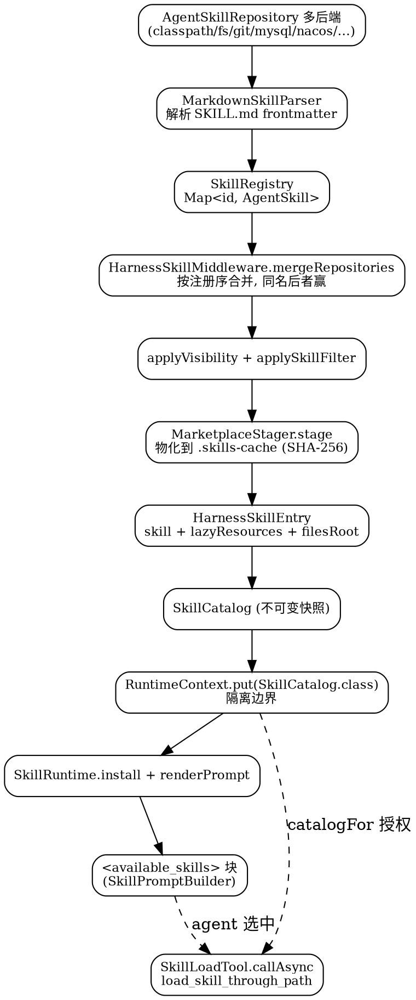
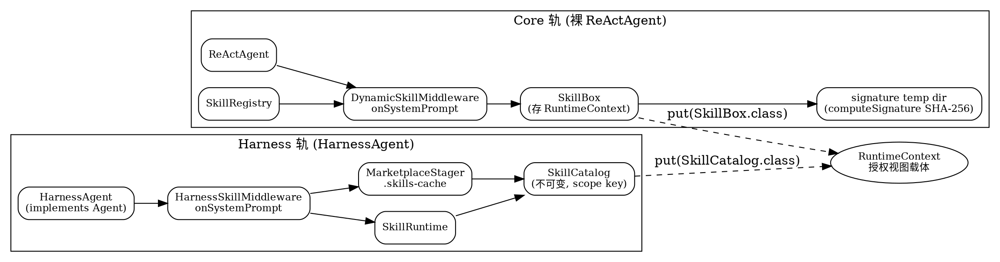
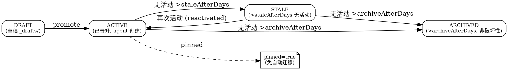

## Introduction

Skill 是 AgentScope Java 对「可复用能力包」的抽象：一个目录里放一份 `SKILL.md`（说明用途、给 agent 看的指令），可以再带参考文档、脚本。写好后丢给 agent，它会在合适的时候自己用。

与直接把工具堆给模型不同，Skill 解决的是**上下文预算**问题——`<available_skills>` 块每次 call 只列 name + description，只有 agent 判断相关才 `load_skill_through_path` 拉详情，避免几十个技能的正文把上下文撑爆。

本分册同时覆盖**子 Agent（SubAgent）**——技能是「能力包」，子 Agent 是「能力的执行体」，两者共用工作区声明与沙箱投影机制，合册阅读最能看清「委派」这条链路。事实来自本地 `v2.0.4` 源码树（`agentscope-harness/.../skill/`、`.../subagent/`、`.../middleware/`）与官方文档站 v2 技能 / 子 Agent 页。

## Skill Directory And Loading

```text
code-reviewer/
├── SKILL.md           # 必需，YAML frontmatter（name + description）+ 给 agent 看的指令
├── references/        # 可选，长篇参考资料，agent 按需读取
│   └── style-guide.md
└── scripts/           # 可选，agent 可以通过 shell 调用的脚本
    └── run-checks.sh
```

`SKILL.md` 用 UTF-8 编码，支持开头 `---` 前带 BOM：

```markdown
---
name: code-reviewer
description: 当用户需要代码评审、风格反馈或 PR 审核时使用。
---

# Code Reviewer

步骤：
1. 读 `references/style-guide.md` 获取项目规范
2. 跑 `scripts/run-checks.sh <目标路径>`，把结果汇总给用户
```

### Four-Layer Composition

四个来源同时生效，优先级从低到高：

| 优先级 | 来源 | 怎么配 |
| :--- | :--- | :--- |
| 1（最低） | 项目全局目录 | `projectGlobalSkillsDir(Path)`，如 `~/.agentscope/skills/`；目录不存在则跳过 |
| 2 | 市场 | `skillRepository(...)`，可重复调用，**后注册的覆盖先注册的** |
| 3 | 工作区共用 | `workspace/skills/`，放好目录即生效，无需注册 |
| 4（最高） | 用户隔离 | `<userId>/skills/`，只对该 userId 生效 |

**下层独有的 skill 仍然保留，只在重名时被上层覆盖。** 举例：团队 Git 上有通用 `code-reviewer`，项目 `workspace/skills/code-reviewer/` 写了项目专属版，那 agent 看到的就是项目版；Alice 在自己目录又覆盖了一份，那 Alice 调用时拿到她自己的版本，其他用户还是项目版。

子 agent 自动继承父的市场列表和项目全局目录，不用重复配。`disableDynamicSkills()` 把「每次 call 前重新合并」改成 build 时合并一次——适合单次任务跑完就退出、或市场后端慢的场景。

### How The Agent Reads Skills

每次 call，harness 在 system prompt 里构建一个 `<available_skills>` 块。**这个块每次 call 只构建一次（PreCall 阶段，随 system message 一起 seed），随后在该 call 的每一轮推理里都原样可见——不是每轮重新构建**：

```xml
<available_skills>
<skill>
  <name>code-reviewer</name>
  <description>当用户需要代码评审、风格反馈或 PR 审核时使用。</description>
  <skill-id>code-reviewer_workspace-namespaced</skill-id>
  <files-root>/workspace/skills/code-reviewer</files-root>
</skill>
...
</available_skills>
```

每个条目只携带最少的元数据。加载详情用内置工具 `load_skill_through_path`：

- `load_skill_through_path(skillId, path="SKILL.md")` 返回 markdown 正文；
- `load_skill_through_path(skillId, path="references/style-guide.md")` 返回该 skill 目录下的任意文件。

**按来源的路径解析方式不同，但 agent 感知不到差异**：

| Skill 来源 | path 解析方式 |
| :--- | :--- |
| 项目全局目录（Layer 1） | 注册时预载到内存 |
| 市场（Git / MySQL / Nacos / classpath，Layer 2） | 由后端预载到内存 |
| `workspace/skills/` 共用（Layer 3） | 注册时预载到内存 |
| `<userId>/skills/` 用户隔离（Layer 4） | `SKILL.md` 预载；其它文件按需通过 `AbstractFilesystem` 读取（自动遵循 per-user namespace + sandbox 路由） |

底层查找顺序是「**内存命中 → 文件系统读取 → 找不到时返回所有真正可用的路径列表**」——传错 path 也只会拿到清单而不是死路。

## Market Backends

`skillRepository(...)` 是统一入口：

| 后端 | 构件 | 要点 |
| :--- | :--- | :--- |
| Git | `agentscope-extensions-skill-git-repository` | `new GitSkillRepository(url)`；默认每次读取做轻量化远端检查，HEAD 变了才 pull；仓库根下有 `skills/` 子目录优先读它，否则读根目录；想自己控制同步节奏用 `new GitSkillRepository(url, false)` 再手动 `repo.sync()` |
| Nacos | `agentscope-extensions-nacos-skill` | `new NacosSkillRepository(aiService, "namespace")`；适合在线下发、变更订阅；`market` 是 `AutoCloseable`，应用退出时关掉释放订阅 |
| MySQL | `agentscope-extensions-mysql-skill` | `MysqlSkillRepository.builder(dataSource).databaseName("agentscope").skillsTableName("skills").createIfNotExist(true).writeable(true).build()`；平台侧统一管理常用，`writeable(true)` 后才能从 agent 侧写回，只读分发传 false |
| Classpath | （core） | `src/main/resources/skills/<name>/SKILL.md` + `new ClasspathSkillRepository("skills")`；兼容标准 JAR 与 Spring Boot Fat JAR |

多个市场可重复注册，后注册优先级更高；也可以用 `skillRepositories(list)` 一次性替换所有市场。

## MarketplaceStager And files-root

市场 skill 的资源最初只在内存里，shell 没法直接执行。每次 call 前（PreCall 阶段，与 `<available_skills>` 同一次 `onSystemPrompt`），`MarketplaceStager` 把它们物化到 `<wsRoot>/.skills-cache/<source>/<name>/`：

- **文件级 SHA-256 去重**——只重写变化过的文件，没变的跳过；
- **孤儿清理**——已下架的 skill、或从 builder 里移除的整个仓库，留下的目录在同一次物化里顺手删掉；
- **恢复执行位**——资源入库时被转成字符串，POSIX 权限丢了，所以 stager 用启发式补回 `+x`：文件开头是 shebang（`#!`），或后缀是已知脚本类型（`.sh` / `.bash` / `.py` / `.rb` / `.pl` / `.js` / `.mjs`）；纯静态资产（`.json` / `.md` / `.txt`）保持 644；
- **重名 source 加后缀**——两个仓库返回相同 `getSource()` 时第二个自动变 `<source>_2`、`<source>_3`… 并打 warning log，路径和 skill-id 不会撞。

工作区 skill（Layer 3 / 4）**跳过**这一步——它们本来就在工作区目录里。

`<files-root>` 是 agent 通过 `execute` 调脚本用的绝对路径，按文件系统模式渲染：

| 文件系统模式 | 工作区 skill | 市场 skill |
| :--- | :--- | :--- |
| Sandbox | `/workspace/skills/<name>` | `/workspace/.skills-cache/<source>/<name>` |
| Local-with-shell | `<wsRoot>/skills/<name>` | `<wsRoot>/.skills-cache/<source>/<name>` |
| Local 不带 shell / Composite | 不渲染（没注册 shell 工具） | 不渲染 |

于是 agent 发出来的 shell 命令永远是 `execute("python3 <files-root>/scripts/foo.py")`——不用猜路径。若沙箱后端把工作区挂在非默认位置（AgentRun 是 `/home/agentscope/workspace`），`<files-root>` 前缀会跟着换。

⚠️ **读 SKILL.md 不需要沙箱**：读 skill（`load_skill_through_path` 取 SKILL.md / references/）走的是内存或宿主文件系统，跟沙箱无关；只有用 shell 跑脚本才需要文件真的进到容器里。所以即便关了投影、或某个 skill 根本没带脚本，agent 依然能正常读它的说明和参考资料。

沙箱模式下三步走：**物化到宿主 → 投影进沙箱 → 容器内执行**。投影默认根 `AGENTS.md skills/ subagents/ knowledge/ .skills-cache/`，按内容 SHA-256 整体比对，没变就跳过 hydrate。跨调用保留脚本副作用（npm install、pip install、编译输出）需要配 `snapshotSpec(...)`——快照保存整个 `/workspace`，下次同一 scope key 的调用先恢复快照、再叠加投影。

## Skill Loading And Usage (Source Pipeline)

上一节「[如何被读取](#how-the-agent-reads-skills)」讲的是概念，这一节把链路落到源码类与调用关系上。核心结论：**技能不是一次性塞进 system prompt，而是「多仓库合并 → 过滤 → 物化 → 装进 `RuntimeContext` → 按需加载」的分阶段管线，且隔离边界建在 `RuntimeContext` 上**——这正是 `SkillRuntime` javadoc 点明的「catalog 存 context 不存共享 runtime，是 `SkillLoadTool` 的授权边界」。

### Model And Parsing

`AgentSkill`（`core/.../skill/AgentSkill.java:68`）是技能的内存模型，五个字段：`metadata`（必含 `name` + `description`）、`skillContent`（指令正文）、`resources`（`Map<path,content>` 附属文件）、`source`（来源标识）、`originDir`（可选磁盘源目录，用于 `<files-root>` 与磁盘回退）。`getSkillId()` 返回 `name + "_" + source`（如 `code-reviewer_workspace-namespaced`，正是 `load_skill_through_path` 与 `<skill-id>` 使用的 id）。

`SKILL.md` 由 `MarkdownSkillParser`（`core/.../skill/util/MarkdownSkillParser.java:68`）解析：正则抽 `---` frontmatter，YAML 用 SnakeYAML `SafeConstructor`（带 `FRONTMATTER_CODE_POINT_LIMIT = 16_384` 上限 + 嵌套深度上限）解析，解析失败回退到逐行简单 `key: value` 提取（只取标量，跳过列表 / 块标量）；`normalizeMetadataValue` 把容器规整成稳定的 `Map<String,Object>` / `List<Object>` 树，便于后续 XML 渲染。`generate(metadata, content)` 则把模型**还原成完整 `SKILL.md`（frontmatter + 正文）**——`SkillLoadTool` 加载 `SKILL.md` 时调它，保证 LLM 读到的字节与 `skill_manage(action=patch)` 改的是同一份（旧版只回 body，导致 patch 在 frontmatter 边界附近 `old_string` 匹配失败）。

### Loading: Repository → Registry → Catalog

加载落点是 `SkillRegistry`（`core/.../skill/SkillRegistry.java:32`）——一个 `Map<String, AgentSkill>`，6 个方法（register / get / getSkillIds / exists / remove）。它不关心来源：`ClasspathSkillRepository` / `FileSystemSkillRepository` / `RuntimeContextSkillRepository`（core），`GitSkillRepository` / `Mysql` / `Postgres` / `Nacos`（extensions）都实现 `AgentSkillRepository` 接口（`getAllSkills` / `getSkill` / `save` / `delete` / `skillExists` / `getRepositoryInfo` / `getSource` + `isWriteable`），构成「多后端可插拔」的加载来源。

合并发生在 `HarnessSkillMiddleware`（`harness/.../middleware/HarnessSkillMiddleware.java:72`）的 `onSystemPrompt` 内 `mergeRepositories`（:349）：按 `repositories` 注册顺序遍历，同名 skill **后者赢**（与「四层组合」概念一致），并记住每个 winning skill 的来源 repo（`RepoBound`），供后续 lazy 资源与物化使用。`frozenSkills` 非空时直接用冻结快照、跳过实时合并（这正是 `disableDynamicSkills()` 的落点）。

### Rendering: Catalog → `<available_skills>`

渲染链（`onSystemPrompt`，:262-315）一次完成：

1. `skillsForCall(ctx)` → `mergeRepositories` 合并；
2. `applyVisibility`（agent-created skill 的可见性过滤）+ `applySkillFilter`（builderFilter overlay 到 RuntimeContext 的 `SkillFilter`）；
3. `stager.stage(enabled, sourceNamespaces, scopeKeyFor(ctx))` —— 即 [MarketplaceStager 物化](#marketplacestager-and-files-root)（`<files-root>` 那一步）；
4. 每个 skill 包成 `HarnessSkillEntry`（skill + `lazyResources` + `filesRoot`），`SkillCatalog.of(entries)` 成**不可变**目录；
5. `runtime.install(catalog, ctx, toolkit)` —— **把 catalog 存进 `RuntimeContext`**（不是共享 runtime），并幂等注册 `load_skill_through_path` 工具为 **ungrouped**（不受 active-group 列表影响，老 session 也能用）；
6. `runtime.renderPrompt(...)` → `SkillPromptBuilder.render`（`SkillPromptBuilder.java:120`）拼 `<available_skills>` 块，且**仅当至少一个 visible skill 有 `filesRoot` 时才追加 code-execution 指令**（否则会误导 LLM 以为有 shell 可用）。

`SkillCatalog`（`harness/.../runtime/SkillCatalog.java:30`）就是 `Map<String, HarnessSkillEntry>` 的不可变包装——**每次 call 一个快照**。

### Usage: Runtime Load (`load_skill_through_path`)

agent 决定用某 skill 后调内置工具 `load_skill_through_path(skillId, path)`，真实实现是 `SkillLoadTool`（`harness/.../runtime/SkillLoadTool.java:54`）的 `callAsync`（:156）：

- 从 `param.getRuntimeContext()` 取 catalog（`catalogFor`，:187）——**授权边界**：只能加载本 call 可见的 skill，被过滤掉的即便别的 session 暴露也加载不到，并发 session 互不污染；
- `catalog.get(skillId)` 找 entry；
- `loadOne`（:195）四级查找，越靠后越「重」：
  1. `path == "SKILL.md"` → 返回完整 markdown（用 `MarkdownSkillParser.generate` 重建，含 frontmatter）；
  2. 内存 `resources` 命中 → 直接返回；
  3. `lazyResources.read(path)` 回退磁盘（`WorkspaceSkillRepository` 等 `LazyResourceCapable` 源，按 per-user namespace + 沙箱路由）；
  4. 都没 → 报错并**枚举真实可用路径**，不是死路。

⚠️ 读 `SKILL.md` / `references/` 走内存或宿主文件系统，**与沙箱无关**；只有 shell 跑脚本才需要文件真进容器（见 [MarketplaceStager 节](#marketplacestager-and-files-root)）。



## Two Loading Tracks: SkillBox (Core) vs SkillRuntime (Harness)

AgentScope-Java 的 skill 加载**不是单一实现**，而是**按「是否使用 harness 层」分层并存的两套机制**——这点最容易被误读成「框架有两套互相打架的加载器」。事实是它们服务不同场景，互不竞争：

- **Harness 轨**（上一节 `Skill Loading And Usage` 描述的）：`HarnessAgent`（`implements Agent`，**不继承** `ReActAgent`）在 build（`HarnessAgent.java:2900`）装配 `HarnessSkillMiddleware`，走 `SkillRuntime` + 不可变 `SkillCatalog` + scope-key 隔离 + 物化 + 沙箱投影，加载工具是 `SkillLoadTool`（`load_skill_through_path`）。
- **Core 轨**：裸 `ReActAgent`（core 层，不依赖 harness）走 `DynamicSkillMiddleware`（`ReActAgent.build():5585` 引用）+ `SkillBox`，把 `SkillBox` 直接存进 `RuntimeContext`，加载工具是 `SkillBox.registerSkillLoadTool` 形态。

两套**都把「per-call 授权视图」存进 `RuntimeContext`**，且都用**内容寻址**（signature / scope key）做隔离与去重；`disableDynamicSkills()` 是跨两轨通用的「build 时合并一次」开关（harness → frozen middleware；core → 跳过每 call 重合并）。

| 维度 | Core 轨（`SkillBox` / `DynamicSkillMiddleware`） | Harness 轨（`SkillRuntime` / `HarnessSkillMiddleware`） |
| :--- | :--- | :--- |
| 适用 | 裸 `ReActAgent`、不依赖 harness 的场景 | `HarnessAgent`（生产 harness，带沙箱 / 多租户） |
| 视图载体 | `SkillBox` → `RuntimeContext.put(SkillBox.class)` | `SkillCatalog`（不可变快照）→ `RuntimeContext`，按 `scopeKeyFor(ctx)` 隔离 |
| 隔离粒度 | `computeSignature`（SHA-256 内容寻址：name+source+metadata+content+资源键+originDir）→ 每个 signature 一个独立 temp 目录 | `scope key`（PER_USER / PER_SESSION / PER_AGENT）→ catalog 是 `SkillLoadTool` 的授权边界 |
| 缓存 | `boxCache`（`MAX_CACHED_BOXES`，满了 `clear()`；**evict 只清引用不删资源目录**，active 请求仍可读） | catalog 每次 call 一个快照，无长生命周期缓存 |
| 物化 | `autoUploadSkill=true` 时 `uploadSkillFiles()` 到 `uploadDir` | `MarketplaceStager` 物化到 `.skills-cache`（文件级 SHA-256 去重） |
| 沙箱投影 | 无（core 不认知沙箱） | 有（`SandboxLifecycleMiddleware` 投影 + snapshotSpec） |
| 加载工具 | `SkillBox.registerSkillLoadTool`（老的 `load_skill` 形态） | `SkillLoadTool`（`load_skill_through_path`，四级查找） |

### `SkillRegistration`: The Programmatic Four-Layer Composition

概念层的「四层组合（skills / tools / agents / teams）」在**编程式注册**上的真身，是 `SkillBox.SkillRegistration`（`SkillBox.java:286`）——一个 skill 不只是 `SKILL.md` 指令，还能把整包能力注册进 toolkit：

| 注册项 | 方法 | 含义 |
| :--- | :--- | :--- |
| Java 工具对象 | `.tool(Object)` | 扫描对象上的 `@Tool` 方法，注册为工具 |
| 原生工具 | `.agentTool(AgentTool)` | 直接注册一个 `AgentTool` 实例 |
| MCP 连接 | `.mcpClient(McpClientWrapper)` | 把 MCP server 的工具暴露给该 skill |
| 子 Agent | `.subAgent(SubAgentProvider)` | 把一个子 Agent 注册成工具（默认 `message` + 可选 `session_id`，支持持久会话） |
| 预设参数 | `.presetParameters(...)` | 调用该 skill 工具时自动注入的参数 |
| 模型覆盖 | `.extendedModel(...)` | 该 skill 工具使用的模型 |
| 工具白/黑名单 | `.enableTools(...)` / `.disableTools(...)` | 限定子 Agent / 工具可见的工具集 |

这正是「skill = 能力包」的落地：skill 可以携带工具、子 agent、MCP 连接，而不只是文本指令。`apply()` 后这些能力随 skill 一起进入 per-call 视图。



## Self-Learning Loop

Harness 拼了一套「让 agent 自己起草 / 沉淀 / 整理 skill」的闭环，各阶段独立可开：

**第一步：让 agent 能自己写 skill**

```java
.enableSkillManageTool(SkillManageConfig.defaults())
```

启用后 agent 获得两个工具：`propose_skill`（把新 skill 写成草稿到 `skills/_drafts/<name>/`，等审核）与 `skill_manage`（编辑已有 skill：创建 / 修改 / 添加附属文件 / 删除）。不想要「草稿 → 审核」两步流程可用 `.enableSkillManageTool(true)`（`autoPromote=true`）让 agent 写完直接生效——**生产场景不建议**。

同时 agent 每次调 `load_skill_through_path` / `read_skill` 时，框架自动记一笔使用计数存到 `skills/.usage.json`，为清理、灰度发布提供数据。

**第二步：加审核闸门 + 可见性过滤**

```java
.enableSkillPromotionGate(
    new LocalApprovalGate(LocalApprovalGate.defaultPrompter()),    // 谁来批
    new CompositeFilter(List.of(
        new EnvironmentFilter("prod", skillUsageStore),
        new CanaryFilter(0.10, skillUsageStore)
    )))
.environment("prod")
```

- **闸门**——草稿要变正式 skill 必须经过它。内置三种：直接拒绝（默认）、本地人工确认（stdin 等）、推消息后等。
- **可见性过滤**——决定 agent 在推理时能看到哪些「agent 自己创建」的 skill，可按部署环境、灰度比例、白名单组合。

**第三步：后台周期性整理**

```java
.enableSkillCurator(SkillCuratorConfig.builder()
    .intervalHours(7 * 24)        // 一周跑一次
    .staleAfterDays(30)
    .archiveAfterDays(90)
    .build())
```

后台按节流闸门跑：超过 30 天没用的 skill 标为 stale，超过 90 天直接归档到 `skills/.archive/`。可选叠加一个 LLM「伞合并」扫描（默认只 dry-run，输出报告，不实际改）。

**程序化触发**：

```java
List<SkillAuditLog.Entry> entries = agent.queryAudit(LocalDate.now(), e -> true);
agent.runCuratorOnce()                                       // 立刻跑一次整理（绕过节流）
     .subscribe(report -> System.out.println(report));
agent.promoteSkill("notes-taker", "alice")                   // 手动晋升一份草稿
     .subscribe(result -> System.out.println(result));
```

源码侧的对应物：`SkillCurator`（整理主逻辑）、`SkillPromoter` / `SkillPromotionGate` / `LocalApprovalGate` / `NotifyAndWaitGate` / `RejectAllGate`（闸门族）、`SkillVisibilityFilter` / `CompositeFilter` / `EnvironmentFilter` / `CanaryFilter` / `AllowListFilter` / `AbstractAgentCreatedFilter`（过滤族）、`SkillUsageStore` / `SkillUsageBackend` / `FilesystemSkillUsageBackend` / `BaseStoreSkillUsageBackend` / `SkillUsageRecord`（计数族）、`SkillSecurityScanner`、`SkillAuditLog`、`SkillCandidate`、`NotificationSink`。

`SkillUsageMiddleware` 的计数语义值得注意（javadoc）：「the model decided to invoke this skill on this turn」——**不是**「the call succeeded」；provenance 门控在 store 内部，只记 `created_by="agent"` 或 `"agent-draft"` 的技能。

## Skill Self-Management: Source Mechanisms

本节是上一节「Self-Learning Loop」概念层的**源码落地**——agent 怎么写 skill、草稿怎么晋升、不用了怎么归档、安全怎么兜底。核心是 `SkillManageTool`（写）+ `SkillPromoter`（晋升）+ `SkillCurator`（整理）+ `SkillSecurityScanner`（扫描）+ `SkillAuditLog`（审计）五个协作类。

### Authoring: `SkillManageTool` & `ProposeSkillTool`

`SkillManageTool`（`skill_manage`，`AgentTool`）把六类操作 dispatch 到 `dispatchSync`（`SkillManageTool.java:240`）：

| action | 语义 |
| :--- | :--- |
| `create` | 写全新 `SKILL.md`（frontmatter 必需） |
| `edit` | 全量重写已有 `SKILL.md` |
| `patch` | **精确字符串替换**：`old_string` / `new_string`；`all=false` 时要求唯一匹配，空 `new_string` 即删除 |
| `write_file` | 新增/覆盖 `references/` / `templates/` / `scripts/` / `assets/` 下的单文件 |
| `remove_file` | 删附属文件 |
| `archive` | 归档 |

**写入落点**：默认写到 `skills/_drafts/<name>/`；`autoPromote=true` 直写 `skills/`；**drafts win on collision**（草稿覆盖同名正式）。

**写后静态安全扫描**（:341 / :422）：每次落盘后跑 `SkillSecurityScanner.scan` → `shouldAllow(TrustLevel.AGENT_CREATED, scan.verdict())`，`DANGEROUS` 时**回滚**到写前内容（`target.writeSkillFile(name, "SKILL.md", previous, ctx)`）——agent 可改后重试，而非被静默吞掉。

`ProposeSkillTool`（`propose_skill`）是 `SkillManageTool` 的**委托包装**（:48）：接受 `body`（**无 frontmatter，框架自动补**）+ 脚本列表，转成 `create` + `write_file`，免 agent 手撸 YAML frontmatter。

### Promotion: `SkillPromoter` Five Steps

`SkillPromoter.promote(name, reviewerId, ctx)`（:87）把草稿推成正式 skill，依次五步：

1. `SkillSecurityScanner.scan` 安全扫描（:106）；
2. `buildCandidate(draft, scan)`（:116）—— 含 `buildScriptPreview` 给 reviewer 看脚本预览；
3. 过 `SkillPromotionGate.review(candidate, ctx)`（:124）→ sealed `PromotionDecision` 三态；
4. `workspaceManager.moveSkill(ctx, src, dst)`（:145）移出草稿目录到正式；
5. sidecar 盖 `promoted_by` + 目标环境（:150），`SkillAuditLog.promoteEntry`（:172）写审计。

`SkillPromotionGate`（sealed interface，`review` 返回 `PromotionDecision` permits `Approve` / `Reject` / `Defer`，:49）：

| 决策 | 字段 | 用途 |
| :--- | :--- | :--- |
| `Approve` | `reviewerId, targetEnvironments, decidedAt` | 放行并标记目标环境 |
| `Reject` | `reason, reviewerId` | 拒绝（附原因） |
| `Defer` | `retryAfter, reason` | 暂缓（如等人工，可重试） |

内置三闸门：`RejectAllGate`（全拒，仅程序化 promote）、`LocalApprovalGate`（本地人工，stdin 等）、`NotifyAndWaitGate`（多副本，写 `.review_request.json` 等）。

### Lifecycle State Machine

`SkillUsageRecord.State` 枚举（:60）：`DRAFT` → `ACTIVE` → `STALE` → `ARCHIVED`，外加 `pinned=true` 钉住免自动迁移。

`SkillCurator.applyAutomaticTransitions`（:193）**只对 `createdBy=="agent"` 且未 `pinned` 的已晋升 skill** 做自动迁移（草稿归 promotion gate 管）：

- `anchor`（latestActivityAt，无则 createdAt）早于 `archiveCutoff`（> `archiveAfterDays`）→ **ARCHIVED**（由 `mainRepo.delete` 非破坏性归档到 `.archive/`，不是真删）；
- 早于 `staleCutoff`（> `staleAfterDays`）且当前 ACTIVE → **STALE**；
- 晚于 staleCutoff 且当前 STALE → 回 **ACTIVE**（reactivated，双向）。



### Audit & Security Scanning

`SkillAuditLog`（`AUDIT_DIR = "skills/.audit"`，:52）：按**天**分文件，经 `WorkspaceManager.appendUtf8WorkspaceRelative`（标准写路径）追加；两类条目 `manageEntry`（管理操作）/ `promoteEntry`（晋升操作）；`query(dayUtc, filter)` 可按谓词检索——收集器故障时也能给运维一份可查记录。

`SkillSecurityScanner`（最终工具类）：枚举 `Severity` / `Category` / `Verdict`（SAFE / CAUTION / DANGEROUS）/ `TrustLevel` / `Finding` / `ScanResult`；`shouldAllow(TrustLevel, Verdict)`——SAFE/CAUTION 放行，DANGEROUS 阻断（注释提到 Hermes 的「ASK」模式在此折叠）。正则库覆盖五大类危险模式：

| 类别 | 代表检测（正则意图） |
| :--- | :--- |
| 数据外泄 | `curl -d/--data/--data-binary`、`wget --post-data`、`cat\|tar\|gzip … \| nc` |
| 提示注入 / 越权 | `<system>` / `<admin>` 注入、`DAN` / `jailbreak` / `developer mode` |
| 破坏性 | `rm -rf /`、`mkfs.<fs> /dev/`、`dd of=/dev/(sd|nvme|hd|xvd|disk)`、`> /dev/...` |
| 持久化 | `crontab -`、写 `~/.bashrc` / `~/.zshrc` / `~/.profile` |
| 反向 shell | `bash -i >& /dev/tcp/`、`nc -e` / `nc -l/-lvp`、`base64 -d \| bash`、`eval $(curl)`、`curl\|bash` |

### Curator State & Umbrella (Dry-Run)

`SkillCuratorState`（`skills/.curator_state.json`，Jackson 注解，:28）：`lastRunAt` / `runCount` / `paused` / `lastRunSummary` / `lastRunDurationSeconds` / `lastReportPath`；`isPaused()` / `setPaused()` 支持**运行时暂停**（程序化 `runCuratorOnce` 绕过 `PeriodicGate` 节流）。

**伞合并（umbrella consolidation）** `runUmbrellaDryRunReport`（:258）：按名字第一段（dash / underscore / dot 分隔）聚类成 *PREFIX CLUSTERS*，生成 Markdown 报告写到 `skills/.curator_reports/<ts>/REPORT.md`，含结构化 YAML（`consolidations: []` / `prunings: []`）。**注意：真正的 LLM 合并尚未实现——当前只是 dry-run 出报告，不实际改技能**（源码注释明确标注为 stub，默认 `DRY_RUN_ONLY`）。

## SubAgent

让主 agent 把「可独立处理、上下文重、可并行」的任务委派出去，避免主线程膨胀。每个子 agent 都是临时实例（本地 `HarnessAgent` 或远程 stub），跑自己的会话，结果通过工具返回给父 agent。

### Declaration Sources

三类来源构建时合并：

| 方式 | 适用 | 怎么配 |
| :--- | :--- | :--- |
| 内置 `general-purpose` | 通用兜底（镜像主 agent 能力） | **总是有，不需要配**；同样的模型、工具、技能，共享主工作区 |
| 工作区 spec 文件 | 项目特有的、能版本控制的 | `workspace/subagents/<id>.md` |
| 编程式声明 | 跑时才能确定（远程、动态参数） | `builder.subagent(SubagentDeclaration.builder()...)` |

工作区 spec **非递归扫** `workspace/subagents/*.md`，**文件名（去掉 `.md`）就是 `agent_id`**，不要在 front matter 里再写 name：

```markdown
---
description: 代码审查专家。当用户需要 review PR、找代码风格问题时使用。   # 必填
workspace:
  mode: isolated              # 默认 isolated；shared 表示和父共享工作区
  path: ./defs/reviewer       # 可选；不写就用默认子目录
model: openai:gpt-4o-mini     # 可选；不写就继承父 agent
steps: 8                      # 可选；这个子 agent 单次最多迭代次数
temperature: 0.2              # 可选；覆盖父的 GenerateOptions
top_p: 0.95                   # 可选
hidden: false                 # true 时不出现在 agent 可见列表（仍可程序化 spawn）
mode: subagent                # primary / subagent / all，默认 all；primary 不允许被 spawn
expose_to_user: true          # 可选三态；强制/禁止向用户暴露（不写表示不表态）
enable_pending_tool_recovery: true   # 可选；不写则继承父 agent 的恢复配置
tools: [read_file, grep_files]       # 可选；继承工具的白名单
---

你是一个专注代码评审的子 agent。
```

三种来源互斥：`workspace(...)`、`inlineAgentsBody(...)`、`url(...)` 三选一。框架自动构建的本地子 agent（含 general-purpose）会继承父级 `enablePendingToolRecovery(...)` 配置，默认关闭；声明里可显式覆盖，`null` 表示继承。

### Workspace Mode

- **ISOLATED（默认）**：子 agent 有自己独立的工作区（`workspace.path` 没写就自动开一个子目录）。**运行时状态按「父 sessionId × 用户」分桶**——同一用户在不同对话里 spawn 同名子 agent 也互不污染。
- **SHARED**：子 agent 直接用主工作区。适合子 agent 的输出会被父立即读到的情况（例如 general-purpose）。

### Sync vs Background

主 agent 通过 `agent_spawn` 创建子 agent，关键是 `timeout_seconds`：

- `timeout_seconds > 0`（**默认 30，最大 600**）——同步调用，主 agent 在这一步 block 等待结果，结果作为工具结果返回。默认超时后会 **promote 成后台任务**（`status: timeout_promoted` + `task_id`），子 agent 继续跑。
- `timeout_seconds = 0` —— 后台调用，立即返回一个 `task_id`，子 agent 在后台跑。

通过 RuntimeContext 强制同步：`AgentSpawnTool.CTX_FORCE_SYNC = true`，可选再放 `CTX_FORCE_SYNC_TIMEOUT_SECONDS` 指定硬超时。

- 设置了硬超时则**完全覆盖** LLM 的 `timeout_seconds`（`<=0` 回退到 30s，上限 600s）；
- 未设置时，LLM 传的 `timeout_seconds=0` 会被改写成默认同步超时（30s），**不会**提交后台任务；LLM 传的正数超时仍生效；
- 同步等待超时后返回 `status: timeout` 并**中断子 agent**，不会 promote 成后台 `task_id`。

**并行**：`ToolkitConfig.parallel` 默认 **true**，同一轮 reasoning 里多个同步子 agent 调用并行推进，主 agent 等这一批工具结果都返回后再进入下一轮——相当于一次同步 fan-out / fan-in。要串行就传 `ToolkitConfig.builder().parallel(false).build()` 构建的自定义 Toolkit。

**后台任务自动反向通知**：后台任务跑完了主 agent 不需要轮询——下一次推理开始前，框架把已完成的任务结果作为系统提醒注入对话末尾：

```xml
<system-reminder>
后台任务已交付：
- task_id=xxx，agent=research-analyst，status=COMPLETED
  结果摘要：...
</system-reminder>
```

主 agent 看到这条 reminder 自然地回应或继续行动。不需要在 prompt 里写「记得调 `task_output` 轮询」——那是旧版本的做法。

**后台任务工具**两组，桥梁是 `task_id`：

| 工具 | 职责 |
| :--- | :--- |
| `agent_spawn` | 创建子 agent，可选地执行任务（同步或后台） |
| `agent_send` | 向已存在的子 agent 追加消息 |
| `agent_list` | 列出当前活跃的子 agent 实例 |
| `task_output` | 通过 `task_id` 获取后台任务结果（阻塞或非阻塞） |
| `wait_async_results` | 等待后台结果到达；可按 `task_ids` 等指定任务全部完成，或 `wait_all=true` |
| `task_cancel` | 取消正在运行的后台任务 |
| `task_list` | 列出所有后台任务及其当前状态 |

三种异步结果收集方式：**主动通知**（不阻塞等待时的默认路径）、**指定任务检查**（`task_output(task_id, block=false)`）、**等待 barrier**（`wait_async_results(task_ids="id1,id2")` 或 `wait_all=true`）。barrier 会等到集合终态并把各任务结果直接写进本次工具返回；`wait_all=true` 以**调用开始时的未完成任务快照**为准，等待期间新创建的任务不会加入 wait set。⚠️ 遗留的 inbox-any 语义：不传 `task_ids` 也不传 `wait_all` 时只等到 inbox 中任意一条消息到达，**不是 wait-all**。

**追加消息**用 `agent_spawn` 返回值里的 `agent_key`（运行时实例句柄，如 `agent:reviewer:abc-123`）或 `label` 寻址：

```java
agent_spawn agent_id="reviewer" task="review 这次 PR" label="pr-reviewer"
agent_send label="pr-reviewer" message="顺便也看下 schema 变更"
```

**持久会话**：默认每次 `agent_spawn` 都创建新实例和新会话——不保留之前调用的上下文。`persistSession(true)` 让框架根据 `(parentSessionId, agentId, label)` 生成确定性 key，再次 spawn 同样组合就复用已有实例，对话历史和状态都保留。

### Exposing SubAgents To Users

通常子 agent 对用户不可见——它们在幕后作为父 agent 的内部工具运行。`expose_to_user=true` 做两件事：在 Gateway 里注册子 agent 使其成为用户可寻址的入口；发出一个 `SubagentExposedEvent` 到流式事件流中（携带 `subagentId` / `agentId` / `label`）。用户客户端收到后可以直接向子 agent 发消息，**完全绕过父 agent**：

```java
ChatUiChannel chat = agent.channel(ChatUiChannel.create());   // bridge 自动接好，零配置
chat.sendStream(SendOptions.userId("user-1"), "派一个研究员调查 AI 趋势")
    .doOnNext(event -> {
        if (event instanceof SubagentExposedEvent se) { /* se.getSubagentId() ... */ }
    })
    .blockLast();
chat.sendToSubagent(subagentId, "重点关注 LLM agent").block();
```

**没有绑定 Channel 时，`expose_to_user=true` 会被静默忽略**——子 agent 照常工作，只是不暴露给用户。

覆盖优先级（从高到低）：RuntimeContext 按调用覆盖（`AgentSpawnTool.CTX_EXPOSE_TO_USER` 放 Boolean 或其字符串形式）> `SubagentDeclaration` 按类型策略（三态 `exposeToUser`：TRUE 总是暴露、FALSE 永不暴露、null 不表态）> LLM 传入的 `expose_to_user` 工具参数 > 都没有表态时默认 false。

**跨重启与多副本**：默认暴露只存在于创建它的进程里，`subagentId` 只在那个节点有效，重启即失效。配 `distributedStore(...)` 后 `subagentId` 持久化到后端，子 agent 自己的对话按 session 从分布式 `AgentStateStore` 重新加载——即使后续消息落到不同节点，用户面对的仍是同一个子 agent。部署上建议把某个 `subagentId` 路由回它的活实例所在节点（粘性路由）。

### agent_generate

`agent_generate` 工具（**默认关闭**）可以让 LLM 起草一份新的子 agent spec 并直接写到 `workspace/subagents/<name>.md`。开启方式：拿到 builder 内部的 `SubagentsMiddleware` 引用调 `enableAgentGenerateTool`。适合「agent 跑到一半发现自己需要一类新的助手」——**生产环境慎用**，通常先让 agent 把方案写出来人工 review 再写文件。

### Behavior Boundaries

- **description 要写好**：这是模型决定要不要委派的关键依据。「代码评审」远不如「当用户要 review PR、找代码风格问题时使用」有效。
- **递归保护**：子 agent 不能再 spawn 子 agent（被强制标为「叶子」）；同时有一个硬上限 **3 层**。
- **userId 透传**：父的 `RuntimeContext.userId` 会自动透到子，多租户隔离链不会断。
- **权限继承**：父的所有 **DENY** 权限规则会自动传给子——父被禁用某个工具，子也一样被禁，安全边界不因委派而被绕过。`inheritParentPermissions(false)` 可关闭。
- **Plan Mode 继承**：父 agent 在 Plan Mode 时 spawn 的子 agent 自动继承只读限制，在 spawn 时就被置入 Plan Mode。

### Remote SubAgents

声明里只填 `url` + 可选 `headers`，子 agent 就走远程 HTTP 服务（Agent Protocol）执行：

```java
.subagent(SubagentDeclaration.builder()
    .name("remote-researcher")
    .description("远端调研子 agent")
    .url("http://agent-task-server:8080")
    .headers(Map.of("Authorization", "Bearer xxx"))
    .remoteStreaming(true)                          // 未设置时默认 true
    .remoteStreamDetail(RemoteStreamDetail.VERBOSE) // 未设置时为 FULL
    .remoteAskPolicy(RemoteAskPolicy.DENY)          // 默认
    .remoteContextAttributes(Map.of("region", "cn"))
    .build())
```

**远程流式详细度**（`remoteStreamDetail`，以 `context.detail` 发送）：

| 档位 | 回传内容 |
| :--- | :--- |
| `STATUS` | 运行生命周期、工具调用起止、工具结果、确认请求 |
| `FULL`（默认） | STATUS 之外再加文本与思考增量 |
| `VERBOSE` | 远程 agent 发出的**每一个**事件——块边界、工具入参增量、工具输出增量、带 token usage 的模型调用、hint、agent 结果、自定义事件 |

**VERBOSE 是唯一能让远程子 agent 的工具输出内容和 token 用量到达父代理的档位**。它不作为默认，是因为对只渲染文本的调用方来说这些事件纯粹是额外流量。没有专属 wire 类型的事件以 `AGENT_EVENT` 传输，原始事件完整序列化在 `payload` 字段里——不認識该字段的旧客户端仍读扁平字段。

**远程授权**：父代理的 DENY 权限规则随远程提交的 `context.deny_rules` 一并转发（与本地子 agent 的权限继承一致，可用 `inheritParentPermissions(false)` 关闭）。远程 agent 因工具确认而暂停（`awaiting_confirm`）时：

- 父代理流式 + `remoteAskPolicy=PROPAGATE`：向父的 `streamEvents()` 转发带非空 source 标记的 `RequireUserConfirmEvent`；通过 Agent Protocol `POST /tasks/{id}/resume` 恢复，请求体为 `decisions[{toolCallId, approved, reason}]`；
- 父代理非流式（`call`）或 `remoteAskPolicy=DENY`（默认）：**自动拒绝**待确认项，工具结果附注 `remote tool confirmation(s) were auto-denied`；
- 等待确认期间任务状态保持 `RUNNING`（`awaitingConfirm=true`），因此 `wait_async_results` 等 barrier 会继续等待，直到任务被 resume 并进入终态。

### Task Storage And Streaming

后台任务状态默认写到 `workspace/agents/<parentAgentId>/tasks/<sessionId>.json`。这意味着：共享存储模式下任意节点都能读到任务状态；**任务执行粘在创建节点**，但完成结果会被任意节点读到并能正常推送回父 agent；想取消可以从任意节点调 `task_cancel`——执行节点轮询取消标记后中止。

**流式转发边界**（父 `streamEvents()` 时）：

| 场景 | 实时流转发？ |
| :--- | :--- |
| `streamEvents()` + 同步本地子 agent（`timeout_seconds > 0`） | ✔ |
| `call()` 模式（非流式） | ✗（子结果以 tool_result 字符串返回） |
| `timeout_seconds = 0` 后台任务 | ✗（终态通过反向通知给父 agent 下一轮） |
| 远程子 agent + 父 `streamEvents()` + `remoteStreaming=true`（默认） | ✔ |
| 远程子 agent + 父 `call()` 或 `remoteStreaming=false` | ✗ |

每个子事件都带一个 `source` 字段（`/` 分隔的路径，如 `main/researcher`），父事件的 `source` 为 null；远程 Agent Protocol 子 agent 还会写 `metadata.taskId`（`AgentEvent.METADATA_TASK_ID`，harness 侧任务 id）与 `metadata.parentSessionId`（`AgentEvent.METADATA_PARENT_SESSION_ID`），因此同一轮里对同一远程 agent 的多次调用即使 source 相同也能区分，并能回溯到发起方会话。据此过滤：`events.filter(e -> e.getSource() == null)` 只看父事件，`!= null` 只看子事件。

**错误处理**：子 agent 内部出错时，框架把错误捕获并写成一条 `TOOL_RESULT` 给父，**不会把 onError 传播到父流**——父流不会被子 agent 的失败打断。父流本身出错（如模型调用失败）按标准 Reactor 语义处理。

## Links

- [AgentScope-Java](/docs/CS/AI/LLM/Agent/Product/AgentScopeJava/AgentScopeJava.md)


## References

- [AgentScope Java 技能](https://java.agentscope.io/v2/zh/docs/harness/skill)
- [AgentScope Java 子 Agent](https://java.agentscope.io/v2/zh/docs/harness/subagent)
- [AgentScope Java 工作区](https://java.agentscope.io/v2/zh/docs/harness/workspace)
