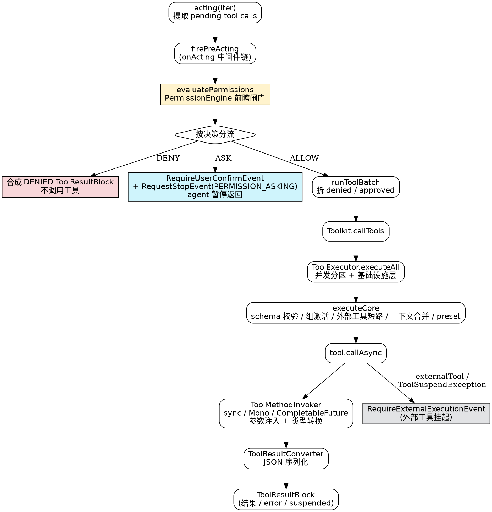
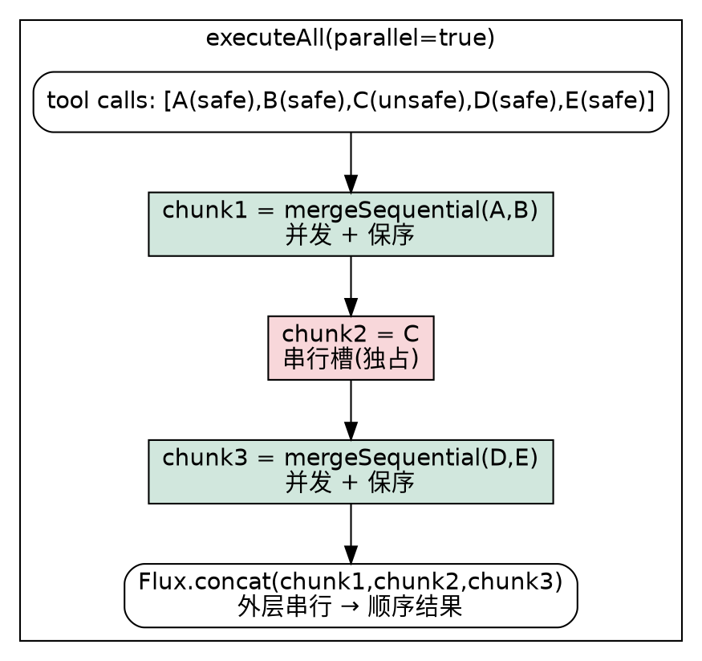
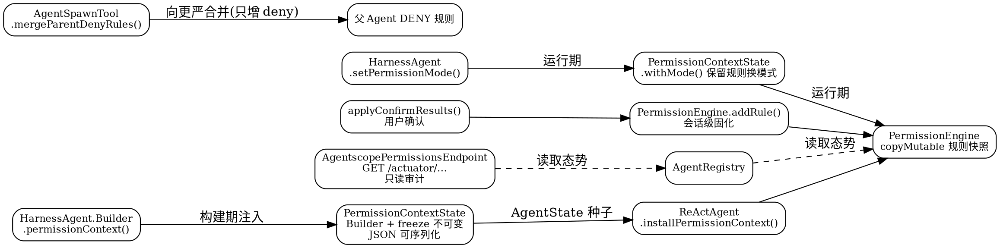

## Introduction

本分册覆盖 AgentScope Java 执行链路上的四块机制：**工具体系**（`Toolkit` 与三种工具写法、MCP）、**权限系统**（五模式 + 规则 DSL + 工具自带检查）、**中间件**（5 个 hook）与 **Plan Mode**（阶段级工具白名单）。四者的共同点是都挂在「一次工具调用怎么被放行、怎么被执行、怎么被拦截」这条路上，合册阅读最能看清整条链路。

本分册所有类名、方法签名、枚举值与默认值均核对自本地 `v2.0.4` 源码树（`agentscope-core/.../tool/`、`.../permission/`、`.../middleware/`、`.../state/PlanModeContextState.java`，`agentscope-harness/.../middleware/`），与官方文档冲突处以源码为准。

与 Python 版的差异值得一提：Python 版中间件是 7 个 hook 反射自动检测，Java 版是 **5 个 hook**（4 洋葱 + 1 管道）+ `order()` 显式排序；Python 版权限的安全 ASK 靠 `bypass_immune` 标记，Java 版靠 `checkPermissions` 的 **bypass-immune 求值次序**（工具自带检查先于 `BYPASS` 兜底）＋工具执行时的**自带安全自检**（如 `ShellCommandTool` 命令白名单、文件工具 baseDir/工作区围栏）两层——后者独立于权限引擎，是防御纵深。⚠️ v2.0.4 实测：`ToolBase.isDangerousPath` / `ToolDangerousPathConstants` 全仓无调用方，危险路径保护是工具作者构件而非框架强制，详见 [Two Safety Layers](#two-safety-layers)。

## Toolkit And Tool Registration

`Toolkit` 是工具总入口，两类注册 API（`tool/Toolkit.java`）：

```java
// 1. 流式 builder（registration() 返回 ToolRegistration）
toolkit.registration()
        .tool(toolObject)                       // POJO，反射 @Tool 方法
        .agentTool(agentTool)                   // AgentTool 实例
        .mcpClient(mcpClientWrapper)            // MCP 客户端
        .subAgent(provider)                     // 子 Agent 提供者（可带 SubAgentConfig）
        .mcpToolNamePrefix(prefix)              // MCP 工具名前缀
        .enableTools(List.of(...))              // 只启用列出的工具
        ...;

// 2. 直接方法
public void registerTool(Object toolObject);
public void registerAgentTool(AgentTool tool);
public Mono<Void> registerMcpClient(McpClientWrapper wrapper);   // 异步：要握手
public Mono<Void> removeMcpClient(String name);
public void closeMcpClients();
public void registerMetaTool();
public Toolkit copy();
```

工具组（运行时切换，配合元工具）：`createToolGroup(name, desc, active)`、`registerToolGroup(ToolGroup)`、`addToolToGroup(group, tool)`、`updateToolGroups(names, active)`、`setActiveGroups(...)` / `getActiveGroups()`、`removeToolGroups(...)`、`createSkillToolGroup(...)`、`findSkillToolGroupsByActivateOnSkill(skillName)`。

执行侧：`callTool(ToolCallParam)` → `Mono<ToolResultBlock>`、`callTools(...)` 三个重载、`setChunkCallback(BiConsumer<ToolUseBlock, ToolResultBlock>)`、`isExternalTool(name)`、`getToolSchemas(Collection<String> activeGroups)`。

⚠️ `copy()` 的语义要读注释（`Toolkit.java:928-946`）：**构建期隔离用，不要 per-call 用**。用户工具实例按引用共享（必须线程安全），工具组与激活标志深拷贝；框架元工具重新绑到新 registry。per-call 的工具面差异应该用 `ToolRequestConfig` 组合表达（`getTool(name, requestConfig)` / `getToolSchemas(groups, requestConfig)`），而不是拷贝 toolkit。

### Three Ways To Write A Tool

| 写法 | 基类/注解 | 适用 |
| :--- | :--- | :--- |
| 注解反射 | POJO 方法打 `@Tool` | 最常用，框架反射生成 schema |
| 继承 `ToolBase` | `public abstract class ToolBase implements AgentTool` | 要自定义 `checkPermissions` / `matchRule` / `generateSuggestions` |
| 直接实现 `AgentTool` | 接口 | 完全手工（元工具、远程代理就是这么写的） |

`@Tool` 注解的**全部 11 个属性**（`tool/Tool.java`）：

```java
String name() default "";
String description() default "";
boolean strict() default false;                    // schema 严格模式
boolean readOnly() default false;                  // EXPLORE 模式放行判据
boolean concurrencySafe() default true;
boolean externalTool() default false;              // 外部执行（HITL 挂起）
boolean stateInjected() default false;             // 注入 AgentState 参数
boolean returnDirect() default false;              // 结果直接作为 agent 回复
String[] dangerousFiles() default {};              // 追加危险文件
String[] dangerousDirectories() default {};        // 追加危险目录
Class<? extends ToolResultConverter> converter() default DefaultToolResultConverter.class;
```

`ToolBase` 的关键方法：`getName()` / `getDescription()` / `getParameters()`（均 final）、`isConcurrencySafe()` / `isReadOnly()` / `isReturnDirect()` / `isExternalTool()` / `isStateInjected()` / `isMcp()`、`callAsync(ToolCallParam)`、`checkPermissions(input, context)`、`matchRule(ruleContent, toolInput)`、`generateSuggestions(toolInput)`、`isDangerousPath(filePath)`。

### Meta Tool

**只有一个元工具，名字是 `reset_equipped_tools`**（`tool/MetaToolFactory.java:51`，`Toolkit.registerMetaTool()` 注册，日志原文 "Registered meta tool: reset_equipped_tools"）。它的语义是**替换而非增量**——javadoc 原文强调「The input list is the FINAL set of active tool groups, not incremental changes. Any group not included in the list will be deactivated」，并建议「只激活当前任务需要的、用完立刻停用以节省上下文空间」。参数 `to_activate`（数组，enum 只含 **META scope** 的组名）。

`ToolGroupScope` 两值决定谁能动一个组（`tool/ToolGroupScope.java:29-42`）：**META**（元工具可管，进 enum、跟替换语义）与 **EXTERNAL**（只归开发者代码管，元工具看不见也改不了）。

## Internal Architecture

本分册前几节把 API 面铺开了，但「工具」不是一个类，而是一组**协作组件**。理解它们的职责边界，才知道哪里能扩展、哪里不能碰、一次调用到底经过了谁。所有类名与行为核对自 `v2.0.4` 源码（`agentscope-core/.../tool/`、`.../permission/`、`ReActAgent.java`）。

`Toolkit` 是**组合根（composition root）**：它内部持有一个 `ToolRegistry`、一个 `ToolGroupManager`、一个 `ToolSchemaProvider` 和一个 `ToolExecutor`。`callTool` / `callTools` 只是把请求转发给 `executor.execute` / `executeAll`，注册方法（`registration()` builder、`registerTool`、`registerMcpClient`、`registerMetaTool`）向 registry + schema provider 灌数据。**关键设计：per-call 的工具面差异用 `ToolRequestConfig` 表达，绝不靠拷贝 toolkit**——`copy()` 的语义是构建期隔离（共享工具实例引用、深拷贝工具组与激活标志、重新绑定框架元工具），详见 `Toolkit.java:928-946` 注释。

组件职责一览：

| 组件 | 文件 | 职责 | 关键事实 |
| :--- | :--- | :--- | :--- |
| `Toolkit` | `tool/Toolkit.java` | 组合根 + 注册 + 转发 | `callTool`→`executor.execute`；per-call 面用 `ToolRequestConfig`，不用 `copy()` |
| `ToolRegistry` | `tool/ToolRegistry.java` | 名字 → 实现 + 元数据 | `ConcurrentHashMap`；`copyTo()` 按引用共享工具实例、拷贝元数据（构建期隔离）；`removeToolIfSame` 用 `ConcurrentHashMap.remove(k, expected)` 防 TOCTOU |
| `ToolGroupManager` | `tool/ToolGroupManager.java` | 工具组 + 激活态 | `isActiveTool(name[, activeGroups])` 是可用性闸门；`replaceMetaActiveGroups` 是元工具的落点；组带 `META`/`EXTERNAL` 两 scope |
| `ToolExecutor` | `tool/ToolExecutor.java` | 执行 + 基础设施层（**不含权限闸门**） | 调度/超时/重试/优雅关闭四层；批量按 `isConcurrencySafe` 分区并发 |
| `ToolBase` | `tool/ToolBase.java` | `AgentTool` 抽象契约 | `final` 标志位 + `dangerousFiles/dangerousDirectories`（**替换非追加**）；`checkPermissions` 默认 passthrough；`isDangerousPath` 是 symlink 解析式构件 |
| `ReflectiveFunctionTool` | `tool/ReflectiveFunctionTool.java` | `@Tool` 方法 → `ToolBase` 桥 | `create()` 校验 `stateInjected` ↔ `AgentState` 参数一致性；schema 来自 `ToolSchemaGenerator`；`@Tool(dangerousFiles=)` 经 builder **替换**默认表 |
| `ToolMethodInvoker` | `tool/ToolMethodInvoker.java` | 反射调用 | 三种返回类型（`CompletableFuture`/`Mono`/sync）；自动注入 `ToolEmitter`/`Agent`/`AgentState`/`RuntimeContext`/用户 POJO；`JsonCodec.convertValue` 保留泛型 |
| `ToolSchemaGenerator` | `tool/ToolSchemaGenerator.java` | 生成 OpenAI 格式 JSON Schema | 只收 `@ToolParam` 参数；把 per-param `$defs`/`definitions` 提升到根；排除 preset 参数 |
| `ToolRequestConfig` | `tool/ToolRequestConfig.java` | 不可变 per-call 配置（外部工具注入） | `resolveTool` = 外部（schema-only）→ 隐藏后端（`EXTERNAL_ONLY`）→ registry；`NONE` = 用共享 toolkit |
| `ToolResultConverter` | `tool/DefaultToolResultConverter.java` | 结果 → `ToolResultBlock` | null→`"null"`、void→`"Done"`、`ToolResultBlock` 透传、其余 JSON（回退 `toString`）；`@Tool(converter=)` 可覆写 |
| `ToolExecutionContext` | `tool/ToolExecutionContext.java` | 上下文注入（**已废弃**） | 双层 facade（facade + `ContextStore`），优先级 Call→Agent→Toolkit→Spring；已被 `RuntimeContext.builder().put(Type, value)` 取代 |

两个容易误读的点：

1. **`ToolExecutor` 不持有权限逻辑**。它只负责「找到工具 → 校验 schema → 合并上下文/preset → 调 `callAsync` → 套上调度/超时/重试/优雅关闭」。权限判定发生在更上游的 ReAct 循环（见 [Execution Chain](#execution-chain) 与 [Permission](#permission)）。把权限想成「executor 里的一道 if」是错的。
2. **`ToolExecutionContext` 已废弃**，但 `ToolMethodInvoker` 仍桥接它——新代码一律用 `RuntimeContext` 注入 POJO；用户自定义类型的参数（无 `@ToolParam`、非 java.*、非 `ContentBlock`/`Msg`）由 `ToolMethodInvoker.resolveContextParameter` 从 `RuntimeContext` 按类型解析。

## Execution Chain

一次「模型决定调用工具」到「工具结果回到上下文」的完整链路，**源码层面**是这样走的（`ReActAgent.acting` → `actingStream` → `evaluatePermissions` → `runToolBatch` → `Toolkit.callTools` → `ToolExecutor.executeAll` → `executeCore` → `tool.callAsync` → `ToolMethodInvoker` → `ToolResultConverter` → `ToolResultBlock`）：



逐段拆解——

**① 入口与中间件（`acting` → `firePreActing`）**：`acting(int iter)` 先从上下文抽出尚未执行的 `ToolUseBlock`，经 `hookDispatcher.firePreActing` 包进 `onActing` 中间件链（洋葱型），再进入 `actingStream`。中间件（如 `AsyncToolMiddleware`、`PlanModeMiddleware`）在这一层就能改写/拦截工具列表。

**② 权限前瞻闸门（`evaluatePermissions`）**：这是权限真正发生的地方（不是 `ToolExecutor`）。它逐个工具跑 `PermissionEngine.checkPermission`（或轻量路径，见 [Permission](#permission)），产出 `PermissionGate(pendingAsk, autoDeniedIds)`。每个 `ToolUseBlock` 被标记成 `ALLOWED` 或 `ASKING` 写回上下文；`DENY` 的工具不再出现在 pending 里。
- 没有 `ASKING` → 直接 `runToolBatch`；
- 有 `ASKING` → 先写 `autoDenied` 的合成结果，发 `RequireUserConfirmEvent` + `RequestStopEvent(PERMISSION_ASKING)`，**agent 暂停并把控制权交还调用方**；下次调用携带 `ConfirmResult`（经 `Msg.METADATA_CONFIRM_RESULTS`）恢复，已确认的工具被标成 `ALLOWED` 跳过引擎。

**③ 批量执行与并发分区（`runToolBatch` → `executeAll`）**：`runToolBatch` 把列表拆成「被拒（合成 DENIED，不调用）」和「放行」两堆。放行部分交给 `ToolExecutor.executeAll`，它**按 `isConcurrencySafe` 分区**：连续的 safe 工具用 `Flux.mergeSequential` 并发推进（保序），unsafe 或无法判定的 legacy `AgentTool` 各自占一个串行槽——避免共享状态的两个调用重叠。`ToolkitConfig.parallel` 默认 `true`。

**④ 单工具核心（`executeCore`）**：拿到工具后依次做——工具查找（`ToolRequestConfig.resolveTool` 的「外部→隐藏后端→registry」策略）→ **组激活闸门**（`groupManager.isActiveTool`，未激活返回 `ToolResultBlock.error("Unauthorized tool call...")`）→ **schema 校验**（`ToolValidator.validateInput`，失败返回错误块并提示改参数）→ **外部工具短路**（`isExternalTool()` 直接返回 `ToolResultBlock.suspended`，不注入 preset、不本地调用）→ 上下文合并（runtimeContext 与 toolkit 默认 context 合并）→ 合并输入与 preset 参数（preset 优先，框架控制参数从调用方/LLM 视角不可变）→ 构造 `ToolEmitter` → `tool.callAsync`。

**⑤ 反射调用与结果转换（`callAsync` → `ToolMethodInvoker` → `ToolResultConverter`）**：`@Tool` 方法经 `ReflectiveFunctionTool` 落到 `ToolMethodInvoker.invokeAsync`，按返回类型走 `CompletableFuture` / `Mono` / sync 三路，做参数自动注入与类型转换（保留泛型），最终由 `ToolResultConverter` 把返回值规范成 `ToolResultBlock`（null→`"null"`、void→`"Done"`、对象→JSON）。`ToolSuspendException` 被 `ToolExecutor` 转成 `suspended` 结果；其余异常转成 `ToolResultBlock.error`。

**⑥ 收尾**：`runToolBatch` 把结果流化成 `ToolResultStartEvent`/`ToolResultTextDeltaEvent`/`ToolResultEndEvent` 等细粒度事件；`returnDirect` 工具在满足「无挂起 + 全部 returnDirect」时短路 ReAct 循环直接作为最终答复；`suspended` 工具触发 `RequireExternalExecutionEvent`，由调用方回传结果（HITL）。

⚠️ 一个边界：第 ④ 步的「组激活闸门」与第 ② 步的「权限引擎」是**两套独立的可用性/放行机制**——前者管「这个工具在当前激活组里可不可见」，后者管「这次调用批不批准」。外部工具经 `ToolRequestConfig` 注入时不受组激活约束（同名的未激活后端工具不能拒绝它，模型看到的是外部覆盖）。

## Execution Engine Internals

[Execution Chain](#execution-chain) 第 ③、④ 步提到了「并发分区」和「基础设施层」，但没展开。`ToolExecutor`（`tool/ToolExecutor.java`）把一次工具调用拆成「单工具核心 `executeCore`」+「四层基础设施」两层，批量入口 `executeAll` 再叠加并发控制。本节把这两层讲透——它们决定了工具执行的**线程模型、超时 / 重试 / 优雅关闭语义、以及并发安全性**，是理解「为什么工具执行有时慢、有时被取消、有时顺序和请求不一致」的关键。

### Four Infrastructure Layers (executeWithInfrastructure)

`executeWithInfrastructure`（`ToolExecutor.java:454-489`）对 `executeCore` 返回的 `Mono<ToolResultBlock>` 依次叠加四层（`ToolExecutor.java:472-476`）：

| 层 | 实现（`ToolExecutor.java`） | 默认行为 |
| :--- | :--- | :--- |
| 调度 Scheduling | `execution.subscribeOn(Schedulers.boundedElastic())` | 工具方法多为阻塞 I/O，离开事件循环线程、落到 Reactor 专为阻塞 I/O 设计的弹性线程池；`ToolkitConfig.executorService != null` 时改用 `Schedulers.fromExecutor(...)` |
| 超时 Timeout | `execution.timeout(timeout, Mono.error(new RuntimeException(...)))` | Reactor 操作符，超时即取消订阅并 error；**默认 5 分钟**（见 [ToolkitConfig Defaults](#toolkitconfig-defaults)） |
| 重试 Retry | `Retry.backoff(maxAttempts-1, initialBackoff).maxBackoff(maxBackoff).jitter(0.5).filter(retryOn)` | **默认 `maxAttempts=1`（不重试）**；若 >1，指数退避、上限 10s、抖动 0.5、按 `retryOn` 过滤 |
| 优雅关闭 Shutdown | `Mono.firstWithSignal(execution, shutdownGuard)` | 与 `GracefulShutdownManager` 的关闭超时信号竞速，关机信号一来即取消执行并 error，绝不阻塞进程优雅退出 |

**设计动机（为何这么写）**：
- **为何调度默认 `boundedElastic` 而非 `parallel()`？** 工具方法（文件读写、HTTP、Shell）本质是阻塞 I/O；Reactor 的 `boundedElastic` 是专为"包裹阻塞调用"设计的弹性线程池（带上限、按需增长），能把阻塞从事件循环（event-loop）线程挪走，避免拖垮整个 reactor 流水线的吞吐。自定义 `ExecutorService` 则用于把工具执行钉进用户指定的线程池（如隔离型线程池）。
- **为何超时是 Reactor `timeout` 操作符而非手动计时？** 它天然与响应式取消（cancel）对齐——超时触发时不仅发 error，还取消上游订阅；被 `retry` 或 `onErrorResume` 统一收口成 `ToolResultBlock.error`，语义干净，不会留下"已超时但仍在跑"的僵尸调用。
- **为何重试注释强调「上一次尝试被取消、可能仍在占用资源」？** `Retry.backoff` 取消的是订阅而非底层调用，一个卡住的远程工具在重试间隙可能仍未释放连接 / 锁；这是"重试 ≠ 无缝切换"的提醒，作者据此把"可重试错误"（429/5xx/timeout/网络）作为 `retryOn` 默认过滤条件（`ExecutionConfig.MODEL_DEFAULTS`）。
- **为何优雅关闭用 `firstWithSignal` 竞速而非等待执行完？** 关闭流程必须有时限——一个 5 分钟超时的工具若等它自然结束，关机将卡死；竞速让"关闭信号"胜出时立即取消工具并降级为 error 结果，执行权交还关机流程。

> 实例方法 `execute(ToolCallParam)` 先解析 per-call 的 `ToolRequestConfig`（来自 RuntimeContext），再转给 `executeCore`；批量 `executeAll` 对每条都调 `executeWithInfrastructure`（即四层仅作用于单工具，批量层再叠加并发控制）。

### ToolkitConfig Defaults

`ToolkitConfig`（`tool/ToolkitConfig.java`）的默认值（Builder 初始值，`defaultConfig()` 即 `builder().build()`）：

| 字段 | 默认值 | 含义 |
| :--- | :--- | :--- |
| `parallel` | `true` | 同一轮多个工具调用并行 |
| `executorService` | `null` | 用 `Schedulers.boundedElastic()` |
| `executionConfig` | `ExecutionConfig.TOOL_DEFAULTS` | **5 分钟超时、无重试（1 attempt）** |
| `allowToolDeletion` | `true` | `removeTool()`/`removeToolGroups()`/`updateToolGroups(...,false)` 可调用；置 false 后这些调用被忽略 |
| `defaultContext` | `null` | `@Deprecated`，改用 `RuntimeContext` |

⚠️ 注意 `executionConfig` 默认等于 `TOOL_DEFAULTS`（`timeout=5min, maxAttempts=1`）——即**工具默认不重试**，只有显式 `.executionConfig(...)` 配了 `maxAttempts>1` 才触发 `Retry.backoff`；对比 `MODEL_DEFAULTS` 是 5min + 3 次重试 + 2s/30s 退避（用于模型调用）。工具与模型用两套不同的弹性默认值，因为工具失败多是不可重试的业务 / 系统错误，盲目重试反而放大副作用（如重复写文件）。

### Concurrency Partitioning (executeAll parallel mode)

[Execution Chain](#execution-chain) 第 ③ 步的「按 `isConcurrencySafe` 分区」在 `executeAll`（`ToolExecutor.java:405-433`）里是这样切的：

- 连续若干个 `safe` 工具收集进 `safeBatch`，用 **`Flux.mergeSequential(safeBatch)`** 并发推进、**输出顺序与输入一致**（保序）；
- 一旦遇到 `unsafe` 工具（或无法判定的 legacy `AgentTool`），先 flush 当前 safe 批，再让该工具**独占一个串行槽**（`mono.flux()` 单独成 chunk）；
- 外层 `Flux.concat(chunks)` 按 chunk 顺序**串行**串起所有批 / 槽。
- `isConcurrencySafe`（`:443-449`）：只对 `ToolBase` 看 `isConcurrencySafe()`（默认 `true`）；legacy `AgentTool`（非 `ToolBase`、无此标志）统一返回 `true`——**保持 2.0 前的并发行为**，即框架默认假设老工具线程安全、由作者自己保证。

串行模式（`parallel=false`）则退化为 `Flux.concat(monos)`：**严格按声明顺序**逐个执行。



下面是可交互的并发分区可视化（基于 `ToolExecutor.executeAll` 的切分算法）：拖动滑块调节工具数 N，点击任一工具芯片切换 `safe`/`unsafe`，实时观察「连续 safe 段 → 同一 `mergeSequential` 并发批（保序）」与「unsafe 工具 → 独占串行槽」如何被切分，以及外层 `Flux.concat` 如何把各 chunk 按序串成 `R1..RN` 的结果。**注意**：v2.0.4 里 legacy `AgentTool` 也默认 `safe=true`，故初始全为 safe；只有显式继承 `ToolBase` 且声明 `concurrencySafe=false` 的工具才进入串行槽。上方 dot 图为同一逻辑的静态呈现，供未启用脚本的阅读器对照。

<div class="cp-root">
<style>
.cp-root{--bg:#ffffff;--bg2:#f6f7f9;--fg:#1a1a1a;--fg2:#52525b;--bd:#e4e4e7;--green:#3b6d11;--green50:#eaf3de;--red:#a4262c;--red50:#fcebeb;--blue:#185fa5;font-family:system-ui,-apple-system,sans-serif;color:var(--fg);}
@media (prefers-color-scheme: dark){.cp-root{--bg:#1e1e1e;--bg2:#27272a;--fg:#e4e4e7;--fg2:#a1a1aa;--bd:#3f3f46;--green:#97c459;--green50:#1f2f12;--red:#f0898c;--red50:#3a1f1f;--blue:#85b7eb;}}
.cp-ctrl{display:flex;flex-wrap:wrap;gap:16px;align-items:flex-end;margin-bottom:14px;}
.cp-ctrl label{display:flex;flex-direction:column;gap:6px;font-size:13px;color:var(--fg);min-width:220px;flex:1;}
.cp-hint{font-size:12px;color:var(--fg2);max-width:340px;line-height:1.5;}
.cp-hint code{background:var(--bg2);padding:1px 4px;border-radius:4px;border:.5px solid var(--bd);font-size:11px;}
.cp-chip{cursor:pointer;user-select:none;font-size:12px;padding:7px 10px;border-radius:8px;border:.5px solid var(--bd);background:var(--bg);color:var(--fg);display:inline-flex;align-items:center;gap:6px;transition:border-color .12s,background .12s;}
.cp-chip:hover{border-color:var(--blue);}
.cp-chip.safe{border-color:var(--green);}
.cp-chip.unsafe{border-color:var(--red);}
.cp-dot{width:8px;height:8px;border-radius:50%;flex:none;}
.cp-chip.safe .cp-dot{background:var(--green);}
.cp-chip.unsafe .cp-dot{background:var(--red);}
.cp-stage{background:var(--bg2);border-radius:10px;padding:14px;margin-bottom:12px;}
.cp-stage h4{margin:0 0 10px;font-size:13px;color:var(--fg2);font-weight:500;}
.cp-row{display:flex;flex-wrap:wrap;gap:10px;align-items:flex-start;}
.cp-chunk{border-radius:10px;padding:10px;display:flex;flex-direction:column;gap:8px;min-width:128px;}
.cp-chunk.safe{background:var(--green50);border:.5px solid var(--green);}
.cp-chunk.unsafe{background:var(--red50);border:.5px solid var(--red);}
.cp-chunk .cp-tag{font-size:11px;font-weight:600;}
.cp-chunk.safe .cp-tag{color:var(--green);}
.cp-chunk.unsafe .cp-tag{color:var(--red);}
.cp-chunk .cp-tools{display:flex;flex-wrap:wrap;gap:6px;}
.cp-out{display:flex;flex-wrap:wrap;gap:8px;}
.cp-res{font-size:12px;padding:7px 12px;border-radius:8px;background:var(--bg);border:.5px solid var(--bd);color:var(--fg);}
.cp-legend{display:flex;flex-wrap:wrap;gap:16px;font-size:12px;color:var(--fg2);margin-top:4px;}
.cp-legend span{display:flex;align-items:center;gap:5px;}
.cp-sw{width:11px;height:11px;border-radius:2px;border:.5px solid var(--bd);}
</style>
<div class="cp-ctrl">
  <label>工具数量 N（executeAll 输入长度）
    <input id="cp-n" type="range" min="3" max="8" step="1" value="5" style="width:100%">
    <span style="font-size:12px;color:var(--fg2);">当前：<b id="cp-nOut">5</b> 个工具</span>
  </label>
  <div class="cp-hint">点击①中任一工具芯片切换 <code>safe</code>/<code>unsafe</code>。<code>unsafe</code> 工具会独占一个串行槽；<code>safe</code> 连续段被收进同一 <code>mergeSequential</code> 并发批（保序）。</div>
</div>
<div class="cp-stage">
  <h4>① 输入（点击切换 safe / unsafe）</h4>
  <div id="cp-input" class="cp-row"></div>
</div>
<div class="cp-stage">
  <h4>② 并发分区（executeAll 切分算法）</h4>
  <div id="cp-part" class="cp-row"></div>
</div>
<div class="cp-stage">
  <h4>③ 保序输出（Flux.concat 外层串行 → 顺序结果 R1..RN）</h4>
  <div id="cp-out" class="cp-out"></div>
</div>
<div class="cp-legend">
  <span><span class="cp-sw" style="background:var(--green50);border-color:var(--green);"></span>safe 批：mergeSequential 并发 + 保序</span>
  <span><span class="cp-sw" style="background:var(--red50);border-color:var(--red);"></span>unsafe 串行槽：独占、不进任何并发批</span>
</div>
<script>
(function(){
  var $=function(id){return document.getElementById(id);};
  var nEl=$('cp-n'), input=$('cp-input'), part=$('cp-part'), out=$('cp-out'), nOut=$('cp-nOut');
  var state=[];
  function syncLen(n){ while(state.length<n) state.push(true); if(state.length>n) state.length=n; }
  function render(){
    var n=+nEl.value; nOut.textContent=n; syncLen(n);
    input.innerHTML='';
    for(var i=0;i<n;i++){
      var safe=state[i];
      var c=document.createElement('div');
      c.className='cp-chip '+(safe?'safe':'unsafe');
      c.innerHTML='<span class="cp-dot"></span>T'+(i+1)+' · '+(safe?'safe':'unsafe');
      (function(idx){ c.onclick=function(){ state[idx]=!state[idx]; render(); }; })(i);
      input.appendChild(c);
    }
    part.innerHTML='';
    var chunks=[], cur=[];
    for(var j=0;j<n;j++){
      if(state[j]){ cur.push(j); }
      else { if(cur.length){ chunks.push({type:'safe',items:cur.slice()}); cur=[]; } chunks.push({type:'unsafe',items:[j]}); }
    }
    if(cur.length){ chunks.push({type:'safe',items:cur.slice()}); }
    chunks.forEach(function(ch){
      var box=document.createElement('div');
      box.className='cp-chunk '+ch.type;
      var tag=document.createElement('div');
      tag.className='cp-tag';
      tag.textContent = ch.type==='safe' ? ('mergeSequential ∥ 并发批（'+ch.items.length+'）') : '串行槽 独占';
      box.appendChild(tag);
      var tools=document.createElement('div');
      tools.className='cp-tools';
      ch.items.forEach(function(idx){
        var t=document.createElement('div');
        t.className='cp-chip '+(state[idx]?'safe':'unsafe');
        t.innerHTML='<span class="cp-dot"></span>T'+(idx+1);
        tools.appendChild(t);
      });
      box.appendChild(tools);
      part.appendChild(box);
    });
    out.innerHTML='';
    for(var k=0;k<n;k++){
      var r=document.createElement('div');
      r.className='cp-res';
      r.textContent='R'+(k+1)+' (T'+(k+1)+')';
      out.appendChild(r);
    }
  }
  nEl.addEventListener('input', render);
  render();
})();
</script>
</div>

**设计动机**：
- **为何保序（mergeSequential 而非 merge）？** 工具结果要按模型请求的顺序回填进上下文（`ToolResultBlock.withIdAndName` 也强绑定原始 `ToolUseBlock` 的 id/name），乱序会让结果对不上调用。mergeSequential 在「并发执行」与「顺序交付」之间取了最优解：快的工具不等慢的，但交付顺序恒定。
- **为何 unsafe 要独占串行槽？** 两个共享可变状态（如写同一工作区、改同一全局标志）的工具若重叠执行，会踩出竞态（读到半成品、覆盖写入）。把它们各自塞进独立串行槽、且**不放进任何 mergeSequential 批**，就保证同一 unsafe 工具（以及它和相邻 safe 工具之间）不会并发交错——这是「宁可牺牲一点并行度、也不冒数据竞争」的保守选择。
- **为何 legacy `AgentTool` 默认 `safe=true`？** 向后兼容：2.0 前没有 `concurrencySafe` 标志，框架一律并发执行用户工具；升级后若默认改 false，会无端拖慢所有老工具。于是只对显式继承 `ToolBase` 的新工具开放该标志，老 `AgentTool` 维持原行为。

### Single-Tool Core (executeCore)

`executeCore`（`ToolExecutor.java:201-316`）是单工具真正干活的地方，[Execution Chain](#execution-chain) 第 ④ 步已概述，这里补几个容易被略过的点：

1. **工具解析走 `ToolRequestConfig.resolveTool`**（external → hide-backend → registry，见 [Tool Resolution Gates](#tool-resolution-gates)），与 `Toolkit.getTool` 共用同一策略，保证「模型看到的名字」和「实际执行的实现」永远一致。
2. **组激活闸门只对 backend 工具生效**：`fromRequestConfig`（同名外部工具注入）为 true 时跳过——否则一个被模型看到的同名外部覆盖会被「未激活」的 backend 工具误拒（`ToolExecutor.java:219-229`）。
3. **preset 参数合并在 input 之后、callAsync 之前**（`ToolExecutor.java:271-289`）：`mergedInput` 先放 input，再 `putAll(registered.getPresetParameters())`——**preset 覆盖 input**，使框架控制参数（如注入的 agent/session 标识）从调用方 / LLM 视角不可变。
4. **错误收口**：`callAsync` 的异常经 `onErrorResume` 转成 `ToolResultBlock.error`（含 `ToolSuspendException`→`suspended`）；`switchIfEmpty` 兜底「工具正常结束却没返回结果」→error。所有失败路径都归一为 `ToolResultBlock`，绝不让异常穿透到 reactor 流水线外。

## Under the Hood

[Execution Engine Internals](#execution-engine-internals) 讲的是「工具怎么被调度、超时、并发」，本节往更底层走：一个 `@Tool` 方法从被反射调用、到参数如何注入与转换、到 schema 怎么生成、再到结果如何流式回传与包装成消息。这些组件在 [Internal Architecture](#internal-architecture) 的组件表里各占一行，这里把它们从「是什么」挖到「为什么这么写」。

### Reflection & Parameter Injection (ToolMethodInvoker)

`ToolMethodInvoker.invokeAsync`（`tool/ToolMethodInvoker.java:55-125`）按方法返回类型分三路，全部经 `Mono` 收口：

- `CompletableFuture<?>` → `Mono.fromFuture(future)`；
- `Mono<?>` → 直接 `flatMap`；
- 其余（同步）→ `Mono.fromCallable(...)` 包裹。

反射调用前统一 `method.setAccessible(true)`（绕过 private/package 限制，使工具方法无需公开）。参数绑定走 `convertParameters`（`:149-198`），按**参数类型**而非名称自动注入以下框架对象：

| 参数类型 | 注入内容 | 备注 |
| :--- | :--- | :--- |
| `ToolEmitter` | 本次调用的流式 emitter | 工具方法声明此参数即可向调用方推送中间 chunk |
| `Agent` | 当前 agent 实例 | 可为 null |
| `AgentState` | 优先 `runtimeContext.getAgentState()`（call-scoped、并发安全），否则 agent 当前 state | 与 `@Tool(stateInjected=true)` 配合 |
| `RuntimeContext` | 本次调用的运行时上下文 | 直接注入 |
| `ToolExecutionContext` | 由 RuntimeContext 桥接（**已废弃**） | 新代码勿用 |
| 用户自定义 POJO | 从 `RuntimeContext.get(type)` 解析 | 见下 |

**用户 POJO 判定（`isUserContextPojo`，`:218-250`）**：一个无 `@ToolParam` 的参数，若**不是** primitive、**不是** `ContentBlock`/`Msg` 类层级、**不在** `java.`/`javax.` 包，就被当作「应从 RuntimeContext 按类型解析的上下文 POJO」——这正是 `@Tool(stateInjected=true)` 之外的另一条依赖注入通道，让工具无需 `@ToolParam` 也能拿到业务上下文（如数据库连接、用户身份）。

**单参数转换（`convertSingleParameter`，`:283-315`）**：LLM 给的是 `Map<String,Object>`（通常都是字符串 / 嵌套 map），要转成方法声明的强类型实参：
- 若 rawType 可赋值且非 `ParameterizedType` → 直接赋值（零拷贝）；
- 否则 `JsonUtils.getJsonCodec().convertValue(value, paramType)`——**保留泛型信息**（`ParameterizedType`），这是 `List<Order>`/`Map<String, X>` 这类参数能正确反序列化的关键；
- 失败回退 `convertFromString`（仅支持常见 primitive/boxed 的字符串解析）。

**错误透传**：`handleInvocationError`（`:363-379`）会在异常链里查找 `ToolSuspendException` 并**重新抛出**——因为 `ToolExecutor` 靠它把执行权交给外部（HITL 挂起）。这一跳很隐蔽：工具方法里抛出的 `ToolSuspendException` 经 `Mono` 链被 `onErrorResume` 捕获后，必须「重新抛出」而非包成 error 块，否则挂起语义就丢了。

### Schema Generation (ToolSchemaGenerator)

模型要「看懂」一个工具，靠的是 JSON Schema。`ToolSchemaGenerator.generateParameterSchema`（`tool/ToolSchemaGenerator.java:50-93`）只收带 `@ToolParam` 的参数（`toolParam == null` 直接跳过——所以**没有 `@ToolParam` 的参数对模型不可见**，正是上面「框架对象自动注入」得以不污染 schema 的原因），对每个参数用 `JsonSchemaUtils.generateSchemaFromType(param.getParameterizedType())` 生成（支持泛型），并做两件事：

- **`$defs`/`definitions` 提升到根**：嵌套类型的 schema 定义（如 `List<Order>` 里的 `Order`）被 hoist 到文档根的 `$defs`，使 `#/$defs/Order` 这种 `$ref` 能解析；
- **冲突检测**：同名但内容不同的定义 → 抛 `IllegalStateException`（避免两个不同 `Order` 一静默覆盖另一）。

`excludeParams` 参数用于**不把 preset 参数暴露给模型**（见 [Execution Engine Internals](#execution-engine-internals) 的 preset 合并）——预设参数对 LLM 透明，模型无需也无法填它。

> 校验（`ToolValidator.validateInput`，`executeCore` 第 ② 步）用同一套 schema 在**执行前**再核一遍输入，失败返回错误块并提示「请修正参数」，形成「生成 schema → 模型填参 → 执行前校验 → 注入调用」的闭环。

### Streaming Result & Conversion

工具执行结果从 `callAsync` 的返回，到成为上下文里的一条 `Msg`，中间经过三道：

1. **`ToolEmitter`**（`tool/DefaultToolEmitter.java`）：`ToolExecutor` 为**每次调用** new 一个 `DefaultToolEmitter`，把 chunk 经 `chunkCallback` 投递（internal + user 两个回调组合，null 安全）。工具方法只要声明 `ToolEmitter` 参数并调用 `emit(chunk)`，就能在调用方实时看到中间产出（如长任务的进度文本）——这是工具「流式输出」的通道，与 [Middleware](#middleware) 的 `onActingChunk` 事件衔接。
2. **`ToolResultConverter`**（`tool/DefaultToolResultConverter.java`）把返回值规范成 `ToolResultBlock`：
   - `null` → `"null"` 文本块；
   - `void`（`Void.TYPE`）→ `"Done"`；
   - 已是 `ToolResultBlock` → 透传；
   - 其余 → `JsonUtils.toJson(...)` 序列化（失败回退 `String.valueOf`/`toString()`）。
3. **`ToolResultMessageBuilder.buildToolResultMsg`**（`tool/ToolResultMessageBuilder.java:40-51`）把 `ToolResultBlock` 包成 `Msg`（role=`TOOL`、content 带 id/name，由 `withIdAndName(originalCall.getId(), originalCall.getName())` 绑定回原始 `ToolUseBlock`）——这一步才让结果能作为「工具消息」回填进 `AgentState.context`。

### Tool Resolution Gates

执行链第 ④ 步的「工具查找」和「组激活闸门」背后是三个协作组件，它们的规则决定了**一个名字最终映射到哪个实现、以及它此刻能不能被调用**。

**`ToolRequestConfig.resolveTool`（单一真相源，`tool/ToolRequestConfig.java:89-98`）**：

```java
AgentTool external = externalTools.get(name);   // 1. 外部工具（SchemaOnlyTool）永远优先
if (external != null) return external;
if (hidesBackend()) return null;                 // 2. EXTERNAL_ONLY 模式隐藏 backend
return registry.getTool(name);                   // 3. 否则查共享 registry
```

这个三路策略同时被 `Toolkit.getTool` 和 `ToolExecutor` 复用，因此「模型看到的工具名」与「实际执行的实现」永不漂移。`overrides(name)`（external 是否覆盖 backend）被执行器的可用性闸门用来**跳过组激活检查**——外部覆盖既然已被模型看到，就不能被一个未激活的同名 backend 工具拒绝。`NONE`（即 `AGENT_ONLY`）等于「用共享 toolkit 原样」；`AGENT_ONLY` 与「非空 externalTools」组合会被构造器拒绝（`IllegalArgumentException`），因为那在语义上自相矛盾。

**`ToolRegistry`**（`tool/ToolRegistry.java`）持两份 `ConcurrentHashMap`：`tools`（name→`AgentTool` 实现）与 `registeredTools`（name→`RegisteredToolFunction` 元数据，含 preset、MCP client 名、extended model）。关键点：
- `removeToolIfSame(name, expected)` 用 `ConcurrentHashMap.remove(k, expected)`——**原子地「值相等才删」**，防 TOCTOU 竞态（避免误删一个已经被替换成新实例的同名工具）；
- `copyTo(target)` **按引用共享工具实例、只拷贝元数据**——工具被假定无状态且线程安全，构建期隔离（见 [Toolkit And Tool Registration](#toolkit-and-tool-registration) 的 `copy()`）只需隔离「注册表 entries」，不复制工具本身。

**`ToolGroupManager` 可用性闸门**（`tool/ToolGroupManager.java:355-369`）的 `isActiveTool(name[, activeGroups])` 规则：
- **未分组的工具默认 `active=true`**（不在任何组 → 可见可调用）；
- 分组工具只要落在**任一激活组**里就 `active`。

⚠️ 这与直觉相反——很多框架把「未分组」当作「不可用」，但 AgentScope 选择反过来：**分组是按需开关的优化（元工具用分组节省上下文），不应让未显式分组的工具因「没被任何组激活」而失活**。外部工具经 `ToolRequestConfig` 注入时不受组约束（同名的未激活 backend 工具不能拒绝它），也源于同一原则——模型看到的覆盖必须被尊重。

## Replay Protection (Anti-Replay)

一个容易被误解的点：AgentScope 的「防重放」**不是 `ToolExecutor` 里按「工具名 + 参数」做内容缓存**，而是在 **agent 循环层（`ReActAgent`）用 `tool_use_id` 做「pending 门禁」**——同一个工具调用实例（同一 id）只会被执行一次，而内容相同的不同实例（不同 id）仍会重跑。这套门禁横跨「正常循环 / 会话恢复 / 优雅关闭重试 / 中断自愈」四种场景。

**核心判定：`MessageUtils.pendingToolUseIds`（`core/util/MessageUtils.java:154-171`）**

```java
Set<String> existingResultIds = messages.stream()                 // 全量对话历史
    .flatMap(m -> m.getContentBlocks(ToolResultBlock.class).stream())
    .map(ToolResultBlock::getId).collect(toSet());                 // 所有已存在的 tool_result.id
return lastAssistant.getContentBlocks(ToolUseBlock.class).stream() // 仅最近一条 assistant
    .map(ToolUseBlock::getId)
    .filter(id -> !existingResultIds.contains(id))                 // 没有对应结果的，才是 pending
    .collect(toSet());
```

即：**一个 `ToolUseBlock` 是「待执行」(pending) 当且仅当它在对话历史里找不到同 id 的 `ToolResultBlock`**。`ToolResultBlock.getId()` 与 `ToolUseBlock.getId()` 同源——都是模型下发的 `tool_use_id`（`ToolResultBlock.withIdAndName` 强绑定它就是为这个）。`extractPendingToolCalls`（`:82-92`）再用这个 id 集合过滤「最近一条 assistant 的工具调用」。

**执行门禁：`ReActAgent.acting`（`ReActAgent.java:2858-2861`）**

```java
List<ToolUseBlock> pendingToolCalls =
    MessageUtils.extractPendingToolCalls(state.contextMutable(), getName());
if (pendingToolCalls.isEmpty()) { ... }   // 没有 pending → 不进 executeAll
```

`acting` 只把 pending 的工具交给 `ToolExecutor.executeAll`。于是：

- **同一轮内**：每个 `tool_use` 执行一次、结果写入上下文，后续迭代再算它时已非 pending，**绝不二次执行**；
- **会话恢复（resume）/ transcript 重放**：历史 `tool_result` 已在上下文里，同名 `tool_use` 直接非 pending → 不重跑，agent 从已保存状态续跑（`doCallInner` 在 `pendingIds` 非空且无新输入时走 `resumeAgent()`，`:1862-1864`）。

**外部结果按 id 关联（HITL / 外部执行）**

当工具结果由外部提供（人工确认、外部执行器回填），`pairProvidedToolResults`（`:2323-2332`）把提供的 `ToolResultBlock` 按 `result.getId()` 建 map，再用 `resultsById.get(toolUse.getId())` 与 pending `ToolUseBlock` 配对——**已配对的不再执行，只有未配对的 remainder 进 `executeAll`**。这正是「防重放」在人机协同场景下的体现：模型/HITL 已给出的结果不会被框架重复触发。

**优雅关闭重试去重（`doCallInner`，`:1822-1831`）**

> Graceful-shutdown deduplication: if the agent's session was previously interrupted by shutdown, the client is likely retrying with the same user prompt that already exists in memory. Discard the duplicate input so the agent resumes purely from its saved memory context.

即客户端因超时被关闭而**用同一 user prompt 重试**时，框架丢弃这条重复输入、直接基于已保存上下文续跑，避免「同一意图被当成新请求再驱动一轮」造成的重放。

**中断自愈（`synthesizeErrorResultsForPendingToolCalls` / `maybePatchPendingToolCalls`，`:2203-2211`、`:2144-2187`）**

若在「reasoning 写出 `tool_use`」与「acting 写出 `tool_result`」之间被中断，上下文会残一条**没有结果的 `tool_use`**。这两个方法在中断恢复前为这些 dangling 调用自动补 error 结果（文案：`Previous tool execution failed or was interrupted`）。作用有二：① 不让 resume 后的运行继承「`tool_use` 无 `tool_result`」的不一致上下文（否则 provider 可能返回空响应）；② 显式把未完成项标记为 error 而非「假装成功」，避免误以为它已执行而漏掉重试。

四类守卫汇总：

| 场景 | 机制 | 源码 |
| :--- | :--- | :--- |
| 正常循环 / 会话恢复 | 只执行 pending（`tool_use_id` 无对应 `tool_result`）的工具 | `MessageUtils.pendingToolUseIds` `:154`；`ReActAgent.acting` `:2858` |
| HITL / 外部结果回填 | 按 `tool_use_id` 配对，已配对的不重跑 | `ReActAgent.pairProvidedToolResults` `:2323` |
| 优雅关闭重试 | 丢弃重复 user prompt，基于已存上下文续跑 | `ReActAgent.doCallInner` `:1822` |
| 中断恢复 | 为无结果的 dangling `tool_use` 补 error 结果 | `synthesizeErrorResultsForPendingToolCalls` `:2203`、`maybePatchPendingToolCalls` `:2144` |

> [!WARNING]
>
> **AgentScope 不提供「内容级幂等缓存」**。防重放是 **实例级**（按 `tool_use_id`），不是 **请求级**（按 `工具名 + 参数`）。如果模型用**同一个工具、同一份参数**但下发了**一个新的 `tool_use_id`**，框架**会再次执行**它——因为有新 id、历史里找不到对应结果、于是被判定为 pending。需要「相同入参绝不二次执行」语义的工具（如重复扣款、重复发消息），必须**自己在工具体内做幂等**（用业务主键去重、或基于 `RuntimeContext` 的调用去重），不能依赖框架的 pending 门禁。

**设计动机**

- **为何用 `tool_use_id` 而不是「工具 + 参数」做去重？** 模型每轮给的 `tool_use_id` 是天然的幂等键：同一调用实例 id 恒定，框架据此精确区分「这是上次那个调用（结果已在）→ 跳过」与「这是个新请求 → 执行」。若改用「工具名 + 参数」哈希，则会把「模型有意重复发起的相同操作」（如确实需要发两封相同邮件）误判为重放而吞掉——这与 agent 的自主性相悖。
- **为何 pending 只看「最近一条 assistant」的 `tool_use`？** 历史 assistant 消息里的 `tool_use` 必然已经走过 acting 并写入了 `tool_result`（否则上下文早就不一致、被中断自愈补了 error），所以只需对「最近一轮」重新判定；全量扫 `tool_result.id` 是为了正确识别哪些已结算。

## Permission

权限是 [Execution Chain](#execution-chain) 第 ② 步的**前瞻闸门**，由 `ReActAgent.evaluatePermissions` 在工具真正执行前调用 `PermissionEngine`，**不在 `ToolExecutor` 内**。本节把引擎判定流、它如何嵌入循环、以及它与工具自身安全层的关系写实。

### Engine As A Pre-Execution Gate

`PermissionEngine` 在 `ReActAgent` 构造/恢复时按 `slot` 缓存（`permissionEngineCache`，`ReActAgent.java:302/697-704`），种子来自 `AgentState` 里的 `PermissionContextState`（规则与模式快照进引擎自己的可变表，原始 context 永不被改）。循环里 `evaluatePermissions` 先判断是否启用引擎：

- **完整引擎路径**（当 `state.getPermissionContext().isTrivial()` 为 `false`：即用户配置了模式、规则或额外工作目录，opt-in 进了权限系统）：逐个工具跑 `PermissionEngine.checkPermission` 六步判定。
- **轻量路径**（`isTrivial()` 为 `true`，即默认出厂状态：DEFAULT 模式、无规则、无额外工作目录）：引擎**根本不启用**——只跑工具的 `checkPermissions`，且只有显式 `ASK` 会触发确认，`PASSTHROUGH`/`ALLOW` 直接放行、`DENY` 照常拒绝。

> 实践含义：开箱即用时权限系统等价于「工具自检 ASK 才拦一下」，规则引擎与五模式都未生效。要让 deny/ask/allow 规则、`EXPLORE`/`ACCEPT_EDITS`/`BYPASS`/`DONT_ASK` 真正起作用，必须先在 `PermissionContextState` 里配置模式或规则（即让它非 trivial）。

`evaluateOne` 还有两条短路：`ToolCallState.ALLOWED`（上一次调用已被用户确认、本轮恢复）直接跳过引擎；**非 `ToolBase` 的 legacy `AgentTool` 一律按 `ALLOW` 放过去**——引擎只看 `ToolBase`，这也是为什么 `ShellCommandTool`（直接实现 `AgentTool`）的自我保护完全靠自己（见 [Two Safety Layers](#two-safety-layers)）。

决策收束（`PermissionGate`）：`DENY` → 收集进 `autoDeniedIds`，循环合成 `DENIED` 结果写回上下文（不调用工具）；`ASK` → 进 `pendingAsk`，循环暂停等 HITL；`ALLOW`/`PASSTHROUGH` → 放行执行。

### Two Safety Layers

权限在这里是**双层结构**，二者互补、不可互相替代：

- **层 A — `PermissionEngine` 前瞻闸门（只覆盖 `ToolBase` 工具）**：deny/ask/allow 规则、`EXPLORE`/`ACCEPT_EDITS`/`BYPASS`/`DONT_ASK` 模式、以及 `ToolBase.checkPermissions`（bypass-immune）在**执行前**统一裁决。这是「集中式策略」。
- **层 B — 工具自带的安全自检（在 `callAsync` 执行时，防御纵深）**：即便绕过或没进引擎，工具自己还会再拦一道。两种典型实现：
  - `ShellCommandTool`（core，直接实现 `AgentTool`）：执行前用 `CommandValidator` 校验——命令白名单、`containsMultipleCommands`（拒绝 `&`/`|`/`;` 链式拼接）、`isPathWithinCurrentDirectory`（按深度追踪目录穿越，逃逸即拒），平台分 `UnixCommandValidator` / `WindowsCommandValidator`；非白名单命令走 `requestUserApproval` 回调，被拒则回 `SecurityError`。
  - 文件工具：`WriteFileTool`/`ReadFileTool`（core）是普通 POJO，靠 `FileToolUtils.validatePath(filePath, baseDir)` 做 **baseDir 围栏**（路径必须在 baseDir 内）；harness `FilesystemTool` 靠 `WorkspacePathNormalizer` + `AbstractFilesystem` 把操作限制在工作区根下。

⚠️ **订正（v2.0.4 实测）**：本仓库旧版叙述「危险路径强制 ASK」并不准确。`ToolBase.isDangerousPath` 与 `ToolDangerousPathConstants`（23 个敏感文件、4 个敏感目录、11 条危险命令）在源码里**只被 `ToolBase` 自身引用，全仓没有任何调用方**——它是提供给工具作者覆写 `checkPermissions` 时**自行调用**的构件（且 `isDangerousPath` 会解析 symlink 防止指向敏感目标的绕过），框架引擎和所有内置工具**默认不自动强制执行**它。换句话说：危险路径保护是「工具作者责任 / 可选构件」，不是框架保证。同理，`@Tool(dangerousFiles=)` / `ToolBase` 子类覆写 `dangerousFiles/dangerousDirectories` 是**整体替换**默认表，不是追加，覆写不当会悄悄关掉默认保护（类 javadoc 原文强调）。

具体样例：`PlanModeTools` 的 `plan_exit` 工具覆写 `checkPermissions` 返回 `ASK`，于是「离开计划模式」会经现有权限 HITL 流让用户确认（`plan_enter`/`plan_write`/`plan_exit` 始终被 `PlanModeMiddleware` 放行，其余变更工具在计划模式激活时被拒）。

### Five Modes

`PermissionMode`（`permission/PermissionMode.java:33-38`）5 值，JSON 值小写：

| 枚举 | JSON | 行为（javadoc 原文） |
| :--- | :--- | :--- |
| `DEFAULT` | `default` | 所有操作都要求显式 allow 规则 |
| `ACCEPT_EDITS` | `accept_edits` | 工作目录内的文件编辑自动放行 |
| `EXPLORE` | `explore` | 只读模式，修改类工具一律 DENY |
| `BYPASS` | `bypass` | 不求值规则，全部放行 |
| `DONT_ASK` | `dont_ask` | ASK 决策降级为 DENY（无人值守跑） |

`PermissionBehavior`（`PermissionBehavior.java:32-36`）4 值：`ALLOW` / `DENY` / `ASK` / **`PASSTHROUGH`**（工具把决策踢回引擎做规则匹配）。

### Evaluation Order

`PermissionEngine.checkPermission(ToolBase tool, Map<String,Object> toolInput)` → `Mono<PermissionDecision>`（`PermissionEngine.java:139-178`），六步次序，**引擎构造时把规则快照进自己的可变表，原始 context 永不被修改**；`addRule()` 可在运行时扩充：

```text
1. deny 规则            （最高优先级）
2. ask 规则             （命中时挂上 tool.generateSuggestions(input) 的建议规则）
3. 工具自带检查          （bypass-immune：EXPLORE/ACCEPT_EDITS 只读处理 + 危险路径 + ToolBase.checkPermissions）
4. allow 规则
5. BYPASS 模式兜底
6. 默认 ASK（DONT_ASK 模式下变 DENY）
```

下面是可交互的六闸门判定树（对齐 `PermissionEngine.checkPermission:139-201`）：切换模式、工具只读性、各规则命中与工具自判结果，实时高亮**哪一道闸门裁决**、后续闸门如何被短路，以及最终 `ALLOW` / `DENY` / `ASK`。

<div class="pe-root">
<style>
.pe-root{--card:var(--color-background-primary,#fff);--bg2:var(--color-background-secondary,#f6f7f9);--fg:var(--color-text-primary,#1a1a1a);--fg2:var(--color-text-secondary,#52525b);--bd:var(--color-border-tertiary,#e4e4e7);--allow:var(--color-text-success,#3b6d11);--allowbg:var(--color-background-success,#eaf3de);--deny:var(--color-text-danger,#a4262c);--denybg:var(--color-background-danger,#fcebeb);--ask:var(--color-text-warning,#854f0b);--askbg:var(--color-background-warning,#faeeda);--pass:var(--color-text-secondary,#52525b);font-family:var(--font-sans,system-ui,-apple-system,sans-serif);color:var(--fg);line-height:1.6;}
@media (prefers-color-scheme: dark){.pe-root{--card:#1e1e1e;--bg2:#27272a;--fg:#e4e4e7;--fg2:#a1a1aa;--bd:#3f3f46;--allow:#97c459;--allowbg:#1f2f12;--deny:#f0898c;--denybg:#3a1f1f;--ask:#ef9f27;--askbg:#3a2a10;--pass:#a1a1aa;}}
.sr-only{position:absolute;width:1px;height:1px;padding:0;margin:-1px;overflow:hidden;clip:rect(0,0,0,0);white-space:nowrap;border:0;}
.pe-root code{background:var(--bg2);padding:1px 4px;border-radius:4px;font-size:11px;}
.pe-grid{display:grid;grid-template-columns:repeat(auto-fit,minmax(158px,1fr));gap:10px;margin-bottom:14px;}
.pe-grid label{display:flex;flex-direction:column;gap:5px;font-size:12px;color:var(--fg2);}
.pe-grid select{font-size:13px;padding:6px 8px;border-radius:8px;border:.5px solid var(--bd);background:var(--card);color:var(--fg);}
.pe-steps{display:flex;flex-direction:column;gap:5px;margin-bottom:14px;}
.pe-step{display:flex;gap:10px;align-items:flex-start;border-radius:8px;padding:7px 11px;border:.5px solid var(--bd);background:var(--card);font-size:12px;}
.pe-step .pe-n{font-weight:500;min-width:118px;flex:none;}
.pe-step.dead{color:var(--fg2);}
.pe-step.dead .pe-n{color:var(--fg2);}
.pe-step.decide-allow{background:var(--allowbg);border-color:var(--allow);}
.pe-step.decide-allow .pe-n{color:var(--allow);}
.pe-step.decide-deny{background:var(--denybg);border-color:var(--deny);}
.pe-step.decide-deny .pe-n{color:var(--deny);}
.pe-step.decide-ask{background:var(--askbg);border-color:var(--ask);}
.pe-step.decide-ask .pe-n{color:var(--ask);}
.pe-res{border-radius:10px;padding:12px 14px;display:flex;align-items:center;gap:14px;flex-wrap:wrap;}
.pe-res.allow{background:var(--allowbg);border:.5px solid var(--allow);}
.pe-res.deny{background:var(--denybg);border:.5px solid var(--deny);}
.pe-res.ask{background:var(--askbg);border:.5px solid var(--ask);}
.pe-badge{font-size:16px;font-weight:500;min-width:64px;text-align:center;padding:6px 12px;border-radius:8px;background:var(--card);}
.pe-res.allow .pe-badge{color:var(--allow);}
.pe-res.deny .pe-badge{color:var(--deny);}
.pe-res.ask .pe-badge{color:var(--ask);}
.pe-why{font-size:12px;color:var(--fg);flex:1;min-width:200px;}
.pe-note{font-size:12px;color:var(--fg2);margin-top:10px;line-height:1.6;}
</style>
<h2 class="sr-only">AgentScope Java PermissionEngine.checkPermission 六闸门权限判定交互树：切换模式与规则命中，实时查看哪道闸门决定 ALLOW、DENY 或 ASK</h2>
<div class="pe-grid">
  <label>权限模式 mode<select id="pe-mode"><option>DEFAULT</option><option>EXPLORE</option><option>ACCEPT_EDITS</option><option>BYPASS</option><option>DONT_ASK</option></select></label>
  <label>工具只读 isReadOnly<select id="pe-ro"><option value="0">否（写操作）</option><option value="1">是（只读）</option></select></label>
  <label>① deny 规则命中<select id="pe-deny"><option value="0">否</option><option value="1">是</option></select></label>
  <label>② ask 规则命中<select id="pe-ask"><option value="0">否</option><option value="1">是</option></select></label>
  <label>③ 工具自判 checkPermissions<select id="pe-tool"><option>PASSTHROUGH</option><option>ALLOW</option><option>DENY</option><option>ASK+safety</option><option>ASK+other</option></select></label>
  <label>④ allow 规则命中<select id="pe-allow"><option value="0">否</option><option value="1">是</option></select></label>
</div>
<div id="pe-steps" class="pe-steps"></div>
<div id="pe-res" class="pe-res"><span id="pe-badge" class="pe-badge">—</span><span id="pe-why" class="pe-why"></span></div>
<div class="pe-note">初始为出厂缺省 <code>DEFAULT</code> 模式、无规则、工具 passthrough → 落到第 6 步默认 ASK。切换任一项观察六闸门短路：<code>DENY/ASK 规则</code>优先于工具自判，而工具自判（含 <code>EXPLORE/ACCEPT_EDITS</code> 只读判定）<code>bypass-immune</code> 又优先于 <code>allow 规则</code>与 <code>BYPASS</code> 兜底。</div>
<script>
(function(){
var $=function(id){return document.getElementById(id);};
var ids=['pe-mode','pe-ro','pe-deny','pe-ask','pe-tool','pe-allow'];
function esc(s){return String(s).replace(/&/g,'&amp;').replace(/</g,'&lt;');}
function dec(steps,cls,why){var b={ALLOW:'ALLOW',DENY:'DENY',ASK:'ASK'};return{steps:steps,cls:cls,badge:b[cls],why:why};}
function decide(s){
  var steps=[];
  function add(n,txt){steps.push({n:n,txt:txt,state:'dead'});}
  function hit(i,cls){steps[i].state='decide-'+cls.toLowerCase();}
  add('① deny 规则','DENY 规则最高优先，命中即拒');
  if(s.deny){hit(0,'DENY');return dec(steps,'deny','第 ① 道 deny 规则命中 → 直接 DENY（最高优先级，模式与工具自判都被短路）。');}
  add('② ask 规则','命中即 ASK，并挂 tool.generateSuggestions');
  if(s.ask){hit(1,'ASK');return dec(steps,'ask','第 ② 道 ask 规则命中 → ASK，并附上工具生成的建议规则（suggestedRules）。');}
  add('③ 工具自判','EXPLORE/ACCEPT_EDITS 只读处理 + ToolBase.checkPermissions（bypass-immune）');
  var modeDecision=null;
  if(s.mode==='EXPLORE'||s.mode==='ACCEPT_EDITS'){
    if(s.ro){modeDecision='ALLOW';}
    else if(s.mode==='EXPLORE'){modeDecision='DENY';}
  }
  var toolDecision=modeDecision||s.tool;
  if(modeDecision){hit(2,modeDecision);return dec(steps,modeDecision.toLowerCase(),'第 ③ 道：'+s.mode+' 模式下按 isReadOnly 判定 → '+modeDecision+'（模式裁决先于工具自身 checkPermissions，checkExploreMode:229-263）。');}
  if(toolDecision==='DENY'){hit(2,'DENY');return dec(steps,'deny','第 ③ 道工具自判返回 DENY → 直接拒绝（bypass-immune，连 BYPASS 都拦不住）。');}
  if(toolDecision==='ALLOW'){hit(2,'ALLOW');return dec(steps,'allow','第 ③ 道工具自判返回 ALLOW → 直接放行（bypass-immune，先于 allow 规则与 BYPASS）。');}
  if(toolDecision==='ASK+safety'){hit(2,'ASK');return dec(steps,'ask','第 ③ 道工具自判 ASK 且 decisionReason 含 “safety” → 带建议规则直接 ASK（:165-174）。');}
  add('④ allow 规则','命中即 ALLOW');
  if(s.allow){hit(3,'ALLOW');return dec(steps,'allow','工具自判 PASSTHROUGH（ASK+非 safety 继续）→ 第 ④ 道 allow 规则命中 → ALLOW。');}
  add('⑤ BYPASS 兜底','仅 BYPASS 模式兜底放行');
  if(s.mode==='BYPASS'){hit(4,'ALLOW');return dec(steps,'allow','无规则命中、工具 passthrough，但处于 BYPASS 模式 → 第 ⑤ 道兜底 ALLOW（:188-196）。');}
  add('⑥ 默认裁决','DONT_ASK 模式变 DENY，否则 ASK');
  var final=s.mode==='DONT_ASK'?'DENY':'ASK';
  hit(5,final);
  return dec(steps,final.toLowerCase(),'前五道均未裁决 → 第 ⑥ 道默认：'+(s.mode==='DONT_ASK'?'DONT_ASK 模式下用户不可用 → DENY':'默认 ASK 并附建议规则')+'（defaultDecisionAsk:318-331）。');
}
function render(){
  var s={mode:$('pe-mode').value,ro:+$('pe-ro').value,deny:+$('pe-deny').value,ask:+$('pe-ask').value,tool:$('pe-tool').value,allow:+$('pe-allow').value};
  var r=decide(s),box=$('pe-steps');box.innerHTML='';
  r.steps.forEach(function(st){var d=document.createElement('div');d.className='pe-step '+st.state;d.innerHTML='<span class="pe-n">'+esc(st.n)+'</span><span>'+esc(st.txt)+'</span>';box.appendChild(d);});
  var res=$('pe-res');res.className='pe-res '+r.cls;
  $('pe-badge').textContent=r.badge;$('pe-why').textContent=r.why;
}
ids.forEach(function(id){$(id).addEventListener('change',render);});
render();
})();
</script>
</div>

第三步的 bypass-immune 体现在：即使 `BYPASS` 模式，工具自带检查仍先于 allow 规则求值——`continueAfterToolCheck()` 里的 BYPASS 兜底排在工具检查之后（`:188-196`）。工具返回 `PASSTHROUGH` 时引擎走空（`Mono.empty()`）继续往后匹配（`:222-224`）。

模式与只读判定：`EXPLORE` 下 `tool.isReadOnly()` 为真才 ALLOW，否则 DENY；`ACCEPT_EDITS` 下只读工具直接 ALLOW，非只读继续走后续步骤（`checkExploreMode`，`:229-263`）。

### Rule DSL

`PermissionRule` 是个四字段 record（`PermissionRule.java:33-37`）：

```java
public record PermissionRule(
        @JsonProperty("tool_name")     String toolName,        // 目标工具，非空
        @JsonProperty("rule_content")  String ruleContent,     // 工具特定的匹配模式，可空
        @JsonProperty("behavior")      PermissionBehavior behavior,
        @JsonProperty("source")        String source) {}       // 如 "userSettings" / "suggested"
```

**匹配语义（`ruleMatches`，`PermissionEngine.java:310-316`）**：

```java
String content = rule.ruleContent();
if (content == null || content.isEmpty()) {
    return true;                          // 规则内容为空 = 对该工具的所有调用生效
}
return tool.matchRule(content, input);    // 否则交给工具自己的匹配器解释
```

也就是说**规则内容的语法由工具定义**，引擎不解释——`ToolBase.matchRule` 是扩展点。规则按 `toolName` 分三个表（allow / deny / ask）存，命中即返回对应 `PermissionDecision`（带 `message` 与 `decisionReason`，如 `"Rule: " + rule.ruleContent()`）。

**规则匹配扩展点（`matchRule`）**：`ruleContent` 的具体语法由工具自己定义。`PermissionEngine.ruleMatches`（`PermissionEngine.java:310-316`）只做两步——`toolName` 路由 + `ruleContent` 空判（为空即对该工具所有调用生效），真正的匹配交给 `ToolBase.matchRule(ruleContent, input)`（`ToolBase.java:244`）这个扩展点。因此一条规则能精确匹配工具特定输入（某文件路径、某条命令），引擎对语法保持不可知。

**工具侧覆写样例（`McpTool`）**：MCP 外部工具 `McpTool` 覆写 `checkPermissions`（`McpTool.java:194`）——`isReadOnly()` 为真直接 `PermissionDecision.allow`（无提示），否则 `PermissionDecision.ask`（每次调用需显式授权）。这属于 [Two Safety Layers](#two-safety-layers) 层 A 的「工具自带检查」分支，与 `ToolBase` 默认走 `PermissionEngine` 的差异在于：MCP 工具绕开规则表，只做「只读放行 / 写即问」的二分。

### Dangerous Paths

`ToolDangerousPathConstants`（`tool/ToolDangerousPathConstants.java`）三张默认表：

- `DEFAULT_DANGEROUS_FILES`（23 项）：shell rc（`.bashrc` / `.zshrc` / `.profile` …）、`.ssh/config`、`.ssh/authorized_keys`、`.netrc`、`.npmrc`、`.pypirc`、`.gitconfig`、`.gitmodules`、以及 8 个 `.env*` 变体（`.env` / `.envrc` / `.env.local` / `.env.development[.local]` / `.env.test[.local]` / `.env.staging` / `.env.production[.local]`）。javadoc 明确「Aligned with Python `tool/_constants.py`」。
- `DEFAULT_DANGEROUS_DIRECTORIES`（4 项）：`.git` / `.vscode` / `.idea` / `.ssh`——路径中**任何一段**命中即算敏感。
- `DANGEROUS_COMMANDS`（11 项）：`rm -rf` / `sudo rm` / `dd` / `mkfs` / `fdisk` / `format` / `chmod 777` / `chmod -R 777` / `chown -R` / `kill -9` / `> /dev/`。

⚠️ 一个覆盖语义坑（类 javadoc 原文）：「Tools that override the fields on `ToolBase` **replace the defaults entirely rather than appending to them**」——子类覆写 `dangerousFiles` / `dangerousDirectories` 是整体替换，不是追加，容易把默认保护悄悄关掉。

`ToolBase.isDangerousPath(filePath)` 解析 symlink 后做「文件名 + 路径段」匹配；但注意（见 [Two Safety Layers](#two-safety-layers) 的 v2.0.4 实测订正）：它默认**不被引擎或任何内置工具自动调用**，只是工具作者覆写 `checkPermissions` 时自行调用的构件。`@Tool(dangerousFiles=...)` / `@Tool(dangerousDirectories=...)` 则让单个工具方法**整体替换**默认清单（见上面的覆盖语义坑）。

### Permission Management

权限不止「一次调用怎么裁决」，还涉及**配置从哪来、运行时怎么切、决策怎么固化、子 Agent 怎么继承、运维怎么观测**。这一层用 codegraph 从 `PermissionEngine` 的 `Called by ←` 反查出来，明显分成五个面。

**1. 配置注入与不可变快照**

全部权限状态装在 `PermissionContextState`（`PermissionContextState.java:36`）里：`mode` + `workingDirectories` + 三张规则表（allow/deny/ask）。它用 **Builder** 构建，构造函数对三张规则表调 `freeze()`（`List.copyOf` + `Collections.unmodifiableMap`）——**一旦构建即不可变**。两个关键性质：

- 并发安全：`PermissionEngine` 构造时把规则 `copyMutable` 进自己的可变表，原始 context 永不被改（`PermissionEngine.java:59-64`，`unmodifiableSnapshot` 同走冻结路径）；评估期间规则表不会被并发修改。
- 可序列化：四个核心类型 `PermissionContextState` / `PermissionRule`（record）/ `PermissionMode` / `PermissionBehavior` 全部带 Jackson 注解（`@JsonProperty` / `@JsonValue` / `@JsonCreator`）。权限配置因此可**持久化进 `AgentState`、经 API 传递、跨进程/重启恢复**，与 [Plan Mode](#plan-mode) 的「distributed and resumable」设计一脉相承。

配置入口两条：构建期 `HarnessAgent.Builder.permissionContext(PermissionContextState)`（`HarnessAgent.java:1724`）；运行期 `ReActAgent.installPermissionContext`（`ReActAgent.java:4634`）把 `AgentState` 里的 context 种子进引擎。

**2. 运行时模式切换**

`HarnessAgent` 提供会话/用户级切换：`setPermissionMode(RuntimeContext, mode)` 与 `setPermissionMode(userId, sessionId, mode)`（`HarnessAgent.java:432/442`）。底层走 `PermissionContextState.withMode(newMode)`（`:148`）——**返回新实例、保留所有规则与工作目录**，只换模式。可临时把会话翻到 `BYPASS` 而不丢配置规则，翻回时规则还在。

**3. 层级权限继承（子 Agent 不能比父更宽松）**

`AgentSpawnTool.mergeParentDenyRules(child, parent)`（`AgentSpawnTool.java:1759`）在 spawn 子 Agent 时合并权限：

- 子模式：`child.isTrivial() ? PermissionMode.BYPASS : child.getMode()`——子 Agent 自己没配权限时退化为 BYPASS（完全继承父裁决），有配置则用自己模式。
- **DENY 规则向更严格方向合并**：父的 deny 规则全量并入子（去重），allow/ask 只取子的。注释明确「explicit DENY rules still take precedence」——子 Agent 永远无法绕过父级拒绝策略。这是把权限做成「只能收紧、不能放宽」的层级闸。

**4. HITL 决策闭环固化**

用户在权限 HITL 流确认/拒绝某次调用后，`ReActAgent.applyConfirmResults`（`ReActAgent.java:2088`）把决策固化：

- `confirmed == true`：ASKING `ToolUseBlock` 提升为 `ALLOWED`，并把 `ConfirmResult.getRules()` 里的 `PermissionRule` 经 `permissionEngine.addRule(rule)`（`PermissionEngine.java:94`）**注册进引擎**——同会话后续同款调用直接命中规则，不再反复问。
- `confirmed == false`：写 `DENIED` `ToolResultBlock`（带用户理由），resume 后该调用不再挂起。

`addRule` 全仓 7 个调用方，生产侧正是 `applyConfirmResults`——这是权限系统的「会话记忆 / 学习」闭环。

**5. 可观测与审计面（只读）**

`AgentscopePermissionsEndpoint`（`agentscope-admin-spring-boot-starter/.../endpoint/AgentscopePermissionsEndpoint.java:39`）是 Spring Boot Admin 端点：

- `GET /actuator/agentscope-permissions` → `listAll()`：遍历 `AgentRegistry` 对每个 `ReActAgent` 调 `describe`。
- `GET /actuator/agentscope-permissions/{agentId}` → `getOne()`。
- `describe` 输出 `agent_id` / `agent_name` / `mode` / `allow` / `deny` / `ask`（`flatten` 展平规则表）。

⚠️ 端点**只读**：类 javadoc 明确「mutating rules requires changes in agentscope-core … tracked in ADMIN_OPS_API_PLAN.md」。当前只暴露权限态势用于审计/排障，运行时改规则（live rule edits）尚未开放。



### External Execution And Suspend

标记 `@Tool(externalTool = true)`（或 `SchemaOnlyTool` 注册）的工具不在框架内执行：抛 `ToolSuspendException`（`tool/ToolSuspendException.java`）把执行权交出去，框架发 `RequireExternalExecutionEvent`，结果由调用方回传，见 [智能体分册 HITL](/docs/CS/AI/LLM/Agent/Product/AgentScopeJava/Agent.md)。

## Middleware

`MiddlewareBase` 是**接口**（`middleware/MiddlewareBase.java:59`），提供 **5 个 hook**，分两种模式：

**洋葱型（4 个，before/after 包裹）**：

```java
default Flux<AgentEvent> onAgent(Agent agent, RuntimeContext ctx, AgentInput input,
                                 Function<AgentInput, Flux<AgentEvent>> next);
default Flux<AgentEvent> onReasoning(Agent agent, RuntimeContext ctx, ReasoningInput input,
                                 Function<ReasoningInput, Flux<AgentEvent>> next);
default Flux<AgentEvent> onActing(Agent agent, RuntimeContext ctx, ActingInput input,
                                 Function<ActingInput, Flux<AgentEvent>> next);
default Flux<AgentEvent> onModelCall(Agent agent, RuntimeContext ctx, ModelCallInput input,
                                 Function<ModelCallInput, Flux<AgentEvent>> next);
```

**管道型（1 个，顺序变换字符串）**：

```java
default Mono<String> onSystemPrompt(Agent agent, RuntimeContext ctx, String currentPrompt);
```

排序：`order()` 默认 **1**，数值越大越靠外层（`2` 在 `1` 之前执行），同级保持 builder 注册顺序。所有 hook 默认直接委托 `next`，子类只覆写关心的。

一个高价值细节写在 `onModelCall` 的 javadoc 里（`:127-131`）：**中间件对返回流中 `TextBlockDeltaEvent` 的变换会反映进最终回复消息**，因此可以在原生结构化输出解析之前归一化模型文本。

配套输入类型：`AgentInput`（消息）、`ReasoningInput`（消息 + 工具 + 选项）、`ActingInput`（工具调用）、`ModelCallInput`（消息 + 工具 + 选项 + model）、`MiddlewareChain`。

这 5 个中间件钩子也是可观测性的接入点：`OtelTracingMiddleware` 挂在 `onAgent` / `onModelCall` / `onActing` 上，把 agent / 模型 / 工具三段包成符合 GenAI semantic conventions 的 OpenTelemetry span；其机制与事件流、JSONL 导出一并收在 [可观测性分册](/docs/CS/AI/LLM/Agent/Product/AgentScopeJava/Observability.md)。

### Built-in Middleware

**core 两个**：`FinalAnswerFilterMiddleware`（最终答复过滤）、`TaskReminderMiddleware`（任务提醒）。

**harness 二十个**（`agentscope-harness/.../middleware/`，按职责分组）：

| 分组 | 类 |
| :--- | :--- |
| 上下文与压缩 | `CompactionMiddleware`（onReasoning，阈值超限时 5 步压缩）、`ToolResultEvictionMiddleware`（超大工具结果卸载到文件系统）、`WorkspaceContextMiddleware`（onSystemPrompt 注入 AGENTS.md / MEMORY.md / knowledge） |
| 记忆 | `MemoryFlushMiddleware`（onAgent 的 doOnComplete，fire-and-forget 抽取事实）、`MemoryMaintenanceMiddleware`（周期维护：过期日文件归档 + LLM 合并，节流执行） |
| 技能 | `HarnessSkillMiddleware`（harness 原生技能合成，onSystemPrompt 渲染 `<available_skills>`）、`SkillUsageMiddleware`（ SkillBox 技能调用计数，只记 `created_by="agent"`/`"agent-draft"`）、`SkillCuratorMiddleware`（call 结束后调度 curator，单线程守护Executor，不阻塞 agent loop）、`DynamicSkillMiddleware`（core 侧 legacy，已被 HarnessSkillMiddleware 取代） |
| 子 Agent 与团队 | `SubagentsMiddleware`（默认模式造 `AgentSpawnTool` + `DefaultAgentManager`；session 模式注入外部 `SessionsTool` 替换之）、`DynamicSubagentsMiddleware`（每轮推理重新解析子 agent 集合，两层加载）、`SubagentEntry`、`TeamsMiddleware`（注入 AgentTeams 上下文 + 角色裁剪的 `TeamTool`） |
| 输入与信箱 | `AtPathExpansionMiddleware`（展开用户消息里的 `@path`，追加 `<attached_file>`）、`InboxMiddleware`（每轮推理前 drain 信箱，以 `HintBlock` 注入并发 `HintBlockEvent`）、`AsyncToolMiddleware`（acting 超时的工具转后台，占位结果 + 完成推送 inbox） |
| 运行时与沙箱 | `HarnessRuntimeMiddleware`（框架装配标记，`fromAgent(...)` 不复制）、`SandboxLifecycleMiddleware`（每次 call 前后借还沙箱会话、4 分支工作区初始化）、`TranscriptMiddleware`（每次 call 结束持久化 transcript，独立于 memory flush） |
| 可观测 | `AgentTraceMiddleware`（INFO 摘要 / DEBUG 详单） |

`DynamicSubagentsMiddleware` 的两层加载值得单记（javadoc）：**Layer 1（override）** `filesystem.glob("*.md", "subagents")` + 逐文件 read，后端的 `NamespaceFactory` 透明生效，每个用户看到自己的覆盖；**Layer 2** 继承静态声明。

中间件要动态注册工具时，必须用 `Agent.getToolkit()` 拿**运行时 toolkit**（`Agent.java:101-113` javadoc 原文提醒：agents may deep-copy the toolkit during construction，build 时捕获的引用可能不是 agent 实际用的那个）。

## Plan Mode

`PlanModeContextState`（`state/PlanModeContextState.java:37-40`）只有两个字段，但存放位置是关键：

```java
private boolean planActive;
private String currentPlanFile;   // workspace 相对路径，markdown 蓝图
```

类 javadoc 说明了为什么它在 `AgentState` 里而不是进程内存：「agentscope agents are distributed and resumable: a plan-mode session must survive process restarts and hand-offs across nodes. Toggling the flag and persisting the `AgentState` is therefore the canonical way to switch modes dynamically at runtime.」

执行者是 `PlanModeMiddleware`（harness），javadoc 原文要点：

- 求值发生在 **`onActing`**，且是确定性的；
- 放行条件：**只读工具**，或计划控制工具之一（`plan_enter` / `plan_write` / `plan_exit` / `todo_write`）；
- 其余工具得到一条**合成 `DENIED` tool result**（写进上下文并作为事件流出）而不真正执行；
- 刻意**不复用 `PermissionMode`**——计划模式是阶段级约束，与权限模式正交。

计划文件落 `plans/PLAN.md`（可用 `.planFileDirectory("design-docs")` 改路径），跨调用保留；Plan Mode 下 spawn 的子 Agent 会自动继承只读限制，详见 [技能分册](/docs/CS/AI/LLM/Agent/Product/AgentScopeJava/Skill.md)。

## MCP: Handshake and Mapping

MCP（Model Context Protocol）让 AgentScope 把**远程 / 外部**工具当成一等公民接入——它们参与权限评估与 pending-confirm 流，对模型和内置 `@Tool` 无异。但接入方式与注册 POJO 工具完全不同：POJO 是同步、进程内的；MCP 是**异步握手 + 远程调用**。本节讲清握手、命名空间、映射与设计动机。

### Three Transports & Async Registration

`McpClientBuilder`（`tool/mcp/McpClientBuilder.java`）支持三种 transport（类注释与 `create` 实例）：

| transport | 方法 | 语义 |
| :--- | :--- | :--- |
| StdIO | `stdioTransport(cmd, args[, env])` | 本地子进程通信，spawn 一个 MCP server 进程 |
| SSE | `sseTransport(url)` | HTTP Server-Sent Events，**有状态**连接 |
| StreamableHTTP | `streamableHttpTransport(url)` | HTTP 流式，**无状态**连接 |

默认请求超时 120s、初始化超时 30s；`protocolVersions("2024-11-05","2025-03-26")` 可覆盖协议版本；`propagateMeta` 默认 true（见下）。`buildAsync()` / `buildSync()` 分别产出 `McpAsyncClientWrapper` / `McpSyncClientWrapper`。

**注册是异步握手**（`McpClientManager.registerMcpClient`，`tool/McpClientManager.java:222-382`）：`initialize()`（握手 + 列出工具）→ `listTools()` → 按 `enableTools`/`disableTools` 过滤（`enable` 优先于 `disable`）→ 对每个远程工具 `new McpTool(...)` 并经 `registrationCallback.registerAgentToolWithMcpClient` 注册进 registry + 组。注意这与 `Toolkit.registration().tool(pojo)` 的**同步**注册形成对比：MCP 注册返回 `Mono<Void>`，必须在 `registerMcpClient` 上 `.block()` 或订阅后才能用——这是「本地 vs 远程」在注册时序上的第一处差异。

**失败处理**：注册中途失败（如远程不可用、per-tool `propagateMeta` override 不匹配任何真实工具）时，best-effort `close()` 已 initialize 的 client（对 StdIO 尤其重要——它拥有 spawn 的子进程，不清理会泄漏），但**不掩盖原始 error**。per-tool override 若指向一个未实际注册的工具 → 抛 `IllegalArgumentException`（fail-loud，避免「想静默关闭某工具 meta 却因名字拼错而悄悄失效」）。

### McpTool: Bridging Remote Tool

`McpTool`（`tool/mcp/McpTool.java`，extends `ToolBase`）把远程工具包装成 AgentScope 工具，几个关键桥接点：

- **命名空间**：构造时 `name = toolNamePrefix + mcpTool.name()`（模型可见、可带前缀避免跨 server 重名），`remoteToolName = mcpTool.name()`（实际发给 MCP server 的名字）——这正是「模型面名字」与「协议面名字」的解耦。
- **`concurrencySafe(false)`**——**关键设计**：每个 MCP client 背后是共享连接 / 会话状态，默认让所有该 server 的工具**串行**执行，避免并发调用交错破坏协议或踩踏资源；需要并发时可显式覆写。
- **覆写 `checkPermissions`**：`isReadOnly()` 真 → `allow`（无提示）；否则 → `ask`（每次调用需显式授权）。这把 MCP 工具的权限二分成了「只读放行 / 写即问」，区别于内置 `ToolBase` 默认 `passthrough`（交给规则引擎）。
- **`callAsync`**：`mergeArguments(input)`（input 优先于 preset）→ `clientWrapper.callTool(remoteToolName, mergedArgs, metaMap)` → `McpContentConverter.convertCallToolResult` → 错误转 `ToolResultBlock.error("MCP tool error: ...")`。
- **meta 双开关**：请求元数据（用户 `McpMeta` 条目 + 框架 tool-call id）只在 **per-tool `propagateMeta` AND connection-level `isPropagateMeta()`**（后者每次调用 live 读取）都为 true 时才随请求发出，否则整段 `_meta` 字段省略。`readOnly` 取自 `annotations().readOnlyHint()`（MCP server 声明）。

**设计动机**：
- **为何 MCP 工具默认 `concurrencySafe(false)`？** 远程 client 通常封装一条有状态连接（STDIO 进程、SSE session）；并发发起多个工具调用会让它们在该连接上交错，可能破坏请求 / 响应配对或耗尽 server 资源。保守串行比「快但偶发错乱」划算——这也解释了 [Execution Engine Internals](#execution-engine-internals) 为何把它们塞进独立串行槽。
- **为何 meta 用双开关而非单开关？** meta 承载 trace id、回调 URL 等**内部信息**；对不可信 MCP server，泄露这些是安全隐患。于是 connection 级开关（live、可随时关闭）作为「总闸」，tool 级只能**进一步收紧不能放宽**——即便某工具曾被记为「允许」，只要连接被关，它立刻停发 meta；而连接开着时，tool 级 `false` 也能单独拦下它。`null` override 表示「听连接的」。

### Content Mapping (McpContentConverter)

`McpContentConverter.convertCallToolResult`（`tool/mcp/McpContentConverter.java:57-72`）把 MCP `CallToolResult` 翻成 AgentScope `ToolResultBlock`，并处理 `isError`：

| MCP Content | → AgentScope | 说明 |
| :--- | :--- | :--- |
| `TextContent` | `TextBlock` | 文本直转 |
| `ImageContent` | `ImageBlock` | `http(s)/file` 前缀 → `URLSource`，否则 `Base64Source` |
| `AudioContent` | `TextBlock`（占位） | 暂未支持音频块，占位 `[Audio content: <mime>]` |
| `EmbeddedResource` | `TextBlock`/`ImageBlock` | 文本资源直转；blob 若 mime 是 image/* → `ImageBlock`，否则占位 |
| `isError=true` | `ToolResultBlock.error(...)` | 从 text content 拼错误消息 |

这样无论工具来自本地 `@Tool` 还是远程 MCP，最终都归一到 `ToolResultBlock` → `Msg(role=TOOL)`，模型侧无感知。

### Tool Groups

`ToolGroup` / `ToolGroupManager`（`replaceMetaActiveGroups(toActivate)` 是元工具的落点、`getMetaGroupNames()`、`isActiveTool(name, activeGroups)`）、`ToolGroupScope`（META / EXTERNAL）、`ToolkitConfig`（`parallel` 默认 **true**）。详见 [Tool Resolution Gates](#tool-resolution-gates)。

## Links

- [主笔记](/docs/CS/AI/LLM/Agent/Product/AgentScopeJava/AgentScopeJava.md)
- [智能体分册](/docs/CS/AI/LLM/Agent/Product/AgentScopeJava/Agent.md)
- [上下文分册](/docs/CS/AI/LLM/Agent/Product/AgentScopeJava/Context.md)
- [Permission](/docs/CS/AI/LLM/Agent/Theory/Permission.md)
- [AgentScope（Python 版）](/docs/CS/AI/LLM/Agent/Product/AgentScope/AgentScope.md)

## References

- [AgentScope Java 工具](https://java.agentscope.io/v2/zh/docs/building-blocks/tool)
- [AgentScope Java 权限系统](https://java.agentscope.io/v2/zh/docs/building-blocks/permission-system)
- [AgentScope Java 中间件](https://java.agentscope.io/v2/zh/docs/building-blocks/middleware)
- [AgentScope Java Plan Mode](https://java.agentscope.io/v2/zh/docs/harness/plan-mode)
