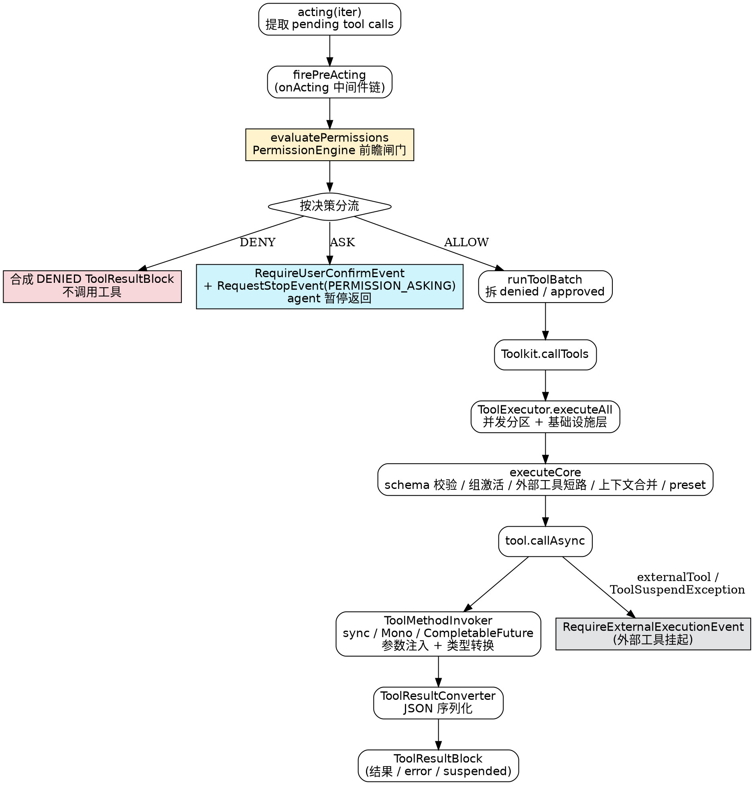
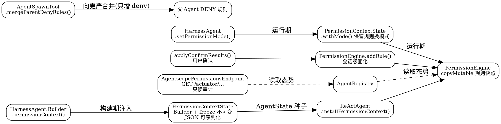

## Introduction

本分册覆盖 AgentScope Java 执行链路上的四块机制：**工具体系**（`Toolkit` 与三种工具写法、MCP）、**权限系统**（五模式 + 规则 DSL + 工具自带检查）、**中间件**（5 个 hook）与 **Plan Mode**（阶段级工具白名单）。四者的共同点是都挂在「一次工具调用怎么被放行、怎么被执行、怎么被拦截」这条路上，合册阅读最能看清整条链路。

本分册所有类名、方法签名、枚举值与默认值均核对自本地 `v2.0.4` 源码树（`agentscope-core/.../tool/`、`.../permission/`、`.../middleware/`、`.../state/PlanModeContextState.java`，`agentscope-harness/.../middleware/`），与官方文档冲突处以源码为准。

与 Python 版的差异值得一提：Python 版中间件是 7 个 hook 反射自动检测，Java 版是 **5 个 hook**（4 洋葱 + 1 管道）+ `order()` 显式排序；Python 版权限的安全 ASK 靠 `bypass_immune` 标记，Java 版靠 `checkPermissions` 的 **bypass-immune 求值次序**（工具自带检查先于 `BYPASS` 兜底）＋工具执行时的**自带安全自检**（如 `ShellCommandTool` 命令白名单、文件工具 baseDir/工作区围栏）两层——后者独立于权限引擎，是防御纵深。⚠️ v2.0.4 实测：`ToolBase.isDangerousPath` / `ToolDangerousPathConstants` 全仓无调用方，危险路径保护是工具作者构件而非框架强制，详见 [Two Safety Layers](#two-safety-layers)。

## Toolkit And Tool Registration

`Toolkit` 是工具总入口，两类注册 API（`tool/Toolkit.java`）：

```java
// 1. 流式 builder（registration() 返回 ToolRegistration）
toolkit.registration()
        .tool(toolObject)                       // POJO，反射 @Tool 方法
        .agentTool(agentTool)                   // AgentTool 实例
        .mcpClient(mcpClientWrapper)            // MCP 客户端
        .subAgent(provider)                     // 子 Agent 提供者（可带 SubAgentConfig）
        .mcpToolNamePrefix(prefix)              // MCP 工具名前缀
        .enableTools(List.of(...))              // 只启用列出的工具
        ...;

// 2. 直接方法
public void registerTool(Object toolObject);
public void registerAgentTool(AgentTool tool);
public Mono<Void> registerMcpClient(McpClientWrapper wrapper);   // 异步：要握手
public Mono<Void> removeMcpClient(String name);
public void closeMcpClients();
public void registerMetaTool();
public Toolkit copy();
```

工具组（运行时切换，配合元工具）：`createToolGroup(name, desc, active)`、`registerToolGroup(ToolGroup)`、`addToolToGroup(group, tool)`、`updateToolGroups(names, active)`、`setActiveGroups(...)` / `getActiveGroups()`、`removeToolGroups(...)`、`createSkillToolGroup(...)`、`findSkillToolGroupsByActivateOnSkill(skillName)`。

执行侧：`callTool(ToolCallParam)` → `Mono<ToolResultBlock>`、`callTools(...)` 三个重载、`setChunkCallback(BiConsumer<ToolUseBlock, ToolResultBlock>)`、`isExternalTool(name)`、`getToolSchemas(Collection<String> activeGroups)`。

⚠️ `copy()` 的语义要读注释（`Toolkit.java:928-946`）：**构建期隔离用，不要 per-call 用**。用户工具实例按引用共享（必须线程安全），工具组与激活标志深拷贝；框架元工具重新绑到新 registry。per-call 的工具面差异应该用 `ToolRequestConfig` 组合表达（`getTool(name, requestConfig)` / `getToolSchemas(groups, requestConfig)`），而不是拷贝 toolkit。

### Three Ways To Write A Tool

| 写法 | 基类/注解 | 适用 |
| :--- | :--- | :--- |
| 注解反射 | POJO 方法打 `@Tool` | 最常用，框架反射生成 schema |
| 继承 `ToolBase` | `public abstract class ToolBase implements AgentTool` | 要自定义 `checkPermissions` / `matchRule` / `generateSuggestions` |
| 直接实现 `AgentTool` | 接口 | 完全手工（元工具、远程代理就是这么写的） |

`@Tool` 注解的**全部 11 个属性**（`tool/Tool.java`）：

```java
String name() default "";
String description() default "";
boolean strict() default false;                    // schema 严格模式
boolean readOnly() default false;                  // EXPLORE 模式放行判据
boolean concurrencySafe() default true;
boolean externalTool() default false;              // 外部执行（HITL 挂起）
boolean stateInjected() default false;             // 注入 AgentState 参数
boolean returnDirect() default false;              // 结果直接作为 agent 回复
String[] dangerousFiles() default {};              // 追加危险文件
String[] dangerousDirectories() default {};        // 追加危险目录
Class<? extends ToolResultConverter> converter() default DefaultToolResultConverter.class;
```

`ToolBase` 的关键方法：`getName()` / `getDescription()` / `getParameters()`（均 final）、`isConcurrencySafe()` / `isReadOnly()` / `isReturnDirect()` / `isExternalTool()` / `isStateInjected()` / `isMcp()`、`callAsync(ToolCallParam)`、`checkPermissions(input, context)`、`matchRule(ruleContent, toolInput)`、`generateSuggestions(toolInput)`、`isDangerousPath(filePath)`。

### Meta Tool

**只有一个元工具，名字是 `reset_equipped_tools`**（`tool/MetaToolFactory.java:51`，`Toolkit.registerMetaTool()` 注册，日志原文 "Registered meta tool: reset_equipped_tools"）。它的语义是**替换而非增量**——javadoc 原文强调「The input list is the FINAL set of active tool groups, not incremental changes. Any group not included in the list will be deactivated」，并建议「只激活当前任务需要的、用完立刻停用以节省上下文空间」。参数 `to_activate`（数组，enum 只含 **META scope** 的组名）。

`ToolGroupScope` 两值决定谁能动一个组（`tool/ToolGroupScope.java:29-42`）：**META**（元工具可管，进 enum、跟替换语义）与 **EXTERNAL**（只归开发者代码管，元工具看不见也改不了）。

## Internal Architecture

本分册前几节把 API 面铺开了，但「工具」不是一个类，而是一组**协作组件**。理解它们的职责边界，才知道哪里能扩展、哪里不能碰、一次调用到底经过了谁。所有类名与行为核对自 `v2.0.4` 源码（`agentscope-core/.../tool/`、`.../permission/`、`ReActAgent.java`）。

`Toolkit` 是**组合根（composition root）**：它内部持有一个 `ToolRegistry`、一个 `ToolGroupManager`、一个 `ToolSchemaProvider` 和一个 `ToolExecutor`。`callTool` / `callTools` 只是把请求转发给 `executor.execute` / `executeAll`，注册方法（`registration()` builder、`registerTool`、`registerMcpClient`、`registerMetaTool`）向 registry + schema provider 灌数据。**关键设计：per-call 的工具面差异用 `ToolRequestConfig` 表达，绝不靠拷贝 toolkit**——`copy()` 的语义是构建期隔离（共享工具实例引用、深拷贝工具组与激活标志、重新绑定框架元工具），详见 `Toolkit.java:928-946` 注释。

组件职责一览：

| 组件 | 文件 | 职责 | 关键事实 |
| :--- | :--- | :--- | :--- |
| `Toolkit` | `tool/Toolkit.java` | 组合根 + 注册 + 转发 | `callTool`→`executor.execute`；per-call 面用 `ToolRequestConfig`，不用 `copy()` |
| `ToolRegistry` | `tool/ToolRegistry.java` | 名字 → 实现 + 元数据 | `ConcurrentHashMap`；`copyTo()` 按引用共享工具实例、拷贝元数据（构建期隔离）；`removeToolIfSame` 用 `ConcurrentHashMap.remove(k, expected)` 防 TOCTOU |
| `ToolGroupManager` | `tool/ToolGroupManager.java` | 工具组 + 激活态 | `isActiveTool(name[, activeGroups])` 是可用性闸门；`replaceMetaActiveGroups` 是元工具的落点；组带 `META`/`EXTERNAL` 两 scope |
| `ToolExecutor` | `tool/ToolExecutor.java` | 执行 + 基础设施层（**不含权限闸门**） | 调度/超时/重试/优雅关闭四层；批量按 `isConcurrencySafe` 分区并发 |
| `ToolBase` | `tool/ToolBase.java` | `AgentTool` 抽象契约 | `final` 标志位 + `dangerousFiles/dangerousDirectories`（**替换非追加**）；`checkPermissions` 默认 passthrough；`isDangerousPath` 是 symlink 解析式构件 |
| `ReflectiveFunctionTool` | `tool/ReflectiveFunctionTool.java` | `@Tool` 方法 → `ToolBase` 桥 | `create()` 校验 `stateInjected` ↔ `AgentState` 参数一致性；schema 来自 `ToolSchemaGenerator`；`@Tool(dangerousFiles=)` 经 builder **替换**默认表 |
| `ToolMethodInvoker` | `tool/ToolMethodInvoker.java` | 反射调用 | 三种返回类型（`CompletableFuture`/`Mono`/sync）；自动注入 `ToolEmitter`/`Agent`/`AgentState`/`RuntimeContext`/用户 POJO；`JsonCodec.convertValue` 保留泛型 |
| `ToolSchemaGenerator` | `tool/ToolSchemaGenerator.java` | 生成 OpenAI 格式 JSON Schema | 只收 `@ToolParam` 参数；把 per-param `$defs`/`definitions` 提升到根；排除 preset 参数 |
| `ToolRequestConfig` | `tool/ToolRequestConfig.java` | 不可变 per-call 配置（外部工具注入） | `resolveTool` = 外部（schema-only）→ 隐藏后端（`EXTERNAL_ONLY`）→ registry；`NONE` = 用共享 toolkit |
| `ToolResultConverter` | `tool/DefaultToolResultConverter.java` | 结果 → `ToolResultBlock` | null→`"null"`、void→`"Done"`、`ToolResultBlock` 透传、其余 JSON（回退 `toString`）；`@Tool(converter=)` 可覆写 |
| `ToolExecutionContext` | `tool/ToolExecutionContext.java` | 上下文注入（**已废弃**） | 双层 facade（facade + `ContextStore`），优先级 Call→Agent→Toolkit→Spring；已被 `RuntimeContext.builder().put(Type, value)` 取代 |

两个容易误读的点：

1. **`ToolExecutor` 不持有权限逻辑**。它只负责「找到工具 → 校验 schema → 合并上下文/preset → 调 `callAsync` → 套上调度/超时/重试/优雅关闭」。权限判定发生在更上游的 ReAct 循环（见 [Execution Chain](#execution-chain) 与 [Permission](#permission)）。把权限想成「executor 里的一道 if」是错的。
2. **`ToolExecutionContext` 已废弃**，但 `ToolMethodInvoker` 仍桥接它——新代码一律用 `RuntimeContext` 注入 POJO；用户自定义类型的参数（无 `@ToolParam`、非 java.*、非 `ContentBlock`/`Msg`）由 `ToolMethodInvoker.resolveContextParameter` 从 `RuntimeContext` 按类型解析。

## Execution Chain

一次「模型决定调用工具」到「工具结果回到上下文」的完整链路，**源码层面**是这样走的（`ReActAgent.acting` → `actingStream` → `evaluatePermissions` → `runToolBatch` → `Toolkit.callTools` → `ToolExecutor.executeAll` → `executeCore` → `tool.callAsync` → `ToolMethodInvoker` → `ToolResultConverter` → `ToolResultBlock`）：



逐段拆解——

**① 入口与中间件（`acting` → `firePreActing`）**：`acting(int iter)` 先从上下文抽出尚未执行的 `ToolUseBlock`，经 `hookDispatcher.firePreActing` 包进 `onActing` 中间件链（洋葱型），再进入 `actingStream`。中间件（如 `AsyncToolMiddleware`、`PlanModeMiddleware`）在这一层就能改写/拦截工具列表。

**② 权限前瞻闸门（`evaluatePermissions`）**：这是权限真正发生的地方（不是 `ToolExecutor`）。它逐个工具跑 `PermissionEngine.checkPermission`（或轻量路径，见 [Permission](#permission)），产出 `PermissionGate(pendingAsk, autoDeniedIds)`。每个 `ToolUseBlock` 被标记成 `ALLOWED` 或 `ASKING` 写回上下文；`DENY` 的工具不再出现在 pending 里。
- 没有 `ASKING` → 直接 `runToolBatch`；
- 有 `ASKING` → 先写 `autoDenied` 的合成结果，发 `RequireUserConfirmEvent` + `RequestStopEvent(PERMISSION_ASKING)`，**agent 暂停并把控制权交还调用方**；下次调用携带 `ConfirmResult`（经 `Msg.METADATA_CONFIRM_RESULTS`）恢复，已确认的工具被标成 `ALLOWED` 跳过引擎。

**③ 批量执行与并发分区（`runToolBatch` → `executeAll`）**：`runToolBatch` 把列表拆成「被拒（合成 DENIED，不调用）」和「放行」两堆。放行部分交给 `ToolExecutor.executeAll`，它**按 `isConcurrencySafe` 分区**：连续的 safe 工具用 `Flux.mergeSequential` 并发推进（保序），unsafe 或无法判定的 legacy `AgentTool` 各自占一个串行槽——避免共享状态的两个调用重叠。`ToolkitConfig.parallel` 默认 `true`。

**④ 单工具核心（`executeCore`）**：拿到工具后依次做——工具查找（`ToolRequestConfig.resolveTool` 的「外部→隐藏后端→registry」策略）→ **组激活闸门**（`groupManager.isActiveTool`，未激活返回 `ToolResultBlock.error("Unauthorized tool call...")`）→ **schema 校验**（`ToolValidator.validateInput`，失败返回错误块并提示改参数）→ **外部工具短路**（`isExternalTool()` 直接返回 `ToolResultBlock.suspended`，不注入 preset、不本地调用）→ 上下文合并（runtimeContext 与 toolkit 默认 context 合并）→ 合并输入与 preset 参数（preset 优先，框架控制参数从调用方/LLM 视角不可变）→ 构造 `ToolEmitter` → `tool.callAsync`。

**⑤ 反射调用与结果转换（`callAsync` → `ToolMethodInvoker` → `ToolResultConverter`）**：`@Tool` 方法经 `ReflectiveFunctionTool` 落到 `ToolMethodInvoker.invokeAsync`，按返回类型走 `CompletableFuture` / `Mono` / sync 三路，做参数自动注入与类型转换（保留泛型），最终由 `ToolResultConverter` 把返回值规范成 `ToolResultBlock`（null→`"null"`、void→`"Done"`、对象→JSON）。`ToolSuspendException` 被 `ToolExecutor` 转成 `suspended` 结果；其余异常转成 `ToolResultBlock.error`。

**⑥ 收尾**：`runToolBatch` 把结果流化成 `ToolResultStartEvent`/`ToolResultTextDeltaEvent`/`ToolResultEndEvent` 等细粒度事件；`returnDirect` 工具在满足「无挂起 + 全部 returnDirect」时短路 ReAct 循环直接作为最终答复；`suspended` 工具触发 `RequireExternalExecutionEvent`，由调用方回传结果（HITL）。

⚠️ 一个边界：第 ④ 步的「组激活闸门」与第 ② 步的「权限引擎」是**两套独立的可用性/放行机制**——前者管「这个工具在当前激活组里可不可见」，后者管「这次调用批不批准」。外部工具经 `ToolRequestConfig` 注入时不受组激活约束（同名的未激活后端工具不能拒绝它，模型看到的是外部覆盖）。

## Permission

权限是 [Execution Chain](#execution-chain) 第 ② 步的**前瞻闸门**，由 `ReActAgent.evaluatePermissions` 在工具真正执行前调用 `PermissionEngine`，**不在 `ToolExecutor` 内**。本节把引擎判定流、它如何嵌入循环、以及它与工具自身安全层的关系写实。

### Engine As A Pre-Execution Gate

`PermissionEngine` 在 `ReActAgent` 构造/恢复时按 `slot` 缓存（`permissionEngineCache`，`ReActAgent.java:302/697-704`），种子来自 `AgentState` 里的 `PermissionContextState`（规则与模式快照进引擎自己的可变表，原始 context 永不被改）。循环里 `evaluatePermissions` 先判断是否启用引擎：

- **完整引擎路径**（当 `state.getPermissionContext().isTrivial()` 为 `false`：即用户配置了模式、规则或额外工作目录，opt-in 进了权限系统）：逐个工具跑 `PermissionEngine.checkPermission` 六步判定。
- **轻量路径**（`isTrivial()` 为 `true`，即默认出厂状态：DEFAULT 模式、无规则、无额外工作目录）：引擎**根本不启用**——只跑工具的 `checkPermissions`，且只有显式 `ASK` 会触发确认，`PASSTHROUGH`/`ALLOW` 直接放行、`DENY` 照常拒绝。

> 实践含义：开箱即用时权限系统等价于「工具自检 ASK 才拦一下」，规则引擎与五模式都未生效。要让 deny/ask/allow 规则、`EXPLORE`/`ACCEPT_EDITS`/`BYPASS`/`DONT_ASK` 真正起作用，必须先在 `PermissionContextState` 里配置模式或规则（即让它非 trivial）。

`evaluateOne` 还有两条短路：`ToolCallState.ALLOWED`（上一次调用已被用户确认、本轮恢复）直接跳过引擎；**非 `ToolBase` 的 legacy `AgentTool` 一律按 `ALLOW` 放过去**——引擎只看 `ToolBase`，这也是为什么 `ShellCommandTool`（直接实现 `AgentTool`）的自我保护完全靠自己（见 [Two Safety Layers](#two-safety-layers)）。

决策收束（`PermissionGate`）：`DENY` → 收集进 `autoDeniedIds`，循环合成 `DENIED` 结果写回上下文（不调用工具）；`ASK` → 进 `pendingAsk`，循环暂停等 HITL；`ALLOW`/`PASSTHROUGH` → 放行执行。

### Two Safety Layers

权限在这里是**双层结构**，二者互补、不可互相替代：

- **层 A — `PermissionEngine` 前瞻闸门（只覆盖 `ToolBase` 工具）**：deny/ask/allow 规则、`EXPLORE`/`ACCEPT_EDITS`/`BYPASS`/`DONT_ASK` 模式、以及 `ToolBase.checkPermissions`（bypass-immune）在**执行前**统一裁决。这是「集中式策略」。
- **层 B — 工具自带的安全自检（在 `callAsync` 执行时，防御纵深）**：即便绕过或没进引擎，工具自己还会再拦一道。两种典型实现：
  - `ShellCommandTool`（core，直接实现 `AgentTool`）：执行前用 `CommandValidator` 校验——命令白名单、`containsMultipleCommands`（拒绝 `&`/`|`/`;` 链式拼接）、`isPathWithinCurrentDirectory`（按深度追踪目录穿越，逃逸即拒），平台分 `UnixCommandValidator` / `WindowsCommandValidator`；非白名单命令走 `requestUserApproval` 回调，被拒则回 `SecurityError`。
  - 文件工具：`WriteFileTool`/`ReadFileTool`（core）是普通 POJO，靠 `FileToolUtils.validatePath(filePath, baseDir)` 做 **baseDir 围栏**（路径必须在 baseDir 内）；harness `FilesystemTool` 靠 `WorkspacePathNormalizer` + `AbstractFilesystem` 把操作限制在工作区根下。

⚠️ **订正（v2.0.4 实测）**：本仓库旧版叙述「危险路径强制 ASK」并不准确。`ToolBase.isDangerousPath` 与 `ToolDangerousPathConstants`（23 个敏感文件、4 个敏感目录、11 条危险命令）在源码里**只被 `ToolBase` 自身引用，全仓没有任何调用方**——它是提供给工具作者覆写 `checkPermissions` 时**自行调用**的构件（且 `isDangerousPath` 会解析 symlink 防止指向敏感目标的绕过），框架引擎和所有内置工具**默认不自动强制执行**它。换句话说：危险路径保护是「工具作者责任 / 可选构件」，不是框架保证。同理，`@Tool(dangerousFiles=)` / `ToolBase` 子类覆写 `dangerousFiles/dangerousDirectories` 是**整体替换**默认表，不是追加，覆写不当会悄悄关掉默认保护（类 javadoc 原文强调）。

具体样例：`PlanModeTools` 的 `plan_exit` 工具覆写 `checkPermissions` 返回 `ASK`，于是「离开计划模式」会经现有权限 HITL 流让用户确认（`plan_enter`/`plan_write`/`plan_exit` 始终被 `PlanModeMiddleware` 放行，其余变更工具在计划模式激活时被拒）。

### Five Modes

`PermissionMode`（`permission/PermissionMode.java:33-38`）5 值，JSON 值小写：

| 枚举 | JSON | 行为（javadoc 原文） |
| :--- | :--- | :--- |
| `DEFAULT` | `default` | 所有操作都要求显式 allow 规则 |
| `ACCEPT_EDITS` | `accept_edits` | 工作目录内的文件编辑自动放行 |
| `EXPLORE` | `explore` | 只读模式，修改类工具一律 DENY |
| `BYPASS` | `bypass` | 不求值规则，全部放行 |
| `DONT_ASK` | `dont_ask` | ASK 决策降级为 DENY（无人值守跑） |

`PermissionBehavior`（`PermissionBehavior.java:32-36`）4 值：`ALLOW` / `DENY` / `ASK` / **`PASSTHROUGH`**（工具把决策踢回引擎做规则匹配）。

### Evaluation Order

`PermissionEngine.checkPermission(ToolBase tool, Map<String,Object> toolInput)` → `Mono<PermissionDecision>`（`PermissionEngine.java:139-178`），六步次序，**引擎构造时把规则快照进自己的可变表，原始 context 永不被修改**；`addRule()` 可在运行时扩充：

```text
1. deny 规则            （最高优先级）
2. ask 规则             （命中时挂上 tool.generateSuggestions(input) 的建议规则）
3. 工具自带检查          （bypass-immune：EXPLORE/ACCEPT_EDITS 只读处理 + 危险路径 + ToolBase.checkPermissions）
4. allow 规则
5. BYPASS 模式兜底
6. 默认 ASK（DONT_ASK 模式下变 DENY）
```

第三步的 bypass-immune 体现在：即使 `BYPASS` 模式，工具自带检查仍先于 allow 规则求值——`continueAfterToolCheck()` 里的 BYPASS 兜底排在工具检查之后（`:188-196`）。工具返回 `PASSTHROUGH` 时引擎走空（`Mono.empty()`）继续往后匹配（`:222-224`）。

模式与只读判定：`EXPLORE` 下 `tool.isReadOnly()` 为真才 ALLOW，否则 DENY；`ACCEPT_EDITS` 下只读工具直接 ALLOW，非只读继续走后续步骤（`checkExploreMode`，`:229-263`）。

### Rule DSL

`PermissionRule` 是个四字段 record（`PermissionRule.java:33-37`）：

```java
public record PermissionRule(
        @JsonProperty("tool_name")     String toolName,        // 目标工具，非空
        @JsonProperty("rule_content")  String ruleContent,     // 工具特定的匹配模式，可空
        @JsonProperty("behavior")      PermissionBehavior behavior,
        @JsonProperty("source")        String source) {}       // 如 "userSettings" / "suggested"
```

**匹配语义（`ruleMatches`，`PermissionEngine.java:310-316`）**：

```java
String content = rule.ruleContent();
if (content == null || content.isEmpty()) {
    return true;                          // 规则内容为空 = 对该工具的所有调用生效
}
return tool.matchRule(content, input);    // 否则交给工具自己的匹配器解释
```

也就是说**规则内容的语法由工具定义**，引擎不解释——`ToolBase.matchRule` 是扩展点。规则按 `toolName` 分三个表（allow / deny / ask）存，命中即返回对应 `PermissionDecision`（带 `message` 与 `decisionReason`，如 `"Rule: " + rule.ruleContent()`）。

**规则匹配扩展点（`matchRule`）**：`ruleContent` 的具体语法由工具自己定义。`PermissionEngine.ruleMatches`（`PermissionEngine.java:310-316`）只做两步——`toolName` 路由 + `ruleContent` 空判（为空即对该工具所有调用生效），真正的匹配交给 `ToolBase.matchRule(ruleContent, input)`（`ToolBase.java:244`）这个扩展点。因此一条规则能精确匹配工具特定输入（某文件路径、某条命令），引擎对语法保持不可知。

**工具侧覆写样例（`McpTool`）**：MCP 外部工具 `McpTool` 覆写 `checkPermissions`（`McpTool.java:194`）——`isReadOnly()` 为真直接 `PermissionDecision.allow`（无提示），否则 `PermissionDecision.ask`（每次调用需显式授权）。这属于 [Two Safety Layers](#two-safety-layers) 层 A 的「工具自带检查」分支，与 `ToolBase` 默认走 `PermissionEngine` 的差异在于：MCP 工具绕开规则表，只做「只读放行 / 写即问」的二分。

### Dangerous Paths

`ToolDangerousPathConstants`（`tool/ToolDangerousPathConstants.java`）三张默认表：

- `DEFAULT_DANGEROUS_FILES`（23 项）：shell rc（`.bashrc` / `.zshrc` / `.profile` …）、`.ssh/config`、`.ssh/authorized_keys`、`.netrc`、`.npmrc`、`.pypirc`、`.gitconfig`、`.gitmodules`、以及 8 个 `.env*` 变体（`.env` / `.envrc` / `.env.local` / `.env.development[.local]` / `.env.test[.local]` / `.env.staging` / `.env.production[.local]`）。javadoc 明确「Aligned with Python `tool/_constants.py`」。
- `DEFAULT_DANGEROUS_DIRECTORIES`（4 项）：`.git` / `.vscode` / `.idea` / `.ssh`——路径中**任何一段**命中即算敏感。
- `DANGEROUS_COMMANDS`（11 项）：`rm -rf` / `sudo rm` / `dd` / `mkfs` / `fdisk` / `format` / `chmod 777` / `chmod -R 777` / `chown -R` / `kill -9` / `> /dev/`。

⚠️ 一个覆盖语义坑（类 javadoc 原文）：「Tools that override the fields on `ToolBase` **replace the defaults entirely rather than appending to them**」——子类覆写 `dangerousFiles` / `dangerousDirectories` 是整体替换，不是追加，容易把默认保护悄悄关掉。

`ToolBase.isDangerousPath(filePath)` 解析 symlink 后做「文件名 + 路径段」匹配；但注意（见 [Two Safety Layers](#two-safety-layers) 的 v2.0.4 实测订正）：它默认**不被引擎或任何内置工具自动调用**，只是工具作者覆写 `checkPermissions` 时自行调用的构件。`@Tool(dangerousFiles=...)` / `@Tool(dangerousDirectories=...)` 则让单个工具方法**整体替换**默认清单（见上面的覆盖语义坑）。

### Permission Management

权限不止「一次调用怎么裁决」，还涉及**配置从哪来、运行时怎么切、决策怎么固化、子 Agent 怎么继承、运维怎么观测**。这一层用 codegraph 从 `PermissionEngine` 的 `Called by ←` 反查出来，明显分成五个面。

**1. 配置注入与不可变快照**

全部权限状态装在 `PermissionContextState`（`PermissionContextState.java:36`）里：`mode` + `workingDirectories` + 三张规则表（allow/deny/ask）。它用 **Builder** 构建，构造函数对三张规则表调 `freeze()`（`List.copyOf` + `Collections.unmodifiableMap`）——**一旦构建即不可变**。两个关键性质：

- 并发安全：`PermissionEngine` 构造时把规则 `copyMutable` 进自己的可变表，原始 context 永不被改（`PermissionEngine.java:59-64`，`unmodifiableSnapshot` 同走冻结路径）；评估期间规则表不会被并发修改。
- 可序列化：四个核心类型 `PermissionContextState` / `PermissionRule`（record）/ `PermissionMode` / `PermissionBehavior` 全部带 Jackson 注解（`@JsonProperty` / `@JsonValue` / `@JsonCreator`）。权限配置因此可**持久化进 `AgentState`、经 API 传递、跨进程/重启恢复**，与 [Plan Mode](#plan-mode) 的「distributed and resumable」设计一脉相承。

配置入口两条：构建期 `HarnessAgent.Builder.permissionContext(PermissionContextState)`（`HarnessAgent.java:1724`）；运行期 `ReActAgent.installPermissionContext`（`ReActAgent.java:4634`）把 `AgentState` 里的 context 种子进引擎。

**2. 运行时模式切换**

`HarnessAgent` 提供会话/用户级切换：`setPermissionMode(RuntimeContext, mode)` 与 `setPermissionMode(userId, sessionId, mode)`（`HarnessAgent.java:432/442`）。底层走 `PermissionContextState.withMode(newMode)`（`:148`）——**返回新实例、保留所有规则与工作目录**，只换模式。可临时把会话翻到 `BYPASS` 而不丢配置规则，翻回时规则还在。

**3. 层级权限继承（子 Agent 不能比父更宽松）**

`AgentSpawnTool.mergeParentDenyRules(child, parent)`（`AgentSpawnTool.java:1759`）在 spawn 子 Agent 时合并权限：

- 子模式：`child.isTrivial() ? PermissionMode.BYPASS : child.getMode()`——子 Agent 自己没配权限时退化为 BYPASS（完全继承父裁决），有配置则用自己模式。
- **DENY 规则向更严格方向合并**：父的 deny 规则全量并入子（去重），allow/ask 只取子的。注释明确「explicit DENY rules still take precedence」——子 Agent 永远无法绕过父级拒绝策略。这是把权限做成「只能收紧、不能放宽」的层级闸。

**4. HITL 决策闭环固化**

用户在权限 HITL 流确认/拒绝某次调用后，`ReActAgent.applyConfirmResults`（`ReActAgent.java:2088`）把决策固化：

- `confirmed == true`：ASKING `ToolUseBlock` 提升为 `ALLOWED`，并把 `ConfirmResult.getRules()` 里的 `PermissionRule` 经 `permissionEngine.addRule(rule)`（`PermissionEngine.java:94`）**注册进引擎**——同会话后续同款调用直接命中规则，不再反复问。
- `confirmed == false`：写 `DENIED` `ToolResultBlock`（带用户理由），resume 后该调用不再挂起。

`addRule` 全仓 7 个调用方，生产侧正是 `applyConfirmResults`——这是权限系统的「会话记忆 / 学习」闭环。

**5. 可观测与审计面（只读）**

`AgentscopePermissionsEndpoint`（`agentscope-admin-spring-boot-starter/.../endpoint/AgentscopePermissionsEndpoint.java:39`）是 Spring Boot Admin 端点：

- `GET /actuator/agentscope-permissions` → `listAll()`：遍历 `AgentRegistry` 对每个 `ReActAgent` 调 `describe`。
- `GET /actuator/agentscope-permissions/{agentId}` → `getOne()`。
- `describe` 输出 `agent_id` / `agent_name` / `mode` / `allow` / `deny` / `ask`（`flatten` 展平规则表）。

⚠️ 端点**只读**：类 javadoc 明确「mutating rules requires changes in agentscope-core … tracked in ADMIN_OPS_API_PLAN.md」。当前只暴露权限态势用于审计/排障，运行时改规则（live rule edits）尚未开放。



### External Execution And Suspend

标记 `@Tool(externalTool = true)`（或 `SchemaOnlyTool` 注册）的工具不在框架内执行：抛 `ToolSuspendException`（`tool/ToolSuspendException.java`）把执行权交出去，框架发 `RequireExternalExecutionEvent`，结果由调用方回传，见 [智能体分册 HITL](/docs/CS/AI/LLM/Agent/Product/AgentScopeJava/Agent.md)。

## Middleware

`MiddlewareBase` 是**接口**（`middleware/MiddlewareBase.java:59`），提供 **5 个 hook**，分两种模式：

**洋葱型（4 个，before/after 包裹）**：

```java
default Flux<AgentEvent> onAgent(Agent agent, RuntimeContext ctx, AgentInput input,
                                 Function<AgentInput, Flux<AgentEvent>> next);
default Flux<AgentEvent> onReasoning(Agent agent, RuntimeContext ctx, ReasoningInput input,
                                 Function<ReasoningInput, Flux<AgentEvent>> next);
default Flux<AgentEvent> onActing(Agent agent, RuntimeContext ctx, ActingInput input,
                                 Function<ActingInput, Flux<AgentEvent>> next);
default Flux<AgentEvent> onModelCall(Agent agent, RuntimeContext ctx, ModelCallInput input,
                                 Function<ModelCallInput, Flux<AgentEvent>> next);
```

**管道型（1 个，顺序变换字符串）**：

```java
default Mono<String> onSystemPrompt(Agent agent, RuntimeContext ctx, String currentPrompt);
```

排序：`order()` 默认 **1**，数值越大越靠外层（`2` 在 `1` 之前执行），同级保持 builder 注册顺序。所有 hook 默认直接委托 `next`，子类只覆写关心的。

一个高价值细节写在 `onModelCall` 的 javadoc 里（`:127-131`）：**中间件对返回流中 `TextBlockDeltaEvent` 的变换会反映进最终回复消息**，因此可以在原生结构化输出解析之前归一化模型文本。

配套输入类型：`AgentInput`（消息）、`ReasoningInput`（消息 + 工具 + 选项）、`ActingInput`（工具调用）、`ModelCallInput`（消息 + 工具 + 选项 + model）、`MiddlewareChain`。

### Built-in Middleware

**core 两个**：`FinalAnswerFilterMiddleware`（最终答复过滤）、`TaskReminderMiddleware`（任务提醒）。

**harness 二十个**（`agentscope-harness/.../middleware/`，按职责分组）：

| 分组 | 类 |
| :--- | :--- |
| 上下文与压缩 | `CompactionMiddleware`（onReasoning，阈值超限时 5 步压缩）、`ToolResultEvictionMiddleware`（超大工具结果卸载到文件系统）、`WorkspaceContextMiddleware`（onSystemPrompt 注入 AGENTS.md / MEMORY.md / knowledge） |
| 记忆 | `MemoryFlushMiddleware`（onAgent 的 doOnComplete，fire-and-forget 抽取事实）、`MemoryMaintenanceMiddleware`（周期维护：过期日文件归档 + LLM 合并，节流执行） |
| 技能 | `HarnessSkillMiddleware`（harness 原生技能合成，onSystemPrompt 渲染 `<available_skills>`）、`SkillUsageMiddleware`（ SkillBox 技能调用计数，只记 `created_by="agent"`/`"agent-draft"`）、`SkillCuratorMiddleware`（call 结束后调度 curator，单线程守护Executor，不阻塞 agent loop）、`DynamicSkillMiddleware`（core 侧 legacy，已被 HarnessSkillMiddleware 取代） |
| 子 Agent 与团队 | `SubagentsMiddleware`（默认模式造 `AgentSpawnTool` + `DefaultAgentManager`；session 模式注入外部 `SessionsTool` 替换之）、`DynamicSubagentsMiddleware`（每轮推理重新解析子 agent 集合，两层加载）、`SubagentEntry`、`TeamsMiddleware`（注入 AgentTeams 上下文 + 角色裁剪的 `TeamTool`） |
| 输入与信箱 | `AtPathExpansionMiddleware`（展开用户消息里的 `@path`，追加 `<attached_file>`）、`InboxMiddleware`（每轮推理前 drain 信箱，以 `HintBlock` 注入并发 `HintBlockEvent`）、`AsyncToolMiddleware`（acting 超时的工具转后台，占位结果 + 完成推送 inbox） |
| 运行时与沙箱 | `HarnessRuntimeMiddleware`（框架装配标记，`fromAgent(...)` 不复制）、`SandboxLifecycleMiddleware`（每次 call 前后借还沙箱会话、4 分支工作区初始化）、`TranscriptMiddleware`（每次 call 结束持久化 transcript，独立于 memory flush） |
| 可观测 | `AgentTraceMiddleware`（INFO 摘要 / DEBUG 详单） |

`DynamicSubagentsMiddleware` 的两层加载值得单记（javadoc）：**Layer 1（override）** `filesystem.glob("*.md", "subagents")` + 逐文件 read，后端的 `NamespaceFactory` 透明生效，每个用户看到自己的覆盖；**Layer 2** 继承静态声明。

中间件要动态注册工具时，必须用 `Agent.getToolkit()` 拿**运行时 toolkit**（`Agent.java:101-113` javadoc 原文提醒：agents may deep-copy the toolkit during construction，build 时捕获的引用可能不是 agent 实际用的那个）。

## Plan Mode

`PlanModeContextState`（`state/PlanModeContextState.java:37-40`）只有两个字段，但存放位置是关键：

```java
private boolean planActive;
private String currentPlanFile;   // workspace 相对路径，markdown 蓝图
```

类 javadoc 说明了为什么它在 `AgentState` 里而不是进程内存：「agentscope agents are distributed and resumable: a plan-mode session must survive process restarts and hand-offs across nodes. Toggling the flag and persisting the `AgentState` is therefore the canonical way to switch modes dynamically at runtime.」

执行者是 `PlanModeMiddleware`（harness），javadoc 原文要点：

- 求值发生在 **`onActing`**，且是确定性的；
- 放行条件：**只读工具**，或计划控制工具之一（`plan_enter` / `plan_write` / `plan_exit` / `todo_write`）；
- 其余工具得到一条**合成 `DENIED` tool result**（写进上下文并作为事件流出）而不真正执行；
- 刻意**不复用 `PermissionMode`**——计划模式是阶段级约束，与权限模式正交。

计划文件落 `plans/PLAN.md`（可用 `.planFileDirectory("design-docs")` 改路径），跨调用保留；Plan Mode 下 spawn 的子 Agent 会自动继承只读限制，详见 [技能分册](/docs/CS/AI/LLM/Agent/Product/AgentScopeJava/Skill.md)。

## MCP And Tool Groups

`mcp/` 包：`McpClientManager`（客户端生命周期）、`McpClientWrapper`（`Toolkit.registerMcpClient` 的参数）、`RegisteredToolFunction` / `ReflectiveFunctionTool` / `SchemaOnlyTool` / `MetaToolFactory` / `SimpleExtendedModel` / `ExtendedModel`（扩展模型能力）、`ToolExecutor` / `ToolMethodInvoker`（反射调用）、`ToolSchemaGenerator` / `ToolSchemaModule` / `ToolSchemaProvider`（JSON Schema 生成）、`SkillToolGroup`（技能工具组）、`ToolMergeMode`。

工具组相关：`ToolGroup`、`ToolGroupManager`（`replaceMetaActiveGroups(toActivate)` 是元工具的落点、`getMetaGroupNames()`、`isActiveTool(name, activeGroups)`）、`ToolGroupScope`（META / EXTERNAL）、`ToolkitConfig`（`parallel` 默认 **true**——同一轮多个同步工具调用并行推进）。

## Links

- [主笔记](/docs/CS/AI/LLM/Agent/Product/AgentScopeJava/AgentScopeJava.md)
- [智能体分册](/docs/CS/AI/LLM/Agent/Product/AgentScopeJava/Agent.md)
- [上下文分册](/docs/CS/AI/LLM/Agent/Product/AgentScopeJava/Context.md)
- [Permission](/docs/CS/AI/LLM/Agent/Theory/Permission.md)
- [AgentScope（Python 版）](/docs/CS/AI/LLM/Agent/Product/AgentScope/AgentScope.md)

## References

- [AgentScope Java 工具](https://java.agentscope.io/v2/zh/docs/building-blocks/tool)
- [AgentScope Java 权限系统](https://java.agentscope.io/v2/zh/docs/building-blocks/permission-system)
- [AgentScope Java 中间件](https://java.agentscope.io/v2/zh/docs/building-blocks/middleware)
- [AgentScope Java Plan Mode](https://java.agentscope.io/v2/zh/docs/harness/plan-mode)
