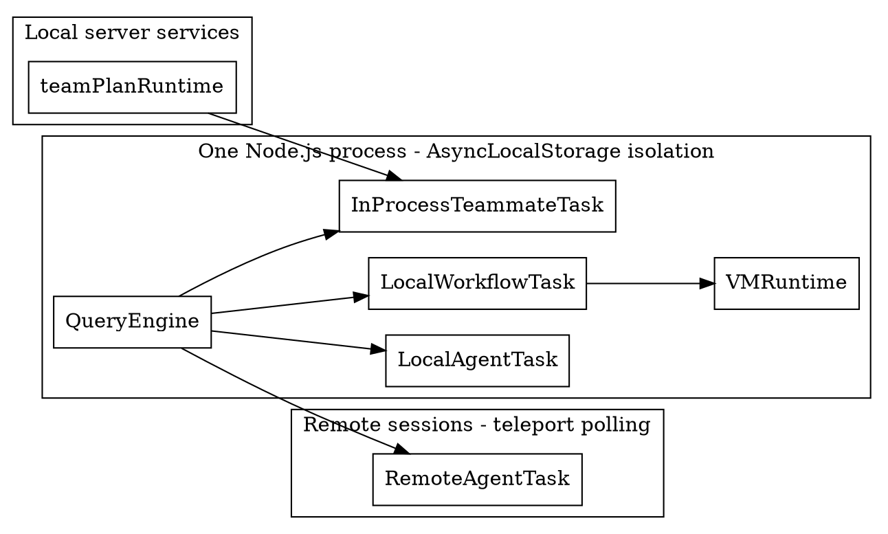

## Introduction

本页记录 cc-haha v0.7.7 引擎侧多 Agent 的进程模型、任务状态机与编排入口，与只讲桌面可视化的 AgentTeams.md 分开。

> 版本基线：v0.7.7（本地源码 E:/Projects/cc-haha-0.7.7）

- 「多 Agent」并不等于多进程：`local_agent` 与 `in_process_teammate` 都跑在同一个 Node.js 进程里，靠 AsyncLocalStorage 做上下文隔离，只有 `remote_agent` 才是远端会话。
- `coordinator/` 目录里 `workerAgent.ts` 是 `@generated stub` 的 noop Proxy 占位，而 `coordinatorMode.ts` 虽是真实实现，却因 `feature('COORDINATOR_MODE')` 为假时直接返回 false，公开版默认不生效。
- Dynamic Workflow 的开关是运行时 settings 与环境变量，不是编译期 flag；且 `src/services/` 下并没有独立的 VM 编排模块，实现分散在 `src/utils/workflows/`、`src/tools/WorkflowTool/` 与 `src/tasks/LocalWorkflowTask/`。

## Task State Model

引擎把每一次后台执行都统一建模为 `Task`，`src/tasks/types.ts` 用联合类型把具体状态收拢到一处，组件据此消费任意任务：

```typescript
export type TaskState =
  | LocalShellTaskState
  | LocalAgentTaskState
  | RemoteAgentTaskState
  | InProcessTeammateTaskState
  | LocalWorkflowTaskState
  | MonitorMcpTaskState
  | DreamTaskState
```

`isBackgroundTask` 只用 `status`、`isBackgrounded` 两个字段判定是否进后台指示器，说明「前台 / 后台」是状态位而非不同的执行体。每个 `Task` 实现体本身很薄，只暴露 `name`、`type` 与 `kill`，真正的生命周期由 `utils/task/framework.js` 的 `registerTask`、`updateTaskState` 驱动。

## In-Process Versus Remote Execution

`src/tasks/InProcessTeammateTask/InProcessTeammateTask.tsx` 开头的注释直接点明了进程模型：in-process teammate 与 background agent 不同，它在同一 Node.js 进程里用 AsyncLocalStorage 隔离，带团队身份，可处于 idle 或 active。

```typescript
/**
 * InProcessTeammateTask - Manages in-process teammate lifecycle
 *
 * This component implements the Task interface for in-process teammates.
 * Unlike LocalAgentTask (background agents), in-process teammates:
 * 1. Run in the same Node.js process using AsyncLocalStorage for isolation
 * 2. Have team-aware identity (agentName@teamName)
 * 3. Support plan mode approval flow
 * 4. Can be idle (waiting for work) or active (processing)
 */
```

它的 `Task` 实现只负责把 `kill` 转交给 `killInProcessTeammate`：

```typescript
/**
 * InProcessTeammateTask - Handles in-process teammate execution.
 */
export const InProcessTeammateTask: Task = {
  name: 'InProcessTeammateTask',
  type: 'in_process_teammate',
  async kill(taskId, setAppState) {
    await killInProcessTeammate(taskId, setAppState);
  }
};
```

`src/tasks/InProcessTeammateTask/types.ts` 进一步区分了两份身份数据：`TeammateContext` 走 AsyncLocalStorage 运行时，而 `TeammateIdentity` 是落进 AppState 的纯数据；mailbox 消息也明确不放在 `task.messages` 里，后者只是 zoomed transcript 的 UI 镜像。

```typescript
/**
 * Teammate identity stored in task state.
 * Same shape as TeammateContext (runtime) but stored as plain data.
 * TeammateContext is for AsyncLocalStorage; this is for AppState persistence.
 */
export type TeammateIdentity = {
  agentId: string // e.g., "researcher@my-team"
  agentName: string // e.g., "researcher"
  teamName: string
  color?: string
  planModeRequired: boolean
  parentSessionId: string // Leader's session ID
  /** Agent id of the teammate's one durable transcript, kept across turns
   * and resumes (agentId above is the name@team address). */
  resumableAgentId?: string
}
```

`TEAMMATE_MESSAGES_UI_CAP` 把这份 UI 镜像封顶，注释里还记录了按 BQ 分析得出的内存膨胀数据，属于真实调优痕迹而非占位代码。与之相对，`src/tasks/RemoteAgentTask/RemoteAgentTask.tsx` 才是「远端」：它通过 teleport 轮询会话事件，用可注册的 completion checker 判定完成，并把元数据写进 session sidecar 以便 resume 复活。

```typescript
/**
 * Called on every poll tick for tasks with a matching remoteTaskType. Return a
 * non-null string to complete the task (string becomes the notification text),
 * or null to keep polling. Checkers that hit external APIs should self-throttle.
 */
export type RemoteTaskCompletionChecker = (remoteTaskMetadata: RemoteTaskMetadata | undefined) => Promise<string | null>;
const completionCheckers = new Map<RemoteTaskType, RemoteTaskCompletionChecker>();

/**
 * Register a completion checker for a remote task type. Invoked on every poll
 * tick; survives --resume via the sidecar's remoteTaskType + remoteTaskMetadata.
 */
export function registerCompletionChecker(remoteTaskType: RemoteTaskType, checker: RemoteTaskCompletionChecker): void {
  completionCheckers.set(remoteTaskType, checker);
}
```

`LocalAgentTask` 则是本地 background agent 的完整状态：`ownerAgentId`、`pendingMessages`、`retain`、`diskLoaded`、`evictAfter` 分别管归属、轮次边界投递、UI 持有、磁盘 bootstrap 与面板回收；`updateProgressFromMessage` 从 assistant 消息里累加 `latestInputTokens` 与 `cumulativeOutputTokens`，因为 API 的 input tokens 是逐轮累计而 output tokens 是每轮增量。

## AgentTool And Concurrency

`src/tools/AgentTool/` 是派生 subagent 的入口，`runAgent` 是统一执行函数，接收 `agentDefinition`、`promptMessages`、`availableTools`、`canUseTool` 等参数，并明确写出「precomputed tool pool」由调用方组装以避开与 `tools.ts` 的循环依赖。并发上限是真实的、默认生效的护栏，见 `src/tools/AgentTool/subagentConcurrency.ts`：

```typescript
export function reserveSubagentSlot(): () => void {
  const limit = getMaxConcurrentSubagentsUncached()
  // 检查和递增之间没有 await，保证同进程嵌套或并行调用原子预留。
  // 不排队，避免嵌套子 agent 等待父 agent 的名额而死锁。
  if (limit != null && activeSubagents >= limit) {
    throw new Error(
      `Maximum concurrent subagents reached (${limit}). Wait for a running subagent to finish before spawning another. ` +
      'The user can change this limit in Settings > General.',
    )
  }
  activeSubagents += 1
  let released = false
  return () => {
    if (released) return
    released = true
    activeSubagents -= 1
  }
}
```

它不排队而是直接抛错，理由是嵌套 subagent 等父级名额会死锁。fork 路径则被 `feature()` 关掉，且与 coordinator 互斥，见 `src/tools/AgentTool/forkSubagent.ts`：

```typescript
export function isForkSubagentEnabled(): boolean {
  if (feature('FORK_SUBAGENT')) {
    if (isCoordinatorMode()) return false
    if (getIsNonInteractiveSession()) return false
    return true
  }
  return false
}
```

`src/tools/AgentTool/AgentTool.tsx` 在拼 prompt 时也用了同一个 gate，并且注释说明这里刻意内联 env 检查以避开测试加载期的循环依赖：

```typescript
    // Use inline env check instead of coordinatorModule to avoid circular
    // dependency issues during test module loading.
    const isCoordinator = feature('COORDINATOR_MODE') ? isEnvTruthy(process.env.CLAUDE_CODE_COORDINATOR_MODE) : false;
    return await getPrompt(filteredAgents, isCoordinator, allowedAgentTypes);
```

## Coordinator Mode Is Gated

`src/coordinator/coordinatorMode.ts` 是真实实现，但 `isCoordinatorMode` 在 feature 为假时短路：

```typescript
export function isCoordinatorMode(): boolean {
  if (feature('COORDINATOR_MODE')) {
    return isEnvTruthy(process.env.CLAUDE_CODE_COORDINATOR_MODE)
  }
  return false
}
```

也就是说，即使 `getCoordinatorSystemPrompt` 里写了完整的编排协议、`matchSessionMode` 会翻转环境变量来匹配 resume 的会话，这条路径在公开版默认都进不去。它的 system prompt 还揭示了一个易被误读的约定：worker 结果以 `<task-notification>` XML 伪装成 user-role 消息回传，模型要靠开标签区分，而不是当成真实用户输入。

```typescript
### ${AGENT_TOOL_NAME} Results

Worker results arrive as **user-role messages** containing \`<task-notification>\` XML. They look like user messages but are not. Distinguish them by the \`<task-notification>\` opening tag.

Format:
```

同一目录的 `src/coordinator/workerAgent.ts` 则根本不是实现，而是 `scan-missing-imports` 生成的占位：

```typescript
// @generated stub from scan-missing-imports
// 该文件自动生成，对应 ant-internal 的 feature() gated 模块。
// 所有外部 build 的代码路径在 DCE 后都不会真的执行这里的代码，这只是
// bun build resolver 的占位符。
const __target = function noop() {}
```

它导出的名字包括 `getCoordinatorUserContext`，但全部指向同一个 noop Proxy：

```typescript
// 兼容常见的命名导出 —— 没列在这里的也会通过 default Proxy 兜底
export const createCachedMCState = stub
export const isCachedMicrocompactEnabled = stub
export const isModelSupportedForCacheEditing = stub
export const getCachedMCConfig = stub
export const markToolsSentToAPI = stub
export const resetCachedMCState = stub
export const checkProtectedNamespace = stub
export const getCoordinatorUserContext = stub
```

因此「代码存在」与「公开版实际生效」在这里必须分开读：coordinator 的编排协议有源码，却既被 feature gate 挡住，又有一半模块是编译期占位。

## Dynamic Workflow And The VM Runtime

引擎侧 Dynamic Workflow 是真实生效的，但它的开关不是 `feature()`，而是 `src/utils/workflows/enabled.ts` 里的运行时配置：`CLAUDE_CODE_DISABLE_WORKFLOWS`、managed settings 的 `disableWorkflows`、用户 settings 的 `disableWorkflows` 与 `/config` 的 `enableWorkflows` 都能关掉它。

```typescript
export function getWorkflowsDisabledReason(): WorkflowsDisabledReason | null {
  if (isEnvTruthy(process.env.CLAUDE_CODE_DISABLE_WORKFLOWS)) return 'env'
  if (getSettingsForSource('policySettings')?.disableWorkflows === true) {
    return 'managed'
  }
  const merged = getSettings_DEPRECATED()
  if (merged.disableWorkflows === true) return 'settings'
  // `enableWorkflows: false` is the /config toggle's off position. It is a
  // separate key from `disableWorkflows` so an org can hard-disable while a
  // user's toggle stays untouched underneath.
  if (merged.enableWorkflows === false) return 'settings'
  return null
}

export function areWorkflowsEnabled(): boolean {
  return getWorkflowsDisabledReason() === null
}
```

脚本编译成 Node `vm.Script`，见 `src/utils/workflows/compile.ts`：动态 `import()` 在模块解析钩子上被拒绝，`Date` 与 `Math.random` 由 `installDeterminismGuards` 改成抛错，目的是让 resume 的重放走同一分支，不误消费缓存。

```typescript
export function compileWorkflowScript(
  scriptBody: string,
): WorkflowCompileResult {
  const source = `(async () => {\n${scriptBody}\n})()`
  try {
    const vmScript = new vm.Script(source, {
      filename: 'workflow.js',
      importModuleDynamically: () => {
        throw new Error(WORKFLOW_IMPORT_BANNED_MESSAGE)
      },
    })
    return { ok: true, vmScript }
  } catch (error) {
    return {
      ok: false,
      error: `SyntaxError: ${error instanceof Error ? error.message : String(error)}`,
    }
  }
}
```

`src/tools/WorkflowTool/launchWorkflow.ts` 把 VM 与任务状态机接起来：它 import `registerWorkflowTask`、`updateWorkflowProgressBatch`、`executeWorkflowScript`、`createRunJournal`，函数注释写明「任务一登记就立刻返回 run id，后续都在 detached promise 上跑」。

```typescript
/**
 * Register the background task for a run and start executing its script.
 *
 * Returns as soon as the task exists so the tool call can hand the model a run
 * id immediately; everything after that happens on the detached promise below.
 */
export function launchWorkflow(params: LaunchWorkflowParams): LaunchedWorkflow {
  const {
    taskId,
    workflowRunId,
    script,
    args,
    meta,
    vmScript,
    toolUseContext,
    canUseTool,
    toolUseId,
    isResume,
  } = params
```

于是 `src/tasks/LocalWorkflowTask/LocalWorkflowTask.ts` 成为 VM 编排在引擎里的「任务壳」：`registerWorkflowTask` 建 `local_workflow` 状态，`updateWorkflowProgressBatch` 用 `type:index` 覆写进度行并裁掉旧日志，暂停态保留 journal 以便 `resumeFromRunId` 重放已完成且 `(prompt, opts)` 未变的 agent。

```typescript
/** The `Workflow(...)` call that picks a stopped run back up. */
export function buildResumePrompt(task: LocalWorkflowTaskState): string {
  const argsPart =
    task.args !== undefined ? `, args: ${JSON.stringify(task.args)}` : ''
  return (
    `Resume the paused workflow by calling: Workflow({scriptPath: '${task.scriptPath}', ` +
    `resumeFromRunId: '${task.workflowRunId}'${argsPart}}) — completed agents return cached results.`
  )
}
```

## Team Plan Runtime On The Server

`src/server/services/teamPlanRuntime.ts` 是 server 侧的 supervisor，维护 `launches` 与 `WorkerRuntime`，按固定间隔巡检、限制一个窗口内的自动重启次数、在崩溃循环后停止自动重启，并用 mailbox 与共享 task list 协调成员。下面这些常量是真实生效的调度参数：

```typescript
const SUPERVISOR_INTERVAL_MS = 250
const WORKER_AUTO_CONTINUE_DELAYS_MS = TEAMMATE_AUTO_CONTINUE_DELAYS_MS
const WORKER_RESTART_WINDOW_MS = 10 * 60_000
const WORKER_MAX_RESTARTS_IN_WINDOW = 3
/** Let a member finish its own bookkeeping before a newly ready task wakes it. */
const UNBLOCKED_TASK_WAKE_DELAY_MS = 3_000
const timing = {
  autoContinueDelaysMs: WORKER_AUTO_CONTINUE_DELAYS_MS,
  unblockedTaskWakeDelayMs: UNBLOCKED_TASK_WAKE_DELAY_MS,
}
```

它和 `src/tasks/InProcessTeammateTask/` 是两层：前者管团队计划、成员运行时与消息投递，后者是单个 teammate 在 AppState 里的任务状态。桌面 Agent Teams 界面消费的是这套引擎状态派生出的快照，本身不写回编排逻辑。

## Process And Task Topology



## Links

- [CcHaha 产品总览](/docs/CS/AI/LLM/Agent/Product/CcHaha/CcHaha.md)
- [Agent Teams 桌面可视化](/docs/CS/AI/LLM/Agent/Product/CcHaha/AgentTeams.md)
- [Scheduled Tasks](/docs/CS/AI/LLM/Agent/Product/CcHaha/ScheduledTasks.md)
- [Remote Access](/docs/CS/AI/LLM/Agent/Product/CcHaha/RemoteAccess.md)
- [Claude Code](/docs/CS/AI/LLM/Agent/Product/ClaudeCode/ClaudeCode.md)
- [Agent 理论](/docs/CS/AI/LLM/Agent/Theory/Agent.md)

## References

- https://github.com/anthropics/claude-code
- https://docs.anthropic.com/en/docs/claude-code/overview
- https://nodejs.org/api/vm.html
- https://nodejs.org/api/async_hooks.html
- https://bun.sh/docs
