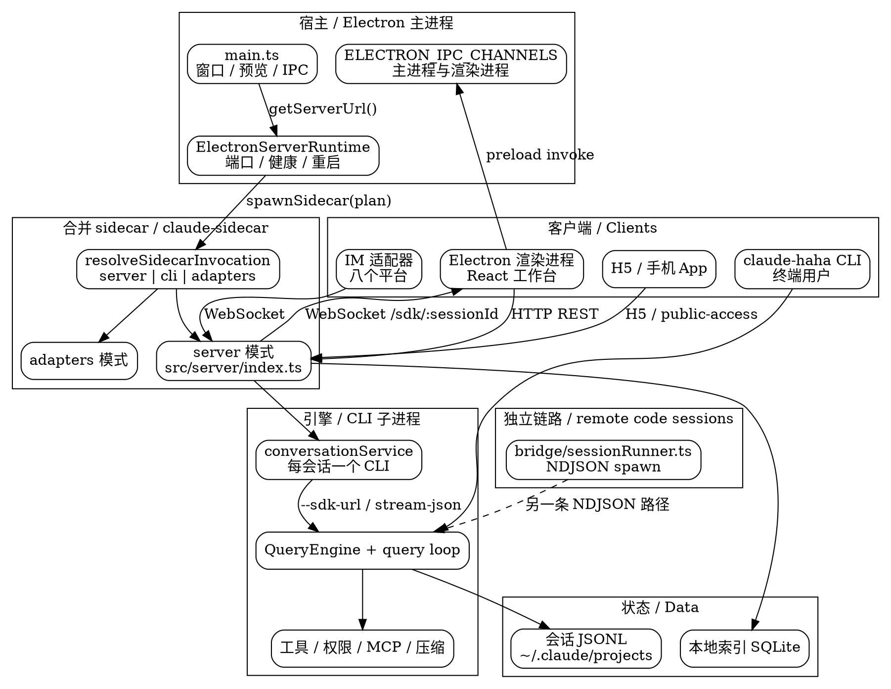

## Introduction

cc-haha 是 [NanmiCoder/cc-haha](https://github.com/NanmiCoder/cc-haha) 开源的**本地优先跨平台桌面 AI Agent 工作台**，常被称作「桌面版 Claude Code」。它不是另写一套 agent 内核：CLI 引擎 `claude-haha` 复用了 Claude Code 的 harness，Electron 桌面外壳则把会话、项目、权限、Diff、Computer Use、远程访问与模型供应商配置收进一个 GUI，并通过本地 HTTP + WebSocket 服务与引擎交互。

> 版本基线：v0.7.7（本地源码 `E:/Projects/cc-haha-0.7.7`，release 源码快照；非 git 仓库）

> [!WARNING]
> cc-haha 基于泄露的 Claude Code 源码修复而来，其 README 自陈原始源码版权归 Anthropic 所有、仅供学习与研究用途。它**非 Anthropic 官方产品**，存在下架与版权追究风险，**不推荐用于生产环境或企业合规场景**。本家族笔记仅作技术架构记录。

几个反直觉的点：

- **桌面并没有把 `claude-haha` 当成自己的引擎子进程**。Electron 主进程先 spawn 一个合并的 `claude-sidecar` 二进制，由它按位置参数切到 `server` 模式；真正的 CLI 子进程是本地 server 内部按会话 spawn 的。
- **UI 与引擎之间不是 NDJSON 管道，而是 HTTP + WebSocket**。`stream-json` 只出现在 server 与 CLI 子进程之间；仓库里另一套 NDJSON spawn 属于独立的 remote code sessions 桥。
- **`src/server/server.ts` 是 `@generated stub` 占位，服务端却是真的**：入口在 `src/server/index.ts` 的 `startServer()`，Electron 侧 `serverRuntime.ts` 只管进程生死。
- **一个二进制扮演三种角色**：`server` / `cli` / `adapters` 共用同一可执行文件，动机是每个 `bun-compile` 二进制都带约 55MB 的 Bun runtime，分开打包会重复占 100MB+。

## What cc-haha Is

把它按边界拆开看：

- **输入端**：桌面输入框、H5 远控与手机 App、八个 IM 平台、定时任务、语音输入、Computer Use 的屏幕与输入事件。
- **处理端**：一个本地 HTTP + WebSocket 服务；每个会话对应一个 CLI 子进程，子进程内跑 agentic loop、工具执行、权限判定、上下文压缩与记忆。
- **输出端**：流式消息经 WebSocket 投影到 UI、文件级 Diff、会话 JSONL 历史与本地 SQLite 索引、系统通知与移动端推送。

为什么需要「本地 server」这一层，而不是桌面直接驱动 CLI？因为桌面 UI、H5、手机、IM adapter 要**同时读写同一批会话与文件**，还需要多会话并发、断线重连、权限审批与定时任务；把这些能力收进一个常驻服务，客户端就退化为「连服务的视图」。这也是它与终端 Claude Code 最本质的差别：终端是单进程单会话，桌面是**一服务多客户端**。

## Architecture

### Layered Architecture



### The Launch Chain

从源码启动 CLI 时，`bin/claude-haha` 只是一层 Bun 启动壳：定位仓库根、按需加载 `.env`、把 `CALLER_DIR` 传下去，再 spawn 真正的入口 `src/entrypoints/cli.tsx`。

```javascript
const entrypoint =
  process.env.CLAUDE_CODE_FORCE_RECOVERY_CLI === '1'
    ? path.join(rootDir, 'src', 'localRecoveryCli.ts')
    : path.join(rootDir, 'src', 'entrypoints', 'cli.tsx')

const command = [
  process.execPath,
  '--feature=TRANSCRIPT_CLASSIFIER',
  ...envFileArgs,
  entrypoint,
  ...process.argv.slice(2),
]
const child = Bun.spawn(command, {
  cwd: rootDir,
  env: { ...process.env, CALLER_DIR: callerDir },
  stdin: 'inherit',
  stdout: 'inherit',
  stderr: 'inherit',
})
```

桌面安装包走的是另一条：`desktop/sidecars/claude-sidecar.ts` 用一个位置参数选择模式，把 launcher-only 参数从 `process.argv` 里剥掉后才动态 import 对应模块树。

```typescript
  if (mode === 'server') {
    console.log(`[claude-sidecar] starting server mode (${process.platform}/${process.arch})`)
    const { startServer } = await import('../../src/server/index.ts')
    startServer()
  } else if (mode === 'cli') {
    await import('../../src/entrypoints/cli.tsx')
  } else {
    console.error(`claude-sidecar: unknown mode "${mode}" (expected "server", "cli" or "adapters")`)
    process.exit(2)
  }
```

### The Local Server And The Conversation Process

`ElectronServerRuntime` 生成 `server` 模式的启动计划并 spawn，URL 固定绑在 `127.0.0.1`：

```typescript
export function createServerPlan({
  desktopRoot,
  appRoot,
  port,
  bindHost = SERVER_BIND_HOST,
  h5DistDir = path.join(desktopRoot, 'dist'),
  env = process.env,
}: {
  desktopRoot: string
  appRoot: string
  port: number
  bindHost?: string
  h5DistDir?: string
  env?: NodeJS.ProcessEnv
}): SidecarPlan {
  return {
    command: resolveSidecarExecutable(desktopRoot),
    args: ['server', '--app-root', appRoot, '--host', bindHost, '--port', String(port)],
    env: buildSidecarEnv(withBundledRipgrepPath(env, desktopRoot), h5DistDir),
  }
}
```

服务端 `startServer()` 用 `Bun.serve` 绑定端口；本地索引初始化被刻意排在 bind 之后，否则同步的 SQLite 打开会让宿主健康探测误判 sidecar 已死。

```typescript
  // Index startup runs after `Bun.serve` (see below), never before it. Opening
  // SQLite and scanning `source_files` happen before the first `await` inside
  // `localIndexCoordinator.start()`, so doing that here kept the port unbound
  // for the whole synchronous pass — every host probe then looked like a dead
  // sidecar (issue #1746). Requests that need the index still await it in the
  // `fetch` handler.
  try {
    server = Bun.serve<WebSocketData>({
      port,
      hostname: host,
      idleTimeout: HTTP_CONNECTION_IDLE_TIMEOUT_SECONDS,
```

真正 spawn CLI 子进程的是 `conversationService.ts`，参数里双向 `stream-json` 与 `--include-partial-messages` 是桌面流式体验的关键：

```typescript
      '--input-format',
      'stream-json',
      '--output-format',
      'stream-json',
      // Desktop chat depends on partial assistant deltas; without this the
      // server only sees the completed assistant message at turn end.
      '--include-partial-messages',
```

### The Electron Shell

主进程与渲染进程之间是显式通道表，覆盖窗口、终端、宠物、预览、剪贴板、更新、迁移、主题与运行时令牌；会话内容本身不经过 IPC，而是渲染进程直连本地 server。

```typescript
export const ELECTRON_IPC_CHANNELS = {
  publicAccessGetStatus: 'desktop:public-access:get-status',
  publicAccessConfigure: 'desktop:public-access:configure',
  publicAccessStart: 'desktop:public-access:start',
  publicAccessStop: 'desktop:public-access:stop',
  publicAccessSetAutoStart: 'desktop:public-access:set-auto-start',
  appGetVersion: 'desktop:app:get-version',
```

```typescript
  runtimeGetServerUrl: 'desktop:runtime:get-server-url',
  runtimeGetLocalAccessToken: 'desktop:runtime:get-local-access-token',
  runtimeGetPetAccessToken: 'desktop:runtime:get-pet-access-token',
  commandInvoke: 'desktop:command:invoke',
```

事件推送与内部中继分别由 `ELECTRON_EVENT_CHANNELS`、`ELECTRON_INTERNAL_CHANNELS` 定义，同样集中在 `channels.ts`。

### Two Separate NDJSON Paths

`src/bridge/sessionRunner.ts` 也会 `spawn` 一个 CLI 并逐行解析 stdout，但它属于 remote code sessions 桥：调用方是 `bridgeMain.ts`，环境注入 `CLAUDE_CODE_SESSION_ACCESS_TOKEN` / `CLAUDE_CODE_USE_CCR_V2` / `CLAUDE_CODE_WORKER_EPOCH`，目标是远端 ingress，并通过 stdin 回写 `update_environment_variables` 刷新令牌。桌面工作台的 NDJSON 则在 server 与 CLI 子进程之间，且开了 `--sdk-url` 后主要经 SDK WebSocket 传递。两条链路共享引擎，但进程归属、认证与目标完全不同，不能混为一谈。

### Why This Shape

- **安装包体积**：server / cli / adapters 合并进一个 `bun-compile` 二进制，共用一份 Bun runtime；但为隔离崩溃与凭据，运行时仍是独立进程。
- **多端复用一份状态**：本地 HTTP + WebSocket 服务让桌面、H5、手机、IM 共享会话历史与文件系统，客户端只负责渲染与审批。
- **流式与会话隔离**：每个会话一个 CLI 子进程，配合 `--include-partial-messages` 把增量投影到 WebSocket，中断、恢复、权限审批都能按会话切分。
- **启动健壮性**：Electron 侧只做端口复用、健康探测、启动超时不误杀与迁移期优雅停机；服务侧先 bind 再做重索引。
- **安全边界**：本地访问令牌、H5 访问策略、IPC payload 校验器各管一段，UI 不直接持有引擎 stdin。

### Corrections

旧版 `Architecture` 页以 GitHub `main` 文档为基线，把 bridge 的 NDJSON spawner 当成了桌面引擎的 spawn，并把 Electron 侧进程管理器当成了服务端实现。以 v0.7.7 源码为准的逐条纠偏与完整进程拓扑见 [RuntimeTopology](/docs/CS/AI/LLM/Agent/Product/CcHaha/RuntimeTopology.md)。

## Subsystem Deep Dives

进程链已在上节展开；源码级机制按「先跑起来、再跑一轮、再看状态」的顺序读。

从 [RuntimeTopology](/docs/CS/AI/LLM/Agent/Product/CcHaha/RuntimeTopology.md) 出发能看清 Electron、合并 sidecar、本地 server 与 CLI 子进程四层的边界，以及为什么 `src/server/server.ts` 的 stub 不代表服务端不存在。会话与 CLI 之间那层 NDJSON 线协议、stdin 控制消息与 stdout 保护拆在 [StreamProtocol](/docs/CS/AI/LLM/Agent/Product/CcHaha/StreamProtocol.md)；服务端按会话 spawn 的参数、SDK WebSocket 与 transcript 落盘则在 [Persistence](/docs/CS/AI/LLM/Agent/Product/CcHaha/Persistence.md) 里接着讲。

引擎内部一轮 turn 怎么走，见 [SessionLoop](/docs/CS/AI/LLM/Agent/Product/CcHaha/SessionLoop.md)：`query()` 是异步生成器，循环退出不看 `stop_reason` 而看 streaming 是否收到 `tool_use`，stop hooks 与 token budget 都能把同一个 turn 续跑。跨会话记忆是纯文件 auto memory：`MEMORY.md` 当索引、四类 frontmatter、Sonnet 做召回选择题、turn-end forked agent 兜底抽取，且 KAIROS 按日日志 / TEAMMEM 团队目录 / 抽取本身都被 `feature()` 门控，见 [MemoryContext](/docs/CS/AI/LLM/Agent/Product/CcHaha/MemoryContext.md)（与 [Codex 记忆](/docs/CS/AI/Codex/MemoryContext.md) 的两阶段流水线正可对照）。上下文窗口与压缩的阈值公式、rapid-refill breaker 与 prompt-too-long 恢复在 [ContextCompaction](/docs/CS/AI/LLM/Agent/Product/CcHaha/ContextCompaction.md)。工具契约、门控组装与并发编排见 [Tools](/docs/CS/AI/LLM/Agent/Product/CcHaha/Tools.md)，而 `allow` / `deny` / `ask` 的判定顺序、控制请求与 fail-closed 分支在 [PermissionEngine](/docs/CS/AI/LLM/Agent/Product/CcHaha/PermissionEngine.md)。多 Agent 的任务模型、进程内隔离与 VM 编排见 [AgentTeamsEngine](/docs/CS/AI/LLM/Agent/Product/CcHaha/AgentTeamsEngine.md)，遥测、诊断与哪些模块是 `feature()` 门控占位见 [Observability](/docs/CS/AI/LLM/Agent/Product/CcHaha/Observability.md)。

桌面外壳的差异化能力另有分册：模型接入 [Models](/docs/CS/AI/LLM/Agent/Product/CcHaha/Models.md)、GUI 权限档位 [Permission](/docs/CS/AI/LLM/Agent/Product/CcHaha/Permission.md)、团队工作台 [AgentTeams](/docs/CS/AI/LLM/Agent/Product/CcHaha/AgentTeams.md)、Computer Use [ComputerUse](/docs/CS/AI/LLM/Agent/Product/CcHaha/ComputerUse.md)、MCP 与 Skill 市场 [MCP_Skills](/docs/CS/AI/LLM/Agent/Product/CcHaha/MCP_Skills.md)、定时任务 [ScheduledTasks](/docs/CS/AI/LLM/Agent/Product/CcHaha/ScheduledTasks.md)、H5 远控 [RemoteAccess](/docs/CS/AI/LLM/Agent/Product/CcHaha/RemoteAccess.md)、桌面宠物 [Pets](/docs/CS/AI/LLM/Agent/Product/CcHaha/Pets.md)、命令队列 [REPL](/docs/CS/AI/LLM/Agent/Product/CcHaha/REPL.md)、自有生成工具 [GenerativeTools](/docs/CS/AI/LLM/Agent/Product/CcHaha/GenerativeTools.md)、assistant 模式 [AssistantMode](/docs/CS/AI/LLM/Agent/Product/CcHaha/AssistantMode.md)，以及三向对照 [Comparison](/docs/CS/AI/LLM/Agent/Product/CcHaha/Comparison.md)。底层 agentic loop / hooks / memory / subagents / skills / MCP 机制与 Claude Code 同源，统一交叉链到 [ClaudeCode 家族](/docs/CS/AI/LLM/Agent/Product/ClaudeCode/ClaudeCode.md)，本家族不重写。

## Desktop Feature Map

完整功能地图见官方 [Desktop](https://cchaha.ai/en/desktop) 文档。日常高频能力：

| 能力 | 说明 |
| :--- | :--- |
| 多会话工作台 | 标签页、项目切换、终端入口、会话历史集中管理，Cmd+K 跨所有会话全局搜索 |
| Branch / Worktree 启动 | 选分支并决定用当前工作树或隔离 Worktree |
| 文件级 Diff review | 右侧面板列出本轮改动，逐文件语法高亮 diff，可整轮 undo |
| 内置浏览器预览 | WebContentsView + 沙箱 partition，带 cookie / 登录态 |
| 5 档权限 | default / acceptEdits / auto / plan / bypassPermissions，危险命令 / 工具调用 / 追问都在 GUI 审批 |
| 可视化 MCP / SubAgent 管理器 | GUI 增删 MCP 服务器（stdio / http / sse，三档 scope）；GUI 创建调优 SubAgent |
| Skill 市场 | ClawHub / SkillHub 双源发现、预览、安装第三方 skill，安装前展示安全报告 |
| 6 主题 | white / paper / warm classic / celadon / ink night / ink blue，可跟随系统明暗 |
| Computer Use | 截屏 / 点击 / 输入 / 控制桌面应用（需授权） |
| Agent Teams | 桌面 UI 是引擎快照的实时可视化器；引擎侧另有 Dynamic Workflow（模型写 VM 编排脚本派生 subagent） |
| H5 远控 + IM | 手机浏览器扫码继续会话；接入微信 / 飞书 / 钉钉 / Telegram / WhatsApp / QQ / Slack / WeCom |
| 计划任务 | 8 步向导 + 自研 5 字段 cron，headless 执行并留运行日志 |
| 桌面宠物 | 常驻桌面的窗体宠物，跟随 agent 活动切换动作与气泡点评 |

## Installation

两种获取方式：

- **桌面安装包**：从 GitHub Releases 下载 macOS / Windows / Linux 安装包。未签名安装包会被系统拦截，需按官方安装指南放行（「Run anyway」）。
- **从源码启动 CLI**（用于调试底层引擎或本地开发）：

```bash
git clone https://github.com/NanmiCoder/cc-haha
cd cc-haha
bun install
cp .env.example .env
./bin/claude-haha
```

桌面端首次启动后，在 Settings 配置模型供应商、API Key 与默认模型，选择项目目录与 Git 分支即可开始使用多会话工作台。

## Common Issues

- **安装包被系统拦截**：未签名，按官方安装指南选择「Run anyway」放行。
- **连不上模型**：检查 Settings 里供应商 / API Key / 默认模型是否配置；本地模型确认 LM Studio / Ollama 已启动并暴露端口。
- **本地服务启动慢 / 提示仍在启动**：大索引重建时 `ElectronServerRuntime` 不会因启动超时杀掉 sidecar，点「重试」会继续探测同一个进程；源码里 `Bun.serve` 先 bind、索引后置就是为了避免健康探测误判。
- **内核机制问题**（agentic loop / hooks / memory / subagents）：这些与 Claude Code 同源，先查 [ClaudeCode 家族](/docs/CS/AI/LLM/Agent/Product/ClaudeCode/ClaudeCode.md) 对应分册。
- **找不到上下文检查工具**：`CtxInspectTool`（`src/tools/CtxInspectTool/CtxInspectTool.ts`）在公开版是 `@generated stub`，由 `scan-missing-imports` 生成的 ant-internal `feature()` 占位，DCE 后不执行——cc-haha 无特有上下文工具。

## Links

- [ClaudeCode 家族](/docs/CS/AI/LLM/Agent/Product/ClaudeCode/ClaudeCode.md)
- [AI 总纲](/docs/CS/AI/AI.md)
- [LLM Agent 理论](/docs/CS/AI/LLM/Agent/Theory/Agent.md)
- [MCP 协议](/docs/CS/AI/LLM/Protocol/MCP.md)
- [Codex](/docs/CS/AI/Codex/Codex.md)
- [Agent 产品索引](/docs/CS/AI/LLM/Agent/README.md)

## References

- [cc-haha 官网](https://cchaha.ai/)
- [NanmiCoder/cc-haha GitHub](https://github.com/NanmiCoder/cc-haha)
- [cc-haha v0.7.7 release notes](https://github.com/NanmiCoder/cc-haha/blob/v0.7.7/release-notes/v0.7.7.md)
- [cc-haha 文档：What cc-haha is](https://cchaha.ai/en/start)
- [desktop/sidecars/claude-sidecar.ts](https://github.com/NanmiCoder/cc-haha/blob/v0.7.7/desktop/sidecars/claude-sidecar.ts)
- [src/server/index.ts](https://github.com/NanmiCoder/cc-haha/blob/v0.7.7/src/server/index.ts)
