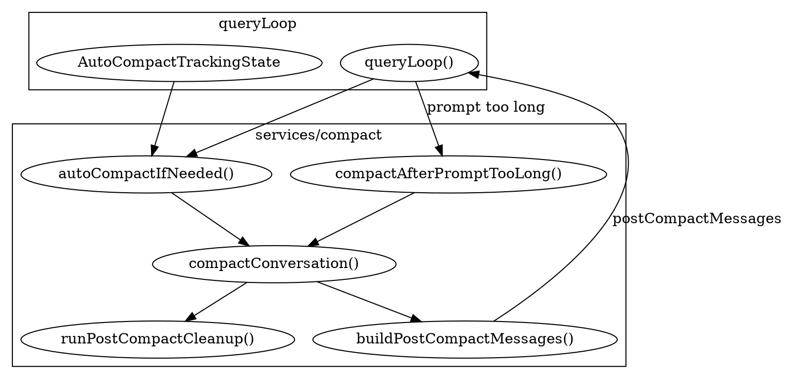

## Introduction

cc-haha 的上下文压缩以 `src/services/compact/` 的主动式 auto-compact 为主干，配合 prompt too long 的反应式恢复；`src/query.ts` 通过 `productionDeps()` 注入压缩依赖，把压缩后的消息直接回填进当前 turn，而不是另起一段会话。

> 版本基线：v0.7.7（本地源码 E:/Projects/cc-haha-0.7.7）

反直觉点：

- `src/query/tokenBudget.ts` 与压缩毫无关系：它是 `feature('TOKEN_BUDGET')` 门控的「本轮花够 token」续跑器，续跑提示语甚至明写 `Keep working — do not summarize`。
- `src/services/contextCollapse/`、`src/query/transitions.ts`、`src/services/compact/reactiveCompact.ts`、`src/services/compact/snipCompact.ts` 全是 `@generated stub`，由 `feature()` 门控，公开版 DCE 后根本不执行。
- 压缩不是「满了就压一次」：连续快速回填会触发 rapid-refill breaker，直接以 `rapid_refill_breaker` 终止整个 turn 并给出 `AUTOCOMPACT_THRASHING_MESSAGE`，而不是无限压缩下去。

## Effective Window And Threshold

压缩阈值的起点是「有效窗口」：先减去给摘要输出预留的 token，再减去一个固定 buffer。源码注释把 `MAX_OUTPUT_TOKENS_FOR_SUMMARY` 定在 20K，依据是摘要输出的 p99.99 为 17,387 tokens；`MAX_SUMMARY_RESERVE_CONTEXT_FRACTION = 0.25` 保证小窗口模型至少还能把 75% 窗口留给压缩输入。`AUTOCOMPACT_BUFFER_TOKENS` 是 13K，`AutoCompactTrackingState` 则记录连续失败与连续快速回填次数。

```typescript
// Reserve this many tokens for output during compaction
// Based on p99.99 of compact summary output being 17,387 tokens.
const MAX_OUTPUT_TOKENS_FOR_SUMMARY = 20_000
// Small-window providers cannot afford the fixed 20K summary reservation.
// Keep at least 75% of their advertised window available to the compact input.
const MAX_SUMMARY_RESERVE_CONTEXT_FRACTION = 0.25

// Returns the context window size minus the max output tokens for the model
export function getEffectiveContextWindowSize(model: string): number {
  const contextWindow = getEffectiveModelContextWindow(model, getSdkBetas())

  const reservedTokensForSummary = Math.min(
    getMaxOutputTokensForModel(model),
    MAX_OUTPUT_TOKENS_FOR_SUMMARY,
    Math.floor(contextWindow * MAX_SUMMARY_RESERVE_CONTEXT_FRACTION),
  )

  return contextWindow - reservedTokensForSummary
}

export type AutoCompactTrackingState = {
  compacted: boolean
  turnCounter: number
  // Unique ID per turn
  turnId: string
  // Consecutive autocompact failures. Reset on success.
  // Used as a circuit breaker to stop retrying when the context is
  // irrecoverably over the limit (e.g., prompt_too_long).
  consecutiveFailures?: number
  // Consecutive compactions that each refilled to the threshold within
  // RAPID_REFILL_TURN_WINDOW turns of the previous one. Used as a circuit
  // breaker when compaction succeeds but frees too little room to matter
  // (fixed context near the threshold, or oversized tool output).
  consecutiveRapidRefills?: number
}

export const AUTOCOMPACT_BUFFER_TOKENS = 13_000
export const WARNING_THRESHOLD_BUFFER_TOKENS = 20_000
export const ERROR_THRESHOLD_BUFFER_TOKENS = 20_000
export const MANUAL_COMPACT_BUFFER_TOKENS = 3_000

// Stop trying autocompact after this many consecutive failures.
// BQ 2026-03-10: 1,279 sessions had 50+ consecutive failures (up to 3,272)
// in a single session, wasting ~250K API calls/day globally.
const MAX_CONSECUTIVE_AUTOCOMPACT_FAILURES = 3

// A compaction that leaves the context so full that it refills to the
// threshold within a few turns is not helping: every later turn pays for
// another summary call and loses detail (#1544). Same trip rule as the
// official CLI (3 refills, each within 3 turns), but a refill only counts
// when the compaction itself freed little room: a small window filled by
// large tool output still compacts usefully every couple of turns and must
// not have its turn ended.
export const RAPID_REFILL_TURN_WINDOW = 3
export const MAX_CONSECUTIVE_RAPID_REFILLS = 3
// The first request after a compaction still using this share of the
// threshold means the summary did not free usable room.
export const RAPID_REFILL_MIN_POST_COMPACT_SHARE = 0.75

export const AUTOCOMPACT_THRASHING_MESSAGE =
  'Auto-compact is thrashing: the context refilled to the limit within 3 turns of the previous compaction, 3 times in a row, and each compaction left most of the limit in use. ' +
  'The fixed context (system prompt, tools, MCP servers, skills, CLAUDE.md) leaves too little room for this context window. ' +
  'Disable unused MCP servers or skills, shorten CLAUDE.md, switch to a model with a larger context window, or use /clear to start fresh.'
```

`getAutoCompactThreshold()` 把 13K buffer 封顶到有效窗口的三分之一，正是为了 16K/32K 这类小窗口也能得到可用阈值；`CLAUDE_AUTOCOMPACT_PCT_OVERRIDE` 只用于测试覆盖。

```typescript
export function getAutoCompactThreshold(model: string): number {
  const effectiveContextWindow = getEffectiveContextWindowSize(model)

  // The fixed 13K buffer is larger than some supported context windows. Cap it
  // at one third of the effective window so the threshold remains useful for
  // 16K/32K providers while preserving the existing buffer for larger models.
  const autoCompactBuffer = Math.min(
    AUTOCOMPACT_BUFFER_TOKENS,
    Math.floor(effectiveContextWindow / 3),
  )
  const autocompactThreshold = effectiveContextWindow - autoCompactBuffer

  // Override for easier testing of autocompact
  const envPercent = process.env.CLAUDE_AUTOCOMPACT_PCT_OVERRIDE
  if (envPercent) {
    const parsed = parseFloat(envPercent)
    if (!isNaN(parsed) && parsed > 0 && parsed <= 100) {
      const percentageThreshold = Math.floor(
        effectiveContextWindow * (parsed / 100),
      )
      return Math.min(percentageThreshold, autocompactThreshold)
    }
  }

  return autocompactThreshold
}
```

`isAutoCompactEnabled()` 会被 `DISABLE_COMPACT`、`DISABLE_AUTO_COMPACT` 与用户配置 `autoCompactEnabled` 三层开关共同决定，手动 `/compact` 不受后两者影响。

```typescript
export function isAutoCompactEnabled(): boolean {
  if (isEnvTruthy(process.env.DISABLE_COMPACT)) {
    return false
  }
  // Allow disabling just auto-compact (keeps manual /compact working)
  if (isEnvTruthy(process.env.DISABLE_AUTO_COMPACT)) {
    return false
  }
  // Check if user has disabled auto-compact in their settings
  const userConfig = getGlobalConfig()
  return userConfig.autoCompactEnabled
}
```

## Rapid Refill Breaker

真正让压缩「停下来」的是两道 circuit breaker。`getPostCompactPromptTokens()` 从最后一个 compact boundary 之后找出首次可用的 usage；`getRapidRefillDecision()` 在「上次压缩过、且距离不足 3 个 turn、且压缩后仍占用阈值 75% 以上」时累加 `consecutiveRapidRefills`，达到 3 次就 `trip`。没有 usage 时宁可保守保留循环守卫，也不无限压缩。

```typescript
export function getPostCompactPromptTokens(
  messages: readonly Message[],
): number | undefined {
  const boundaryIndex = findLastCompactBoundaryIndex([...messages])
  if (boundaryIndex < 0) return undefined
  for (const message of messages.slice(boundaryIndex + 1)) {
    const usage = getTokenUsage(message)
    if (usage && isUsableContextUsage(usage)) {
      return (
        (usage.input_tokens ?? 0) +
        (usage.cache_creation_input_tokens ?? 0) +
        (usage.cache_read_input_tokens ?? 0)
      )
    }
  }
  return undefined
}

export function getRapidRefillDecision(
  tracking: AutoCompactTrackingState | undefined,
  postCompactPromptTokens: number | undefined,
  autoCompactThreshold: number,
): { trip: boolean; consecutiveRapidRefills: number } {
  // Without usage we cannot tell a useless compaction from a useful one;
  // keep the loop guard rather than compact forever.
  const compactionLeftLittleRoom =
    postCompactPromptTokens === undefined ||
    postCompactPromptTokens >=
      autoCompactThreshold * RAPID_REFILL_MIN_POST_COMPACT_SHARE
  const consecutiveRapidRefills =
    tracking?.compacted === true &&
    tracking.turnCounter < RAPID_REFILL_TURN_WINDOW &&
    compactionLeftLittleRoom
      ? (tracking.consecutiveRapidRefills ?? 0) + 1
      : 0
  return {
    trip: consecutiveRapidRefills >= MAX_CONSECUTIVE_RAPID_REFILLS,
    consecutiveRapidRefills,
  }
}
```

`autoCompactIfNeeded()` 是主入口：先按 `MAX_CONSECUTIVE_AUTOCOMPACT_FAILURES` 卡住连续失败，再用 `shouldAutoCompact()` 判断是否触发，随后调用 `getRapidRefillDecision()`；`trip` 为真时不再压缩，只返回 `rapidRefillBreakerTripped`。真正压缩前还会先尝试 `trySessionMemoryCompaction()`。

```typescript
export async function autoCompactIfNeeded(
  messages: Message[],
  toolUseContext: ToolUseContext,
  cacheSafeParams: CacheSafeParams,
  querySource?: QuerySource,
  tracking?: AutoCompactTrackingState,
  snipTokensFreed?: number,
): Promise<{
  wasCompacted: boolean
  compactionResult?: CompactionResult
  consecutiveFailures?: number
  consecutiveRapidRefills?: number
  rapidRefillBreakerTripped?: boolean
}> {
  if (isEnvTruthy(process.env.DISABLE_COMPACT)) {
    return { wasCompacted: false }
  }

  // Circuit breaker: stop retrying after N consecutive failures.
  // Without this, sessions where context is irrecoverably over the limit
  // hammer the API with doomed compaction attempts on every turn.
  if (
    tracking?.consecutiveFailures !== undefined &&
    tracking.consecutiveFailures >= MAX_CONSECUTIVE_AUTOCOMPACT_FAILURES
  ) {
    return { wasCompacted: false }
  }

  const model = toolUseContext.options.mainLoopModel
  const shouldCompact = await shouldAutoCompact(
    messages,
    model,
    querySource,
    snipTokensFreed,
    estimateFallbackFixedContextTokens(cacheSafeParams),
  )

  if (!shouldCompact) {
    return { wasCompacted: false }
  }

  const postCompactPromptTokens = tracking?.compacted
    ? getPostCompactPromptTokens(messages)
    : undefined
  const { trip, consecutiveRapidRefills } = getRapidRefillDecision(
    tracking,
    postCompactPromptTokens,
    getAutoCompactThreshold(model),
  )
  if (trip) {
    logForDebugging(
      `autocompact: rapid-refill breaker tripped — ${consecutiveRapidRefills} consecutive refills within <${RAPID_REFILL_TURN_WINDOW} turns each (last was ${tracking?.turnCounter} turns, post-compact prompt ${postCompactPromptTokens ?? 'unknown'} tokens)`,
      { level: 'warn' },
    )
    return { wasCompacted: false, rapidRefillBreakerTripped: true }
  }
```

主循环拿到 `rapidRefillBreakerTripped` 后，并不继续采样，而是 yield 一条带 `AUTOCOMPACT_THRASHING` 业务错误码的 assistant 消息，并以 `rapid_refill_breaker` 结束整个 turn；注释说明下一个用户 turn 会开启全新的 tracking chain，因此 session 并不会被永久禁用压缩。

```typescript
    } else if (rapidRefillBreakerTripped) {
      // Compaction keeps succeeding without freeing usable room (#1544).
      // End the turn with an explanation instead of compacting every turn
      // until the provider rejects the request; the next user turn starts a
      // fresh tracking chain, so auto-compact is not disabled for the session.
      yield createAssistantAPIErrorMessage({
        content: AUTOCOMPACT_THRASHING_MESSAGE,
        error: 'invalid_request',
        businessErrorCode: BUSINESS_ERROR_CODES.AUTOCOMPACT_THRASHING,
      })
      return { reason: 'rapid_refill_breaker' }
```

测试 `autoCompactRapidRefill.test.ts` 用自定义 100K 模型把阈值钉在 67_000，正好等于 `100K - 20K summary reserve - 13K buffer`，与上面的公式逐项吻合。

```typescript
const THRESHOLD = 67_000 // custom-100k: 100K - 20K summary reserve - 13K buffer

// createAssistantMessage marks messages synthetic, whose usage is ignored;
// give them the provider model a real response would carry.
function providerAssistant(content: Parameters<typeof messagesModule.createAssistantMessage>[0]['content'], promptTokens: number) {
  const message = messagesModule.createAssistantMessage({ content, usage: usageFor(promptTokens) })
  message.message.model = 'custom-100k'
  return message
}
```

断言写得非常直白：每轮回填 84_000 时，前 3 次压缩后第 4 次 `tripped`，模型只被调 3 次，最终 reason 是 `rapid_refill_breaker` 且业务错误码为 `autocompact_thrashing`；而每轮只回填 26_000 时则一路压缩到 `max_turns`，不出现 thrashing。

```typescript
describe('query auto-compact rapid-refill breaker (#1544)', () => {
  test('ends the turn with an explanation when every compaction leaves the fixed context over the threshold', async () => {
    const { terminal, decisions, modelCalls, output } = await runLoop(84_000, 20)

    // Without the breaker this loop compacts before every one of the 20 turns.
    expect(terminal).toEqual({ reason: 'rapid_refill_breaker' })
    expect(decisions).toEqual(['compacted', 'compacted', 'compacted', 'tripped'])
    expect(modelCalls).toBe(3)

    const last = output.at(-1) as { type?: string, isApiErrorMessage?: boolean, businessErrorCode?: string, message?: { content?: Array<{ text?: string }> } }
    expect(last.type).toBe('assistant')
    expect(last.isApiErrorMessage).toBe(true)
    expect(last.businessErrorCode).toBe('autocompact_thrashing')
    expect(last.message?.content?.[0]?.text).toBe(autoCompactModule.AUTOCOMPACT_THRASHING_MESSAGE)
  })

  test('keeps working when each compaction frees most of the window, even if large reads refill it quickly', async () => {
    const { terminal, decisions, output } = await runLoop(26_000, 8)

    expect(terminal).toMatchObject({ reason: 'max_turns' })
    expect(decisions.every(decision => decision === 'compacted')).toBe(true)
    expect(decisions.length).toBeGreaterThanOrEqual(8)
    expect(output.some(message => (message as { businessErrorCode?: string }).businessErrorCode === 'autocompact_thrashing')).toBe(false)
  })
})
```

## Prompt Too Long Recovery

主动压缩的阈值基于「应用以为的窗口」，当 provider 的真实上限更小（未注册模型落到 200K 默认、窗口写错、网关自带限额）时，请求会在阈值到达之前就被拒绝。`promptTooLongRecovery.ts` 的注释把这一点讲得很清楚，并说明只对 agent loop 恢复：主线程、SDK 会话、subagent 与 teammate 可以，短命的 forked side query 故意继续抛错。

```typescript
/**
 * Recovery for a request the provider rejected as too long.
 *
 * Proactive auto-compact fires at a threshold derived from the window the app
 * believes in. When the provider's real cap is smaller (an unregistered model
 * on the 200K default, a mistyped window, a gateway with its own limit), the
 * request is rejected before that threshold is ever reached and, without this,
 * the turn just ends. A desktop team member then stays stuck: everything sent
 * to it replays the same oversized context. The official CLI compacts and
 * retries once in this case; this is the same recovery built on the regular
 * compaction path, whose summary request already peels the oldest messages
 * when it is itself too long.
 *
 * Only agent loops recover (the main thread, SDK sessions such as desktop
 * members, subagents and teammates). Forked side queries (prompt suggestions,
 * summaries, memory extraction) are short-lived and share the main thread's
 * module state, so they keep surfacing the error.
 */
export function canRecoverFromPromptTooLong(querySource: QuerySource): boolean {
  const isAgentLoop =
    querySource === 'sdk' ||
    querySource.startsWith('repl_main_thread') ||
    querySource.startsWith('agent:')
  return isAgentLoop && isAutoCompactEnabled()
}
```

`isRecoverableContextRejection()` 把「prompt too long」与「无媒体请求上的 413」视为可压缩修复；带图片或 PDF 的 413 则留给下一轮 history normalization 去剥媒体。`getProviderContextLimit()` 优先采用错误里声明的 `limitTokens`，否则用被拒请求的 token 数作为 provider 真实上限。恢复动作本身就是调一次 `compactConversation()`，随后 `setLastSummarizedMessageId(undefined)` 与 `runPostCompactCleanup()` 做记账。

```typescript
export async function compactAfterPromptTooLong({
  messages,
  toolUseContext,
  cacheSafeParams,
  querySource,
}: {
  messages: Message[]
  toolUseContext: ToolUseContext
  cacheSafeParams: CacheSafeParams
  querySource: QuerySource
}): Promise<CompactionResult | null> {
  if (toolUseContext.abortController.signal.aborted) return null
  try {
    const result = await compactConversation(
      messages,
      toolUseContext,
      cacheSafeParams,
      true, // No follow-up questions: nobody is waiting on this compaction
      undefined,
      true, // isAutoCompact
      {
        isRecompactionInChain: false,
        turnsSincePreviousCompact: -1,
        autoCompactThreshold: getAutoCompactThreshold(
          toolUseContext.options.mainLoopModel,
        ),
        querySource,
      },
    )
    // Same bookkeeping as a proactive auto-compact: the summarized message
    // ids are gone and the module caches describe the old conversation.
    setLastSummarizedMessageId(undefined)
    runPostCompactCleanup(querySource)
    logForDebugging('prompt-too-long: compacted the rejected request; retrying once')
    return result
  } catch (error) {
    if (!hasExactErrorMessage(error, ERROR_MESSAGE_USER_ABORT)) {
      logError(error)
    }
    return null
  }
}
```

主循环侧的对应分支是：判定 `isRecoverableContextRejection` 后调 `deps.compactAfterPromptTooLong`，把 `buildPostCompactMessages()` 的结果逐条 yield，再以 `reactive_compact_retry` 这个 `transition` 重建 `State` 并 `continue`。`hasAttemptedReactiveCompact: true` 保证这次反应式压缩只重试一轮，不会与主动压缩互相踩成死循环。

```typescript
        isRecoverableContextRejection(lastMessage, messagesForQuery)
      ) {
        const rejectedCacheSafeParams = {
          systemPrompt,
          userContext,
          systemContext,
          toolUseContext,
          forkContextMessages: messagesForQuery,
        }
        const rejectedRequestTokens = estimateRejectedRequestTokens(
          messagesForQuery,
          rejectedCacheSafeParams,
        )
        const compacted = await (
          deps.compactAfterPromptTooLong ?? compactAfterPromptTooLong
        )({
          messages: messagesForQuery,
          toolUseContext,
          cacheSafeParams: rejectedCacheSafeParams,
          querySource,
        })
        if (compacted) {
          if (params.taskBudget) {
            const preCompactContext =
              finalContextTokensFromLastResponse(messagesForQuery)
            taskBudgetRemaining = Math.max(
              0,
              (taskBudgetRemaining ?? params.taskBudget.total) -
                preCompactContext,
            )
          }
          const limit = getProviderContextLimit(
            lastMessage,
            rejectedRequestTokens,
          )
          pendingProviderContextLimit =
            limit === undefined ? undefined : { model: currentModel, limit }
          const postCompactMessages = buildPostCompactMessages(compacted)
          for (const msg of postCompactMessages) {
            yield msg
          }
          state = {
            messages: postCompactMessages,
            toolUseContext,
            autoCompactTracking: undefined,
            maxOutputTokensRecoveryCount,
            hasAttemptedReactiveCompact: true,
            maxOutputTokensOverride: undefined,
            pendingToolUseSummary: undefined,
            stopHookActive: undefined,
            turnCount,
            transition: { reason: 'reactive_compact_retry' },
          }
          continue
```

## Feature Gated Stubs

`query.ts` 顶部用 `feature()` 把两个可疑模块做成条件 `require`，公开版 DCE 后它们是 `null`；`TOKEN_BUDGET` 同样在这条门控链上。

```typescript
/* eslint-disable @typescript-eslint/no-require-imports */
const reactiveCompact = feature('REACTIVE_COMPACT')
  ? (require('./services/compact/reactiveCompact.js') as typeof import('./services/compact/reactiveCompact.js'))
  : null
const contextCollapse = feature('CONTEXT_COLLAPSE')
  ? (require('./services/contextCollapse/index.js') as typeof import('./services/contextCollapse/index.js'))
  : null
/* eslint-enable @typescript-eslint/no-require-imports */
```

被 `require` 指向的 `contextCollapse/index.ts`（连同 `operations.ts`、`persist.ts`）以及 `query/transitions.ts`、`compact/reactiveCompact.ts`、`compact/snipCompact.ts` 都是同一份 `@generated stub`：`__target` 是 noop，导出全是 Proxy，导出名只是为兼容命名导入而列。也就是说，公开版里并没有真实的上下文折叠状态机。

```typescript
// @generated stub from scan-missing-imports
// 该文件自动生成，对应 ant-internal 的 feature() gated 模块。
// 所有外部 build 的代码路径在 DCE 后都不会真的执行这里的代码，这只是
// bun build resolver 的占位符。
const __target = function noop() {}
const __handler: ProxyHandler<any> = {
  get(_t, prop) {
    if (prop === '__esModule') return true
    if (prop === 'default') return new Proxy(__target, __handler)
    if (prop === Symbol.toPrimitive) return () => undefined
    if (prop === Symbol.iterator) return function* () {}
    if (prop === Symbol.asyncIterator) return async function* () {}
    if (prop === 'then') return undefined
    return new Proxy(__target, __handler)
  },
  apply() {
    return new Proxy(__target, __handler)
  },
  construct() {
    return new Proxy(__target, __handler)
  },
}
const stub: any = new Proxy(__target, __handler)
export default stub
export const __stubMissing = true
```

`postCompactCleanup.ts` 里唯一引用 `resetContextCollapse()` 的地方也被 `feature('CONTEXT_COLLAPSE')` 包住，且只对主线程压缩生效——注释明确说 subagent 与主线程共享 module-level state，误清会污染主线程。这与「context-collapse 是真实可用机制」的直觉直接冲突。

```typescript
  resetMicrocompactState()
  if (feature('CONTEXT_COLLAPSE')) {
    if (isMainThreadCompact) {
      /* eslint-disable @typescript-eslint/no-require-imports */
      ;(
        require('../contextCollapse/index.js') as typeof import('../contextCollapse/index.js')
      ).resetContextCollapse()
      /* eslint-enable @typescript-eslint/no-require-imports */
    }
  }
```

真正承载压缩逻辑的是 `autoCompact.ts`、`compact.ts`、`microCompact.ts`、`promptTooLongRecovery.ts` 与 `postCompactCleanup.ts`；`microCompact.ts` 有完整的工具名导入与 token 估算，不是占位符。

## Token Budget Is Not Compaction

这是与旧文档最容易混淆的一处。`src/query/tokenBudget.ts` 的 `checkTokenBudget()` 只在 turn 输出 token 未达到预算的 90% 且未出现 diminishing returns 时返回 `continue`，并产出一条 nudge 消息；`agentId` 存在（subagent）或 `budget === null` 时直接 `stop`。它衡量的是「这一轮还想花多少输出 token」，不是上下文窗口占用。

```typescript
export function checkTokenBudget(
  tracker: BudgetTracker,
  agentId: string | undefined,
  budget: number | null,
  globalTurnTokens: number,
): TokenBudgetDecision {
  if (agentId || budget === null || budget <= 0) {
    return { action: 'stop', completionEvent: null }
  }

  const turnTokens = globalTurnTokens
  const pct = Math.round((turnTokens / budget) * 100)
  const deltaSinceLastCheck = globalTurnTokens - tracker.lastGlobalTurnTokens

  const isDiminishing =
    tracker.continuationCount >= 3 &&
    deltaSinceLastCheck < DIMINISHING_THRESHOLD &&
    tracker.lastDeltaTokens < DIMINISHING_THRESHOLD

  if (!isDiminishing && turnTokens < budget * COMPLETION_THRESHOLD) {
    tracker.continuationCount++
    tracker.lastDeltaTokens = deltaSinceLastCheck
    tracker.lastGlobalTurnTokens = globalTurnTokens
    return {
      action: 'continue',
      nudgeMessage: getBudgetContinuationMessage(pct, turnTokens, budget),
      continuationCount: tracker.continuationCount,
      pct,
      turnTokens,
      budget,
    }
  }

  if (isDiminishing || tracker.continuationCount > 0) {
    return {
      action: 'stop',
      completionEvent: {
        continuationCount: tracker.continuationCount,
        pct,
        turnTokens,
        budget,
        diminishingReturns: isDiminishing,
        durationMs: Date.now() - tracker.startedAt,
      },
    }
  }

  return { action: 'stop', completionEvent: null }
}
```

nudge 文案来自 `src/utils/tokenBudget.ts`，最后一句直接叫模型不要总结：这恰好是压缩的反面。同一文件还用正则解析用户输入里的 `+500k` 或 `use 2M tokens` 这类预算写法。

```typescript
export function getBudgetContinuationMessage(
  pct: number,
  turnTokens: number,
  budget: number,
): string {
  const fmt = (n: number): string => new Intl.NumberFormat('en-US').format(n)
  return `Stopped at ${pct}% of token target (${fmt(turnTokens)} / ${fmt(budget)}). Keep working — do not summarize.`
}
```

还需区分 `QueryParams` 里的 `taskBudget`（API 侧 `output_config.task_budget`，整轮累计预算）：源码注释明确写它与「tokenBudget 加 500k auto-continue 特性」是两码事。三者名字相近，语义却分属「整轮预算」「续跑催单」「窗口压缩」三个不同维度。

## Compaction Execution Path

所有压缩路径最终都汇到 `compactConversation()`：先估算压缩前 token 数，触发 `onCompactProgress` 与 `executePreCompactHooks`（`trigger` 区分 `auto` / `manual`），再合并 hook 注入的自定义指令，最后进入摘要采样与 `buildPostCompactMessages()`。

```typescript
export async function compactConversation(
  messages: Message[],
  context: ToolUseContext,
  cacheSafeParams: CacheSafeParams,
  suppressFollowUpQuestions: boolean,
  customInstructions?: string,
  isAutoCompact: boolean = false,
  recompactionInfo?: RecompactionInfo,
): Promise<CompactionResult> {
  try {
    if (messages.length === 0) {
      throw new Error(ERROR_MESSAGE_NOT_ENOUGH_MESSAGES)
    }

    const preCompactTokenCount = tokenCountWithEstimation(messages)

    const appState = context.getAppState()
    void logPermissionContextForAnts(appState.toolPermissionContext, 'summary')

    context.onCompactProgress?.({
      type: 'hooks_start',
      hookType: 'pre_compact',
    })

    // Execute PreCompact hooks
    context.setSDKStatus?.('compacting')
    const hookResult = await executePreCompactHooks(
      {
        trigger: isAutoCompact ? 'auto' : 'manual',
        customInstructions: customInstructions ?? null,
      },
      context.abortController.signal,
    )
    customInstructions = mergeHookInstructions(
      customInstructions,
      hookResult.newCustomInstructions,
    )
    const userDisplayMessage = hookResult.userDisplayMessage
```

`compactConversation()` 被调用者包括 `getCompactPrompt()`、`streamCompactSummary()`、`executePreCompactHooks()`、`notifyCompaction()` 与 `createPostCompactDeltaAttachments()` 等，是一条独立的摘要生成流水线。

## Dependency Injection

压缩能力不是硬编码进 `queryLoop()` 的，而是经 `src/query/deps.ts` 的 `QueryDeps` 注入。`productionDeps()` 把 `autoCompactIfNeeded`、`compactAfterPromptTooLong`、`microcompactMessages` 与 `queryModelWithStreaming` 交给主循环；测试可以传入 fake，例如 `autoCompactRapidRefill.test.ts` 就用自己的 `realDecisionAutocompact()` 替换 `autocompact`，只伪造摘要调用而保留生产判定逻辑。注释也点明这个注入面刻意收窄到 4 个依赖。

```typescript
export type QueryDeps = {
  // -- model
  callModel: typeof queryModelWithStreaming

  // -- compaction
  microcompact: typeof microcompactMessages
  autocompact: typeof autoCompactIfNeeded
  /** Optional so existing fakes keep compiling; production uses the real one. */
  compactAfterPromptTooLong?: typeof compactAfterPromptTooLong

  // -- platform
  uuid: () => string
}

export function productionDeps(): QueryDeps {
  return {
    callModel: queryModelWithStreaming,
    microcompact: microcompactMessages,
    autocompact: autoCompactIfNeeded,
    compactAfterPromptTooLong,
    uuid: randomUUID,
  }
}
```

## Compaction Flow



## Links

- [CcHaha](/docs/CS/AI/LLM/Agent/Product/CcHaha/CcHaha.md)
- [Models](/docs/CS/AI/LLM/Agent/Product/CcHaha/Models.md)
- [REPL](/docs/CS/AI/LLM/Agent/Product/CcHaha/REPL.md)
- [StreamProtocol](/docs/CS/AI/LLM/Agent/Product/CcHaha/StreamProtocol.md)
- [ClaudeCode](/docs/CS/AI/LLM/Agent/Product/ClaudeCode/ClaudeCode.md)
- [Agent](/docs/CS/AI/LLM/Agent/Theory/Agent.md)

## References

- [cc-haha GitHub](https://github.com/NanmiCoder/cc-haha)
- [services/compact/autoCompact.ts](https://github.com/NanmiCoder/cc-haha/blob/main/src/services/compact/autoCompact.ts)
- [services/compact/compact.ts](https://github.com/NanmiCoder/cc-haha/blob/main/src/services/compact/compact.ts)
- [services/compact/promptTooLongRecovery.ts](https://github.com/NanmiCoder/cc-haha/blob/main/src/services/compact/promptTooLongRecovery.ts)
- [query/autoCompactRapidRefill.test.ts](https://github.com/NanmiCoder/cc-haha/blob/main/src/query/autoCompactRapidRefill.test.ts)
- [query/tokenBudget.ts](https://github.com/NanmiCoder/cc-haha/blob/main/src/query/tokenBudget.ts)
- [services/contextCollapse/index.ts](https://github.com/NanmiCoder/cc-haha/blob/main/src/services/contextCollapse/index.ts)
- [services/compact/postCompactCleanup.ts](https://github.com/NanmiCoder/cc-haha/blob/main/src/services/compact/postCompactCleanup.ts)
