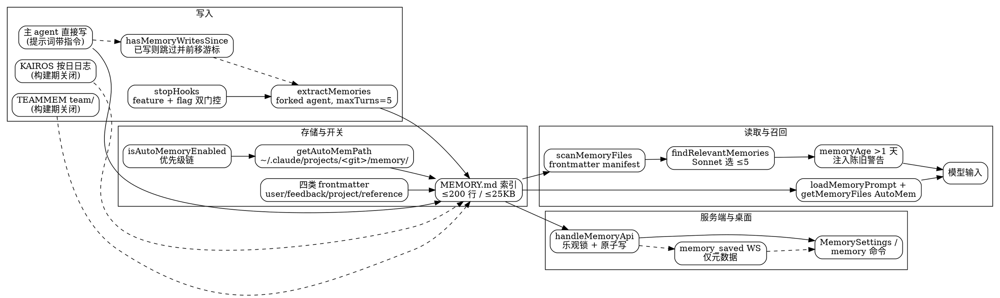

## Introduction

cc-haha 的「记忆」是一套**纯文件、按项目隔离的 auto memory**：CLI 把用户偏好、反馈、项目事实写成带 frontmatter 的 Markdown，用一份 `MEMORY.md` 当索引，在每次 turn 注入系统提示；模型没主动写时，一个 forked agent 在 turn 结束时补抽取。它和 Codex 那种「启动时两阶段流水线 + git 基线合并智能体 + 状态库」完全不同——没有数据库、没有 rollout 摘要、没有合并 agent（见 [Codex 记忆与上下文](/docs/CS/AI/Codex/MemoryContext.md) 对照）。

> 版本基线：v0.7.7（本地源码 E:/Projects/cc-haha-0.7.7）

三处反直觉点先摆在前面：

- **写内存的是模型自己，不是后台服务**。主 agent 的提示词里带完整保存指令；turn-end 的 `extractMemories` 只是兜底，且与主 agent 直接写**互斥**——检测到本轮已写过 auto-mem 路径就跳过并把游标前移。
- **四种记忆形态里，只有两种在公开版默认生效**。标准索引与召回是无门控的；KAIROS 的按日日志、TEAMMEM 的团队目录都被 `feature()` 构建期门控，extract 走 `feature('EXTRACT_MEMORIES')` + GrowthBook flag 双门控，默认全关。
- **名字带 "Memory" 的不一定是记忆**。`MemoryUsageIndicator` 监控的是 Node **堆内存**，与记忆文件无关，且 external 构建恒返回 `null`；服务端 memory API 也没有 preview 端点，预览是桌面端本地渲染。

## Storage Layout

auto memory 根目录按环境、settings 与 override 逐级解析，最终落到 `<memoryBase>/projects/<sanitized-git-root>/memory/`：

```typescript
const AUTO_MEM_DIRNAME = 'memory'
const AUTO_MEM_ENTRYPOINT_NAME = 'MEMORY.md'

export const getAutoMemPath = memoize(
  (): string => {
    const override = getAutoMemPathOverride() ?? getAutoMemPathSetting()
    if (override) {
      return override
    }
    const projectsDir = join(getMemoryBaseDir(), 'projects')
    return (
      join(projectsDir, sanitizePath(getAutoMemBase()), AUTO_MEM_DIRNAME) + sep
    ).normalize('NFC')
  },
  () => getProjectRoot(),
)
```

`getAutoMemBase` 用 `findCanonicalGitRoot`，让同一仓库的多个 worktree 共享一份记忆。`getMemoryBaseDir` 优先 `CLAUDE_CODE_REMOTE_MEMORY_DIR`，否则 `~/.claude`。路径解析带一串安全拒绝规则——相对路径、根/近根、Windows 盘根、UNC、null byte 全部挡掉，settings 里可写的 `autoMemoryDirectory` 只认 policy/flag/local/user 四个可信来源，**刻意排除随仓库提交的 projectSettings**，防止恶意仓库把记忆目录指到 `~/.ssh`。

开关优先级链（`isAutoMemoryEnabled`）一目了然：

```typescript
export function isAutoMemoryEnabled(): boolean {
  const envVal = process.env.CLAUDE_CODE_DISABLE_AUTO_MEMORY
  if (isEnvTruthy(envVal)) {
    return false
  }
  if (isEnvDefinedFalsy(envVal)) {
    return true
  }
  if (isEnvTruthy(process.env.CLAUDE_CODE_SIMPLE)) {
    return false
  }
  if (
    isEnvTruthy(process.env.CLAUDE_CODE_REMOTE) &&
    !process.env.CLAUDE_CODE_REMOTE_MEMORY_DIR
  ) {
    return false
  }
  const settings = getInitialSettings()
  if (settings.autoMemoryEnabled !== undefined) {
    return settings.autoMemoryEnabled
  }
  return true
}
```

即：环境变量 > `--bare` SIMPLE > 无持久目录的 CCR > settings > 默认开。

## Four Types And Frontmatter

记忆被约束在四类封闭分类法里，全部是「当前项目状态推导不出来」的上下文；代码模式、架构、git 历史、文件路径明确**不许**存：

```typescript
export const MEMORY_TYPES = [
  'user',
  'feedback',
  'project',
  'reference',
] as const

export type MemoryType = (typeof MEMORY_TYPES)[number]
```

- `user` 永远私有：角色、目标、知识背景。
- `feedback` 默认私有，只有「项目级约定」才存团队：用户的纠正**和**确认都要记，正文结构是「规则 + `**Why:**` + `**How to apply:**`」。
- `project` 偏团队：谁在做什么、为什么、截止日期，相对日期必须转绝对日期。
- `reference` 通常团队：外部系统里信息在哪（Linear 项目、Slack 频道、Grafana 板）。

每条记忆是独立文件，frontmatter 长这样；`description` 直接决定未来召回是否命中，所以要求「one-line description — be specific」：

```typescript
export const MEMORY_FRONTMATTER_EXAMPLE: readonly string[] = [
  '```markdown',
  '---',
  'name: {{memory name}}',
  'description: {{one-line description — used to decide relevance in future conversations, so be specific}}',
  `type: {{${MEMORY_TYPES.join(', ')}}}`,
  '---',
  '',
  '{{memory content — for feedback/project types, structure as: rule/fact, then **Why:** and **How to apply:** lines}}',
  '```',
]
```

`parseMemoryType` 对非法/缺失值返回 `undefined`，老文件没有 `type:` 也照常工作。

## Index Contract

`MEMORY.md` 是**索引不是记忆正文**：只放一行一个的指针，无 frontmatter，且带行数与字节双上限。字节上限专门对付「200 行内塞 197KB 长行」这种绕过行数的写法：

```typescript
export const ENTRYPOINT_NAME = 'MEMORY.md'
export const MAX_ENTRYPOINT_LINES = 200
export const MAX_ENTRYPOINT_BYTES = 25_000
```

`truncateEntrypointContent` 先按行截，再在字节上限前的最后一个换行处切，并追加一条点明是哪个上限触发的 WARNING。保存是两步走：写独立文件 → 在 `MEMORY.md` 加指针（`buildMemoryLines` 生成的提示词原文规定 `<entry> — one-line hook`，约 150 字符以内）。

几个提示词段落直接编码了评测结论，值得注意：

- `WHAT_NOT_TO_SAVE_SECTION` 明确「即使用户要求保存也适用」——要存 PR 列表就问「有什么是意外/不显然的」，否则会退化成活动日志。
- `WHEN_TO_ACCESS_SECTION` 里「ignore memory」被单列为一条：用户说忽略就当作 `MEMORY.md` 为空，不引用、不比较、不提及。这是针对「读了代码却补一句『根据记忆不是 Y』」的分支污染修复。
- `TRUSTING_RECALL_SECTION` 标题用 `Before recommending from memory` 而非抽象的 "Trusting what you recall"——评测里前者 3/3、后者 0/3，同一正文只有标题不同。

## Prompt Injection

注入有两条互补路径。**系统提示侧**用缓存型 section，只在 `/clear`、`/compact` 失效：

```typescript
systemPromptSection('memory', () => loadMemoryPrompt()),
```

`loadMemoryPrompt` 按开关分派四种形态——KAIROS 按日日志、TEAMMEM 合并双目录、compact 精简档、标准档；auto memory 关闭时返回 `null`：

```typescript
if (feature('KAIROS') && autoEnabled && getKairosActive()) {
  logMemoryDirCounts(getAutoMemPath(), {
    memory_type: 'auto' as AnalyticsMetadata_I_VERIFIED_THIS_IS_NOT_CODE_OR_FILEPATHS,
  })
  return buildAssistantDailyLogPrompt(skipIndex)
}
```

**CLAUDE.md 侧**的 `getMemoryFiles` 把 `MEMORY.md` 作为 `AutoMem` 类型文件并入注入流，紧跟在 Managed / User / Project 之后：

```typescript
if (isAutoMemoryEnabled()) {
  const { info: memdirEntry } = await safelyReadMemoryFileAsync(
    getAutoMemEntrypoint(),
    'AutoMem',
  )
  if (memdirEntry) {
    const normalizedPath = normalizePathForComparison(memdirEntry.path)
    if (!processedPaths.has(normalizedPath)) {
      processedPaths.add(normalizedPath)
      result.push(memdirEntry)
    }
  }
}
```

KAIROS 形态是另一套心智模型：assistant 会话近乎永久，模型往 `logs/YYYY/MM/YYYY-MM-DD.md` **追加**带时间戳的条目，不维护活索引；夜间 `/dream` 技能再蒸馏成主题文件与 `MEMORY.md`。提示词里故意写日期**模式**而非当天字面路径，为的是保住午夜跨天时的 prompt cache 前缀。

## Recall

召回不是简单 grep，而是让 Sonnet 做一次选择题：扫描所有记忆文件的 frontmatter 生成 manifest，交给 `sideQuery` 选出最多 5 个「确定有用」的文件名：

```typescript
const result = await sideQuery({
  model: getDefaultSonnetModel(),
  system: SELECT_MEMORIES_SYSTEM_PROMPT,
  skipSystemPromptPrefix: true,
  messages: [
    {
      role: 'user',
      content: `Query: ${query}\n\nAvailable memories:\n${manifest}${toolsSection}`,
    },
  ],
  max_tokens: 256,
  output_format: {
    type: 'json_schema',
    schema: {
      type: 'object',
      properties: {
        selected_memories: { type: 'array', items: { type: 'string' } },
      },
      required: ['selected_memories'],
      additionalProperties: false,
    },
  },
  signal,
  querySource: 'memdir_relevance',
})
```

规则很克制：不确定就不选，可以不返回空列表；最近在用的工具的「用法/API 文档」类记忆被排除（对话里已有现成用法），但**警告、坑、已知问题仍要选**——正在用它才最需要。`alreadySurfaced` 在调用前过滤前几轮已展示的路径，把 5 个槽位留给新候选。

`scanMemoryFiles` 是召回与抽取共用的扫描原语，单遍读前 30 行 frontmatter、按 mtime 倒序、上限 200 个文件；它被从 `findRelevantMemories` 拆出，正是为了不让 `extractMemories` 引入 `sideQuery` 与 API client 链（那会成环）：

```typescript
const entries = await readdir(memoryDir, { recursive: true })
const mdFiles = entries.filter(
  f => f.endsWith('.md') && basename(f) !== 'MEMORY.md',
)
```

召回的记忆不会裸奔——`memoryAge` 按 mtime 算天数，`>1 天` 就注入陈旧警告，专门对付「带 `file:line` 的过期记忆被当成事实」（引用反而让过期结论显得更权威）：

```typescript
export function memoryFreshnessText(mtimeMs: number): string {
  const d = memoryAgeDays(mtimeMs)
  if (d <= 1) return ''
  return (
    `This memory is ${d} days old. ` +
    `Memories are point-in-time observations, not live state — ` +
    `claims about code behavior or file:line citations may be outdated. ` +
    `Verify against current code before asserting as fact.`
  )
}
```

这段是**无门控真实生效**的，调用方在 `attachments.ts` 与 `FileReadTool`。

## Extraction At Turn End

主 agent 的提示词带完整保存指令，所以后台抽取被设计成兜底且互斥。turn 结束时 `stopHooks` 只在非 subagent、非 bare 模式下 fire-and-forget：

```typescript
if (
  feature('EXTRACT_MEMORIES') &&
  !toolUseContext.agentId &&
  isExtractModeActive()
) {
  void extractMemoriesModule!.executeExtractMemories(
    stopHookContext,
    toolUseContext.appendSystemMessage,
  )
}
```

注意这是**双门控**：`feature()` 是构建期 DCE，`isExtractModeActive()` 还依赖 GrowthBook flag `tengu_passport_quail`（默认 false）。即便 feature 编进去了，flag 没命中照样不抽取。执行入口再判一遍 flag、auto memory 开关、remote 模式，三样任一不满足就退出。

`runExtraction` 的互斥逻辑扫描游标之后的 assistant 消息，只要有一个 Write/Edit 命中 auto-mem 路径就跳过抽取并前移游标：

```typescript
if (hasMemoryWritesSince(messages, lastMemoryMessageUuid)) {
  logForDebugging(
    '[extractMemories] skipping — conversation already wrote to memory files',
  )
  const lastMessage = messages.at(-1)
  if (lastMessage?.uuid) {
    lastMemoryMessageUuid = lastMessage.uuid
  }
  logEvent('tengu_extract_memories_skipped_direct_write', {
    message_count: newMessageCount,
  })
  return
}
```

抽取 agent 用 `runForkedAgent` 复制主对话以共享 prompt cache，`maxTurns: 5`、不写 transcript；它的工具权限被 `createAutoMemCanUseTool` 卡死——Read/Grep/Glob 与只读 Bash 随便用，Edit/Write 只允许落在 auto-mem 目录内：

```typescript
if (
  (tool.name === FILE_EDIT_TOOL_NAME ||
    tool.name === FILE_WRITE_TOOL_NAME) &&
  'file_path' in input
) {
  const filePath = input.file_path
  if (typeof filePath === 'string' && isAutoMemPath(filePath)) {
    return { behavior: 'allow' as const, updatedInput: input }
  }
}

return denyAutoMemTool(
  tool,
  `only ${FILE_READ_TOOL_NAME}, ${GREP_TOOL_NAME}, ${GLOB_TOOL_NAME}, read-only ${BASH_TOOL_NAME}, and ${FILE_EDIT_TOOL_NAME}/${FILE_WRITE_TOOL_NAME} within ${memoryDir} are allowed`,
)
```

REPL 被直接放行，因为 REPL 模式下原语工具被隐藏、fork 只能调 REPL；而 REPL 的 VM 会对内部每个原语再过一遍 `canUseTool`，所以文件与 shell 操作仍被上面这些检查管住。

## Feature Gates And Stubs

公开版（external 构建）里各模块的真实状态差别很大，不能一概而论：

| 模块 | 机制 | 公开版状态 |
| :--- | :--- | :--- |
| `loadMemoryPrompt` / `buildMemoryLines` | 标准索引与保存指令 | 无门控，生效 |
| `getMemoryFiles` 的 `AutoMem` 入口 | 注入 `MEMORY.md` | 无门控，生效 |
| `findRelevantMemories` / `scanMemoryFiles` | 召回选择题 | 无门控，生效 |
| `memoryAge` 陈旧警告 | 召回时注入 | 无门控，生效 |
| 服务端 memory API | projects / files / file | 无门控，生效 |
| KAIROS 按日日志 | `feature('KAIROS')` + `getKairosActive()` | 构建期关闭 |
| TEAMMEM 团队目录 | `feature('TEAMMEM')` + flag `tengu_herring_clock` | 构建期关闭 |
| turn-end `extractMemories` | `feature('EXTRACT_MEMORIES')` + flag `tengu_passport_quail` | 双重关闭 |
| `memoryShapeTelemetry` | 召回形态遥测 | `@generated stub`，Proxy noop 占位 |
| `MemoryUsageIndicator` | Node **堆内存**监控 | `if ("external" !== 'ant') return null`，external 恒不渲染 |

`memoryShapeTelemetry` 整个文件是 `@generated stub from scan-missing-imports`，内容是 Proxy noop，只为 bun resolver 占位；经 `feature('MEMORY_SHAPE_TELEMETRY')` 在 `sessionFileAccessHooks` 引入，DCE 后公开版永不执行。团队记忆本身是 auto memory 的子目录（`getTeamMemPath() = join(getAutoMemPath(), 'team')`），所以 `isTeamMemoryEnabled()` 先查 `isAutoMemoryEnabled()` 再查 flag——auto memory 关时团队记忆一并关闭，保证 prompt、注入、同步、文件检测四处判断一致。

## Server And Desktop Surface

桌面端读写的不是本地文件直连，而是服务端 API（`handleMemoryApi` 无门控）。上限与路径边界写死在路由里：

```typescript
const MAX_MEMORY_FILE_BYTES = 512 * 1024
const MAX_MEMORY_FILES = 500
const MAX_MEMORY_PROJECT_ID_BYTES = 1024
const MAX_MEMORY_PATH_BYTES = 4096
const MAX_MEMORY_PATH_SEGMENT_BYTES = 255
```

写入用 `expectedUpdatedAt` + `expectedBytes` 成对乐观锁、temp + rename + fsync 原子落盘、按路径串行；读取前后双 stat 比对以检测并发改动。列表递归只收 `.md`、跳过隐藏目录与 node_modules，`MEMORY.md` 打 `isIndex` 排最前。三个容易踩空的地方：

- **服务端没有 preview 端点**。桌面 `MemorySettings` 的「预览」是本地 MarkdownRenderer 渲染，不走 server。
- 项目的显示 label 靠扫 `.jsonl` 前 64KB 提取 cwd、或受限目录搜索反推，不是数据库字段。
- 保存记忆时推给前端的 WS 事件 `memory_saved` **只带元数据**（`writtenPaths` / `teamCount` / `verb`），不推正文：

```typescript
if (subtype === 'memory_saved') {
  return [{
    type: 'system_notification',
    subtype: 'memory_saved',
    message: cliMsg.message,
    data: {
      writtenPaths: Array.isArray(cliMsg.writtenPaths) ? cliMsg.writtenPaths : [],
      teamCount: typeof cliMsg.teamCount === 'number' ? cliMsg.teamCount : undefined,
      verb: typeof cliMsg.verb === 'string' ? cliMsg.verb : undefined,
    },
  }]
}
```

CLI/TUI 的 `/memory` 命令与桌面设置页是两套独立 UI，不共用 server API：它弹 `MemoryFileSelector`，用 `wx` 标志创建空文件（`EEXIST` 保留原内容），再交 `editFileInEditor` 按 `$VISUAL` / `$EDITOR` 打开。

## Lifecycle



## Links

- [CcHaha 主枢纽](/docs/CS/AI/LLM/Agent/Product/CcHaha/CcHaha.md)
- [Persistence](/docs/CS/AI/LLM/Agent/Product/CcHaha/Persistence.md)
- [ContextCompaction](/docs/CS/AI/LLM/Agent/Product/CcHaha/ContextCompaction.md)
- [ClaudeCode Memory](/docs/CS/AI/LLM/Agent/Product/ClaudeCode/Memory.md)
- [Codex 记忆与上下文](/docs/CS/AI/Codex/MemoryContext.md)
- [Agent 理论](/docs/CS/AI/LLM/Agent/Theory/Agent.md)

## References

- [cc-haha GitHub](https://github.com/NanmiCoder/cc-haha)
- [memdir.ts](https://github.com/NanmiCoder/cc-haha/blob/main/src/memdir/memdir.ts)
- [paths.ts](https://github.com/NanmiCoder/cc-haha/blob/main/src/memdir/paths.ts)
- [memoryTypes.ts](https://github.com/NanmiCoder/cc-haha/blob/main/src/memdir/memoryTypes.ts)
- [findRelevantMemories.ts](https://github.com/NanmiCoder/cc-haha/blob/main/src/memdir/findRelevantMemories.ts)
- [extractMemories.ts](https://github.com/NanmiCoder/cc-haha/blob/main/src/services/extractMemories/extractMemories.ts)
- [memoryAge.ts](https://github.com/NanmiCoder/cc-haha/blob/main/src/memdir/memoryAge.ts)
- [memory.ts server API](https://github.com/NanmiCoder/cc-haha/blob/main/src/server/api/memory.ts)
