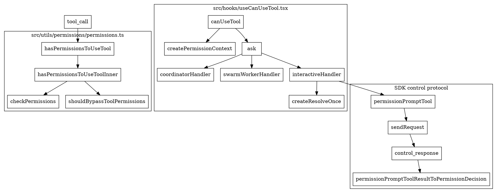

## Introduction

cc-haha 引擎侧的权限判定不是 GUI 上那排可切换档位，而是一条 `hasPermissionsToUseTool` 规则链、一个 `canUseTool` 回调分发器，以及在 headless 模式下把决定权外抛给宿主的 `can_use_tool` 控制协议——三者共同把每次工具调用收敛成一个 `PermissionDecision`。

> 版本基线：v0.7.7（本地源码 E:/Projects/cc-haha-0.7.7）

- 引擎的 `PermissionMode` 比产品页 `Permission.md` 描述的 GUI 档位更宽：`dontAsk` 是 `EXTERNAL_PERMISSION_MODES` 里的一等成员（GUI 不暴露但引擎真实处理），`auto` 只在 `feature('TRANSCRIPT_CLASSIFIER')` 打开时才进入集合，另有一个纯内部的 `bubble` 模式。
- `bypassPermissions` 并非「跳过一切」：`hasPermissionsToUseToolInner` 里 deny 规则、工具自身 deny、`requiresUserInteraction` 的 ask 都在 bypass 短路之前返回，所以 deny 依旧强制；而 `plan` 模式在 `isBypassPermissionsModeAvailable` 为真时同样会走 bypass。
- `PermissionResult` 比 `allow` / `deny` / `ask` 多一个 `passthrough`，最终被转成 ask；而 `cancelAndAbort` 在用户中断或异常时返回的居然是 `behavior: 'ask'`，靠 abort controller 冒泡去结束整个 turn，而非返回一个 deny。

## Types And Decision Vocabulary

`src/Tool.ts` 把运行期权限状态定型为 `ToolPermissionContext`，用 `DeepImmutable` 包住：`mode`、`alwaysAllowRules` / `alwaysDenyRules` / `alwaysAskRules` 三组按来源分组的规则，加上 `shouldAvoidPermissionPrompts`（后台 agent 无 UI 时自动拒）、`awaitAutomatedChecksBeforeDialog`（coordinator worker 先等自动检查）、`prePlanMode`（退出计划模式时恢复）等开关。注释说明这些类型被抽到 `types/permissions.ts` 是为了打断 import cycle。

```typescript
export type ToolPermissionContext = DeepImmutable<{
  mode: PermissionMode
  additionalWorkingDirectories: Map<string, AdditionalWorkingDirectory>
  alwaysAllowRules: ToolPermissionRulesBySource
  alwaysDenyRules: ToolPermissionRulesBySource
  alwaysAskRules: ToolPermissionRulesBySource
  isBypassPermissionsModeAvailable: boolean
  isAutoModeAvailable?: boolean
  strippedDangerousRules?: ToolPermissionRulesBySource
  /** When true, permission prompts are auto-denied (e.g., background agents that can't show UI) */
  shouldAvoidPermissionPrompts?: boolean
  /** When true, automated checks (classifier, hooks) are awaited before showing the permission dialog (coordinator workers) */
  awaitAutomatedChecksBeforeDialog?: boolean
  /** Stores the permission mode before model-initiated plan mode entry, so it can be restored on exit */
  prePlanMode?: PermissionMode
}>
```

空上下文的默认 `mode` 是 `default`，且 `isBypassPermissionsModeAvailable` 为 `false`——也就是说最宽松档默认不可用，需要显式开启。

```typescript
export const getEmptyToolPermissionContext: () => ToolPermissionContext =
  () => ({
    mode: 'default',
    additionalWorkingDirectories: new Map(),
    alwaysAllowRules: {},
    alwaysDenyRules: {},
    alwaysAskRules: {},
    isBypassPermissionsModeAvailable: false,
  })
```

`Tool.checkPermissions(input, context)` 返回 `Promise<PermissionResult>`，注释写明「通用权限逻辑在 permissions.ts，此方法只放工具特有逻辑」；`buildTool` 给它的默认实现是直接 `allow`，等于把判定全部让位给通用链。

## Modes And The Extra Ones

集中定义在 `src/types/permissions.ts` 的 `EXTERNAL_PERMISSION_MODES` 才是引擎真正认得的模式集合。`dontAsk` 赫然在列；`auto` 用 `feature('TRANSCRIPT_CLASSIFIER')` 条件展开；`InternalPermissionMode` 又追加了 `bubble`，`PermissionMode` 取二者的并集。这正是与产品页最容易混淆的地方：GUI 只暴露其中一部分，但引擎对 `dontAsk`、`bubble` 都有实际分支。

```typescript
export const EXTERNAL_PERMISSION_MODES = [
  'acceptEdits',
  'bypassPermissions',
  'default',
  'dontAsk',
  'plan',
  ...(feature('TRANSCRIPT_CLASSIFIER') ? (['auto'] as const) : ([] as const)),
] as const

export type ExternalPermissionMode = (typeof EXTERNAL_PERMISSION_MODES)[number]

// Exhaustive mode union for typechecking. The user-addressable runtime set
// is INTERNAL_PERMISSION_MODES below.
export type InternalPermissionMode = ExternalPermissionMode | 'bubble'
export type PermissionMode = InternalPermissionMode
```

`PermissionBehavior` 只有 `allow` / `deny` / `ask` 三值，但 `PermissionResult` 在 `PermissionDecision` 之外多带一个 `passthrough` 分支，用来表达「工具自身没意见，交给后续流程」，它携带 `suggestions`、`blockedPath` 与 `pendingClassifierCheck`。

```typescript
/**
 * A permission decision - allow, ask, or deny
 */
export type PermissionDecision<
  Input extends { [key: string]: unknown } = { [key: string]: unknown },
> =
  | PermissionAllowDecision<Input>
  | PermissionAskDecision<Input>
  | PermissionDenyDecision

/**
 * Permission result with additional passthrough option
 */
export type PermissionResult<
  Input extends { [key: string]: unknown } = { [key: string]: unknown },
> =
  | PermissionDecision<Input>
  | {
      behavior: 'passthrough'
      message: string
      decisionReason?: PermissionDecision<Input>['decisionReason']
      suggestions?: PermissionUpdate[]
      blockedPath?: string
      /**
       * If set, an allow classifier check should be run asynchronously.
       * The classifier may auto-approve the permission before the user responds.
       */
      pendingClassifierCheck?: PendingClassifierCheck
    }
```

`PermissionDecisionReason` 则是溯源用的联合类型，覆盖 `rule`、`mode`、`hook`、`classifier`、`safetyCheck`、`workingDir`、`sandboxOverride`、`permissionPromptTool` 等来源，日志与 OTel 事件据此把一次决策归到「配置 / 用户 / 钩子 / 分类器」之一。

## Rule Precedence In hasPermissionsToUseTool

核心是 `src/utils/permissions/permissions.ts` 里的 `hasPermissionsToUseToolInner`。它并非简单的 deny > ask > allow，而是一串带特例的步骤：先取 `shouldBypassToolPermissions`，随后 1a 整工具 deny、1b 整工具 ask（sandbox 自动放行可跳过）、1c 调 `tool.checkPermissions`、1d 工具自身 deny、1e `requiresUserInteraction` 的 ask、1f 内容级 ask 规则、1g 安全路径检查，之后才到 2a bypass、2b always-allow、3 把 passthrough 转成 ask。deny 相关步骤排在 bypass 之前，是「bypass 仍强制 deny」的根因。

```typescript
  // 1. Check if the tool is denied
  // 1a. Entire tool is denied
  const denyRule = getDenyRuleForTool(appState.toolPermissionContext, tool)
  if (denyRule) {
    return {
      behavior: 'deny',
      decisionReason: {
        type: 'rule',
        rule: denyRule,
      },
      message: `Permission to use ${tool.name} has been denied.`,
    }
  }

  // 1b. Check if the entire tool should always ask for permission
  const askRule = getAskRuleForTool(appState.toolPermissionContext, tool)
  if (askRule && !shouldBypassPermissions) {
    // When autoAllowBashIfSandboxed is on, sandboxed commands skip the ask rule and
    // auto-allow via Bash's checkPermissions. Commands that won't be sandboxed (excluded
    // commands, dangerouslyDisableSandbox) still need to respect the ask rule.
    const canSandboxAutoAllow =
      tool.name === BASH_TOOL_NAME &&
      SandboxManager.isSandboxingEnabled() &&
      SandboxManager.isAutoAllowBashIfSandboxedEnabled() &&
      shouldUseSandbox(input)

    if (!canSandboxAutoAllow) {
      return {
        behavior: 'ask',
        decisionReason: {
          type: 'rule',
          rule: askRule,
        },
        message: createPermissionRequestMessage(tool.name),
      }
    }
    // Fall through to let Bash's checkPermissions handle command-specific rules
  }
```

`shouldBypassToolPermissions` 的判定比字面更宽：除 `bypassPermissions` 外，`plan` 模式只要 `isBypassPermissionsModeAvailable` 为真也视为 bypass。

```typescript
function shouldBypassToolPermissions(
  toolPermissionContext: ToolPermissionContext,
): boolean {
  return (
    toolPermissionContext.mode === 'bypassPermissions' ||
    (toolPermissionContext.mode === 'plan' &&
      toolPermissionContext.isBypassPermissionsModeAvailable)
  )
}
```

走到 2a 才真正因 mode 放行，2b 处理整工具 always-allow 规则，两者都返回 `behavior: 'allow'` 并带上 `decisionReason`。

```typescript
  // 2a. Check if mode allows the tool to run
  // IMPORTANT: Call getAppState() to get the latest value
  appState = context.getAppState()
  shouldBypassPermissions = shouldBypassToolPermissions(
    appState.toolPermissionContext,
  )
  if (shouldBypassPermissions) {
    return {
      behavior: 'allow',
      updatedInput: getUpdatedInputOrFallback(toolPermissionResult, input),
      decisionReason: {
        type: 'mode',
        mode: appState.toolPermissionContext.mode,
      },
    }
  }

  // 2b. Entire tool is allowed
  const alwaysAllowedRule = toolAlwaysAllowedRule(
    appState.toolPermissionContext,
    tool,
  )
```

兜底的第 3 步把 `passthrough` 正规化成 `ask`，这解释了为什么 `buildTool` 默认 `checkPermissions` 返回 `allow` 之外，通用链里还会出现一个初始 `passthrough` 结果——两者并不矛盾，前者是工具侧默认，后者是通用链在未拿到工具意见时的占位。

```typescript
  // 3. Convert "passthrough" to "ask"
  const result: PermissionDecision =
    toolPermissionResult.behavior === 'passthrough'
      ? {
          ...toolPermissionResult,
          behavior: 'ask' as const,
          message: createPermissionRequestMessage(
            tool.name,
            toolPermissionResult.decisionReason,
          ),
        }
      : toolPermissionResult
```

规则本身由 `getDenyRules` / `getAskRules` 按 `PERMISSION_RULE_SOURCES`（userSettings / projectSettings / localSettings / flagSettings / policySettings / cliArg / command / session）把字符串数组铺开成 `PermissionRule`，`toolMatchesRule` 对 MCP 工具用 `mcp__server__tool` 全名匹配，且只有不带 `ruleContent` 的规则才匹配「整个工具」。

## Mode Transformations On The Result

外层 `hasPermissionsToUseTool: CanUseToolFn` 在拿到 inner 结果后再做模式变换。`dontAsk` 的转换被刻意放在末尾、且只在结果为 `ask` 时触发，注释写明「放在最后，避免被前面的 early return 绕过」——它把 ask 原地改写成 `deny`，决策原因标为 `type: 'mode'`。

```typescript
  // Apply dontAsk mode transformation: convert 'ask' to 'deny'
  // This is done at the end so it can't be bypassed by early returns
  if (result.behavior === 'ask') {
    const appState = context.getAppState()

    if (appState.toolPermissionContext.mode === 'dontAsk') {
      return {
        behavior: 'deny',
        decisionReason: {
          type: 'mode',
          mode: 'dontAsk',
        },
        message: DONT_ASK_REJECT_MESSAGE(tool.name),
      }
    }
```

`auto` 模式（或 plan 下激活的 auto）改走分类器而非弹窗；更反直觉的是 `forceShellClassifier`：当 `classifyAllShell` 打开且工具是 Bash / PowerShell 时，一个本已 `allow` 的结果会被强制回写成 `ask`，把命令重新交给分类器过一遍，作为「auto 模式启动后才加进来的动态放行规则」的最后防线。

```typescript
  // Entry-time rule stripping is defense in depth. This runtime conversion is
  // the final guard for policy, flag, session, and dynamic shell allows added
  // after Auto mode starts.
  if (forceShellClassifier && result.behavior === 'allow') {
    classifierInput = getUpdatedInputOrFallback(result, input)
    result = {
      behavior: 'ask',
      message: createPermissionRequestMessage(tool.name),
      decisionReason: result.decisionReason,
    }
  }
```

## The canUseTool Dispatch

`src/hooks/useCanUseTool.tsx` 是这个回调的工厂。需要先点明：release 快照里该文件是 React Compiler 的编译产物（开头 `import { c as _c } from "react/compiler-runtime"`、函数里 `const $ = _c(3)`、末尾带 `sourceMappingURL`），逻辑仍能逐行读出。`CanUseToolFn` 的签名把工具、输入、上下文、assistant 消息、`toolUseID` 与可选的 `forceDecision` 收进去，吐出 `Promise<PermissionDecision>`。

```typescript
export type CanUseToolFn<Input extends Record<string, unknown> = Record<string, unknown>> = (tool: ToolType, input: Input, toolUseContext: ToolUseContext, assistantMessage: AssistantMessage, toolUseID: string, forceDecision?: PermissionDecision<Input>) => Promise<PermissionDecision<Input>>;
```

主流程先 `createPermissionContext(...)`，再取 `forceDecision ?? hasPermissionsToUseTool(...)`，然后按 `result.behavior` 三分：`allow` 记日志后 `resolve(ctx.buildAllow(...))`；`deny` 记 reject 日志、auto 模式拒绝时追加通知并 `resolve(result)`；`ask` 才是重头戏。下面是 allow 分支的原样片段。

```typescript
      return decisionPromise.then(async result => {
        if (result.behavior === "allow") {
          if (ctx.resolveIfAborted(resolve)) {
            return;
          }
          if (feature("TRANSCRIPT_CLASSIFIER") && result.decisionReason?.type === "classifier" && result.decisionReason.classifier === "auto-mode") {
            setYoloClassifierApproval(toolUseID, result.decisionReason.reason);
          }
          ctx.logDecision({
            decision: "accept",
            source: "config"
          });
          resolve(ctx.buildAllow(result.updatedInput ?? input, {
            decisionReason: result.decisionReason
          }));
          return;
        }
```

`ask` 分支先按 `awaitAutomatedChecksBeforeDialog` 决定是否让 coordinator 先跑自动检查，把 `appState.toolPermissionContext.mode` 作为 `permissionMode` 传下去，任一 handler 给出非空决定即短路返回。

```typescript
              if (appState.toolPermissionContext.awaitAutomatedChecksBeforeDialog) {
                const coordinatorDecision = await handleCoordinatorPermission({
                  ctx,
                  ...(feature("BASH_CLASSIFIER") ? {
                    pendingClassifierCheck: result.pendingClassifierCheck
                  } : {}),
                  updatedInput: result.updatedInput,
                  suggestions: result.suggestions,
                  permissionMode: appState.toolPermissionContext.mode
                });
                if (coordinatorDecision) {
                  resolve(coordinatorDecision);
                  return;
                }
              }
```

整个 Promise 的 `.catch` 对 `AbortError` / `APIUserAbortError` 记录调试日志，其余错误 `logError`，两者都落到 `cancelAndAbort`；`.finally` 统一 `clearClassifierChecking(toolUseID)`。也就是任何异常都 fail-closed，不会静默放行。

## Automated Check Handlers

`src/hooks/toolPermission/handlers/` 下按运行上下文分派。`coordinatorHandler` 把自动检查**顺序**执行：先 hooks（快、本地），再 classifier（慢、推理、仅 Bash），任一得决定即返回；抛错则记日志并 `return null` 落回对话框，注释强调「hooks 已跑、classifier 已消耗」，不重复执行。

```typescript
  const { ctx, updatedInput, suggestions, permissionMode } = params

  try {
    // 1. Try permission hooks first (fast, local)
    const hookResult = await ctx.runHooks(
      permissionMode,
      suggestions,
      updatedInput,
    )
    if (hookResult) return hookResult

    // 2. Try classifier (slow, inference -- bash only)
    const classifierResult = feature('BASH_CLASSIFIER')
      ? await ctx.tryClassifier?.(params.pendingClassifierCheck, updatedInput)
      : null
    if (classifierResult) {
      return classifierResult
    }
  } catch (error) {
    // If automated checks fail unexpectedly, fall through to show the dialog
    // so the user can decide manually. Non-Error throws get a context prefix
    // so the log is traceable — intentionally NOT toError(), which would drop
    // the prefix.
    if (error instanceof Error) {
      logError(error)
    } else {
      logError(new Error(`Automated permission check failed: ${String(error)}`))
    }
  }

  // 3. Neither resolved (or checks failed) -- fall through to dialog below.
  // Hooks already ran, classifier already consumed.
  return null
```

`swarmWorkerHandler` 在非 swarm / 非 worker 时直接返回 `null` 让调用方降级；否则先试分类器自动放行，再经 mailbox 把 `createPermissionRequest` 转发给 leader，**先注册 callback 再发请求**，等待期 abort 会 resolve 成 cancel 而非挂死，转发抛错则回退本地处理。

```typescript
      // If the abort signal fires while waiting for the leader response,
      // resolve the promise with a cancel decision so it does not hang.
      ctx.toolUseContext.abortController.signal.addEventListener(
        'abort',
        () => {
          if (!claim()) return
          clearPendingRequest()
          ctx.logCancelled()
          resolveOnce(ctx.cancelAndAbort(undefined, true))
        },
        { once: true },
      )
```

`interactiveHandler` 是最后一级，也是最容易误解的一级：它不是「等用户点一下」，而是把本地对话框、bridge（CCR）、channel（IM 通道）、hooks、bash classifier 全部并发起来竞速，谁先 `claim()` 成功谁赢。文件头的注释把这层设计写得很直白。

```typescript
/**
 * Handles the interactive (main-agent) permission flow.
 *
 * Pushes a ToolUseConfirm entry to the confirm queue with callbacks:
 * onAbort, onAllow, onReject, recheckPermission, onUserInteraction.
 *
 * Runs permission hooks and bash classifier checks asynchronously in the
 * background, racing them against user interaction. Uses a resolve-once
 * guard and `userInteracted` flag to prevent multiple resolutions.
 *
 * This function does NOT return a Promise -- it sets up callbacks that
 * eventually call `resolve()` to resolve the outer promise owned by
 * the caller.
 */
```

产品页 `Permission.md` 里描述的「三条委派链 + GUI 审批」正是这一层的外显；本篇补的是它下面 `hasPermissionsToUseTool` 的规则优先级与 `can_use_tool` 协议这两段引擎内部实现。

## Permission Context Helpers

`src/hooks/toolPermission/PermissionContext.ts` 提供共享原语。`createResolveOnce` 用 `claimed` / `delivered` 两个标志实现 `claim()` 原子「检查并占位」，专门堵住「`isResolved()` 检查与 `resolve()` 之间」的竞态窗口，上面所有竞速分支都靠它防重复 resolve。

```typescript
function createResolveOnce<T>(resolve: (value: T) => void): ResolveOnce<T> {
  let claimed = false
  let delivered = false
  return {
    resolve(value: T) {
      if (delivered) return
      delivered = true
      claimed = true
      resolve(value)
    },
    isResolved() {
      return claimed
    },
    claim() {
      if (claimed) return false
      claimed = true
      return true
    },
  }
}
```

同文件里 `createPermissionContext` 用 `Object.freeze` 冻结出 `ctx`，挂上 `buildAllow` / `buildDeny`、`handleUserAllow` / `handleHookAllow`、`persistPermissions`（`applyPermissionUpdates` + `setToolPermissionContext`，把「本会话永久允许」写回权限上下文）、`runHooks`（跑 `executePermissionRequestHooks`）、`tryClassifier` 与队列操作。最反直觉的是 `cancelAndAbort`：它 `abort` 掉 controller 后返回的是 `{ behavior: 'ask', message, contentBlocks }` 而非 deny，且对子 agent 换用 `SUBAGENT_REJECT_MESSAGE`。源码注释关联到 `#21056` 回归——这个 abort 必须冒泡到 query controller，否则 ExitPlanMode 的「清上下文 + 自动」会把 REJECT_MESSAGE 发给模型而不是结束 turn。

```typescript
    cancelAndAbort(
      feedback?: string,
      isAbort?: boolean,
      contentBlocks?: ContentBlockParam[],
    ): PermissionDecision {
      const sub = !!toolUseContext.agentId
      const baseMessage = feedback
        ? `${sub ? SUBAGENT_REJECT_MESSAGE_WITH_REASON_PREFIX : REJECT_MESSAGE_WITH_REASON_PREFIX}${feedback}`
        : sub
          ? SUBAGENT_REJECT_MESSAGE
          : REJECT_MESSAGE
      const message = sub ? baseMessage : withMemoryCorrectionHint(baseMessage)
      if (isAbort || (!feedback && !contentBlocks?.length && !sub)) {
        logForDebugging(
          `Aborting: tool=${tool.name} isAbort=${isAbort} hasFeedback=${!!feedback} isSubagent=${sub}`,
        )
        toolUseContext.abortController.abort()
      }
      return { behavior: 'ask', message, contentBlocks }
    },
```

## The can_use_tool Control Protocol

在 print / SDK 这类非交互模式，引擎不弹 GUI，而是把权限请求包装成 `control_request` 发给宿主。`src/entrypoints/sdk/controlSchemas.ts` 里 `SDKControlPermissionRequestSchema` 定义了 `subtype: 'can_use_tool'` 的载荷：`tool_name`、`input`、`permission_suggestions`、`blocked_path`、`decision_reason`、`tool_use_id`、`agent_id` 等。

```typescript
export const SDKControlPermissionRequestSchema = lazySchema(() =>
  z
    .object({
      subtype: z.literal('can_use_tool'),
      tool_name: z.string(),
      input: z.record(z.string(), z.unknown()),
      permission_suggestions: z.array(PermissionUpdateSchema()).optional(),
      blocked_path: z.string().optional(),
      decision_reason: z.string().optional(),
      title: z.string().optional(),
      display_name: z.string().optional(),
      tool_use_id: z.string(),
      agent_id: z.string().optional(),
      description: z.string().optional(),
    })
    .describe('Requests permission to use a tool with the given input.'),
)
```

外层 `SDKControlRequestSchema` 是 `{ type: 'control_request', request_id, request }`，响应侧 `SDKControlResponseSchema` 是 `{ type: 'control_response', response }`，其中 `ControlResponseSchema` 为 `subtype: 'success'` 加可选 `response` 记录，另有 `ControlErrorResponseSchema` 走 `subtype: 'error'`。

```typescript
export const SDKControlRequestSchema = lazySchema(() =>
  z.object({
    type: z.literal('control_request'),
    request_id: z.string(),
    request: SDKControlRequestInnerSchema(),
  }),
)

export const ControlResponseSchema = lazySchema(() =>
  z.object({
    subtype: z.literal('success'),
    request_id: z.string(),
    response: z.record(z.string(), z.unknown()).optional(),
  }),
)
```

`src/cli/print.ts` 的 `createCanUseToolWithPermissionPrompt` 是引擎侧入口：先用 `hasPermissionsToUseTool`（或 `forceDecision`），`allow` / `deny` 直接返回，只有 `ask` 才把请求交给 `permissionPromptTool.call(...)` 并与 abort 信号 `Promise.race`。

```typescript
export function createCanUseToolWithPermissionPrompt(
  permissionPromptTool: PermissionPromptTool,
): CanUseToolFn {
  const canUseTool: CanUseToolFn = async (
    tool,
    input,
    toolUseContext,
    assistantMessage,
    toolUseId,
    forceDecision,
  ) => {
    const mainPermissionResult =
      forceDecision ??
      (await hasPermissionsToUseTool(
        tool,
        input,
        toolUseContext,
        assistantMessage,
        toolUseId,
      ))

    // If the tool is allowed or denied, return the result
    if (
      mainPermissionResult.behavior === 'allow' ||
      mainPermissionResult.behavior === 'deny'
    ) {
      return mainPermissionResult
    }
```

那个 `permissionPromptTool` 的实现就在 `src/cli/structuredIO.ts`：它 `sendRequest({ subtype: 'can_use_tool', ... }, permissionToolOutputSchema(), ...)`，字段与上面的 schema 一一对应。

```typescript
        const sdkPromise = this.sendRequest<PermissionToolOutput>(
          {
            subtype: 'can_use_tool',
            tool_name: tool.name,
            input,
            permission_suggestions: mainPermissionResult.suggestions,
            blocked_path: mainPermissionResult.blockedPath,
            decision_reason: serializeDecisionReason(
              mainPermissionResult.decisionReason,
            ),
            tool_use_id: toolUseID,
            agent_id: toolUseContext.agentId,
          },
          permissionToolOutputSchema(),
          hookAbortController.signal,
          requestId,
        ).then(result => ({ source: 'sdk' as const, result }))
```

这里同样是一次竞速：SDK 宿主的 `control_response` 与 `executePermissionRequestHooksForSDK` 的 hook 结果 `Promise.race`，hook 先出决定就 abort 掉挂起的 SDK 请求，SDK 先回则经 `permissionPromptToolResultToPermissionDecision` 转成 `PermissionDecision`；任何异常都 catch 成 `behavior: 'deny'` 的 fail-closed 结果。

```typescript
        // Race: hook completion vs SDK prompt response.
        // The hook promise always resolves (never rejects), returning
        // undefined if no hook made a decision.
        const winner = await Promise.race([hookPromise, sdkPromise])

        if (winner.source === 'hook') {
          if (winner.decision) {
            // Hook decided — abort the pending SDK request.
            // Suppress the expected AbortError rejection from sdkPromise.
            sdkPromise.catch(() => {})
            hookAbortController.abort()
            return winner.decision
          }
          // Hook passed through (no decision) — wait for the SDK prompt
          const sdkResult = await sdkPromise
          return permissionPromptToolResultToPermissionDecision(
            sdkResult.result,
            tool,
            input,
            toolUseContext,
          )
        }
```

这条协议还被复用：沙箱的网络访问请求以合成工具名 `SandboxNetworkAccess` 借 `can_use_tool` 发出，`src/server/services/conversationService.ts` 则在桌面侧把 `can_use_tool` 的控制请求翻译成 GUI 的 `permission_request`——引擎外抛与产品页审批弹窗在这里接上。`structuredIO` 还用 `trackResolvedToolUseId` 维护已决 `tool_use_id` 集合，忽略迟到或重复的 `control_response`。

## Decision Chain At A Glance



## Links

- [Permission 产品页](/docs/CS/AI/LLM/Agent/Product/CcHaha/Permission.md)
- [CcHaha 主枢纽](/docs/CS/AI/LLM/Agent/Product/CcHaha/CcHaha.md)
- [REPL](/docs/CS/AI/LLM/Agent/Product/CcHaha/REPL.md)
- [AgentTeams](/docs/CS/AI/LLM/Agent/Product/CcHaha/AgentTeams.md)
- [ComputerUse](/docs/CS/AI/LLM/Agent/Product/CcHaha/ComputerUse.md)
- [ClaudeCode 家族](/docs/CS/AI/LLM/Agent/Product/ClaudeCode/ClaudeCode.md)

## References

- [NanmiCoder/cc-haha GitHub](https://github.com/NanmiCoder/cc-haha)
- [cc-haha 官网](https://cchaha.ai/)
- [src/Tool.ts](https://github.com/NanmiCoder/cc-haha/blob/main/src/Tool.ts)
- [src/types/permissions.ts](https://github.com/NanmiCoder/cc-haha/blob/main/src/types/permissions.ts)
- [src/utils/permissions/permissions.ts](https://github.com/NanmiCoder/cc-haha/blob/main/src/utils/permissions/permissions.ts)
- [src/hooks/useCanUseTool.tsx](https://github.com/NanmiCoder/cc-haha/blob/main/src/hooks/useCanUseTool.tsx)
- [src/hooks/toolPermission/PermissionContext.ts](https://github.com/NanmiCoder/cc-haha/blob/main/src/hooks/toolPermission/PermissionContext.ts)
- [src/entrypoints/sdk/controlSchemas.ts](https://github.com/NanmiCoder/cc-haha/blob/main/src/entrypoints/sdk/controlSchemas.ts)
- [src/cli/structuredIO.ts](https://github.com/NanmiCoder/cc-haha/blob/main/src/cli/structuredIO.ts)
- [src/cli/print.ts](https://github.com/NanmiCoder/cc-haha/blob/main/src/cli/print.ts)
