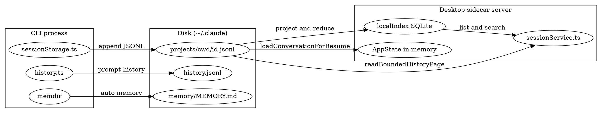

## Introduction

cc-haha 的会话持久化以 CLI 写出的项目级 JSONL transcript 为唯一权威数据源，桌面服务端在其上叠加 SQLite 本地索引、纯内存运行时 state 与 auto memory 记忆文件。

> 版本基线：v0.7.7（本地源码 E:/Projects/cc-haha-0.7.7）

反直觉点：

- `src/history.ts` 并不是会话历史，而是 prompt 命令历史（Up 箭头 / ctrl+r 搜索），写入全局 `history.jsonl`；会话 transcript 位于项目目录下的 `{sessionId}.jsonl`，两者互不相干。
- `src/state/` 是纯内存 store，退出即失，不落盘；本地 SQLite 索引是投影与读缓存而非权威数据，索引无法投影时 `SessionService` 会回退读盘。
- `--resume` 恢复的不只是消息数组，还包含 agent 设置、file history 快照、attribution 快照、context collapse 状态与 worktree session 等，经 `loadConversationForResume` 一次性回填到 AppState。

## Transcript As Source Of Truth

`src/server/services/sessionService.ts` 文件头注释点明权威路径与互通目标：

```typescript
/**
 * Session Service — 会话文件的读写操作封装
 *
 * 读写 CLI 持久化在 ~/.claude/projects/{sanitized_path}/{sessionId}.jsonl 的会话数据，
 * 确保 Desktop App 与 CLI 的数据完全互通。
 */
```

`src/utils/sessionStorage.ts` 的 `getProjectsDir` 与 `getTranscriptPath` 拼出实际路径，`getProjectDir` 用 `sanitizePath` 把 cwd 映射成项目目录名：

```typescript
export function getProjectsDir(): string {
  return join(getClaudeConfigHomeDir(), 'projects')
}

export function getTranscriptPath(): string {
  const projectDir = getSessionProjectDir() ?? getProjectDir(getOriginalCwd())
  return join(projectDir, `${getSessionId()}.jsonl`)
}
```

```typescript
export const getProjectDir = memoize((projectDir: string): string => {
  return join(getProjectsDir(), sanitizePath(projectDir))
})
```

写入是逐行 append，权限 0600，目录不存在时先以 0700 创建：

```typescript
  try {
    fs.appendFileSync(fullPath, line, { mode: 0o600 })
  } catch {
    fs.mkdirSync(dirname(fullPath), { mode: 0o700 })
    fs.appendFileSync(fullPath, line, { mode: 0o600 })
  }
```

加载侧用 `parseJSONL` 读入、`isCompactBoundaryMessage` 识别压缩边界、`readTranscriptForLoad` 做加载前扫描，这些能力从 `sessionStoragePortable.js` 的 import 可见：

```typescript
import {
  extractJsonStringField,
  extractLastJsonStringField,
  LITE_READ_BUF_SIZE,
  readHeadAndTail,
  readTranscriptForLoad,
  SKIP_PRECOMPACT_THRESHOLD,
} from './sessionStoragePortable.js'
```

## Prompt History Is Not Session History

`src/history.ts` 的 `LogEntry` 表明它记录的是用户输入 display 文本、粘贴内容引用、时间戳、项目与 sessionId：

```typescript
type LogEntry = {
  display: string
  pastedContents: Record<number, StoredPastedContent>
  timestamp: number
  project: string
  sessionId?: string
}
```

读取目标是全局共享的 `history.jsonl`，而非项目 transcript：

```typescript
  // Read from global history file (shared across all projects)
  const historyPath = join(getClaudeConfigHomeDir(), 'history.jsonl')
```

`getTimestampedHistory` 的注释说明它服务于 ctrl+r 选择器，按 display 去重、懒解析粘贴内容：

```typescript
/**
 * Current-project history for the ctrl+r picker: deduped by display text,
 * newest first, with timestamps. Paste contents are resolved lazily via
 * `resolve()` — the picker only reads display+timestamp for the list.
 */
```

`addToHistory` 还会在 `CLAUDE_CODE_SKIP_PROMPT_HISTORY` 时跳过，避免验证会话污染真实命令历史；`removeLastFromHistory` 用于 ESC 撤销输入。它与 `--resume` 无关：

```typescript
export function addToHistory(command: HistoryEntry | string): void {
  // Skip history when running in a tmux session spawned by Claude Code's Tungsten tool.
  // This prevents verification/test sessions from polluting the user's real command history.
  if (isEnvTruthy(process.env.CLAUDE_CODE_SKIP_PROMPT_HISTORY)) {
    return
  }
```

## In Memory State

`src/state/store.ts` 的 `createStore` 只是闭包变量加 listener 集合，没有任何磁盘 IO：

```typescript
export function createStore<T>(
  initialState: T,
  onChange?: OnChange<T>,
): Store<T> {
  let state = initialState
  const listeners = new Set<Listener>()

  return {
    getState: () => state,

    setState: (updater: (prev: T) => T) => {
      const prev = state
      const next = updater(prev)
      if (Object.is(next, prev)) return
      state = next
      onChange?.({ newState: next, oldState: prev })
      for (const listener of listeners) listener()
    },

    subscribe: (listener: Listener) => {
      listeners.add(listener)
      return () => listeners.delete(listener)
    },
  }
}
```

`src/state/AppStateStore.ts` 定义的是 `Message`、`TodoList`、`MCPServerConnection`、`FileHistoryState`、`SpeculationState` 等运行时字段，例如：

```typescript
export type CompletionBoundary =
  | { type: 'complete'; completedAt: number; outputTokens: number }
  | { type: 'bash'; command: string; completedAt: number }
  | { type: 'edit'; toolName: string; filePath: string; completedAt: number }
  | {
      type: 'denied_tool'
      toolName: string
      detail: string
      completedAt: number
    }
```

持久化由 transcript 与索引负责；resume 时通过 `restoreSessionStateFromLog` 把 transcript 回填进 AppState，而非从 `state/` 目录读盘。

## Local Index And Projection

`src/server/services/localIndex/config.ts` 说明 SQLite 是常规读路径，另有 `shadow` 与 `off` 仅供 parity / fallback 测试与应急诊断，数据库文件为 `index-v1.sqlite`：

```typescript
export function resolveLocalIndexMode(
  value = process.env.CC_HAHA_LOCAL_INDEX,
): LocalIndexModeResolution {
  // SQLite is the normal product read path. Explicit modes remain available
  // only for deterministic parity/fallback tests and emergency diagnosis.
  if (value === undefined || value === 'on') {
    return { mode: 'on', warningCode: null }
  }
  if (value === 'off') {
    return { mode: 'off', warningCode: null }
  }
  if (value === 'shadow') {
    return { mode: value, warningCode: null }
  }
  return { mode: 'on', warningCode: LOCAL_INDEX_INVALID_MODE }
}

export function getLocalIndexDatabasePath(): string {
  return join(getCcHahaDir(), 'db', 'index-v1.sqlite')
}
```

`src/server/services/localIndex/sessionProjector.ts` 用 `stream-json/parser.js` 流式解析 transcript 并 reduce 成 `TranscriptProjection`；`SESSION_SUMMARY_PARSER_VERSION` 一旦变化就触发 rebuild，注释明说这是刷新已索引 transcript 的唯一途径：

```typescript
// Bump whenever the reducer's output changes for input it has already seen: a mismatch against a
// source's stored version makes `detectSourceChange` return `rebuild`, which is the only thing
// that refreshes already-indexed transcripts.
// 3: usage is deduplicated per (message.id, requestId), and sessions carry active working time.
// 4: usage copied into a fork is excluded from the fork's activity projection.
// 5: protocol-lock metadata was projected into session summaries.
// 6: protocol enforcement was removed; rebuild v5 summaries without protocol restrictions.
// 7: independent desktop team workers remain addressable but leave sidebar listings.
// 8: complete runtime selections clear the previous effort when no override is saved.
// 9: usage cost rates were corrected (Sonnet 5, Sonnet 5.5, Opus 5.5, fast mode); rebuild the
//    persisted per-model dollars.
// 10: project the explicit per-session ChatGPT OAuth Fast selection.
// 11: Haiku 5.5 gained (prompt-length tiered) pricing; rebuild the persisted per-model dollars.
// 12: project the immutable conversation agent profile; legacy sessions use standard.
// 13: a reply's usage is the per-field maximum over its content-block lines, not its first line;
//     rebuild the persisted per-model tokens and dollars that under-counted zero-first replies.
export const SESSION_SUMMARY_PARSER_VERSION = 13
```

投影结果区分为 full / append / rebuild / unchanged，说明索引是增量维护的读模型：

```typescript
export type SessionProjectResult =
  | {
    kind: 'indexed'
    action: 'full' | 'append' | 'rebuild' | 'unchanged'
    projection: TranscriptProjection
    work: ProjectionWork
  }
  | { kind: 'deleted' }
  | Extract<SourceChange, { kind: 'retry' }>
```

`src/server/services/localIndex/sessionIndex.ts` 的 `SessionIndexReader` 定义列表、定位与搜索接口：

```typescript
export interface SessionIndexReader {
  getSessionSuggestionMetadata?(sessionIds: string[]): IndexedSessionRow[] | null
  searchSessionMetadata?(query: string, options?: { limit?: number; offset?: number }): SessionIndexPage | null
  listSessions(options?: {
    project?: string
    limit?: number
    offset?: number
  }): SessionIndexPage
  findSessionFiles(sessionId: string): SessionFileMatch[]
  getSession?(sessionId: string): IndexedSessionRow | null
  findSearchCandidates?(
    filters: SessionSearchCandidateFilters,
  ): IndexedSessionSearchCandidate[] | null
}
```

`src/server/services/localIndex/sessionEntries.ts` 用字节区间 locator 做定向读取，读前校验文件 size / mtime / identity 是否与索引页一致：

```typescript
function snapshotMatchesPage(
  snapshot: Pick<Stats, 'size' | 'mtimeMs' | 'dev' | 'ino'>,
  page: SessionEntryLocatorPage,
): boolean {
  const actualIdentity = identity(snapshot)
  return snapshot.size === page.source.size &&
    snapshot.mtimeMs === page.source.mtimeMs &&
    (
      page.source.fileIdentity === null ||
      actualIdentity === null ||
      page.source.fileIdentity === actualIdentity
    )
}
```

`src/server/services/sessionService.ts` 明确准备在索引无法投影时回退读盘：

```typescript
/** Index rows minus the transcripts the index could not project, which are read from disk. */
type DegradedListPlan = {
  excludedPaths: ReadonlySet<string>
  revision: string
}
```

`src/server/services/localIndex/transcriptReducer.ts` 在投影状态不可用时要求从字节零重建：

```typescript
export const LOCAL_INDEX_REBUILD_REQUIRED = 'LOCAL_INDEX_REBUILD_REQUIRED'

export class TranscriptRebuildRequiredError extends Error {
  readonly code = LOCAL_INDEX_REBUILD_REQUIRED

  constructor() {
    super('Transcript projection state is unavailable; rebuild this source from byte zero')
    this.name = 'TranscriptRebuildRequiredError'
  }
}
```

## History Paging And Fallback

`SessionService.getSessionHistoryPage` 先经 `findSessionFile` 定位 transcript，再用 `readBoundedHistoryPage` 做有字节预算的分页读取，而不是从 SQLite 取消息本体：

```typescript
  async getSessionHistoryPage(sessionId: string, options: {
    cursor?: string; limit?: number; signal?: AbortSignal; full?: boolean; projectContext?: boolean
    /** Replace tool-result image bytes with references and page by the projected size. */
    mediaRefs?: boolean
  } = {}): Promise<{
    messages: MessageEntry[]
    taskNotifications: SessionTaskNotification[]
    page: HistoryPageInfo
  }> {
```

```typescript
    const found = await this.findSessionFile(sessionId)
    if (!found) {
      const key = this.memorySessionKey(sessionId)
      if (this.memoryLaunchInfo.has(key) || this.knownSessionKeys.has(key)) {
        return { messages: [], taskNotifications: [], page: { nextCursor: null, hasMore: false, historyComplete: true, sourceVersion: 'memory', scannedBytes: 0, omittedOversizedEntries: 0 } }
      }
      throw ApiError.notFound(`Session not found: ${sessionId}`)
    }
    const mediaRefs = options.mediaRefs === true && !options.full
    const result = await readBoundedHistoryPage(found.filePath, mediaRefs ? { ...options, measure: measureEntryWithMediaRefs } : options)
```

可见索引主要服务于列表、搜索、统计与元数据，历史消息本体仍从 JSONL 源文件按页读取；`memory` 分支表明仅有内存启动信息、无 transcript 的会话返回空历史。

## Resume And Fork

`src/cli/print.ts` 的 `loadInitialMessages` 在 `--continue` 分支调 `loadConversationForResume`：

```typescript
  const persistSession = !isSessionPersistenceDisabled()
  // Handle continue in print mode
  if (options.continue) {
    try {
      logEvent('tengu_continue_print', {})

      const result = await loadConversationForResume(
        undefined /* sessionId */,
        undefined /* file path */,
      )
```

随后复用 sessionId、`switchSession`、`resetSessionFilePointer`、`restoreSessionStateFromLog` 与 `restoreSessionMetadata`；`forkSession` 时不复用 sessionId：

```typescript
        // Reuse the resumed session's ID
        if (!options.forkSession) {
          if (result.sessionId) {
            switchSession(
              asSessionId(result.sessionId),
              result.fullPath ? dirname(result.fullPath) : null,
            )
            if (persistSession) {
              await resetSessionFilePointer()
            }
          }
        }
        restoreSessionStateFromLog(result, setAppState)

        // Restore session metadata so it's re-appended on exit via reAppendSessionMetadata
        restoreSessionMetadata(
          options.forkSession
            ? { ...result, worktreeSession: undefined }
            : result,
        )
```

`src/utils/conversationRecovery.ts` 的返回类型说明恢复载荷远不止 messages：

```typescript
export async function loadConversationForResume(
  source: string | LogOption | undefined,
  sourceJsonlFile: string | undefined,
  options: { resumeSessionAt?: string } = {},
): Promise<{
  messages: Message[]
  turnInterruptionState: TurnInterruptionState
  fileHistorySnapshots?: FileHistorySnapshot[]
  attributionSnapshots?: AttributionSnapshotMessage[]
  contentReplacements?: ContentReplacementRecord[]
  contextCollapseCommits?: ContextCollapseCommitEntry[]
  contextCollapseSnapshot?: ContextCollapseSnapshotEntry
  sessionId: UUID | undefined
```

`src/server/services/conversationService.ts` 的 `buildSessionCliArgs` 里，续接与新建仅在 `--resume sessionId` 与 `--session-id sessionId` 之间切换；side chat 走 `--resume <resumePath>` 加 `--resume-session-at`、`--fork-session`、`--no-session-persistence` 与边界 system prompt：

```typescript
      ...(side ? ['--resume', side.resumePath, '--resume-session-at', side.resumeAt, '--fork-session', '--session-id', side.cliSessionId, '--no-session-persistence', '--append-system-prompt', SIDE_CHAT_BOUNDARY] : shouldResume ? ['--resume', sessionId] : ['--session-id', sessionId]),
```

## Auto Memory Files

`src/memdir/paths.ts` 定义 auto memory 目录为 `<memoryBase>/projects/<sanitized-git-root>/memory/`，入口文件是 `MEMORY.md`：

```typescript
const AUTO_MEM_DIRNAME = 'memory'
const AUTO_MEM_ENTRYPOINT_NAME = 'MEMORY.md'
```

```typescript
export const getAutoMemPath = memoize(
  (): string => {
    const override = getAutoMemPathOverride() ?? getAutoMemPathSetting()
    if (override) {
      return override
    }
    const projectsDir = join(getMemoryBaseDir(), 'projects')
    return (
      join(projectsDir, sanitizePath(getAutoMemBase()), AUTO_MEM_DIRNAME) + sep
    ).normalize('NFC')
  },
  () => getProjectRoot(),
)
```

`getAutoMemBase` 用 canonical git root，让同一仓库的多个 worktree 共享一份记忆：

```typescript
function getAutoMemBase(): string {
  return findCanonicalGitRoot(getProjectRoot()) ?? getProjectRoot()
}
```

`isAutoMemoryEnabled` 默认开启，可被 `CLAUDE_CODE_DISABLE_AUTO_MEMORY`、`CLAUDE_CODE_SIMPLE`、CCR 无持久内存目录、settings 的 `autoMemoryEnabled` 关闭：

```typescript
export function isAutoMemoryEnabled(): boolean {
  const envVal = process.env.CLAUDE_CODE_DISABLE_AUTO_MEMORY
  if (isEnvTruthy(envVal)) {
    return false
  }
  if (isEnvDefinedFalsy(envVal)) {
    return true
  }
  // --bare / SIMPLE: prompts.ts already drops the memory section from the
  // system prompt via its SIMPLE early-return; this gate stops the other half
  // (extractMemories turn-end fork, autoDream, /remember, /dream, team sync).
  if (isEnvTruthy(process.env.CLAUDE_CODE_SIMPLE)) {
    return false
  }
  if (
    isEnvTruthy(process.env.CLAUDE_CODE_REMOTE) &&
    !process.env.CLAUDE_CODE_REMOTE_MEMORY_DIR
  ) {
    return false
  }
  const settings = getInitialSettings()
  if (settings.autoMemoryEnabled !== undefined) {
    return settings.autoMemoryEnabled
  }
  return true
}
```

`src/memdir/memdir.ts` 对 `MEMORY.md` 施加双上限，超限会截断并附加警告，提示把细节移到 topic 文件：

```typescript
export const ENTRYPOINT_NAME = 'MEMORY.md'
export const MAX_ENTRYPOINT_LINES = 200
// ~125 chars/line at 200 lines. At p97 today; catches long-line indexes that
// slip past the line cap (p100 observed: 197KB under 200 lines).
export const MAX_ENTRYPOINT_BYTES = 25_000
```

`getAutoMemDailyLogPath` 给出按日期的日志形态 `logs/YYYY/MM/YYYY-MM-DD.md`：

```typescript
export function getAutoMemDailyLogPath(date: Date = new Date()): string {
  const yyyy = date.getFullYear().toString()
  const mm = (date.getMonth() + 1).toString().padStart(2, '0')
  const dd = date.getDate().toString().padStart(2, '0')
  return join(getAutoMemPath(), 'logs', yyyy, mm, `${yyyy}-${mm}-${dd}.md`)
}
```

安全方面，`paths.ts` 的 settings 覆盖刻意排除 `projectSettings`，防止恶意仓库把 `autoMemoryDirectory` 指到敏感目录：

```typescript
/**
 * Settings.json override for the full auto-memory directory path.
 * Supports ~/ expansion for user convenience.
 *
 * SECURITY: projectSettings (.claude/settings.json committed to the repo) is
 * intentionally excluded — a malicious repo could otherwise set
 * autoMemoryDirectory: "~/.ssh" and gain silent write access to sensitive
 * directories via the filesystem.ts write carve-out (which fires when
 * isAutoMemPath() matches and hasAutoMemPathOverride() is false). This follows
 * the same pattern as hasSkipDangerousModePermissionPrompt() etc.
 */
```

## Topology



## Links

- [CcHaha 主枢纽](/docs/CS/AI/LLM/Agent/Product/CcHaha/CcHaha.md)
- [MemoryContext](/docs/CS/AI/LLM/Agent/Product/CcHaha/MemoryContext.md)
- [REPL](/docs/CS/AI/LLM/Agent/Product/CcHaha/REPL.md)
- [ScheduledTasks](/docs/CS/AI/LLM/Agent/Product/CcHaha/ScheduledTasks.md)
- [Comparison](/docs/CS/AI/LLM/Agent/Product/CcHaha/Comparison.md)
- [ClaudeCode](/docs/CS/AI/LLM/Agent/Product/ClaudeCode/ClaudeCode.md)

## References

- [cc-haha GitHub](https://github.com/NanmiCoder/cc-haha)
- [history.ts](https://github.com/NanmiCoder/cc-haha/blob/main/src/history.ts)
- [sessionStorage.ts](https://github.com/NanmiCoder/cc-haha/blob/main/src/utils/sessionStorage.ts)
- [conversationRecovery.ts](https://github.com/NanmiCoder/cc-haha/blob/main/src/utils/conversationRecovery.ts)
- [sessionService.ts](https://github.com/NanmiCoder/cc-haha/blob/main/src/server/services/sessionService.ts)
- [sessionProjector.ts](https://github.com/NanmiCoder/cc-haha/blob/main/src/server/services/localIndex/sessionProjector.ts)
- [config.ts](https://github.com/NanmiCoder/cc-haha/blob/main/src/server/services/localIndex/config.ts)
- [sessionIndex.ts](https://github.com/NanmiCoder/cc-haha/blob/main/src/server/services/localIndex/sessionIndex.ts)
- [memdir paths.ts](https://github.com/NanmiCoder/cc-haha/blob/main/src/memdir/paths.ts)
- [memdir memdir.ts](https://github.com/NanmiCoder/cc-haha/blob/main/src/memdir/memdir.ts)
- [state store.ts](https://github.com/NanmiCoder/cc-haha/blob/main/src/state/store.ts)
