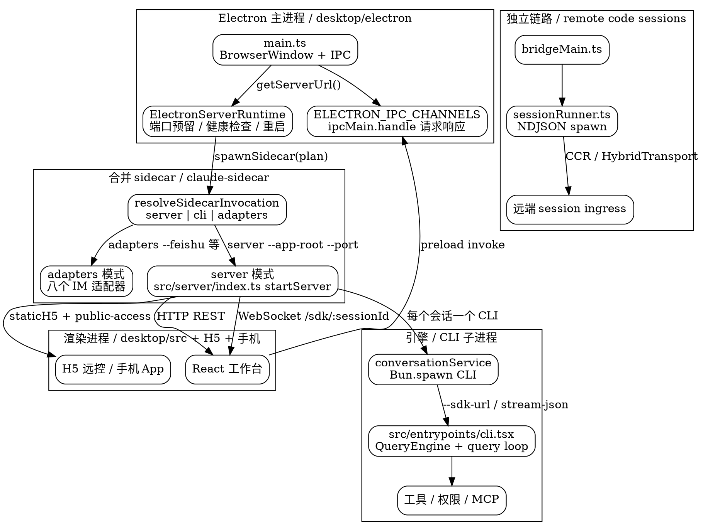

## Introduction

cc-haha 桌面工作台的运行时不是「Electron 直接 spawn 一个 CLI 子进程」这么简单：Electron 主进程先拉起一个**合并的 sidecar 二进制**，由它按第一个位置参数选择 `server` / `cli` / `adapters` 三种模式；`server` 模式启动本地 HTTP + WebSocket 服务，再由这个服务按会话去 spawn `claude-haha` CLI 子进程。本页把这条进程链逐段拆开，并把它与另一条常被混为一谈的 remote code sessions 桥区分开。

> 版本基线：v0.7.7（本地源码 `E:/Projects/cc-haha-0.7.7`，release 源码快照）

反直觉点：

- **桌面 UI 与引擎之间没有 NDJSON stdin/stdout 管道**。UI 走的是本地 HTTP + WebSocket；`stream-json` 是 server 与 CLI 子进程之间的线协议，且带 `--sdk-url` 时连 stdout 都只被当作日志与启动错误捕获。
- **`src/server/server.ts` 是占位文件，服务端却不是**。真实入口是 `src/server/index.ts` 的 `startServer()`；Electron 侧 `serverRuntime.ts` 只是进程生命周期管理器，不实现任何 HTTP 路由。
- **一个二进制三种模式是为了省体积**。合并前 server / cli / adapters 各自打包，每个 `bun-compile` 二进制都要带一份约 55MB 的 Bun runtime，光这一项就重复占 100MB+。
- **仓库里还有第三条 spawn 链路**：`src/bridge/sessionRunner.ts` 同样 spawn CLI 并走 NDJSON，但那是把本地 CLI 接到远端 code sessions ingress 的桥，不参与桌面工作台的主链路。

## Process Topology



## The CLI Launcher

从源码启动时的入口是 `bin/claude-haha`。它是一个 Bun 启动壳，而不是引擎本体：解析仓库根、按需加载 `.env`、把 `CALLER_DIR` 传给子进程、把 `--feature=TRANSCRIPT_CLASSIFIER` 与真正的入口脚本拼成一条 `process.execPath` 命令，再 `Bun.spawn` 出来并转发信号。

```javascript
#!/usr/bin/env -S bun --no-env-file

import { existsSync } from 'node:fs'
import path from 'node:path'
import { fileURLToPath } from 'node:url'

const rootDir = path.resolve(path.dirname(fileURLToPath(import.meta.url)), '..')
const callerDir = process.env.CALLER_DIR || process.cwd()
const skipDotenv = process.env.CC_HAHA_SKIP_DOTENV === '1'
const rootEnvPath = path.join(rootDir, '.env')
const envFileArgs =
  !skipDotenv && existsSync(rootEnvPath)
    ? [`--env-file=${rootEnvPath}`]
    : ['--no-env-file']
const entrypoint =
  process.env.CLAUDE_CODE_FORCE_RECOVERY_CLI === '1'
    ? path.join(rootDir, 'src', 'localRecoveryCli.ts')
    : path.join(rootDir, 'src', 'entrypoints', 'cli.tsx')

const command = [
  process.execPath,
  '--feature=TRANSCRIPT_CLASSIFIER',
  ...envFileArgs,
  entrypoint,
  ...process.argv.slice(2),
]
const child = Bun.spawn(command, {
  cwd: rootDir,
  env: { ...process.env, CALLER_DIR: callerDir },
  stdin: 'inherit',
  stdout: 'inherit',
  stderr: 'inherit',
})
```

注意 `CLAUDE_CODE_FORCE_RECOVERY_CLI` 会把入口换成 `localRecoveryCli.ts`——这是本地恢复用的旁路，不是主链路。`package.json` 里 `"name": "claude-code-local"` 与 `"version": "999.0.0-local"` 是这份本地构建源码的占位坐标，版本号应当以目录名与 `release-notes/v0.7.7.md` 为准。

## The Merged Sidecar

桌面安装包里的 `claude-sidecar` 只有一个二进制，三种模式靠位置参数切换。源码注释把合并动机写得很直白：

```typescript
/**
 * Claude Code 桌面端合并 sidecar 入口。
 *
 * 历史上 server / cli / IM adapters 是各自独立的进程。每个 bun-compile
 * 二进制都要带一份 ~55MB 的 bun runtime，光这一项就重复占了 100MB+。
 * 把所有运行模式合并到同一个二进制里，runtime 只保留一份；调用方通过
 * 第一个 positional 参数选择模式：
 *
 *   claude-sidecar server   --app-root <path> --host 127.0.0.1 --port 12345
 *   claude-sidecar cli      --app-root <path> [其它 CLI 参数...]
 *   claude-sidecar adapters --app-root <path> [--feishu] [--telegram] [--wechat]
 *                           [--dingtalk] [--whatsapp] [--wecom] [--qq] [--slack]
 *
 * 任何模式都必须先做 process.env / process.argv 设置，再 await 进入相应的
 * 子模块树。原因：src/server/index.ts、src/entrypoints/cli.tsx、以及
 * adapters/feishu/index.ts 等顶层都会立即读 process.argv / process.env，
 * 必须在它们求值前 splice 掉 --app-root、mode 和各 adapter 的 flag 这些
 * launcher-only 参数。
 */
```

分派发生在模块顶层：先剥掉 `--app-root`、设置 `CLAUDE_APP_ROOT` 与 `CALLER_DIR`、重写 `process.argv`，再动态 `import` 对应模块树。动态 import 是刻意的，因为子模块在求值时就会读环境变量。

```typescript
const rawArgs = process.argv.slice(2)
const invocation = resolveSidecarInvocation(rawArgs)
if (!invocation.mode) {
  console.error('claude-sidecar: missing mode argument (expected "server", "cli" or "adapters")')
  process.exit(2)
}
const mode = invocation.mode
const restArgs = invocation.restArgs

if (mode === 'adapters') {
  await runAdapters(restArgs)
} else {
  const { appRoot, args } = parseLauncherArgs(restArgs, invocation.defaultAppRoot)

  process.env.CLAUDE_APP_ROOT = appRoot
  process.env.CALLER_DIR ||= process.cwd()
  process.argv = [process.argv[0]!, process.argv[1]!, ...args]

  await import('../../preload.ts')

  if (mode === 'server') {
    console.log(`[claude-sidecar] starting server mode (${process.platform}/${process.arch})`)
    const { startServer } = await import('../../src/server/index.ts')
    startServer()
  } else if (mode === 'cli') {
    await import('../../src/entrypoints/cli.tsx')
  } else {
    console.error(`claude-sidecar: unknown mode "${mode}" (expected "server", "cli" or "adapters")`)
    process.exit(2)
  }
}
```

还有两个「同二进制、隔离模式」的旁路：`--computer-use-repl-worker` 与 `--voice-worker` 在最早处直接 `await import` 专用 worker 并 `process.exit(0)`，它们不加载 preload、不进任何桌面模式，只服务 JSON-only 的内核协议。模式判别本身由 `desktop/sidecars/launcherRouting.ts` 完成，它还兼容「可执行文件名就是 `claude-haha`」时默认当作 cli 模式：

```typescript
export type SidecarMode = 'server' | 'cli' | 'adapters'

const EXPLICIT_MODES = new Set<SidecarMode>(['server', 'cli', 'adapters'])
const DESKTOP_CLI_NAMES = new Set(['claude-haha', 'claude-haha.exe'])

export function resolveSidecarInvocation(
  rawArgs: string[],
  execPath: string = process.execPath,
  envAppRoot: string | null = process.env.CLAUDE_APP_ROOT ?? null,
): {
  mode: SidecarMode | null
  restArgs: string[]
  defaultAppRoot: string | null
} {
  const explicitMode = rawArgs[0]
  if (explicitMode && EXPLICIT_MODES.has(explicitMode as SidecarMode)) {
    return {
      mode: explicitMode as SidecarMode,
      restArgs: rawArgs.slice(1),
      defaultAppRoot: envAppRoot,
    }
  }

  const execName = path.basename(execPath).toLowerCase()
  if (DESKTOP_CLI_NAMES.has(execName)) {
    return {
      mode: 'cli',
      restArgs: rawArgs,
      defaultAppRoot: envAppRoot ?? path.dirname(execPath),
    }
  }

  return {
    mode: null,
    restArgs: rawArgs,
    defaultAppRoot: envAppRoot,
  }
}
```

## The Electron Runtime

Electron 主进程侧由 `ElectronServerRuntime` 管进程，它调用 `createServerPlan` 生成命令与参数，再交给 `spawnSidecar`。计划里明确写出 `server` 模式与 `--host` / `--port`：

```typescript
export function createServerPlan({
  desktopRoot,
  appRoot,
  port,
  bindHost = SERVER_BIND_HOST,
  h5DistDir = path.join(desktopRoot, 'dist'),
  env = process.env,
}: {
  desktopRoot: string
  appRoot: string
  port: number
  bindHost?: string
  h5DistDir?: string
  env?: NodeJS.ProcessEnv
}): SidecarPlan {
  return {
    command: resolveSidecarExecutable(desktopRoot),
    args: ['server', '--app-root', appRoot, '--host', bindHost, '--port', String(port)],
    env: buildSidecarEnv(withBundledRipgrepPath(env, desktopRoot), h5DistDir),
  }
}
```

`spawnSidecar` 用 Node 的 `spawn` 起进程（不是 `Bun.spawn`），并对 Windows 上「二进制被截断 / 被安全软件拦截」的错误码给出专门提示：

```typescript
export function spawnSidecar(plan: SidecarPlan, deps: SpawnSidecarDeps = {}): SidecarChild {
  const exists = deps.existsSyncFn ?? existsSync
  if (!exists(plan.command)) {
    throw new Error(`Electron sidecar binary not found: ${plan.command}. Run "cd desktop && bun run build:sidecars" first.`)
  }
  try {
    return (deps.spawnFn ?? spawn)(plan.command, plan.args, {
      env: plan.env,
      stdio: [plan.env.CC_HAHA_MIGRATION_CONTROL === '1' && plan.args[0] === 'adapters' ? 'pipe' : 'ignore', 'pipe', 'pipe'],
      windowsHide: true,
    }) as SidecarChild
  } catch (error) {
    const code = (error as NodeJS.ErrnoException | null)?.code
    if (typeof code !== 'string' || !UNEXECUTABLE_SIDECAR_ERROR_CODES.has(code)) throw error
    throw new Error(
      `Electron sidecar could not be executed (${code}): ${plan.command}. The file may be damaged, incomplete, or blocked by security software. Reinstall Claude Code Haha with the full installer, and allow its install directory in your security software if this keeps happening.`,
      { cause: error },
    )
  }
}
```

端口选择优先复用固定配置、再退回上一轮端口，让手机书签、二维码与反向代理在重启后仍然有效；服务 URL 绑定在 `127.0.0.1`：

```typescript
    // Prefer the configured fixed port, then the previous run's port, so
    // phone bookmarks / QR codes / reverse proxies survive restarts (#767).
    const port = await this.deps.reserveServerPort(
      SERVER_BIND_HOST,
      this.deps.preferredServerPorts(this.baseEnv),
    )
    const url = `http://${SERVER_CONTROL_HOST}:${port}`
    const logs: string[] = []
    const env = this.withServerAccessTokens(await this.resolveSidecarBaseEnv())
    this.assertCurrentGeneration(generation)
    const plan = createServerPlan({
      desktopRoot: this.desktopRoot,
      appRoot: this.appRoot,
      port,
      h5DistDir: this.h5DistDir,
      env: this.diagnosticsFile
        ? { ...env, [ELECTRON_DIAGNOSTICS_FILE_ENV]: this.diagnosticsFile }
        : env,
    })

    let startState: ServerStartState
    try {
      const child = this.deps.spawnSidecar(plan)
      startState = createServerStartState({ child, port, url, logs, generation })
```

服务健康后再拉起 IM adapter sidecar。`startAdaptersSidecars` 逐个平台调用 `createAdapterPlan`，每个 adapter 是一个**独立进程**，通过 `ADAPTER_SERVER_URL` 连回本地 server：

```typescript
    for (const [label, flag] of [
      ['feishu', '--feishu'],
      ['telegram', '--telegram'],
      ['wechat', '--wechat'],
      ['dingtalk', '--dingtalk'],
      ['whatsapp', '--whatsapp'],
      ['wecom', '--wecom'],
      ['qq', '--qq'],
      ['slack', '--slack'],
    ] as const) {
      if (!isCurrentGeneration()) break
      try {
        const child = this.deps.spawnSidecar(createAdapterPlan({
          desktopRoot: this.desktopRoot,
          appRoot: this.appRoot,
          h5DistDir: this.h5DistDir,
          serverUrl,
          flag,
          env,
        }))
```

注意这里的「合并」是**二进制合并**，不是进程合并：server 与每个 adapter 仍然是各自独立的 OS 进程，只是共用同一个可执行文件。

## The Local Server

`src/server/index.ts` 的文件头注释就点明了定位：为桌面 UI 提供 REST API 与 WebSocket，且读写与 CLI 完全相同的文件系统。服务参数从命令行与环境变量解析，默认端口 3456、默认只绑 `127.0.0.1`：

```typescript
function readArgValue(flag: string): string | undefined {
  const args = process.argv.slice(2)
  const index = args.indexOf(flag)
  if (index === -1) return undefined
  return args[index + 1]
}

function hasArgFlag(flag: string): boolean {
  return process.argv.slice(2).includes(flag)
}

function resolveServerOptions() {
  const portArg = readArgValue('--port')
  const port = Number.parseInt(portArg || process.env.SERVER_PORT || '3456', 10)
  const host = readArgValue('--host') || process.env.SERVER_HOST || '127.0.0.1'
  const cliPath = readArgValue('--cli-path')
  const authRequired = hasArgFlag('--auth-required')

  if (cliPath) {
    process.env.CLAUDE_CLI_PATH = cliPath
  }

  return { port, host, authRequired }
}
```

`startServer()` 里用 Bun 的 `Bun.serve` 绑定端口，并把 WebSocket 升级交给 `handleWebSocket`。源码里特意说明：本地索引启动必须排在 `Bun.serve` **之后**，否则同步的 SQLite 打开与扫描会让端口迟迟不 bind，宿主的健康探测就会误判 sidecar 死了：

```typescript
export function startServer(port = PORT, host = HOST) {
  // Everything before this point is module loading. When a host reports that
  // the sidecar "never started listening", this line splits that time from
  // the work below that still runs before Bun.serve binds (#1746).
  console.log(`[Server] modules loaded ${Math.round(performance.now())} ms after process start; binding ${host}:${port}`)
```

```typescript
  // Index startup runs after `Bun.serve` (see below), never before it. Opening
  // SQLite and scanning `source_files` happen before the first `await` inside
  // `localIndexCoordinator.start()`, so doing that here kept the port unbound
  // for the whole synchronous pass — every host probe then looked like a dead
  // sidecar (issue #1746). Requests that need the index still await it in the
  // `fetch` handler.
  try {
    server = Bun.serve<WebSocketData>({
      port,
      hostname: host,
      idleTimeout: HTTP_CONNECTION_IDLE_TIMEOUT_SECONDS,

      async fetch(req, server) {
        const pathname = new URL(req.url).pathname
```

因此，`src/server/server.ts` 只是 `scan-missing-imports` 生成的 `@generated stub` 占位（对应 ant-internal 的 `feature()` gated 模块，DCE 后不执行），不能据此认为「服务端实现在 Electron 侧」。HTTP 路由、WebSocket、H5 静态服务、认证、定时任务、本地索引这些真实实现都在 `src/server/` 的 `router.ts`、`ws/handler.ts`、`services/` 子树里。

## The Conversation Process

真正 spawn CLI 子进程的是服务端的 `src/server/services/conversationService.ts`。`buildSessionCliArgs` 拼出 `--print`、`--sdk-url`、双向 `stream-json` 与 `--include-partial-messages`；后者是桌面聊天的硬要求，没有它 server 只能在 turn 结束时才看到完整 assistant 消息，无法流式刷新。

```typescript
    return this.resolveCliArgs([
      '--print',
      '--agent-profile', agentProfile,
      '--verbose',
      '--sdk-url',
      sdkUrl,
      '--enable-auth-status',
      '--input-format',
      'stream-json',
      '--output-format',
      'stream-json',
      // Desktop chat depends on partial assistant deltas; without this the
      // server only sees the completed assistant message at turn end.
      '--include-partial-messages',
      ...(side ? ['--resume', side.resumePath, '--resume-session-at', side.resumeAt, '--fork-session', '--session-id', side.cliSessionId, '--no-session-persistence', '--append-system-prompt', SIDE_CHAT_BOUNDARY] : shouldResume ? ['--resume', sessionId] : ['--session-id', sessionId]),
      ...(options?.teamWorker ? [
        '--agent-id', `${options.teamWorker.name}@${options.teamWorker.teamName}`,
        '--agent-name', options.teamWorker.name,
        '--team-name', options.teamWorker.teamName,
        '--parent-session-id', options.teamWorker.parentSessionId,
```

启动用 `Bun.spawn`，并且处理了「同一个 session 已有 CLI 在跑、新的一次 start 又走到 spawn」的竞态：先按运行时重启退役旧进程，再启动新的，避免留下无人认领的进程。

```typescript
    const registered = this.sessions.get(sessionId)
    if (registered) {
      console.warn(
        `[ConversationService] Replacing CLI pid ${registered.proc.pid} for ${sessionId}: a newer start reached spawn`,
      )
      this.stopSession(sessionId, { keepTeamWorkers: true })
    }
    try {
      proc = Bun.spawn(args, buildConversationCliSpawnOptions(launchWorkDir, childEnv))
      if (side) side.started = true
    } catch (spawnErr) {
```

每个会话对应一个 CLI 子进程，进程参数里还带 worktree、`--add-dir`、`--replay-user-messages`、权限模式与团队成员身份等。线协议细节见 [StreamProtocol](/docs/CS/AI/LLM/Agent/Product/CcHaha/StreamProtocol.md)。

## The Electron IPC Surface

Electron 主进程与 React 渲染进程之间是显式的通道表，而不是自由字符串。所有通道常量集中在 `desktop/electron/ipc/channels.ts`，分为请求响应、事件推送与内部中继三类；payload 校验器在 `capabilities.ts` 里逐通道定义。

```typescript
export const ELECTRON_IPC_CHANNELS = {
  publicAccessGetStatus: 'desktop:public-access:get-status',
  publicAccessConfigure: 'desktop:public-access:configure',
  publicAccessStart: 'desktop:public-access:start',
  publicAccessStop: 'desktop:public-access:stop',
  publicAccessSetAutoStart: 'desktop:public-access:set-auto-start',
  appGetVersion: 'desktop:app:get-version',
  powerSetPreventSleepWhileRunning: 'desktop:power:set-prevent-sleep-while-running',
```

```typescript
export const ELECTRON_EVENT_CHANNELS = {
  powerIdleActionState: 'desktop:power:idle-action-state',
  event: 'desktop:event',
  appLocaleChanged: 'desktop:app:locale-changed',
  webviewDragDrop: 'desktop:webview:drag-drop',
  notificationAction: 'desktop:notification:action',
  updateDownloadEvent: 'desktop:update:download-event',
  windowResized: 'desktop:window:resized',
  nativeMenuNavigate: 'desktop:window:native-menu-navigate',
  terminalOutput: 'desktop:terminal:output',
  terminalExit: 'desktop:terminal:exit',
  previewEvent: 'desktop:preview:event',
  workspaceBrowserEvent: 'desktop:workspace-browser:event',
  petNavigateSession: 'desktop:pets:navigate-session',
  petVisibilityChanged: 'desktop:pets:visibility-changed',
  petPanelPlacementChanged: 'desktop:pets:panel-placement-changed',
  migrationProgress: 'desktop:app-mode:migration:progress',
} as const
```

这些 IPC 通道只覆盖「桌面外壳能力」：窗口、终端、宠物、预览、剪贴板、更新、迁移、主题、运行时令牌。会话内容本身不经过 IPC，而是由渲染进程直接连本地 server 的 HTTP / WebSocket。这也是为什么内置浏览器预览能带独立 cookie / 登录态——它走的是 `WebContentsView` 的沙箱 partition，与会话数据通道正交。

## The Separate Bridge Path

仓库里另有一套 `src/bridge/`，用于把本地 CLI 接到远端 code sessions。`sessionRunner.ts` 的 `createSessionSpawner()` 也用 `spawn` 起 CLI、也传双向 `stream-json`、也按行解析 NDJSON：

```typescript
      const args = [
        ...deps.scriptArgs,
        '--print',
        '--sdk-url',
        opts.sdkUrl,
        '--session-id',
        opts.sessionId,
        '--input-format',
        'stream-json',
        '--output-format',
        'stream-json',
        '--replay-user-messages',
        ...(deps.verbose ? ['--verbose'] : []),
        ...(debugFile ? ['--debug-file', debugFile] : []),
        ...(deps.permissionMode
          ? ['--permission-mode', deps.permissionMode]
          : []),
      ]
```

```typescript
      // Pipe all three streams: stdin for control, stdout for NDJSON parsing,
      // stderr for error capture and diagnostics.
      const child: ChildProcess = spawn(deps.execPath, args, {
        cwd: dir,
        stdio: ['pipe', 'pipe', 'pipe'],
        env,
        windowsHide: true,
      })
```

但它的调用方是 `src/bridge/bridgeMain.ts`，环境里注入的是 `CLAUDE_CODE_SESSION_ACCESS_TOKEN`、`CLAUDE_CODE_USE_CCR_V2`、`CLAUDE_CODE_WORKER_EPOCH`，目标是远端 ingress；它通过 stdin 回写 `update_environment_variables` 刷新令牌，把 `control_request` 的权限询问转给服务端。换句话说，这是**远程会话桥**的 NDJSON 管道，不是桌面工作台驱动引擎的管道。旧资料把这段当成「桌面 spawn 引擎」的机制，是把两条链路合并了。

## Why This Shape

把上面几段串起来，进程拓扑是几组约束共同压出来的：

- **安装包体积**：server / cli / adapters 共用一份 Bun runtime，所以合并进一个二进制；但为隔离崩溃与凭据，它们运行时仍是不同进程。
- **多端复用同一份数据**：桌面 React、H5、手机 App、IM adapter 都要读写同一批会话与文件，于是把 agent 能力收进一个本地 HTTP + WebSocket 服务，客户端退化为「连服务的视图」。
- **流式体验要让 UI 拿到增量**：CLI 侧必须开 `--include-partial-messages`，服务端按会话把 NDJSON 增量投影到 WebSocket；会话与 CLI 子进程一一对应，方便中断、恢复与权限审批按会话隔离。
- **启动健壮性**：Electron 侧只做进程管理与健康探测，端口复用、启动超时不误杀、迁移期优雅停机都集中在 `serverRuntime.ts`；服务侧则必须先把端口 bind 出来再做重的索引初始化。
- **安全边界**：本地访问令牌、H5 访问策略、IPC payload 校验器各管一段，桌面 UI 不直接持有引擎进程的 stdin。

## Corrections

以下结论以 v0.7.7 本地源码为准，与旧的 `main` 分支文档级描述冲突：

| 旧描述 | 源码事实 |
| :--- | :--- |
| 桌面把 `claude-haha` 作为子进程 spawn，用 stdin/stdout NDJSON 管道驱动 | Electron 主进程 spawn 的是 `claude-sidecar server`；UI 走 HTTP + WebSocket，CLI 子进程由 `conversationService.ts` 在服务端内部 spawn |
| `src/server/server.ts` 是 stub，因此真实服务端实现就是 `serverRuntime.ts` | `server.ts` 确为 stub，但真实入口是 `src/server/index.ts` 的 `startServer()` 与 `services/`；`serverRuntime.ts` 只管进程生命周期 |
| `sessionRunner.ts` 的 spawn 参数是桌面引擎的启动参数 | 那是 `src/bridge/` 远程 code sessions 桥的参数，调用方是 `bridgeMain.ts` |
| 八个 IM adapter 是同一个 sidecar 进程里的八个模块 | 二进制共用、进程独立：`ElectronServerRuntime` 为每个平台单独 `spawnSidecar(createAdapterPlan(...))` |

## Links

- [CcHaha 主枢纽](/docs/CS/AI/LLM/Agent/Product/CcHaha/CcHaha.md)
- [SessionLoop](/docs/CS/AI/LLM/Agent/Product/CcHaha/SessionLoop.md)
- [StreamProtocol](/docs/CS/AI/LLM/Agent/Product/CcHaha/StreamProtocol.md)
- [Persistence](/docs/CS/AI/LLM/Agent/Product/CcHaha/Persistence.md)
- [RemoteAccess](/docs/CS/AI/LLM/Agent/Product/CcHaha/RemoteAccess.md)
- [Agent 理论](/docs/CS/AI/LLM/Agent/Theory/Agent.md)

## References

- [NanmiCoder/cc-haha v0.7.7 release notes](https://github.com/NanmiCoder/cc-haha/blob/v0.7.7/release-notes/v0.7.7.md)
- [bin/claude-haha](https://github.com/NanmiCoder/cc-haha/blob/v0.7.7/bin/claude-haha)
- [desktop/sidecars/claude-sidecar.ts](https://github.com/NanmiCoder/cc-haha/blob/v0.7.7/desktop/sidecars/claude-sidecar.ts)
- [desktop/electron/services/serverRuntime.ts](https://github.com/NanmiCoder/cc-haha/blob/v0.7.7/desktop/electron/services/serverRuntime.ts)
- [src/server/index.ts](https://github.com/NanmiCoder/cc-haha/blob/v0.7.7/src/server/index.ts)
- [src/server/services/conversationService.ts](https://github.com/NanmiCoder/cc-haha/blob/v0.7.7/src/server/services/conversationService.ts)
- [src/bridge/sessionRunner.ts](https://github.com/NanmiCoder/cc-haha/blob/v0.7.7/src/bridge/sessionRunner.ts)
