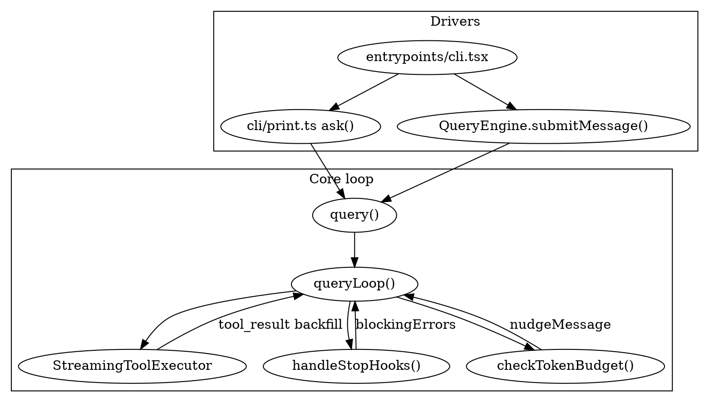

## Introduction

cc-haha 的 agentic 会话循环以 `src/query.ts` 里的异步生成器 `query()` 与 `queryLoop()` 为内核，由 `QueryEngine.submitMessage()` 或 REPL 侧的 `cli/print.ts` 驱动；一轮 turn 内反复执行「采样模型 → 执行工具 → 回填 `tool_result` → 再采样」，直到 stop hooks 与 token budget 都放行才返回 `Terminal`。

> 版本基线：v0.7.7（本地源码 E:/Projects/cc-haha-0.7.7）

反直觉点：

- 循环退出**不看** `stop_reason === 'tool_use'`，源码注释直言该字段 unreliable；真正的退出信号是 streaming 期间是否收到 `tool_use` 块并置 `needsFollowUp`。
- `src/query/transitions.ts` 是 `@generated stub`，全体导出都是 Proxy noop；`Terminal` 与 `Continue` 只作为 `import type` 的类型契约存在，运行时根本没有状态机实现。
- 到达「完成」并不等于停下：`handleStopHooks` 的 `blockingErrors` 与 `checkTokenBudget` 的 `continue` 都会重建 `State` 后 `continue`，把同一个 turn 续跑下去。

## Generator Skeleton

`query()` 是 async generator，逐条 yield 流事件与消息，最终返回 `Terminal`。`queryLoop()` 把消息、追踪状态、turn 计数收进一个可变 `State` 对象，每轮迭代在顶部解构，continue 站点整体重建 `State` 而不是逐个字段赋值。

```typescript
// -- query loop state

// Mutable state carried between loop iterations
type State = {
  messages: Message[]
  toolUseContext: ToolUseContext
  autoCompactTracking: AutoCompactTrackingState | undefined
  maxOutputTokensRecoveryCount: number
  hasAttemptedReactiveCompact: boolean
  maxOutputTokensOverride: number | undefined
  pendingToolUseSummary: Promise<ToolUseSummaryMessage | null> | undefined
  stopHookActive: boolean | undefined
  turnCount: number
  // Why the previous iteration continued. Undefined on first iteration.
  // Lets tests assert recovery paths fired without inspecting message contents.
  transition: Continue | undefined
}

export async function* query(
  params: QueryParams,
): AsyncGenerator<
  | StreamEvent
  | RequestStartEvent
  | Message
  | TombstoneMessage
  | ToolUseSummaryMessage,
  Terminal
> {
  const consumedCommandUuids: string[] = []
  const turn = params.toolUseContext.agentId ? undefined : Symbol()
  const toolUseContext = turn ? { ...params.toolUseContext, computerUseTurn: turn } : params.toolUseContext
  try {
    const terminal = yield* queryLoop({ ...params, toolUseContext }, consumedCommandUuids)
    // A throw or .return() skips this notification, as in print.ts.
    for (const uuid of consumedCommandUuids) {
      notifyCommandLifecycle(uuid, 'completed')
    }
    return terminal
  } finally {
    // API failures, turn limits and iterator closure can bypass Stop hooks.
    if (turn && isLockHeldLocally(turn)) {
      try {
        const { cleanupComputerUseAfterTurn } = await import('./utils/computerUse/cleanup.js')
        await cleanupComputerUseAfterTurn(toolUseContext, { ownedTurn: turn })
      } catch (error) {
        logForDebugging(`Could not finish Computer Use cleanup: ${String(error)}`)
      }
    }
  }
}
```

`queryLoop()` 通过 `deps = params.deps ?? productionDeps()` 取得可注入的 I/O 依赖；`budgetTracker` 只在 `feature('TOKEN_BUDGET')` 打开时创建，说明这同样是 feature gate 能力。循环体是一个 `while (true)`，每轮开头解构 `State`。

```typescript
  // eslint-disable-next-line no-constant-condition
  while (true) {
    // Destructure state at the top of each iteration. toolUseContext alone
    // is reassigned within an iteration (queryTracking, messages updates);
    // the rest are read-only between continue sites.
    let { toolUseContext } = state
    const {
      messages,
      autoCompactTracking,
      maxOutputTokensRecoveryCount,
      hasAttemptedReactiveCompact,
      maxOutputTokensOverride,
      pendingToolUseSummary,
      stopHookActive,
      turnCount,
    } = state
```

`Terminal` 与 `Continue` 来自 `./query/transitions.js`，但那是纯类型导入；该文件的运行时内容只是一个 Proxy noop 占位符。也就是说，循环的状态流转完全由 `query.ts` 自己用 `state = { ... }` 加 `continue` 实现，并不存在独立的状态机模块。

## Turn Exit Signal And Tool Result Backfill

工具结果如何回填，是理解一轮 turn 的关键。源码注释明确说 `stop_reason === 'tool_use'` unreliable，因此循环不看该字段，而是在 streaming 期间收到 `tool_use` 块时累积 `toolUseBlocks` 并置 `needsFollowUp`，把它当作唯一的退出信号；工具执行交给 `StreamingToolExecutor`。

```typescript
    const assistantMessages: AssistantMessage[] = []
    const toolResults: (UserMessage | AttachmentMessage)[] = []
    // @see https://docs.claude.com/en/docs/build-with-claude/tool-use
    // Note: stop_reason === 'tool_use' is unreliable -- it's not always set correctly.
    // Set during streaming whenever a tool_use block arrives — the sole
    // loop-exit signal. If false after streaming, we're done (modulo stop-hook retry).
    const toolUseBlocks: ToolUseBlock[] = []
    let needsFollowUp = false

    queryCheckpoint('query_setup_start')
    const useStreamingToolExecution = config.gates.streamingToolExecution
    let streamingToolExecutor = useStreamingToolExecution
      ? new StreamingToolExecutor(
          toolUseContext.options.tools,
          canUseTool,
          toolUseContext,
        )
      : null
```

当流式过程中出现异常（例如模型回退），`yieldMissingToolResultBlocks()` 会为每一个尚未收到结果的 `tool_use` 补发 `is_error: true` 的 `tool_result`，保证发给 API 的 `tool_use` 与 `tool_result` 配对完整，避免会话因缺失工具结果而报废。

```typescript
function* yieldMissingToolResultBlocks(
  assistantMessages: AssistantMessage[],
  errorMessage: string,
) {
  for (const assistantMessage of assistantMessages) {
    // Extract all tool use blocks from this assistant message
    const toolUseBlocks = assistantMessage.message.content.filter(
      content => content.type === 'tool_use',
    ) as ToolUseBlock[]

    // Emit an interruption message for each tool use
    for (const toolUse of toolUseBlocks) {
      yield createUserMessage({
        content: [
          {
            type: 'tool_result',
            content: errorMessage,
            is_error: true,
            tool_use_id: toolUse.id,
          },
        ],
        toolUseResult: errorMessage,
        sourceToolAssistantUUID: assistantMessage.uuid,
      })
    }
  }
}
```

一轮工具执行结束后，下一轮的消息数组由 `messagesForQuery`、`assistantMessages`、`toolResults` 三段拼接而成：工具结果就这样被回填进上下文，再构造新的 `State` 并写入 `transition: { reason: 'next_turn' }`，`while (true)` 随即进入下一轮。超过 `maxTurns` 则在推进前终止。

```typescript
    // Check if we've reached the max turns limit
    if (maxTurns && nextTurnCount > maxTurns) {
      yield createAttachmentMessage({
        type: 'max_turns_reached',
        maxTurns,
        turnCount: nextTurnCount,
      })
      return { reason: 'max_turns', turnCount: nextTurnCount }
    }

    queryCheckpoint('query_recursive_call')
    const next: State = {
      messages: [...messagesForQuery, ...assistantMessages, ...toolResults],
      toolUseContext: toolUseContextWithQueryTracking,
      autoCompactTracking: tracking,
      turnCount: nextTurnCount,
      maxOutputTokensRecoveryCount: 0,
      hasAttemptedReactiveCompact: false,
      pendingToolUseSummary: nextPendingToolUseSummary,
      maxOutputTokensOverride: undefined,
      stopHookActive,
      transition: { reason: 'next_turn' },
    }
    state = next
  } // while (true)
```

## Stop Hooks And Continuation

没有新的 `tool_use` 时，循环进入收尾判定，但并未立即结束。`handleStopHooks()` 返回一个 `StopHookResult`，结构极简；`shouldLetGoalPromptHookContinue()` 还专门区分 goal hook 的 `preventContinuation`。

```typescript
type StopHookResult = {
  blockingErrors: Message[]
  preventContinuation: boolean
}

export function shouldLetGoalPromptHookContinue(
  result: Pick<HookResult, 'blockingError' | 'preventContinuation'>,
): boolean {
  return Boolean(
    result.preventContinuation &&
      isGoalPromptHookCommand(result.blockingError?.command),
  )
}
```

调用侧逻辑是：`preventContinuation` 为真时直接以 `stop_hook_prevented` 终止，而 `blockingErrors` 非空时，把错误追加进消息、重建 `State`，以 `stop_hook_blocking` 这个 `transition` 再次 `continue`。源码注释特别强调要保留 `hasAttemptedReactiveCompact`，否则会陷入 compact 与 stop hook 互踩的死循环。

```typescript
      const stopHookResult = yield* handleStopHooks(
        messagesForQuery,
        assistantMessages,
        systemPrompt,
        userContext,
        systemContext,
        toolUseContext,
        querySource,
        stopHookActive,
      )

      if (stopHookResult.preventContinuation) {
        return { reason: 'stop_hook_prevented' }
      }

      if (stopHookResult.blockingErrors.length > 0) {
        const next: State = {
          messages: [
            ...messagesForQuery,
            ...assistantMessages,
            ...stopHookResult.blockingErrors,
          ],
          toolUseContext,
          autoCompactTracking: tracking,
          maxOutputTokensRecoveryCount: 0,
          // Preserve the reactive compact guard — if compact already ran and
          // couldn't recover from prompt-too-long, retrying after a stop-hook
          // blocking error will produce the same result. Resetting to false
          // here caused an infinite loop: compact → still too long → error →
          // stop hook blocking → compact → … burning thousands of API calls.
          hasAttemptedReactiveCompact,
          maxOutputTokensOverride: undefined,
          pendingToolUseSummary: undefined,
          stopHookActive: true,
          turnCount,
          transition: { reason: 'stop_hook_blocking' },
        }
        state = next
        continue
      }
```

`handleStopHooks()` 本身还是各类后台工作的挂载点：消费 `executeStopHooks()` 生成器，并顺带触发 prompt suggestion、记忆抽取、任务分类等；因此 Stop hook 不只是「是否停止」的布尔判断。

```typescript
    const blockingErrors = []
    const appState = toolUseContext.getAppState()
    const permissionMode = appState.toolPermissionContext.mode

    if (!toolUseContext.agentId) {
      ensureThreadGoalHookFromTranscript(
        toolUseContext,
        getSessionId(),
        [...messagesForQuery, ...assistantMessages],
      )
    }

    const generator = executeStopHooks(
      permissionMode,
      toolUseContext.abortController.signal,
      undefined,
      stopHookActive ?? false,
      toolUseContext.agentId,
      toolUseContext,
      [...messagesForQuery, ...assistantMessages],
      toolUseContext.agentType,
    )
```

## Token Budget Continuation

紧接着是第二道「续跑」判定，且仅在 `feature('TOKEN_BUDGET')` 打开时执行。`checkTokenBudget()` 返回 `continue` 时，循环把 `decision.nudgeMessage` 包装成 `isMeta: true` 的用户消息插回上下文，以 `token_budget_continuation` 再次 `continue`；只有返回 `stop` 才走到 `completed`。需要强调，这个 `tokenBudget` 是「本轮花够 token」的续跑机制，与上下文压缩无关，详见 ContextCompaction 分册。

```typescript
      if (feature('TOKEN_BUDGET')) {
        const decision = checkTokenBudget(
          budgetTracker!,
          toolUseContext.agentId,
          getCurrentTurnTokenBudget(),
          getTurnOutputTokens(),
        )

        if (decision.action === 'continue') {
          incrementBudgetContinuationCount()
          logForDebugging(
            `Token budget continuation #${decision.continuationCount}: ${decision.pct}% (${decision.turnTokens.toLocaleString()} / ${decision.budget.toLocaleString()})`,
          )
          state = {
            messages: [
              ...messagesForQuery,
              ...assistantMessages,
              createUserMessage({
                content: decision.nudgeMessage,
                isMeta: true,
              }),
            ],
            toolUseContext,
            autoCompactTracking: tracking,
            maxOutputTokensRecoveryCount: 0,
            hasAttemptedReactiveCompact: false,
            maxOutputTokensOverride: undefined,
            pendingToolUseSummary: undefined,
            stopHookActive: undefined,
            turnCount,
            transition: { reason: 'token_budget_continuation' },
          }
          continue
        }

        if (decision.completionEvent) {
          if (decision.completionEvent.diminishingReturns) {
            logForDebugging(
              `Token budget early stop: diminishing returns at ${decision.completionEvent.pct}%`,
            )
          }
          logEvent('tengu_token_budget_completed', {
            ...decision.completionEvent,
            queryChainId: queryChainIdForAnalytics,
            queryDepth: queryTracking.depth,
          })
        }
      }

      return { reason: 'completed' }
```

## Turn Flow



## Driver And Entrypoints

最上层驱动分两条：`QueryEngine.submitMessage()` 用 `for await` 消费 `query({ ... })` 产出的每条消息，写入 `messages` 并落盘 transcript；REPL 侧则由 `cli/print.ts` 的 `ask()` 驱动同一套循环。入口 `entrypoints/cli.tsx` 只做 fast-path 分发，最后动态载入 `main` 并调用 `cliMain()`。压缩相关依赖通过 `query/deps.ts` 的 `productionDeps()` 注入，便于测试替换成 fake。

```typescript
    for await (const message of withFileHistoryCompletion(query({
      messages,
      systemPrompt,
      userContext,
      systemContext,
      canUseTool: wrappedCanUseTool,
      toolUseContext: processUserInputContext,
      fallbackModel,
      querySource: 'sdk',
      maxTurns,
      taskBudget,
    }), completeCheckpoint)) {
```

```typescript
          await runWithWorkload(cmd.workload ?? options.workload, async () => {
            for await (const message of ask({
              commands: uniqBy(
                [...currentCommands, ...appState.mcp.commands],
                'name',
              ),
              prompt: input,
              promptUuid: cmd.uuid,
              isMeta: cmd.isMeta,
              // Same derivation as handlePromptSubmit: a task notification that
              // starts its own turn is not the user's input.
              origin: cmd.origin ?? (cmd.mode === 'task-notification' ? ({ kind: 'task-notification' } as const) : undefined),
              cwd: cwd(),
              tools: allTools,
              verbose: options.verbose,
              mcpClients: allMcpClients,
              thinkingConfig: options.thinkingConfig,
              maxTurns: options.maxTurns,
              maxBudgetUsd: options.maxBudgetUsd,
```

```typescript
  // No special flags detected, load and run the full CLI
  const {
    startCapturingEarlyInput
  } = await import('../utils/earlyInput.js');
  startCapturingEarlyInput();
  profileCheckpoint('cli_before_main_import');
  const {
    main: cliMain
  } = await import('../main.js');
  profileCheckpoint('cli_after_main_import');
  await cliMain();
  profileCheckpoint('cli_after_main_complete');
```

## Interrupt And Queued Commands

排队消息与中断由 `cli/print.ts` 的流式循环负责。命令队列订阅里，一旦出现 `now` 优先级的命令，就对当前 `abortController` 调用 `abort('interrupt')`；这解释了一次高优先级用户输入为何能立刻打断正在进行的 turn。

```typescript
  // Abort the current operation when a 'now' priority message arrives.
  subscribeToCommandQueue(() => {
    if (abortController && getCommandsByMaxPriority('now').length > 0) {
      abortController.abort('interrupt')
    }
  })
```

队列不在命令到达时立即执行，而是在 turn 间隙由 `drainCommandQueue()` 以 `while ((command = dequeue(isMainThread)))` 取出；连续的 prompt 命令会被 greedy 合并进同一个 `ask()` 调用，使长 turn 期间堆积的消息合并成一次 follow-up turn，而不是 N 个独立 turn。`isMainThread` 过滤保证 subagent 的命令留给各自的 runner。

```typescript
      // Extract command processing into a named function for the do-while pattern.
      // Drains the queue, batching consecutive prompt-mode commands into one
      // ask() call so messages that queued up during a long turn coalesce
      // into a single follow-up turn instead of N separate turns.
      const drainCommandQueue = async () => {
        while ((command = dequeue(isMainThread))) {
          if (
            command.mode !== 'prompt' &&
            command.mode !== 'orphaned-permission' &&
            command.mode !== 'task-notification'
          ) {
            throw new Error(
              'only prompt commands are supported in streaming mode',
            )
          }

          // Non-prompt commands (task-notification, orphaned-permission) carry
          // side effects or orphanedPermission state, so they process singly.
          // Prompt commands greedily collect followers with matching workload.
          const batch: QueuedCommand[] = [command]
          if (command.mode === 'prompt') {
            while (canBatchWith(command, peek(isMainThread))) {
              batch.push(dequeue(isMainThread)!)
            }
            if (batch.length > 1) {
              command = {
                ...command,
                value: joinPromptValues(batch.map(c => c.value)),
                uuid: batch.findLast(c => c.uuid)?.uuid ?? command.uuid,
              }
            }
          }
```

被中断的 turn 在进程重启后可以自动恢复：`CLAUDE_CODE_RESUME_INTERRUPTED_TURN` 打开时，先移除中断消息及其哨兵，再重新 `enqueue`，确保模型只看到一次该 prompt；中途中断会被反序列化层改写成带「Continue from where you left off.」的 `interrupted_prompt`。

```typescript
  // Auto-resume interrupted turns on restart so CC continues from where it
  // left off without requiring the SDK to re-send the prompt.
  const resumeInterruptedTurnEnv =
    process.env.CLAUDE_CODE_RESUME_INTERRUPTED_TURN
  if (
    turnInterruptionState &&
    turnInterruptionState.kind !== 'none' &&
    resumeInterruptedTurnEnv
  ) {
    logForDebugging(
      `[print.ts] Auto-resuming interrupted turn (kind: ${turnInterruptionState.kind})`,
    )

    // Remove the interrupted message and its sentinel, then re-enqueue so
    // the model sees it exactly once. For mid-turn interruptions, the
    // deserialization layer transforms them into interrupted_prompt by
    // appending a synthetic "Continue from where you left off." message.
    removeInterruptedMessage(mutableMessages, turnInterruptionState.message)
    enqueue({
      mode: 'prompt',
      value: turnInterruptionState.message.message.content,
      uuid: randomUUID(),
    })
  }
```

## Terminal And Transition Reasons

把反查到的返回点归纳一下，`queryLoop()` 的终止 reason 包括 `completed`、`stop_hook_prevented`、`max_turns`、`aborted_streaming`、`aborted_tools`、`hook_stopped`、`blocking_limit`、`model_error`、`image_error`、`prompt_too_long` 与 `rapid_refill_breaker`；而续跑的 `transition.reason` 包括 `next_turn`、`stop_hook_blocking`、`token_budget_continuation`、`reactive_compact_retry`、`collapse_drain_retry`、`max_output_tokens_recovery` 与 `max_output_tokens_escalate`。二者共用同一个 `State` 结构，靠 `transition` 字段记录上一轮为何继续，测试据此断言恢复路径是否触发，而无需检查消息内容。

## Links

- [CcHaha](/docs/CS/AI/LLM/Agent/Product/CcHaha/CcHaha.md)
- [REPL](/docs/CS/AI/LLM/Agent/Product/CcHaha/REPL.md)
- [StreamProtocol](/docs/CS/AI/LLM/Agent/Product/CcHaha/StreamProtocol.md)
- [Persistence](/docs/CS/AI/LLM/Agent/Product/CcHaha/Persistence.md)
- [MemoryContext](/docs/CS/AI/LLM/Agent/Product/CcHaha/MemoryContext.md)
- [ClaudeCode](/docs/CS/AI/LLM/Agent/Product/ClaudeCode/ClaudeCode.md)

## References

- [cc-haha GitHub](https://github.com/NanmiCoder/cc-haha)
- [query.ts](https://github.com/NanmiCoder/cc-haha/blob/main/src/query.ts)
- [QueryEngine.ts](https://github.com/NanmiCoder/cc-haha/blob/main/src/QueryEngine.ts)
- [query/deps.ts](https://github.com/NanmiCoder/cc-haha/blob/main/src/query/deps.ts)
- [query/stopHooks.ts](https://github.com/NanmiCoder/cc-haha/blob/main/src/query/stopHooks.ts)
- [query/tokenBudget.ts](https://github.com/NanmiCoder/cc-haha/blob/main/src/query/tokenBudget.ts)
- [cli/print.ts](https://github.com/NanmiCoder/cc-haha/blob/main/src/cli/print.ts)
- [Tool use docs](https://docs.claude.com/en/docs/build-with-claude/tool-use)
