## Introduction

cc-haha 的 stream-json / NDJSON 线协议，是 CLI `--print` 模式与 SDK host 之间「一行一个 JSON 对象」的双向消息帧格式，桌面服务端借它驱动会话并把消息转发给 renderer。

> 版本基线：v0.7.7（本地源码 E:/Projects/cc-haha-0.7.7）

反直觉点：

- 桌面主链路同时传入 `--input-format stream-json` 与 `--output-format stream-json`，却又额外传入 `--sdk-url`，导致 `getStructuredIO` 选择 `RemoteIO`，消息实际上走 SDK WebSocket 而非进程 stdio；`ConversationService.readProcessOutputStream` 只把 stdout 当作诊断日志与启动错误捕获。
- `SDKCompactBoundary` 不是独立顶层类型，而是 `type` 为 `system`、`subtype` 为 `compact_boundary` 的消息；`interrupt` 也不是顶层类型，只是 `control_request` 的一个 `subtype`。
- `--print` 搭配 `--output-format=stream-json` 时强制要求 `--verbose`，否则 CLI 直接报错退出；`update_environment_variables` 这类 stdin 控制消息会直接改写 `process.env`，其注释指向独立的 bridge session runner 链路，而非桌面主链路的常规帧。

## Transport Selection

桌面服务端在 `src/server/services/conversationService.ts` 的 `buildSessionCliArgs` 里为 CLI 子进程拼参数，明确给出 `--print`、`--verbose`、双向的 `stream-json` 格式、`--include-partial-messages`，并按是否续接在 `--resume` 与 `--session-id` 之间二选一。

```typescript
    return this.resolveCliArgs([
      '--print',
      '--agent-profile', agentProfile,
      '--verbose',
      '--sdk-url',
      sdkUrl,
      '--enable-auth-status',
      '--input-format',
      'stream-json',
      '--output-format',
      'stream-json',
      // Desktop chat depends on partial assistant deltas; without this the
      // server only sees the completed assistant message at turn end.
      '--include-partial-messages',
      ...(side ? ['--resume', side.resumePath, '--resume-session-at', side.resumeAt, '--fork-session', '--session-id', side.cliSessionId, '--no-session-persistence', '--append-system-prompt', SIDE_CHAT_BOUNDARY] : shouldResume ? ['--resume', sessionId] : ['--session-id', sessionId]),
```

`--include-partial-messages` 的注释说明桌面聊天依赖部分 assistant 增量，否则服务端只能在回合结束时看到完整消息。但 `src/cli/print.ts` 的 `getStructuredIO` 依据 `sdkUrl` 决定真正的 transport：

```typescript
  // Use RemoteIO if sdkUrl is provided, otherwise use regular StructuredIO
  return options.sdkUrl
    ? new RemoteIO(options.sdkUrl, inputStream, options.replayUserMessages)
    : new StructuredIO(inputStream, options.replayUserMessages)
```

`RemoteIO` 继承 `StructuredIO`，内部以 `PassThrough` 作为输入流并挂接 WebSocket / SSE transport。因此桌面主链路虽声明了 `stream-json` 的输入输出格式，字节帧却承载在 SDK WebSocket 上。`src/server/services/conversationService.ts` 文件头注释直接点明这套双 WebSocket 结构：

```typescript
/**
 * ConversationService — CLI subprocess manager
 *
 * Each desktop session owns one CLI subprocess. The subprocess talks back to
 * the desktop server over the SDK WebSocket bridge, while the desktop UI talks
 * to the server over its own client WebSocket.
 */
```

`readProcessOutputStream` 逐行读取 `proc.stdout` / `proc.stderr`，只做脱敏、行缓存与 console 打印，并不解析业务消息：

```typescript
      while (true) {
        const { done, value } = await reader.read()
        if (done) break

        const text = decoder.decode(value, { stream: true })
        if (!text.trim()) continue

        const session = this.sessions.get(sessionId)
        if (session) {
          for (const line of text
            .split('\n')
            .map((entry) => entry.trim())
            .filter(Boolean)) {
            const lines =
              streamName === 'stderr' ? session.stderrLines : session.stdoutLines
            lines.push(this.redactProcessOutput(line))
            if (lines.length > MAX_CAPTURED_PROCESS_LINES) {
              lines.splice(0, lines.length - MAX_CAPTURED_PROCESS_LINES)
            }
          }
        }

        const logLine = this.redactProcessOutput(text.trim())
        if (streamName === 'stderr') {
          console.error(`[CLI:${sessionId}:stderr] ${logLine}`)
        } else {
          console.log(`[CLI:${sessionId}:stdout] ${logLine}`)
        }
      }
```

## Framing And Direction

`src/cli/structuredIO.ts` 的 `read` 用换行切分输入块，逐行交给 `processLine`；`prependedLines` 允许在迭代中途插入用户消息并保证其排在下一条之前。

```typescript
    const splitAndProcess = async function* (this: StructuredIO) {
      for (;;) {
        if (this.prependedLines.length > 0) {
          content = this.prependedLines.join('') + content
          this.prependedLines = []
        }
        const newline = content.indexOf('\n')
        if (newline === -1) break
        const line = content.slice(0, newline)
        content = content.slice(newline + 1)
        const message = await this.processLine(line)
        if (message) {
          logForDiagnosticsNoPII('info', 'cli_stdin_message_parsed', {
            type: message.type,
          })
          yield message
        }
      }
    }.bind(this)
```

写出方向由 `StructuredIO.write` 决定，用 `ndjsonSafeStringify` 转义 U+2028 / U+2029 后补换行，避免按行切分的接收端把 JSON 从字符串中间截断：

```typescript
  async write(message: StdoutMessage): Promise<void> {
    writeToStdout(ndjsonSafeStringify(message) + '\n')
  }
```

```typescript
export function ndjsonSafeStringify(value: unknown): string {
  return escapeJsLineTerminators(jsonStringify(value))
}
```

方向定义并不在 `src/entrypoints/sdk/controlTypes.ts`——这份 release 快照里它只是自动生成的占位 stub：

```typescript
// @generated stub from scan-missing-imports
// 该文件自动生成，对应 ant-internal 的 feature() gated 模块。
// 所有外部 build 的代码路径在 DCE 后都不会真的执行这里的代码，这只是
// bun build resolver 的占位符。
const __target = function noop() {}
```

真实 union 在 `src/entrypoints/sdk/controlSchemas.ts`：

```typescript
export const StdoutMessageSchema = lazySchema(() =>
  z.union([
    SDKSessionMessageReceiptSchema(),
    SDKMessageSchema(),
    SDKStreamlinedTextMessageSchema(),
    SDKStreamlinedToolUseSummaryMessageSchema(),
    SDKPostTurnSummaryMessageSchema(),
    SDKControlResponseSchema(),
    SDKControlRequestSchema(),
    SDKControlCancelRequestSchema(),
    SDKKeepAliveMessageSchema(),
  ]),
)

export const StdinMessageSchema = lazySchema(() =>
  z.union([
    SDKUserMessageSchema(),
    SDKControlRequestSchema(),
    SDKControlResponseSchema(),
    SDKKeepAliveMessageSchema(),
    SDKUpdateEnvironmentVariablesMessageSchema(),
  ]),
)
```

两侧并不对称：`update_environment_variables` 只出现在 `StdinMessageSchema`，而 `control_request` 与 `control_response` 在两侧都出现，属于双向控制通道；`SDKMessage` 携带的 assistant / user / result / system 等只出现在 stdout。

## Message Types

`src/entrypoints/sdk/coreSchemas.ts` 的 `SDKMessageSchema` 是一个 `z.union`，成员包含 assistant、user、user replay、result、system、partial assistant、compact boundary、status、api retry 等：

```typescript
export const SDKMessageSchema = lazySchema(() =>
  z.union([
    SDKAssistantMessageSchema(),
    SDKUserMessageSchema(),
    SDKUserMessageReplaySchema(),
    SDKResultMessageSchema(),
    SDKSystemMessageSchema(),
    SDKPartialAssistantMessageSchema(),
    SDKCompactBoundaryMessageSchema(),
    SDKStatusMessageSchema(),
    SDKAPIRetryMessageSchema(),
```

`SDKCompactBoundary` 的形态是 `system` 加 `compact_boundary`，`src/QueryEngine.ts` 在压缩边界处产出它：

```typescript
          yield {
            type: 'system',
            subtype: 'compact_boundary' as const,
            session_id: getSessionId(),
            uuid: msg.uuid,
            compact_metadata: toSDKCompactMetadata(msg.compactMetadata),
          } as SDKCompactBoundaryMessage
```

其 `compact_metadata.preserved_segment` 的 schema 注释说明 loader 会按 `anchor_uuid`  splice 回保留片段，使 resume 包含被保留内容——这是线协议与会话恢复的交叉点。`src/cli/print.ts` 的 streaming 循环把每条消息写给 `structuredIO`：

```typescript
    partialOutputTracker.observe(message)

    if (transformToStreamlined) {
      // Streamlined mode: transform messages and stream immediately
      const transformed = transformToStreamlined(message)
      if (transformed) {
        await structuredIO.write(transformed)
      }
    } else if (options.outputFormat === 'stream-json' && options.verbose) {
      await structuredIO.write(message)
    }
```

同时把 control 类、部分 system 子类、`stream_event`、`keep_alive` 排除在 `lastMessage` 之外，使其停留在 `result`：

```typescript
    if (
      message.type !== 'control_response' &&
      message.type !== 'control_request' &&
      message.type !== 'control_cancel_request' &&
      !(
        message.type === 'system' &&
        (message.subtype === 'session_state_changed' ||
          message.subtype === 'task_notification' ||
          message.subtype === 'task_started' ||
          message.subtype === 'task_progress' ||
          message.subtype === 'prompt_suggestion_activity' ||
          message.subtype === 'post_turn_summary')
      ) &&
      message.type !== 'stream_event' &&
      message.type !== 'keep_alive' &&
      message.type !== 'streamlined_text' &&
      message.type !== 'streamlined_tool_use_summary' &&
      message.type !== 'prompt_suggestion'
    ) {
      if (needsFullArray) {
        messages.push(message)
      }
      lastMessage = message
    }
```

`json` 输出模式会检查 `lastMessage` 是否为 `result`，而 `stream-json` 分支是空操作，因为已逐条写出：

```typescript
  switch (options.outputFormat) {
    case 'json':
      if (!lastMessage || lastMessage.type !== 'result') {
        throw new Error('No messages returned')
      }
```

## Stdin Control Messages

`processLine` 先跳过空行、静默忽略 `keep_alive`，再解析为控制消息或 SDK 消息：

```typescript
    // Skip empty lines (e.g. from double newlines in piped stdin)
    if (!line) {
      return undefined
    }
    try {
      const message = normalizeControlMessageKeys(jsonParse(line)) as
        | StdinMessage
        | SDKMessage
      if (message.type === 'keep_alive') {
        // Silently ignore keep-alive messages
        return undefined
      }
```

随后只放行 `user` / `control_request` / `assistant` / `system` 四类输入，其余类型告警后丢弃；SDK host 不能往 stdin 塞 `result` 消息：

```typescript
      if (
        message.type !== 'user' &&
        message.type !== 'control_request' &&
        message.type !== 'assistant' &&
        message.type !== 'system'
      ) {
        logForDebugging(`Ignoring unknown message type: ${message.type}`, {
          level: 'warn',
        })
        return undefined
      }
```

`update_environment_variables` 直接把变量写入 `process.env`，并针对代理类变量与 OAuth token 清理缓存；注释明说它服务于 bridge session runner 的 token 刷新，属于 `src/bridge/sessionRunner.ts` 那条独立链路：

```typescript
      if (message.type === 'update_environment_variables') {
        // Apply environment variable updates directly to process.env.
        // Used by bridge session runner for auth token refresh
        // (CLAUDE_CODE_SESSION_ACCESS_TOKEN) which must be readable
        // by the REPL process itself, not just child Bash commands.
        const keys = Object.keys(message.variables)
        for (const [key, value] of Object.entries(message.variables)) {
          process.env[key] = value
        }
        if (keys.some(key => NETWORK_RUNTIME_ENV_KEYS.has(key.toUpperCase()))) {
          const { clearProxyCache, configureGlobalAgents } = await import(
            '../utils/proxy.js'
          )
          clearProxyCache()
          configureGlobalAgents()
        }
        if (Object.hasOwn(message.variables, 'CLAUDE_CODE_OAUTH_TOKEN')) {
          const { clearOAuthTokenCache } = await import('../utils/auth.js')
          clearOAuthTokenCache()
        }
        logForDebugging(
          `[structuredIO] applied update_environment_variables: ${keys.join(', ')}`,
        )
        return undefined
      }
```

`interrupt` 是 `control_request` 的 `subtype`，其 schema 与 wrapper 分别为：

```typescript
export const SDKControlInterruptRequestSchema = lazySchema(() =>
  z
    .object({
      subtype: z.literal('interrupt'),
    })
    .describe('Interrupts the currently running conversation turn.'),
)
```

```typescript
export const SDKControlRequestSchema = lazySchema(() =>
  z.object({
    type: z.literal('control_request'),
    request_id: z.string(),
    request: SDKControlRequestInnerSchema(),
  }),
)
```

`SDKControlRequestInnerSchema` 的 union 里同时含 `SDKControlInterruptRequestSchema()` 与 `can_use_tool`、hook callback、mcp message、initialize 等子类型：

```typescript
export const SDKControlRequestInnerSchema = lazySchema(() =>
  z.union([
    z.object({ subtype: z.literal('team_runtime_snapshot'), team_name: z.string().min(1), created_at: z.number() }),
    z.object({ subtype: z.literal('team_runtime_ended'), team_name: z.string().min(1) }),
    z.object({ subtype: z.literal('team_plan_pause') }),
    sessionMessageInputSchema,
    scheduledTaskMessageInputSchema,
    SDKControlInterruptRequestSchema(),
```

`src/cli/print.ts` 收到 `interrupt` 后清空排队消息：

```typescript
        } else if (message.request.subtype === 'interrupt' || message.request.subtype === 'team_plan_pause') {
          sessionMessageInbox.cancelQueued(dequeueAllMatching)
          if (message.request.subtype === 'team_plan_pause') leadMailboxPoll.held = true
```

`control_response` 用于 resolve `pendingRequests`；`StructuredIO` 用 `outbound` Stream 串行化输出，避免 `control_request` 越过排队的 `stream_events`：

```typescript
  // sendRequest() and print.ts both enqueue here; the drain loop is the
  // only writer. Prevents control_request from overtaking queued stream_events.
  readonly outbound = new Stream<StdoutMessage>()
```

## Server Parsing And Forwarding

`ConversationService.handleSdkPayload` 从 SDK WebSocket 收到原始 payload 后按行 `JSON.parse`，先过滤重放消息，再处理 `system` 的 `prompt_suggestion_activity` 与 `api_retry` 401、`control_request` 的 `can_use_tool`，然后 retain 消息：

```typescript
    const lines = rawPayload
      .split('\n')
      .map((line) => line.trim())
      .filter(Boolean)

    for (const line of lines) {
      try {
        const msg = JSON.parse(line)
        if (this.isReplayedSdkMessage(session, msg)) continue
        if (msg?.type === 'system' && msg.subtype === 'prompt_suggestion_activity') {
          const activity = SDKPromptSuggestionActivityMessageSchema().safeParse(msg)
          if (activity.success) {
            this.trackPromptSuggestionActivity(session, activity.data.generation_id, activity.data.active)
          }
          continue
        }
        if (
          msg?.type === 'system' &&
          msg.subtype === 'api_retry' &&
          Number(msg.error_status) === 401
        ) {
          this.recoverOfficialOAuthAfter401(sessionId, session)
        }
        if (
          msg?.type === 'control_request' &&
          msg.request?.subtype === 'can_use_tool' &&
          typeof msg.request_id === 'string' &&
          options?.canAcceptPermissionRequest?.(msg) === false
        ) {
          // Stop may win while a permission request is already queued on the
          // SDK transport. Reject it at the service boundary so it is neither
          // persisted as pending nor replayed to a reconnecting renderer.
          this.respondToPermission(sessionId, msg.request_id, false)
          continue
        }
        this.retainSdkMessage(session, msg, Buffer.byteLength(line, 'utf-8'))
```

转发通过 `notifyOutputCallbacks` 送到 renderer 的 client WebSocket；`sendSdkMessage` 把控制帧序列化为 NDJSON 行经 `sdkSocket.send` 回送 CLI，未连接时先缓存到 `pendingOutbound`：

```typescript
  private sendSdkMessage(
    sessionId: string,
    payload: Record<string, unknown>,
  ): boolean {
    const session = this.sessions.get(sessionId)
    if (!session) return false

    const line = JSON.stringify(payload) + '\n'
    if (session.sdkSocket) {
      session.sdkSocket.send(line)
    } else {
      session.pendingOutbound.push(line)
    }
    return true
  }
```

`attachSdkConnection` 在 SDK WebSocket 建好时 flush 这些待发帧：

```typescript
  attachSdkConnection(
    sessionId: string,
    socket: { send(data: string): void },
  ): boolean {
    const session = this.sessions.get(sessionId)
    if (!session) return false

    session.sdkSocket = socket
    session.resolveSdkAttached?.()
    session.resolveSdkAttached = null
    while (session.pendingOutbound.length > 0) {
      const line = session.pendingOutbound.shift()
      if (line) {
        socket.send(line)
      }
    }
    return true
  }
```

## Stdout Guard

`src/utils/streamJsonStdoutGuard.ts` 包装 `process.stdout.write`，缓冲到换行后逐行 `JSON.parse`，合法行放行、非 JSON 行改道 stderr 并打 `[stdout-guard]` 标记；空行被视为合法，以免尾随换行触发误判：

```typescript
function isJsonLine(line: string): boolean {
  // Empty lines are tolerated in NDJSON streams — treat them as valid so a
  // trailing newline or a blank separator doesn't trip the guard.
  if (line.length === 0) {
    return true
  }
  try {
    JSON.parse(line)
    return true
  } catch {
    return false
  }
}
```

```typescript
    for (const [index, line] of lines.entries()) {
      if (validLines[index]) {
        const lineCallback = index === callbackLineIndex ? callback : undefined
        if (encoding) {
          wrote = lineCallback
            ? originalWrite!(line + '\n', encoding, lineCallback)
            : originalWrite!(line + '\n', encoding)
        } else {
          wrote = lineCallback
            ? originalWrite!(line + '\n', lineCallback)
            : originalWrite!(line + '\n')
        }
      } else {
        process.stderr.write(`${STDOUT_GUARD_MARKER} ${line}\n`)
        logForDebugging(
          `streamJsonStdoutGuard diverted non-JSON stdout line: ${line.slice(0, 200)}`,
        )
      }
    }
```

`src/cli/print.ts` 在 `structuredIO` 创建后、首次 write 之前安装它：

```typescript
  if (options.outputFormat === 'stream-json') {
    installStreamJsonStdoutGuard()
  }
```

`--print` 与 `--output-format=stream-json` 还强制 `--verbose`，这也是桌面参数里带 `--verbose` 的原因：

```typescript
  if (options.outputFormat === 'stream-json' && !options.verbose) {
    process.stderr.write(
      'Error: When using --print, --output-format=stream-json requires --verbose\n',
    )
    gracefulShutdownSync(1)
    return
  }
```

## Replay And Deduplication

`src/cli/transports/WebSocketTransport.ts` 用 `keep_alive` 帧保活，重连后会重放发送缓冲；服务端按 uuid 判重，避免把早已完成的消息当实时输出重渲染：

```typescript
const KEEP_ALIVE_FRAME = '{"type":"keep_alive"}\n'

const DEFAULT_MAX_BUFFER_SIZE = 1000
```

```typescript
  private isReplayedSdkMessage(session: SessionProcess, msg: any): boolean {
    const uuid = typeof msg?.uuid === 'string' ? msg.uuid : ''
    if (!uuid) return false

    // 会话对象并非只有 startSession 一条构造路径，缺字段时按空集合起步而不是抛错。
    const seen = session.seenSdkMessageUuids ?? new Set<string>()
    session.seenSdkMessageUuids = seen
    if (seen.has(uuid)) return true

    if (seen.size >= MAX_SEEN_SDK_MESSAGE_UUIDS) {
      // Set 保持插入顺序，最早进来的就是最该淘汰的。
      const oldest = seen.values().next().value
      if (oldest !== undefined) seen.delete(oldest)
    }
    seen.add(uuid)
    return false
  }
```

`StructuredIO` 侧则用 `resolvedToolUseIds` 集合对重复的 `control_response` 去重，避免重复 assistant 消息触发 API 400：

```typescript
  // Tracks tool_use IDs that have been resolved through the normal permission
  // flow (or aborted by a hook). When a duplicate control_response arrives
  // after the original was already handled, this Set prevents the orphan
  // handler from re-processing it — which would push duplicate assistant
  // messages into mutableMessages and cause a 400 "tool_use ids must be unique"
  // error from the API.
  private readonly resolvedToolUseIds = new Set<string>()
```

## Topology

```dot
digraph stream_protocol {
  rankdir=LR;
  subgraph cluster_desktop { label="Electron main + sidecar server"; "startServer"; "ConversationService"; }
  subgraph cluster_cli { label="CLI subprocess --print"; "print.ts"; "getStructuredIO"; "StructuredIO"; "RemoteIO"; "stdout guard"; }
  "startServer" -> "ConversationService" [label="spawn"];
  "ConversationService" -> "print.ts" [label="--print stream-json --sdk-url"];
  "print.ts" -> "getStructuredIO" [label="select transport"];
  "getStructuredIO" -> "StructuredIO" [label="no sdkUrl, piped stdio"];
  "getStructuredIO" -> "RemoteIO" [label="with --sdk-url"];
  "StructuredIO" -> "stdout guard" [label="ndjsonSafeStringify + newline"];
  "RemoteIO" -> "ConversationService" [label="SDK WebSocket NDJSON frames"];
  "ConversationService" -> "startServer" [label="client WebSocket broadcast"];
}
```



## Links

- [CcHaha 主枢纽](/docs/CS/AI/LLM/Agent/Product/CcHaha/CcHaha.md)
- [REPL](/docs/CS/AI/LLM/Agent/Product/CcHaha/REPL.md)
- [RemoteAccess](/docs/CS/AI/LLM/Agent/Product/CcHaha/RemoteAccess.md)
- [Permission](/docs/CS/AI/LLM/Agent/Product/CcHaha/Permission.md)
- [ClaudeCode](/docs/CS/AI/LLM/Agent/Product/ClaudeCode/ClaudeCode.md)

## References

- [cc-haha GitHub](https://github.com/NanmiCoder/cc-haha)
- [structuredIO.ts](https://github.com/NanmiCoder/cc-haha/blob/main/src/cli/structuredIO.ts)
- [print.ts](https://github.com/NanmiCoder/cc-haha/blob/main/src/cli/print.ts)
- [streamJsonStdoutGuard.ts](https://github.com/NanmiCoder/cc-haha/blob/main/src/utils/streamJsonStdoutGuard.ts)
- [conversationService.ts](https://github.com/NanmiCoder/cc-haha/blob/main/src/server/services/conversationService.ts)
- [controlSchemas.ts](https://github.com/NanmiCoder/cc-haha/blob/main/src/entrypoints/sdk/controlSchemas.ts)
- [coreSchemas.ts](https://github.com/NanmiCoder/cc-haha/blob/main/src/entrypoints/sdk/coreSchemas.ts)
- [remoteIO.ts](https://github.com/NanmiCoder/cc-haha/blob/main/src/cli/remoteIO.ts)
- [WebSocketTransport.ts](https://github.com/NanmiCoder/cc-haha/blob/main/src/cli/transports/WebSocketTransport.ts)
