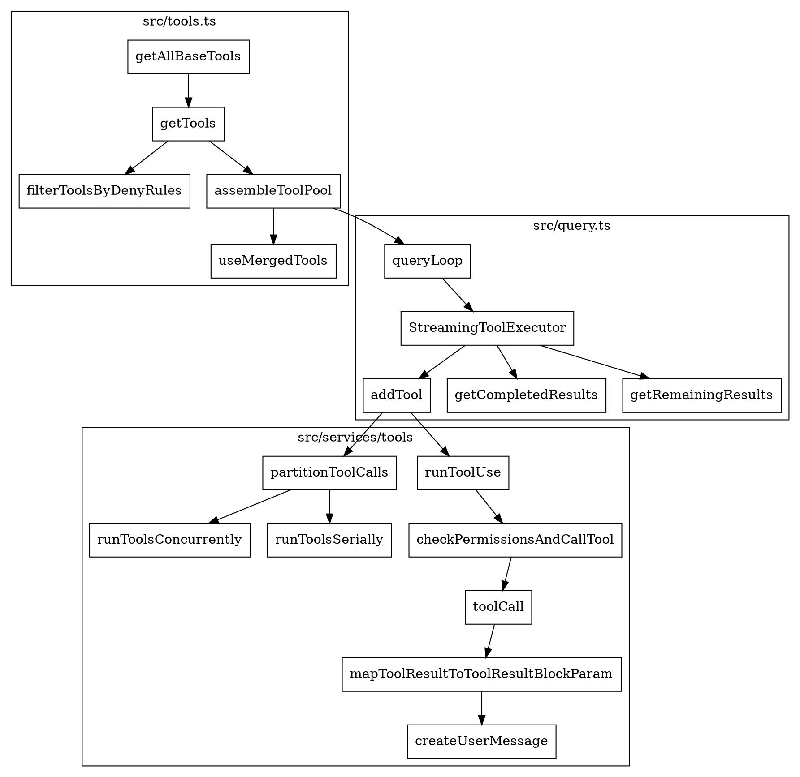

## Introduction

cc-haha 引擎把每个工具抽象成一份带 zod 输入 schema、权限钩子与渲染方法的契约对象，由 `tools.ts` 按 feature 与环境门控组装成 `Tools`，再经 `StreamingToolExecutor` 把模型流式吐出的 `tool_use` 边到边执行、回填成 `tool_result` 用户消息。

> 版本基线：v0.7.7（本地源码 E:/Projects/cc-haha-0.7.7）

- 内置工具清单不是一个静态常量数组：`getAllBaseTools` 里大量条目由 `feature()`、`process.env.USER_TYPE === 'ant'`、各类 `isXxxEnabled()` 门控，部分工具用懒 `require()` 引入，纯粹是为打断 `WorkflowTool -> launchWorkflow -> tools.js` 这类循环依赖。
- `deny` 规则在模型看到工具之前就生效：`filterToolsByDenyRules` 直接把命中 blanket deny 的工具从清单里剔除，`mcp__server` 前缀规则会整段剥掉该服务器的工具，而不只是运行时拦截。
- `src/utils/toolPool.ts` 并非并发执行池，而是一组 React-free 的纯合并与过滤函数，目的是让 `print.ts` 能复用它而不把 react/ink 拉进 SDK 模块图；真正的并发在 `toolOrchestration.ts` 与 `StreamingToolExecutor` 里。

## The Tool Contract

`src/Tool.ts` 把工具统一定型为 `Tool<Input, Output, P>`：输入是 `zod` schema，核心方法是 `call(...)`、`description(...)`、`checkPermissions(...)`、`mapToolResultToToolResultBlockParam(...)`，另有 `isConcurrencySafe(input)`、`isReadOnly(input)`、`isEnabled()`、`validateInput(...)`、`interruptBehavior()`、`shouldDefer` / `alwaysLoad` 等能力位。`Tools` 被刻意定义成 `readonly Tool[]`，便于在类型层面追踪工具集合在哪里被组装、传递与过滤。查找工具支持重命名后的别名，`toolMatchesName` 同时比对主名与 `aliases`，`findToolByName` 据此在池里定位。

工具执行返回 `ToolResult<T>`，其中 `contextModifier` 明确只对非并发安全工具有效，`mcpMeta` 透传 MCP 协议元数据，`maxResultSizeChars` 则决定超大结果是否落盘。

```typescript
export type ToolResult<T> = {
  data: T
  newMessages?: (
    | UserMessage
    | AssistantMessage
    | AttachmentMessage
    | SystemMessage
  )[]
  // contextModifier is only honored for tools that aren't concurrency safe.
  contextModifier?: (context: ToolUseContext) => ToolUseContext
  /** MCP protocol metadata (structuredContent, _meta) to pass through to SDK consumers */
  mcpMeta?: {
    _meta?: Record<string, unknown>
    structuredContent?: Record<string, unknown>
  }
}
```

所有工具导出都要经过 `buildTool(def)`，它把 `TOOL_DEFAULTS` 铺在底层再覆盖 `def`，让调用方不必到处写 `?.() ?? default`。这组默认值是 fail-closed 的：`isConcurrencySafe` 默认 `false`（假定不安全）、`isReadOnly` 默认 `false`（假定有写）、`isDestructive` 默认 `false`，只有 `isEnabled` 默认 `true`；`checkPermissions` 默认直接回 `allow`，把判定让位给通用权限系统。

```typescript
const TOOL_DEFAULTS = {
  isEnabled: () => true,
  isConcurrencySafe: (_input?: unknown) => false,
  isReadOnly: (_input?: unknown) => false,
  isDestructive: (_input?: unknown) => false,
  checkPermissions: (
    input: { [key: string]: unknown },
    _ctx?: ToolUseContext,
  ): Promise<PermissionResult> =>
    Promise.resolve({ behavior: 'allow', updatedInput: input }),
  toAutoClassifierInput: (_input?: unknown) => '',
  userFacingName: (_input?: unknown) => '',
}
```

## Assembly And Gating

`getAllBaseTools()` 被注释标注为「所有工具的 source of truth」，返回一个大数组。前半段是常规主力工具，第一项就是 `AgentTool`，`BashTool` 与 `GlobTool` / `GrepTool` 分别受 `isBashToolEnabled()`、`hasEmbeddedSearchTools()` 门控。

```typescript
export function getAllBaseTools(): Tools {
  const powerShellTool = getPowerShellTool()
  return [
    AgentTool,
    TaskOutputTool,
    ...(isBashToolEnabled() ? [BashTool] : []),
    // Ant-native builds have bfs/ugrep embedded in the bun binary (same ARGV0
    // trick as ripgrep). When available, find/grep in Claude's shell are aliased
    // to these fast tools, so the dedicated Glob/Grep tools are unnecessary.
    ...(hasEmbeddedSearchTools() && getAgentProfile() !== 'lean' ? [] : [GlobTool, GrepTool]),
    ExitPlanModeV2Tool,
    FileReadTool,
    FileEditTool,
```

后半段更集中地体现「按门控拼装」：swarm 三件套、ant 专属 REPL、`SleepTool`、cron 工具、主动推送、生成式工具、PowerShell、`ToolSearchTool` 都是条件展开项。

```typescript
    ...(VerifyPlanExecutionTool ? [VerifyPlanExecutionTool] : []),
    ...(process.env.USER_TYPE === 'ant' && REPLTool ? [REPLTool] : []),
    getWorkflowTool(),
    ...(SleepTool ? [SleepTool] : []),
    ...(isDesktopScheduleAvailable() ? [] : cronTools),
    ...(RemoteTriggerTool ? [RemoteTriggerTool] : []),
    ...(MonitorTool ? [MonitorTool] : []),
    BriefTool,
    ImageGenTool,
    ImageEditTool,
    ...(SendUserFileTool ? [SendUserFileTool] : []),
    ...(PushNotificationTool ? [PushNotificationTool] : []),
    ...(SubscribePRTool ? [SubscribePRTool] : []),
    ...(powerShellTool ? [powerShellTool] : []),
    ...(SnipTool ? [SnipTool] : []),
    ...(process.env.NODE_ENV === 'test' ? [TestingPermissionTool] : []),
    ListMcpResourcesTool,
    ReadMcpResourceTool,
    // Include ToolSearchTool when tool search might be enabled (optimistic check)
    // The actual decision to defer tools happens at request time in claude.ts
    ...(isToolSearchEnabledOptimistic() ? [ToolSearchTool] : []),
```

`getTools(permissionContext)` 才是实际交给模型的清单：在 `CLAUDE_CODE_SIMPLE` 下只留 shell / Read / Edit，剔除 `specialTools`（`ListMcpResourcesTool`、`ReadMcpResourceTool`、结构化输出），再依次跑 deny 过滤、REPL 模式下隐藏 `REPL_ONLY_TOOLS`、`isEnabled()` 过滤与 `filterAgentProfileTools`。其中 deny 过滤用的是与运行时同一套匹配器，因此 `mcp__server` 这类前缀规则会在模型看到工具前就整段剥离。

```typescript
export function filterToolsByDenyRules<
  T extends {
    name: string
    mcpInfo?: { serverName: string; toolName: string }
  },
>(tools: readonly T[], permissionContext: ToolPermissionContext): T[] {
  return tools.filter(tool => !getDenyRuleForTool(permissionContext, tool))
}
```

## Pool Merging And Cache Stability

`assembleToolPool(permissionContext, mcpTools)` 是合并内置工具与 MCP 工具的「单一真相」：内置取 `getTools`，MCP 侧同样过 `filterToolsByDenyRules`，然后各分区内按名字排序、用 `uniqBy` 按名去重（内置工具优先，因为 `uniqBy` 保留插入序）。注释点明这样排序不是为好看，而是为 **prompt cache 稳定性**——内置工具必须保持为连续前缀，避免 MCP 工具插进内置之间使下游全局缓存断点失效。

```typescript
  const builtInTools = getTools(permissionContext)

  // Filter out MCP tools that are in the deny list
  const allowedMcpTools = filterToolsByDenyRules(mcpTools, permissionContext)

  // Sort each partition for prompt-cache stability, keeping built-ins as a
  // contiguous prefix. The server's claude_code_system_cache_policy places a
  // global cache breakpoint after the last prefix-matched built-in tool; a flat
  // sort would interleave MCP tools into built-ins and invalidate all downstream
  // cache keys whenever an MCP tool sorts between existing built-ins. uniqBy
  // preserves insertion order, so built-ins win on name conflict.
  // Avoid Array.toSorted (Node 20+) — we support Node 18. builtInTools is
  // readonly so copy-then-sort; allowedMcpTools is a fresh .filter() result.
  const byName = (a: Tool, b: Tool) => a.name.localeCompare(b.name)
  return filterAgentProfileTools(uniqBy(
    [...builtInTools].sort(byName).concat(allowedMcpTools.sort(byName)),
    'name',
  ))
```

`getMergedTools` 则是不过 deny、不排序、不去重的轻量拼接，专供工具搜索阈值计算与 token 计数这类需要「含 MCP 的全量」场景。`src/utils/toolPool.ts` 提供的 `mergeAndFilterTools` 是同一套 partition-sort 的 React-free 版本，被 `useMergedTools` 在 `useMemo` 里委托调用，并在 coordinator 模式下再套一层 `applyCoordinatorToolFilter` 白名单。

```typescript
export function mergeAndFilterTools(
  initialTools: Tools,
  assembled: Tools,
  mode: ToolPermissionContext['mode'],
): Tools {
  // Merge initialTools on top - they take precedence in deduplication.
  // initialTools may include built-in tools (from getTools() in REPL.tsx) which
  // overlap with assembled tools. uniqBy handles this deduplication.
  // Partition-sort for prompt-cache stability (same as assembleToolPool):
  // built-ins must stay a contiguous prefix for the server's cache policy.
  const [mcp, builtIn] = partition(
    uniqBy([...initialTools, ...assembled], 'name'),
    isMcpTool,
  )
  const byName = (a: Tool, b: Tool) => a.name.localeCompare(b.name)
  const tools = [...builtIn.sort(byName), ...mcp.sort(byName)]

  if (feature('COORDINATOR_MODE') && coordinatorModeModule) {
    if (coordinatorModeModule.isCoordinatorMode()) {
      return applyCoordinatorToolFilter(tools)
    }
  }

  return tools
}
```

## Routing tool_use To Execution

`src/query.ts` 的 `queryLoop` 不依赖 `stop_reason === 'tool_use'`（源码注释明确它不可靠），而是在每个 assistant 消息里扫出 `tool_use` block，逐个喂给 `StreamingToolExecutor.addTool(block, message)`，再从 `getCompletedResults()` 取出结果 yield 回消息流。

```typescript
            if (message.type === 'assistant') {
              assistantMessages.push(message)

              const msgToolUseBlocks = message.message.content.filter(
                content => content.type === 'tool_use',
              ) as ToolUseBlock[]
              if (msgToolUseBlocks.length > 0) {
                toolUseBlocks.push(...msgToolUseBlocks)
                needsFollowUp = true
              }

              if (
                streamingToolExecutor &&
                !toolUseContext.abortController.signal.aborted
              ) {
                for (const toolBlock of msgToolUseBlocks) {
                  streamingToolExecutor.addTool(toolBlock, message)
                }
              }
            }
```

`runToolUse` → `checkPermissionsAndCallTool` 是真正的单次执行管线：先 `inputSchema.safeParse`（失败回 `<tool_use_error>InputValidationError`）、再 `validateInput`、再跑 `runPreToolUseHooks`，之后读取 `toolPermissionContext.mode` 并调用 `resolveHookPermissionDecision(..., canUseTool, ...)` 拿权限决策。`canUseTool` 这个回调既在这里做判定，又被当作参数原样传给 `tool.call`。

```typescript
  const permissionMode = toolUseContext.getAppState().toolPermissionContext.mode
  const permissionStart = Date.now()

  const resolved = await resolveHookPermissionDecision(
    hookPermissionResult,
    tool,
    processedInput,
    toolUseContext,
    canUseTool,
    assistantMessage,
    toolUseID,
  )
  const permissionDecision = resolved.decision
  processedInput = resolved.input
```

只有 `permissionDecision.behavior === 'allow'` 才真正进入 `tool.call(..., canUseTool, ...)`；拒绝时直接返回 `is_error: true` 的 `tool_result`。

```typescript
    const result = await tool.call(
      callInput,
      {
        ...toolUseContext,
        toolUseId: toolUseID,
        userModified: permissionDecision.userModified ?? false,
      },
      canUseTool,
      assistantMessage,
      progress => {
        onToolProgress({
          toolUseID: progress.toolUseID,
          data: progress.data,
        })
      },
    )
```

## Concurrency Partitioning

`toolOrchestration.ts` 的 `partitionToolCalls` 把一串 `tool_use` 顺序归约成 `Batch`：连续多个并发安全工具合成一批，写工具或判定失败的工具单独成批。判定链是 `findToolByName` → `inputSchema.safeParse` → `isConcurrencySafe(parsedInput.data)`，解析失败或该函数抛错一律保守判 `false`（不并发）。

```typescript
function partitionToolCalls(
  toolUseMessages: ToolUseBlock[],
  toolUseContext: ToolUseContext,
): Batch[] {
  return toolUseMessages.reduce((acc: Batch[], toolUse) => {
    const tool = findToolByName(toolUseContext.options.tools, toolUse.name)
    const parsedInput = tool?.inputSchema.safeParse(toolUse.input)
    const isConcurrencySafe = parsedInput?.success
      ? (() => {
          try {
            return Boolean(tool?.isConcurrencySafe(parsedInput.data))
          } catch {
            // If isConcurrencySafe throws (e.g., due to shell-quote parse failure),
            // treat as not concurrency-safe to be conservative
            return false
          }
        })()
      : false
    if (isConcurrencySafe && acc[acc.length - 1]?.isConcurrencySafe) {
      acc[acc.length - 1]!.blocks.push(toolUse)
    } else {
      acc.push({ isConcurrencySafe, blocks: [toolUse] })
    }
    return acc
  }, [])
}
```

`runTools` 据此把并发批交给 `runToolsConcurrently`（`all(..., getMaxToolUseConcurrency())`），非并发批交给 `runToolsSerially`。并发上限可由环境变量改写，默认 10。

```typescript
function getMaxToolUseConcurrency(): number {
  return (
    parseInt(process.env.CLAUDE_CODE_MAX_TOOL_USE_CONCURRENCY || '', 10) || 10
  )
}
```

并发批里的 `contextModifier` 不立即生效，而是按 `toolUseID` 排队、等整批完成后按序应用；串行批则逐个即时应用——这与 `ToolResult` 里「`contextModifier` 只对非并发安全工具有效」的约定互相印证。

## Streaming Execution And Result Backfill

`StreamingToolExecutor` 是边流边执行的实现：`addTool` 立刻把 block 入队并触发 `processQueue`，`canExecuteTool` 规定「无执行中工具」或「新工具与所有执行中工具都并发安全」才放行，否则遇到写工具就 `break` 保序。结果被缓冲，按接收顺序发射。

```typescript
  private canExecuteTool(isConcurrencySafe: boolean): boolean {
    const executingTools = this.tools.filter(t => t.status === 'executing')
    return (
      executingTools.length === 0 ||
      (isConcurrencySafe && executingTools.every(t => t.isConcurrencySafe))
    )
  }
```

结果回填统一是「造一条 user 消息，里面放 `tool_result` block」，带 `tool_use_id`、`is_error`、`toolUseResult` 与 `sourceToolAssistantUUID`。找不到工具时不抛异常，而是当场合成一段 `<tool_use_error>Error: No such tool available` 的失败结果，保证模型总能拿到配对的 `tool_result`。

```typescript
          createUserMessage({
            content: [
              {
                type: 'tool_result',
                content: `<tool_use_error>Error: No such tool available: ${block.name}</tool_use_error>`,
                is_error: true,
                tool_use_id: block.id,
              },
            ],
            toolUseResult: `Error: No such tool available: ${block.name}`,
            sourceToolAssistantUUID: assistantMessage.uuid,
          }),
```

成功路径先由工具自己把输出映射成 API 块并缓存复用，再由 `addToolResult` 过 `maxResultSizeChars` 决定是原样返回还是落盘预览，最后才拼进 user 消息。

```typescript
    // Map the tool result to API format once and cache it. This block is reused
    // by addToolResult (skipping the remap) and measured here for analytics.
    const mappedToolResultBlock = tool.mapToolResultToToolResultBlockParam(
      result.data,
      toolUseID,
    )
```

```typescript
      const toolResultBlock = preMappedBlock
        ? await processPreMappedToolResultBlock(
            preMappedBlock,
            tool.name,
            tool.maxResultSizeChars,
          )
        : await processToolResultBlock(tool, toolUseResult, toolUseID)
```

执行器还维护 `siblingAbortController`：只有 Bash 出错才 abort 兄弟子进程（因为 Bash 命令常有隐式依赖链，Read / WebFetch 之类相互独立不连坐），并为 `user_interrupted`、`streaming_fallback`、`sibling_error` 生成对应的合成错误块。最反直觉的一点是，即便整轮被 abort，也必须消费 `getRemainingResults()`，让执行器为排队中与执行中的工具补齐合成 `tool_result`，否则 `tool_use` 会缺少配对结果块。

```typescript
    // We need to handle a streaming abort before anything else.
    // When using streamingToolExecutor, we must consume getRemainingResults() so the
    // executor can generate synthetic tool_result blocks for queued/in-progress tools.
    // Without this, tool_use blocks would lack matching tool_result blocks.
    if (toolUseContext.abortController.signal.aborted) {
      if (streamingToolExecutor) {
        // Consume remaining results - executor generates synthetic tool_results for
        // aborted tools since it checks the abort signal in executeTool()
        for await (const update of streamingToolExecutor.getRemainingResults()) {
          if (update.message) {
            yield update.message
          }
        }
      }
```

## Call Chain At A Glance



## Links

- [CcHaha 主枢纽](/docs/CS/AI/LLM/Agent/Product/CcHaha/CcHaha.md)
- [GenerativeTools](/docs/CS/AI/LLM/Agent/Product/CcHaha/GenerativeTools.md)
- [MCP_Skills](/docs/CS/AI/LLM/Agent/Product/CcHaha/MCP_Skills.md)
- [REPL](/docs/CS/AI/LLM/Agent/Product/CcHaha/REPL.md)
- [Permission](/docs/CS/AI/LLM/Agent/Product/CcHaha/Permission.md)
- [ClaudeCode 家族](/docs/CS/AI/LLM/Agent/Product/ClaudeCode/ClaudeCode.md)

## References

- [NanmiCoder/cc-haha GitHub](https://github.com/NanmiCoder/cc-haha)
- [cc-haha 官网](https://cchaha.ai/)
- [src/Tool.ts](https://github.com/NanmiCoder/cc-haha/blob/main/src/Tool.ts)
- [src/tools.ts](https://github.com/NanmiCoder/cc-haha/blob/main/src/tools.ts)
- [src/utils/toolPool.ts](https://github.com/NanmiCoder/cc-haha/blob/main/src/utils/toolPool.ts)
- [src/services/tools/toolOrchestration.ts](https://github.com/NanmiCoder/cc-haha/blob/main/src/services/tools/toolOrchestration.ts)
- [src/services/tools/StreamingToolExecutor.ts](https://github.com/NanmiCoder/cc-haha/blob/main/src/services/tools/StreamingToolExecutor.ts)
- [src/services/tools/toolExecution.ts](https://github.com/NanmiCoder/cc-haha/blob/main/src/services/tools/toolExecution.ts)
- [src/query.ts](https://github.com/NanmiCoder/cc-haha/blob/main/src/query.ts)
