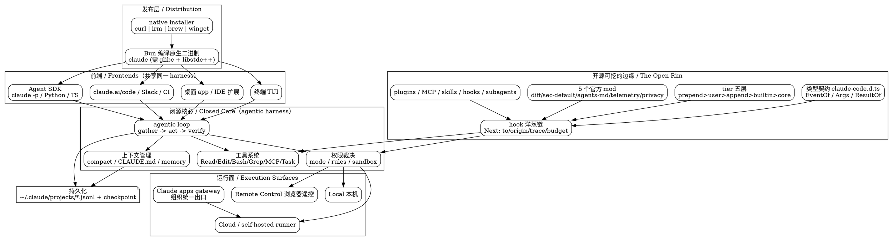

## Introduction

Claude Code 是 Anthropic 官方的终端 agentic 助手：模型负责推理，工具负责行动，Claude Code 本身是包在外面的一层——提供工具、管理模型看到的上下文、裁决每次工具调用能否执行。官方把这层外围直接称为 **agentic harness**，与 [Harness 理论篇](/docs/CS/AI/LLM/Agent/Theory/Harness.md) 的抽象精确对应。除终端外还有桌面 app、VS Code / JetBrains 扩展、claude.ai/code、Slack 与 CI/CD 等界面，底层循环完全相同。

> 版本基线：npm `@anthropic-ai/claude-code` **2.1.326**；源码基线为官方仓库 [`anthropics/claude-code`](https://github.com/anthropics/claude-code) 的本地快照 `E:/Projects/claude-code-2.1.326`（`mods/types/claude-code.d.ts` 824 KB / 20,680 行，5 个官方 mod 的真实 TypeScript 源码，CHANGELOG 覆盖 2.1.326→2.1.302）。

几个反直觉的点，也是决定"能挖到什么"的关键：

- **你装到的 `claude` 不是能读的 JS，而是 Bun 编译的原生二进制**。官方 gateway 的 Dockerfile 特意用 `gcr.io/distroless/cc` 而非 scratch，只为给它提供 glibc + libstdc++——这是"客户端是编译产物"的硬证据。因此"读源码深挖实现"在这里有个诚实的边界：**核心 loop 闭源，真正源码级可挖的是随仓库公开的类型契约与 5 个内置 mod**；其余结论来自官方文档与 CHANGELOG，不凭记忆推断。
- **hook 不是附加功能，而是中枢神经**。类型契约里连 `fs.read`、`http.fetch`、`clock.now`、`process.run` 这些宿主能力都作为**可拦截事件**暴露——整个 harness 是一张洋葱状的拦截链，插件与内置功能在同一条链上按 tier 落座。
- **tier 是权限序，不是执行序**。`prepend`（组织管控）在最外、`core`（引擎）在最内；插件只能"收紧"不能"放松"，`next.to` 只能向内跳层。这解释了为什么安全 mod 坐在最外层却能拦住内层的一切改写。

## What Claude Code Is

Claude Code 的定位是「在用户机器上、受权限与沙箱约束地、闭环调用模型的编码代理」。边界可以这样理解：

- **输入端**：用户 prompt、图片、附加目录（`--add-dir`）、`CLAUDE.md`/`AGENTS.md` 指令、MCP 工具、插件、skills。
- **处理端**：三阶段 agentic loop（gather context → take action → verify results），由模型决定节奏；上下文管理、工具裁决、会话持久化都围绕它展开。
- **输出端**：模型回复、工具结果、流式事件、落盘的 JSONL 会话与 checkpoint。

为什么值得单独深挖它的"外围"？因为模型与工具与其他 agent 大同小异，真正区分产品的是 harness：怎么把工具交给模型、怎么管理上下文、怎么在"自主"与"可控"之间裁决。Claude Code 把这些裁决点几乎全部做成了可拦截、可审计、带优先级的事件链——这是它架构的主轴。

## Architecture

### Layered Architecture



### The Closed Core and the Open Rim

理解 Claude Code 架构的第一把钥匙，是接受一个不对称：**真正跑 agent 的核心不可读，而围绕它的治理层完全可读**。

发布形态坐实了核心是编译产物。`README` 已声明 npm 安装方式 deprecated，推荐 native installer（macOS/Linux `curl | bash`、Windows `irm | iex`、Homebrew、WinGet）；gateway 的部署模板则明确期待构建上下文里已有一个预编译的 `linux-x64`/`linux-arm64` `claude` 可执行文件，`setup.sh` 按 `DIST_URL`/`DIST_SHA256` 下载并校验，基础镜像用 `gcr.io/distroless/cc:nonroot`——注释写明选 `cc` 而非 `scratch` 是因为"提供 glibc + libstdc++，Bun 编译的客户端需要"。

于是可源码级深挖的只有三样，它们恰好构成一条完整的治理链：

1. **类型契约** `claude-code.d.ts`——由引擎在加载 mod 时写出，是插件唯一可 import 的类型模块，精确列出每个事件的输入 `Args<N>`、结果 `ResultOf[N]` 与宿主对象 `$` 的全部方法。
2. **5 个内置 mod 的真实源码**——`diff` / `sec-default` / `agents-md` / `telemetry` / `privacy`，随二进制一同构建发布，是"官方自己怎么写扩展"的活样本。
3. **CHANGELOG 与 gateway/settings 模板**——给出版本边界与部署事实。

三者的关系是：契约给**接口面**，mod 给**实现面**，CHANGELOG 给**版本边界**。本文与所有分册的"实现细节"，凡涉及闭环内部的一律以官方文档明确陈述为准，能用契约/mod 源码坐实的绝不凭记忆推断。

### The Hook Onion

类型契约把整个 harness 描述成一个事件系统。事件的合成公式是一个三重交：

```ts
export type EventOf = CoreEventOf & NounEventOf;

type CoreEventOf = EngineEventOf & ClassicEventOf & OpEventOf;
```

四个命名空间各有分工：

- `EngineEventOf`——引擎自身的钩子点：`tool.call`/`tool.check`/`tool.judge`、`prompt.context`/`prompt.section`、`session.start`/`session.compact`/`session.end`、`turn.step`、`engine.create`、`ui.*` 等。
- `ClassicEventOf`——33 个 `classic.*` 事件，对应传统 hook 的 `PreToolUse`/`PostToolUse`/`Stop` 等。
- `OpEventOf`——`$` 上每一个宿主调用都被做成了事件：`fs.read`/`fs.write`、`http.fetch`、`process.run`、`store.get`、`clock.after`、`settings.read`、`env.set`……这意味着插件可以拦截"一次文件读取"本身，而不只是拦截"工具调用"。
- `NounEventOf`——插件声明的名词方法（见下节）。

参数是 `Args<N> = EventOf[N]`，结果是 `EventResult<N> = ResultOf[N]`。核心抽象是 `Next`——它携带的不只是"继续"这一个动作：

```ts
export type Next<N extends EventName = EventName, E = Args<N>, O = NextResult<N>> = {
  (e: E): Promise<O>;
  readonly to: {
    (e: E, tier: TargetTier): Promise<O>;
  };
  readonly signal: AbortSignal;
  readonly event: N;
  readonly origin: Origin;
  readonly trace: readonly TraceEntry<N, E, O>[];
  readonly budget: NextBudget;
};
```

每个字段都是一种治理能力：`to` 跳层、`origin` 标识调用者身份（宿主盖章、插件写不到）、`trace` 记录链上每个 link 的判定、`budget` 是 10 秒配额、`signal` 用于中断。`next.called` 只存在于 `.catch` 处理器上，用来区分"失败前是否已下传"——这是 fail-closed 钩子的关键判据。每个 hook 还有 1 秒的 catch 宽限期。

### Tiers Are An Authority Order

五层 tier 是权限序，同事件的 hook 严格按此嵌套，别无第二种顺序：

```ts
export type Tier = (typeof TIERS)[number];
const TIERS: readonly ["prepend", "user", "append", "builtin", "core"];
export type TargetTier = Exclude<Tier, 'prepend'>;
```

注释写得很直白："earlier is outer is more authority"。落座规则：

| Tier | 谁在这里 | 谁能放 |
| :--- | :--- | :--- |
| `prepend` | 组织管控 mod（如 `sec-default`） | 最外，能守住内层一切 |
| `user` | 用户安装的插件 | 人与人写的策略之间 |
| `append` | 内置 mod | 后于用户层 |
| `builtin` | 随二进制构建的功能 | 内置能力 |
| `core` | 引擎最内层 | 引擎自身 |

`TargetTier` 排除 `prepend`——`next.to` 只能向内跳，没人能往外跳。这直接决定了 [Security](/docs/CS/AI/LLM/Agent/Product/ClaudeCode/Security.md) 里 `sec-default` 的"双跑"机制：先跑整链，若 `next.trace` 显示 `user` 层改写过判定且策略要求守住房，就用 `next.to(e, 'append')` 跳过用户层再跑一次，取更严的结果。组织层坐在最外，才有能力把用户的放松"折叠回去"。

### Nouns Are The Extension Points

`$`（宿主对象）不是封闭的命名空间，而是可扩展的挂载点。核心类型 `EngineInterface` 在契约里是一个空 interface，靠声明合并扩展：

```ts
declare module "claude-code" {
  interface EngineInterface {
    telemetry: Telemetry
  }
}
```

`telemetry` mod 用 `engine.create` 事件（每次加载只跑一次的折叠）给 `$` 加上 `telemetry` 这个 noun：

```ts
on('engine.create', async (_$, e, next) => {
  // The contract types $.telemetry as always there, though only a step beneath
  // may have added it: without the Omit, the return below is TS2783.
  const beneath: Omit<EngineInterface, 'telemetry'> = await next(e)
  const telemetry: EngineInterface['telemetry'] = sender.telemetry
  return { telemetry, ...beneath }
})
```

规则极严：可以**添加**自己的 noun、可以**扣留**（withhold）一个 noun，但**不能替换**别的 step 已加的 noun——替换会导致该 step 失败、插件被卸载、`$` 重建。2026 年的一个版本纠偏进一步收紧：`engine.create` 上的通配/namespace/取反 hook 现在**只观察**，要增删 noun 必须**按名字** hook `engine.create`。调用方 mod 读同一个 `types/index.d.ts` 而不是复制类型（测试里要"坐一个 provider"提供该 noun，否则 `$` 构建直接拒绝），这就是 noun 契约"实现无法与调用方类型漂移"的保证。完整机制见 [ModInternals](/docs/CS/AI/LLM/Agent/Product/ClaudeCode/ModInternals.md)。

### The Agentic Loop

闭源核心对外呈现的行为是三阶段循环，三个阶段互相交融：

| 阶段 | 做什么 |
| :--- | :--- |
| gather context | 读文件、搜代码、查文档，搞清楚现状 |
| take action | 编辑文件、跑命令、调用外部服务 |
| verify results | 跑测试、复查输出，确认改动生效 |

节奏由模型自己决定：纯问答可能只需要 gather；修 bug 会在三阶段间反复；大规模重构以 verify 为主。用户也在循环内——任何时刻可打断（Esc 立即取消进行中的工具调用），或不打断直接回车把消息排队，当前工具调用结束后同一 turn 内读取。

工具按"赋予哪种行动能力"分五类：文件操作（Read/Edit/Write）、搜索（Glob/Grep）、执行（shell/git）、Web（WebSearch/WebFetch）、代码智能（类型错误/跳定义/找引用，需插件）。之上还有编排类工具 Task（派生子 agent）与 AskUserQuestion。

Agent SDK（Python/TypeScript）把同一个循环嵌进用户程序，消息流与 CLI 完全一致：turn 定义为"Claude 产出含工具调用的输出 → SDK 执行工具 → 结果喂回"，循环直到某次输出不含工具调用；五种核心消息为 `SystemMessage`（`init`/`compact_boundary`/`informational` 等 subtype）、`AssistantMessage`、`UserMessage`（携带工具结果）、`StreamEvent`（仅开启 partial messages）、`ResultMessage`（终点，带文本/token/成本/session ID）。熔断用 `max_turns`（只数含工具调用的 turn）与 `max_budget_usd`。

### Sessions, Context, Checkpoints

会话随进度落盘：每条消息、每次工具调用及结果写进 `~/.claude/projects/` 下的纯文本 JSONL，支撑 rewind / resume / fork。改代码前对受影响文件做快照（checkpoint），出问题按两次 Esc 回退。checkpoint 与 git 独立、只覆盖文件改动、恢复时跳过符号链接与硬链接；影响远端系统的动作（数据库、API、部署）无法 checkpoint，靠权限规则控制。

上下文窗口装着对话历史、文件内容、命令输出、`CLAUDE.md`、auto memory、已加载 skill、系统指令。装满时自动管理——**先清较早的工具输出，不够再总结对话**。一个必须知道的 2.1.326 纠偏：对**无法识别但以 `claude-` 开头**的模型 ID（如网关的 `claude-sonnet-latest`），默认上下文窗口假设从 200K **改为 1M**，可用 `CLAUDE_CODE_DISABLE_1M_CONTEXT=1` 保留 200K、`CLAUDE_CODE_MAX_CONTEXT_TOKENS` 显式指定。这套压缩、阈值与保留策略的完整拆解见 [Memory](/docs/CS/AI/LLM/Agent/Product/ClaudeCode/Memory.md)。

### Where It Runs

同一循环、工具与能力在所有界面相同，变的是**代码在哪里执行**：Local（本机，默认）、Cloud（Anthropic 管理的 VM 或组织自建环境）、Remote Control（本机执行、浏览器遥控）。界面覆盖终端、桌面 app、IDE 扩展、claude.ai/code、Slack 与 CI/CD。

组织可自建 **Claude apps gateway**（`claude gateway`）作统一出口与管控点，客户端 `/login` 直通其 SSO 屏幕。CHANGELOG 给出能力面（upstream 路由支持 Anthropic API/Bedrock/Vertex/Foundry/Mantle、`managed.policies[]` 的 `cli`/`code`/`desktop` 三键、`load_test_mode` 压测等），而 `examples/gateway/{aws,gcp}/` 的部署模板坐实了几条 CHANGELOG 不会说的实现事实：

- **镜像不构建二进制**，期待上下文里已有预编译的 `claude`；基础镜像按 digest 钉死。
- **`public_url` 必需**：它固定 IdP 的 `redirect_uri`、OIDC discovery 与 gateway-token 的 issuer，三者都不从客户端可控的 `Host` 头推导——这是把 issuer 从 Host 注入攻击里摘出来的关键。
- **`trusted_proxies` 必需**：经内部 ALB 时对端 IP 都是 ALB 节点，不配则按 IP 的限流与审计记的都是负载均衡器。
- **配置投递的两种哲学**：AWS 把 `gateway.yaml` 烤进镜像（改配置必须重建，`setup.sh` 用配置哈希打 tag），GCP 存 Secret Manager 运行时挂载（重新发布 secret 即可，因为 Cloud Run 无法把多个 secret 挂到同一目录）。
- **`managed.policies[]` 是 first-match-wins**，自上而下，catch-all 兜底项必须放最后；`store`（Postgres）缺它 gateway 拒绝启动；遥测 `forward_to` 在服务端盖上 `user.id/email/groups` 戳再扇出，`logs` 因带 bash 命令与工具输入默认关。

还有几个运行面的专属约束：`--worktree` 让会话跑在独立 git worktree（新版 git 2.56+ 的 reftable 格式曾引发一批诡异 bug）；cloud session 中 `widgets` 是保留的 MCP server 名；self-hosted runner 有 `claude self-hosted-runner orchestrator` 命令，长 system prompt 必须走 `--system-prompt-file`。`/advisor`（Claude Platform on AWS）是模型自己决定要不要用的旁路助手，在遥测里以 `serverToolUses` 形态出现。

### Why This Shape

把这些串起来，Claude Code 长成"闭源核心 + 开源治理边缘 + 多前端 + 多运行面"，是几个约束共同决定的：

- **发布要跨平台且无需用户编译**：native installer + Bun 编译二进制，省掉 JS 运行时依赖。
- **治理要可被组织管控、可被审计**：把工具调用、宿主能力、会话事件全做成带 tier 与 trace 的拦截链，组织 mod 坐最外层、用户插件坐中间、引擎坐最内，权限只能收紧。
- **扩展要类型安全**：类型契约 + noun 声明合并，让插件扩展宿主对象时实现与调用方类型不会漂移。
- **能力要被多端复用**：终端/桌面/IDE/Web/SDK 都只是同一 harness 的驾驶舱；本地/云/遥控只是代码执行位置不同。

## Subsystem Deep Dives

分层与治理链已在上节展开；各子系统的独立深挖如下。

权限与沙箱的独立深挖见 [Permission](/docs/CS/AI/LLM/Agent/Product/ClaudeCode/Permission.md)：六个权限模式、`auto` 的后台 classifier（默认拦截清单、3/20 次回退阈值）、Bash sandbox（Seatbelt / bubblewrap+socat）与 2.1.326 起"起始 mode 由服务端下发 `defaultMode`"的纠偏。Hook 系统的独立深挖见 [Hooks](/docs/CS/AI/LLM/Agent/Product/ClaudeCode/Hooks.md)：33 个 `classic.*` 生命周期事件、三种 cadence、matcher 与 `if` 两级过滤、五种 handler 与退出码语义，以及 `asyncRewake`。mod 接口面见 [Mods](/docs/CS/AI/LLM/Agent/Product/ClaudeCode/Mods.md)：`$` 的命名空间、128 个事件、四个渲染表面、五层 tier 与类型契约读法；mod 实现面见 [ModInternals](/docs/CS/AI/LLM/Agent/Product/ClaudeCode/ModInternals.md)：从 5 个官方 mod 真实源码读出的 noun 声明合并、双跑守房、窄宿主接口与 fail-closed。

安全基线的独立深挖见 [Security](/docs/CS/AI/LLM/Agent/Product/ClaudeCode/Security.md)：`sec-default` 的 tier 落座、`tool.check` 双跑如何让 deny 规则不被用户插件消掉、钉死的环境变量与 fail-closed 选项。写插件的字段级契约见 [PluginSpec](/docs/CS/AI/LLM/Agent/Product/ClaudeCode/PluginSpec.md)（`plugin.json` 全字段、frontmatter、退出码语义），官方自己的用法范式见 [PluginPatterns](/docs/CS/AI/LLM/Agent/Product/ClaudeCode/PluginPatterns.md)（按模型档位分层派 agent、七阶段编排、`Stop` hook 自主循环），最大插件的实现拆解见 [HookPatterns](/docs/CS/AI/LLM/Agent/Product/ClaudeCode/HookPatterns.md)。

记忆与上下文的独立深挖见 [Memory](/docs/CS/AI/LLM/Agent/Product/ClaudeCode/Memory.md)：`CLAUDE.md` 四层作用域与拼接式加载、`@path` 导入、`.claude/rules/` 路径限定、auto memory、压缩触发点与保留策略。子 agent 的独立深挖见 [Subagents](/docs/CS/AI/LLM/Agent/Product/ClaudeCode/Subagents.md)：独立上下文与定义方式、内置 Explore/Plan/general-purpose、agent teams 的 mailbox 架构与消息信任边界。扩展能力的独立深挖见 [Extensions](/docs/CS/AI/LLM/Agent/Product/ClaudeCode/Extensions.md)：Skills、Plugins、MCP（工具延迟加载）、Output styles 与官方插件清单；可观测性见 [Observability](/docs/CS/AI/LLM/Agent/Product/ClaudeCode/Observability.md)：OTel 事件表与字段、内容捕获门控、gateway 转发；非交互面见 [Headless](/docs/CS/AI/LLM/Agent/Product/ClaudeCode/Headless.md)：`claude -p`、`--bare`、退出语义与 GitHub Actions。

## Links

- [Permission](/docs/CS/AI/LLM/Agent/Product/ClaudeCode/Permission.md)
- [Hooks](/docs/CS/AI/LLM/Agent/Product/ClaudeCode/Hooks.md)
- [Mods](/docs/CS/AI/LLM/Agent/Product/ClaudeCode/Mods.md)
- [ModInternals](/docs/CS/AI/LLM/Agent/Product/ClaudeCode/ModInternals.md)
- [Memory](/docs/CS/AI/LLM/Agent/Product/ClaudeCode/Memory.md)
- [Extensions](/docs/CS/AI/LLM/Agent/Product/ClaudeCode/Extensions.md)
- [Harness 理论](/docs/CS/AI/LLM/Agent/Theory/Harness.md)
- [Codex 架构](/docs/CS/AI/Codex/Codex.md)

## References

1. [anthropics/claude-code（本地快照 2.1.326）](https://github.com/anthropics/claude-code)
2. [类型契约 claude-code.d.ts](https://github.com/anthropics/claude-code/blob/main/mods/types/claude-code.d.ts)
3. [官方 mod 目录](https://github.com/anthropics/claude-code/tree/main/mods)
4. [How Claude Code works](https://code.claude.com/docs/en/how-claude-code-works)
5. [CLI reference](https://code.claude.com/docs/en/cli-reference)
