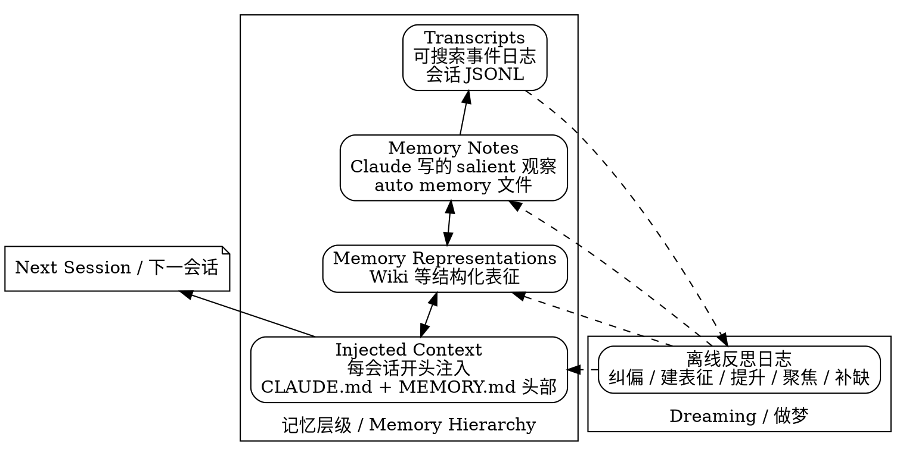

## Introduction

Claude Code 的记忆分两套互补机制，都在每次会话开始时加载：

- **CLAUDE.md 文件**：你写的持久指令（项目规范、工作流、架构上下文）。
- **Auto memory**：Claude 自己根据你的纠正与偏好写的笔记。

外加两套相邻能力：`.claude/rules/` 把指令按路径拆分，AGENTS.md 支持让你复用给别的编码 agent 写的指令文件。压缩与上下文窗口的通用原理见 [Compaction](/docs/CS/AI/LLM/Agent/Theory/Compaction.md)，本文讲 Claude Code 的实现。下半篇借 Anthropic 2026-11 的研究 [The components of agent memory](https://www.anthropic.com/research/components-of-agent-memory) 把这套实现放回 agent memory 的通用框架：它解释了为什么注入层只留一个头部索引、记忆该写什么由谁判断，以及会话之间的做梦（dreaming）如何纠偏与整理。

事实基线：`@anthropic-ai/claude-code` **2.1.326**，按 2.1.326 的 CHANGELOG（2.1.302→2.1.326 区间）逐条核实，官方 memory 页作补充。下半篇的框架与实验数字来自上述研究文章，属官方报告口径，非本地源码核实。

## CLAUDE.md vs Auto Memory

| | CLAUDE.md | Auto memory |
| :--- | :--- | :--- |
| 谁写 | 你 | Claude |
| 内容 | 指令与规则 | 学到的模式与偏好 |
| 作用域 | 项目 / 用户 / 组织 | 每仓库，跨 worktree 共享 |
| 加载量 | 全部 | 每会话前 200 行或 25KB（先到为准） |
| 用途 | 编码标准、工作流、项目架构 | 你的偏好、你给的纠正、代码里推不出的项目上下文 |

⚠️ 两者都是 **context 不是 enforced configuration**——Claude 把它们当上下文而非强制配置对待。要无条件阻断某个动作，用 `PreToolUse` hook（见 [Hooks](/docs/CS/AI/LLM/Agent/Product/ClaudeCode/Hooks.md)），不要指望 CLAUDE.md。

反直觉的两层含义：**写进去不等于被执行**（只是强倾向的引导，不是硬约束），也**写进去不等于被读到**——超大嵌套 CLAUDE.md 只加载开头（见 How Files Load）。所以「把规则写进 CLAUDE.md」既不等于强制生效，也不保证全文进上下文；需要硬保证时分别用 hook 和把文件控制在大小限制内。

subagent 也可以维护自己的 auto memory。

## Four Scopes

CLAUDE.md 按作用域分四层，加载顺序从宽到窄：

| 作用域 | 位置 | 共享 |
| :--- | :--- | :--- |
| Managed policy | macOS `/Library/Application Support/ClaudeCode/CLAUDE.md`；Linux/WSL `/etc/claude-code/CLAUDE.md`；Windows `C:\Program Files\ClaudeCode\CLAUDE.md` | 组织全员，个人设置无法排除 |
| User | `~/.claude/CLAUDE.md` | 仅自己，所有项目 |
| Project | `./CLAUDE.md` 或 `./.claude/CLAUDE.md` | 团队，随版本控制提交 |
| Local | `./CLAUDE.local.md` | 仅自己当前项目，应进 .gitignore |

managed settings 里也可以直接用 `claudeMd` 键写组织级指令（只在 managed/policy settings 里生效）。**managed 层与个人 settings 层的分工**：settings（`permissions.deny`、`sandbox.enabled`、`env`、`forceLoginMethod`）是客户端强制的技术面；CLAUDE.md 是行为引导，不是硬强制层。

## How Files Load

加载语义是**拼接而非覆盖**：

- 从**当前工作目录及每一级上级目录**加载 `CLAUDE.md` 与 `CLAUDE.local.md`，全部串接进上下文；顺序从文件系统根到工作目录，所以越靠近启动目录的指令越晚被读到。
- 每个目录内 `CLAUDE.local.md` 接在 `CLAUDE.md` 之后——个人备注是该层级 Claude 最后读到的东西。
- 工作目录**子目录**里的 CLAUDE.md 不随启动加载：Claude 读/写/编辑该子目录里某个文件时才加载（Bash 里 `cat`/`head` 单文件也算读）。
- 块级 HTML 注释（`<!-- ... -->`）在注入上下文前被剥掉，代码块内的注释保留——可以用来给人写维护备注而不花 token。
- monorepo 里被别的团队的 CLAUDE.md 打扰，用 `claudeMdExcludes` 按路径/glob 跳过。
- **大小上限**（2.1.309+）：超过大小限制的嵌套 CLAUDE.md 现在**只加载开头**，不再整份注入；此前读取这种超大嵌套文件下的内容会陷入反复压缩（反复把上下文撑满又总结）。代价是后半段指令根本不进上下文——Nested 文件要控制体积，别把关键规则压在尾部。
- 写操作注意：Claude 只看过开头时，不会再整份覆盖超大 CLAUDE.md / rules / @ 引入文件，而是要求读全文或就地编辑（2.1.312+）。

### Import Syntax

CLAUDE.md 里可以用 `@path/to/file` 导入其他文件，导入的文件在启动时连同宿主文件一起展开加载：

- 相对路径**相对包含 import 的文件**解析，不是相对工作目录；可递归导入，**最多 4 跳**。
- 路径含空格时每个空格前加反斜杠；带引号的路径不会被导入。
- **代码跨度与围栏代码块内的 `@` 不解析**——想提路径而不导入，用反斜杠号包起来。
- 解析到工作目录外的 **external import** 首次出现时有审批对话框（列文件、可拒绝）；user 级文件（`~/.claude/CLAUDE.md`、`~/.claude/rules/`）的导入免审批，Cowork 会话除外。

### Rules

`.claude/rules/` 把指令拆成主题文件，支持用 frontmatter 的 `paths` 字段按 glob 限定生效范围：

```
---
paths:
  - "src/api/**/*.ts"
  - "lib/**/*.ts"
---
```

- 无 `paths` 的 rule 随启动加载，优先级与 `.claude/CLAUDE.md` 相同；path-scoped rule 在 Claude 用 Read/Write/Edit 碰匹配文件（或 Bash 读它）时才加载。
- `paths` 是 rule 的**唯一** frontmatter 字段，别的字段被静默忽略；YAML 解析失败则当作无 `paths` 加载。
- glob 花括号展开有预算：整个 `paths` 列表共享 **1000 个展开模式与 4 MiB**，超预算的模式按未展开字面量使用（其字面花括号匹配不到任何文件）。
- `.claude/rules/` 支持 symlink，可跨项目共享一套规则；指向工作目录外的 symlink 按 external import 对待（需审批，且审批后只加载无 `paths` 的）；指向网络路径（UNC、`/net`）的链接**不加载**。
- user 级规则放 `~/.claude/rules/`，对本机所有项目生效，加载在项目规则之前。

## Auto Memory

Claude 会在你纠正它、表达偏好时自动把学到的东西写进每仓库的 memory 文件（`MEMORY.md`），**跨 worktree 共享**，每会话加载前 200 行或 25KB。它补的是 CLAUDE.md 的反面：你反复解释的东西写进 CLAUDE.md，Claude 自己该长记性的东西交给 auto memory。

为什么只加载头部、而不是全部？研究文章把 `MEMORY.md` 的这 200 行/25KB 明确归为记忆层级的**注入层（injected context）**：这段头部是**索引**，让 Claude 知道自己知道什么、去哪里找，细节留在下层按需读取。注入层必须小，原因有三——注入的记忆占掉宝贵 token；一条写错的笔记会被带进**每个**会话；而且官方 memory 文档承认，指令文件越长，Claude 的遵守度（adherence）越低。所以「写进 CLAUDE.md 不等于被执行」不只是描述性提醒，而是有 token 与注意力预算支撑的设计约束。

## AGENTS.md

Claude Code 原生读仓库里的 AGENTS.md——那是给别的编码 agent 用的开放指令文件格式。何时读、与 CLAUDE.md 的差异（AGENTS.md 支持不可用时怎么办、怎么选加载哪个、如何与用同一文件的其他工具共存）官方有专门一节；核心规则是：仓库有 AGENTS.md 时 Claude 可以拿它当 CLAUDE.md 用，两者并存时的取舍见官方 AGENTS.md 页。

## Compaction And Context

上下文窗口装着对话历史、文件内容、命令输出、CLAUDE.md、auto memory、已加载 skill 与系统指令。装满时自动管理：**先清较早的工具输出，不够再总结对话**。要点：

- **窗口按模型分档**：Sonnet 5/5.5、Fable 5/5.1、Opus 4.7 及以上**原生 1M 窗口**（无 `[1m]` 变体名），自动压缩默认约在 **967K token** 触发——这是 1M 窗口模型的口径，不是所有模型的通用常量。
- **无法识别的模型 ID**：2.1.323 起假定的默认窗口从 200K 改为 **1M**；要更早压缩用 `/autocompact`，要保留旧的 200K 用 `CLAUDE_CODE_DISABLE_1M_CONTEXT=1`。其他厂商窗口更小的模型一旦填满，可能每轮都失败直到 `/clear`，所以要在填满前就设该变量。2.1.325 起 `CLAUDE_CODE_MAX_CONTEXT_TOKENS` 也能设定「无法识别但以 `claude-` 开头」的模型窗口（如网关的 `claude-sonnet-latest`）。
- **请求上限**：2.1.326 起 `max_tokens` 超过模型上限时不再直接报错，改用 API 报告的最大值重试。
- **手动压缩**：`/compact` 触发，`PreCompact` / `PostCompact` 两个 hook 事件可介入前后；官方建议别抢在自动压缩之前手动 compact，留给任务间的自然断点。想控制保留什么，在 CLAUDE.md 里加「Compact Instructions」一节，或 `/compact focus on the API changes` 带焦点压缩。
- **Idle compaction（空闲压缩）**：终端里 200K+ token 的会话空闲约 54 分钟后、在 1 小时提示缓存过期前被摘要，下一条消息不必重读全量；`CLAUDE_CODE_IDLE_COMPACT_MIN_TOKENS` 改这个下限，settings.json 里 `"idleCompaction": false` 关闭。2.1.314 起扩展到 VS Code 与 Claude Desktop 的 Code tab（200K+ token 空闲会话被摘要，缓存过期后摘要用于下一条消息），同一版本也覆盖关闭遥测的订阅用户，以及 Bedrock / Vertex / Foundry / LLM 网关（前提是 1 小时提示缓存开启）。
- **摘要生成**：2.1.311 起，模型回复里没有摘要时，Claude Code 通常会**再要一次摘要**才替换对话；`DISABLE_COMPACT` 只能关不能重新打开压缩。2.1.326 修了 Bedrock / Vertex / Foundry 及关闭遥测时压缩曾把你的某条消息当摘要、或漏掉 Claude 最后一条回复的问题。
- **压缩后的 skill 状态**：2.1.304 起压缩后会**重新发送 skill 列表**给 Claude；`/reload-skills` 现在只发送新增或有变化的 skills。2.1.326 起 plan mode 下自动压缩用**正在回答你的模型**（如 `opusplan` 下的 Opus），可能更贵。
- **Thrashing**：单个文件/工具输出大到每次总结后立刻填满上下文时，Claude Code 尝试几次后停止自动压缩并报 thrashing 错误。
- **用量查看**：`/context` 看空间占用；MCP 工具定义默认延迟加载、skill 按需加载，都不进常驻上下文。2.1.319 起 `/context` 给 Claude 读的表格每个列表只留最大的 10 行，按需加载的 MCP 工具在被真正调用前每个 server 只占一行。2.1.326 起 `/update-config` 的上下文占用从约 93000 降到约 13000 tokens。

细节（触发公式、保留策略、压缩与 skill 状态的关系、各家对比）见 [Compaction 理论篇](/docs/CS/AI/LLM/Agent/Theory/Compaction.md)。

## Agent Memory Framework

研究文章给出的定义很窄，值得照抄边界：**agent memory 是 Claude 从经验（与用户的交互、被委派的任务）中获得、跨会话保留、以可读取 context 形式保存的知识**。它明确排除三种相邻能力——权重变化（训练期内部参数）、in-context learning（单会话内获得的知识）、以及 compaction（Claude 写的摘要，替换旧 turn 以便在新上下文窗口继续）。也就是说，本页上半篇的 CLAUDE.md 与 auto memory 是 memory 的**载体**，而压缩属于上下文管理，两者不是一回事。

记忆被组织成四层，从下到上依次是 transcripts（可搜索事件日志，即 ground truth）、memory notes（Claude 写的 salient 观察）、memory representations（wiki 等结构化表征）、injected context（每会话开头注入）。Claude Code 的组件正好落在这条链上：`~/.claude/projects/*.jsonl` 会话记录是 transcripts；auto memory 的完整 `MEMORY.md` 及其笔记文件是 memory notes；`MEMORY.md` 头部注入的 200 行/25KB 是 injected context。中间的 wiki 表征层 Claude Code 本体没有内置，见于 Managed Agents 与官方 knowledge-wiki cookbook。



## Salience And Steering

**记忆是对未来的预测**。写下一条规则，是预测它描述的模式会再次相关；写下一个已核实的事实，是预测未来会话会依赖它而不想重新核对。CL-Bench 1.0（跨会话查库答题，每题新开会话、只带一个持久 memory 目录）显示，能否形成"写错→记录失败→提出假设→验证→固化为规则"的学习闭环，决定了模型间巨大的差距。有记忆 / 无记忆的平均得分：Opus 5.5 0.838 / 0.655，Sonnet 5.5 0.833 / 0.644，Opus 5 0.828 / 0.564，Opus 4.7 0.700 / 0.383，Sonnet 5 0.610 / 0.306，Sonnet 4.6 0.364 / 0.330。演进路径也清晰：Sonnet 4.6 只攒了一堆未验证的猜测；Opus 4.7 把笔记合并成单一参考文档、开始标记哪些已核实；Sonnet 5 逐题标 confirmed、答错就写 correction；Opus 5 首次闭环——条目同时含规则、为何为真的依据、旧答案、以及已踩过的坑。

**Claude 已经学会判断该记什么**。Pokémon Red 长程任务里，Sonnet 3.7 什么都记，留下 413 个文件 / 225 个文件夹 / 977,930 字符，只拿到 1 枚徽章——它记的多是屏幕上每轮都能读到的状态（钱数、位置），持续过时；约第 10,000 步时它开始整理第 4 个 "master" 文件夹，接下来 17 步里建了 6 个、删了 9 个，游戏里一步没走。Fable 5 只写 9 个文件 / 2 个文件夹外加一个顶层 `global.md`（43,406 字符），拿到 4 枚徽章：它只记游戏不会告诉它的东西——`global.md` 当仪表盘（当前目标、预写的道馆攻略、自己的 memory 使用规则），`locations` 放路线导航计划，`gameplay` 放验证过的策略（连续 7 个球抓不到 Magikarp 后写下"3+ 球连败就变换时机，在菜单步骤间插入额外 wait"）。Opus 5.5 同样用小文件夹追踪目标与下一步、边玩边重写，最终通关。结论：值得记的是**环境中不会主动呈现、且会被遗忘的东西**——策略、计划、验证过的规则；屏幕上随时可读的状态存进记忆是冗余。

**引导要告诉 Claude 记忆用来做什么，而不是怎么用**。只说"有一个 memory 文件夹可用"，就足够 Opus 4.7 与 Opus 5 有效利用；反过来下硬规则会削弱收益——要求"只记失败"，让 Opus 5 的记忆增益下降 0.234、Opus 4.7 下降 0.150、Sonnet 4.6 下降 0.020。对老模型则要更具体：提示 Sonnet 4.6 答题前先读 memory、并显式验证假设，得分从 0.330 升到 0.641（近翻倍）；Sonnet 5 无需提示，10 次里 9 次答题前主动读记忆，Sonnet 4.6 不到一半。前沿模型的现行做法是：只在用户要求或事情明显值得记时写 memory，显著性判断交给 Claude 自己。

## Dreaming

会话内写 memory 只能看到当前会话，笔记可能一开始就错、或随环境漂移而被后来的会话当真。**Dreaming** 借用这个类比：人脑睡眠时海马体重放近期经验、整合进新皮层；agent 则用空闲算力离线反思日志，跨会话整理记忆。研究给出五种作用：

- **纠偏（correct）**：拿 transcript 当 ground truth 核对笔记。Pokémon 里 Claude 曾把 PokéCenter 错记在山的东侧，于是宣布"Mt Moon is behind me"、更新笔记"Mt Moon DONE"，随后掉进单向平台回到来路。对它做一次 dreaming、对照日志改对笔记后，它直接折返山洞并在第 1,935 步抵达 Cerulean City；而笔记未改的那次连掉三次平台，最后写下"I'm going to stop rather than keep looping"放弃。
- **建表征（build representations）**：wiki 是 Claude 编写维护、页面互相链接的页面集合，链接充当筛选记忆的地图。用 Stainless 的约 35 万个文件 / 4.2 亿 token 语料、25 个问题做评测，128 轮 dreaming 后 wiki-only 得分从 13% 升到 48%；wiki + 搜索从 54% 升到 61%（纯搜索 53%），每题还省约 2 万 token；wiki 本身从 2 轮时的 103 页 / 766 条链接长到 128 轮时的 222 页 / 12,893 条链接。但 wiki 不是万能：Harvey LAB 并购题（24 项，过半需跨文档综合）wiki 达 87% vs 纯搜索 73%；而单文档文本检索就能答的任务没有优势，甚至有一个 wiki 长到 203KB、比原文的 115KB 还大（1.77×），等于什么都没抽象。
- **提升（promote）**：把常用笔记上浮到注入层、每会话预加载，省掉搜索甚至"意识到要搜"。代价是占 token、错笔记会被带进每个会话，所以 dreaming 的大量工作是把细节下移、只留链接，维持顶层足够小——这正是上一节 `MEMORY.md` 头部索引的设计动机。
- **聚焦目标（focus）**：引导做梦的指令要告诉它什么信息真正重要。LAB 合同任务里，多个 agent 同时写一张合同表、互相覆盖，57 项事实只留下 41 项（72%）；让 Claude 反思失败并自行改写建 wiki 的指令后，改成每份合同单独一页、单 agent 逐字引用条款，57 项全中（100%）。
- **补缺（fill gaps）**：二次 dreaming 修补跨会话留下的空洞。一次实验把 9 条指向不存在页面的链接重指向已存在的同文档页面，并补了含 index 在内的 3 个新页，wiki 从 38 条 / 225 条链接变为 41 条 / 278 条链接。

开放问题：什么时候创建记忆（会话内写会把注意力从主任务拉走，dreaming 放后台但产出不即时可用）；如何保持记忆最新（全量反复核对不现实，宜聚焦易变信息或按访问频率调 cadence）；能否以 transcript 搜索为底座（表征 + 搜索常有效，但表征要花算力维护、防错误与幻觉累积）；以及显著性判断再强也无法预知未来会话的需要。

## Working With Memory Files

- `/init` 生成起始 CLAUDE.md（已有时给改进建议而非覆盖）；`CLAUDE_CODE_NEW_INIT=1` 走多阶段交互流程。
- `/doctor prompt-audit`（v2.1.283+）让 Claude 审查指令文件的过时/冲突内容，先出报告、你点头才改。
- 写有效指令的要点：具体到可验证（「用 2 空格缩进」而非「正确格式化代码」）、单文件控制在 200 行内、相关指令归组、矛盾指令定期清理。
- 让 Claude 自己更新记忆：对话里直接指示（「把这个架构决策记到根目录的 CLAUDE.md」）。
- `@` 符号在对话中把文件拉进当前会话短期记忆；`/context` 的 Memory files 一节可确认 CLAUDE.md 确实加载了。

## Links

- [ClaudeCode 主枢纽](/docs/CS/AI/LLM/Agent/Product/ClaudeCode/ClaudeCode.md)
- [Compaction 理论篇](/docs/CS/AI/LLM/Agent/Theory/Compaction.md)
- [Agent 理论篇](/docs/CS/AI/LLM/Agent/Theory/Agent.md)
- [Hooks](/docs/CS/AI/LLM/Agent/Product/ClaudeCode/Hooks.md)

## References

- [The components of agent memory（Anthropic, 2026-11）](https://www.anthropic.com/research/components-of-agent-memory)
- [Claude Code memory](https://code.claude.com/docs/en/memory)
- [Explore the context window](https://code.claude.com/docs/en/context-window)
