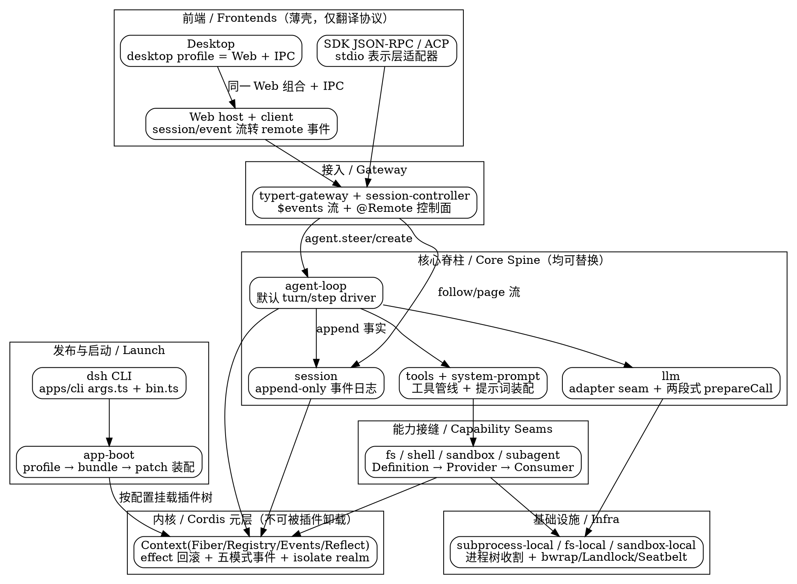

## Introduction

DeepSeek Harness（`dsh`）是一个**"一切皆插件"的 AI 编程 Agent harness**：它把模型、工具、会话日志、沙箱乃至驱动 Agent 运转的主循环都做成可替换插件，由自研 Cordis 运行时按一份层层叠加的配置树装配出实际运行的系统。

> 版本基线：v0.2.2-rc.3（`E:/Projects/deepseek-harness-dsh-v0.2.2-rc.3`，package.json `version=0.2.2-rc.3`，release 源码快照无 `.git`）。

几个反直觉的点：

- **没有"特权内核"可以打补丁，但"一切皆插件"有边界**：Cordis 自己在构造根 Context 时直接 `new Fiber/ReflectService/RegistryService/EventsService/LoggerService`（见 `vendor/cordis/src/context.ts`），这些元层机制不是插件、也无法被插件卸载。可替换的是产品能力，不是让插件得以存在的运行时。
- **"配置"不是描述最终状态，而是装配意图**：每次启动都把 profile 根 `cordis.yml` 重写回空条目 `[]`，真正的系统是 bundle + 多层 patch 现叠出来的。静态代码 ≠ 实际系统，排障入口是 `dsh --profile web --dump-config`。
- **追加事件成功 ≠ 已落盘**：`session.append()` 把事件 push 进内存 log 即 committed，持久化是另一个异步、带 flush 检查点的通道。崩溃可能丢未 flush 的尾部，于是有 `interrupted` 补写。

## What DSH Is

把 DSH 理解成三个平面的协作：

- **运行时插件图**：Cordis 维护"系统现在由什么组成"——谁提供 `ctx.llm`、谁注册工具、哪个 agent loop 在驱动。
- **追加式事件流**：Session 维护"系统刚才做过什么"——一份不可变日志，模型历史、fork、回放、遥测都从它派生。
- **装配配置**：profile / bundle / patch 决定"启动时把哪些插件叠成那张图"。

Agent loop 夹在图与日志之间：从插件图取能力（工具、模型、上下文），把事实写回日志。之所以这样切，是因为同一套运行时要同时服务 Web、headless、SDK、ACP、Desktop 五种形态，还要支持会话中途换工具/提示词而不打断已缓存前缀——把"组成"外置成配置、把"历史"外置成日志，才能让能力替换和崩溃恢复都变成数据操作而不是改代码。

## Installation

安装 Node.js 后免安装运行（本机默认监听 `http://127.0.0.1:3080` 并打开浏览器，SSH 下只打印宿主机 URL，`--no-open` 只起服务器）：

```sh
npx @deepseek-ai/dsh web
```

从源码运行：`pnpm install && pnpm run build && pnpm dsh web`。`pnpm run build` 只准备产物，`pnpm dsh web` 直接用已构建产物、不重新构建。

排障时看实际装配出的插件树：

```sh
dsh --profile web --dump-config
```

## Architecture

### Layered Architecture



### The Launcher: `dsh` Is a Profile Selector

`dsh <name>` 不是独立命令，而是 `--profile <name>` 的语法糖；`plugin` 是保留名，需要写 `dsh --profile plugin`。CLI 解析后交给 `runProfile`，按 mode 分发（文件 `apps/cli/src/args.ts`、`apps/cli/src/bin.ts`）：

```ts
    const expanded = first !== undefined && !first.startsWith('-') && first !== 'plugin'
      ? ['--profile', ...argv]
      : argv
    program.parse(expanded, { from: 'user' })
```

```ts
  switch (invocation.mode) {
    case 'profile': {
      const { runProfile } = await import('./profile-boot.ts')
      try {
        await runProfile({
          environment: loadLayeredEnv('dsh'),
          profile: invocation.profile,
```

内置 profile 只是一张"堆哪些 bundle"的表（`packages/util/official-bundles/src/bundles.ts`）：

```ts
export const PROFILE_TEMPLATES: Record<string, ProfileTemplate> = {
  acp: {
    bundles: ['@deepseek-ai/dsh-base', '@deepseek-ai/dsh-acp-app'],
  },
  web: {
    bundles: ['@deepseek-ai/dsh-base', '@deepseek-ai/dsh-web-app'],
  },
  headless: {
    bundles: ['@deepseek-ai/dsh-base', '@deepseek-ai/dsh-headless'],
  },
  sdk: {
    bundles: ['@deepseek-ai/dsh-base', '@deepseek-ai/dsh-sdk-app'],
  },
  'sdk-minimal': {
    bundles: ['@deepseek-ai/dsh-sdk-minimal'],
  },
}
```

注意 `sdk-minimal` 是唯一例外：它不叠 `dsh-base`，自带一整棵显式最小树。Python SDK 也没有独立运行器——`python/sdk-runtime/runtime-bootstrap.mjs` 直接 `import('@deepseek-ai/dsh/lib/bin.js').runCli()`，客户端只是多传一段 `--profile sdk`。

### Configuration Is Assembly

boot 读 profile 声明的每个 bundle 的 `dsh.bundle`，把它的 patch 文件逐层解析成 layer，再叠加 profile 层、home 层、`--patch` overlay（`packages/boot/app-boot/src/profile.ts`、`packages/boot/app-boot/src/profile-context.ts`）：

```ts
      const bundle = bundleManifest.dsh?.bundle
      if (bundle === undefined) {
        throw new Error(`${binName}: profile bundle ${JSON.stringify(packageName)} declares no dsh.bundle in its package.json`)
      }
      const patchPaths = bundlePatchPaths(packageDir, bundle)
      const patches = patchPaths.flatMap(patchPath => loadOverlayPatches(binName, patchPath))
      layers.push({ packageName, packageDir, patchPaths, patches })
```

```ts
  const patches = structuredClone([
    ...readBundlePatches(binName, context, initialProfile),
    ...(initialProfile?.patches ?? loadOptionalPatches(binName, context.patchPath) ?? []),
    ...(loadOptionalPatches(binName, join(context.home, PROFILE_PATCH_FILENAME)) ?? []),
    ...context.overlays,
  ])
```

patch 的核心算法是**按 id 整块替换**，不是深度合并（`vendor/include/src/patch.ts`）：

```ts
    const target = entryMap.get(id)
    if (!target) {
      warn('patch: entry %C not found', id)
      continue
    }
    for (const [key, value] of Object.entries(overrides)) {
      if (key === 'id') continue
      target[key] = value
    }
```

`target[key] = value` 对 `config` 是整体赋值。利：可预测、可审计、每层只声明自己拥有的完整值。弊：值若随 mode 变化就必须在每个 mode bundle 里整段重述，用户 override 一个键也要重述整段 `config`。

于是有两条**正交的组合轴**：进程轴是 profile（web/headless/sdk/acp/sdk-minimal + bundles），会话轴是 agent preset（standard/ptc/minimal/cordis）——同一个 Web 进程可服务不同 preset 的会话，preset 改变的是会话内层 agent realm，不改 host/transport/端口。详见 [Boot & Frontends](/docs/CS/AI/LLM/Agent/Product/DSH/BootAndFrontends.md)。

### The Kernel: Cordis

根 Context 的构造直接创建元层服务，并把核心方法 mixin 到 `ctx`（`vendor/cordis/src/context.ts`）：

```ts
  constructor() {
    this[symbols.isolate] = Object.create(null)
    this[symbols.intercept] = Object.create(null)
    const self = new Proxy<this>(this, ReflectService.handler)
    this.root = self
    this.fiber = new Fiber(self, {}, Object.create(null), null, () => [])
    this.reflect = new ReflectService(self)
    this.registry = new RegistryService(self)
    this.events = new EventsService(self)
    this.logger = new LoggerService(self)
    this.fiber._disposables.clear()
    return self
  }
```

**注册本身就是 effect**：`ctx.provide()` 返回一个 effect wrapper，登记进 fiber 的 `DisposableList`；fiber 卸载时先等 dependents 清空，再逆序执行所有 disposer（`vendor/cordis/src/reflect.ts`、`vendor/cordis/src/fiber.ts`）：

```ts
  provide(name: string, value?: any, check?: () => boolean) {
    return this.ctx.fiber.effect(() => {
      this.ctx.root[symbols.isolate][name] ??= Symbol(name)
      const key = this.ctx[symbols.isolate][name]
      const impl: Impl = { uid: ++this._implCounter, name, value, ctx: this.ctx, check, isolate: key, dependents: new Set() }
      this.store[key] = impl
      this.ctx.fiber.provisions.add(impl)
      // ...
      return async () => {
        if (this.store[impl.isolate] === impl) delete this.store[impl.isolate]
        // wait for retired binding's dependents to finish cleanup
      }
    }, `ctx.provide(${JSON.stringify(name)})`)
  }
```

事件分派有五种模式，其中 `waterfall` 是 Koa 式洋葱模型——最后一个参数是内层 `next`，不调用即否决整条链，调用两次抛错（`vendor/cordis/src/events.ts`）：

```ts
  waterfall(...args: any[]) {
    const [thisArg, callbacks] = this._resolve('waterfall', args)
    const inner = args.pop()
    const dispatch = () => {
      const callback = callbacks.shift()
      if (!callback) return inner()
      let called = false
      const next = () => {
        if (called) throw new Error('next() called multiple times')
        called = true
        return dispatch()
      }
      return Reflect.apply(callback, thisArg, [...args, next])
    }
    return dispatch()
  }
```

这解释了 DSH 扩展点的分野：`agent/pre-step`、`agent/request`、`llm/stream`、`tools/execute` 是 waterfall（可改写/否决），`agent/turn-stopping` 是 serial（数据驱动、无布尔返回），`tools/result` 是 emit（只读）。内核全貌见 [Cordis](/docs/CS/AI/LLM/Agent/Product/DSH/Cordis.md)。

### The Core Spine: Loop Between Graph and Log

核心脊柱是六个包：`core/session`、`core/system-prompt`、`core/tools`、`core/agent`、`core/agent-loop`、`llm/llm`。默认 driver 是一个可被替换的服务（`packages/core/agent-loop/src/index.ts`、`packages/core/agent-loop/src/agent.ts`）：

```ts
/** Concrete agent factory and driver service. */
export class AgentLoop extends Service implements AgentFactory {
  static inject = ['agents', 'sessions', 'llm', 'tools', 'systemPrompt', 'sessionProjections']
```

```ts
  private async kick(): Promise<void> {
    try {
      while (await this.turn()) {}
    } catch (_error) {
      // Reported failures and cancellation are contained at the driver boundary.
    } finally {
      if (this.phase.kind === 'running') {
        const { turn, wakeRequested } = this.phase
        this.setPhase({ kind: 'idle', lastTurn: turn })
        if (wakeRequested && this.inbox.hasPending) this.wakeDriver()
      }
    }
  }
```

一个 **step** 是一次模型请求 + 它调用的工具批次；一个 **turn** 是零到多个 step，从 `turn/start` 到 `turn/end`。turn 的结束由两件事共同决定：模型不欠回复（无未收口 tool call）、inbox 无待处理输入。`max-tokens` 是粘性的，`agent/turn-stopping` 无布尔返回——监听器只能 `agent.steer()` 往 inbox 写消息表示继续。详见 [Agent Loop](/docs/CS/AI/LLM/Agent/Product/DSH/AgentLoop.md)。

### The Session Log: Single Source of Model Context

Session 是纯类（不是 Service），核心是 append-only 日志（`packages/core/session/src/index.ts`）：

```ts
export class Session {
  private log: SessionEvent[] = []
  // ...
  /** The next event's sequence number — always the log length (the `seq = log.length` contiguity contract). */
  get seq(): SessionLogOffset {
    return SessionLogOffset(this.log.length)
  }
```

`seq = log.length` 让 seq 同时是数组下标，回放、fork、修复、投影共享同一坐标。发给模型的 `request.messages` 没有任何旁路数组，就是 `session.deriveMessages()`——这就是"model-visible means logged"的字面实现。fork 用 `inheritedEventCount` 标记复制前缀，JSONL 后端用 `session.vN.jsonl` 代际文件 + 排他发布做到"永不覆盖已提交代际"。详见 [Session & Persistence](/docs/CS/AI/LLM/Agent/Product/DSH/SessionPersistence.md)。

### Capability Seams: Swap Provider, Not Loop

能力接缝由三角色构成：Service Definition（接口 + 事件词汇）、Service Provider（实现）、Consumer（模型可见工具）。以工具执行器为例，`ctx.tools` 只认契约、在 dispatch 时才按作用域链解析 provider（`packages/core/tools/src/index.ts`）：

```ts
  private selectExecutor(scope?: ScopeKey): ToolExecutor {
    let record: Registration | undefined
    for (const key of scopeChainOf(scope)) {
      record = this.scoped.get(key)
      if (record !== undefined) break
    }
    record ??= this.root
    const executor = record?.executor
    if (executor === undefined) throw new ToolExecutorUnavailableError()
    return executor
  }

  async execute(input: ToolBatchInput): Promise<ToolBatchResult> {
    return this.selectExecutor(input.agent).execute(input)
  }
```

把 YAML 里的 native executor 换成 PTC executor，loop 代码零改动——PTC 只是把 `describe` 改成只暴露 `run_code` 并生成 SDK，共享流水线与审批/guard 原样复用。同一模式贯穿 fs（fs-local / fs-sandbox）、shell（bash-local / bash-sandbox）、sandbox（bwrap / Landlock / Seatbelt）、subagent（spawn / fork / codex / acp）。详见 [Tools & Capability Seams](/docs/CS/AI/LLM/Agent/Product/DSH/Tools.md)。

### Why This Shape

把上面几层串起来，DSH 长成"元内核 + 配置装配 + 事件日志 + 能力接缝"是几个约束共同决定的：

- **同运行时多形态**：Web/headless/SDK/ACP/Desktop 要复用同一套 agent 逻辑，于是把前端做成"协议翻译薄壳"、把能力做成晚绑定服务，load 哪套取决于 profile。
- **能力要独立替换**：同一进程并存多套组合、运行期可热更新，于是提供/消费分离成 capability seam，注册动作收敛成 effect（可撤销），HMR 失败时恢复最后一棵可用树。
- **崩溃与 fork 要可重建**：把"历史"外置成不可变日志，模型上下文是日志的纯函数，才能做到确定性回放、会话分叉、格式代际迁移而不覆盖旧数据。
- **安全要分层**：不可信"路径"用 fs-sandbox 策略围栏（受信代码做规范化→包含判定），不可信"代码"用 sandbox-local 内核隔离（bwrap/Landlock/Seatbelt），两者 fail-closed。

代价也真实：静态代码 ≠ 实际系统（必须 dump 配置树排障）、动态依赖放大因果链、可逆不等于事务（外部副作用无法回滚）、vendor Cordis 带来元框架维护成本。更完整的反直觉点与纠偏在各分册。

## Subsystem Deep Dives

内核运行时与插件模型的逐字源码拆解见 [DSH Cordis](/docs/CS/AI/LLM/Agent/Product/DSH/Cordis.md)：根 Context 与 Proxy、Fiber 状态机与 effect 逆序回滚、registry/reflect 的 provide/inject、事件五模式、isolate/realm 空间隔离、Loader 与 HMR 失败恢复。启动配置与前端接入见 [DSH Boot & Frontends](/docs/CS/AI/LLM/Agent/Product/DSH/BootAndFrontends.md)：profile/bundle/patch 分层、Web host 的 remote 事件流、SDK JSON-RPC 与 ACP、Desktop 的 Electron→host→Web 链路。

主循环与工具管线的独立深挖见 [DSH Agent Loop](/docs/CS/AI/LLM/Agent/Product/DSH/AgentLoop.md)（turn/step 状态机、pre-step 门禁、取消传播、工具收口）与 [DSH Tools & Capability Seams](/docs/CS/AI/LLM/Agent/Product/DSH/Tools.md)（注册→schema 注入→pre/post-execute→审批→有序提交，以及 executor/fs/subagent 三角色 seam）。会话层的事件溯源见 [DSH Session & Persistence](/docs/CS/AI/LLM/Agent/Product/DSH/SessionPersistence.md)。

模型侧见 [DSH LLM Adapter & Context](/docs/CS/AI/LLM/Agent/Product/DSH/LlmAdapter.md)：两段式 prepareCall、adapter 注册与路由、流式协议、system prompt 分节装配与前缀缓存；记忆与知识的组织见 [DSH Context / Memory](/docs/CS/AI/LLM/Agent/Product/DSH/Context.md)。执行与安全面见 [DSH Subprocess](/docs/CS/AI/LLM/Agent/Product/DSH/Subprocess.md)（进程树收割、pid 复用栅栏、PTY、spill）与 [DSH Permission & Sandbox](/docs/CS/AI/LLM/Agent/Product/DSH/Permission.md)（allowed-once、fail-closed、两层沙箱边界）。多 Agent 编排见 [DSH Subagent & Team](/docs/CS/AI/LLM/Agent/Product/DSH/SubagentTeam.md)：provider seam、fork/spawn 差异、共享任务板、preset realm、goal 续跑。插件开发工作流见 [DSH Plugin](/docs/CS/AI/LLM/Agent/Product/DSH/Plugin.md)。

## Links

- [DSH Cordis 微内核](/docs/CS/AI/LLM/Agent/Product/DSH/Cordis.md)
- [DSH Agent Loop](/docs/CS/AI/LLM/Agent/Product/DSH/AgentLoop.md)
- [DSH Session & Persistence](/docs/CS/AI/LLM/Agent/Product/DSH/SessionPersistence.md)
- [DSH Tools & Capability Seams](/docs/CS/AI/LLM/Agent/Product/DSH/Tools.md)
- [DSH Boot & Frontends](/docs/CS/AI/LLM/Agent/Product/DSH/BootAndFrontends.md)
- [Agent 理论](/docs/CS/AI/LLM/Agent/Theory/Agent.md)

## References

1. [deepseek-ai/deepseek-harness（v0.2.2-rc.3）](https://github.com/deepseek-ai/deepseek-harness/tree/v0.2.2-rc.3)
2. [架构文档 docs/architecture.md](https://github.com/deepseek-ai/deepseek-harness/blob/v0.2.2-rc.3/docs/architecture.md)
3. [Cordis 框架](https://github.com/cordiverse/cordis) / [时空可组合性论文](https://arxiv.org/abs/2608.25512)
4. [DSH 官方文档站](https://deepseek-harness.github.io/deepseek-harness/)
5. [DSH：DeepSeek Harness 架构解析](https://mp.weixin.qq.com/s/Kf87hcNdSmY4ODWI4UZ8cg)
