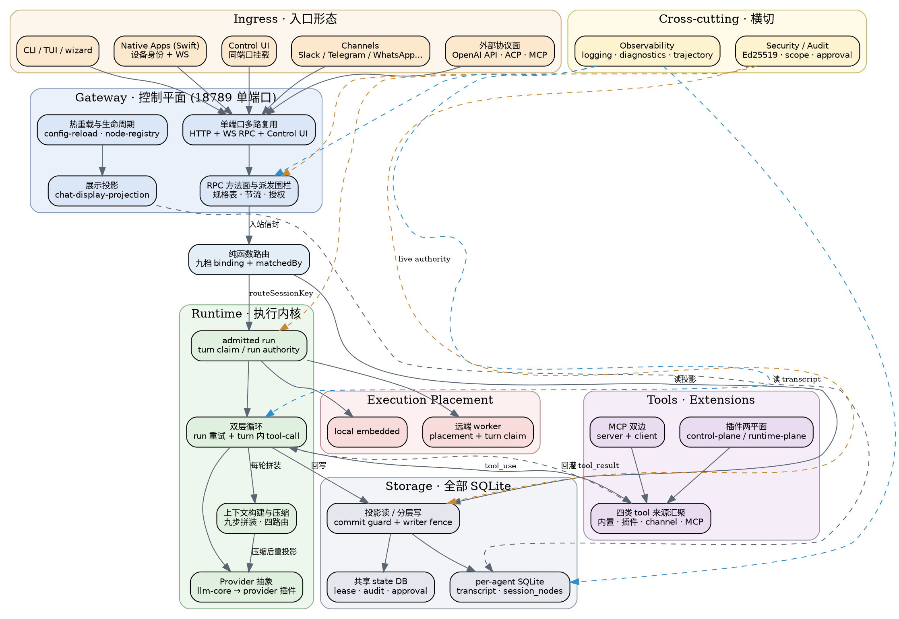

## Introduction

**OpenClaw** 是一个 **terminal-first 的个人 / 团队 AI 助手平台**，本质上是一套 **AI agent 编排系统**：prompts、tools、protocols、integrations 都由它统一编排，因此主语言选 TypeScript（可 hack、易读、迭代快）。它不服务于「写代码」这一类场景，而是要成为运行在用户自己设备上的「全能数字管家」——通过一个本地常驻的 Gateway，把 AI 能力分发到日常使用的通讯软件与原生客户端里。

两条设计哲学决定了整个架构：

- **隐私与安全优先**：默认把数据与控制权留在本地，Gateway 是用户自己的服务，不依赖云端 SaaS。
- **精简 core + 插件化**：core 里每多一个 tool / prompt / config key，都会对每次模型请求产生「按调用征税」的成本，所以可选能力一律下沉到插件、skills、channels、apps。

项目历史上经历过多次改名：**Warelay → Clawdbot → Moltbot → OpenClaw**。运行形态有两种：**个人安装**（独占一台设备）与 **共享 Gateway**（团队协作，同一 session 可承载多个人类、信用与历史）。

架构一句话概括：**Gateway 驱动 + 本地优先 + 多 agent 路由**——Gateway 只是控制平面，真正的产品是那个无处不在的助手；入站消息按来源（渠道、账户、联系人或群组）路由到相互隔离的 Agent 工作区，每个人设、记忆、文件与上下文完全隔离。

另有一条贯穿全栈的主线：**run authority / live authority**——任何执行前先认领权限，副作用前再重校验。它在渠道准入、worker placement、会话写路径、压缩、审批、出站投递里反复出现，形态各异而内核同一；[Security](/docs/CS/AI/LLM/Agent/Product/OpenClaw/Security.md?id=the-authority-chain) 页末尾把这条主线完整串了一遍，是理解全篇最省力的一条线索。

## Architecture Map

下面这张图是 OpenClaw 的总架构。读法：**左侧一列自上而下是主链路**（入口 → Gateway → 路由 → 执行内核 → provider），**右侧三块**分别是工具与扩展、执行位置、存储，**顶部右侧**是贯穿全栈的横切层（安全与观测），它们用虚线挂在所约束的层上。

抓住两个事实就够：Gateway 只是控制平面、自己不跑模型；而执行位置可以是本机也可以是远端 worker，两者都受同一套 turn claim 约束。



三条读图提示：

- **Gateway 不是执行者**。它负责接入、路由、投影、授权与广播；真正跑模型的是它下游的 Runtime，且可以落在本机也可以落在远端 worker。
- **工具调用是一条闭环**，不是单向：`loop → tools` 出去、`tools → loop` 回灌 `tool_result`，压缩与上下文构建就挂在这条闭环上。
- **虚线是校验与记录，不是数据流**。橙色是 live authority（每次副作用前重校验），蓝色是观测与审计落盘——它们不改变主链路走向。九个校验点的完整串联见 [Security](/docs/CS/AI/LLM/Agent/Product/OpenClaw/Security.md?id=the-authority-chain)。

## Tech Stack and Monorepo Layout

pnpm workspace 组织：

```
packages:
  - .              # 根包 = 主运行时（构建到 dist/）
  - ui             # Control UI 前端
  - packages/*     # 共享核心库
  - extensions/*   # 插件
  - examples/*
```

| 层 | 语言 | 目录 | 职责 |
| :--- | :--- | :--- | :--- |
| 主运行时（core） | TypeScript | `src/` | Gateway、CLI、agents、channels、plugins、llm、state、config 等，构建产物 `dist/` |
| 共享核心库 | TypeScript | `packages/` | `agent-core`、`llm-core`、`gateway-client`、`plugin-sdk`、`gateway-protocol`、`model-catalog-core` 等 |
| 插件 | TypeScript | `extensions/` | 模型 provider（anthropic / bedrock / deepseek / openai…）、消息 channel（telegram / whatsapp / slack…）、工具与能力插件（browser / canvas / memory…） |
| 原生客户端 | Swift 为主 | `apps/` | macOS / iOS / Android / Linux 等跨端应用 |
| Rust 组件 | Rust | `crates/` | 只承担两件边界事：远端 Node worker 的 Rust 宿主（`openclaw-node-host`）与 Gateway WebSocket 客户端库（`openclaw-gateway-client`） |
| 控制界面 | TypeScript | `ui/` | Web Control UI，与 Gateway 共享状态 |

技术栈结论：**TypeScript 编排核心为中枢，Swift 负责跨端原生体验，Rust 仅是「边界库」而非主体**。macOS / iOS 原生 app 走 Swift 原生 `OpenClawKit.GatewayChannelActor`，不经过 Rust；Rust gateway-client 实际主要服务远端 node worker。

启动链本身也分层：`openclaw.mjs` 这个 launcher 只做 Node 运行时校验（`node:sqlite` 能力、Node ≥ 24.16 / ≥ 26.1）与 compile-cache respawn，真正逻辑在 `dist/entry.js`——**launcher 不等于 runtime**。

## How to Read the Subsystem Notes

这一组笔记按「**控制面 → 执行内核 → 消息与存储 → 扩展与边界**」四层展开，共十五个专题页；安全与观测是横切层，单独成页。每条链路只在其**主坑页**讲透，别处留指针。

**控制面**是 Gateway 一族。从 [Gateway](/docs/CS/AI/LLM/Agent/Product/OpenClaw/Gateway.md) 入手：它是全仓最大的子系统，也是唯一枢纽，18789 单端口同时承载 HTTP、WebSocket RPC 与 Control UI，理解它的两阶段启动（control-plane 预载、runtime-plane 挂载）才能看懂后面所有子系统的挂载时机；它的 RPC 方法面与 OpenAI 兼容 API 也在同一页。Gateway 活着的时候怎么变——配置热重载、node registry、session-sharing 与 compaction checkpoints、`chat.abort`——在 [Lifecycle](/docs/CS/AI/LLM/Agent/Product/OpenClaw/Lifecycle.md)。用户从哪进来在 [Clients](/docs/CS/AI/LLM/Agent/Product/OpenClaw/Clients.md)（CLI 双角色、pi-tui 手写 TUI、一份 wizard 服务两个调用者，末尾的外圈子系统表是全库补充索引）；Gateway 被谁托管在 [Deployment](/docs/CS/AI/LLM/Agent/Product/OpenClaw/Deployment.md)（Daemon 的事务性 launchd 与自适应堆、Fleet 的单写锁端口分配）。

**执行内核**四页。核心是 [Runtime](/docs/CS/AI/LLM/Agent/Product/OpenClaw/Runtime.md)：所谓 provider 的 tool-call 循环其实不在 provider 代码里，真正的循环是 provider 无关的，位于 `packages/agent-core`；同一页还覆盖模型清单装配、上下文压缩的四条路由。长在内核之上的三块各自独立成页：记忆与 context engine 在 [Memory](/docs/CS/AI/LLM/Agent/Product/OpenClaw/Memory.md)（dreaming 三阶段、记忆事件落插件状态表、`compaction-watchdog.ts` 其实不是计时器）；子代理编排在 [SubAgent](/docs/CS/AI/LLM/Agent/Product/OpenClaw/SubAgent.md)（child run 继承 parent 的 worker turn 而非重新认领）；后台工作三层底座在 [Process](/docs/CS/AI/LLM/Agent/Product/OpenClaw/Process.md)（四类 task owner、spawn-broker 过户、system-agent 的闭集指令）。

**消息与存储**两页。消息的两端在 [Channels](/docs/CS/AI/LLM/Agent/Product/OpenClaw/Channels.md)：具体渠道全是 extension 插件，`src/channels/` 只留核心机制层；入站是一条 adapter-driven 的 turn 管线，出站分被动 reply 与主动 send 两条路。消息落在哪个会话、怎么落盘由 [Storage](/docs/CS/AI/LLM/Agent/Product/OpenClaw/Storage.md) 决定：全库只有 SQLite 一种存储，读侧走内存投影、写侧走带 commit guard 的分层链路，远端执行还有一套 worker placement 与 turn claim 的状态机。

**扩展与边界**三页。工具从哪来属于 [Plugins](/docs/CS/AI/LLM/Agent/Product/OpenClaw/Plugins.md)——control-plane 与 runtime-plane 分离、两个激活 planner、以及 Claw 包从 plan 到 consent 再到 apply 的事务链。外部 agent 互操作（ACP，session/turn 级，与 MCP 的 tool 级互补）在 [Integrations](/docs/CS/AI/LLM/Agent/Product/OpenClaw/Integrations.md)；多模态 I/O（生成 / 理解 / 语音 / 会议 / 网页，generation 不走 streamText 而走 capability-provider 契约）在 [Media](/docs/CS/AI/LLM/Agent/Product/OpenClaw/Media.md)。

**横切层**两页。[Security](/docs/CS/AI/LLM/Agent/Product/OpenClaw/Security.md) 是那条主线的家：设备身份用 Ed25519 签名证明持有私钥（Swift 侧另走 P-256）、operator scope 是 8 个闭集且未分类 default-deny、审批状态机直接写死在 DDL 的 CHECK 元组里、两套配对流互不相关；该页末尾的 The Authority Chain 把九个校验点串成一张图，值得单独读一遍。[Observability](/docs/CS/AI/LLM/Agent/Product/OpenClaw/Observability.md) 收日志诊断、LLM 流量旁路抓包（抓的是 pre-TLS 明文，不是 MITM）、agent 执行轨迹导出与数据库快照备份。

## Links

- [Harness](/docs/CS/AI/LLM/Agent/Theory/Harness.md)
- [Agent](/docs/CS/AI/LLM/Agent/Theory/Agent.md)
- [MCP](/docs/CS/AI/LLM/Protocol/MCP.md)
- [Codex](/docs/CS/AI/LLM/Agent/Product/Codex/Codex.md) / [OpenCode](/docs/CS/AI/LLM/Agent/Product/OpenCode/OpenCode.md)
- [TypeScript](/docs/CS/TypeScript/TypeScript.md) / [Nodejs](/docs/CS/front-end/Nodejs.md)

## References

- [深入理解OpenClaw技术架构与实现原理（上）-阿里云开发者社区](https://developer.aliyun.com/article/1717849)
- [深入理解OpenClaw技术架构与实现原理（下）-阿里云开发者社区](https://developer.aliyun.com/article/1719929)
- [OpenClaw 官方文档](https://docs.openclaw.ai)
- [ClawHub 官方文档](https://docs.openclaw.ai/clawhub)
- [openclaw/clawhub 仓库](https://github.com/openclaw/clawhub)
- [OpenClaw Gateway Client V3 Device Auth Reference](https://github.com/KangCaijun/openclaw-gateway-client)
- [OpenClaw Assistant Device Identity and Pairing（DeepWiki）](https://deepwiki.com/yuga-hashimoto/openclaw-assistant/3.3-device-identity-and-pairing)
- [Agent Client Protocol 官方站](https://agentclientprotocol.com/)
