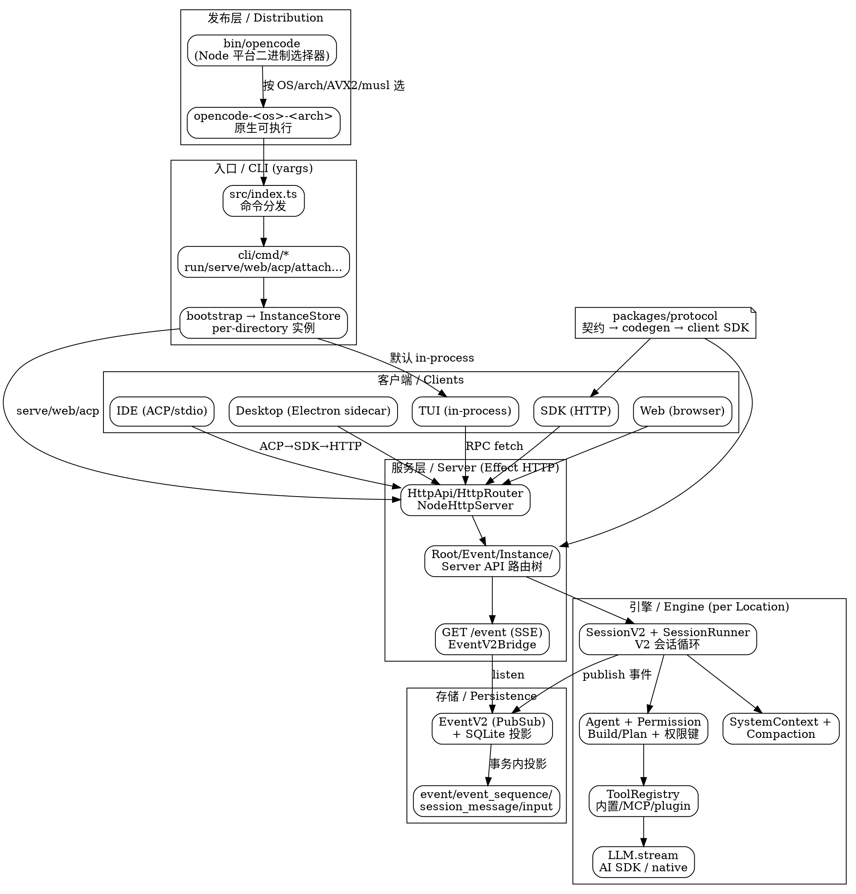

> 版本基线：v1.19.5（`E:/Projects/opencode-1.19.5` release 源码快照；`packages/opencode/package.json` 与 `core/package.json` 均标 `1.19.5`，无 `.git`，以目录名为准）。OpenCode **2.0** 是独立主版本线：自 v1.19.0 起可通过 `opencode upgrade --major` 或 `/update` 里的 2.0 offer 升级，1.x 安装不会被当作常规更新推到 2.x。本文各机制分册均以源码核实，旧版"文档口径"与源码冲突处以源码为准并标注。

## Introduction

[**OpenCode**](https://opencode.ai/) 是一个开源的、模型无关的 AI 编码代理（AI Coding Agent）。同一套 Agent 循环可以驱动 Anthropic、OpenAI、Google 以及任意 OpenAI 兼容端点；内核是一个本地 HTTP 服务，TUI、Web、IDE、桌面 App 与 SDK 都只是它的客户端。

一句话概括：**OpenCode = Agent 循环（Harness） + 本地服务 + 一套以 Markdown/配置为载体的扩展协议（Rules / Skills / Commands / Agents / Tools / Plugins / MCP）**。

本篇是 OpenCode 的**总入口**与架构总览；各机制的源码级细节在 `OpenCode/` 子目录的分册，按「架构 → 会话与引擎 → 扩展面 → 客户端与集成」组织。Harness 的通用概念（Host/Harness/Model 三层边界、SubAgent 委派、Compaction 等）已提炼到 [Harness](/docs/CS/AI/LLM/Agent/Theory/Harness.md)。

几个反直觉点（后文逐一展开）：

- **你装到的 `opencode` 命令是一个 Node 写的平台二进制选择器**：`bin/opencode` 按 OS/arch/AVX2/musl 选一个 `opencode-<os>-<arch>` 包里的原生可执行并 `spawn`，npm 壳里没有引擎逻辑。
- **TUI 默认根本不开 TCP 端口**：它用 `http://opencode.internal` 这个假 URL + RPC 代理的 `fetch` 直接调 `Server.Default().app.fetch(request)`，多数时候是**同进程函数调用**，不是网络通信。
- **v1.19.5 是一个"迁移中的架构"**：V1（legacy）与 V2（core）两套实现并存——会话循环、工具、权限、Provider、插件都有两版，V2 尚未在全部链路上取代 V1。读源码时看到两套同名概念不要以为是重复。
- **HTTP 栈不是 Hono**：整个服务是 Effect 原生栈 `HttpApi`/`HttpRouter`/`NodeHttpServer`，路由不是命令式 `app.get()`，而是 `Layer.provide([...handlers])` 的编译期依赖组合。

## What OpenCode Is

从源码看，OpenCode 是一个多包（30+ packages）的 monorepo，依赖方向由仓库 `AGENTS.md` 明确锁定：

> runtime dependencies directed from Schema to Core and Protocol, then from Core and Protocol to Server. Client runtime code may depend on Schema and Protocol but never Core or Server; `sdk-next` composes Client, Core, and Server.

- **输入端**：用户 prompt、`opencode.json` 配置、`AGENTS.md` 指令、Skills / Commands / 自定义 Agent、MCP 工具、Plugin。
- **处理端**：`packages/core` 里的 SessionRunner（会话循环）+ Agent/Permission + ToolRegistry + LLM 适配，全部用 Effect 表达、按 Location（项目目录）构建。
- **输出端**：流式文本/推理/工具事件（统一为 `LLMEvent`）、durable 事件（`EventV2`）投影到 SQLite、SSE 推给客户端。

## Architecture

### Layered Architecture



### The Distribution Shell

`packages/opencode/bin/opencode` 是一个 CommonJS 的 Node 脚本，本身**不含任何引擎逻辑**。它先算平台三元组，再按 CPU 特性与 libc 生成一个候选包名列表，沿目录树向上找 `node_modules/<name>/bin/opencode`，最后 `spawn` 真正的可执行文件并转发信号。

```javascript
const base = "opencode-" + platform + "-" + arch
const binary = platform === "windows" ? "opencode.exe" : "opencode"

const names = (() => {
  const avx2 = supportsAvx2()
  const baseline = arch === "x64" && !avx2
  if (platform === "linux") {
    // ... musl 探测（/etc/alpine-release 或 ldd --version）
  }
  if (arch === "x64") {
    if (baseline) return [`${base}-baseline`, base]
    return [base, `${base}-baseline`]
  }
  return [base]
})()
```

这里的 `supportsAvx2()` 是个小巧思：Linux 读 `/proc/cpuinfo`、macOS 调 `sysctl hw.optional.avx2_0`、Windows 用 PowerShell 调 `IsProcessorFeaturePresent(40)`，据此优先选 AVX2 版或 baseline 版。含义：用户通过 npm 装的是壳，**真正的版本、更新与逻辑都绑定在那个按平台分发的原生二进制上**。

### The Multitool CLI

原生二进制的源码入口是 `packages/opencode/src/index.ts`，用 yargs 把几十个子命令挂到同一个 `cli` 上：

```typescript
const cli = yargs(args)
  .parserConfiguration({ "populate--": true })
  .scriptName("opencode")
  .option("pure", { describe: "run without external plugins", type: "boolean" })
  .middleware(async (opts) => {
    if (opts.pure) process.env.OPENCODE_PURE = "1"
    Heap.start()
    process.env.AGENT = "1"
    process.env.OPENCODE = "1"
    process.env.OPENCODE_PID = String(process.pid)
  })
  .command(AcpCommand).command(McpCommand).command(TuiThreadCommand)
  .command(RunCommand).command(ServeCommand).command(WebCommand)
  .command(AgentCommand).command(SessionCommand).command(PluginCommand)
  // ...
  .strict()
```

命令按"是否需要项目实例"分两类：`tui` / `run` / `attach` 等走 `bootstrap(directory, cb)` 加载 `InstanceRuntime`（项目上下文 + per-instance 服务），而 `serve` / `web` / `acp` 声明 `instance: false`——它们先起一个空 server，实例由请求里的 `x-opencode-directory` 头**按请求懒加载**。

### The Instance and the Server

`opencode serve` 起的是 Effect 原生 HTTP 服务（`cli/cmd/serve.ts` → `server/server.ts`）：

```typescript
export const ServeCommand = effectCmd({
  command: "serve",
  describe: "starts a headless opencode server",
  // Server loads instances per-request via x-opencode-directory header — no
  // need for an ambient project InstanceContext at startup.
  instance: false,
  handler: Effect.fn("Cli.serve")(function* (args) {
    const { Server } = yield* Effect.promise(() => import("../../server/server"))
    const opts = yield* resolveNetworkOptions(args)
    const server = yield* Effect.promise(() => Server.listen(opts))
    yield* Effect.never
  }),
})
```

监听层用 `HttpRouter.serve(HttpApiApp.createRoutes(opts))`，底层是 `node:http` 的 `createServer()` 包成 `NodeHttpServer.layer`。路由是**声明式组合**而非命令式注册（`server/routes/instance/httpapi/api.ts`）：

```typescript
export const RootHttpApi = HttpApi.make("opencode-root")
  .addHttpApi(ControlApi).addHttpApi(ControlPlaneApi).addHttpApi(GlobalApi)
  .middleware(SchemaErrorMiddleware).middleware(Authorization)

export const InstanceHttpApi = HttpApi.make("opencode-instance")
  .addHttpApi(ConfigApi).addHttpApi(FileApi).addHttpApi(McpApi)
  .addHttpApi(PermissionApi).addHttpApi(ProviderApi).addHttpApi(SessionApi)
  .addHttpApi(SyncApi).addHttpApi(TuiApi).addHttpApi(WorkspaceApi)
  .middleware(SchemaErrorMiddleware)
```

一个 server 进程承载多个项目目录，`InstanceStore` 以 `directory` 为 key 缓存 `Deferred`，同一目录的并发请求共享一次 boot；`bootstrap.run` 在已注入的 per-instance 环境里先 `config.get()`、再 `plugin.init()`（插件可改配置，必须最先），然后并发初始化 LSP / Format / Vcs / Snapshot / Project。

### The Engine: Sessions, Agents, Tools, LLM

引擎在 `packages/core`，按 Location（项目目录）构建。核心是 `SessionRunner`——它每轮重新加载投影历史、解析模型、装配 system context、**恰好调用一次 `llm.stream(request)`**，把工具调用交给 registry 结算后再开下一轮。V2 的会话循环是一次彻底的 Event Sourcing 重构：用户 prompt 先 durable admission 进 inbox，drain 时在 safe boundary 晋升为可见消息（详见 [SessionLoop](/docs/CS/AI/LLM/Agent/Product/OpenCode/SessionLoop.md)）。

Agent 与权限决定"能做什么"：两个主 Agent（build / plan）默认共存、Tab 循环；权限用 `permission/pattern/action` 三元组、`findLast` 实现"最后匹配者胜"，`ask` 态阻塞在 `Deferred` 上并经 `permission.asked` 事件推给 UI（详见 [Agent](/docs/CS/AI/LLM/Agent/Product/OpenCode/Agent.md)）。

工具系统分 V1（`Tool.define()`，当前主链路）与 V2（`Tool.make()` + `WeakMap`，尚未移植完）；权限**不在 registry 层统一鉴权**，而在每个叶工具的 `execute` 内手写 `ctx.ask()`（详见 [Tools](/docs/CS/AI/LLM/Agent/Product/OpenCode/Tools.md)）。

### Two Runtimes, One Event Stream

Provider 与 LLM 也不是一条路：默认走 AI SDK `streamText`，打开 `OPENCODE_EXPERIMENTAL_NATIVE_LLM` 则走 `@opencode-ai/llm` 的原生 route 运行时；两条路径都收敛为统一的 `LLMEvent` 流，下游 `processor.ts` 不关心是哪一个 provider / 哪一个 runtime（详见 [Provider](/docs/CS/AI/LLM/Agent/Product/OpenCode/Provider.md)）。

事件主干是 core 的 `EventV2`：durable 事件在 SQLite 事务内分配 aggregate seq、跑投影器、原子提交，再通过 PubSub 通知监听者。opencode 侧的 `EventV2Bridge` 发布时自动补 `location`，并把每条事件转发到进程内 `GlobalBus`；SSE 的 `GET /event` 订阅的是 `EventV2Bridge.listen`，按 directory/workspace 过滤后推给客户端（详见 [Persistence](/docs/CS/AI/LLM/Agent/Product/OpenCode/Persistence.md) 与 [Server](/docs/CS/AI/LLM/Agent/Product/OpenCode/Server.md)）。

### Where the Protocol Lives

`packages/protocol` 是权威 HTTP 契约（用 Effect `HttpApi` 声明 group / endpoint / Schema），`packages/httpapi-codegen` 在构建期反射它、生成 promise 版与 effect 版两套 client（`packages/client/src/generated*`），`sdk-next` 再组合 Client / Core / Server。协议层与实现层单向解耦：改契约后 `bun run generate` 重新生成客户端，不手写生成物。

### Multiple Clients, One Server

| 形态 | 连接方式 |
| :--- | :--- |
| TUI | 默认 in-process：假 URL + RPC fetch 直调 `Server.Default().app.fetch` |
| Web | `Server.listen()` + 浏览器，静态 UI 内嵌或反代 `app.opencode.ai` |
| IDE（ACP） | IDE ↔ opencode 走 stdio NDJSON 的 Agent Client Protocol；opencode 内部再用 SDK 连自己的 server |
| Desktop | Electron `utilityProcess.fork(sidecar)`，sidecar 内 `Server.listen()` |
| SDK | `createOpencodeClient({ baseUrl, headers })`，HTTP 直连 |

### Why This Shape

- **能力要被多端复用**：CLI / Web / IDE / 桌面都要驱动同一套引擎，于是把逻辑压进 `core`、把 server 做成薄 HTTP 层、前端退化为客户端。
- **状态要可重建、可跨进程同步**：会话用 Event Sourcing（durable 事件 + 投影表），owner 栅栏与执行所有权分离，为将来的多节点集群留了接缝。
- **发布要跨平台且轻**：Node 壳按平台选原生二进制，AVX2/baseline/musl 多版本兜底。
- **迁移要可控**：V1/V2 两套实现并存、逐子系统切换，代价是源码里同名概念成双——这是读这个仓库最大的心智负担。

## Subsystem Deep Dives

架构分层与启动链路已在上节展开；各子系统的源码级深挖如下。

会话循环见 [SessionLoop](/docs/CS/AI/LLM/Agent/Product/OpenCode/SessionLoop.md)：V2 的 durable admission → `wake` → `SessionRunner.drain` → steer/queue 晋升 → 单 provider turn → 工具结算 → continuation，`SessionRunCoordinator` 如何 join/coalesce，以及未实现的崩溃恢复。引擎的上下文装配与压缩见 [Context](/docs/CS/AI/LLM/Agent/Product/OpenCode/Context.md)：SystemContext 的 `Generation` 代数与 registry、`SessionContextEpoch` 的 compaction 边界、主动压缩与 overflow 恢复两条路径。工具系统见 [Tools](/docs/CS/AI/LLM/Agent/Product/OpenCode/Tools.md)：契约/注册/执行链、`apply_patch` 的四轮模糊匹配、`execute` 元工具与 task 子 agent、输出截断。Agent 与权限见 [Agent](/docs/CS/AI/LLM/Agent/Product/OpenCode/Agent.md)：15 个权限键与 `findLast` 求值、`ask` 的 SSE 确认通道、build/plan/subagent 的权限继承。

模型与调用见 [Provider](/docs/CS/AI/LLM/Agent/Product/OpenCode/Provider.md)：`BUNDLED_PROVIDERS` 表与自定义 OpenAI-compatible 接入、`provider/model` 解析、`small_model` 的真实用途、凭据双轨制、AI SDK 与 native 两条 runtime。持久化见 [Persistence](/docs/CS/AI/LLM/Agent/Product/OpenCode/Persistence.md)：EventV2 的两张表与 seq 分配、projector 如何把事件投影成消息行、replay/claim/owner、历史重建、Bun/Node 双 DB 后端。C/S 与事件总线见 [Server](/docs/CS/AI/LLM/Agent/Product/OpenCode/Server.md)：Effect HTTP 栈、路由树、SSE 链路、per-request 实例加载、鉴权。

扩展面见 [Rules](/docs/CS/AI/LLM/Agent/Product/OpenCode/Rules.md) / [Skills](/docs/CS/AI/LLM/Agent/Product/OpenCode/Skills.md) / [Commands](/docs/CS/AI/LLM/Agent/Product/OpenCode/Commands.md)：指令文件、技能渐进式加载与命令模板。外部集成见 [Plugin](/docs/CS/AI/LLM/Agent/Product/OpenCode/Plugin.md) 与 [MCP](/docs/CS/AI/LLM/Agent/Product/OpenCode/MCP.md)：hook 拦截与权限是两道独立的门、MCP 的 stdio/HTTP/SSE 连接与 OAuth。客户端与命令见 [TUI](/docs/CS/AI/LLM/Agent/Product/OpenCode/TUI.md) 与 [CLI](/docs/CS/AI/LLM/Agent/Product/OpenCode/CLI.md)。

## Installation

官网一键脚本：

```shell
curl -fsSL https://opencode.ai/install | bash
```

Node 生态（Windows 上推荐此方式）：

```shell
npm install -g opencode-ai
# bun / pnpm / yarn
bun install -g opencode-ai
pnpm install -g opencode-ai
yarn global add opencode-ai
```

macOS 通过 Homebrew：`brew install anomalyco/tap/opencode`；Windows 通过 `choco install opencode` 或 `scoop install opencode`。也可用 `docker run -it --rm ghcr.io/anomalyco/opencode` 在容器内运行。

启动：

```shell
opencode                    # 在当前目录启动 TUI
opencode /path/to/project   # 指定项目
```

## Model

配置模型与提供商：

```shell
opencode providers          # 别名 opencode auth，管理提供商与凭据
opencode providers list     # 查看已保存的凭据
/connect                    # TUI 内添加提供商（API Key 或 OAuth）
opencode models [provider]  # 列出可用模型
/models                     # TUI 内选择模型
```

凭据落盘在 `~/.local/share/opencode/auth.json`（源码见 `packages/opencode/src/auth/index.ts`，文件权限 `0o600`）；注意 core 里另有一套 SQLite 的 `Credential` 服务，但 provider 主链路实际读的是 `auth.json`。

`opencode.json` 中的模型相关配置：

```json
{
  "$schema": "https://opencode.ai/config.json",
  "model": "anthropic/claude-sonnet-4-5",
  "small_model": "anthropic/claude-haiku-4-5",
  "enabled_providers": ["anthropic"],
  "disabled_providers": ["github-copilot"],
  "provider": {
    "my-local": {
      "name": "Local Llama",
      "npm": "@ai-sdk/openai-compatible",
      "options": {
        "baseURL": "http://127.0.0.1:11434/v1",
        "apiKey": "sk-...",
        "timeout": 600000
      },
      "models": { "llama3.1-70b": { "name": "Llama 3.1 70B" } }
    }
  }
}
```

要点：接 Ollama / LM Studio / 自建网关时在 `/connect` 里选 **Other**，把 `npm` 设为 `@ai-sdk/openai-compatible` 并给出 `baseURL`（注意包名是 `@ai-sdk/*`，不是 `@opencode-ai/*`）；`small_model` 在源码里的真实用途是**会话标题生成**，压缩走独立的 compaction agent，并非"全局自动用便宜模型"（详见 [Provider](/docs/CS/AI/LLM/Agent/Product/OpenCode/Provider.md)）。模型列表来自 `https://models.opencode.ai/api.json` 镜像，用 `blacklist` / `whitelist` 控制哪些出现在 `/models` 里。

## Comparison with Claude Code

| 维度 | Claude Code | OpenCode |
| :--- | :--- | :--- |
| 规则文件 | `CLAUDE.md`（全局 `~/.claude/CLAUDE.md`） | `AGENTS.md`（V1 兼容 `CLAUDE.md`） |
| 技能目录 | `.claude/skills/` | `.opencode/skills/`，兼容 `.claude/`、`.agents/` |
| 调用技能 | `Skill` 工具 | 原生 `skill` 工具，摘要 + 按需全文 |
| 配置 | `settings.json` + `CLAUDE.md` | `opencode.json`（运行时）+ 独立的 UI 配置 |
| 工作模式 | `/plan` 等 | build / plan 双主 Agent，Tab 循环 |
| 形态 | CLI + SDK | HTTP 服务 + TUI / Web / IDE / Desktop / SDK |
| 模型 | 以 Anthropic 为主 | 任意 provider，含 OpenAI 兼容本地端点 |
| 权限模型 | 默认关闭沙箱、deny 优先 | 三态 + `findLast`「最后匹配者胜」、默认 `*` allow |
| 扩展钩子 | hooks（settings 配置） | Plugin 事件钩子（`tool.execute.before` 等），可硬拦截 |

## Practical Recommendations

**规则分层**：全局 `~/.config/opencode/AGENTS.md` 放个人偏好，项目 `AGENTS.md` 放技术栈、目录结构、可执行命令与**负面约束**；保持精简。

**先 Plan 后 Build**：复杂任务用 Tab 切到 plan 出方案，确认后再切 build；`/undo` 依赖 Git，脏工作区前先提交。

**上下文卫生**：接近窗口上限时 `/compact` 而不是硬撑；探索性闲聊污染上下文时直接 `/new`，长期记忆靠 `AGENTS.md` 重新加载。

**权限最小化**：默认「不问即放行」适合单人本地环境；接入 MCP 或跑不可信仓库时把 `permission.edit` / `permission.bash` 设为 `ask`，对 skill 和 MCP 工具用 glob 精确放开，并用插件做 `.env`、密钥路径这类硬拦截。注意 OpenCode 的「最后匹配者胜」与 Claude Code 的「deny 优先」是**相反的优先级模型**；且源码里 `.env` 默认是 `ask`（弹确认）而非文档写的 `deny`。

## Links

- [SessionLoop](/docs/CS/AI/LLM/Agent/Product/OpenCode/SessionLoop.md) / [Context](/docs/CS/AI/LLM/Agent/Product/OpenCode/Context.md) / [Tools](/docs/CS/AI/LLM/Agent/Product/OpenCode/Tools.md)
- [Agent](/docs/CS/AI/LLM/Agent/Product/OpenCode/Agent.md) / [Provider](/docs/CS/AI/LLM/Agent/Product/OpenCode/Provider.md) / [Persistence](/docs/CS/AI/LLM/Agent/Product/OpenCode/Persistence.md)
- [Server](/docs/CS/AI/LLM/Agent/Product/OpenCode/Server.md) / [Plugin](/docs/CS/AI/LLM/Agent/Product/OpenCode/Plugin.md) / [MCP](/docs/CS/AI/LLM/Agent/Product/OpenCode/MCP.md)
- [Claude Code](/docs/CS/AI/LLM/Agent/Product/ClaudeCode/ClaudeCode.md) / [Codex](/docs/CS/AI/Codex/Codex.md) / [Harness](/docs/CS/AI/LLM/Agent/Theory/Harness.md)

## References

1. [anomalyco/opencode（v1.19.5）](https://github.com/anomalyco/opencode/tree/v1.19.5)
2. [平台二进制启动器 bin/opencode](https://github.com/anomalyco/opencode/blob/v1.19.5/packages/opencode/bin/opencode)
3. [CLI 入口 index.ts](https://github.com/anomalyco/opencode/blob/v1.19.5/packages/opencode/src/index.ts)
4. [HTTP Server server.ts](https://github.com/anomalyco/opencode/blob/v1.19.5/packages/opencode/src/server/server.ts)
5. [core 会话循环 runner/llm.ts](https://github.com/anomalyco/opencode/blob/v1.19.5/packages/core/src/session/runner/llm.ts)
6. [OpenCode 官方文档](https://opencode.ai/docs/)
