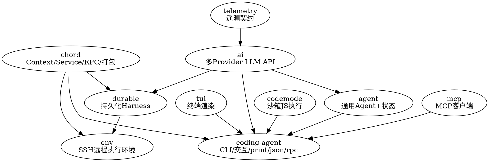

## Introduction

Pi 是跑在终端的 AI 编程 agent，使用指南见其姐妹笔记 [Pi](/docs/CS/AI/LLM/Agent/Product/Pi/Pi.md)（同目录枢纽）。本文是其**内部实现**的架构拆解：v1.0.0 部分基于 `git tag v1.0.0`（提交 `a13d35a74`）对实际代码核对，2026-10-16 按 npm `latest` **1.3.0**（2026-10-15 发布）与 `main` 分支逐包复核更新。根 `package.json` 是私有 monorepo 元包（版本 `0.0.3`，不随发布走），workspace 包各自带版本号；v1.0.0 时 13 个包锁步发布，现为 **11 个**——`protocol`/`client`/`server` 三个实验性远程会话包已删除，新增 `env`（远程执行环境）。

Pi 的运行时正是 [Agent](/docs/CS/AI/LLM/Agent/Theory/Agent.md)（Loop / Tools / Memory / Harness 四构成）与 [Harness](/docs/CS/AI/LLM/Agent/Theory/Harness.md)（对模型能力缺口的补偿面）这两个抽象在 TypeScript 工程里的具体实现——读本文时可与那两篇对照。

> 结论以代码为准、非以文档为准：官方文档自身也注明旧文档多处与实测打架，本文事实均来自对仓库的核对，关键差异见下文对照说明。

### Packages and Layering

| 包 | npm 名 | 职责 | 内部依赖 |
| --- | --- | --- | --- |
| `chord` | @earendil-works/chord | 应用组合运行时：Context、Service、RPC、facet 打包 | — |
| `telemetry` | @earendil-works/pi-telemetry | 厂商中立的遥测契约与类型化 schema | — |
| `tui` | @earendil-works/pi-tui | 终端 UI：差分渲染、布局、编辑器、markdown、按键 | — |
| `codemode` | @earendil-works/pi-codemode | 沙箱化 JavaScript 执行（QuickJS；脚本经 `tools.<name>()` 调用注入的工具） | — |
| `mcp` | @earendil-works/pi-mcp | 独立的 Model Context Protocol 客户端 | — |
| `ai` | @earendil-works/pi-ai | 统一多 Provider LLM API、模型发现、鉴权 | telemetry |
| `agent` | @earendil-works/pi-agent-core | 通用 Agent：传输抽象、状态管理、attachment 支持（不含持久化 Harness） | ai |
| `durable` | @earendil-works/pi-durable | 持久化对话/任务/文档运行时，含新一代 Harness 与 SQLite 后端 | chord, ai |
| `env` | @earendil-works/pi-env | **远程执行环境**：经 SSH 部署的小 daemon 及其 ExecutionEnv 客户端（服务 Pi Durable） | chord, durable |
| `coding-agent` | @earendil-works/pi-coding-agent | 交互式编码 Agent CLI，最终产品（组装层） | chord, agent, ai, codemode, mcp, tui |
| `evals` | @earendil-works/pi-evals | 评测工具 | — |

> v1.0.0 → main 的关键差异：① `protocol`/`client`/`server`（CBOR 帧远程会话，实验性）已删除，远程执行改由 `env` 承担；② SQLite 后端在 v1.0.0 时已并入 `pi-durable`（`@earendil-works/pi-durable/storage/sqlite/node`，导出 `openNodeSqliteStorage`），旧文档列的 `session-backends/sqlite-node` 包早已不存在。

### Dependencies

边 `X → Y` 表示 **Y 依赖 X**（消费者在上、依赖在下）：



要点：

- `ai` 只依赖 `telemetry` 与各厂 SDK，不依赖 `agent` 或 `tui`。
- `agent`（pi-agent-core）是**纯轻量层**：只提供 Agent 循环、传输抽象与共享类型，不持有会话/工具/压缩/持久化 Harness，**不依赖 `chord`**。
- `coding-agent` 是唯一同时依赖全部基础包（含 `codemode`、`mcp`）的组装层。
- `durable` 内含新一代持久化 Harness，但**生产路径的 `coding-agent` 并不直接依赖它**——目前仅被 `experimental/`（vacation 规划器、client-tui-chat）试用；`env` 同属这条支线（服务 Durable 的远程执行）。
- v1.0.0 时的远程会话三包（`protocol` CBOR 帧 / `client` / `server`）已整体删除，现役远程执行面是 `env` 的 SSH daemon + ExecutionEnv 客户端。

### Layered Responsibilities (Key Points)

- **chord**：让"本地函数调用"与"跨进程 RPC"走同一套契约（Context 隐式传播 AbortSignal；Service 支持本地 loopback 与远程 wire；facet bundle 经 esbuild 隔离加载扩展）。
- **ai**：三层结构——API 适配层（`openai-*`/`anthropic-*`/`google-*`/`bedrock-*` 等，`.lazy.ts` 惰性注册）、Provider 层（`models.generated.ts` 的 MODELS 目录当前收 **44 个 provider**，v1.0.0 文中的「90+ Provider 定义」已过期；目录另分类模型与图像模型两个专用表）、模型与鉴权（生成的 `models.generated.ts` 不可手改，可被 `models.json` 的用户覆盖叠加）。流式统一为 `EventStream` / `AssistantMessageEventStream`。
- **agent**（pi-agent-core）：v1.0.0 起精简为 `agent-loop.ts` / `agent.ts` / `proxy.ts` / `stream-fn.ts` / `types.ts`；`agentLoop()` 全程用 `AgentMessage`，只在调 LLM 边界转成 `Message[]`。旧的 `harness/`、`session/`、`tools/`、`compaction/`、`pico3/` 已全部移除。main 上包的自我描述是「通用 agent：传输抽象、状态管理、attachment 支持」。
- **durable**：文档/任务模型（`AgentDoc` rewindable + fork、`UserEntry`/`AssistantEntry`/`ToolResultEntry`… 不可变条目）；`Harness` + `GenerationTask`/`CompactionTask`/`ToolTask`（各带 checkpoint）+ `TaskGraph` + scheduler；`openNodeSqliteStorage` 后端。
- **env**（新增）：Pi Durable 的远程执行环境——一个经 SSH 部署的小 daemon 加其 ExecutionEnv 客户端，依赖 chord 与 durable。
- **tui / codemode / mcp**：终端渲染 / QuickJS 沙箱 JS / MCP 客户端，均为可单独复用的基础能力。
- **coding-agent**：组装层。`src/core/` 内嵌生产路径的全部"重"能力——`AgentSession`、`compaction/`、`tools/`、`session-manager`、`settings-manager`、`skills`、`trust-manager`、`model-runtime`、`package-manager`、`resource-loader`、`virtual-models`；内置扩展（codemode / mcp / tool-search）在 `src/extensions/`。

### Core Request Chain: Two-Layer Collaboration Loop

生产路径 = `coding-agent/core` 的 `AgentSession` 驱动 `pi-agent-core` 的 `Agent`（内层 `runLoop`）。旧文档的 `driveOperation` / `lane` / `reducer` 持久化状态机已随精简被移除，换成下面这套：

- **内层 `runLoop`**（`agent-loop.ts`）：外层 `while(true)` + 内层 `while(hasMoreToolCalls || pendingMessages.length > 0)`。每个内层迭代即一个 turn：
  1. `prepareNextTurn`：轮间准备（可触发压缩、更新 context/model/thinkingLevel、拾取 steering 消息）
  2. `prepareRequest` 钩子：LLM 请求前的最后一次 context/model 裁决（含虚拟模型路由 + 阈值压缩）
  3. `streamAssistantResponse`：`transformContext` → `convertToLlm` → `streamSimple`（pi-ai），发射 `message_*` 事件
  4. 解析 toolCall → `executeToolCalls`（parallel/sequential）→ `finishTurn` 钩子（`action: end` 结束 / `continue` 续跑）
  5. 轮边界接入 steering / follow-up 队列
- **外层 `_runAgentPrompt`**（`AgentSession`）：驱动 `this.agent.prompt/continue`，每次运行结束按 `_handlePostAgentRun` 判定续跑或结算，最后过 `_runBeforeSettleBoundary`（扩展的 `agent_before_settle` 钩子）。

```sequence
Title: Pi 核心请求链路（两层循环交互）

participant U as 调用方(CLI/RPC)
participant S as AgentSession._runAgentPrompt
participant H as 钩子(prepareRequest/finishTurn/prepareNextTurn)
participant A as Agent(agent.ts)
participant L as runLoop(agent-loop.ts)
participant P as Provider(streamSimple)
participant T as 工具执行(executeToolCalls)
participant C as 压缩/重试/结算(_handlePostAgentRun)

U->>S: prompt(messages)
S->>A: agent.prompt(messages)
A->>L: runLoop()
loop 内层 while(还有 toolCall 或 pending/steering 消息)
  L->>H: prepareNextTurnWithContext(拾 steering/轮间压缩/重建系统提示)
  L->>H: prepareRequest(虚拟模型路由+阈值压缩)
  L->>A: streamAssistantResponse
  A->>P: streamSimple(transformContext→convertToLlm)
  P-->>A: AssistantMessage(toolCalls?/stopReason)
  A-->>L: AssistantMessage
  alt stopReason == error / aborted
    L->>L: finishTurn+turn_end+agent_end→break 内层
  else 含 toolCall
    L->>T: executeToolCalls(parallel/sequential)
    T-->>L: toolResults(terminate? 早停)
    L->>H: finishTurn(turn_end 边界, 可 continue/end)
  else 无 toolCall
    L->>H: finishTurn(end)
  end
  L->>L: turn_end; 轮询 steering 消息
end
L-->>A: agent_end(本轮 turn 序列结束)
A-->>S: 一次 agent 运行结束(runResult)
S->>C: _handlePostAgentRun(message)
alt 可重试错误(_isRetryableError)
  C->>C: _prepareRetry(omit attempt+指数退避)
  S->>A: agent.continue() 重试
  A->>L: runLoop() 重跑
else 压缩命中(_checkCompaction)
  C->>C: _runAutoCompaction/compact
  S->>A: agent.continue() 续跑
  A->>L: runLoop() 续跑
else 有排队消息(hasQueuedMessages)
  S->>A: agent.continue() 消费队列
  A->>L: runLoop() 续跑
else 进入结算
  S->>C: _runBeforeSettleBoundary(agent_before_settle 钩子)
  alt 钩子返回 true
    S->>A: agent.continue()
    A->>L: runLoop() 续跑
  else false
    S->>S: emit agent_settled
  end
end
Note over S: finally 中清理重试/flush bash+custom/emit agent_settled
```

读图要点：

- **续跑是无状态从头续**：外层每次 `agent.continue()` 重新进入 `runLoop`，后者从 agent 当前消息列表尾部继续生成，而非重启对话。
- **续跑 vs 结算的唯一裁决点是 `_handlePostAgentRun`**：只看上一次运行的结束态（错误可重试 / 压缩命中 / 队列非空），三者皆否才走 `_runBeforeSettleBoundary`——所以压缩/重试都发生在 turn 边界之后、下一轮生成之前，不会切到一半的生成里。
- **`agent_end` ≠ `agent_settled`**：`agent_end` 只是内层 `runLoop` 跑完，外层还要过一遍裁决；只有 `_runBeforeSettleBoundary` 返回 false 才真正结算。

### Tool Batches and Event Persistence

一个 assistant 消息里的多个 toolCall 组成一个 **tool batch**，由 `runLoop` 的 `executeToolCalls` 执行：

```sequence
Title: 单 tool batch 执行时序(生产路径)

participant L as runLoop
participant P as prepareToolCall
participant B as tool_call 钩子
participant E as executePreparedToolCall
participant A as tool_result 钩子
participant M as SessionManager/事件总线

L->>P: 对每个 toolCall 走准备
P->>P: 工具查找→prepareArguments→validateToolArguments
P->>B: tool_call(权限检查/改写 input, 可 block)
alt block 或 terminate
  B-->>L: 拦截结果(可终止整批)
else 放行
  B->>E: 执行(可 onUpdate 推送 tool_execution_update 增量)
  E-->>A: result
  A->>A: tool_result 改写结果/置 terminate?
  A-->>L: toolResult
end
L->>M: tool_execution_start/_update/_end
L->>M: Promise.all 按源顺序物化 toolResult
L->>M: message_start/message_end(物化进 context+历史)
Note over L: 全批 terminate===true → hasMoreToolCalls=false → 本轮 turn 早停
```

- `tool_call` / `tool_result` **贯穿嵌套调用**：工具内部再调子工具（`ctx.executeTool`）时也过这两道钩子，子调用 id 形如 `<parent id>/<n>` 且携带 `parentToolCallId`，权限检查不漏底（详见 [Events](/docs/CS/AI/LLM/Agent/Product/Pi/Events.md)）。
- 事件持久化顺序固定：扩展先看到事件（`_emitExtensionEvent`）→ 通知外部监听器 → `SessionManager` 落盘（`message_end` 时 `appendMessage`）。保证"看到的即已持久化"。
- **压缩 3 类触发**：阈值（`shouldCompact` 命中）、溢出（`isContextOverflow`，可恢复时走"压缩+重试"且 `_overflowRecoveryAttempted` 仅允许一次）、手动（`/compact`/RPC，永不续跑被打断的 turn）。生产路径在 `core/compaction/`，与 `pi-durable` 的 `CompactionTask` 是两套并行实现。
- **取消**经 `AbortSignal` 向生成与工具传播；运行中 `abort()` 置 `_agentRunAbortRequested`，外层在下一判定点退出结算，不伪造结果。

> 以上两层结构在 main 仍成立：压缩文档引用的 `prepareNextTurn` / `shouldCompact` / `firstKeptEntryId` 与 `src/index.ts` 的导出面（`AgentSession`、`SessionManager`、`compact`、`createCodingTools`…）与 v1.0.0 核实结果一致；新增的是 JSON 事件流模式（见下文「运行模式」）。

### Nested Tool Calls and Exposure (New in main)

v1.0.0 之后工具层长出两套机制。**嵌套调用**：工具内部经 `ctx.executeTool(name, args, { signal, onUpdate })` 再调子工具，与模型发起的调用走同一套参数校验和 `tool_call`/`tool_result` 钩子；嵌套 id 形如 `<parent id>/n`，不进转录，只在调用方结果的 `nestedCalls` 里留有界记录（参数 >8KiB、结果 >32KiB 省略，至多 256 条，丢失标 `complete: false`），各层 `usage` 汇总进调用方。**Exposure 五态**：`direct`（默认，声明给模型且可被调）、`model-only`（只声明）、`codemode`（可被调、被 codemode 列出，不声明）、`deferred`（只有 `tool_search` 能找到）、`hidden`（注册不可达，重新注册即撤回）；配套 `reachesTools(input)` 声明一次调用触及哪些工具、`prepareLoadout` 让编排型工具改写声明集。用户侧入口是 `--tools` / `--exclude-tools` / `defaultTools`，详见 [Extensions](/docs/CS/AI/LLM/Agent/Product/Pi/Extensions.md)。

### Run Mode and Remote Sessions

同一份 `AgentSession`，不同 I/O 外壳（`modes/`）：

| 模式 | 触发 | I/O | 用途 |
| --- | --- | --- | --- |
| interactive | TTY 直接运行 | pi-tui 全屏（v1.0.0 起默认 fullscreen） | 人机交互 |
| print | `-p`、管道、非 TTY | stdin 输入，stdout 纯文本或 `--mode json` | 脚本、一次性提问 |
| json | `--mode json` | stdout 写 JSONL 事件流 | 消费单次运行的结构化事件 |
| rpc | `--mode rpc` | stdin/stdout 上的 JSON Lines 命令/事件 | 嵌入其他应用 |

- **rpc 协议**：stdin 每行一个 `RpcCommand`（`type`/`id`），`handleCommand` 按 `type` 分派，响应带 correlation id；`AgentSessionEvent` 作为事件流式输出；扩展可发起 `extension_ui` 请求由宿主应答。命令集覆盖 `steer`/`fork`/`set_model`/`compact`/`bash` 等。
- **SDK**：`createAgentSession` / `AgentSessionRuntime` 在宿主进程内造会话；工具工厂（`createBashTool` / `createCodingTools` / `createReadOnlyTools`…）支持自定义 cwd；扩展以工厂形式注入。
- **远程执行（现役）**：v1.0.0 的 CBOR 帧远程会话三包（`protocol` + `client` + `server`，`PROTOCOL_VERSION = 8`）已删除；当前形态是 `env` 包的 SSH daemon + `ExecutionEnv` 客户端，服务 `pi-durable` 的远程执行，与进程内 RPC 是两套通道。用户可见的隔离形态（Docker / OpenShell / Gondolin）见 [Security](/docs/CS/AI/LLM/Agent/Product/Pi/Security.md)。

### Extension Loading (complementary to the [Extensions](/docs/CS/AI/LLM/Agent/Product/Pi/Extensions.md) page)

- **加载与隔离**：`core/extensions/loader.ts` + `jiti-loader.ts` 用 jiti 在运行时加载 TS 扩展（本地扩展免编译）；复杂扩展可经 chord / esbuild 打成 facet bundle 隔离加载。内置扩展为 `codemode` / `mcp` / `tool-search` 三个（MCP 见 [MCP](/docs/CS/AI/LLM/Protocol/MCP.md)）；v1.0.0 时的 `llama-cpp` 内置扩展已不在现役清单。
- **信任门槛**：项目级扩展/技能/包只在 project trust 授予后加载，`project_trust` 事件可被用户级扩展接管决策（详见 [Security](/docs/CS/AI/LLM/Agent/Product/Pi/Security.md)）。
- **非代码扩展点**：Skills（`SKILL.md`，两阶段加载）、Prompt Templates、Themes、Pi Packages——[Extensions](/docs/CS/AI/LLM/Agent/Product/Pi/Extensions.md) 分册已展开，这里不再重复。

### Build, Quality and Configuration

- **构建顺序**（main 实际）：`chord → tui → telemetry → codemode → mcp → ai → durable → env → agent → coding-agent`（v1.0.0 时的 `protocol`/`client`/`server` 已删，`env` 新增；`evals` 不参与主构建链）。
- **质量门禁**：Biome（lint/format，warning 即失败）+ 原生 TypeScript 类型检查 + 一组结构检查（`check:pinned-deps` 钉版、`check:runtime-deps`、`check:ts-imports`、`check:entry-graphs` 入口图防分层破坏、`check:install-lock:coding-agent` 安装锁、`check:browser-smoke`）；`npm run check` 改代码后必跑。引擎要求 Node ≥ 22.19；工具链 Biome 2.3.5 / TypeScript 7.0.2 / esbuild 0.28.2 / pnpm 11.15.1，husky 管提交钩子。
- **数据/配置位置**：`~/.pi/agent/{settings.json,keybindings.json,mcp.json,models.json,auth.json,trust.json}`、会话仓库 `~/.pi/agent/sessions/`（JSONL，可选用 SQLite 后端）；项目侧 `.pi/{settings.json,mcp.json,extensions,skills,prompts,themes}`。格式升级经 `migrations.ts`。

## Links

- [Pi 枢纽](/docs/CS/AI/LLM/Agent/Product/Pi/Pi.md)
- [Session：会话树](/docs/CS/AI/LLM/Agent/Product/Pi/Session.md) / [Context：上下文与压缩](/docs/CS/AI/LLM/Agent/Product/Pi/Context.md)
- [Extensions：扩展体系](/docs/CS/AI/LLM/Agent/Product/Pi/Extensions.md) / [Security：信任与隔离](/docs/CS/AI/LLM/Agent/Product/Pi/Security.md)
- [CodeMode：codemode 实现机制](/docs/CS/AI/LLM/Agent/Product/Pi/CodeMode.md)
- [Tools：工具系统](/docs/CS/AI/LLM/Agent/Product/Pi/Tools.md)
- [Providers：Provider 与模型目录](/docs/CS/AI/LLM/Agent/Product/Pi/Providers.md)
- [Events：扩展事件 / 钩子总表](/docs/CS/AI/LLM/Agent/Product/Pi/Events.md) — 工具批次时序里的 `tool_call`/`tool_result` 钩子出处
- [Env：远程执行环境](/docs/CS/AI/LLM/Agent/Product/Pi/Env.md) — `env` 包在 11 包分层中的位置（依赖 chord, durable）
- [Durable：持久化 Agent 框架](/docs/CS/AI/LLM/Agent/Product/Pi/Durable.md) — `durable` 在支线中的定位与四层可替换架构
- [LLM](/docs/CS/AI/LLM/LLM.md)

## References

- [Pi Compaction Reference](https://github.com/earendil-works/pi/blob/main/packages/coding-agent/docs/compaction.md)
- [Pi Extensions](https://github.com/earendil-works/pi/blob/main/packages/coding-agent/docs/extensions.md)
- [Pi Packages](https://github.com/earendil-works/pi/blob/main/packages/coding-agent/docs/packages.md)
