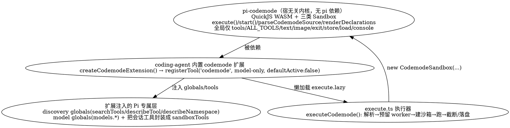

## Introduction

Pi 的 **codemode** 是一套「让模型写 JavaScript、在沙箱里调用其它工具」的机制：模型不再逐条发工具调用，而是写一段脚本，脚本在 **QuickJS（编译成 WebAssembly）** 的隔离 VM 里跑，唯一的能力是调用宿主注入的工具。它是 Pi 把「重」能力下沉成通用机制、再由内置扩展叠加的典型标本——核心在 `@earendil-works/pi-codemode` 包，Pi 自己的集成在 `coding-agent` 的内置 `codemode` 扩展。

> 本文事实核对于 2026-10-21，基线为 npm `@earendil-works/pi-coding-agent` **1.3.0**（2026-10-15 发布）与 GitHub `earendil-works/pi` `main` 分支源码；对照项见 [Architecture](/docs/CS/AI/LLM/Agent/Product/Pi/Architecture.md)（包分层、内置扩展）与 [Extensions](/docs/CS/AI/LLM/Agent/Product/Pi/Extensions.md)（工具 exposure 五态、嵌套调用）。结论以源码为准，非以文档为准。

与 [Harness](/docs/CS/AI/LLM/Agent/Theory/Harness.md) 的对应：codemode 是「用代码替代 N 次工具调用」的补偿面——一次 `codemode` 调用替代 N 次 `read`/`bash`/`edit`，且脚本内的嵌套工具调用**绝不进入 LLM 上下文**，只有脚本的输出和返回值回到模型。

### 两层拆分

codemode 不是单点实现，而是「与宿主无关的沙箱内核」+「Pi 专属集成层」两段：



要点：

- **内核 `pi-codemode` 不知道 Pi**：它只接收一组 `tools` / `globals`、一段源码、一个 `store`，跑完返回结果。官方 README 明确说它「无 pi 依赖，可独立使用，把任意函数（远程 API、MCP server、应用服务）暴露给模型写的脚本」。所以沙箱契约是通用的，Pi 只是它的一个 host。
- **Pi 集成层**做三件事：① 把会话里 `direct` / `codemode` / `deferred` 的工具封装成 `CodemodeTool` 喂给沙箱；② 注入 Pi 专属的 discovery 与 model 全局；③ 把脚本输出截断、把 `store` 落盘成会话条目、把嵌套调用记成 `nestedCalls`。

## 1. 沙箱与 VM：三类 Sandbox

`pi-codemode` 提供**同一 API、同一脚本环境、同一结果格式**，但按运行位置分三种 VM 驱动（见包 `src/index.ts` 导出）：

| Sandbox | 导入路径 | VM 跑在哪 | 适用 |
| :--- | :--- | :--- | :--- |
| `CodemodeSandbox` | `@earendil-works/pi-codemode` | **worker 线程**（每次执行一个新 worker） | Node / Bun（默认） |
| `InlineCodemodeSandbox` | 同上 | **调用线程**（不阻塞调用方不可接受时；或别的运行时） | 同步/内联场景 |
| `RemoteCodemodeSandbox` | `@earendil-works/pi-codemode/portable` | Cloudflare Worker 里的 Durable Object（独立部署） | 让脚本永不阻塞调用方线程 |

核心约束：脚本跑在 QuickJS WASM 里，**没有 Node、没有文件系统、没有网络、没有定时器、没有 `process`/`require`/模块系统**——唯一的「能力」就是调用注入的 `tools.<name>()`。VM 的 CPU/内存边界由宿主负责真正停止：worker 类直接终止线程，inline 类靠 **interrupt budget**（见 §9），remote 类由宿主在下次交换点告知停止。

`CodemodeSandboxBaseOptions` 给每类沙箱统一兜底：`timeoutMs`（默认 `300000` 即 5 分钟，含工具耗时）、`memoryLimitBytes`（超出在脚本内抛 `InternalError: out of memory`；默认仅受 wasm32 4 GiB 地址空间限制）。Pi 的执行器把内存上限显式钉到 `CODEMODE_MEMORY_LIMIT_BYTES = 256 MiB`。

## 2. 脚本环境：VM 内可见的全局

脚本被当作 **async 函数体**执行——顶层 `await` 与 `return` 都可用。VM 内可见的全局分两类：

**内核保留全局（来自 `pi-codemode`，`RESERVED_GLOBALS`）：**

| 全局 | 作用 |
| :--- | :--- |
| `tools.<id>(args)` / `tools["<name>"]`（参数以对象传入） | 调工具；`<id>` 是把非法标识符字符替换成 `_` 后的名字（`toCodemodeIdentifier`） |
| `ALL_TOOLS` | 已声明工具的目录（含 `description`） |
| `text(value)` | 追加一段文本输出 |
| `image(dataUrlOrImageBlock)` | 追加图像输出（同时存临时文件，结果给出路径） |
| `exit()` | 提前结束脚本（以 `value: undefined` 正常完成） |
| `store(key, value)` / `load(key)` | 跨 codemode 调用保持 JSON 值（见 §7） |
| `console.log(...)` | 日志，归入输出的 `<console_output>` 块 |

**Pi 扩展注入的专属全局（来自 `coding-agent` 的 `createDiscoveryGlobals` / `createModelGlobals`，作为 `globals` 传入沙箱）：**

| 全局 | 作用 |
| :--- | :--- |
| `await searchTools(query, { limit?, namespace? })` | 找**未列出**的工具（如 MCP 工具），用完按名字 `tools.<name>()` 调 |
| `await describeTool(name)` | 读某工具的完整声明 |
| `await describeNamespace(name)` | 读某 namespace 的长说明 |
| `models.*` | 分类器与图像生成（`classify` / `generateImages` / `getModelsOfType` …），由会话的 `ctx.modelRegistry` 支撑；除非显式开启否则不声明 |

多文本项输出时，每一项以 `==> text N/M <==` 行起始，`console` 日志集中在 `<console_output>` 块；失败时返回「保留部分输出的正常错误结果」+ `"Script error:"` + 错误文本。

## 3. 源格式与约束采样

脚本首行可带选项（其余行号不变，便于堆栈对齐）：

```js
// @options: {"max_output_tokens": 10000, "timeout_ms": 60000}
const src = await tools.read({ path: "package.json" });
text(JSON.parse(src).name);
```

- `parseCodemodeSource()`（`packages/codemode/src/source.ts`）解析首行 `// @options:`：支持 `max_output_tokens`（输出 token 预算）与 `timeout_ms`（硬截止）；空输入、非法 JSON、未知字段、无代码的选项行、或选项行不在第一行都会抛 `CodemodeSourceError`（修复了 #10631：错位的选项行曾被忽略导致脚本无截止）。
- `CODEMODE_SOURCE_GRAMMAR` 是一条 **Lark 语法**，供支持 grammar 约束采样的 provider（如 OpenAI 的 `openai_lark` 变体）用——让能力强的模型**直接产出原始 JS 而非 JSON 转义字符串**（`constrainedSampling` 字段挂在工具定义上）。

## 4. 工具桥接与嵌套调用

模型写脚本 → 脚本调 `tools.<name>()` → 这一步**不是**在 VM 内直接执行工具，而是由 Pi 的执行器把每个可调用工具包成 `CodemodeTool`，其 `execute` 走**会话的 agent loop 工具管线**：

```ts
execute: async (args, { signal: callSignal }) => {
  const outcome = await ctx.executeTool(tool.name, args, { signal: callSignal });
  return toScriptValue(tool, outcome);   // structuredContent | text | throw Error
}
```

- `ctx.executeTool` 与模型直接发起的调用走**同一套**：参数校验、`tool_call` / `tool_result` 钩子、权限检查全部生效（权限扩展据此弹确认）。
- `toScriptValue` 决定脚本拿到什么：
  - 声明了 `outputSchema` 的工具 → 解析为它的 `structuredContent`（**即使该工具报错但带了 structuredContent 也如此**，检查其字段即可）；
  - 其它工具 → 所有 `type:"text"` 块拼成一个字符串；
  - 失败 / 被阻断 / 参数无效的调用 → 以携带工具错误文本的 `Error` **reject**。
- **嵌套结果绝不进 LLM 上下文**：只有脚本的 `text()`/`image()` 输出和 `return` 值回到模型；嵌套工具调用在 agent loop 里照常发 `tool_call`/`tool_result` 事件（带 `parentToolCallId`，记为有界 `nestedCalls`，供压缩与 HTML 导出使用），但模型侧看不到「脚本调了哪些工具」。
- 脚本结束仍在跑的工具调用会被取消（`signal` 随脚本结束而 abort）。

脚本可调的工具集 = 会话里除 `codemode` 自身外的全部工具（`getCodemodeCallableTools` 过滤掉 `CODEMODE_TOOL_NAME`，即「脚本不得再起脚本」）。`reachesTools(input)` 声明脚本一次调用触及哪些工具：用到 discovery 全局（`searchTools`/`describeNamespace`/`describeTool`/`ALL_TOOLS`）时为 `"all"`，否则按源码里的词做名字匹配——MCP 扩展据此判断该激活/等待哪些 server。

## 5. 声明与 loadout：脚本「看见」哪些工具

Pi 用 `createCodemodeDescription()` 把可调用工具的声明渲染成面向模型的工具说明（含 `renderToolSample` 生成的 TS 风格签名）。`prepareLoadout`（工具激活时调用）按 `codemode.mode` 设置决定呈现方式——这正是 **Codex `exec` 工具模式的翻版**：

| `codemode.mode` | 行为 |
| :--- | :--- |
| `on`（默认） | 已声明给模型的工具，其说明里补一句「脚本如何调它」；codemode 的说明**只列没有 `direct` exposure 的可调用工具** |
| `only` | codemode 的说明列出**每一个**可调用工具，并请求把活跃 `direct` 工具的声明从请求里隐藏 |

两种模式都**按 exposure 而非按活跃集**列工具，所以 `tool_search` 后加载的工具不会改变 codemode 的说明、避免「加载即重新声明」击穿缓存前缀。

预算控制：`inlineBudget`（受 `codemode.inlineBudget` 设置约束，约 `token ≈ 字符/4`）限制说明里能列多少工具——放不下的工具按 **OpenCode catalog 式轮询**落选（无 namespace 的工具优先，再按 namespace 名排序，每组逐轮放最便宜的一个），`deferred` 暴露的工具**永不列出**、也不影响说明。

## 6. 执行器链路（execute.ts）

内置扩展的 `codemode` 工具 `exposure` 为 `model-only`、`defaultActive: false`——默认不激活，需 `--tools` / `defaultTools` 设置 / `setActiveTools()` 激活，MCP 扩展在「MCP 工具只能从脚本可达」时也会激活它。激活后模型的一次 `codemode` 调用进入执行器 `executeCodemode`：

```sequence
Title: executeCodemode 执行链路

participant M as 模型(tool_call: codemode)
participant E as executeCodemode(execute.ts)
participant P as parseCodemodeSource
participant W as reserveCodemodeWorker
participant S as CodemodeSandbox(worker+QuickJS)
participant T as 嵌套工具(ctx.executeTool)
participant O as formatOutput/truncate/spill

M->>E: code(原始 JS 字符串)
E->>P: parseCodemodeSource(code)
P-->>E: {code, sourceOptions:{timeout_ms, max_output_tokens}}
E->>W: reserveWorker(signal, timeoutMs) 进程级 worker 槽位
W-->>E: release 回调
E->>S: new CodemodeSandbox({tools,globals,memoryLimit:256MB,timeoutMs})
E->>S: sandbox.execute(code,{signal,store})
alt 脚本调 tools.<name>(args)
  S->>T: sandboxTool.execute → ctx.executeTool(name,args,{signal})
  T-->>S: outcome → toScriptValue(structuredContent|text|Error)
  S-->>E: 实时 tool_execution_update（calls 行）
end
S-->>E: CodemodeResult{ok,value,output,calls,storeWrites,during?}
E->>O: formatOutput→truncateOutput(budget=max_output_tokens*4)
O->>O: 超预算头尾截断 + spillOutput 写临时文件
E->>E: 成功→appendEntry('codemode-store',{set,delete})
E-->>M: content(头尾)+details{calls,fullOutputPath?}
```

关键细节：

- **worker 槽位**：`reserveCodemodeWorker(signal, timeoutMs)` 先预留进程级并发容量；若 `signal` 已 abort 立即返回 `"aborted"`，否则监听 abort 事件让出槽位。这防止大量并发 codemode 把机器打满。
- **大输出**：合并文本超预算（默认 `max_output_tokens=10000` → `10000×4=40000` 字符）时，保留头尾各半、中间提示截断了多少，并把**完整文本写临时文件**（`writeOutputFile("pi-codemode", ".txt", text)`），结果的 `details.fullOutputPath` 告诉模型去哪读全文；图像经 `saveImages` 同样存临时文件并插入路径块。
- **`store` 落盘**：执行前 `readCodemodeStore(branch)` 遍历分支上所有 `customType==="codemode-store"` 的条目，从根到当前分支依次 `delete` 后 `set`，构建成 `Map` 传进 VM；脚本成功（`result.ok`）后把 `result.storeWrites`（`{set,delete}`）`appendEntry(CODEMODE_STORE_ENTRY_TYPE, ...)` 追加为新会话条目——于是**每个分支只看到自己路径上写的值**，符合「分支敏感」原则（别从所有 file entry 重建）。

## 7. 结果形状与错误分类

`CodemodeResult`（来自 `packages/codemode/src/types.ts`）是一个判别联合：

```ts
type CodemodeResult =
  | { ok: true;  value: unknown; output: CodemodeOutputItem[];
      calls: CodemodeCall[]; storeWrites: CodemodeStoreWrites; during?: CodemodeDuring }
  | { ok: false; error: CodemodeError; output: CodemodeOutputItem[];
      calls: CodemodeCall[]; during?: CodemodeDuring };
```

- `output`：脚本产出的有序项，`{type:"text",text,console?}` 或 `{type:"image",data(base64),mimeType}`；失败时也保留到出错点为止的输出。
- `calls`：`CodemodeCall[]`（name / status / durationMs），status 为 `ok`/`error`/`cancelled`。
- `storeWrites`：仅成功执行报告写入（`{set: Record, delete: string[]}`）。
- `during`：仅 `start()` 确定性运行里出现——脚本自己结束时 VM 正在处理的那个结果（其 `seq` 与已发出的调用数 `issued`）。
- 脚本失败**永不 reject**：`execute()` 把失败包成 `{ok:false}`，调用方据此构造「保留部分输出 + Script error」的结果。

错误分四类（`CodemodeErrorKind`）：`script`（脚本抛错/解析失败）、`timeout`（整体截止到期或 inline VM 用尽 interrupt budget）、`aborted`（调用方 `signal` 触发或沙箱关闭）、`sandbox`（VM/传输在脚本控制之外失败，如 wasm trap、缺 worker 文件、remote 沙箱挂掉）。

## 8. 取消 / 超时 / 内存

- **取消**：顶层 `signal` 透传进 `sandbox.execute` 与每个嵌套 `ctx.executeTool`；worker 预留阶段若已 abort 直接返回 `"aborted"` 且脚本不启动；执行后仍在 `"running"` 的调用统一改标 `"cancelled"`；`finally` 里 `sandbox.close()`。
- **超时**：`@options timeout_ms` 覆盖单次执行截止；执行器把 `timeoutMs` 设为 `max(1, round(deadline - waitedMs))`（扣掉等 worker 的时间），不传则回落沙箱默认 `300000`ms。截止到期 → `finish({kind:"timeout"})`，真正停 VM 交给宿主（杀 worker / 中断 inline / 通知 remote）。
- **内存**：Pi 钉 `256 MiB`；沙箱 `memoryLimitBytes` 默认仅受 wasm32 4 GiB 限制。
- **interrupt budget**：仅 `InlineCodemodeSandbox`（调用线程上跑）需要——因为没法靠杀线程停止，CPU 密集又不 `await` 工具的脚本受 interrupt budget 约束，VM 在「排干 Promise 任务」时也轮询预算，用尽即中断（`DEFAULT_INTERRUPT_BUDGET` 来自 `runtime/inline.ts`）。worker / remote 类走上面的终止路径，不依赖它。

## 9. 确定性执行 start()

`pi-codemode` 另提供 `start()`，用于「宿主控制工具应答、可重放」的场景（如 durable code mode）：

```ts
const run = sandbox.start(code, { startedAt, seed, tools?, globals?, store?, signal?, timeoutMs?,
  onStarted(fingerprint), onCall({id,target,name,args}), onIdle(seq,issued) });
// 收到 onCall 后，宿主在任意时刻回答：
run.deliver(seq, now, id, { ok:true, value } | { ok:false, message, properties? });
await run.result;   // CodemodeResult
```

- VM 跑在 **UTC**；时钟先读 `startedAt`，随后读正在处理的结果的 `now`，**永不回退**；随机性来自 `seed`（32 位无符号整数）；**没有 `WeakRef` / `FinalizationRegistry`**。
- `onStarted(fingerprint)` 在脚本运行前、任何调用前给出指纹（引擎版本、prelude 哈希、limits）。**相同 fingerprint + 相同 `startedAt`/`seed`/tools/`store` + 相同 `seq` 顺序** → 任何 VM 上产生相同的调用与输出（可重放）。
- 结果编号 `1,2,...` 无缺号；VM **严格按序应用** `deliver` 的结果（乱序到达也先缓存等缺号）。`deliver` 校验 `seq` 只此一次、`now` 必须有限、`id` 必须是正在等待的调用。
- 拒绝（`CodemodeOutcome` 的 `ok:false`）在脚本里变成携带 `properties` 的 `Error`（但 `name`/`message`/`stack` 被忽略），例如 `{ structuredOutput }`。

## 10. 安全边界

codemode 的安全模型是「**最小能力**」：VM 里没有任何宿主资源通道，唯一对外动作是调用注入的工具。这意味着：

- 沙箱本身**不提供**文件系统/网络/进程——脚本能读文件、跑命令，是因为 `read`/`bash` 等工具被显式注入，而非 VM 自带。
- 工具的权限检查、钩子、确认框在嵌套调用上**完全复用**（见 [Extensions](/docs/CS/AI/LLM/Agent/Product/Pi/Extensions.md) 的 `tool_call`/`tool_result`/`user_bash`）；想让 codemode 跑在真隔离里，得把底层工具接去 Docker / OpenShell / Gondolin（见 [Security](/docs/CS/AI/LLM/Agent/Product/Pi/Security.md)）。
- 脚本可调的工具集受 `exposure` 约束：`direct` 与 `codemode`/`deferred` 工具可达，`model-only` 与 `hidden` 不可被脚本调；`codemode` 自身永远从脚本可达集里剔除。

## 11. 与 Codex exec 的兼容

内置 `codemode` 工具**兼容 Codex 的 `exec` 工具**，且 `codemode.mode` 语义对应 Codex 的工具模式（`on` / `only`）。大结果同样写 JSON 临时文件、嵌套调用同样不进上下文——这是 Pi 选「脚本化工具编排」而非「堆 sub-agent」路线的一环，也是它与 Codex 在「代码执行」维度上对标的接口。

## Links

- [Pi 枢纽](/docs/CS/AI/LLM/Agent/Product/Pi/Pi.md) / [Architecture：包分层与内置扩展](/docs/CS/AI/LLM/Agent/Product/Pi/Architecture.md)
- [Extensions：工具 exposure 五态与嵌套调用](/docs/CS/AI/LLM/Agent/Product/Pi/Extensions.md) / [Security：沙箱与隔离](/docs/CS/AI/LLM/Agent/Product/Pi/Security.md)
- [MCP](/docs/CS/AI/LLM/Protocol/MCP.md) — codemode 经 `deferred` 工具与 `reachesTools` 配合 MCP server

## References

- [earendil-works/pi 仓库](https://github.com/earendil-works/pi)（`packages/codemode`、`packages/coding-agent/src/extensions/codemode`）
- [`@earendil-works/pi-codemode` 包 README](https://github.com/earendil-works/pi/blob/main/packages/codemode/README.md)
- Pi 内置 codemode 扩展源码：`index.ts` / `tool.ts` / `execute.ts` / `execute.lazy.ts` / `renderer.ts`（路径 `packages/coding-agent/src/extensions/codemode/`）
- 关键类型：`packages/codemode/src/types.ts`、`packages/codemode/src/runtime/execution.ts`、`packages/codemode/src/source.ts`
