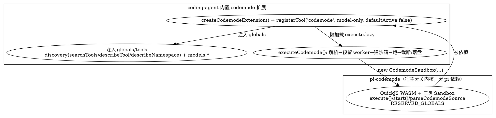

## Introduction

Pi 的 **codemode** 是一套「让模型写 JavaScript、在沙箱里调用其它工具」的机制：模型不再逐条发工具调用，而是写一段脚本，脚本在 QuickJS（编译成 WebAssembly）的隔离 VM 里跑，唯一的能力是调用宿主注入的工具。它是 Pi 把「重」能力下沉成通用机制、再由内置扩展叠加的典型标本——核心在 `@earendil-works/pi-codemode` 包，Pi 自己的集成在 `coding-agent` 的内置 `codemode` 扩展。

本文事实基线为 **v1.5.2**（commit `b4afdddf`，2026-11-10 发布）：12 个 workspace 包（agent / ai / chord / codemode / coding-agent / durable / env / evals / mcp / schema / telemetry / tui，全部 `version=1.5.2`，本版新增 `pi-schema`）全部按该 tag 的真实源码核对，结论以源码为准、非以文档为准。架构定位见 [Pi 的 Architecture 章节](/docs/CS/AI/LLM/Agent/Product/Pi/Pi.md?id=architecture)，工具暴露机制的对照见 [Harness](/docs/CS/AI/LLM/Agent/Theory/Harness.md) 的补偿面。

与 Harness 的对应：codemode 是「用代码替代 N 次工具调用」的补偿面——一次 `codemode` 调用替代 N 次 `read`/`bash`/`edit`，且脚本内的**嵌套工具调用结果不进入 LLM 上下文**，只有脚本的 `text()`/`image()` 输出与 `return` 值回到模型。

### Two-Layer Split

codemode 不是单点实现，而是「与宿主无关的沙箱内核」+「Pi 专属集成层」两段：



要点：

- **内核 `pi-codemode` 不知道 Pi**：它只接收一组 `tools` / `globals`、一段源码、一个 `store`，跑完返回结果。包描述即为「Sandboxed JavaScript execution where the only capability is calling injected tools」，无 pi 依赖、可独立使用，把任意函数（远程 API、MCP server、应用服务）暴露给模型写的脚本。
- **Pi 集成层**做三件事：① 把会话里可调用的工具封装成 `CodemodeTool` 喂给沙箱；② 注入 Pi 专属的 discovery 与 model 全局；③ 把脚本输出截断、把 `store` 落盘成会话条目、把嵌套调用记成 `CodemodeNestedCall`。

## Sandboxes

`pi-codemode` 提供**同一 API、同一脚本环境、同一结果格式**，但按 VM 运行位置分三种驱动（`packages/codemode/src/index.ts` 集中导出）：

| Sandbox | VM 跑在哪 | 适用 |
| :--- | :--- | :--- |
| `CodemodeSandbox` | **worker 线程**（每次执行一个新 worker） | Node / Bun（默认） |
| `InlineCodemodeSandbox` | **调用线程**（无 worker 的运行时，也是 remote 的服务端） | Cloudflare Workers / Durable Objects / 浏览器 |
| `RemoteCodemodeSandbox` | **另一个 isolate**（经 RPC，通常是 Cloudflare Durable Object） | 让脚本永不阻塞调用方线程 |

三者共享同一个宿主基类——工具表、调用记录、输出、截止、abort 与结果解码全在基类，子类只用 `VmLauncher` 决定 VM 跑在哪（`packages/codemode/src/runtime/execution.ts`）：

```ts
/**
 * Tool table, defaults, and in-flight executions; the behavior every sandbox shares. Subclasses
 * only choose where the VM runs by passing a {@link VmLauncher}.
 *
 * The script sees `tools.<name>(args)` for every registered tool, `ALL_TOOLS`, the output helpers
 * `text`, `image`, `exit`, and `console.*`, `store`/`load`, and the configured globals; nothing
 * else (no timers, `fetch`, `process`, `require`, modules). Each `execute()` gets its own VM; the
 * sandbox only holds the tool table and defaults. `close()` aborts in-flight executions.
 */

export class CodemodeSandboxBase {
```

核心约束：脚本跑在 QuickJS WASM 里，**没有 Node、没有文件系统、没有网络、没有定时器、没有 `process`/`require`/模块系统**——唯一的「能力」就是调用注入的 `tools.<name>()`。真正停止 VM 由 launcher 负责：worker 类 `terminate()`、inline 类靠中断预算、remote 类在下一个交换点告知停止。

`CodemodeSandboxBaseOptions` 统一兜底：`timeoutMs`（默认 `300000` 即 5 分钟，含工具耗时）、`memoryLimitBytes`（超出在脚本内抛 `InternalError: out of memory`；默认仅受 wasm32 4 GiB 地址空间限制）。Pi 执行器把内存上限显式钉到 `256 * 1024 * 1024`。

## Script Environment

脚本被当作 **async 函数体**执行——顶层 `await` 与 `return` 都可用。VM 内可见的全局分两类。

**内核保留全局**（`packages/codemode/src/runtime/execution.ts`，脚本不能覆盖这些名字）：

```ts
const DEFAULT_TIMEOUT_MS = 300_000;
const IDENTIFIER = /^[A-Za-z_$][A-Za-z0-9_$]*$/;
const RESERVED_GLOBALS: ReadonlySet<string> = new Set([
	"tools",
	"ALL_TOOLS",
	"console",
	"text",
	"image",
	"exit",
	"globalThis",
	"store",
	"load",
]);
```

| 全局 | 作用 |
| :--- | :--- |
| `tools.<id>(args)` / `tools["<name>"]` | 调工具；`<id>` 是把非法标识符字符替换成 `_` 后的名字（`toCodemodeIdentifier`） |
| `ALL_TOOLS` | 已声明工具的目录（含 `description`） |
| `text(value)` / `image(...)` | 追加文本 / 图像输出（`image()` 同时存临时文件） |
| `exit()` | 提前结束脚本（`value: undefined`） |
| `store(k,v)` / `load(k)` | 跨 codemode 调用保持 JSON 值 |
| `console.log(...)` | 日志，归入 `<console_output>` 块 |

**Pi 扩展注入的专属全局**（`packages/coding-agent/src/extensions/codemode/execute.ts` 的 `createDiscoveryGlobals` / `createModelGlobals`，作为 `globals` 传入沙箱）：

| 全局 | 作用 |
| :--- | :--- |
| `await searchTools(query, { limit?, namespace? })` | 找**未列出**的工具（如 MCP 工具），Bm25 排序，用完按名字 `tools.<name>()` 调 |
| `await describeTool(name)` | 读某工具的完整声明 |
| `await describeNamespace(name)` | 读某 namespace 的长说明与工具清单 |
| `models.*` | 分类器与图像生成（`getModelsOfType` / `getModelOfType` / `classify` / `generateImages` …），由会话的 `ctx.modelRegistry` 支撑；关闭时根本不声明 |

多文本项输出时每项以 `==> text N/M <==` 起始，`console` 日志集中在 `<console_output>` 块；失败时返回「保留部分输出的正常错误结果」+ `"Script error:"` + 错误文本。

## Source Format and Constrained Sampling

脚本首行可带选项（替换成空行以保持后续行号不变，便于堆栈对齐）：

```js
// @options: {"max_output_tokens": 10000, "timeout_ms": 60000}
const src = await tools.read({ path: "package.json" });
text(JSON.parse(src).name);
```

选项只支持 `max_output_tokens` 与 `timeout_ms`。解析逻辑（`packages/codemode/src/source.ts`）对空输入、非法 JSON、未知字段、无代码的选项行、错位的选项行都抛 `CodemodeSourceError`：

```ts
export function parseCodemodeSource(input: string): ParsedCodemodeSource {
	if (input.trim() === "") {
		throw new CodemodeSourceError(
			'Expected JavaScript source text (non-empty). Provide JS only, optionally with a first line `// @options: {"max_output_tokens": 1000}`.',
		);
	}
	const lines = input.split("\n");
	const misplaced = lines.findIndex(
		(line, index) => index > 0 && line.trimStart().startsWith(CODEMODE_OPTIONS_PREFIX),
	);
	if (misplaced !== -1) {
		throw new CodemodeSourceError(
			`The ${CODEMODE_OPTIONS_PREFIX} line must be the first line of the input; found one on line ${misplaced + 1}`,
		);
	}
	const newline = input.indexOf("\n");
	const firstLine = lines[0].replace(/\r$/, "");
	const trimmed = firstLine.trimStart();
	if (!trimmed.startsWith(CODEMODE_OPTIONS_PREFIX)) return { code: input, options: {} };
	const code = newline === -1 ? "" : input.slice(newline);
	if (code.trim() === "") {
		throw new CodemodeSourceError("The @options line must be followed by JavaScript source on subsequent lines");
	}
	return { code, options: parseOptions(trimmed.slice(CODEMODE_OPTIONS_PREFIX.length).trim()) };
}
```

同一文件还导出一条 **Lark 语法**，供支持 grammar 约束采样的 provider 用——它只固定选项行的形状，真正的 JSON 与代码仍由 `parseCodemodeSource` 校验：

```ts
/**
 * Lark grammar for providers with grammar-constrained tool input. It only fixes the shape of the
 * options line; the options JSON and the code are checked by {@link parseCodemodeSource}.
 */
export const CODEMODE_SOURCE_GRAMMAR = String.raw`
start: options_source | plain_source
options_source: OPTIONS_LINE NEWLINE SOURCE
plain_source: SOURCE

OPTIONS_LINE: /[ \t]*\/\/ @options:[^\r\n]*/
NEWLINE: /\r?\n/
SOURCE: /[\s\S]+/
`;
```

## Tool Definition and Constrained Sampling

内置扩展把 `codemode` 注册为 `model-only` 工具（对模型不可见、由扩展按需激活），并把 Lark grammar 挂到 `constrainedSampling`——让能力强的模型**直接产出原始 JS 而非 JSON 转义字符串**（`packages/coding-agent/src/extensions/codemode/tool.ts`）：

```ts
export function createCodemodeToolDefinition(
	options: CodemodeToolOptions = {},
): ToolDefinition<typeof codemodeSchema, CodemodeToolDetails | undefined> {
	return {
		name: CODEMODE_TOOL_NAME,
		label: CODEMODE_TOOL_NAME,
		// Replaced with the declarations of the callable tools when the tool is activated.
		description: createCodemodeDescription([], { models: options.models === true }),
		promptSnippet: codemodeToolSystemPromptContribution.snippet,
		promptGuidelines: [...codemodeToolSystemPromptContribution.guidelines],
		parameters: codemodeSchema,
		// Scripts must not start other scripts.
		exposure: "model-only",
		prepareLoadout: (loadout) => prepareCodemodeLoadout(loadout, options),
		reachesTools: (input) => getScriptReach(input.code),
		// Capable models write the script as raw text instead of a JSON-escaped string.
		constrainedSampling: { type: "grammar", variants: { openai_lark: CODEMODE_SOURCE_GRAMMAR } },
		// The sandbox (worker, QuickJS wasm) loads on the first call, not at startup.
		execute: async (toolCallId, params, signal, onUpdate, ctx) =>
			(await loadCodemodeExecutor()).executeCodemode(toolCallId, params, signal, onUpdate, ctx, options),
		...codemodeRenderers,
	};
}
```

`createCodemodeExtension()` 在注册时给 `defaultActive: false`——默认不激活，需 `--tools` / `defaultTools` 设置 / `setActiveTools()` 激活；MCP 扩展在「MCP 工具只能从脚本可达」时也会自动激活它。

## Tool Bridging and Nested Calls

脚本调 `tools.<name>()` **不是**在 VM 内直接执行工具。执行器把每个可调用工具包成 `CodemodeTool`，其 `execute` 走**会话 agent loop 的工具管线** `ctx.executeTool()`（`packages/coding-agent/src/extensions/codemode/execute.ts`）：

```ts
	const sandboxTools: CodemodeTool[] = callable.map((tool) => ({
		name: tool.name,
		description: samples.get(tool.name),
		execute: async (args, { signal: callSignal }) => {
			const record: CodemodeNestedCall = {
				id: `${toolCallId}/?`,
				name: tool.name,
				args: previewArgs(args),
				status: "running",
			};
			calls.push(record);
			publish();
			const callStartedAt = performance.now();
			// Only tools from ctx.tools are callable, so ctx is set here.
			if (!ctx) throw new Error("Tool calls need a session");
			const outcome = await ctx.executeTool(tool.name, args, { signal: callSignal });
			record.id = outcome.toolCall.id;
			record.durationMs = performance.now() - callStartedAt;
			if (outcome.isError) {
				record.status = callSignal.aborted ? "cancelled" : "error";
				record.error = truncateText(textOf(outcome.result) || `Tool "${tool.name}" failed`, ERROR_PREVIEW_CHARS);
			} else {
				record.status = "ok";
			}
			publish();
			return toScriptValue(tool, outcome);
		},
	}));
```

因此 `tool_call` / `tool_result` 钩子、参数校验、权限检查在嵌套调用上**与模型直接调用完全一样生效**（钩子与权限扩展见 [Extensions](/docs/CS/AI/LLM/Agent/Product/Pi/Extensions.md)）。`toScriptValue` 决定脚本拿到什么（同文件）：

```ts
function toScriptValue(tool: AgentTool<any>, outcome: AgentToolCallOutcome): unknown {
	const { result } = outcome;
	if (tool.outputSchema && result.structuredContent !== undefined) return result.structuredContent;
	const text = textOf(result);
	if (outcome.isError) throw new Error(text || `Tool "${tool.name}" failed`);
	return text;
}
```

- 声明了 `outputSchema` 的工具 → 解析为 `structuredContent`（**即使报错但带了 structuredContent 也如此**，例如 MCP 的 `isError` 结果，须检查其字段）；
- 其它工具 → 所有 `type:"text"` 块拼成一个字符串；
- 失败 / 被阻断 / 参数无效 → 以携带错误文本的 `Error` reject。

**嵌套结果绝不进 LLM 上下文**：嵌套调用在 agent loop 里照常发事件（记为有界 `CodemodeNestedCall`，供 HTML 导出与摘要），但模型侧看不到「脚本调了哪些工具」，只看到脚本输出。脚本结束仍在跑的调用会被取消（`signal` 随脚本结束 abort）。可调工具集 = 会话里除 `codemode` 自身外的全部工具（`getCodemodeCallableTools` 过滤掉自身，即「脚本不得再起脚本」）；`reachesTools(input)` 用 discovery 全局词正则判定用 `"all"` 还是按源码词匹配，MCP 据此决定激活哪些 server。

## MCP as a Built-in Extension

需要先纠正一个常见误述：源码与 CHANGELOG 里**没有「native MCP support」这个字面说法**，真相是 **MCP 以内置扩展 `createMcpExtension()` 一等接入**，客户端自带 JSON-RPC（`packages/mcp/src/protocol/jsonrpc.ts`）与多种 transport，**不依赖官方 MCP SDK**。工具注册为 `mcp__<server>__<tool>`，默认 `exposure:"codemode"`（对模型不可见，只从脚可达），脚本用 `searchTools()` / `describeNamespace()` 发现它们（`packages/coding-agent/src/extensions/mcp/index.ts` 头部注释）：

```ts
/**
 * Built-in MCP integration.
 *
 * Connects the servers from `mcp.json` and the servers extensions register with
 * `pi.registerMcpServer()` when a session starts, and servers registered later right away. A server
 * in `mcp.json` takes precedence over a registered server of the same name. Connections run in the
 * background: the first prompt waits only for servers with `direct` tools, and codemode scripts,
 * `tool_search`, and the resource tools wait for the servers they need when they run. Tools are
 * registered as `mcp__<server>__<tool>`. By default (`"exposure": "codemode"`) the tools are only
 * callable from codemode scripts, which keeps MCP tools out of the model's tool declarations and
 * the codemode description: scripts find the tools with `searchTools()` and the server instructions
 * with `describeNamespace()`. The codemode tool is activated for that unless `autoEnableCodemode` is
 * false. `"deferred"` declares the tools to the model once the `tool_search` tool loads them, and
 * activates `tool_search` instead of codemode.
```

（以上为 `mcp/index.ts` 头部注释的连续片段，原文其后还继续说明 `"direct"` / `"hidden"` exposure 与资源工具。）

MCP 的 `codemode` exposure 在工具层映射到 `deferred`（即不进 codemode 声明清单、由脚本按需发现），差别只在激活哪个发现工具（`packages/coding-agent/src/extensions/mcp/tools.ts`）：

```ts
/**
 * Tool exposure of an MCP exposure. `codemode` and `deferred` both leave tools out of the codemode
 * description; they differ only in which tool the MCP extension activates to reach them.
 */
export function toToolExposure(exposure: McpExposure): ToolExposure {
	return exposure === "codemode" ? "deferred" : exposure;
}
```

`autoEnableCodemode`（默认 `true`）在有 `codemode` server 连接时自动激活 codemode 工具，否则只告警（同 `mcp/index.ts` 的 `ensureDiscoveryActive`）：

```ts
			const needsCodemode = exposures.has("codemode");
			const needsToolSearch = exposures.has("deferred");
			if (!needsCodemode && !needsToolSearch) return;
			// Only a tool of these names that declares `reachesTools` can reach MCP tools; another
			// extension's tool of the same name without it is never activated.
			const tools = pi.getAllTools();
			const hasReachingTool = (name: string) => tools.some((tool) => tool.name === name && tool.reachesTools);
			const hasCodemode = hasReachingTool(CODEMODE_TOOL_NAME);
			const hasToolSearch = hasReachingTool(TOOL_SEARCH_TOOL_NAME);
			const active = pi.getActiveTools();
			const activate: string[] = [];
			if (needsCodemode && hasCodemode && autoEnableCodemode && !active.includes(CODEMODE_TOOL_NAME)) {
				activate.push(CODEMODE_TOOL_NAME);
			}
			if (needsToolSearch && hasToolSearch && !active.includes(TOOL_SEARCH_TOOL_NAME)) {
				activate.push(TOOL_SEARCH_TOOL_NAME);
			}
			if (activate.length > 0) pi.setActiveTools([...active, ...activate]);
```

协议层见 [MCP](/docs/CS/AI/LLM/Protocol/MCP.md)。

## Tool Declarations and Loadout

`createCodemodeDescription()` 把可调用工具的声明渲染成面向模型的工具说明（含 TS 风格签名）。`prepareCodemodeLoadout`（`tool.ts`）按 `codemode.mode` 决定呈现方式——这是 Codex `exec` 工具模式的翻版：

| `codemode.mode` | 行为 |
| :--- | :--- |
| `on`（默认） | 已声明给模型的工具，其说明里补一句「脚本如何调它」；codemode 说明**只列没有 `direct` exposure 的可调用工具** |
| `only` | codemode 说明列出**每一个**可调用工具，并请求把活跃 `direct` 工具的声明从请求里隐藏 |

```ts
	if (mode === "on") {
		for (const tool of loadout.declared) {
			if (callableNames.has(tool.name)) descriptions[tool.name] = describeScriptCall(tool);
		}
	}
	const listed = mode === "only" ? callable : callable.filter((tool) => !isDirect(tool));
	const namespaces = new Map(
		listed.flatMap((tool) => {
			const namespace = loadout.getNamespace(tool.name);
			return namespace ? [[tool.name, namespace] as const] : [];
		}),
	);
	const guidelines = new Map(listed.map((tool) => [tool.name, loadout.getPromptGuidelines(tool.name)] as const));
	descriptions[CODEMODE_TOOL_NAME] = createCodemodeDescription(listed, {
		models: options.models === true,
		namespaces,
		guidelines,
		deferred: new Set(
			listed.filter((tool) => loadout.getExposure(tool.name) === "deferred").map((tool) => tool.name),
		),
		inlineBudget: options.getInlineBudget?.() ?? DEFAULT_CODEMODE_INLINE_BUDGET,
	});
```

两种模式都**按 exposure 而非按活跃集**列工具，所以 `tool_search` 后加载的工具不会改变 codemode 说明、避免击穿缓存前缀。预算控制 `inlineBudget`（`token ≈ 字符/4`）用 OpenCode catalog 式轮询放不下的工具：无 namespace 优先、再按 namespace 名排序，每组逐轮放最便宜的；`deferred` 工具**永不列出**、也不影响说明。

## Execution Pipeline

`codemode` 工具激活后，模型的一次调用进入 `executeCodemode`（`packages/coding-agent/src/extensions/codemode/execute.ts`，经 `execute.lazy.ts` 懒加载，沙箱首次调用才装载）：

```sequence
Title: executeCodemode 执行链路

participant M as 模型(tool_call: codemode)
participant E as executeCodemode
participant P as parseCodemodeSource
participant W as reserveCodemodeWorker
participant S as CodemodeSandbox(worker+QuickJS)
participant T as 嵌套工具(ctx.executeTool)
participant O as formatOutput/truncate/spill

M->>E: code(原始 JS 字符串)
E->>P: parseCodemodeSource(code)
P-->>E: {code, options:{timeout_ms, max_output_tokens}}
E->>W: reserveCodemodeWorker(signal, timeout) 进程级 worker 槽位
W-->>E: 预留成功/release 回调
E->>S: new CodemodeSandbox({tools,globals,memoryLimit:256MB,wasm,workerUrl})
E->>S: sandbox.execute(code,{signal,store})
alt 脚本调 tools.<name>(args)
  S->>T: sandboxTool.execute → ctx.executeTool(name,args,{signal})
  T-->>S: outcome → toScriptValue(structuredContent|text|Error)
end
S-->>E: CodemodeResult{ok,value,output,calls,storeWrites}
E->>O: formatOutput→truncateOutput(budget=max_output_tokens*4)
O->>O: 超预算头尾截断 + spillOutput 写临时文件
E->>E: 成功→appendEntry('codemode-store',{set,delete})
E-->>M: content(头尾)+details{calls,fullOutputPath?}
```

沙箱构造真实代码（同文件）——注意内存上限、`wasm` 与 `workerUrl` 都由宿主注入：

```ts
		sandbox = new CodemodeSandbox({
			tools: sandboxTools,
			globals: [
				...createDiscoveryGlobals(callable, samples, options),
				...(options.models && ctx
					? createModelGlobals(ctx.modelRegistry, toolCallId, calls, publish, addModelUsage, addGeneratedImages)
					: []),
			],
			timeoutMs: Math.max(1, Math.round(deadline - waitedMs)),
			memoryLimitBytes: CODEMODE_MEMORY_LIMIT_BYTES,
			wasm: loadQuickJSWasm(getQuickJSWasmPath()),
			workerUrl: getCodemodeWorkerSpecifier(),
			acquireWorker: () => {
				if (!reserved) throw new Error("The script already settled");
				reserved = false;
				return releaseCodemodeWorker;
			},
		});
```

关键细节：

- **worker 槽位**：`reserveCodemodeWorker` 先按到达顺序预留进程级并发容量（默认 2，可由 `PI_CODEMODE_MAX_WORKERS` 调），等待也计入脚本截止；`signal` abort 直接返回 `"aborted"` 且脚本不启动，防止大量并发把机器打满。
- **大输出**：合并文本超预算（默认 `10000×4=40000` 字符）时保留头尾各半、中间提示截断了多少，并把完整文本写临时文件（`writeOutputFile("pi-codemode", ".txt", text)`），结果的 `details.fullOutputPath` 告诉模型去哪读全文。
- **`store` 落盘**：执行前 `readCodemodeStore(branch)` 遍历分支上所有 `customType === "codemode-store"` 的条目，从根到当前依次 `delete` 后 `set`，构建成 `Map` 传进 VM；成功后 `appendEntry(CODEMODE_STORE_ENTRY_TYPE, {set, delete})` 追加为新条目——于是**每个分支只看到自己路径上写的值**，符合分支敏感原则。

## Result Shape and Errors

`CodemodeResult`（`packages/codemode/src/types.ts`）是一个判别联合，失败也保留到出错点为止的 `output`：

```ts
export type CodemodeResult =
	| {
			ok: true;
			value: unknown;
			output: CodemodeOutputItem[];
			calls: CodemodeCall[];
			storeWrites: CodemodeStoreWrites;
			during?: CodemodeDuring;
	  }
	| {
			ok: false;
			error: CodemodeError;
			output: CodemodeOutputItem[];
			calls: CodemodeCall[];
			during?: CodemodeDuring;
	  };
```

- `output`：有序项 `{type:"text",text,console?}` 或 `{type:"image",data(base64),mimeType}`；
- `calls`：`{name,status,durationMs}[]`，status 为 `ok`/`error`/`cancelled`；
- `storeWrites`：仅成功执行报告 `{set, delete}`；
- `during`：仅 `start()` 确定性运行里脚本自己结束时，VM 正在处理的那个结果（`seq` 与已发出的调用数 `issued`）；
- 脚本失败**永不 reject**：`execute()` 把失败包成 `{ok:false}`。

错误分四类（`CodemodeErrorKind`）：`script`（抛错/解析失败）、`timeout`（截止到期或 inline 用尽 interrupt budget）、`aborted`（调用方 signal 或沙箱关闭）、`sandbox`（VM/传输在脚本控制之外失败，如 wasm trap、缺 worker 文件、remote 挂掉）。

## Timeout, Cancellation, and Memory

- **取消**：顶层 `signal` 透传进 `sandbox.execute` 与每个嵌套 `ctx.executeTool`；执行后仍 `"running"` 的调用统一改标 `"cancelled"`；`finally` 里 `sandbox.close()`。
- **超时**：`@options timeout_ms` 覆盖单次截止；执行器把 `timeoutMs` 设为 `Math.max(1, Math.round(deadline - waitedMs))`（扣掉等 worker 的时间），不传则回落沙箱默认 `300000`ms；到期即 `finish({kind:"timeout"})`。
- **内存**：Pi 钉 `256 MiB`；沙箱默认仅受 wasm32 4 GiB 限制。
- **interrupt budget**：仅 `InlineCodemodeSandbox`（调用线程上跑）需要——QuickJS 同步执行时宿主的定时器与 abort 都跑不起来，改用轮询计数中断（`packages/codemode/src/runtime/inline.ts`）：

```ts
 * Solution: an interrupt budget. QuickJS polls its interrupt handler periodically while a script
 * runs; this launcher counts the polls across the whole execution and interrupts the script once
 * the count passes the budget. The execution then fails with `kind: "timeout"`. The deadline and
 * abort signal still work whenever the script waits on a tool, since the event loop runs then.
 *
 * The rate of polls depends on the code and the machine. Measured with a tight loop: about 50,000
 * per second of CPU on an Apple M-series laptop and about 10,000 per second on Cloudflare Durable
 * Objects (October 2026). The default of 100,000 allows roughly 2 to 10 seconds of uninterrupted
 * computation; keep it well below the platform's own CPU limit, because hitting that limit resets
 * a Durable Object instead of failing one script.
```

## Deterministic Execution

`CodemodeSandboxBase.start()` 用于「宿主控制工具应答、可重放」的场景（如 durable code mode）：相同 fingerprint + 相同 `startedAt`/`seed`/tools/`store` + 相同 `seq` 顺序 → 任何 VM 产生相同调用与输出，可在重启后重放（`packages/codemode/src/runtime/execution.ts`）：

```ts
	/**
	 * Run `code` deterministically, with the caller answering its calls: the same script, start time, seed, tools,
	 * globals, and store, answered with the same results in the same `seq` order, makes the same calls with the same
	 * arguments and produces the same output, on any VM with the same fingerprint. A host can therefore replay it
	 * after a restart. The VM runs in UTC, its clock reads `startedAt` and then the `now` of the result being
	 * processed, its randomness comes from `seed`, and `WeakRef` and `FinalizationRegistry` do not exist.
	 *
	 * The sandbox's own tools and globals are not used: the run declares its own, and every call goes to
	 * `options.onCall`. Never rejects for script failures; abort through `options.signal` to end the run with an
	 * error the script cannot catch.
	 */
	start(code: string, options: CodemodeRunOptions): CodemodeRun {
```

- `onStarted(fingerprint)` 在脚本运行前、任何调用前给出指纹（引擎版本、prelude 哈希、limits）；
- `deliver(seq, now, id, outcome)`：结果编号 `1,2,...` 无缺号，VM 严格按序应用（乱序到达先缓存等缺号），校验 `seq` 只此一次、`now` 必须有限、`id` 必须是正在等待的调用；拒绝在脚本里变成携带 `properties` 的 `Error`（`name`/`message`/`stack` 被忽略）。

## Safety Boundary

安全模型是「**最小能力**」：VM 里没有任何宿主资源通道，唯一对外动作是调用注入的工具。

- 沙箱本身**不提供**文件系统/网络/进程——脚本能读文件、跑命令，是因为 `read`/`bash` 等工具被显式注入，而非 VM 自带。
- 工具的权限检查、钩子、确认框在嵌套调用上完全复用；想让 codemode 跑在真隔离里，须把底层工具接去容器 / OpenShell 等（见 [Security](/docs/CS/AI/LLM/Agent/Product/Pi/Security.md)）。
- exposure 约束：`direct` 与 `codemode`/`deferred` 工具可达，`model-only` 与 `hidden` 不可被脚本调；`codemode` 自身永远从脚本可达集里剔除。

## Codex exec Compatibility

内置 `codemode` 工具**兼容 Codex 的 `exec` 工具**，`codemode.mode` 语义对应 Codex 的工具模式（`on` / `only`）。大结果同样写 JSON 临时文件、嵌套调用同样不进上下文——这是 Pi 选「脚本化工具编排」而非「堆 sub-agent」路线的一环，也是它与 Codex 在「代码执行」维度上对标的接口。

## Links

- [Pi：产品总览与子系统索引](/docs/CS/AI/LLM/Agent/Product/Pi/Pi.md)
- [Providers：Provider 与模型目录](/docs/CS/AI/LLM/Agent/Product/Pi/Providers.md)
- [Tools：工具系统](/docs/CS/AI/LLM/Agent/Product/Pi/Tools.md)
- [Durable：可重放执行](/docs/CS/AI/LLM/Agent/Product/Pi/Durable.md)
- [Events：事件流](/docs/CS/AI/LLM/Agent/Product/Pi/Events.md)

## References

- [earendil-works/pi 仓库（v1.5.2）](https://github.com/earendil-works/pi/tree/v1.5.2)
- [pi-codemode 源码入口](https://github.com/earendil-works/pi/blob/v1.5.2/packages/codemode/src/index.ts)
- [pi-codemode 共享执行基类](https://github.com/earendil-works/pi/blob/v1.5.2/packages/codemode/src/runtime/execution.ts)
- [codemode 工具定义](https://github.com/earendil-works/pi/blob/v1.5.2/packages/coding-agent/src/extensions/codemode/tool.ts)
- [codemode 执行器](https://github.com/earendil-works/pi/blob/v1.5.2/packages/coding-agent/src/extensions/codemode/execute.ts)
- [内置 MCP 扩展](https://github.com/earendil-works/pi/blob/v1.5.2/packages/coding-agent/src/extensions/mcp/index.ts)
