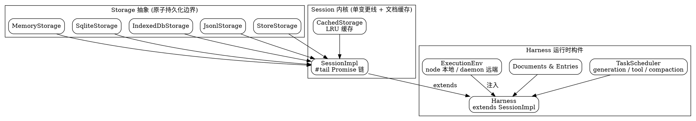

## Introduction

`@earendil-works/pi-durable`（源码 `packages/durable`，v1.5.2）是 Pi 的**持久化 Agent 执行框架**：在单一 `Storage` 后端之上建立 `Session` 内核，再叠一个 `Harness` 作为「耐执行（durable）」的 Agent 引擎。设计目标是把一次 Agent 运行（多轮对话、工具调用、压缩、任务依赖）的全部状态落到可持久化存储里，进程崩溃后能从中恢复。

有一层关系必须先摆正：**pi-durable 是独立于 coding-agent 的实验性运行时**。它的 `package.json` 依赖 `chord` / `pi-ai` / `pi-codemode` / `pi-schema` / `pi-telemetry`，**coding-agent 并不依赖它**；现役 coding-agent 有自己的 `SessionManager`，durable 的 `Harness` + 三个内置任务尚未进入其生产主循环。本页按 v1.5.2（commit `b4afdddf`）源码核验，重点放在「分层契约」——每一层都是可替换的后端或可被继承扩展的内核。

## Layer Overview



四层从下到上：**Storage（落盘边界）→ Session（状态内核）→ Harness（执行引擎）→ Tasks/Docs/Env（运行时构件）**。下三层都可替换或扩展：`Storage` 有多种后端、`Session` 被 `Harness` 继承、`Env` 有本地与远端两套实现。

## Storage: The Atomic Persistence Boundary

`Storage` 接口是 Session 记录的原子提交边界，本身不含 watch / transaction（watch 由 `Session`/`DocumentObserver` 提供，事务面由 `Tx` 在 `Session.commit` 回调里给出）。核心方法：

- `commit(writes, adopt, context)`：原子提交一批 `StorageWrite` 并返回 `Seq`；持久化后必须同步调用 `adopt(seq)`。
- 读 / 扫描：`conversation` / `scanConversations`、`entry` / `scanEntries`、`task` / `scanTasks`、`submission` / `scanSubmissions`、`findDocument` / `document` / `scanDocuments`。
- `mintId`：从全局数字 ID 命名空间分配品牌化 ID；`close`：释放后端资源。

`StorageWrite` 是原子提交里的单条写操作，覆盖 conversation / entry / task / submission 四类表记录，以及 document 的 create / copy / change / retire 四种变体（文档以 base 全量或 delta 增量两种 `DocumentContent` 形态存储；`StoredDocument` 含 `record` + `version` + 物化 `value` + `deltasSinceBase`）。

### Backends

v1.5.2 主包直接实现五种后端，类名可从源码逐一核对（`src/storage/`）：

| 后端 | 类名 | 说明 |
| :--- | :--- | :--- |
| 内存 | `MemoryStorage` | `storage/memory.ts`，进程内内存后端 |
| Node SQLite | `SqliteStorage` | `storage/sqlite/storage.ts`，经 `chord` 的 SQLite 封装用 Node 内置 SQLite |
| Cloudflare SQLite | `openDurableObjectSqliteStorage` | `storage/sqlite/cloudflare.ts`，面向 Durable Objects |
| IndexedDB | `IndexedDbStorage` | `storage/indexeddb.ts`，浏览器端后端 |
| JSONL | `JsonlStorage` | `storage/jsonl/storage.ts`，追加式 JSONL（导出 / 审计用途） |
| Store | `StoreStorage` | `storage/store/storage.ts`，基于 `chord` 的 `Store` 抽象，`StoreStorage.open()` 用 claimant 抢占所有权 |

> `SqliteStorage` / `StoreStorage` 实际建立在 `chord` 包之上（见 Architecture 里 `chord` 的依赖位置）。主包只从 `index.ts` 直接导出 `MemoryStorage`，其余后端走各自子路径。

## Session: The State Kernel

`createSession(storage, options?)` 是轻量工厂，真正逻辑在 `SessionImpl`。Session 内核三件事：**一条变更线（mutation line）**、**已加载文档的追踪缓存**、**提交后的发布（publication）**。

- **绑定单一 Storage**：经 `GuardedStorage` 包装，首次 Storage 错误会终结整个 Session。
- **单变更线**：所有 commit / 结算 / 采纳 / 发布都排到 `#tail` 这条 Promise 链的尾部串行执行，避免并发写入竞争。`#enqueue()` 把工作挂到上一次 tail 之后，再把 tail 推进一步（`src/session/session.ts`）：

```typescript
	#enqueue<T>(work: (index: number) => Promise<Ran<T>>, exempt = false): Promise<T> {
		const job: Job = { index: this.#nextIndex++, hit: false };
		const ran = this.#tail.then(async () => {
			while (this.#outstanding >= MAX_OUTSTANDING) {
				this.#room ??= Promise.withResolvers();
				await this.#room.promise;
			}
			this.#outstanding++;
			return this.#onLine(job, work);
		});
		this.#tail = ran.then(ignore, ignore);
```

- **缓存与 LRU 淘汰**：`Session` 用 `CachedStorage` 包住底层存储，文档缓存按容量淘汰最近最少使用的条目——`Lru` 用 `Map` 实现，`set` 超容量即删最老的键（`src/session/cached-storage.ts`）：

```typescript
/** A Map bounded to `capacity` entries that drops the least recently used one. */
class Lru<K, V> {
	readonly #map = new Map<K, V>();
	readonly #capacity: number;

	constructor(capacity: number) {
		this.#capacity = capacity;
	}
```

- **只读模式**：`readOnly` 开启后所有带写入的 commit 抛 `ReadOnlySession`。

文档访问用**文档令牌（Doc Token）**做类型化寻址，分三种作用域：`SessionDocToken` / `ConversationDocToken` / `TaskDocToken`，外加可回滚的 `RewindableConversationDocToken` 等家族令牌（keyed document family，按种子键寻址）。事务面 `Tx` 在一次 commit 回调内提供全部表读取、扫描、创建（conversation / entry / task / submission / doc）与 `retireDoc`——回调内只能走 `tx`，若调用 `snapshot`/`watchDoc` 等运行时读取会死锁在自身持有的行上。

## Harness: The Durable Agent Engine

`Harness.open(storage, options, context)` 挂载到 `Storage` 上运行。它**继承** `SessionImpl`，即在 Session 内核之上增加「对话句柄 + 任务注册表」。打开时先校验注册表含全部 `BUILTIN_TASKS`，再 `openTasks` 恢复上次未跑完的任务。

主要职责：

1. **跑对话轮次**：`conversation()` / `createConversation()` / `root()` 拿到对话实例，再 `submit()` / `reset()` / `fork()` / `commit()` 推进状态。`fork()` 继承来源对话的历史，来源记在 `ConversationRecord.parent`（`{ conversationId, at }`），不在条目上。
2. **调度任务**：内部 `TaskScheduler` 负责打开 / 恢复（resume）/ 唤醒（wake）/ 等待（waitForIdle）/ 终止（abortTask）/ 重试（retryTask）。
3. **管理文档与条目**：每新建或分叉对话时覆盖 `conversationCreated`，初始化 `LiveDoc` / `InboxDoc` / `UsageDoc` / `ProviderDoc` / `AgentDoc` 等持久化文档；`entries()` 扫描存储里的 `EntryRecord`。
4. **压缩**：`compact(instructions, context)` 把上下文压缩作为一个任务提交。

`HarnessOptions` 包含：`models`（模型解析）、`identity`（客户端身份）、`settings`、`registry`、`env`（构造 `ExecutionEnv` 的函数）、`now`、`onReport` / `telemetry`、`setTimer`、`readOnly`、`onWake`、`conversationCreated`。当用户 `submit()` 输入，`Submissions` 调 `tasks.resume()` 唤醒调度器，由内置任务驱动实际的 LLM 生成与工具调用。

### Built-in Tasks

注册表先装三个内置任务，它们是**不可移除、不可替换**的（`src/harness/registry.ts`）：

```typescript
/** Built-in task definitions every registry holds; they are not an extension and cannot be removed or replaced. */
export const BUILTIN_TASKS: readonly AnyTask[] = [GenerationTask, ToolTask, CompactionTask];
```

三者定义在 `src/harness/`，任务 `definition.name` 分别为 `pi.generation` / `pi.tool` / `pi.compaction`：

- **GenerationTask**：跑一次 LLM 生成（对应一轮模型调用 + 结果落库）。
- **ToolTask**：执行一次工具调用（嵌套调用也走这套任务，权限检查不漏底）。
- **CompactionTask**：把上下文压缩成摘要，控制上下文长度。

`createRegistry()` 先装内置三任务，扩展（`Extension`）可追加自己的任务 / 工具 / 提示段（section），但任务名冲突会抛错，`instructions` section key 被保留给 Agent 指令。这把「Agent 能力 = 内置任务 + 扩展任务」的设计落在可执行契约上。

## Documents and Entries

- **文档（Documents）**：`defineDoc` / `defineDocFamily` 定义 CRDT 风格的持久化文档，按 Session / Conversation / Task 作用域（及可回滚家族）寻址；运行时文档有 `LiveDoc`（实时状态）、`InboxDoc`（待处理输入）、`UsageDoc`（用量）、`ProviderDoc`（提供方状态）、`AgentDoc`、`NestedCallDoc`（嵌套工具调用）。
- **条目（Entries）**：`defineEntry` 定义不可变条目；内置类型有 `UserEntry` / `AssistantEntry` / `SystemEntry` / `ToolResultEntry` / `ResetEntry` / `CompactionEntry`。条目流是 Agent 运行的可重放历史，配合 `snapshotAsOf` 可在任意 `EntryId` 回滚文档状态。

`EntryRecord` 是条目的真实字段集合（`src/types.ts`）——**没有 `parent` 字段**，fork 来源在 `ConversationRecord.parent` 描述：

```typescript
export type EntryRecord = {
	readonly id: EntryId;
	readonly conversationId: ConversationId;
	/** Application-defined entry discriminator. */
	readonly kind: string;
	/** Messages contributed to model context; absent for display or bookkeeping entries. */
	readonly model?: readonly Message[];
	/** JSON payload consumed by views, extensions, or bookkeeping logic. */
	readonly data?: JsonValue;
	/** First entry in the active context selected by this entry. */
	readonly head?: EntryId;
	/** Context-only overrides of earlier visible entries. */
	readonly edits?: readonly ContextEdit[];
	/** Task that appended this entry, when it was produced by durable work. */
	readonly byTaskId?: TaskId;
};
```

`head` 与 `edits` 是**上下文边界**的表达：`ResetEntry` / `CompactionEntry` 用 `head` 指向新上下文的第一条可见条目，`edits`（`ContextEdit`，动作为 `omit` 或 `replace`）对更早的可见条目做 context-only 覆盖——二者都不改动条目本体，只改变它对模型上下文的贡献。

## ExecutionEnv: The Execution Interface

`ExecutionEnv` 接口**定义在 durable 包**（不是 env 包），在 `packages/durable/src/env/index.ts`；它 = `FileSystem` + `Shell` 两个面的合成，是 Agent 实际「动手」的统一执行面（读文件、跑命令、调用工具后端）：

```typescript
export interface ExecutionEnv extends FileSystem, Shell {}
```

本地实现 `NodeExecutionEnv` **也在 durable**（`src/env/node.ts`，`implements ExecutionEnv`），直接走进程内系统调用；`index.ts` 另给出抽象与远端协商工具（`rangeDecoder` / `StreamDecoder` / `LineScanner`），正是 `pi-env` 的远端 daemon 实现的那套接口。

> 关键衔接：同一个 `ExecutionEnv` 接口，本地后端走进程内调用、远端后端走 daemon RPC。工具的远端 `operations` 与远程执行最终都落到这一层——`pi-env` 的 `RemoteExecutionEnv` 实现的就是 durable 的 `ExecutionEnv`。这两条接缝分别在 Tools 与 Env 两篇展开。

## Integration with coding-agent

`pi-durable` 是 Pi 的「下一代」持久化 / Agent 框架，但**生产路径的 coding-agent 并不直接依赖它，也不使用它的 Harness**——目前仅 `experimental/` 在试用；本地类 `NodeExecutionEnv` 与 env 抽象则被 `pi-env` 复用作为工具远端执行的统一接口。

换句话说：durable 的**存储 / 文档 / 任务 / 环境抽象**已是 Pi 公共底座的一部分，但把它整合成完整 Agent 主循环的那一层（Harness + 内置任务）尚未进入 coding-agent 生产代码。这也是 [Architecture](/docs/CS/AI/LLM/Agent/Product/Pi/Pi.md?id=architecture) 把 `durable` 归在「支线（服务 Durable 的远程执行）」而非主循环依赖的原因。

## Summary

- **四层可替换架构**：Storage（多后端）→ Session（单变更线内核）→ Harness（耐执行引擎）→ Tasks/Docs/Env（构件）。
- **Storage** 是原子边界，后端含 `MemoryStorage` / `SqliteStorage` / `IndexedDbStorage` / `JsonlStorage` / `StoreStorage`；SQLite 与 Store 后端基于 `chord`。
- **Session** 绑定单一后端，用 `#tail` Promise 链串行化所有写入，经 `CachedStorage` 的 `Lru` 淘汰缓存，按令牌做类型化文档寻址。
- **Harness** 继承 Session，以 `pi.generation` / `pi.tool` / `pi.compaction` 三个不可移除的内置任务驱动 Agent 运行。
- **EntryRecord** 无 parent 字段；`head` / `edits` 表达上下文边界，fork 来源记在 `ConversationRecord.parent`。
- **ExecutionEnv** 定义在 durable 的 `src/env/index.ts`，`NodeExecutionEnv` 也在 durable；远端实现见 `pi-env`。
- 生产 coding-agent 暂未采用 durable 的 Harness，但 env 抽象已被远程执行链路复用。

## Links

- [Pi 枢纽](/docs/CS/AI/LLM/Agent/Product/Pi/Pi.md)
- [Tools：工具系统](/docs/CS/AI/LLM/Agent/Product/Pi/Tools.md)
- [Env：远程执行环境](/docs/CS/AI/LLM/Agent/Product/Pi/Env.md)
- [Session：会话树与压缩](/docs/CS/AI/LLM/Agent/Product/Pi/Session.md)

## References

- [earendil-works/pi · packages/durable（v1.5.2）](https://github.com/earendil-works/pi/tree/v1.5.2/packages/durable)
- [BUILTIN_TASKS 定义（v1.5.2）](https://github.com/earendil-works/pi/blob/v1.5.2/packages/durable/src/harness/registry.ts)
- [Session #tail 变更线（v1.5.2）](https://github.com/earendil-works/pi/blob/v1.5.2/packages/durable/src/session/session.ts)
- [CachedStorage Lru（v1.5.2）](https://github.com/earendil-works/pi/blob/v1.5.2/packages/durable/src/session/cached-storage.ts)
- [EntryRecord 字段（v1.5.2）](https://github.com/earendil-works/pi/blob/v1.5.2/packages/durable/src/types.ts)
- [ExecutionEnv 接口（v1.5.2）](https://github.com/earendil-works/pi/blob/v1.5.2/packages/durable/src/env/index.ts)
