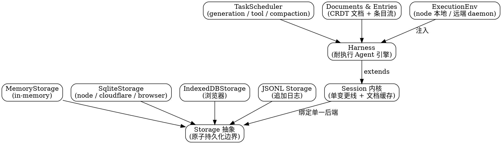

# Durable：持久化 Agent 执行框架（pi-durable）

`@earendil-works/pi-durable`（源码 `packages/durable`）是 Pi 的**持久化 Agent 执行框架**：在单一 `Storage` 后端之上建立 `Session` 内核，再叠一个 `Harness` 作为"耐执行（durable）"的 Agent 引擎。它的设计目标是把一次 Agent 运行（多轮对话、工具调用、压缩、任务依赖）的全部状态落到可持久化的存储里，进程崩溃后能从中恢复。

本文按 `main` 分支 `packages/durable` 拆解，重点放在"分层契约"而非逐文件罗列——每一层都是可替换的后端或可被继承扩展的内核。

## 分层总览



四层从下到上：**Storage（落盘边界）→ Session（状态内核）→ Harness（执行引擎）→ Tasks/Docs/Env（运行时构件）**。下三层都可替换或扩展：`Storage` 有多种后端、`Session` 被 `Harness` 继承、`Env` 有本地与远端两套实现。

## Storage：原子持久化边界

`Storage` 接口是 Session 记录的原子提交边界，本身不含 watch / transaction（watch 由 `Session`/`DocumentObserver` 提供，事务面由 `Tx` 在 `Session.commit` 回调里给出）。核心方法：

- `commit(writes, adopt, context)`：原子提交一批 `StorageWrite` 并返回 `Seq`；持久化后必须同步调用 `adopt(seq)`。
- 读 / 扫描：`conversation` / `scanConversations`、`entry` / `scanEntries`、`task` / `scanTasks`、`submission` / `scanSubmissions`、`findDocument` / `document` / `scanDocuments`。
- `mintId`：从全局数字 ID 命名空间分配品牌化 ID；`close`：释放后端资源。

`StorageWrite` 是原子提交里的单条写操作，覆盖 conversation / entry / task / submission 四类表记录，以及 document 的 create / copy / change / retire 四种变体（文档以 base 全量或 delta 增量两种 `DocumentContent` 形态存储；`StoredDocument` 含 `record` + `version` + 物化 `value` + `deltasSinceBase`）。

### 后端实现

| 后端 | 源码 | 导出 / 说明 |
| :--- | :--- | :--- |
| `MemoryStorage` | `storage/memory.ts` | 主包直接导出，进程内内存后端 |
| Node SQLite | `storage/sqlite/node.ts` | `openNodeSqliteStorage(path, options)`；经 `@earendil-works/chord/sqlite/node` 的 `openNodeSqliteDatabase` 用 **Node 内置 SQLite**，支持 `prefix` 表前缀（`validateSqliteSchemaPrefix` 校验） |
| Cloudflare SQLite | `storage/sqlite/cloudflare.ts` | 面向 Cloudflare Durable Objects 的 SQLite 后端 |
| IndexedDB | `storage/indexeddb.ts` | 浏览器端后端 |
| JSONL | `storage/jsonl/` | 追加式 JSONL 存储（导出 / 审计类用途） |

> 注意：`openNodeSqliteStorage` 实际建立在 `chord` 包的 SQLite 封装之上（见 [Architecture](/docs/CS/AI/LLM/Agent/Product/Pi/Architecture.md) 里 `chord` 的依赖位置）。主包导出路径为 `@earendil-works/pi-durable/storage/sqlite/node`，导出的就是 `openNodeSqliteStorage` 与底层 `openNodeSqliteDatabase`。

## Session：状态内核

`createSession(storage, options?)` 是轻量工厂，真正逻辑在 `SessionImpl`。Session 内核三件事：**一条变更线（mutation line）**、**已加载文档的追踪缓存**、**提交后的发布（publication）**。

- **绑定单一 Storage**：经 `GuardedStorage` 包装，首次 Storage 错误会终结整个 Session。
- **单变更线**：所有 commit / 结算 / 采纳 / 发布都通过 `#enqueue` 排队串行执行，避免并发写入竞争。
- **文档缓存与淘汰**：`#documents` 缓存已加载文档，空闲文档按 `documentRetentionMs` 留存策略淘汰；`setTimer` 负责"驱逐空闲文档"的定时器（默认 `setTimeout`）。
- **只读模式**：`readOnly` 开启后所有带写入的 commit 抛 `ReadOnlySession`。

文档访问用**文档令牌（Doc Token）**做类型化寻址，分三种作用域：`SessionDocToken` / `ConversationDocToken` / `TaskDocToken`，外加可回滚的 `RewindableConversationDocToken` 等家族令牌（keyed document family，按种子键寻址）。事务面 `Tx` 在一次 commit 回调内提供全部表读取、扫描、创建（conversation / entry / task / submission / doc）与 `retireDoc`——注意回调内只能走 `tx`，若调用 `snapshot`/`watchDoc` 等运行时读取会死锁在自身持有的行上。

## Harness：耐执行 Agent 引擎

`Harness.open(storage, options, context)` 挂载到 `Storage` 上运行。它**继承** `SessionImpl`（`class HarnessImpl extends SessionImpl`），即在 Session 内核之上增加"对话句柄 + 任务注册表"。打开时先校验注册表含全部 `BUILTIN_TASKS`，再 `openTasks` 恢复上次未跑完的任务。

主要职责：

1. **跑对话轮次**：`conversation()` / `createConversation()` / `root()` 拿到对话实例，再 `submit()` / `reset()` / `fork()` / `commit()` 推进状态。
2. **调度任务**：内部 `TaskScheduler`（`#tasks`）负责打开 / 恢复（resume）/ 唤醒（wake）/ 等待（waitForIdle）/ 终止（abortTask）/ 重试（retryTask）。
3. **管理文档与条目**：每新建或分叉对话时覆盖 `conversationCreated`，初始化 `LiveDoc` / `InboxDoc` / `UsageDoc` / `ProviderDoc` / `AgentDoc` 等持久化文档；`entries()` 扫描存储里的 `EntryRecord`。
4. **压缩**：`compact(instructions, context)` 把上下文压缩作为一个任务提交。

`HarnessOptions` 包含：`models`（模型解析）、`identity`（客户端身份，合并进 `DEFAULT_HARNESS_IDENTITY = { attribution: PI_ATTRIBUTION }`，即用 pi 的 provider 归属）、`settings`、`registry`、`env`（构造 `ExecutionEnv` 的函数）、`now`、`onReport` / `telemetry`、`setTimer`、`readOnly`、`onWake`、`conversationCreated`。当用户 `submit()` 输入，`Submissions` 调 `tasks.resume()` 唤醒调度器，由内置任务驱动实际的 LLM 生成与工具调用。

### 内置任务（BUILTIN_TASKS）

```typescript
export const BUILTIN_TASKS: readonly AnyTask[] = [GenerationTask, ToolTask, CompactionTask];
```

- **GenerationTask**：跑一次 LLM 生成（对应一轮模型调用 + 结果落库）。
- **ToolTask**：执行一次工具调用（嵌套调用也走这套任务，权限检查不漏底）。
- **CompactionTask**：把上下文压缩成摘要，控制上下文长度。

注册表 `createRegistry()` 先装内置三任务，扩展（`Extension`）可追加自己的任务 / 工具 / 提示段（section），但任务名冲突会抛错，`instructions` section key 被保留给 Agent 指令。这把"Agent 能力 = 内置任务 + 扩展任务"的设计落在可执行契约上。

## Documents 与 Entries

- **文档（Documents）**：`defineDoc` / `defineDocFamily` 定义 CRDT 风格的持久化文档，按 Session / Conversation / Task 作用域（及可回滚家族）寻址；运行时文档有 `LiveDoc`（实时状态）、`InboxDoc`（待处理输入）、`UsageDoc`（用量）、`ProviderDoc`（提供方状态）、`AgentDoc`、`NestedCallDoc`（嵌套工具调用）。
- **条目（Entries）**：`defineEntry` 定义不可变条目；内置类型有 `UserEntry` / `AssistantEntry` / `SystemEntry` / `ToolResultEntry` / `ResetEntry` / `CompactionEntry`。条目流（entry stream）是 Agent 运行的可重放历史，配合 `snapshotAsOf` 可在任意 `EntryId` 回滚文档状态。

## ExecutionEnv：执行环境（与 env 包的接缝）

`packages/durable/src/env/` 定义了 `ExecutionEnv` 抽象——Agent 实际"动手"的执行面（读文件、跑命令、调用工具后端）。`node.ts` 里的 `NodeExecutionEnv`（约 41KB）是**本地后端**，直接走进程内系统调用；`index.ts` 给出抽象与远端协商（decode / line-scan），正是 `pi-env` 经 SSH 部署的 daemon 在远端实现的那套接口。

> 关键衔接：同一个 `ExecutionEnv` 接口，**本地后端走进程内调用、远端后端走 daemon RPC**。工具 `operations` 的远端后端（见 [Tools](/docs/CS/AI/LLM/Agent/Product/Pi/Tools.md)）与远程执行（见 [Env](/docs/CS/AI/LLM/Agent/Product/Pi/Env.md)）最终都落到这一层——`pi-env` 的 `RemoteExecutionEnv` 实现的就是 `pi-durable` 的 `ExecutionEnv`。

## 与 coding-agent 的集成现状

`pi-durable` 是 Pi 的"下一代"持久化 / Agent 框架，但**生产路径的 `coding-agent` 并不直接依赖它的 `Harness`**——目前仅 `experimental/`（vacation 规划器、client-tui-chat）在试用。现役 `coding-agent` 有自己独立的 `SessionManager`，而 `durable` 的 `env/` 抽象则被 `pi-env` 复用，作为工具远端执行的统一接口。

换句话说：durable 的**存储 / 文档 / 任务 / 环境抽象**已经是 Pi 公共底座的一部分，但把它整合成完整 Agent 主循环的那一层（Harness + 内置任务）尚未进入 `coding-agent` 生产代码。这解释了为什么 [Architecture](/docs/CS/AI/LLM/Agent/Product/Pi/Architecture.md) 把 `durable` 归在"支线（服务 Durable 的远程执行）"而非主循环依赖。

## 小结

- **四层可替换架构**：Storage（多后端）→ Session（单变更线内核）→ Harness（耐执行引擎）→ Tasks/Docs/Env（构件）。
- **Storage** 是原子边界，后端含 Memory / Node·Cloudflare·IndexedDB SQLite / JSONL；Node 后端基于 `chord` 的 SQLite 封装。
- **Session** 绑定单一后端、串行化所有写入、按令牌做类型化文档寻址、支持回滚。
- **Harness** 继承 Session，以 `GenerationTask` / `ToolTask` / `CompactionTask` 三个不可移除的内置任务驱动 Agent 运行，进程崩溃可恢复。
- **ExecutionEnv** 是工具执行的统一接口，本地与远端（pi-env daemon）共用。
- 生产 `coding-agent` 暂未采用 durable 的 Harness，但 env 抽象已被远程执行链路复用。

## Links

- [Pi 枢纽](/docs/CS/AI/LLM/Agent/Product/Pi/Pi.md)
- [Architecture：包分层与依赖](/docs/CS/AI/LLM/Agent/Product/Pi/Architecture.md) — `durable` 在 11 包分层中的位置、`chord` 依赖、为何归在支线
- [Tools：工具系统](/docs/CS/AI/LLM/Agent/Product/Pi/Tools.md) — 工具 `operations` 如何成为 env 的远端后端
- [Env：远程执行环境](/docs/CS/AI/LLM/Agent/Product/Pi/Env.md) — `pi-env` 的 `RemoteExecutionEnv` 实现 durable 的 `ExecutionEnv`
- [Session：会话树与压缩](/docs/CS/AI/LLM/Agent/Product/Pi/Session.md) — 现役 coding-agent 的会话管理（与 durable 的 Session 内核对照）

## References

- [earendil-works/pi · packages/durable](https://github.com/earendil-works/pi/tree/main/packages/durable) — 源码（main 分支）
- [earendil-works/pi · packages/durable/src/storage/sqlite/node.ts](https://github.com/earendil-works/pi/blob/main/packages/durable/src/storage/sqlite/node.ts) — `openNodeSqliteStorage` 实现
- [earendil-works/pi · packages/durable/src/harness/harness.ts](https://github.com/earendil-works/pi/blob/main/packages/durable/src/harness/harness.ts) — `Harness` 引擎
- [earendil-works/pi · packages/durable/src/harness/registry.ts](https://github.com/earendil-works/pi/blob/main/packages/durable/src/harness/registry.ts) — `BUILTIN_TASKS` 定义
