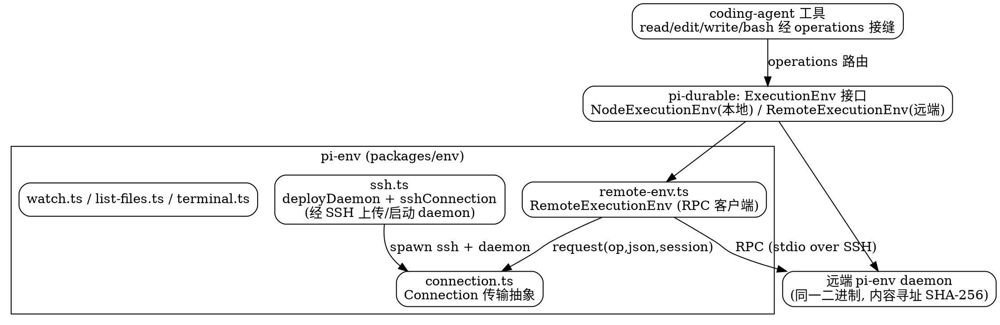

# Env：远程执行环境（pi-env）

Pi 的远程执行由 `@earendil-works/pi-env`（源码 `packages/env`）承担：把一个小 daemon（`pi-env` 二进制）经 SSH 部署到远端机器，再让本地 `RemoteExecutionEnv` 客户端通过 RPC 调它，把远端文件系统与命令执行"镜像"成和本地 `NodeExecutionEnv` 完全一致的行为。本文按 `main` 分支 `packages/env` 与 `pi-durable/env` 接口拆解。

## 包定位与两层结构

`packages/env` 只做远程那一端，内部再分两层：

1. **部署 + 传输层（`ssh.ts` + `connection.ts`）**：`deployDaemon()` 把 `pi-env` 二进制安全传到远端并启动；`Connection`（来自 `connection.ts`）抽象传输——SSH 实现就是 spawn 一个 `ssh` 子进程，把远端 daemon 当作远程命令，通信全部走子进程 stdio。
2. **RPC 客户端层（`remote-env.ts`）**：`RemoteExecutionEnv` 实现 `ExecutionEnv` 接口，把每个文件/命令操作序列化成 `connection.request(op, json, { payload, signal, session })` 发给 daemon。

配套 `watch.ts`（`RemoteWatcher` 文件监听）、`list-files.ts`（`listFilesOver`）、`terminal.ts`、`errors.ts`（`RemoteError`）。

## ExecutionEnv 统一接口与两套后端（"两套通道"）

`ExecutionEnv` 是 `pi-durable/env` 提供的统一抽象，Pi 的工具层只认这个接口，不关心背后是本地还是远端。它有两套后端：

- **`NodeExecutionEnv`（进程内 / 本地）**：直接调用 Node.js 的 fs / spawn 等系统调用。
- **`RemoteExecutionEnv`（远端，本包实现）**：经 `pi-env` daemon 执行系统调用，但**客户端再套用 Node 的路径解析、错误模型、结果规则**，使返回值与"在该机器上直接跑 `NodeExecutionEnv`"一致（`remote-env.ts` 注释原文：*the daemon performs the system calls, and this class applies Node's path, error, and result rules*）。

这正是 Architecture 说的"与进程内 RPC 的两套通道"：同一 `ExecutionEnv` 接口，本地后端走进程内系统调用、远端后端走 daemon RPC；远端 daemon 二进制又被 `pi-durable` 复用做它自己的持久化远程执行（durable remote execution）。

## SSH daemon 部署：内容寻址、零 scp

`deployDaemon()` 不用 `scp`，而是**把二进制经 SSH 标准输入管道传过去**，再作为远程命令直接启动（整个会话复用 SSH 主通道，无端口转发）：

- **内容寻址、版本不撞车**：远端路径按二进制 SHA-256 前缀命名：`~/.pi/mobile/tools/pi-env-<sha256[:32]>`（Windows 在 `.pi\mobile\tools\`）。部署前先 `checkDaemon` 在远端比对哈希，命中即跳过上传。
- **POSIX 上传**：读本地字节 → `runSsh(..., { stdin: bytes })` → 远端 `sh -c` 接收、`mkdir -p`、`chmod 700`、写临时文件、`cat > t` 收 stdin、`hash` 校验（不符则删并报 "pi-env upload is corrupt"）、原子 `mv` 到目标、清理旧版 `pi-env-*`。
- **Windows 上传**：Base64 编码经 PowerShell 解码写入，以 `PI-ENV-END` 标记收尾。
- **启动**：每次 SSH 连接把 daemon 二进制作为**远程主命令**执行（`launchCommand`：POSIX 无登录 shell 直接执行；带登录 shell 时 `exec "$SHELL" -lc 'exec "$0" "$@"'`）。

## 安全姿态：最小暴露

`sshArguments` 明确关掉一切转发与共享，只走一条干净通道：

- `-T`（禁伪终端）、`-a`（禁 agent 转发）、`-x`（禁 X11 转发）、`ClearAllForwardings=yes`、`ForwardAgent=no`、`ForwardX11=no`、`ControlMaster=no`、`RemoteCommand=none`、`PermitLocalCommand=no`、`SendEnv=-*`（不转发环境变量）。
- **密钥认证**：`IdentityFile` + `IdentitiesOnly=yes` + `BatchMode=yes`（只用指定密钥，禁交互口令，杜绝卡在密码提示）。
- **主机密钥**：应用自维护独立 `knownHostsFile`，`GlobalKnownHostsFile=none`、`HostKeyAlias=<固定别名>` 严格校验；`StrictHostKeyChecking` 为 `accept-new` 或 `yes`；密钥变更抛 `HostKeyChangedError` 拒绝自动接受。`scanHostKey`（展示指纹供带外比对）/`acceptHostKey`（写入信任）用于首次授信。
- **保活**：`ServerAliveInterval=15`；超时 `SSH_TIMEOUT_MS=60_000`（普通命令）、`UPLOAD_TIMEOUT_MS=300_000`（二进制上传，5 分钟）。

## RPC 客户端：句柄 + 分块 + 流式

`RemoteExecutionEnv` 通过 `Connection` 发 RPC，核心机制：

- **操作名 + 句柄**：文件/目录先 `open` 得到 daemon 返回的 `handle` 数字 id 与 `session` 编号，后续 `pread`/`writeChunk`/`watch` 都带上；`Handle` 类型注释明确"只在打开它的 session 内有效"——`session + handle` 做跨会话隔离。
- **分块读写**：读 `READ_CHUNK = 256KB`、并发 `READ_DEPTH = 8`；写 `WRITE_CHUNK = 512KB`、首块建文件、后续并发 `writeChunk`，支持自动建父目录。
- **流式 exec**：`exec(command, options, context)` 支持 `string` 或 `string[]`，带超时（→ `timeoutMs`）、`inheritEnv`、`cwd`、`onOutput` 输出回调、`spill`/`window`；`onStart` 拿到远端 `requestId` 登记进 `#running` Map，`cleanup()` 经 `connection.kill(id, session)` 终止本环境启动的仍在跑的远程命令。
- **路径镜像**：`connection.info()` 返回远端 `platform`/`home`/`cwd`/`tmpdir`，`remotePath()` 据此选 `win32`/`posix`，把路径解析、错误、`mtime` 等规则对齐本地 Node。
- **文件命名空间**：`RemoteExecutionEnvOptions.id`（如 `pi-env:<env name>`）——相同 id 的客户端看到同一份文件系统视图（`FileSystem.id`）。

## 生命周期与清理

daemon 生命周期**绑定于 SSH 会话**：会话断开，远端进程即退出（代码未实现显式远程 kill，"running ones keep their file open until they exit"）。本地侧 `Connection` 由 `ssh.ts` 的 `sshConnection`/`connectSsh` 返回，首次请求时探测远端平台、部署/校验 daemon 再启动；上传/启动都走"内容寻址 + 哈希校验"保证二进制未被篡改。

## 与 pi-durable / 工具 operations 接缝

这是把 `Env` 与 [Tools](/docs/CS/AI/LLM/Agent/Product/Pi/Tools.md) 串起来的关键：read/edit/write/bash 等工具全部构建在可插拔的 `operations` 接口之上，该接口底层就是 `ExecutionEnv`。本地时 `operations` 由 `NodeExecutionEnv` 支撑，连到远端（经 `pi-env`）时换成 `RemoteExecutionEnv`——**工具定义、声明、钩子一行不改**，只是文件读写与命令执行的 I/O 被路由到了宿主机之外。这也解释了 [Security](/docs/CS/AI/LLM/Agent/Product/Pi/Security.md) 里"Docker / OpenShell / Gondolin 通过替换 operations 接管 I/O"的同一种接缝原理。

## Links

- [Tools：工具系统](/docs/CS/AI/LLM/Agent/Product/Pi/Tools.md) — `operations` 接缝如何被本包接管
- [Architecture：架构](/docs/CS/AI/LLM/Agent/Product/Pi/Architecture.md) — 11 包分层中 env 的位置与依赖（chord, durable）
- [Durable：持久化 Agent 框架](/docs/CS/AI/LLM/Agent/Product/Pi/Durable.md) — `ExecutionEnv` 抽象的来源：本包 `RemoteExecutionEnv` 实现 durable 的接口
- [Security：信任与隔离](/docs/CS/AI/LLM/Agent/Product/Pi/Security.md) — 远程执行与隔离的取舍
- [Pi 枢纽](/docs/CS/AI/LLM/Agent/Product/Pi/Pi.md)

## References

- [pi/packages/env/src/ssh.ts](https://github.com/earendil-works/pi/blob/main/packages/env/src/ssh.ts) — `deployDaemon` / `sshConnection`：SSH 部署、安全姿态、零转发
- [pi/packages/env/src/remote-env.ts](https://github.com/earendil-works/pi/blob/main/packages/env/src/remote-env.ts) — `RemoteExecutionEnv`：RPC 客户端、句柄、分块、流式 exec
- [pi/packages/env/src/connection.ts](https://github.com/earendil-works/pi/blob/main/packages/env/src/connection.ts) — `Connection` 传输抽象
- [pi/packages/env/src/watch.ts](https://github.com/earendil-works/pi/blob/main/packages/env/src/watch.ts) — `RemoteWatcher` 文件监听
