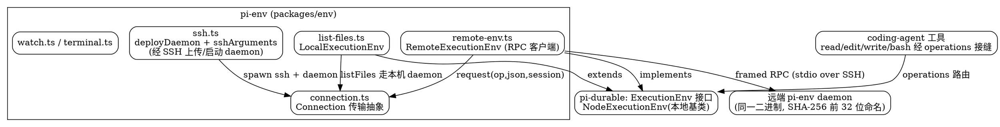

## Introduction

Pi 的远程执行由 `@earendil-works/pi-env`（源码 `packages/env`，v1.5.2 / commit `b4afdddf`）承担：把一个小 daemon（`pi-env` 二进制）经 SSH 部署到远端机器，再让本地 `RemoteExecutionEnv` 客户端通过 RPC 调它，把远端文件系统与命令执行「镜像」成和本地一样的行为。本页按 v1.5.2 源码核验。

先纠正一处极易写错的关系：**`ExecutionEnv` 接口定义在 `pi-durable`，不在 `pi-env`**（在 `packages/durable/src/env/index.ts`）；`pi-env` 包（v1.5.2）只依赖 `chord` + `pi-durable`，实现这套接口。



## Package Structure

`packages/env` 只做远程那一端，内部再分两层：

1. **部署 + 传输层（`ssh.ts` + `connection.ts`）**：`deployDaemon()` 把 `pi-env` 二进制安全传到远端并启动；`Connection` 抽象传输——SSH 实现就是 spawn 一个 `ssh` 子进程，把远端 daemon 当作远程命令，通信全部走子进程 stdio；`connection.ts` 负责 framed RPC 的封包 / 解包。
2. **RPC 客户端层（`remote-env.ts`）**：`RemoteExecutionEnv` 实现 durable 的 `ExecutionEnv` 接口，把每个文件/命令操作序列化成 `connection.request(op, json, { payload, signal, session, onEvent })` 发给 daemon。

配套 `watch.ts`（`RemoteWatcher` 文件监听）、`list-files.ts`（`LocalExecutionEnv` / `listFilesOver`）、`terminal.ts`、`errors.ts`（`RemoteError`）。

## ExecutionEnv: Interface in durable, Two Backends

`ExecutionEnv` 是 `pi-durable/env` 提供的统一抽象（`export interface ExecutionEnv extends FileSystem, Shell {}`），Pi 的工具层只认这个接口，不关心背后是本地还是远端。它有两套后端，但**两个本地类的归属不同**：

- **`NodeExecutionEnv`（进程内 / 本地基类）**：定义在 **durable**（`packages/durable/src/env/node.ts`），直接走 Node.js 的 fs / spawn 等系统调用。
- **`LocalExecutionEnv`（本地，pi-env 的 `list-files.ts`）**：继承 durable 的 `NodeExecutionEnv`，只额外把 `listFiles` 也走一个本机 daemon，从而让本地与远端用同一份 list-files 代码。源码注释与类声明：

```typescript
/**
 * `NodeExecutionEnv` with `listFiles` through a pi-env daemon on the same machine, so local and remote environments
 * list files with the same code. Everything else is `NodeExecutionEnv`'s. The connection belongs to the caller, who
 * closes it; several environments may share it.
 */
export class LocalExecutionEnv extends NodeExecutionEnv implements ExecutionEnv {
```

- **`RemoteExecutionEnv`（远端，本包实现）**：经 `pi-env` daemon 执行系统调用，但**客户端再套用 Node 的路径解析、错误模型、结果规则**，使返回值与「在该机器上直接跑 `NodeExecutionEnv`」一致。

这正是 Architecture 说的「与进程内 RPC 的两套通道」：同一 `ExecutionEnv` 接口，本地后端走进程内系统调用、远端后端走 daemon RPC；daemon 二进制又被 `pi-durable` 复用做它自己的持久化远程执行。分层位置见 [Architecture](/docs/CS/AI/LLM/Agent/Product/Pi/Pi.md?id=architecture)。

## SSH daemon Deployment: Content-Addressed, Zero scp

`deployDaemon()` 不用 `scp`，而是**把二进制经 SSH 标准输入管道传过去**，再作为远程命令直接启动（整个会话复用 SSH 主通道，无端口转发）：

- **内容寻址、版本不撞车**：远端路径按二进制 SHA-256 **前 32 位十六进制**命名：`~/.pi/mobile/tools/pi-env-<sha256[:32]>`（Windows 在 `.pi\mobile\tools\` 加 `.exe`）。`daemonPath()` 源码：

```typescript
function daemonPath(remote: RemotePlatform, sha256: string): string {
	const name = `pi-env-${sha256.slice(0, 32)}`;
	return remote.platform === "windows"
		? `${remote.home}\\.pi\\mobile\\tools\\${name}.exe`
		: `${remote.home}/.pi/mobile/tools/${name}`;
}
```

- **每次启动校验哈希**：部署前先 `checkDaemon` 在远端比对 SHA-256，命中即跳过上传；上传先写临时文件、`hash` 校验（不符则报 "pi-env upload is corrupt" 并删除）、再原子 `mv` 到目标、清理旧版 `pi-env-*`；远端机器上没有 `sha256sum` / `shasum` / `openssl` 之一时拒绝运行。
- **POSIX 上传**：读本地字节 → `runSsh(..., { stdin: bytes })` → 远端 `sh -c` 接收、`mkdir -p`、`chmod 700`、写临时文件、`cat > t` 收 stdin、校验、原子 `mv`。**Windows 上传**：Base64 编码经 PowerShell 解码写入。
- **启动**：每次 SSH 连接把 daemon 二进制作为**远程主命令**执行（`launchCommand`：POSIX 无登录 shell 直接执行；带登录 shell 时 `exec "$SHELL" -lc 'exec "$0" "$@"'`）。

## Security Posture: Zero Forwarding

`sshArguments()` 明确关掉一切转发与共享，只走一条干净通道：

```typescript
	const option = (setting: string) => ["-o", setting];
	return [
		...(target.configFile === undefined ? [] : ["-F", target.configFile]),
		"-T",
		"-a",
		"-x",
		...option("BatchMode=yes"),
		...option("ClearAllForwardings=yes"),
		...option("ForwardAgent=no"),
		...option("ForwardX11=no"),
		...option("ControlMaster=no"),
		...option("ControlPath=none"),
		...option("RemoteCommand=none"),
		...option("PermitLocalCommand=no"),
		...option("SendEnv=-*"),
```

- `-T`（禁伪终端）、`-a`（禁 agent 转发）、`-x`（禁 X11 转发）、`ClearAllForwardings=yes`、`ForwardAgent=no`、`SendEnv=-*`（不转发环境变量）。
- **密钥认证**：`IdentityFile` + `IdentitiesOnly=yes` + `BatchMode=yes`（只用指定密钥，禁交互口令）。
- **主机密钥**：应用自维护独立 `knownHostsFile`，`GlobalKnownHostsFile=none`、`HostKeyAlias=<固定别名>` 严格校验；`StrictHostKeyChecking` 为 `accept-new` 或 `yes`；密钥变更抛 `HostKeyChangedError`。`scanHostKey` / `acceptHostKey` 用于首次授信。
- **保活与超时**：`ConnectTimeout=15`、`ServerAliveInterval=15`；普通命令超时 60s、二进制上传超时 300s。

## Framed RPC

双方用长度前缀帧通信，格式（`packages/env/daemon/src/frame.rs` 注释原文）：`u32 length | u8 type | u32 id | u32 jsonLength | json | payload`，帧上限 16MiB：

```rust
//! Length-prefixed frames: `u32 length | u8 type | u32 id | u32 jsonLength | json | payload` (docs/protocol.md).

pub const REQUEST: u8 = 1;
pub const RESULT: u8 = 2;
pub const ERROR: u8 = 3;
pub const EVENT: u8 = 4;
pub const CANCEL: u8 = 5;
pub const PING: u8 = 6;

/// Largest frame either side accepts.
pub const MAX_FRAME: usize = 16 * 1024 * 1024;
```

客户端 `frame()` 用大端写入同样的头（`src/connection.ts`）：

```typescript
function frame(type: number, id: number, json: Json, payload: Uint8Array = new Uint8Array(0)): Buffer {
	const body = Buffer.from(JSON.stringify(json, wellFormed), "utf8");
	const header = Buffer.alloc(13);
	header.writeUInt32BE(9 + body.length + payload.length, 0);
	header.writeUInt8(type, 4);
	header.writeUInt32BE(id, 5);
	header.writeUInt32BE(body.length, 9);
	return Buffer.concat([header, body, payload]);
}
```

## Handles, Chunks, Streaming

`RemoteExecutionEnv` 的核心机制：

- **操作名 + 句柄**：文件/目录先 `open` 得到 daemon 返回的 `handle` 数字 id 与 `session` 编号，后续 `pread`/`writeChunk`/`watch` 都带上。`Handle` 类型注释明确「只在打开它的 session 内有效」——`session + handle` 做跨会话隔离：

```typescript
/** A daemon handle: valid only in the session that opened it. */
class Handle {
	readonly env: RemoteExecutionEnv;
	readonly id: number;
	readonly session: number;
	readonly path: string;

	constructor(env: RemoteExecutionEnv, id: number, session: number, path: string) {
		this.env = env;
		this.id = id;
		this.session = session;
		this.path = path;
	}
```

- **分块读写**：`READ_CHUNK = 256KiB` / `READ_DEPTH = 8`，`WRITE_CHUNK = 512KiB` / `WRITE_DEPTH = 8`（`src/remote-env.ts`）：

```typescript
/** Bytes per `pread` request of a binary reader; several are in flight at once. */
const READ_CHUNK = 256 * 1024;
const READ_DEPTH = 8;
/** Node's `writeFile` writes at most this much per call and checks for an abort before each. */
const WRITE_CHUNK = 512 * 1024;
const WRITE_DEPTH = 8;
```

写操作首块建文件、后续并发 `writeChunk`，支持自动建父目录；读操作多个 `pread` 并发在飞。

- **流式 exec**：`exec(command, options, context)` 支持 `string` 或 `string[]`，带超时、`inheritEnv`、`cwd`、`onOutput` 输出回调、`spill`/`window`。流式输出通过 RPC 的 `onEvent` 回调接收 `output` 事件后再转给 `options.onOutput`（`src/remote-env.ts`）：

```typescript
					onEvent: (event, payload) => {
						if (settled || callbackError !== undefined || event.kind !== "output") return;
						const text = Buffer.from(payload.buffer, payload.byteOffset, payload.length).toString("utf8");
						if (text === "" || options?.onOutput === undefined) return;
						const info: ShellOutputInfo = { stream: event.stream === "stderr" ? "stderr" : "stdout" };
						if (event.skipped !== undefined) info.skipped = event.skipped as ShellOutputSkip;
						try {
							options.onOutput(text, context, info);
```

- **路径镜像**：`connection.info()` 返回远端 `platform`/`home`/`cwd`/`tmpdir`，`remotePath()` 据此选 `win32`/`posix`，把路径解析、错误、`mtime` 等规则对齐本地 Node。
- **文件命名空间**：`RemoteExecutionEnvOptions.id`（如 `pi-env:<env name>`）——相同 id 的客户端看到同一份文件系统视图。

## Lifecycle and Cleanup

daemon 生命周期**绑定于 SSH 会话**：会话断开，远端进程即退出（代码未实现显式远程 kill）。本地侧 `Connection` 由 `ssh.ts` 的 `sshConnection`/`connectSsh` 返回，首次请求时探测远端平台、部署/校验 daemon 再启动；上传/启动都走「内容寻址 + 哈希校验」保证二进制未被篡改。`onStart` 把远端 `requestId` 登记进 `#running`，`cleanup()` 经 `connection.kill(id, session)` 终止本环境启动的仍在跑的远程命令。

## Relation to pi-durable and Tool operations

这是把 `Env` 与工具系统串起来的关键：read/edit/write/bash 等工具全部构建在可插拔的 `operations` 接口之上，该接口底层就是 durable 的 `ExecutionEnv`。本地时 `operations` 由 `NodeExecutionEnv` / `LocalExecutionEnv` 支撑，连到远端（经 `pi-env`）时换成 `RemoteExecutionEnv`——**工具定义、声明、钩子一行不改**，只是文件读写与命令执行的 I/O 被路由到宿主机之外。这也解释了 [Security](/docs/CS/AI/LLM/Agent/Product/Pi/Security.md) 里「Docker / OpenShell / Gondolin 通过替换 operations 接管 I/O」的同一种接缝原理。

## Links

- [Pi 枢纽](/docs/CS/AI/LLM/Agent/Product/Pi/Pi.md)
- [Tools：工具系统](/docs/CS/AI/LLM/Agent/Product/Pi/Tools.md)
- [Durable：持久化 Agent 框架](/docs/CS/AI/LLM/Agent/Product/Pi/Durable.md)
- [CodeMode：codemode 实现机制](/docs/CS/AI/LLM/Agent/Product/Pi/CodeMode.md)
- [Chord：跨进程对象运行时](/docs/CS/AI/LLM/Agent/Product/Pi/Chord.md)

## References

- [pi/packages/env/src/ssh.ts（v1.5.2）](https://github.com/earendil-works/pi/blob/v1.5.2/packages/env/src/ssh.ts) — `deployDaemon` / `sshArguments`：SSH 部署、安全姿态、零转发
- [pi/packages/env/src/remote-env.ts（v1.5.2）](https://github.com/earendil-works/pi/blob/v1.5.2/packages/env/src/remote-env.ts) — `RemoteExecutionEnv`：句柄、分块、流式 exec
- [pi/packages/env/src/connection.ts（v1.5.2）](https://github.com/earendil-works/pi/blob/v1.5.2/packages/env/src/connection.ts) — `Connection` 传输抽象与 framed RPC 封包
- [pi/packages/env/src/list-files.ts（v1.5.2）](https://github.com/earendil-works/pi/blob/v1.5.2/packages/env/src/list-files.ts) — `LocalExecutionEnv`
- [pi/packages/env/daemon/src/frame.rs（v1.5.2）](https://github.com/earendil-works/pi/blob/v1.5.2/packages/env/daemon/src/frame.rs) — 帧格式与 MAX_FRAME
- [pi/packages/durable/src/env/index.ts（v1.5.2）](https://github.com/earendil-works/pi/blob/v1.5.2/packages/durable/src/env/index.ts) — `ExecutionEnv` 接口定义
