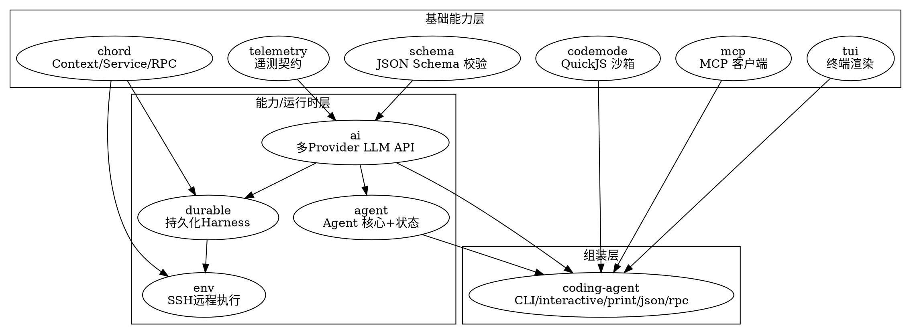

> 版本基线：v1.5.2（commit `b4afdddf`，2026-11-10 发布）。事实以 GitHub `earendil-works/pi` 该 tag 与本地 `E:/Projects/pi-1.5.2` 源码为准。相较早期 v1.0.0 记录：远程会话三包（`protocol`/`client`/`server`）已删除、新增 `env`（SSH 远程执行）与 `pi-schema`（无 eval 的 JSON Schema 校验）两包，workspace 包从 11 增至 **12**；运行模式四种（JSON 事件流转正）；技能体系切换到 Agent Skills 规范；工具参数校验 v1.5.0 起改走 pi-schema（TypeBox 超 JSON Schema 特性不再生效）。本文为 v1.5.2 全家族源码级重写后的枢纽，架构正文已并入下方 `## Architecture`（原独立 `Architecture.md` 已删除）。

## Introduction

Pi 是一个跑在终端里的 AI 编程 agent，口号是 **minimal, extensible agent harness that you can make your own**——把能力藏在基础操作里，而不是堆在界面上。默认只启用四个工具（`read` / `bash` / `edit` / `write`），sub-agent、plan mode 这类「重型」特性一概不带，需要就自己装包或写扩展。整仓 TypeScript（一个 Rust 边界库都没有——对比 OpenClaw 的 Rust 只做边界库，Pi 更纯；唯一例外是 `pi-env` 的 daemon 用 Rust），由 Earendil Works 维护，npm 包名 `@earendil-works/pi-coding-agent`。

它同时是 Harness 抽象的优秀标本：[Harness](/docs/CS/AI/LLM/Agent/Theory/Harness.md) 的「对模型能力缺口的补偿面」在 Pi 身上被拆成了可替换的层——会话树、压缩、工具、信任机制各自独立成篇；内部实现见下方 [Architecture](#architecture) 与 [AgentLoop](/docs/CS/AI/LLM/Agent/Product/Pi/AgentLoop.md)，与 [Agent](/docs/CS/AI/LLM/Agent/Theory/Agent.md) 的 Loop/Tools/Memory/Harness 四构成对照阅读最清楚。

模型无关是卖点：内置目录覆盖 44 个 provider（Anthropic / OpenAI / Google / Bedrock / OpenRouter / 国产各家……），`builtinProviders()` 实注册 43 个（差额是纯动态 Provider），`/login` 选 provider、`/model` 选模型，凭证、目录、兼容端点都可自定义—详见 [Providers](/docs/CS/AI/LLM/Agent/Product/Pi/Providers.md)。

## Installation

macOS / Linux 首选安装脚本（钉死所有依赖，之后 `pi update` 升级）：

```bash
curl -fsSL https://pi.dev/install.sh | sh
```

Windows 用 PowerShell：`powershell -c "irm https://pi.dev/install.ps1 | iex"`。也可以走 npm（不钉传递依赖，需 Node.js ≥ 22.19）：

```bash
npm install -g --ignore-scripts @earendil-works/pi-coding-agent
```

Nix 用户装 flake（从源码构建）：`nix profile add github:earendil-works/pi/stable`，可用 tag 钉版本，升级走 `nix profile upgrade pi`（`pi update` 管不了 Nix 装的 Pi）。卸载：npm 装的就 `npm uninstall -g`，脚本装的再跑一次脚本选 Uninstall，Nix 装的 `nix profile remove pi`——三种方式都不动 `~/.pi/agent/` 下的配置、凭证、会话和已装包。

装完 `pi --version` 验证，`cd` 到工作目录跑 `pi` 即启动；首次使用按 Quickstart 走 `/login` → 选模型 → 派活。

## Run Modes

同一份 `AgentSession` 套不同 I/O 外壳（`resolveAppMode`：`--mode rpc/json` 优先，`--print` 或 stdio 非 TTY 落 print，否则 interactive）：

| 模式 | 触发 | 用途 |
| :--- | :--- | :--- |
| interactive | 终端直跑（默认全屏 TUI） | 人机交互 |
| print | `-p` / `--print`，或 stdin/stdout 被重定向 | 一次性任务、脚本 |
| json | `--mode json` | 单次运行的 JSONL 事件流 |
| rpc | `--mode rpc` | 控制一个独立 Pi 进程（stdin/stdout JSONL） |

JSON **不是独立模式**——它复用 `runPrintMode`，只是把 session 事件经 `toJsonEvent()` 序列化为 JSONL。另有 TypeScript SDK（`createAgentSession` 等）在应用内嵌 Pi。四种形态共享同一套 agent 与会话机制，详见下方 [Architecture](#architecture)。

## Architecture

Pi 的运行时正是 [Agent](/docs/CS/AI/LLM/Agent/Theory/Agent.md)（Loop / Tools / Memory / Harness 四构成）与 [Harness](/docs/CS/AI/LLM/Agent/Theory/Harness.md)（对模型能力缺口的补偿面）在 TypeScript 工程里的具体实现。结论以代码为准、非以文档为准。

### Packages and Layering

根 `package.json` 是私有 monorepo 元包（版本 `0.0.3`，不随发布走），workspace 包各自锁步发布 `1.5.2`。共 **12 个包**：

| 包 | npm 名 | 职责 | 内部依赖 |
| :--- | :--- | :--- | :--- |
| `telemetry` | @earendil-works/pi-telemetry | 厂商中立的遥测契约与类型化 schema | — |
| `schema` | @earendil-works/pi-schema | 无 eval 的 JSON Schema 校验（drafts 2020-12/7 编译成闭包） | — |
| `chord` | @earendil-works/chord | 应用组合运行时：Context、Service、RPC、facet 打包 | — |
| `tui` | @earendil-works/pi-tui | 终端 UI：差分渲染、布局、编辑器、markdown、按键 | — |
| `codemode` | @earendil-works/pi-codemode | 沙箱化 JavaScript 执行（QuickJS WASM；脚本经 `tools.<name>()` 调注入工具） | — |
| `mcp` | @earendil-works/pi-mcp | 自研 JSON-RPC 的 Model Context Protocol 客户端（不依赖官方 SDK） | — |
| `ai` | @earendil-works/pi-ai | 统一多 Provider LLM API、模型发现、鉴权 | telemetry, schema |
| `agent` | @earendil-works/pi-agent-core | 通用 Agent 核心：传输抽象、状态管理（不含持久化 Harness） | ai |
| `durable` | @earendil-works/pi-durable | 持久化对话/任务/文档运行时，含实验性 Harness 与多后端存储 | chord, ai |
| `env` | @earendil-works/pi-env | 远程执行环境：SSH daemon + ExecutionEnv 客户端（服务 Durable） | chord, durable |
| `evals` | @earendil-works/pi-evals | 评测工具（不参与主构建链） | — |
| `coding-agent` | @earendil-works/pi-coding-agent | 交互式编码 Agent CLI，最终组装层 | agent, ai, codemode, mcp, tui |

> v1.0.0 → v1.5.2 的关键差异：① `protocol`/`client`/`server`（CBOR 帧远程会话，实验性）已删除，远程执行改由 `env` 承担；② 新增 `pi-schema`（v1.5.0 起工具参数校验从 TypeBox 迁来）；③ `pi-ai` 现依赖 schema；④ coding-agent **不依赖 chord**（旧文写错）——直接从 `package.json` 的 dependencies 可核。



要点：`agent`（pi-agent-core）是**纯轻量层**——只提供 Agent 循环、传输抽象与共享类型，不持有会话/工具/压缩/持久化 Harness，不依赖 chord；`coding-agent` 是唯一同时依赖全部五个基础能力包的组装层；`durable` 含实验性 Harness 但生产路径的 coding-agent 并不直接依赖它，`env` 同属这条支线。

### Two-Layer Collaboration Loop

生产路径 = `coding-agent/core` 的 `AgentSession`（外层：压缩/重试/排队/结算）驱动 `pi-agent-core` 的 `Agent`（内层 `runLoop`：生成→工具→回填）。旧文档的 `driveOperation` / `lane` / `reducer` 持久化状态机已随精简移除。内层 `runLoop` 的骨架：

```ts
	// Outer loop: continues when queued follow-up messages arrive after agent would stop
	while (true) {
		let hasMoreToolCalls = true;

		// Inner loop: process tool calls and steering messages
		while (hasMoreToolCalls || pendingMessages.length > 0) {
			let preparedMessages: AgentMessage[] = [];
			if (lastCompletedTurn) {
				const nextTurnSnapshot = await config.prepareNextTurn?.(lastCompletedTurn);
				if (nextTurnSnapshot) {
					currentContext = nextTurnSnapshot.context ?? currentContext;
					preparedMessages = nextTurnSnapshot.messages ?? [];
				}
				if (pendingMessages.length === 0) {
					pendingMessages = (await config.getSteeringMessages?.()) || [];
				}
				await emit({ type: "turn_start" });
			}
```

外层 `_runAgentPrompt` 在每次 `agent_end` 后按 `_handlePostAgentRun` 裁决：错误可重试 → 压缩命中 → 队列非空 → `_runBeforeSettleBoundary`（`agent_before_settle` 钩子），三者皆否才 `agent_settled`。完整的队列语义、工具批次并发/串行、`stopReason==="length"` 的整批判失败、无最大轮数保护等原理，见 [AgentLoop](/docs/CS/AI/LLM/Agent/Product/Pi/AgentLoop.md) 专项。

### Tool Batches, Compaction and Context

一个 assistant 消息的多个 toolCall 组成 batch，默认 `Promise.all` 并发无上限，任一工具 `executionMode==="sequential"` 则整批串行；`tool_execution_end` 按完成顺序 emit、`ToolResultMessage` 按源顺序入历史。压缩由 `shouldCompact` 判定，阈值与投影细节见 [Context](/docs/CS/AI/LLM/Agent/Product/Pi/Context.md)：

```ts
export function shouldCompact(contextTokens: number, contextWindow: number, settings: CompactionSettings): boolean {
	if (!settings.enabled) return false;
	return contextTokens > contextWindow - settings.reserveTokens;
}

export const DEFAULT_COMPACTION_SETTINGS: CompactionSettings = {
	enabled: true,
	reserveTokens: 16384,
	keepRecentTokens: 20000,
};
```

压缩只追加 checkpoint（`firstKeptEntryId`）不删历史 entry，摘要以 user 角色回注；`toolResult` 永不作切点。会话是 append-only 的 entry 日志树，分支只移 `leafId`——见 [Session](/docs/CS/AI/LLM/Agent/Product/Pi/Session.md)。工具全集与默认四件套见 [Tools](/docs/CS/AI/LLM/Agent/Product/Pi/Tools.md)。

### Extensions and Trust

`core/extensions/loader.ts` 用 jiti 即时加载 TS 扩展（本地扩展免编译）；内置扩展为 `codemode` / `mcp` / `tool-search`。非代码扩展点（Skills 两阶段加载、Prompt Templates、Themes、Pi Packages）见 [Extensions](/docs/CS/AI/LLM/Agent/Product/Pi/Extensions.md)，事件总表见 [Events](/docs/CS/AI/LLM/Agent/Product/Pi/Events.md)。项目级扩展/技能/包只在 project trust 授予后加载，`project_trust` 事件可被用户级扩展接管——见 [Security](/docs/CS/AI/LLM/Agent/Product/Pi/Security.md)。codemode（QuickJS 脚本调工具）见 [CodeMode](/docs/CS/AI/LLM/Agent/Product/Pi/CodeMode.md)。

### Build and Configuration

- **构建顺序**（v1.5.2 实际）：`telemetry → schema → chord → tui → codemode → mcp → ai → durable → env → agent → coding-agent`（`evals` 不参与主构建链）。
- **质量门禁**：Biome（lint/format）+ 原生 TypeScript 类型检查 + 一组结构检查（`check:pinned-deps` 钉版、`check:runtime-deps`、`check:ts-imports`、`check:entry-graphs` 入口图防分层破坏、`check:install-lock:coding-agent`、`check:browser-smoke`）；`npm run check` 改代码后必跑。引擎要求 Node ≥ 22.19。依赖钉版与 `--ignore-scripts` 是供应链硬化的核心（安装器用 `install-lock/` 钉传递依赖）。
- **数据/配置位置**：`~/.pi/agent/{settings.json,keybindings.json,mcp.json,models.json,auth.json,trust.json}`、会话仓库 `~/.pi/agent/sessions/`（JSONL）；项目侧 `.pi/{settings.json,mcp.json,extensions,skills,prompts,themes}`。格式升级经 `migrations.ts`。

## Subsystem Notes

**Agent 主循环（原理）**从 [AgentLoop](/docs/CS/AI/LLM/Agent/Product/Pi/AgentLoop.md) 入手：两层循环如何咬合、工具批次的并发/终止、steering/follow-up/abort 三种队列语义、为何没有最大轮数保护——这是理解其余机制的总钥匙。

**日常交互**从 [Interaction](/docs/CS/AI/LLM/Agent/Product/Pi/Interaction.md) 入手：`@` 引用与图片粘贴、`!`/`!!` 两条 Shell 前缀（注意每条命令都是独立进程，旧文「持久化 Shell」已不成立）、可自定义的命名快捷键体系、七档思考级别与模型切换、steering/follow-up 两种排队语义。

**会话即数据**在 [Session](/docs/CS/AI/LLM/Agent/Product/Pi/Session.md)：会话是 JSONL 树，模型只见活跃分支；`/tree`（文件内移动）、`/fork`（早期消息建新会话）、`/clone`（复制当前分支）三种操作分工明确，离开分支时可带摘要迁移，`/export` / `/share` 负责出场。

**上下文与压缩**在 [Context](/docs/CS/AI/LLM/Agent/Product/Pi/Context.md)：AGENTS.md 层级与 override 语义、SYSTEM.md 两级优先、压缩的阈值公式（默认保留 16k 响应空间、20k 近期消息）、切割点规则与结构化摘要格式。

**扩展体系**在 [Extensions](/docs/CS/AI/LLM/Agent/Product/Pi/Extensions.md)：Skill（Agent Skills 规范，两阶段加载）、Prompt Template（文件名即命令）、Pi Package（npm/git 分发 + peerDependencies 纪律）、TypeScript Extension（工具 exposure 五态、嵌套调用、生命周期纪律）四层由浅入深。

**代码执行（codemode）**在 [CodeMode](/docs/CS/AI/LLM/Agent/Product/Pi/CodeMode.md)：模型写 JS、在 QuickJS WASM 沙箱里调工具的机制——沙箱内核（三类 Sandbox）/ 脚本环境全局 / 工具桥接与嵌套调用 / 声明 loadout（on·only）/ 执行器链路 / 确定性重放 start()。

**工具系统**在 [Tools](/docs/CS/AI/LLM/Agent/Product/Pi/Tools.md)：默认四件套与只读集的真实实现与限制、工厂、共享截断（行+字节双上限）与并发锁、可插拔 `operations` 如何成为远程执行接缝。

**Provider 与模型目录**在 [Providers](/docs/CS/AI/LLM/Agent/Product/Pi/Providers.md)：`pi-ai` 与 `coding-agent` 的包边界、43 个内建 Provider、目录三重生成与五层刷新、订阅 OAuth 与 pi-virtual 路由、faux 测试桩纠正。

**扩展事件 / 钩子总表**在 [Events](/docs/CS/AI/LLM/Agent/Product/Pi/Events.md)：`pi.on()` 全部事件按 A–J 分类、handler 六种组合模式、真实事件名 `tool_call`/`tool_result` 与嵌套调用的贯穿。

**远程执行环境**在 [Env](/docs/CS/AI/LLM/Agent/Product/Pi/Env.md)：`pi-env` 经 SSH 部署内容寻址（SHA-256）的 daemon、`RemoteExecutionEnv` RPC 客户端（句柄/分块/流式 exec）、零转发的安全姿态，以及它如何作为工具 `operations` 的远端后端。

**持久化 Agent 框架**在 [Durable](/docs/CS/AI/LLM/Agent/Product/Pi/Durable.md)：`pi-durable` 的四层可替换架构（Storage 多后端 → Session 单变更线内核 → Harness → Tasks/Docs/Env）、三个 BUILTIN_TASKS、`ExecutionEnv` 抽象，以及为何生产 `coding-agent` 暂未采用其 Harness。

**信任与隔离**在 [Security](/docs/CS/AI/LLM/Agent/Product/Pi/Security.md)：Pi 无内置权限系统，project trust 管加载（决策链七级、`trust.json`、非交互模式行为），隔离靠四种外部环境（Docker 两类 / OpenShell / Gondolin）。

## Trade-offs

- **上手快但需自己配置**：安装一条命令，但不像 [Claude Code](/docs/CS/AI/LLM/Agent/Product/ClaudeCode/ClaudeCode.md) / [Codex](/docs/CS/AI/LLM/Agent/Product/Codex/Codex.md) 那样开箱带 Plan mode、子 agent、审批框——这些在 Pi 里要么装包要么写扩展。
- **透明度高**：每次读了哪个文件、跑了什么命令、改了哪几行都可见，没有子 agent 黑盒，契合 plan-act-verify 工作法。
- **会话是树**：从任意消息分叉试不同方案，实验成本低；分支摘要让「换路子」不丢上下文。
- **轻量提示词、上下文干净**：系统提示和工具定义精简，部分评测中同任务比重型 harness 省 token——但这依赖模型与任务，不是任何 workload 都更省。
- **长会话强**：单会话可承载数百轮，压缩策略与替换实现都能用扩展换掉。
- **短板**：无内置审批与沙箱（安全靠外部环境，见 [Security](/docs/CS/AI/LLM/Agent/Product/Pi/Security.md)）、无跨会话持久记忆、深度定制要写 TypeScript、生态规模不及 [MCP](/docs/CS/AI/LLM/Protocol/MCP.md) 成熟阵营；四个默认工具是刻意的极简设计而非缺失。

适合想自己掌控 harness 形态、需要在同一会话切换多家模型、重视上下文干净与 token 效率、愿意锻造工作流的用户；不适合追求一站式开箱、依赖消息平台网关、或要求内置审批流的企业场景。

## Common Issues

| 问题 | 回答 |
| :--- | :--- |
| 会话太多会不会卡？ | 不会。会话是 `~/.pi/agent/sessions/` 下的 JSONL 文件，卡顿主要来自模型响应速度，与会话数量无关 |
| Shell 里 `cd` / `export` 为什么不保留？ | 每条命令都是独立的非交互 shell 进程（`bash -c`）。要跨命令复现状态，用 `shellCommandPrefix` 在每条命令前垫 setup，详见 [Interaction](/docs/CS/AI/LLM/Agent/Product/Pi/Interaction.md) |
| 换模型后会话还在吗？ | 在。会话记录与模型相互独立，同一会话内随时切换模型不丢内容 |
| 打开陌生仓库要注意什么？ | 触发 project trust 时先看清它要加载什么（扩展/技能/MCP 都能执行代码）；文件夹里的 `AGENTS.md` 等指令一律按不可信输入对待，详见 [Security](/docs/CS/AI/LLM/Agent/Product/Pi/Security.md) |
| 能用 Pi 联网搜索吗？ | 不内置。可以 bash 里 `curl`，或装社区搜索包（Tavily / Grok） |
| 想加能力从哪入手？ | 从最弱的机制开始：指令 → 模板 → Skill → Package → Extension，选型表见 [Extensions](/docs/CS/AI/LLM/Agent/Product/Pi/Extensions.md) |

## Links

- [Harness](/docs/CS/AI/LLM/Agent/Theory/Harness.md) / [Agent](/docs/CS/AI/LLM/Agent/Theory/Agent.md) — Pi 对应的两个抽象层
- [Codex](/docs/CS/AI/LLM/Agent/Product/Codex/Codex.md) / [Claude Code](/docs/CS/AI/LLM/Agent/Product/ClaudeCode/ClaudeCode.md) / [OpenCode](/docs/CS/AI/LLM/Agent/Product/OpenCode/OpenCode.md) — 同层产品对照
- [MCP](/docs/CS/AI/LLM/Protocol/MCP.md) — Pi 内置 MCP 客户端的外部协议面
- [AgentLoop](/docs/CS/AI/LLM/Agent/Product/Pi/AgentLoop.md) — agent 主循环原理专项

## References

- [earendil-works/pi 仓库（v1.5.2）](https://github.com/earendil-works/pi/tree/v1.5.2)
- [Pi 官方文档](https://pi.dev/docs) / [Pi package gallery](https://pi.dev/packages) / [Pi 模型目录](https://pi.dev/models)
- [pi/packages/agent/src/agent-loop.ts](https://github.com/earendil-works/pi/blob/v1.5.2/packages/agent/src/agent-loop.ts) — 两层协作循环的核心
- [PI 系列（三）：扩展能力与选型指南](https://mp.weixin.qq.com/s/Rv0a2_7dzSSWJeTOXKQiLA)
- [Pi 中文文档](https://pi-doc.com)
