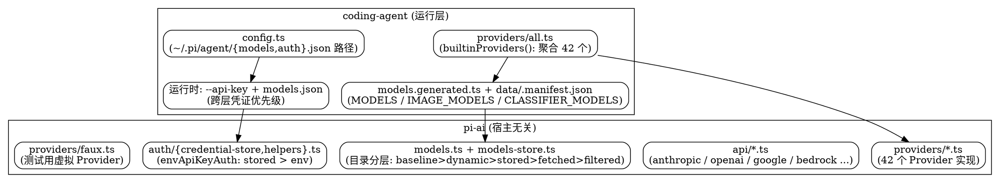

# Providers：Provider 与模型目录系统

Pi 的模型接入被拆成两层：**宿主无关的 `@earendil-works/pi-ai`**（Provider 抽象、API 实现、凭证、目录存储）和 **`coding-agent` 的运行层**（把 40+ 内建 Provider 聚合成 `builtinProviders()`、生成目录、叠加用户 `models.json` 覆盖、解析 CLI 凭证）。本文按 `main` 分支 `packages/ai` 与 `packages/coding-agent` 源码拆解，不依赖文档复述。

## 包边界：pi-ai 与 coding-agent 的职责切分

`packages/ai/src/index.ts` 明确**只导出核心、零副作用**：不导出生成的目录、不导出 Provider 工厂、不导出 OAuth 实现。Provider 工厂住在子路径 `@earendil-works/pi-ai/providers/*`，API 实现在 `@earendil-works/pi-ai/api/*`，旧全局 API 在 `@earendil-works/pi-ai/compat`。

- **`pi-ai` 负责**：`Provider`/`Model` 抽象、`Api`（anthropic-messages、openai-responses、google-generative-ai、bedrock-converse-stream、mistral-conversations、openai-codex-responses、azure-openai-responses、google-vertex …）、`auth/` 凭证解析与持久化、`models.ts` 目录合并、`models-store.ts` 离线缓存。
- **`coding-agent` 负责**：`builtinProviders()` 聚合、从 `models.generated.ts` 读目录、在 `config.ts` 定位 `models.json`/`auth.json`、解析 `--api-key` 等 CLI 覆盖。

这一切分让 `pi-ai` 可被任意宿主（CLI、Durable Object、测试）复用，Pi 只是其中一个消费者。

## Provider 注册：builtinProviders() 与 all.ts

`providers/all.ts` 是聚合入口，从 `../models.generated.ts` 导入三类目录常量（`MODELS`/`IMAGE_MODELS`/`CLASSIFIER_MODELS`），再 `import` 全部 Provider 工厂，最后在 `builtinProviders()` 中实例化并 `models.setProvider()` 注册。`BuiltinProvider = keyof typeof MODELS`，即"在生成目录里有静态条目的 Provider"。

`builtinProviders()` 当前注册 **42 个** Provider（README 对外宣称 44，差额来自纯动态 Provider——如 `radius` 在注释中明确"no static catalog entry"，以及测试用 `faux`）。按来源大致分组：

| 分组 | Provider（工厂函数后缀 `Provider`） |
| --- | --- |
| 美国主流 | anthropic、openai、openaiCodex、google、googleVertex、azure、meta、xai、mistral、groq、fireworks、together、cerebras、baseten、huggingface、nvidia、vercelAIGateway、openrouter、cloudflareAIGateway、cloudflareWorkersAI、typesafe |
| 中国 | deepseek、moonshotai、moonshotaiCn、minimax、minimaxCn、qwenTokenPlan / qwenTokenPlanCn / qwenTokenPlanIndividual、zai、zaiCodingCn、xiaomi / xiaomiTokenPlanAms / xiaomiTokenPlanCn / xiaomiTokenPlanSgp、antLing、kimiCoding |
| 企业 / 云 / 代理 | amazonBedrock、githubCopilot、radius、opencode、opencodeGo |

每个 Provider 配套一个 `*.models.ts` 文件（如 `anthropic.models.ts`），把该厂商的模型定义成静态基线目录；纯动态 Provider（如 `radius`）没有静态 `*.models.ts`，目录完全靠运行时拉取。

## 模型目录三重生成：MODELS / IMAGE_MODELS / CLASSIFIER_MODELS

`all.ts` 从 `models.generated.ts` 导入三个并列目录常量，对应 `Model`（对话）、`ImageModel`（图像）、`ClassifierModel`（分类器）三种 `ModelType`（源码 `KNOWN_MODEL_TYPES = { chat, image, classifier }`）：

- **`MODELS`（chat）**：常规对话模型，绝大多数 Provider 的主目录。
- **`IMAGE_MODELS`**：图像模型——既含图像生成，也含多模态图像输入的承载模型（近期提交为 System One 分类器补了 `images` 入参，说明图像模型与分类器共用输入管道）。
- **`CLASSIFIER_MODELS`**：**分类器模型**，是 Pi 内部 Decisions / System One 子系统（自动压缩、子代理路由、意图判别等）所用的轻量快速模型，由 OpenRouter、Clef（Workers AI）、TypeSafe（Jev）等厂商的 classifier API 支撑——**不是 `faux` 虚拟模型**（见下文纠正）。

三者都由构建期脚本生成进 `models.generated.ts`，并带 `data/.manifest.json`（`generatedAt` 时间戳，`getBuiltinModelDataGeneratedAt()` 可读）。`getBuiltinModel(s)` / `getBuiltinImageModel(s)` / `getBuiltinClassifierModel(s)` 提供按 `(provider, id)` 的类型安全读取；`getBuiltinProviders()` 返回全部 provider 名。

## 目录分层与刷新：baseline → dynamic → stored → fetched → filtered

`models.ts` 的 `createProvider` 把每个 Provider 的目录维护成一条分层链，`currentModels()` 按 `type + id` 做覆盖式合并：

1. **baseline（静态基线）**：来自 `*.models.ts` 的生成目录，编译期固定。
2. **dynamic（动态拉取）**：`refreshModels` 从厂商 API `fetchModels` 得到的实时目录，按 `type+id` 覆盖基线或追加新条目。
3. **stored（离线恢复）**：`ModelsStoreEntry` 持久化快照（`{ models, checkedAt }`），启动时先恢复，避免无网络时目录为空；`withKnownModelTypes()` 丢弃当前版本不认识的模型类型。
4. **fetched（网络刷新）**：允许网络时并发 `runProviderRefreshPhase` → `publishProviderModels`，事务性地写回 `ModelsStore`。
5. **filtered（凭据过滤）**：`getAvailable()` 时 `filterModels` 按当前凭据动态筛掉无 key 的 Provider 模型。

同步访问器 `getModels()` / `getAllModels()` / `getModelOfType()` 直接读合并后的结果，刷新在后台并发进行。这套机制让 Pi 既能离线工作，又能在厂商上新模型时自动"看到"。

## 用户覆盖层：models.json 叠加在生成目录之上

`config.ts` 定义两个用户配置文件路径（位于 Agent 目录，可用 `PI_CODING_AGENT_DIR` 环境变量重定向）：

- `getModelsPath()` → `~/.pi/agent/models.json`：用户级模型目录覆盖。用户可在此追加 Provider 条目、覆盖某模型的 `context_window`/`max_output_tokens`/`cost` 等，叠加在 `models.generated.ts` 之上（"用户覆盖 vs 内建"层）。
- `getAuthPath()` → `~/.pi/agent/auth.json`：持久化的登录凭证（`CredentialStore` 落盘），与内存 `InMemoryCredentialStore` 互为持久层。

注意：`config.ts` 本身只负责"路径指向"，真正的读取/合并在运行层；`models.generated.ts` 是构建期产物（不可手改），`models.json` 是运行期用户层（手改生效）。

## 凭证解析链：envApiKeyAuth 与跨层优先级

`auth/helpers.ts` 的 `envApiKeyAuth(name, envVars)` 是每个 API-key Provider 的标准实现，`resolve` 的**已验证**优先级为：

1. **存储凭证优先**：`credential?.key` 命中（来自 `auth.json` / `CredentialStore`）→ `source: "stored credential"`。
2. **环境变量兜底**：依次读 `envVars`（如 `ANTHROPIC_API_KEY`），命中即返回，`source` 记为该变量名。

`InMemoryCredentialStore` 以 `Provider.id` 为键，写入经 per-provider 的 Promise 链串行化（`enqueue`），保证同一 Provider 的凭证读写不竞态。

在 `coding-agent` 运行层，再往上叠加两条跨层覆盖（文档化运行行为，非 `helpers.ts` 内）：

3. **`models.json` Provider 级 auth**：用户在该文件里为某 Provider 直接写 key，覆盖存储凭证。
4. **CLI `--api-key` 覆盖**：运行期命令行指定，优先级最高，仅当次会话生效。

综合优先级（高→低）：**`--api-key` > `models.json` Provider auth > `auth.json` 存储凭证 > Provider 自带 env 变量**。OAuth 类（如 Bedrock IAM）走 `lazyOAuth` 动态 import，把 Node-only 的 OAuth 流程代码排除出浏览器/Worker 打包。

## 虚拟/测试模型：faux Provider（纠正）

`providers/faux.ts` 是一个**仅供测试**的虚拟 Provider：默认模型 `faux-1`（baseUrl `http://localhost:0`，无真实后端），从内存队列 `pendingResponses` 弹出预编排响应、用 `setTimeout` 模拟 token 速率，全程零网络 I/O。它通过 `models.setProvider(faux.provider)` 把虚拟模型挂进目录，用于单元测试 `Models` 集合。

> **纠正**：早期笔记里"Pi 内部 Decisions 分类模型是 faux"的猜测不成立。分类器是 `CLASSIFIER_MODELS` 中**真实生成的目录条目**，由 OpenRouter/Clef/Workers AI 等真实 classifier API 支撑；`faux` 只是测试桩。

## 分类器与图像模型：支撑 Decisions / System One

`CLASSIFIER_MODELS` 与 `IMAGE_MODELS` 是 Pi 区别于"纯聊天壳"的关键设计——它们让**内部决策也走模型**：

- **分类器**：自动压缩判别、子代理派发、意图/边界判断等 Decisions 子系统，调用的是小、快、廉的 classifier 模型；近期提交为这些分类器统一补了图像输入能力（`ClassifierContext.images` + 各厂商线格式适配）。
- **图像模型**：承载多模态输入与图像生成，与分类器共用 `images` 输入通道。

这三类目录（对话/图像/分类器）通过同一套 `Model`/`Api` 抽象与分层刷新机制统一管理，是 Pi "everything is a model call" 架构在 Provider 层的落地。

## Links

- [Architecture：架构与包分层](/docs/CS/AI/LLM/Agent/Product/Pi/Architecture.md) — pi-ai 在包分层中的位置
- [Tools：工具系统](/docs/CS/AI/LLM/Agent/Product/Pi/Tools.md) — 工具如何经由 Provider 的模型调用
- [CodeMode：codemode 实现机制](/docs/CS/AI/LLM/Agent/Product/Pi/CodeMode.md) — 沙箱内 `models.*` 全局来自本目录
- [Pi：产品总览](/docs/CS/AI/LLM/Agent/Product/Pi/Pi.md)

## References

- [pi/packages/ai/src/providers/all.ts](https://github.com/earendil-works/pi/blob/main/packages/ai/src/providers/all.ts) — `builtinProviders()` 聚合 42 个 Provider、三类目录常量
- [pi/packages/ai/src/models.ts](https://github.com/earendil-works/pi/blob/main/packages/ai/src/models.ts) — 目录分层（baseline→dynamic→stored→fetched→filtered）
- [pi/packages/ai/src/auth/helpers.ts](https://github.com/earendil-works/pi/blob/main/packages/ai/src/auth/helpers.ts) — `envApiKeyAuth` 存储凭证 > 环境变量
- [pi/packages/ai/src/auth/credential-store.ts](https://github.com/earendil-works/pi/blob/main/packages/ai/src/auth/credential-store.ts) — per-provider 串行化凭证存储
- [pi/packages/ai/src/providers/faux.ts](https://github.com/earendil-works/pi/blob/main/packages/ai/src/providers/faux.ts) — 测试用虚拟 Provider
- [pi/packages/coding-agent/src/config.ts](https://github.com/earendil-works/pi/blob/main/packages/coding-agent/src/config.ts) — `models.json`/`auth.json` 路径与 `PI_CODING_AGENT_DIR`
