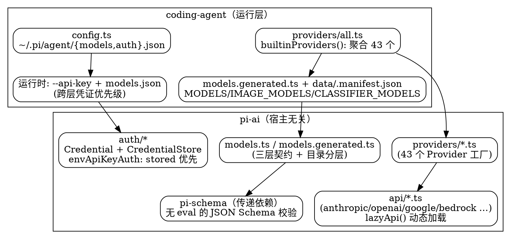

## Introduction

Pi 的模型接入被拆成两层：**宿主无关的 `@earendil-works/pi-ai`**（Provider 抽象、API 实现、凭证、目录存储）和 **`coding-agent` 的运行层**（把内建 Provider 聚合成 `builtinProviders()`、生成目录、叠加用户 `models.json` 覆盖、解析 CLI 凭证）。本文事实基线为 **v1.5.2**（commit `b4afdddf`，2026-11-10 发布）：12 个 workspace 包（agent / ai / chord / codemode / coding-agent / durable / env / evals / mcp / schema / telemetry / tui，全部 `version=1.5.2`，本版新增 `pi-schema`）全部按该 tag 的真实源码核对，结论以源码为准。

统一契约可分三层：`ProviderStreams`（协议实现）→ `Provider<TApi>`（一个厂商运行时单元）→ `Models`（聚合与路由集合）。Provider 工厂只声明 `id` / `baseUrl` / `auth` / `models` / `api`，具体协议放在 `api/*.ts` 并用 `lazyApi()` 动态加载。codemode 脚本里的 `models.*` 全局正是从这套目录系统取模型，见 [CodeMode](/docs/CS/AI/LLM/Agent/Product/Pi/CodeMode.md)。

## Package Boundary

`packages/ai/src/index.ts` 只导出核心、零副作用：不导出生成的目录、不导出 Provider 工厂、不导出 OAuth 实现。Provider 工厂住在子路径 `@earendil-works/pi-ai/providers/*`，API 实现在 `@earendil-works/pi-ai/api/*`，旧全局 API 在 `@earendil-works/pi-ai/compat`。



职责切分：

- **`pi-ai` 负责**：`Provider`/`Model` 抽象、`Api` 协议实现、`auth/` 凭证解析与持久化、`models.ts` 目录合并、`models-store.ts` 离线缓存。其 `package.json` 直接依赖 `@earendil-works/pi-schema`、`@anthropic-ai/sdk`、`openai`、`@google/genai`、AWS Bedrock SDK 等；`typebox` 只在 `devDependencies`。
- **`coding-agent` 负责**：`builtinProviders()` 聚合、从 `models.generated.ts` 读目录、`config.ts` 定位 `models.json`/`auth.json`、解析 `--api-key` 覆盖。其直接依赖含 `pi-tui` / `typebox` / `undici` / `quickjs-wasi` / `pi-codemode` / `pi-mcp`；**`pi-schema` 由 `pi-ai` 传递依赖**，不在直接依赖里。

这套切分让 `pi-ai` 可被任意宿主（CLI、Durable Object、测试）复用，Pi 只是其中一个消费者。

## Three-Layer Contract

第一层是协议实现模块的统一流式契约——每个 `src/api/` 模块都导出 `stream` / `streamSimple`，能处理延迟响应的还可导出 `fetchDeferred` / `cancelDeferred`（`packages/ai/src/types.ts`）：

```ts
export interface ProviderStreams {
	stream(model: Model<Api>, context: TranscriptContext, options?: StreamOptions): AssistantMessageEventStream;
	streamSimple(
		model: Model<Api>,
		context: TranscriptContext,
		options?: SimpleStreamOptions,
	): AssistantMessageEventStream;
	fetchDeferred?(
		model: Model<Api>,
		handle: DeferredHandle,
		options?: DeferredFetchOptions,
	): AssistantMessageEventStream;
	cancelDeferred?(model: Model<Api>, handle: DeferredHandle, options?: DeferredCancelOptions): Promise<void>;
}
```

第二层是运行时单元 `Provider<TApi>`（`packages/ai/src/models.ts`）——它拥有目录、认证与流行为，`TApi` 让具体工厂声明所用 API 以获得类型化的模型列表：

```ts
export interface Provider<TApi extends Api = Api> {
	readonly id: string;
	readonly name: string;
	readonly baseUrl?: string;
	readonly headers?: ProviderHeaders;
	/**
	 * Required: at least one of `apiKey`/`oauth`. Every provider has auth
	 * semantics — even providers with only ambient credentials (env vars, AWS
	 * profiles, ADC files) and keyless local servers provide `apiKey` auth
	 * whose `resolve()` reports whether the provider is configured.
	 * `Models.getAuth()` returns undefined when the provider is unconfigured.
	 */
	readonly auth: ProviderAuth;

	/**
	 * Current known chat models, sync. Static providers return their catalog;
	 * dynamic providers return the list as of the last `refreshModels()` (empty
	 * before the first). Must not throw; `Models` treats a throwing
	 * implementation as having no models.
	 */
	getModels(): readonly Model<TApi>[];
```

（此块为 `Provider` 接口开头到 `getModels()` 的连续片段。）第三层 `Models`（同文件）是聚合集合：持有一组 `Provider`，把每次请求路由给拥有该模型的 Provider，并统一做认证解析、目录合并与刷新。

## Provider Factories and Lazy APIs

Provider 工厂**只声明元数据、认证、目录与协议入口**，不写任何协议逻辑——以 `openaiProvider()` 为例（`packages/ai/src/providers/openai.ts`）：

```ts
export function openaiProvider(): Provider<"openai-responses"> {
	return createProvider<"openai-responses">({
		id: "openai",
		name: "OpenAI",
		baseUrl: "https://api.openai.com/v1",
		auth: {
			apiKey: envApiKeyAuth("OpenAI API key", ["OPENAI_API_KEY"]),
			oauth: lazyOAuth({
				name: "OpenAI (ChatGPT subscription)",
				isSubscription: true,
				loginLabel: "Sign in with ChatGPT",
				load: loadOpenAIChatGPTOAuth,
			}),
		},
		models: [
			...Object.values(OPENAI_MODELS),
			...Object.values<ClassifierModel<"openai-decisions">>(OPENAI_CLASSIFIER_MODELS),
		],
		// Sign in with ChatGPT tokens only reach the Responses API; the Decisions API rejects them.
		filterAllModels: (models, credential) =>
			credential?.type === "oauth" ? models.filter((model) => !isModelType(model, "classifier")) : models,
		api: openAIResponsesApi(),
		classifiers: {
			"openai-decisions": openAIDecisionsApi(),
		},
	});
}
```

`api` 字段来自 `api/*.lazy.ts`，经 `lazyApi()` 包装成 `ProviderStreams`：模块在首次 `stream()` 时才真正 `import()`，host 的 import 缓存负责去重，加载失败编码成流上的 error 事件（`packages/ai/src/api/lazy.ts`）：

```ts
export function lazyApi(load: () => Promise<ProviderStreams>, capabilities?: LazyApiCapabilities): ProviderStreams {
	const api: ProviderStreams = {
		stream: (model, context, options) =>
			lazyStream(model, async () => (await load()).stream(model, context, options), undefined, options?.signal),
		streamSimple: (model, context, options) =>
			lazyStream(
				model,
				async () => (await load()).streamSimple(model, context, options),
				undefined,
				options?.signal,
			),
	};
```

若调用方声明了延迟响应能力，函数再补上对应方法并返回（同一文件，连续片段）：

```ts
	if (capabilities?.fetchDeferred) {
		api.fetchDeferred = (model, handle, options) =>
			lazyStream(
				model,
				async () => {
					const implementation = await load();
					if (!implementation.fetchDeferred) throw new Error("API does not support deferred responses");
					return implementation.fetchDeferred(model, handle, options);
				},
				undefined,
				options?.signal,
			);
	}
	if (capabilities?.cancelDeferred) {
		api.cancelDeferred = async (model, handle, options) => {
			const implementation = await load();
			if (!implementation.cancelDeferred) throw new Error("API cannot cancel deferred responses");
			await implementation.cancelDeferred(model, handle, options);
		};
	}

	return api;
}
```

这让 SDK 实现（`@anthropic-ai/sdk`、`openai`、`@google/genai` 等）留在按需加载的 chunk 里。

## Builtin Providers

`providers/all.ts` 是聚合入口：导入 `models.generated.ts` 的三类目录常量、导入全部工厂，在 `builtinProviders()` 里实例化。`BuiltinProvider = keyof typeof MODELS`，即在生成目录里有静态条目的 Provider。

**v1.5.2 的 `builtinProviders()` 注册 43 个 Provider**（旧版笔记记的 42 已过时；README「Supported Providers」对外宣称 44，差额来自纯动态 Provider——如 `radius` 没有静态目录条目——以及测试用 `faux`）：

函数开头是一串工厂调用（连续片段），逐个实例化后返回：

```ts
export function builtinProviders(): Provider[] {
	return [
		amazonBedrockProvider(),
		antLingProvider(),
		anthropicProvider(),
		azureProvider(),
		basetenProvider(),
		cerebrasProvider(),
		cloudflareAIGatewayProvider(),
		cloudflareWorkersAIProvider(),
		deepseekProvider(),
		fireworksProvider(),
		githubCopilotProvider(),
		googleProvider(),
		googleVertexProvider(),
		groqProvider(),
```

列表一路排到 `zaiCodingCnProvider()`（中间还有 huggingface、minimax、mistral、moonshotai、nvidia、openai、openrouter、qwen 系列、radius、xiaomi 系列、zai 等），合计 **43 项**。按来源大致分组（工厂函数后缀 `Provider`）：

| 分组 | Provider |
| :--- | :--- |
| 美国主流 | anthropic、openai、openaiCodex、google、googleVertex、azure、meta、xai、mistral、groq、fireworks、together、cerebras、baseten、huggingface、nvidia、vercelAIGateway、openrouter、cloudflareAIGateway、cloudflareWorkersAI、typesafe |
| 中国 | deepseek、moonshotai、moonshotaiCn、minimax、minimaxCn、qwenTokenPlan / qwenTokenPlanCn / qwenTokenPlanIndividual / qwenTokenPlanIndividualCn、zai、zaiCodingCn、xiaomi / xiaomiTokenPlanAms / xiaomiTokenPlanCn / xiaomiTokenPlanSgp、antLing、kimiCoding |
| 企业 / 云 / 代理 | amazonBedrock、githubCopilot、radius、opencode、opencodeGo |

每个 Provider 配套一个 `*.models.ts` 静态基线目录（如 `anthropic.models.ts`）；纯动态 Provider（如 `radius`）没有静态文件，目录靠运行时拉取。

## The Streaming Contract

所有 Provider 最终产出统一的 `AssistantMessageEventStream`，事件协议在 `packages/ai/src/types.ts`：

```ts
export type AssistantMessageEvent =
	| { type: "start"; partial: AssistantMessage }
	| { type: "text_start"; contentIndex: number; partial: AssistantMessage }
	| { type: "text_delta"; contentIndex: number; delta: string; partial: AssistantMessage }
	| { type: "text_end"; contentIndex: number; content: string; partial: AssistantMessage }
	| { type: "thinking_start"; contentIndex: number; partial: AssistantMessage }
	| { type: "thinking_delta"; contentIndex: number; delta: string; partial: AssistantMessage }
	| { type: "thinking_end"; contentIndex: number; content: string; partial: AssistantMessage }
	| { type: "toolcall_start"; contentIndex: number; partial: AssistantMessage }
	| { type: "toolcall_delta"; contentIndex: number; delta: string; partial: AssistantMessage }
	| { type: "toolcall_end"; contentIndex: number; toolCall: ToolCall; partial: AssistantMessage }
	| {
			type: "done";
			reason: Extract<StopReason, "stop" | "length" | "toolUse" | "deferred">;
			message: AssistantMessage;
	  }
	| { type: "error"; reason: Extract<StopReason, "aborted" | "error">; error: AssistantMessage };
```

成功流先发 `start`、增量发 `text_delta` / `thinking_delta` / `toolcall_*`，最后 `done`；**失败不抛异常，而是编码进流**——要么在 `start` 前直接 `error`，要么在流内以 `error` 终止，并落到一个 `stopReason: "error"` 或 `"aborted"` 的 `AssistantMessage` 上。直接 `streamSimple()` 在缺认证时可同步抛错，但流一旦返回，请求/模型/运行时失败都走这条协议。

## Model Catalog Generation and Layering

`all.ts` 从 `models.generated.ts` 导入三个并列目录常量，对应 `Model` 的三种类型（chat / image / classifier），并提供类型安全的读取（`getBuiltinModel` / `getBuiltinImageModel` / `getBuiltinClassifierModel`）：

```ts
/** Typed read of one generated built-in chat model. */
export function getBuiltinModel<TProvider extends BuiltinProvider, TModelId extends BuiltinChatModelId<TProvider>>(
	provider: TProvider,
	modelId: TModelId,
): Model<CatalogApi<(typeof MODELS)[TProvider][TModelId]>> {
	return (MODELS as Record<string, Record<string, Model<Api>> | undefined>)[provider]?.[modelId as string] as Model<
		CatalogApi<(typeof MODELS)[TProvider][TModelId]>
	>;
}
```

三者都是构建期脚本生成进 `models.generated.ts`、带 `data/.manifest.json`（`getBuiltinModelDataGeneratedAt()` 可读 `generatedAt`）。`CLASSIFIER_MODELS` 是真实生成的目录条目（由 OpenRouter、Clef / Workers AI、TypeSafe 等的 classifier API 支撑，**不是测试桩 `faux`**），用于 Decisions / System One 的自动压缩、路由、意图判别；`IMAGE_MODELS` 承载多模态输入与图像生成。

目录分层链由 `createProvider` 维护，`currentModels()` 按 `type + id` 做覆盖式合并（`packages/ai/src/models.ts`）：

```ts
	const currentModels = (): readonly ProviderModel<TApi>[] => {
		const merged = [...baselineModels];
		for (const model of dynamicModels) {
			const index = merged.findIndex(
				(entry) => getModelType(entry) === getModelType(model) && entry.id === model.id,
			);
			if (index >= 0) merged[index] = model;
			else merged.push(model);
		}
		return merged;
	};
```

完整五层：`baseline`（`*.models.ts` 静态基线）→ `dynamic`（`refreshModels` 从厂商 API 拉取）→ `stored`（`ModelsStoreEntry` 离线快照，无网络时恢复）→ `fetched`（网络刷新后事务性写回）→ `filtered`（`getAvailable()` 按当前凭据筛掉无 key 的模型）。同步访问器读的是合并结果，刷新在后台并发。

## User Override Layer

`config.ts` 定义两个用户配置文件路径（位于 Agent 目录，可用 `PI_CODING_AGENT_DIR` 重定向）：

- `getModelsPath()` → `~/.pi/agent/models.json`：用户级覆盖，追加 Provider、改 `context_window` / `max_output_tokens` / `cost`，叠加在生成目录之上；也能为某 Provider 直接写 key。
- `getAuthPath()` → `~/.pi/agent/auth.json`：`CredentialStore` 的持久化落盘，与内存 `InMemoryCredentialStore` 互为持入层。

`models.generated.ts` 是构建期产物（不可手改），`models.json` 是运行期用户层（手改生效）；`config.ts` 本身只负责路径指向，读取与合并在运行层完成。

## Credentials and Authentication

认证的核心契约是 `Credential` + `CredentialStore`：`Credential` 是**每 Provider 一个、带类型标签**的凭证（`auth/types.ts`）：

```ts
/**
 * Stored api-key credential. `env` holds provider-scoped environment/config
 * values such as Cloudflare account/gateway ids.
 */
export interface ApiKeyCredential {
	type: "api_key";
	key?: string;
	env?: ProviderEnv;
}

/** OAuth token data returned by extension compatibility flows. */
export interface OAuthCredentials {
	refresh: string;
	access: string;
	expires: number;
	[key: string]: unknown;
}

/** Stored canonical OAuth credential. */
export interface OAuthCredential extends OAuthCredentials {
	type: "oauth";
}

/** One type-tagged credential per provider — the shape of today's auth.json. */
export type Credential = ApiKeyCredential | OAuthCredential;
```

`CredentialStore` 以 `Provider.id` 为键、每 Provider 一条；**`modify()` 是唯一写入口**，所有变更都是串行化的 read-modify-write（`auth/types.ts` 注释 + `auth/credential-store.ts` 实现）：

```ts
export class InMemoryCredentialStore implements CredentialStore {
	private credentials = new Map<string, Credential>();
	private chains = new Map<string, Promise<unknown>>();

	/** Serialize tasks per provider id without releasing the chain before active work settles. */
	private enqueue<T>(providerId: string, task: () => Promise<T>, options?: AuthOperationOptions): Promise<T> {
		const signal = operationSignal(options?.signal);
		const previous = this.chains.get(providerId) ?? Promise.resolve();
		const queued = (async () => {
			await previous.catch(() => {});
			signal.throwIfAborted();
			return task();
		})();
		const tail = queued.catch(() => {});
		this.chains.set(providerId, tail);
		void tail.then(() => {
			if (this.chains.get(providerId) === tail) this.chains.delete(providerId);
		});
		return raceWithAbortSignal(queued, signal);
	}
```

`modify()` 与 `delete()` 都经 `enqueue` 串行化，保证同一 Provider 的读写不竞态。

标准 API-key 认证 `envApiKeyAuth(name, envVars)`（`auth/helpers.ts`）：**存储凭证优先、无静默 env 回退**——只要 `credential.key` 命中就以 `source: "stored credential"` 返回且连同凭证自带的 `env` 一起交付；只有没有存储凭证时才依次读 `envVars`，两者都没有才返回 `undefined`：

```ts
		resolve: async ({ ctx, credential, signal }) => {
			signal.throwIfAborted();
			if (credential?.key) {
				return { auth: { apiKey: credential.key }, env: credential.env, source: "stored credential" };
			}
			for (const envVar of envVars) {
				const value = await ctx.env(envVar);
				signal.throwIfAborted();
				if (value) return { auth: { apiKey: value }, source: envVar };
			}
			return undefined;
		},
```

跨层的综合优先级（高→低）：**`--api-key` CLI > `models.json` Provider auth > `auth.json` 存储凭证 > Provider 自带 env 变量**。

OAuth 刷新在 `modify()` 锁内完成、且用双重检查避免并发/多进程重复刷新——`signal` 只取消等锁，一旦刷新开始就忽略它以保住轮换后的 refresh token（`auth/resolve.ts`）：

```ts
		post = await credentials.modify(
			providerId,
			async (current) => {
				signal.removeEventListener("abort", cancelLockWait);
				signal.throwIfAborted();
				if (current?.type !== "oauth") return undefined; // logged out meanwhile
				if (!needsRefresh(current)) return undefined; // another process/request refreshed
				try {
					return await oauth.refresh(current, AbortSignal.timeout(DEFAULT_OAUTH_REFRESH_TIMEOUT_MS));
				} catch (error) {
					throw new ModelsError("oauth", `OAuth refresh failed for ${providerId}`, { cause: error });
				}
			},
			{ signal: lockWait.signal },
		);
```

**ChatGPT / Claude Pro 订阅登录统一走 provider OAuth**：不是单独的用户体系，而是 Provider 工厂里声明的 `oauth: lazyOAuth({ isSubscription: true, ... })`——`openaiProvider()` 挂 `"OpenAI (ChatGPT subscription)"`（`Sign in with ChatGPT`），`anthropicProvider()` 挂 `"Anthropic (Claude Pro/Max)"`。`isSubscription` 标记区分订阅令牌与 API-key 计费；订阅令牌的能力可能受限（如 openai 的 ChatGPT 令牌只到 Responses API、被 `filterAllModels` 从 classifier 里排除）。`lazyOAuth` 把 Node-only 的 OAuth 流程代码排除出浏览器 / Worker 打包，首次 `login`/`refresh`/`toAuth` 才加载。

## pi-schema Validation

v1.5.2（自 **v1.5.0** 起）新增 `@earendil-works/pi-schema`：一个**不用 `eval`** 的 JSON Schema 校验器，schema 一次编译成普通闭包，drafts **2020-12 / 7** 都能编译，在严格 CSP 下也能跑、零运行时依赖。编译器头注释与 `compile` 入口（`packages/schema/src/compiler.ts`、`validator.ts`）：

```ts
// The compiler: a schema to one check closure, built once. Keywords group by the type they constrain, so a value
// is classified once per schema, and the common shapes (closed objects, arrays of one item schema, tagged unions,
// leaf schemas) get one specialized closure each.
```

```ts
export function compile<S extends JsonSchema>(
	schema: S,
	options: CompileOptions = NO_OPTIONS,
): Validator<Static<S>> | CoercingValidator<Static<S>> {
	const check = compileCheck(schema, options);
	return options.coerce === true
		? new CoercingValidator(schema, options, check)
		: new Validator(schema, options, check);
}
```

校验器的 `check()` 是布尔快路径（无分配），`errors()` 按需构建并缓存，`validate()` 合并二者；`coerce: true` 另加 `coerce()`/`parse()`，规则是 TypeBox `Value.Convert` 的超集。

**这是 breaking change**：主入口不再 re-export TypeBox、`typebox` 不再是 `pi-ai` 依赖；`Tool.parameters` 现在是任意 JSON Schema，`validateToolCall()` / `validateToolArguments()` 一律用 `pi-schema` 的 `compile(schema, { coerce: true }).parse()`。TypeBox **超出 JSON Schema 的特性不再对工具参数生效**——`Type.Refine()` 的 refinement 不执行、`Type.BigInt()`/`Undefined()`/`Void()` 拒绝所有 JSON 参数、codec 不解码、`Format.Set()` 注册的自定义 format 不检查；未解析的 `$ref` 只让该处参数失败而非整个工具调用失败。想保留 TypeBox，直接从 `typebox` 包导入（其 schema 本身就是 JSON Schema）。

## Virtual Models

虚拟模型是**目录里每次请求都被路由到一个物理模型**的条目：它属于某个 Provider 但不发给该 Provider，选择（`model_change` / `agent.state.model` / `ctx.model`）可以指到虚拟模型，路由之下的所有环节只看到物理模型（`packages/coding-agent/src/core/virtual-models.ts`）：

虚拟模型的 API id 是常量 `pi-virtual`，未路由就请求它会失败（`virtual-models.ts`）：

```ts
/** API id of virtual catalog entries. Requests for it fail unless routed first. */
export const VIRTUAL_MODEL_API = "pi-virtual";
```

判定一个模型或消息是否为虚拟模型只看这个 api 字段（同文件另一处）：

```ts
/** Whether a model or message names a virtual model. Failed routing leaves the virtual model on its message. */
export function isVirtualModel(model: { api: string }): boolean {
	return model.api === VIRTUAL_MODEL_API;
}
```

目录条目把 `api` 固定为 `pi-virtual`、`baseUrl` 留空（同文件 `createVirtualModel`）：

```ts
/** Build the catalog entry of a virtual model. */
export function createVirtualModel(definition: Omit<VirtualModelDefinition, "route">): Model<Api> {
	const levels = definition.thinkingLevels ?? ["off"];
	const thinkingLevelMap: ThinkingLevelMap = {};
	for (const level of THINKING_LEVELS) thinkingLevelMap[level] = levels.includes(level) ? level : null;
	return {
		id: definition.id,
		name: definition.name,
		api: VIRTUAL_MODEL_API,
		provider: definition.provider,
		baseUrl: "",
		reasoning: levels.some((level) => level !== "off"),
		thinkingLevelMap,
		input: definition.input ?? ["text", "image"],
		cost: { input: 0, output: 0, cacheRead: 0, cacheWrite: 0 },
		contextWindow: definition.contextWindow ?? 0,
		maxTokens: definition.maxTokens ?? 0,
	};
}
```

`VirtualModelDefinition.route(request)` 按请求（`user` / `continuation` / `retry` / `direct`）、思考级别、上次成功的物理模型、路由状态挑出物理模型；路由状态存在会话分支的 `pi.virtual-model-state` 条目里。`withVirtualModels()` 把虚拟模型叠加进 Provider 目录，`stream()` 遇到未路由的虚拟模型直接给错误流——所以**虚拟模型永远不会发给 Provider**：

```ts
	const { filterModels, filterAllModels } = provider;
	return {
		...provider,
		getModels: () => [...physical(provider.getModels()), ...virtualModels],
		getAllModels: () => [...physical(provider.getAllModels?.() ?? provider.getModels()), ...virtualModels],
		filterModels: (models, credential) => {
			const real = physical(models);
			return [...(filterModels?.(real, credential) ?? real), ...virtual(models)];
		},
		filterAllModels:
			filterAllModels &&
			((models, credential) => [...filterAllModels(physical(models), credential), ...virtual(models)]),
		stream: (model, context, options) =>
			isVirtualModel(model) ? unroutedStream(model) : provider.stream(model, context, options),
		streamSimple: (model, context, options) =>
			isVirtualModel(model) ? unroutedStream(model) : provider.streamSimple(model, context, options),
	};
```

另有测试桩 `faux` Provider（默认模型 `faux-1`、`baseUrl: http://localhost:0`、从内存队列弹预编排响应、零网络 I/O），仅用于单元测试，不属于 `builtinProviders()`。

`ModelRegistry` 只是**给扩展的同步兼容门面**，coding-agent 内部直接用 `ModelRuntime`（`packages/coding-agent/src/core/model-registry.ts`）：

```ts
/**
 * Synchronous compatibility facade exposed to extensions.
 * Coding-agent internals use ModelRuntime directly.
 */
export class ModelRegistry {
	private readonly runtime: ModelRuntime;

	constructor(runtime: ModelRuntime) {
		this.runtime = runtime;
	}

	/** Reload models.json asynchronously. Await before making synchronous registry reads. */
	refresh(options?: ModelsRefreshOptions): Promise<ModelsRefreshResult> {
		return this.runtime.refresh(options);
	}

	getAll(): Model<Api>[] {
		return [...this.runtime.getModels()];
	}

	find(provider: string, modelId: string): Model<Api> | undefined {
		return this.runtime.getModel(provider, modelId);
	}
```

## Links

- [Pi：产品总览与子系统索引](/docs/CS/AI/LLM/Agent/Product/Pi/Pi.md)
- [Architecture：架构与包分层](/docs/CS/AI/LLM/Agent/Product/Pi/Pi.md?id=architecture)
- [Tools：工具系统](/docs/CS/AI/LLM/Agent/Product/Pi/Tools.md)
- [Extensions：扩展与工具暴露](/docs/CS/AI/LLM/Agent/Product/Pi/Extensions.md)
- [Events：事件流](/docs/CS/AI/LLM/Agent/Product/Pi/Events.md)
- [MCP：客户端与 OAuth](/docs/CS/AI/LLM/Agent/Product/Pi/MCP.md)

## References

- [pi 仓库（v1.5.2）](https://github.com/earendil-works/pi/tree/v1.5.2)
- [providers/all.ts — builtinProviders() 聚合 43 个](https://github.com/earendil-works/pi/blob/v1.5.2/packages/ai/src/providers/all.ts)
- [types.ts — ProviderStreams / AssistantMessageEvent](https://github.com/earendil-works/pi/blob/v1.5.2/packages/ai/src/types.ts)
- [models.ts — Provider 契约与目录分层](https://github.com/earendil-works/pi/blob/v1.5.2/packages/ai/src/models.ts)
- [api/lazy.ts — lazyApi() 动态加载](https://github.com/earendil-works/pi/blob/v1.5.2/packages/ai/src/api/lazy.ts)
- [auth/credential-store.ts — 串行化凭证存储](https://github.com/earendil-works/pi/blob/v1.5.2/packages/ai/src/auth/credential-store.ts)
- [auth/resolve.ts — 锁内 OAuth 刷新](https://github.com/earendil-works/pi/blob/v1.5.2/packages/ai/src/auth/resolve.ts)
- [virtual-models.ts — pi-virtual 路由](https://github.com/earendil-works/pi/blob/v1.5.2/packages/coding-agent/src/core/virtual-models.ts)
