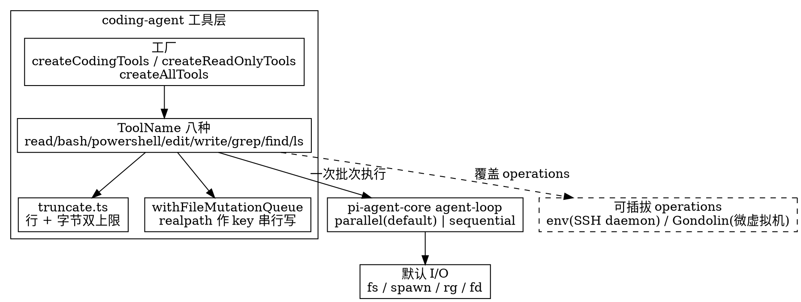

## Introduction

Pi 的工具是一套工程化分层：`ToolName` 声明八种能力，工厂按用途装配，ToolDefinition 经 `wrapToolDefinition` 变成可执行的 AgentTool；模型侧只默认激活四个（`read`/`bash`/`edit`/`write`），其余靠扩展、`--tools` 或 `defaultTools` 启用。输出限制统一走 `truncate.ts` 的**行 + 字节双上限**，与 token 无关；一次工具批次的并发度、截断响应下工具调用的处置，则由 `pi-agent-core` 的 agent loop 决定（见 [AgentLoop](/docs/CS/AI/LLM/Agent/Product/Pi/AgentLoop.md)）。本页按 v1.5.2 源码把这几条链路拆开讲清。

> 版本基线：核实于 2026-11-16，对应 **v1.5.2**（commit `b4afdddf44e059c67ccf5097e5317d913521b470`，2026-11-10 发布）。所有事实以该 tag 的源码为准，非以文档为准；源码路径相对仓库根。



## Tool Factories and Exposure

`packages/coding-agent/src/core/tools/index.ts` 是装配层。它先声明八种工具名，再给出三组工厂：

```ts
export type ToolName = "read" | "bash" | "powershell" | "edit" | "write" | "grep" | "find" | "ls";
export const allToolNames: Set<ToolName> = new Set([
	"read",
	"bash",
	"powershell",
	"edit",
	"write",
	"grep",
	"find",
	"ls",
]);
```

```ts
export function createCodingTools(cwd: string, options?: ToolsOptions): Tool[] {
	return [
		createReadTool(cwd, options?.read),
		createBashTool(cwd, options?.bash),
		createEditTool(cwd, options?.edit),
		createWriteTool(cwd, options?.write),
	];
}
```

`createReadOnlyTools` 是 `read`/`grep`/`find`/`ls`，`createAllTools` 返回上面八个的完整 `Record`。每个工厂还有对应的 `*ToolDefinitions` 版本，只产出声明、不包 AgentTool。

**注册八个、默认激活四个**是两条独立机制：`AgentSession` 用 `createAllToolDefinitions` 把八个全部注册进 `_baseToolDefinitions`，再按 active 名字决定哪些进入模型可见的 loadout：

```ts
const baseToolDefinitions = this._baseToolsOverride
	? Object.fromEntries(
			Object.entries(this._baseToolsOverride).map(([name, tool]) => [
				name,
				createToolDefinitionFromAgentTool(tool),
			]),
		)
	: createAllToolDefinitions(this._cwd, {
			read: { autoResizeImages },
			bash: { commandPrefix: shellCommandPrefix, shellPath },
		});
```

```ts
const defaultActiveToolNames = this._baseToolsOverride
	? Object.keys(this._baseToolsOverride)
	: ["read", "bash", "edit", "write"];
const baseActiveToolNames = options.activeToolNames ?? defaultActiveToolNames;
```

`defaultTools` 设置（`DEFAULT_TOOL_NAMES = ["read", "bash", "edit", "write"]`）和 `--tools` 的 `+name`/`-name` 都在这层生效；reload 时新加进 `defaultTools` 的工具被激活，被移除的仍保持激活。暴露态五态（`direct`/`model-only`/`codemode`/`deferred`/`hidden`）与编排型工具的 `prepareLoadout` 见 [Extensions](/docs/CS/AI/LLM/Agent/Product/Pi/Extensions.md)。

## The Eight Tools

### read / edit / write

`read` 入参 `path`、`offset`（1-indexed 起读行）、`limit`（读取行数），文本走流式或 buffer 读取，`resolveReadPathAsync` 解析路径，全程可 `AbortSignal` 取消。图片（`jpg`/`png`/`gif`/`webp`/`bmp`）走 `processImage`，默认 `autoResizeImages: true`，按模型 `inputLimits.images` 缩放；不支持 vision 时附提示。`outputSchema` 是字符串与 `{ type:"image", data, mimeType, note }` 的联合，codemode 脚本拿到的是可直接喂 `image()` 的结构化块。

截到首行就超字节上限时，不是简单丢弃，而是给模型一条可执行的 shell 兜底：

```ts
if (truncation.firstLineExceedsLimit) {
	// First line alone exceeds the byte limit. Point the model at a bash fallback.
	const firstLineSize = formatSize(firstLineBytes);
	outputText = `[Line ${startLineDisplay} is ${firstLineSize}, exceeds ${formatSize(DEFAULT_MAX_BYTES)} limit. Use bash: sed -n '${startLineDisplay}p' ${path} | head -c ${DEFAULT_MAX_BYTES}]`;
	details = { truncation };
} else if (truncation.truncated) {
	// Truncation occurred. Build an actionable continuation notice.
	const endLineDisplay = startLineDisplay + truncation.outputLines - 1;
	const nextOffset = endLineDisplay + 1;
	outputText = truncation.content;
	if (truncation.truncatedBy === "lines") {
		outputText += `\n\n[Showing lines ${startLineDisplay}-${endLineDisplay} of ${totalFileLines}. Use offset=${nextOffset} to continue.]`;
	} else {
		outputText += `\n\n[Showing lines ${startLineDisplay}-${endLineDisplay} of ${totalFileLines} (${formatSize(DEFAULT_MAX_BYTES)} limit). Use offset=${nextOffset} to continue.]`;
	}
	details = { truncation };
}
```

`edit` 入参 `path` + `edits[]`（每项 `{ oldText, newText }`）。**所有 `oldText` 都针对原始文件匹配**，不可重叠/嵌套，需在文件内唯一；匹配前剥 BOM、归一化成 LF，写回时用 `applyReplacementsToOriginal` 把改动拼回原文，未触碰的行保留原始行尾。`prepareEditArguments` 做兼容归一：旧式单字段 `oldText`/`newText` 并入 `edits[]`，Opus 4.6 / GLM-5.1 之类把 `edits` 发成 JSON 字符串或单对象的情况也统一成数组。返回 `diff`（展示）、`patch`（unified diff）、`firstChangedLine`（导航）。`write` 入参 `path` + `content`，不存在则建、存在则**直接覆盖**，自动 `mkdir -p` 父目录；两者全程走 `withFileMutationQueue`。

### bash

`bash` 的 schema 只有 `command` + 可选 `timeout`（秒，**无默认值即不超时**）。`MAX_TIMEOUT_MS = 2_147_483_647` 是上限，`STRUCTURED_OUTPUT_MAX_BYTES = 1MB` 只限制程序化 `structuredContent.output`，模型可见输出另按尾部 2000 行 / 50KB 截断并落临时文件（前缀 `pi-bash`，附 `[Showing lines A-B of T. Full output: <path>]`）。

执行后端是本地 shell operations，每次调用 `spawn` 一个**独立子进程**，非 Windows 设 `detached` 以便杀整棵进程树；stdout 与 stderr 接进同一个 `onData` 累积器：

```ts
const child = spawn(shellConfig.shell, commandFromStdin ? shellConfig.args : [...shellConfig.args, command], {
	cwd,
	detached: process.platform !== "win32",
	env: env ?? getShellEnv(),
	stdio: [commandFromStdin ? "pipe" : "ignore", "pipe", "pipe"],
	windowsHide: true,
});
if (commandFromStdin) {
	child.stdin?.on("error", () => {});
	child.stdin?.end(command);
}
if (child.pid) trackDetachedChildPid(child.pid);
```

abort 和 timeout 都落到一个动作——`killProcessTree(child.pid)`：

```ts
const onAbort = () => {
	if (child.pid) killProcessTree(child.pid);
};

try {
	// Set timeout if provided.
	if (timeoutMs !== undefined) {
		timeoutHandle = setTimeout(() => {
			timedOut = true;
			exitedBeforeDeadlineAfterMs = shellExitedAfterMs;
			// Also when the shell already exited: on Unix the group kill still reaches background
			// processes holding the pipes. Windows cannot find them once the shell pid is gone.
			if (child.pid) killProcessTree(child.pid);
		}, timeoutMs);
	}
```

`BashToolOptions` 支持 `operations`（替换后端）、`commandPrefix`（每条命令前垫 setup）、`shellPath`、`exposeSessionEnvironment`（默认 `true`，暴露 `PI_*`）、`spawnHook`。**无内置沙箱、无 `run_in_background` 参数**，安全靠外部隔离（见 [Security](/docs/CS/AI/LLM/Agent/Product/Pi/Security.md)）。

### grep / find / ls

三者组成只读集。`grep` 与 `find` 默认**调外部二进制**：`ensureTool("rg")` / `ensureTool("fd")`，本地没有就下载。

`grep` 入参 `pattern` / `path?` / `glob?` / `ignoreCase?` / `literal?` / `context?` / `limit?`(100)。它用 `--json --line-number --hidden --no-config` 起 ripgrep，`--no-config` 是为了让工具契约不依赖 `RIPGREP_CONFIG_PATH`；`context` 直接由 rg 的 `context` 事件给出，不再回读文件：

```ts
// --no-config: the tool contract (literal, glob, limit, ...) must not depend on
// ambient user config like RIPGREP_CONFIG_PATH. Users can customize via bash or extensions.
const args: string[] = ["--no-config", "--json", "--line-number", "--color=never", "--hidden"];
if (ignoreCase) args.push("--ignore-case");
if (literal) args.push("--fixed-strings");
// rg never matches a leading "./" ("./src/*.ts" finds nothing), so drop it; "!" negates.
if (glob) args.push("--glob", glob.replace(/^(!?)(?:\.\/)+/, "$1"));
// rg emits the surrounding lines as `context` events, so no matched file is ever read here (#9276).
if (contextValue > 0) args.push("--context", String(contextValue));
// rg roots --glob at its own cwd, so a directory search runs inside searchPath (#11807).
// It searches "." because rg canonicalizes its cwd: with an absolute path, a symlinked
// searchPath (macOS /tmp) would no longer lie under the glob root.
args.push("--", pattern, isDirectory ? "." : searchPath);

const child = spawn(rgPath, args, {
	cwd: isDirectory ? searchPath : undefined,
	stdio: ["ignore", "pipe", "pipe"],
});
```

匹配行经 `truncateLine` 截到 `GREP_MAX_LINE_LENGTH = 500` 字符，超限时提示用 read 看全文；字节上限 50KB，匹配数上限 100（`limit=` 可加）。注意 `GrepOperations` 在 v1.5.2 只剩 `isDirectory`（`readFile` 已废弃并被忽略），注释明确「搜索本身始终跑本地 ripgrep」，要远程搜索得覆盖整个 `execute()`，而不是替换 I/O 后端。

`find` 入参 `pattern`(glob) / `path?` / `limit?`(1000)，默认走 fd：

```ts
// Default implementation uses fd.
const fdPath = await ensureTool("fd");
if (signal?.aborted) {
	settle(() => reject(new Error("Operation aborted")));
	return;
}
if (!fdPath) {
	settle(() => reject(new Error("fd is not available and could not be downloaded")));
	return;
}

const args: string[] = ["--color=never", "--hidden"];
```

`FindOperations` 的 `exists`/`glob` 可整体替换掉 fd（自定义 `glob` 存在时直接走它）；`--no-require-git` 只在仓库外追加，含 `/` 的模式走 `--full-path` 并补 `**/`，Windows 上带路径的 glob 改由 `Minimatch` 兜底。`ls` 用 `fs.readdir`，大小写不敏感字母序、目录加 `/`、含 dotfile，上限 500 条 / 50KB；`LsOperations`（`exists`/`stat`/`readdir`）可替换后端。

## Shared Truncation（`truncate.ts`）

所有工具的输出上限来自同一处：两个独立上限**先到为准**，绝不按 token 计。

```ts
export const DEFAULT_MAX_LINES = 2000;
export const DEFAULT_MAX_BYTES = 50 * 1024; // 50KB
export const GREP_MAX_LINE_LENGTH = 500; // Max chars per grep match line

export interface TruncationResult {
	/** The truncated content */
	content: string;
	/** Whether truncation occurred */
	truncated: boolean;
	/** Which limit was hit: "lines", "bytes", or null if not truncated */
	truncatedBy: "lines" | "bytes" | null;
	/** Total number of lines in the original content */
	totalLines: number;
	/** Total number of bytes in the original content */
	totalBytes: number;
	/** Number of complete lines in the truncated output */
	outputLines: number;
	/** Number of bytes in the truncated output */
	outputBytes: number;
	/** Whether the last line was partially truncated (only for tail truncation edge case) */
	lastLinePartial: boolean;
	/** Whether the first line exceeded the byte limit (for head truncation) */
	firstLineExceedsLimit: boolean;
	/** The max lines limit that was applied */
	maxLines: number;
	/** The max bytes limit that was applied */
	maxBytes: number;
}
```

四个能力：`truncateHead`（从头留，read/grep/find/ls 用；首行超字节上限时返回空并置 `firstLineExceedsLimit`）、`truncateTail`（从尾留，bash 用；单行超限时才可能留半行）、`truncateLine`（grep 长行截到 N 字符，按 UTF-16 code unit 且不切代理对）、`formatSize`（字节渲染成 `B`/`KB`/`MB`）。v1.5.2 已**没有** `truncateMiddle`——旧的「头+尾+中间标记」实现不在 `truncate.ts` 的导出里。`grep`/`find`/`ls` 因已有匹配数/条目数上限，调用 `truncateHead` 时把 `maxLines` 设为 `Number.MAX_SAFE_INTEGER`，实际只受字节上限约束。

## Tool Execution: Parallel by Default

一个 assistant 消息里的多个 tool call 默认**并行**执行：`Agent` 的 `toolExecution` 默认 `parallel`，`executeToolCalls` 据此分流；并行分支把所有调用映射成 promise 后 `Promise.all`，**没有并发度上限**（无信号量/限流）。

```ts
const toolCalls = assistantMessage.content.filter((c) => c.type === "toolCall");
const hasSequentialToolCall = toolCalls.some(
	(tc) => currentContext.tools?.find((t) => t.name === tc.name)?.executionMode === "sequential",
);
if (config.toolExecution === "sequential" || hasSequentialToolCall) {
	return executeToolCallsSequential(currentContext, assistantMessage, toolCalls, config, signal, emit);
}
return executeToolCallsParallel(currentContext, assistantMessage, toolCalls, config, signal, emit);
```

```ts
const orderedFinalizedCalls = await Promise.all(
	finalizedCalls.map((entry) => (typeof entry === "function" ? entry() : Promise.resolve(entry))),
);
const messages: ToolResultMessage[] = [];
for (const finalized of orderedFinalizedCalls) {
	const toolResultMessage = createToolResultMessage(finalized);
	await emitToolResultMessage(toolResultMessage, emit);
	messages.push(toolResultMessage);
}
```

结果是：执行可以乱序完成，但 `tool_execution_start` 与 `tool_result` 的持久化顺序按原始调用顺序固定。任一工具把 `executionMode` 声明为 `"sequential"`，整批退回串行（wrapToolDefinition 会透传该字段）；内置八工具都没设，所以默认全是并行。

## Truncated Responses Fail All Tool Calls

模型输出被 token 上限截断时，`stopReason === "length"`。此时流式工具调用参数经 best-effort JSON 抢救可能「解析合法但内容残缺」，**整批调用一律判失败、绝不执行**：

```ts
const toolCalls = message.content.filter((c) => c.type === "toolCall");

const toolResults: ToolResultMessage[] = [];
hasMoreToolCalls = false;
if (toolCalls.length > 0) {
	// A "length" stop means the output was cut off by the token limit, so
	// every tool call in the message may carry truncated arguments. Fail
	// them all instead of executing potentially borked calls.
	const executedToolBatch =
		message.stopReason === "length"
			? await failToolCallsFromTruncatedMessage(toolCalls, emit)
			: await executeToolCalls(currentContext, message, config, signal, emit);
```

每个调用收到统一的 error result，要模型用完整参数重发：

```ts
const finalized: FinalizedToolCallOutcome = {
	toolCall,
	result: createErrorToolResult(
		`Tool call "${toolCall.name}" was not executed: the response hit the output token limit, so its arguments may be truncated. Re-issue the tool call with complete arguments.`,
	),
	isError: true,
};
await emitToolExecutionEnd(finalized, emit);
const toolResultMessage = createToolResultMessage(finalized);
```

注意这与上一节的「输出裁剪」是两回事：裁剪针对**工具返回给模型的内容**（行+字节），这里针对**模型生成的 tool call 参数被截断**。

## Concurrency Guard（`withFileMutationQueue`）

并行执行下，多个工具或 codemode 脚本可能同时改同一文件。`withFileMutationQueue` 用 **realpath 作 key**（缺失则退回 `resolve` 后的路径）把同一文件的变更串成一条 promise 链，不同文件仍并行：

```ts
async function getMutationQueueKey(filePath: string): Promise<string> {
	const resolvedPath = resolve(filePath);
	try {
		return await realpath(resolvedPath);
	} catch (error) {
		if (isMissingPathError(error)) {
			return resolvedPath;
		}
		throw error;
	}
}
```

```ts
export async function withFileMutationQueue<T>(filePath: string, fn: () => Promise<T>): Promise<T> {
	const registration = registrationQueue.then(async () => {
		const key = await getMutationQueueKey(filePath);
		const currentQueue = fileMutationQueues.get(key) ?? Promise.resolve();

		let releaseNext!: () => void;
		const nextQueue = new Promise<void>((resolveQueue) => {
			releaseNext = resolveQueue;
		});
		const chainedQueue = currentQueue.then(() => nextQueue);
		fileMutationQueues.set(key, chainedQueue);

		return { key, currentQueue, chainedQueue, releaseNext };
	});
	registrationQueue = registration.then(
		() => undefined,
		() => undefined,
	);

	const { key, currentQueue, chainedQueue, releaseNext } = await registration;
	await currentQueue;
	try {
		return await fn();
	} finally {
		releaseNext();
		if (fileMutationQueues.get(key) === chainedQueue) {
			fileMutationQueues.delete(key);
		}
	}
}
```

`registrationQueue` 保证「取链尾、挂新链尾」这一步本身原子化；`edit`/`write` 把整个读-改-写包在 `fn` 里，所以同一文件的写入严格串行、不会读到半写完状态。

```sequence
Title: withFileMutationQueue 对同一文件的串行化

participant A as edit(file X)
participant B as edit(file X) 并发
participant Q as fileMutationQueues[realpath(X)]
participant F as fs 写盘

A->>Q: 取当前链尾，挂上自己的 next
B->>Q: 取当前链尾（=A 的 next），再挂自己的 next
A->>F: 读-改-写 file X
A-->>Q: finally 释放
B->>F: A 释放后才跑，读-改-写 file X
B-->>Q: finally 释放，清理空队列
Note over A,B: realpath 不同（不同文件）则各自并行，不互锁
```

## Pluggable Operations and Selection

八个工具各自定义 `operations` 接口，默认实现是本地 fs / `spawn` / `rg` / `fd`；传 `options.operations` 即可换掉后端。这正是 Pi 远程执行的接缝：[Env](/docs/CS/AI/LLM/Agent/Product/Pi/Env.md) 的 SSH daemon（`RemoteExecutionEnv`）、Gondolin 扩展的 Linux 微虚拟机，都靠替换 `operations` 把文件读写与命令执行路由出去，而工具声明、钩子不用改。例外是 `grep`——如上所述它始终跑本地 rg，远程搜索得覆盖 `execute()`。

| 工具 | `operations` 接口 | 默认实现 |
| :--- | :--- | :--- |
| `read` | `readFile` / `access` / `detectImageMimeType?` / `createReadStream?` | fs 读写 + `R_OK`，可选流式读 |
| `edit` | `readFile` / `writeFile` / `access` | fs 读写 + `R_OK\|W_OK` |
| `write` | `writeFile` / `mkdir` | `fs.writeFile` / `mkdir -p` |
| `bash` | `exec` | `spawn` 本地 shell（PowerShell 平行一套） |
| `grep` | `isDirectory`（`readFile` 已废弃） | 本地 ripgrep，搜索不可替换 |
| `find` | `exists` / `glob` | fs + fd |
| `ls` | `exists` / `stat` / `readdir` | `fs.readdir` |

`constrainedSampling: { type: "json_schema", strict: "prefer" }` 只出现在四个默认工具（`read`/`bash`/`edit`/`write`）的定义上，`grep`/`find`/`ls` 不带；wrapToolDefinition 只是把它原样透传给 AgentTool。工具集可由 `--tools` / `--exclude-tools` / `defaultTools` 选择；事件与持久化顺序见 [Events](/docs/CS/AI/LLM/Agent/Product/Pi/Events.md)。

## Links

- [Pi 枢纽](/docs/CS/AI/LLM/Agent/Product/Pi/Pi.md)
- [Architecture](/docs/CS/AI/LLM/Agent/Product/Pi/Pi.md?id=architecture)
- [Session：会话树](/docs/CS/AI/LLM/Agent/Product/Pi/Session.md)
- [Interaction：交互侧](/docs/CS/AI/LLM/Agent/Product/Pi/Interaction.md)
- [Durable：持久化 Agent 框架](/docs/CS/AI/LLM/Agent/Product/Pi/Durable.md)
- [Schema：无 eval 参数校验](/docs/CS/AI/LLM/Agent/Product/Pi/Schema.md)

## References

- [Pi coding-agent tools 源码（v1.5.2）](https://github.com/earendil-works/pi/tree/v1.5.2/packages/coding-agent/src/core/tools)
- [pi-agent-core agent-loop（v1.5.2）](https://github.com/earendil-works/pi/blob/v1.5.2/packages/agent/src/agent-loop.ts)
- [AgentSession 工具装配（v1.5.2）](https://github.com/earendil-works/pi/blob/v1.5.2/packages/coding-agent/src/core/agent-session.ts)
- [Pi Extensions（v1.5.2）](https://github.com/earendil-works/pi/blob/v1.5.2/packages/coding-agent/docs/extensions.md)
- [Pi Shell Aliases（v1.5.2）](https://github.com/earendil-works/pi/blob/v1.5.2/packages/coding-agent/docs/shell-aliases.md)
